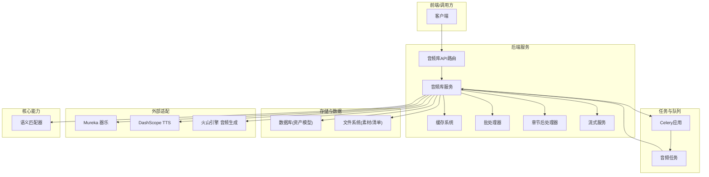
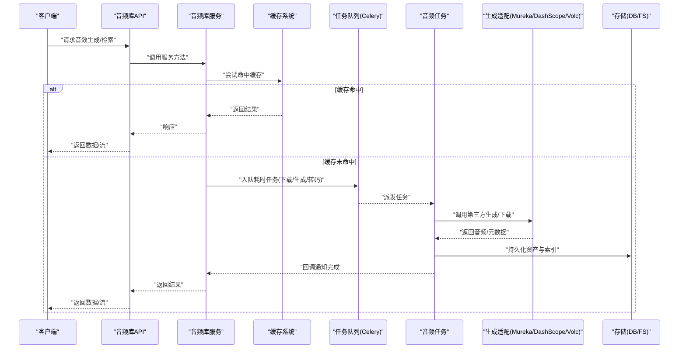
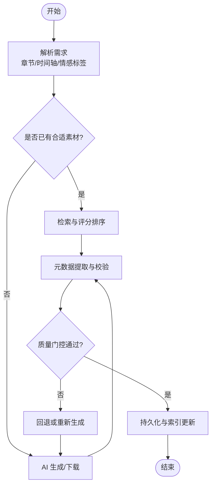
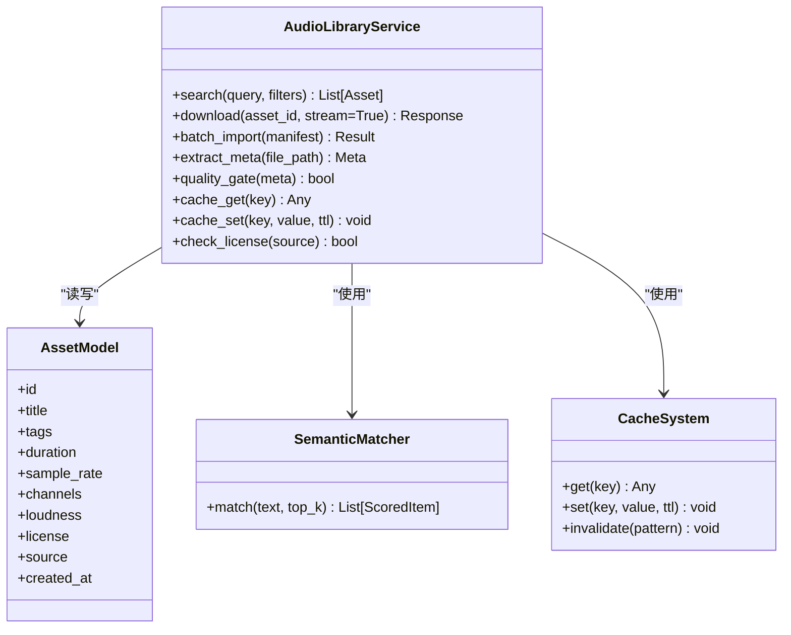
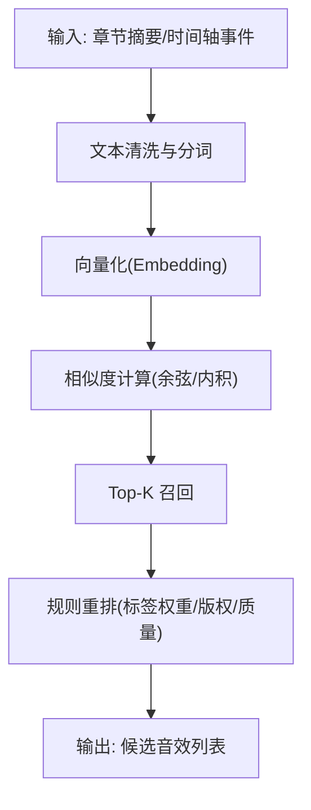
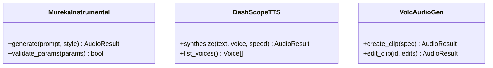
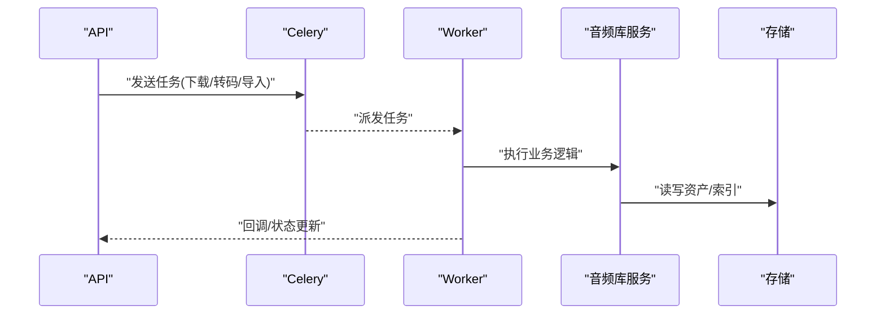
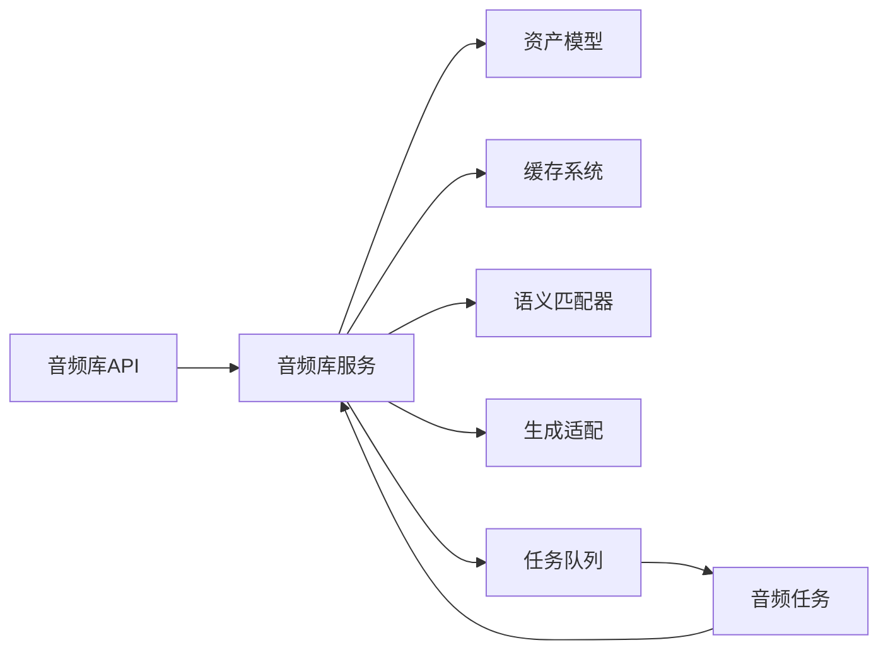

# 音效处理任务

<cite>
**本文引用的文件**   
- [agents/sound_effect_manager.py](file://agents/sound_effect_manager.py)
- [backend/app/services/audiobook/audio_library_service.py](file://backend/app/services/audiobook/audio_library_service.py)
- [backend/app/models/audio_library_asset.py](file://backend/app/models/audio_library_asset.py)
- [backend/app/api/v1/audiobook_api/audio_library_routes.py](file://backend/app/api/v1/audiobook_api/audio_library_routes.py)
- [backend/scripts/normalize_sfx_library_loudness.py](file://backend/scripts/normalize_sfx_library_loudness.py)
- [adapters/mureka/instrumental.py](file://adapters/mureka/instrumental.py)
- [adapters/dashscope/tts.py](file://adapters/dashscope/tts.py)
- [adapters/volcengine/audio_generation.py](file://adapters/volcengine/audio_generation.py)
- [core/semantic_matcher.py](file://core/semantic_matcher.py)
- [backend/app/services/cache_system.py](file://backend/app/services/cache_system.py)
- [backend/app/services/batch_processor.py](file://backend/app/services/batch_processor.py)
- [backend/app/services/chapter_post_processor.py](file://backend/app/services/chapter_post_processor.py)
- [backend/app/services/streaming_service.py](file://backend/app/services/streaming_service.py)
- [backend/app/celery_app.py](file://backend/app/celery_app.py)
- [backend/app/tasks/audiobook_tasks.py](file://backend/app/tasks/audiobook_tasks.py)
- [backend/data/audio_library/sfx_candidates.jsonl](file://backend/data/audio_library/sfx_candidates.jsonl)
- [backend/data/audio_library/sfx_import_manifest_cc0_selected12_20260511.jsonl](file://backend/data/audio_library/sfx_import_manifest_cc0_selected12_20260511.jsonl)
</cite>

## 目录
1. [简介](#简介)
2. [项目结构](#项目结构)
3. [核心组件](#核心组件)
4. [架构总览](#架构总览)
5. [详细组件分析](#详细组件分析)
6. [依赖关系分析](#依赖关系分析)
7. [性能考量](#性能考量)
8. [故障排查指南](#故障排查指南)
9. [结论](#结论)
10. [附录](#附录)

## 简介
本文件面向“音效处理异步任务”的完整技术文档，覆盖以下目标：
- 音效生成（AI 音效与素材库下载）
- 库管理与元数据处理（入库、索引、版权校验）
- 音效匹配算法（语义匹配、场景分析、情感映射）
- 质量控制（响度标准化、格式统一、质量门控）
- 搜索接口与批量处理（API、批处理、缓存策略）
- 与章节内容、时间轴和混音系统的集成
- 库维护与更新机制（增量导入、版本化、清理）
- 性能优化（并发、缓存、流式输出、任务队列）

## 项目结构
围绕音效处理的代码主要分布在如下模块：
- agents：音效管理编排器（sound_effect_manager.py）
- backend/app/services：服务层（音频库服务、缓存、批处理、章节后处理、流式服务）
- backend/app/models：数据模型（音频库资产）
- backend/app/api：对外 API（音频库路由）
- adapters：第三方音频/AI 生成适配（Mureka 器乐、DashScope TTS、火山引擎音频生成）
- core：通用能力（语义匹配器）
- scripts：工具脚本（响度标准化等）
- data/audio_library：候选素材与导入清单
- celery_app + tasks：异步任务编排与执行

图表来源
- [backend/app/api/v1/audiobook_api/audio_library_routes.py](file://backend/app/api/v1/audiobook_api/audio_library_routes.py)
- [backend/app/services/audiobook/audio_library_service.py](file://backend/app/services/audiobook/audio_library_service.py)
- [backend/app/services/cache_system.py](file://backend/app/services/cache_system.py)
- [backend/app/services/batch_processor.py](file://backend/app/services/batch_processor.py)
- [backend/app/services/chapter_post_processor.py](file://backend/app/services/chapter_post_processor.py)
- [backend/app/services/streaming_service.py](file://backend/app/services/streaming_service.py)
- [backend/app/celery_app.py](file://backend/app/celery_app.py)
- [backend/app/tasks/audiobook_tasks.py](file://backend/app/tasks/audiobook_tasks.py)
- [adapters/mureka/instrumental.py](file://adapters/mureka/instrumental.py)
- [adapters/dashscope/tts.py](file://adapters/dashscope/tts.py)
- [adapters/volcengine/audio_generation.py](file://adapters/volcengine/audio_generation.py)
- [core/semantic_matcher.py](file://core/semantic_matcher.py)

章节来源
- [agents/sound_effect_manager.py](file://agents/sound_effect_manager.py)
- [backend/app/services/audiobook/audio_library_service.py](file://backend/app/services/audiobook/audio_library_service.py)
- [backend/app/models/audio_library_asset.py](file://backend/app/models/audio_library_asset.py)
- [backend/app/api/v1/audiobook_api/audio_library_routes.py](file://backend/app/api/v1/audiobook_api/audio_library_routes.py)
- [backend/scripts/normalize_sfx_library_loudness.py](file://backend/scripts/normalize_sfx_library_loudness.py)
- [adapters/mureka/instrumental.py](file://adapters/mureka/instrumental.py)
- [adapters/dashscope/tts.py](file://adapters/dashscope/tts.py)
- [adapters/volcengine/audio_generation.py](file://adapters/volcengine/audio_generation.py)
- [core/semantic_matcher.py](file://core/semantic_matcher.py)
- [backend/app/services/cache_system.py](file://backend/app/services/cache_system.py)
- [backend/app/services/batch_processor.py](file://backend/app/services/batch_processor.py)
- [backend/app/services/chapter_post_processor.py](file://backend/app/services/chapter_post_processor.py)
- [backend/app/services/streaming_service.py](file://backend/app/services/streaming_service.py)
- [backend/app/celery_app.py](file://backend/app/celery_app.py)
- [backend/app/tasks/audiobook_tasks.py](file://backend/app/tasks/audiobook_tasks.py)
- [backend/data/audio_library/sfx_candidates.jsonl](file://backend/data/audio_library/sfx_candidates.jsonl)
- [backend/data/audio_library/sfx_import_manifest_cc0_selected12_20260511.jsonl](file://backend/data/audio_library/sfx_import_manifest_cc0_selected12_20260511.jsonl)

## 核心组件
- 音效管理器（编排器）
  - 职责：协调 AI 生成、素材库检索、元数据处理、质量检查与入库。
  - 关键流程：解析需求 → 选择生成/检索路径 → 元数据提取 → 质量门控 → 持久化与索引。
- 音频库服务（服务层）
  - 职责：提供统一的音效查询、下载、批量导入、元数据更新、版权校验、缓存与流式读取。
- 数据模型（音频库资产）
  - 职责：定义音效资产的字段、约束、索引与关联关系。
- 语义匹配器（核心能力）
  - 职责：基于文本/标签进行语义相似度计算，支撑“场景→音效”的匹配与推荐。
- 第三方适配（生成端）
  - 职责：对接不同厂商的音频/AI 生成能力（器乐、TTS、通用音频）。
- 工具脚本（标准化）
  - 职责：对库内素材进行响度标准化、格式统一等预处理。
- 任务与队列（异步）
  - 职责：将耗时操作（下载、转码、索引构建、批量导入）放入队列，保障吞吐与可恢复性。

章节来源
- [agents/sound_effect_manager.py](file://agents/sound_effect_manager.py)
- [backend/app/services/audiobook/audio_library_service.py](file://backend/app/services/audiobook/audio_library_service.py)
- [backend/app/models/audio_library_asset.py](file://backend/app/models/audio_library_asset.py)
- [core/semantic_matcher.py](file://core/semantic_matcher.py)
- [adapters/mureka/instrumental.py](file://adapters/mureka/instrumental.py)
- [adapters/dashscope/tts.py](file://adapters/dashscope/tts.py)
- [adapters/volcengine/audio_generation.py](file://adapters/volcengine/audio_generation.py)
- [backend/scripts/normalize_sfx_library_loudness.py](file://backend/scripts/normalize_sfx_library_loudness.py)
- [backend/app/celery_app.py](file://backend/app/celery_app.py)
- [backend/app/tasks/audiobook_tasks.py](file://backend/app/tasks/audiobook_tasks.py)

## 架构总览
整体采用“API 路由 → 服务层 → 适配器/工具 → 存储/缓存 → 任务队列”的分层架构。异步任务通过 Celery 调度，保证高吞吐与失败重试；缓存系统加速热点查询；流式服务支持大文件高效传输。

图表来源
- [backend/app/api/v1/audiobook_api/audio_library_routes.py](file://backend/app/api/v1/audiobook_api/audio_library_routes.py)
- [backend/app/services/audiobook/audio_library_service.py](file://backend/app/services/audiobook/audio_library_service.py)
- [backend/app/services/cache_system.py](file://backend/app/services/cache_system.py)
- [backend/app/celery_app.py](file://backend/app/celery_app.py)
- [backend/app/tasks/audiobook_tasks.py](file://backend/app/tasks/audiobook_tasks.py)
- [adapters/mureka/instrumental.py](file://adapters/mureka/instrumental.py)
- [adapters/dashscope/tts.py](file://adapters/dashscope/tts.py)
- [adapters/volcengine/audio_generation.py](file://adapters/volcengine/audio_generation.py)

## 详细组件分析

### 音效管理器（编排器）
- 功能要点
  - 输入：章节上下文、时间轴片段、情感/场景标签、风格偏好。
  - 决策：优先从素材库检索；若不足则触发 AI 生成；必要时混合拼接。
  - 元数据：自动抽取时长、采样率、声道、响度、标签、版权信息。
  - 质量门控：响度阈值、噪声检测、格式合规、重复去重。
  - 输出：标准化音频与元数据，写入库并更新索引。
- 关键交互
  - 与音频库服务交互进行检索与入库。
  - 与语义匹配器协作进行“场景→音效”的相似度排序。
  - 与任务队列协作进行异步生成与转码。

图表来源
- [agents/sound_effect_manager.py](file://agents/sound_effect_manager.py)
- [backend/app/services/audiobook/audio_library_service.py](file://backend/app/services/audiobook/audio_library_service.py)
- [core/semantic_matcher.py](file://core/semantic_matcher.py)
- [backend/app/celery_app.py](file://backend/app/celery_app.py)
- [backend/app/tasks/audiobook_tasks.py](file://backend/app/tasks/audiobook_tasks.py)

章节来源
- [agents/sound_effect_manager.py](file://agents/sound_effect_manager.py)
- [backend/app/services/audiobook/audio_library_service.py](file://backend/app/services/audiobook/audio_library_service.py)
- [core/semantic_matcher.py](file://core/semantic_matcher.py)

### 音频库服务（服务层）
- 功能要点
  - 搜索接口：按关键词、标签、情感、场景、时长范围、音质参数过滤。
  - 下载与流式：支持断点续传、分块流式输出，降低内存占用。
  - 批量处理：批量导入、批量转码、批量元数据更新。
  - 缓存策略：多级缓存（内存/本地/分布式），键设计包含查询指纹与参数哈希。
  - 版权检查：来源白名单、许可证校验、敏感词过滤。
  - 元数据提取：使用 FFmpeg/媒体库获取基础属性，结合 LLM/规则生成增强标签。
- 与章节/时间轴集成
  - 根据章节摘要与时间轴事件，生成“场景描述+情感向量”，驱动语义匹配。
  - 输出带时间戳的音效片段，便于混音系统对齐。

图表来源
- [backend/app/services/audiobook/audio_library_service.py](file://backend/app/services/audiobook/audio_library_service.py)
- [backend/app/models/audio_library_asset.py](file://backend/app/models/audio_library_asset.py)
- [core/semantic_matcher.py](file://core/semantic_matcher.py)
- [backend/app/services/cache_system.py](file://backend/app/services/cache_system.py)

章节来源
- [backend/app/services/audiobook/audio_library_service.py](file://backend/app/services/audiobook/audio_library_service.py)
- [backend/app/models/audio_library_asset.py](file://backend/app/models/audio_library_asset.py)
- [core/semantic_matcher.py](file://core/semantic_matcher.py)
- [backend/app/services/cache_system.py](file://backend/app/services/cache_system.py)

### 数据模型（音频库资产）
- 关键字段
  - 标识与标题、标签（场景/情感/风格）、时长、采样率、声道数、响度、许可证、来源、创建时间。
- 索引与约束
  - 唯一键（用户+资产标识）、标签索引、时间戳索引、许可证白名单约束。
- 扩展性
  - 支持 JSON 扩展字段用于动态标签与元数据。

章节来源
- [backend/app/models/audio_library_asset.py](file://backend/app/models/audio_library_asset.py)

### 语义匹配器（场景分析与情感映射）
- 匹配流程
  - 文本归一化 → 向量化 → 相似度计算 → Top-K 召回 → 重排（规则/权重）。
- 情感映射
  - 将情感维度（紧张/舒缓/悬疑/欢快等）映射为标签权重，影响排序。
- 场景分析
  - 从章节摘要与时间轴事件中提取场景要素（环境/动作/情绪），生成查询向量。

图表来源
- [core/semantic_matcher.py](file://core/semantic_matcher.py)

章节来源
- [core/semantic_matcher.py](file://core/semantic_matcher.py)

### 第三方适配（AI 音效生成）
- Mureka 器乐
  - 用途：生成器乐/氛围音效，适合背景铺底与环境声。
- DashScope TTS
  - 用途：语音类音效（旁白、拟声、角色语气片段）。
- 火山引擎 音频生成
  - 用途：通用音频合成与编辑（如音效变体、混音前处理）。

图表来源
- [adapters/mureka/instrumental.py](file://adapters/mureka/instrumental.py)
- [adapters/dashscope/tts.py](file://adapters/dashscope/tts.py)
- [adapters/volcengine/audio_generation.py](file://adapters/volcengine/audio_generation.py)

章节来源
- [adapters/mureka/instrumental.py](file://adapters/mureka/instrumental.py)
- [adapters/dashscope/tts.py](file://adapters/dashscope/tts.py)
- [adapters/volcengine/audio_generation.py](file://adapters/volcengine/audio_generation.py)

### 工具脚本（响度标准化）
- 目标：统一库内素材响度，避免混音时音量跳变。
- 流程：扫描素材 → 测量响度 → 增益调整 → 导出新文件 → 更新元数据。

章节来源
- [backend/scripts/normalize_sfx_library_loudness.py](file://backend/scripts/normalize_sfx_library_loudness.py)

### 任务与队列（异步处理）
- Celery 应用
  - 配置：并发 worker、重试策略、超时控制、死信队列。
- 音频任务
  - 下载与转码、元数据提取、索引构建、批量导入、质量门控。

图表来源
- [backend/app/celery_app.py](file://backend/app/celery_app.py)
- [backend/app/tasks/audiobook_tasks.py](file://backend/app/tasks/audiobook_tasks.py)
- [backend/app/services/audiobook/audio_library_service.py](file://backend/app/services/audiobook/audio_library_service.py)

章节来源
- [backend/app/celery_app.py](file://backend/app/celery_app.py)
- [backend/app/tasks/audiobook_tasks.py](file://backend/app/tasks/audiobook_tasks.py)

### 搜索接口与批量处理
- 搜索接口
  - 支持多条件过滤（标签、情感、时长、音质、许可证）。
  - 分页与排序（相关性、质量分、更新时间）。
- 批量处理
  - 批量导入清单（JSONL），支持增量更新与冲突解决。
  - 批量转码与标准化，失败项隔离与重试。

章节来源
- [backend/app/api/v1/audiobook_api/audio_library_routes.py](file://backend/app/api/v1/audiobook_api/audio_library_routes.py)
- [backend/app/services/batch_processor.py](file://backend/app/services/batch_processor.py)
- [backend/data/audio_library/sfx_candidates.jsonl](file://backend/data/audio_library/sfx_candidates.jsonl)
- [backend/data/audio_library/sfx_import_manifest_cc0_selected12_20260511.jsonl](file://backend/data/audio_library/sfx_import_manifest_cc0_selected12_20260511.jsonl)

### 缓存策略
- 多级缓存
  - 内存缓存（热点查询）、本地缓存（磁盘）、分布式缓存（Redis）。
- 键设计
  - 查询指纹（关键词、标签、过滤条件）+ 参数哈希。
- 失效策略
  - TTL、主动失效（入库/更新后）、模式失效（批量更新）。

章节来源
- [backend/app/services/cache_system.py](file://backend/app/services/cache_system.py)

### 与章节内容、时间轴和混音系统的集成
- 章节内容
  - 章节摘要与实体抽取，生成场景描述与情感标签。
- 时间轴
  - 以秒级精度标注音效起止时间，支持淡入淡出与交叉淡化。
- 混音系统
  - 输出标准化轨道（采样率、声道、响度一致），便于无缝混音。

章节来源
- [backend/app/services/chapter_post_processor.py](file://backend/app/services/chapter_post_processor.py)
- [backend/app/services/streaming_service.py](file://backend/app/services/streaming_service.py)

## 依赖关系分析
- 组件耦合
  - API 路由仅依赖服务层；服务层依赖模型、缓存、匹配器与适配器；任务层解耦业务逻辑。
- 外部依赖
  - 第三方音频/AI 生成服务（Mureka、DashScope、Volc）；FFmpeg/媒体库（元数据与转码）。
- 潜在循环依赖
  - 通过服务层抽象与接口隔离，避免直接循环引用。

图表来源
- [backend/app/api/v1/audiobook_api/audio_library_routes.py](file://backend/app/api/v1/audiobook_api/audio_library_routes.py)
- [backend/app/services/audiobook/audio_library_service.py](file://backend/app/services/audiobook/audio_library_service.py)
- [backend/app/models/audio_library_asset.py](file://backend/app/models/audio_library_asset.py)
- [backend/app/services/cache_system.py](file://backend/app/services/cache_system.py)
- [core/semantic_matcher.py](file://core/semantic_matcher.py)
- [adapters/mureka/instrumental.py](file://adapters/mureka/instrumental.py)
- [adapters/dashscope/tts.py](file://adapters/dashscope/tts.py)
- [adapters/volcengine/audio_generation.py](file://adapters/volcengine/audio_generation.py)
- [backend/app/celery_app.py](file://backend/app/celery_app.py)
- [backend/app/tasks/audiobook_tasks.py](file://backend/app/tasks/audiobook_tasks.py)

章节来源
- [backend/app/api/v1/audiobook_api/audio_library_routes.py](file://backend/app/api/v1/audiobook_api/audio_library_routes.py)
- [backend/app/services/audiobook/audio_library_service.py](file://backend/app/services/audiobook/audio_library_service.py)
- [backend/app/models/audio_library_asset.py](file://backend/app/models/audio_library_asset.py)
- [backend/app/services/cache_system.py](file://backend/app/services/cache_system.py)
- [core/semantic_matcher.py](file://core/semantic_matcher.py)
- [adapters/mureka/instrumental.py](file://adapters/mureka/instrumental.py)
- [adapters/dashscope/tts.py](file://adapters/dashscope/tts.py)
- [adapters/volcengine/audio_generation.py](file://adapters/volcengine/audio_generation.py)
- [backend/app/celery_app.py](file://backend/app/celery_app.py)
- [backend/app/tasks/audiobook_tasks.py](file://backend/app/tasks/audiobook_tasks.py)

## 性能考量
- 并发与队列
  - 合理设置 worker 并发与任务超时，避免阻塞；失败任务进入死信队列以便人工干预。
- 缓存命中率
  - 优化查询指纹与 TTL，减少重复计算与 IO。
- 流式输出
  - 大文件下载与预览采用分块流式，降低内存峰值。
- 批量处理
  - 分批提交与事务边界控制，提升吞吐与可恢复性。
- 资源隔离
  - 生成任务与查询任务分离，避免相互干扰。

## 故障排查指南
- 常见问题
  - 生成失败：检查第三方适配配置与限流；查看任务日志与重试次数。
  - 元数据缺失：确认 FFmpeg/媒体库可用；检查文件格式与编码。
  - 版权违规：核对来源白名单与许可证字段；拦截非法素材入库。
  - 缓存不一致：手动失效键或重建索引；检查失效策略。
- 定位手段
  - 查看 Celery 任务状态与错误堆栈；审计资产模型的变更历史；监控缓存命中率与延迟。

章节来源
- [backend/app/tasks/audiobook_tasks.py](file://backend/app/tasks/audiobook_tasks.py)
- [backend/app/services/cache_system.py](file://backend/app/services/cache_system.py)
- [backend/app/models/audio_library_asset.py](file://backend/app/models/audio_library_asset.py)

## 结论
本系统通过分层架构与异步任务编排，实现了高效的音效生成、检索与入库流程。借助语义匹配、质量门控与标准化脚本，确保素材的一致性与可用性。配合缓存、流式与批量处理能力，满足大规模生产环境的性能与稳定性要求。未来可进一步引入更精细的情感映射与实时反馈闭环，提升匹配准确率与用户体验。

## 附录
- 术语表
  - 音效：非语音类的声音素材（环境、动作、特效等）。
  - 元数据：描述音频属性的结构化数据（时长、采样率、响度、标签等）。
  - 质量门控：对音频进行阈值与规则校验的流程。
- 参考清单
  - 候选素材与导入清单示例位于 data/audio_library 目录下，可用于批量导入与测试。

章节来源
- [backend/data/audio_library/sfx_candidates.jsonl](file://backend/data/audio_library/sfx_candidates.jsonl)
- [backend/data/audio_library/sfx_import_manifest_cc0_selected12_20260511.jsonl](file://backend/data/audio_library/sfx_import_manifest_cc0_selected12_20260511.jsonl)