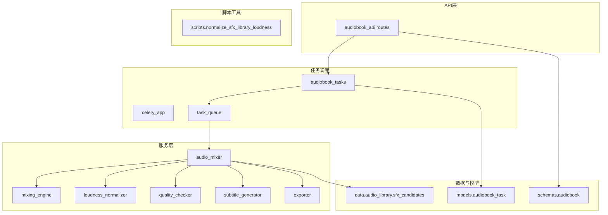
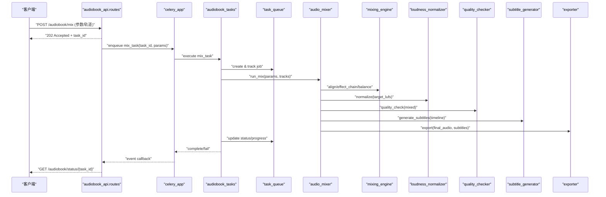
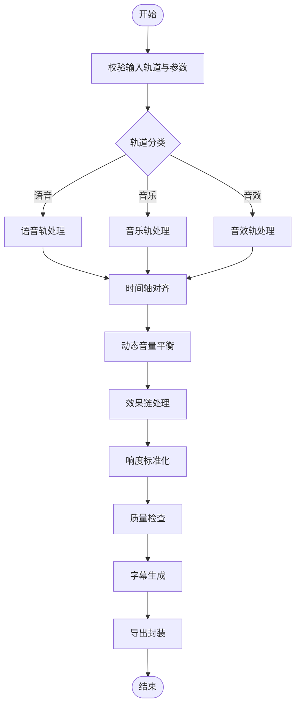
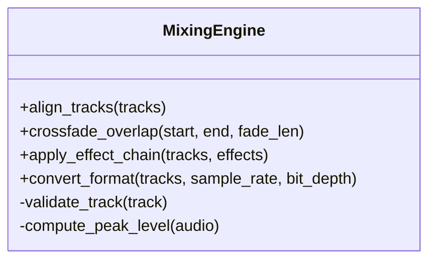
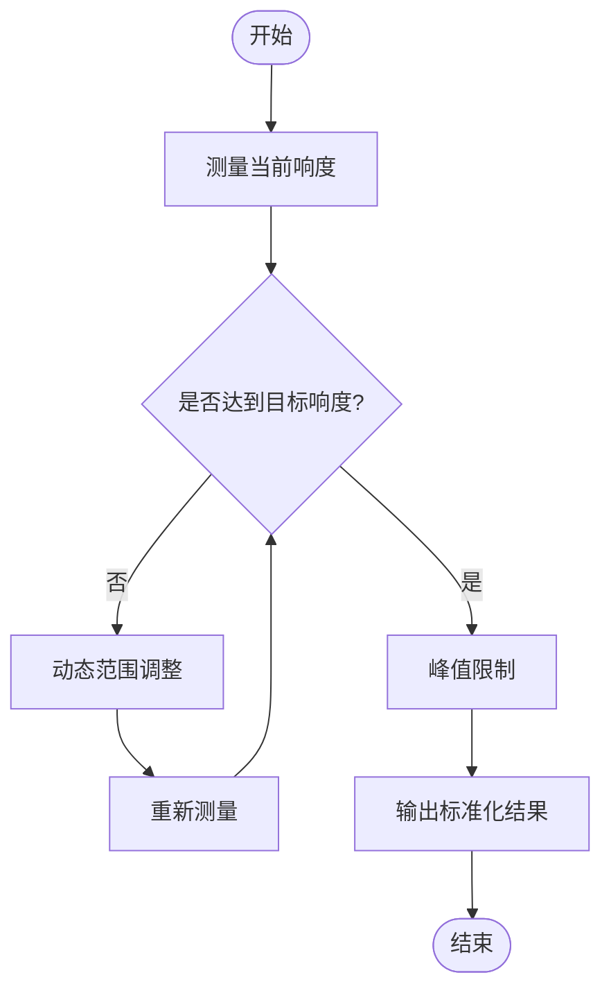
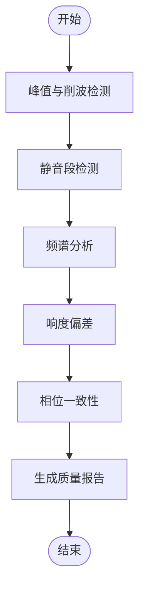
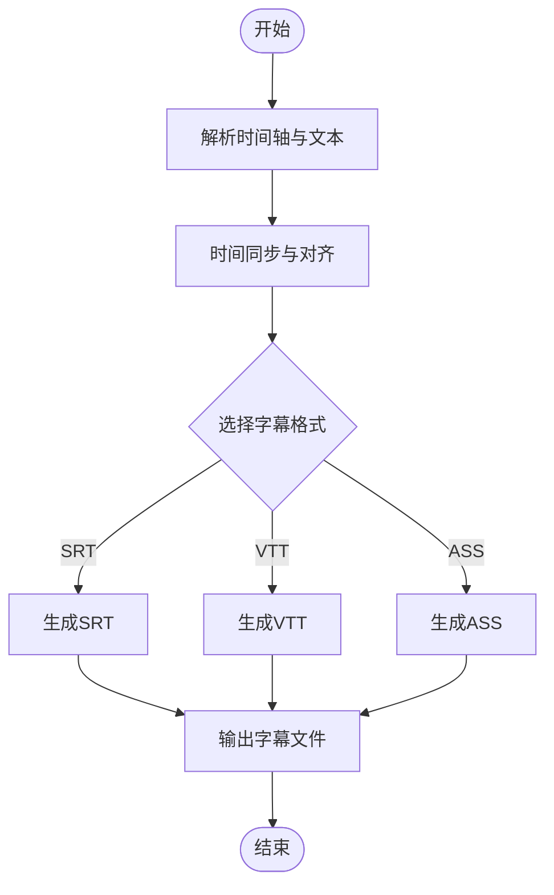
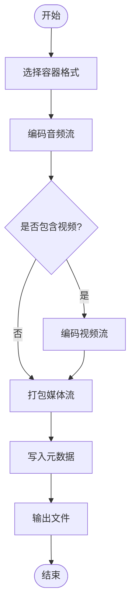
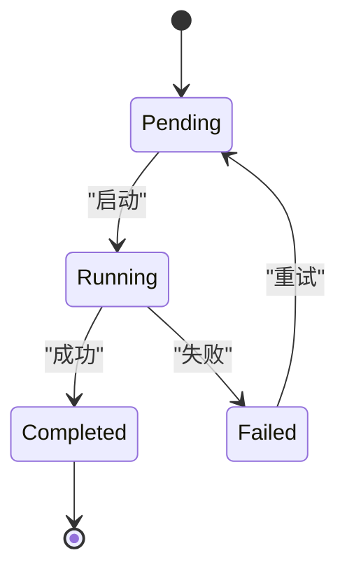
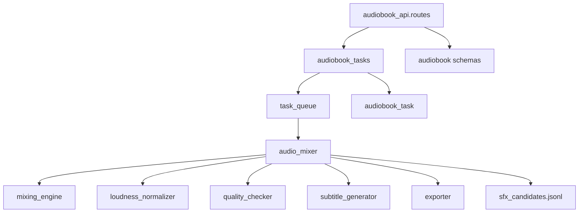

# 音频混音任务

<cite>
**本文档引用的文件**   
- [backend/app/services/audiobook/audio_mixer.py](file://backend/app/services/audiobook/audio_mixer.py)
- [backend/app/services/audiobook/mixing_engine.py](file://backend/app/services/audiobook/mixing_engine.py)
- [backend/app/services/audiobook/loudness_normalizer.py](file://backend/app/services/audiobook/loudness_normalizer.py)
- [backend/app/services/audiobook/subtitle_generator.py](file://backend/app/services/audiobook/subtitle_generator.py)
- [backend/app/services/audiobook/task_queue.py](file://backend/app/services/audiobook/task_queue.py)
- [backend/app/services/audiobook/exporter.py](file://backend/app/services/audiobook/exporter.py)
- [backend/app/services/audiobook/quality_checker.py](file://backend/app/services/audiobook/quality_checker.py)
- [backend/app/schemas/audiobook.py](file://backend/app/schemas/audiobook.py)
- [backend/app/models/audiobook_task.py](file://backend/app/models/audiobook_task.py)
- [backend/app/api/v1/audiobook_api/routes.py](file://backend/app/api/v1/audiobook_api/routes.py)
- [backend/app/celery_app.py](file://backend/app/celery_app.py)
- [backend/app/tasks/audiobook_tasks.py](file://backend/app/tasks/audiobook_tasks.py)
- [backend/scripts/normalize_sfx_library_loudness.py](file://backend/scripts/normalize_sfx_library_loudness.py)
- [backend/data/audio_library/sfx_candidates.jsonl](file://backend/data/audio_library/sfx_candidates.jsonl)
</cite>

## 目录
1. [简介](#简介)
2. [项目结构](#项目结构)
3. [核心组件](#核心组件)
4. [架构总览](#架构总览)
5. [详细组件分析](#详细组件分析)
6. [依赖关系分析](#依赖关系分析)
7. [性能考量](#性能考量)
8. [故障排查指南](#故障排查指南)
9. [结论](#结论)
10. [附录](#附录)

## 简介
本文件面向“音频混音异步任务”的完整实现，覆盖多轨音频混合、音量平衡与效果处理、语音/音乐/音效层次化混音策略与动态调整机制、音频质量检查与响度标准化、格式转换、字幕生成与时间同步、导出流程、参数配置、实时预览与质量评估接口，以及与时间轴编辑、场景渲染和最终输出的数据流转。文档同时给出质量控制、错误恢复与性能优化策略，帮助读者快速理解并扩展系统能力。

## 项目结构
围绕音频混音的核心代码主要位于后端服务层（services）、API路由（api）、任务调度（tasks）与模型/模式定义（models/schemas），以及脚本工具与数据资源。关键目录与职责：
- services/audiobook：混音引擎、响度标准化、字幕生成、质量检查、导出等核心服务
- api/v1/audiobook_api：对外暴露混音任务创建、进度查询、预览与导出接口
- tasks：Celery 异步任务编排，驱动长耗时混音流程
- models/schemas：任务状态、混音参数、输出元数据等数据结构
- scripts：批量处理与库级响度归一化工具
- data/audio_library：音效候选与索引数据

图表来源
- [backend/app/api/v1/audiobook_api/routes.py](file://backend/app/api/v1/audiobook_api/routes.py)
- [backend/app/celery_app.py](file://backend/app/celery_app.py)
- [backend/app/tasks/audiobook_tasks.py](file://backend/app/tasks/audiobook_tasks.py)
- [backend/app/services/audiobook/task_queue.py](file://backend/app/services/audiobook/task_queue.py)
- [backend/app/services/audiobook/audio_mixer.py](file://backend/app/services/audiobook/audio_mixer.py)
- [backend/app/services/audiobook/mixing_engine.py](file://backend/app/services/audiobook/mixing_engine.py)
- [backend/app/services/audiobook/loudness_normalizer.py](file://backend/app/services/audiobook/loudness_normalizer.py)
- [backend/app/services/audiobook/quality_checker.py](file://backend/app/services/audiobook/quality_checker.py)
- [backend/app/services/audiobook/subtitle_generator.py](file://backend/app/services/audiobook/subtitle_generator.py)
- [backend/app/services/audiobook/exporter.py](file://backend/app/services/audiobook/exporter.py)
- [backend/app/schemas/audiobook.py](file://backend/app/schemas/audiobook.py)
- [backend/app/models/audiobook_task.py](file://backend/app/models/audiobook_task.py)
- [backend/data/audio_library/sfx_candidates.jsonl](file://backend/data/audio_library/sfx_candidates.jsonl)
- [backend/scripts/normalize_sfx_library_loudness.py](file://backend/scripts/normalize_sfx_library_loudness.py)

章节来源
- [backend/app/api/v1/audiobook_api/routes.py](file://backend/app/api/v1/audiobook_api/routes.py)
- [backend/app/celery_app.py](file://backend/app/celery_app.py)
- [backend/app/tasks/audiobook_tasks.py](file://backend/app/tasks/audiobook_tasks.py)
- [backend/app/services/audiobook/task_queue.py](file://backend/app/services/audiobook/task_queue.py)
- [backend/app/services/audiobook/audio_mixer.py](file://backend/app/services/audiobook/audio_mixer.py)
- [backend/app/services/audiobook/mixing_engine.py](file://backend/app/services/audiobook/mixing_engine.py)
- [backend/app/services/audiobook/loudness_normalizer.py](file://backend/app/services/audiobook/loudness_normalizer.py)
- [backend/app/services/audiobook/quality_checker.py](file://backend/app/services/audiobook/quality_checker.py)
- [backend/app/services/audiobook/subtitle_generator.py](file://backend/app/services/audiobook/subtitle_generator.py)
- [backend/app/services/audiobook/exporter.py](file://backend/app/services/audiobook/exporter.py)
- [backend/app/schemas/audiobook.py](file://backend/app/schemas/audiobook.py)
- [backend/app/models/audiobook_task.py](file://backend/app/models/audiobook_task.py)
- [backend/data/audio_library/sfx_candidates.jsonl](file://backend/data/audio_library/sfx_candidates.jsonl)
- [backend/scripts/normalize_sfx_library_loudness.py](file://backend/scripts/normalize_sfx_library_loudness.py)

## 核心组件
- 混音器（AudioMixer）：协调多轨输入（语音、音乐、音效），执行分层混音、动态音量平衡与效果链处理，产出中间混音结果与元数据
- 混音引擎（MixingEngine）：底层音频处理管线，负责轨道对齐、交叉淡化、EQ/压缩/混响等效果应用、采样率/位深转换
- 响度标准化（LoudnessNormalizer）：基于目标响度（如 -23 LUFS）进行整体或分轨响度校正，确保一致性
- 质量检查（QualityChecker）：检测削波、静音段、频谱异常、响度偏差、相位问题等，输出质量报告与建议
- 字幕生成（SubtitleGenerator）：根据时间轴与文本片段生成 SRT/VTT/ASS 等格式，支持时间同步与样式映射
- 导出器（Exporter）：将最终混音结果与字幕打包为指定容器与编码（如 MP4/MKV + AAC/Opus），并生成元数据清单
- 任务队列（TaskQueue）：管理异步任务生命周期、重试、优先级与并发控制
- 任务编排（audiobook_tasks）：Celery 任务入口，串联上述服务，更新任务状态与进度
- 模式与模型（schemas/audiobook, models/audiobook_task）：统一描述混音参数、任务状态、输出结构与校验规则

章节来源
- [backend/app/services/audiobook/audio_mixer.py](file://backend/app/services/audiobook/audio_mixer.py)
- [backend/app/services/audiobook/mixing_engine.py](file://backend/app/services/audiobook/mixing_engine.py)
- [backend/app/services/audiobook/loudness_normalizer.py](file://backend/app/services/audiobook/loudness_normalizer.py)
- [backend/app/services/audiobook/quality_checker.py](file://backend/app/services/audiobook/quality_checker.py)
- [backend/app/services/audiobook/subtitle_generator.py](file://backend/app/services/audiobook/subtitle_generator.py)
- [backend/app/services/audiobook/exporter.py](file://backend/app/services/audiobook/exporter.py)
- [backend/app/services/audiobook/task_queue.py](file://backend/app/services/audiobook/task_queue.py)
- [backend/app/tasks/audiobook_tasks.py](file://backend/app/tasks/audiobook_tasks.py)
- [backend/app/schemas/audiobook.py](file://backend/app/schemas/audiobook.py)
- [backend/app/models/audiobook_task.py](file://backend/app/models/audiobook_task.py)

## 架构总览
下图展示从 API 请求到异步任务执行、混音处理、质量检查与导出的端到端流程。

图表来源
- [backend/app/api/v1/audiobook_api/routes.py](file://backend/app/api/v1/audiobook_api/routes.py)
- [backend/app/celery_app.py](file://backend/app/celery_app.py)
- [backend/app/tasks/audiobook_tasks.py](file://backend/app/tasks/audiobook_tasks.py)
- [backend/app/services/audiobook/task_queue.py](file://backend/app/services/audiobook/task_queue.py)
- [backend/app/services/audiobook/audio_mixer.py](file://backend/app/services/audiobook/audio_mixer.py)
- [backend/app/services/audiobook/mixing_engine.py](file://backend/app/services/audiobook/mixing_engine.py)
- [backend/app/services/audiobook/loudness_normalizer.py](file://backend/app/services/audiobook/loudness_normalizer.py)
- [backend/app/services/audiobook/quality_checker.py](file://backend/app/services/audiobook/quality_checker.py)
- [backend/app/services/audiobook/subtitle_generator.py](file://backend/app/services/audiobook/subtitle_generator.py)
- [backend/app/services/audiobook/exporter.py](file://backend/app/services/audiobook/exporter.py)

## 详细组件分析

### 混音器（AudioMixer）
- 职责：接收多轨输入（语音、音乐、音效），按层次策略进行混音；维护动态音量平衡；调用效果链与响度标准化；产出中间产物与质量报告
- 关键流程：
  - 输入校验与轨道分类（语音/音乐/音效）
  - 时间轴对齐与重叠区域处理（交叉淡化、避让）
  - 分层增益分配与动态压缩（语音优先、音乐铺底、音效点缀）
  - 效果链应用（EQ、压缩、混响、降噪）
  - 全局响度标准化与峰值限制
  - 触发质量检查与字幕生成
  - 导出前打包与元数据写入

图表来源
- [backend/app/services/audiobook/audio_mixer.py](file://backend/app/services/audiobook/audio_mixer.py)
- [backend/app/services/audiobook/mixing_engine.py](file://backend/app/services/audiobook/mixing_engine.py)
- [backend/app/services/audiobook/loudness_normalizer.py](file://backend/app/services/audiobook/loudness_normalizer.py)
- [backend/app/services/audiobook/quality_checker.py](file://backend/app/services/audiobook/quality_checker.py)
- [backend/app/services/audiobook/subtitle_generator.py](file://backend/app/services/audiobook/subtitle_generator.py)
- [backend/app/services/audiobook/exporter.py](file://backend/app/services/audiobook/exporter.py)

章节来源
- [backend/app/services/audiobook/audio_mixer.py](file://backend/app/services/audiobook/audio_mixer.py)

### 混音引擎（MixingEngine）
- 职责：提供底层音频处理能力，包括轨道对齐、交叉淡化、采样率/位深转换、效果器链执行
- 关键点：
  - 轨道对齐：基于时间戳与帧级别对齐，处理偏移与长度差异
  - 交叉淡化：在重叠区域平滑过渡，避免瞬态失真
  - 效果链：顺序应用 EQ、压缩、限幅、混响、降噪等模块
  - 格式转换：统一输出采样率与位深，保证兼容性

图表来源
- [backend/app/services/audiobook/mixing_engine.py](file://backend/app/services/audiobook/mixing_engine.py)

章节来源
- [backend/app/services/audiobook/mixing_engine.py](file://backend/app/services/audiobook/mixing_engine.py)

### 响度标准化（LoudnessNormalizer）
- 职责：对混音结果进行响度分析与校正，达到目标响度（如 -23 LUFS），并保持峰值安全
- 关键点：
  - 测量算法：计算瞬时/短期/总体响度
  - 动态范围控制：压缩与限幅协同，避免削波
  - 分段处理：针对长音频分块处理，减少内存占用

图表来源
- [backend/app/services/audiobook/loudness_normalizer.py](file://backend/app/services/audiobook/loudness_normalizer.py)

章节来源
- [backend/app/services/audiobook/loudness_normalizer.py](file://backend/app/services/audiobook/loudness_normalizer.py)

### 质量检查（QualityChecker）
- 职责：对混音结果进行多维度质量评估，输出可操作的质量报告
- 关键点：
  - 削波检测：峰值超过阈值即告警
  - 静音段检测：过长静音影响听感
  - 频谱异常：频带能量分布不合理
  - 响度偏差：与目标响度偏离过大
  - 相位问题：多轨叠加导致相位抵消

图表来源
- [backend/app/services/audiobook/quality_checker.py](file://backend/app/services/audiobook/quality_checker.py)

章节来源
- [backend/app/services/audiobook/quality_checker.py](file://backend/app/services/audiobook/quality_checker.py)

### 字幕生成（SubtitleGenerator）
- 职责：基于时间轴与文本片段生成标准字幕格式（SRT/VTT/ASS），支持时间同步与样式映射
- 关键点：
  - 时间同步：对齐语音/旁白时间戳，处理重叠与间隙
  - 格式导出：支持多种字幕格式与样式标签
  - 语言与编码：UTF-8 编码，多语言支持

图表来源
- [backend/app/services/audiobook/subtitle_generator.py](file://backend/app/services/audiobook/subtitle_generator.py)

章节来源
- [backend/app/services/audiobook/subtitle_generator.py](file://backend/app/services/audiobook/subtitle_generator.py)

### 导出器（Exporter）
- 职责：将最终混音结果与字幕打包为指定容器与编码，生成元数据清单
- 关键点：
  - 容器选择：MP4/MKV 等
  - 编码设置：AAC/Opus 音频，H.264/H.265 视频（若包含画面）
  - 元数据：标题、作者、时长、采样率、响度信息等

图表来源
- [backend/app/services/audiobook/exporter.py](file://backend/app/services/audiobook/exporter.py)

章节来源
- [backend/app/services/audiobook/exporter.py](file://backend/app/services/audiobook/exporter.py)

### 任务队列（TaskQueue）
- 职责：管理异步任务的生命周期、重试、优先级与并发控制
- 关键点：
  - 任务状态机：pending/running/completed/failed
  - 重试策略：指数退避与最大重试次数
  - 并发控制：限制同时运行的混音任务数

图表来源
- [backend/app/services/audiobook/task_queue.py](file://backend/app/services/audiobook/task_queue.py)

章节来源
- [backend/app/services/audiobook/task_queue.py](file://backend/app/services/audiobook/task_queue.py)

### 任务编排（audiobook_tasks）
- 职责：Celery 任务入口，串联混音流程，更新任务状态与进度
- 关键点：
  - 参数校验：使用 schemas 验证输入
  - 进度上报：通过 WebSocket/SSE 推送进度
  - 错误处理：捕获异常并记录诊断信息

章节来源
- [backend/app/tasks/audiobook_tasks.py](file://backend/app/tasks/audiobook_tasks.py)

### 模式与模型（schemas/audiobook, models/audiobook_task）
- 职责：定义混音参数、任务状态、输出结构的统一模式与数据库模型
- 关键点：
  - 混音参数：轨道列表、效果链、响度目标、导出格式
  - 任务状态：ID、状态、进度、错误信息、输出路径
  - 输出元数据：文件大小、时长、采样率、响度指标

章节来源
- [backend/app/schemas/audiobook.py](file://backend/app/schemas/audiobook.py)
- [backend/app/models/audiobook_task.py](file://backend/app/models/audiobook_task.py)

## 依赖关系分析
混音任务涉及多层依赖：API 层依赖任务编排，任务编排依赖服务层，服务层依赖底层引擎与外部数据源。

图表来源
- [backend/app/api/v1/audiobook_api/routes.py](file://backend/app/api/v1/audiobook_api/routes.py)
- [backend/app/tasks/audiobook_tasks.py](file://backend/app/tasks/audiobook_tasks.py)
- [backend/app/services/audiobook/task_queue.py](file://backend/app/services/audiobook/task_queue.py)
- [backend/app/services/audiobook/audio_mixer.py](file://backend/app/services/audiobook/audio_mixer.py)
- [backend/app/services/audiobook/mixing_engine.py](file://backend/app/services/audiobook/mixing_engine.py)
- [backend/app/services/audiobook/loudness_normalizer.py](file://backend/app/services/audiobook/loudness_normalizer.py)
- [backend/app/services/audiobook/quality_checker.py](file://backend/app/services/audiobook/quality_checker.py)
- [backend/app/services/audiobook/subtitle_generator.py](file://backend/app/services/audiobook/subtitle_generator.py)
- [backend/app/services/audiobook/exporter.py](file://backend/app/services/audiobook/exporter.py)
- [backend/data/audio_library/sfx_candidates.jsonl](file://backend/data/audio_library/sfx_candidates.jsonl)
- [backend/app/schemas/audiobook.py](file://backend/app/schemas/audiobook.py)
- [backend/app/models/audiobook_task.py](file://backend/app/models/audiobook_task.py)

章节来源
- [backend/app/api/v1/audiobook_api/routes.py](file://backend/app/api/v1/audiobook_api/routes.py)
- [backend/app/tasks/audiobook_tasks.py](file://backend/app/tasks/audiobook_tasks.py)
- [backend/app/services/audiobook/task_queue.py](file://backend/app/services/audiobook/task_queue.py)
- [backend/app/services/audiobook/audio_mixer.py](file://backend/app/services/audiobook/audio_mixer.py)
- [backend/app/services/audiobook/mixing_engine.py](file://backend/app/services/audiobook/mixing_engine.py)
- [backend/app/services/audiobook/loudness_normalizer.py](file://backend/app/services/audiobook/loudness_normalizer.py)
- [backend/app/services/audiobook/quality_checker.py](file://backend/app/services/audiobook/quality_checker.py)
- [backend/app/services/audiobook/subtitle_generator.py](file://backend/app/services/audiobook/subtitle_generator.py)
- [backend/app/services/audiobook/exporter.py](file://backend/app/services/audiobook/exporter.py)
- [backend/data/audio_library/sfx_candidates.jsonl](file://backend/data/audio_library/sfx_candidates.jsonl)
- [backend/app/schemas/audiobook.py](file://backend/app/schemas/audiobook.py)
- [backend/app/models/audiobook_task.py](file://backend/app/models/audiobook_task.py)

## 性能考量
- 并行处理：多轨独立处理阶段（如效果链）可并行执行，提升吞吐
- 分块处理：长音频分块处理，降低内存峰值
- 缓存策略：重复使用的效果参数与中间结果可缓存
- I/O 优化：使用零拷贝或内存映射读取大文件
- 资源隔离：每个混音任务限制 CPU/内存配额，避免争用
- 预取与预热：常用音效与预设提前加载至内存

[本节为通用指导，不直接分析具体文件]

## 故障排查指南
- 常见问题：
  - 任务卡住：检查队列状态与 Worker 健康
  - 音质劣化：查看质量报告中的削波与频谱异常
  - 字幕不同步：核对时间轴对齐逻辑与帧率
  - 导出失败：确认编码器可用性与磁盘空间
- 诊断步骤：
  - 查看任务日志与错误堆栈
  - 检查中间产物（未标准化的混音、质量报告）
  - 重放原始轨道与效果链参数
  - 使用脚本工具批量检查音效库响度

章节来源
- [backend/scripts/normalize_sfx_library_loudness.py](file://backend/scripts/normalize_sfx_library_loudness.py)
- [backend/data/audio_library/sfx_candidates.jsonl](file://backend/data/audio_library/sfx_candidates.jsonl)

## 结论
本系统通过分层混音策略、动态音量平衡、响度标准化与全面质量检查，实现了高质量的音频混音异步任务。结合字幕生成与导出功能，满足多格式输出需求。任务队列与 Celery 编排保障了高并发与可靠性。建议在生产环境中加强监控与告警，持续优化性能与稳定性。

[本节为总结性内容，不直接分析具体文件]

## 附录
- 混音参数配置示例：轨道列表、效果链、响度目标、导出格式
- 实时预览接口：返回中间混音片段与质量指标
- 质量评估接口：返回详细质量报告与建议调整
- 与时间轴编辑集成：支持拖拽调整轨道时间与强度
- 场景渲染对接：混音结果与场景元数据关联
- 最终输出规范：容器、编码、元数据字段定义

[本节为补充信息，不直接分析具体文件]