# 任务调度与队列管理

<cite>
**本文引用的文件**   
- [backend/app/celery_app.py](file://backend/app/celery_app.py)
- [backend/app/tasks/dreamweaver_tasks.py](file://backend/app/tasks/dreamweaver_tasks.py)
- [backend/app/tasks/audiobook_tasks.py](file://backend/app/tasks/audiobook_tasks.py)
- [backend/app/api/v1/dreamweaver_api/dreamweaver_routes.py](file://backend/app/api/v1/dreamweaver_api/dreamweaver_routes.py)
- [backend/app/services/dreamweaver/dreamweaver_service.py](file://backend/app/services/dreamweaver/dreamweaver_service.py)
- [backend/app/models/dreamweaver.py](file://backend/app/models/dreamweaver.py)
- [backend/app/schemas/dreamweaver_contract.py](file://backend/app/schemas/dreamweaver_contract.py)
- [backend/app/core/config.py](file://backend/app/core/config.py)
- [backend/app/utils/api_errors.py](file://backend/app/utils/api_errors.py)
- [backend/app/websocket/manager.py](file://backend/app/websocket/manager.py)
- [backend/app/services/monitoring/monitoring_service.py](file://backend/app/services/monitoring/monitoring_service.py)
- [backend/app/api/v1/monitoring.py](file://backend/app/api/v1/monitoring.py)
- [backend/app/services/batch_processor.py](file://backend/app/services/batch_processor.py)
- [backend/app/services/cache_system.py](file://backend/app/services/cache_system.py)
- [backend/app/services/streaming_service.py](file://backend/app/services/streaming_service.py)
- [backend/app/services/user_center_task_billing.py](file://backend/app/services/user_center_task_billing.py)
- [backend/app/services/generation_lock.py](file://backend/app/services/generation_lock.py)
- [backend/app/services/rate_limit_handler.py](file://backend/app/services/rate_limit_handler.py)
- [backend/app/services/ai_trace_storage.py](file://backend/app/services/ai_trace_storage.py)
- [backend/app/services/agent_coordinator.py](file://backend/app/services/agent_coordinator.py)
- [backend/app/services/workflow_context_builder.py](file://backend/app/services/workflow_context_builder.py)
- [backend/app/services/prompt_evolution/strategy_manager.py](file://backend/app/services/prompt_evolution/strategy_manager.py)
- [backend/app/services/prompt_evolution/sample_manager.py](file://backend/app/services/prompt_evolution/sample_manager.py)
- [backend/app/services/prompt_evolution/experiment_manager.py](file://backend/app/services/prompt_evolution/experiment_manager.py)
- [backend/app/services/prompt_evolution/evolution_scheduler.py](file://backend/app/services/prompt_evolution/evolution_scheduler.py)
- [backend/app/services/prompt_evolution/quality_gate.py](file://backend/app/services/prompt_evolution/quality门禁.py)
- [backend/app/services/prompt_evolution/champion_promotion.py](file://backend/app/services/prompt_evolution/champion_promotion.py)
- [backend/app/services/prompt_evolution/shadow_executor.py](file://backend/app/services/prompt_evolution/shadow_executor.py)
- [backend/app/services/prompt_evolution/shadow_dispatch.py](file://backend/app/services/prompt_evolution/shadow_dispatch.py)
- [backend/app/services/prompt_evolution/test_unit.py](file://backend/app/services/prompt_evolution/test_unit.py)
- [backend/app/services/prompt_evolution/trace_contexts.py](file://backend/app/services/prompt_evolution/trace_contexts.py)
- [backend/app/services/prompt_evolution/billing_support.py](file://backend/app/services/prompt_evolution/billing_support.py)
- [backend/app/services/prompt_evolution/routes.py](file://backend/app/services/prompt_evolution/routes.py)
- [backend/app/services/prompt_evolution/__init__.py](file://backend/app/services/prompt_evolution/__init__.py)
- [backend/app/services/prompt_evolution/evolution_scheduler.py](file://backend/app/services/prompt_evolution/evolution_scheduler.py)
- [backend/app/services/prompt_evolution/quality_gate.py](file://backend/app/services/prompt_evolution/quality_gate.py)
- [backend/app/services/prompt_evolution/champion_promotion.py](file://backend/app/services/prompt_evolution/champion_promotion.py)
- [backend/app/services/prompt_evolution/shadow_executor.py](file://backend/app/services/prompt_evolution/shadow_executor.py)
- [backend/app/services/prompt_evolution/shadow_dispatch.py](file://backend/app/services/prompt_evolution/shadow_dispatch.py)
- [backend/app/services/prompt_evolution/test_unit.py](file://backend/app/services/prompt_evolution/test_unit.py)
- [backend/app/services/prompt_evolution/trace_contexts.py](file://backend/app/services/prompt_evolution/trace_contexts.py)
- [backend/app/services/prompt_evolution/billing_support.py](file://backend/app/services/prompt_evolution/billing_support.py)
- [backend/app/services/prompt_evolution/routes.py](file://backend/app/services/prompt_evolution/routes.py)
- [backend/app/services/prompt_evolution/__init__.py](file://backend/app/services/prompt_evolution/__init__.py)
</cite>

## 目录
1. [简介](#简介)
2. [项目结构](#项目结构)
3. [核心组件](#核心组件)
4. [架构总览](#架构总览)
5. [详细组件分析](#详细组件分析)
6. [依赖关系分析](#依赖关系分析)
7. [性能考量](#性能考量)
8. [故障排查指南](#故障排查指南)
9. [结论](#结论)
10. [附录](#附录)

## 简介
本文件为“梦境编织者”任务调度系统的技术文档，聚焦于Celery任务队列配置、任务优先级与并发控制、任务生命周期与状态跟踪、持久化存储、重试策略、超时处理、失败补偿、监控仪表板、日志收集与性能分析工具，以及扩展接口、自定义处理器开发与调试方法。读者可据此快速理解系统如何编排高并发的视频生成任务，并在生产环境中稳定运行。

## 项目结构
- 应用入口与Celery初始化位于后端应用层，负责加载配置、注册任务、暴露API路由。
- 任务定义集中在tasks包中，按业务域拆分（如dreamweaver、audiobook等）。
- API层提供REST接口用于提交任务、查询状态、触发重试或取消。
- 服务层封装业务逻辑，包括上下文构建、计费、限流、锁机制、缓存、流式输出等。
- 模型与Schema定义数据库表结构与请求/响应契约。
- WebSocket管理器用于实时推送任务进度与事件。
- 监控与追踪服务提供指标采集、链路追踪与审计。

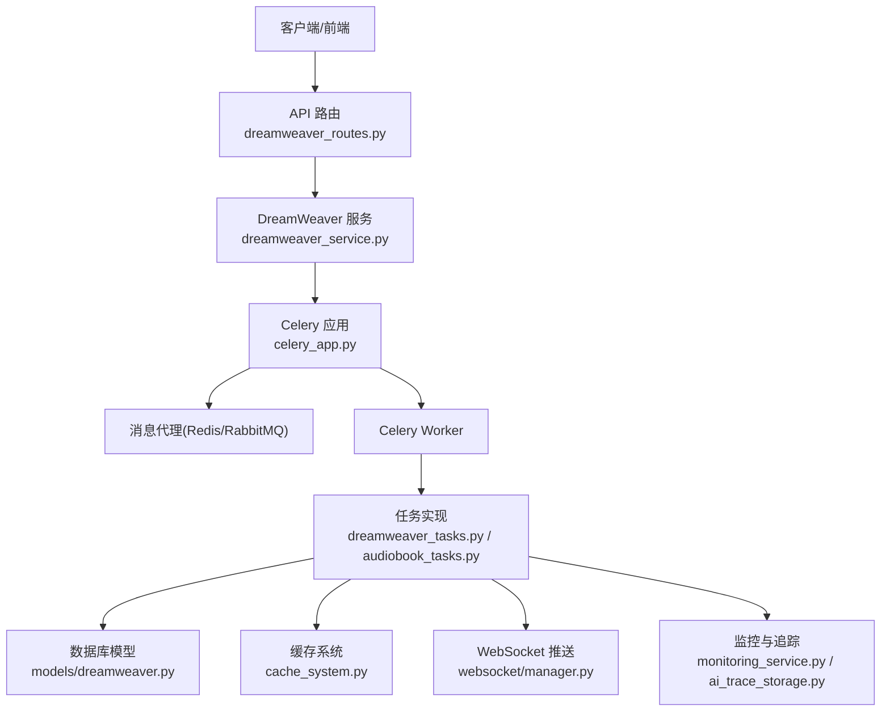

图表来源
- [backend/app/celery_app.py](file://backend/app/celery_app.py)
- [backend/app/tasks/dreamweaver_tasks.py](file://backend/app/tasks/dreamweaver_tasks.py)
- [backend/app/tasks/audiobook_tasks.py](file://backend/app/tasks/audiobook_tasks.py)
- [backend/app/api/v1/dreamweaver_api/dreamweaver_routes.py](file://backend/app/api/v1/dreamweaver_api/dreamweaver_routes.py)
- [backend/app/services/dreamweaver/dreamweaver_service.py](file://backend/app/services/dreamweaver/dreamweaver_service.py)
- [backend/app/models/dreamweaver.py](file://backend/app/models/dreamweaver.py)
- [backend/app/websocket/manager.py](file://backend/app/websocket/manager.py)
- [backend/app/services/monitoring/monitoring_service.py](file://backend/app/services/monitoring/monitoring_service.py)
- [backend/app/services/ai_trace_storage.py](file://backend/app/services/ai_trace_storage.py)

章节来源
- [backend/app/celery_app.py](file://backend/app/celery_app.py)
- [backend/app/api/v1/dreamweaver_api/dreamweaver_routes.py](file://backend/app/api/v1/dreamweaver_api/dreamweaver_routes.py)
- [backend/app/services/dreamweaver/dreamweaver_service.py](file://backend/app/services/dreamweaver/dreamweaver_service.py)

## 核心组件
- Celery应用与配置：集中管理Broker、结果后端、序列化、并发参数、任务路由与优先级队列。
- 任务定义与执行器：按业务域划分任务，包含输入校验、资源准备、调用外部适配器、结果落库与事件推送。
- API路由与契约：统一请求/响应结构，参数校验，错误码与异常映射。
- 服务层能力：上下文构建、计费、限流、分布式锁、缓存、流式输出、监控与追踪。
- 数据模型与迁移：任务状态、事件、实验与样本的持久化。
- WebSocket与SSE：实时进度与事件推送。
- 监控与追踪：指标采集、链路ID、审计日志。

章节来源
- [backend/app/celery_app.py](file://backend/app/celery_app.py)
- [backend/app/tasks/dreamweaver_tasks.py](file://backend/app/tasks/dreamweaver_tasks.py)
- [backend/app/tasks/audiobook_tasks.py](file://backend/app/tasks/audiobook_tasks.py)
- [backend/app/api/v1/dreamweaver_api/dreamweaver_routes.py](file://backend/app/api/v1/dreamweaver_api/dreamweaver_routes.py)
- [backend/app/services/dreamweaver/dreamweaver_service.py](file://backend/app/services/dreamweaver/dreamweaver_service.py)
- [backend/app/models/dreamweaver.py](file://backend/app/models/dreamweaver.py)
- [backend/app/schemas/dreamweaver_contract.py](file://backend/app/schemas/dreamweaver_contract.py)
- [backend/app/websocket/manager.py](file://backend/app/websocket/manager.py)
- [backend/app/services/monitoring/monitoring_service.py](file://backend/app/services/monitoring/monitoring_service.py)
- [backend/app/services/ai_trace_storage.py](file://backend/app/services/ai_trace_storage.py)

## 架构总览
下图展示从API到任务执行、状态更新与监控的全链路流程。

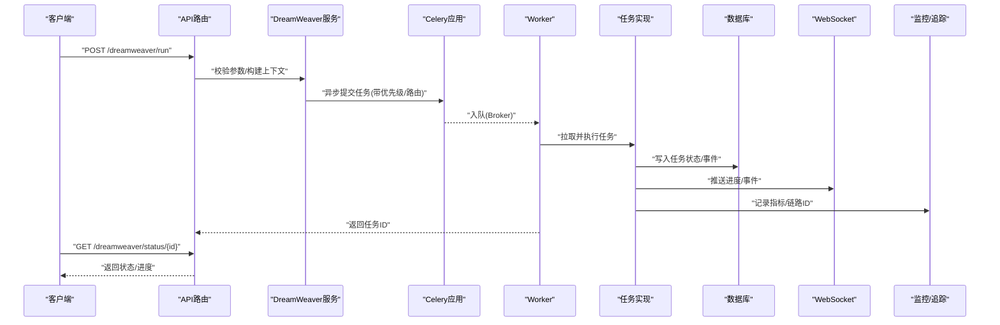

图表来源
- [backend/app/api/v1/dreamweaver_api/dreamweaver_routes.py](file://backend/app/api/v1/dreamweaver_api/dreamweaver_routes.py)
- [backend/app/services/dreamweaver/dreamweaver_service.py](file://backend/app/services/dreamweaver/dreamweaver_service.py)
- [backend/app/celery_app.py](file://backend/app/celery_app.py)
- [backend/app/tasks/dreamweaver_tasks.py](file://backend/app/tasks/dreamweaver_tasks.py)
- [backend/app/models/dreamweaver.py](file://backend/app/models/dreamweaver.py)
- [backend/app/websocket/manager.py](file://backend/app/websocket/manager.py)
- [backend/app/services/monitoring/monitoring_service.py](file://backend/app/services/monitoring/monitoring_service.py)

## 详细组件分析

### Celery应用与队列配置
- 配置项涵盖Broker URL、结果后端、序列化格式、并发数、任务路由键、队列名与优先级。
- 支持多队列与优先级队列，确保关键任务优先执行。
- 通过环境变量与配置文件注入运行时参数，便于不同环境部署。

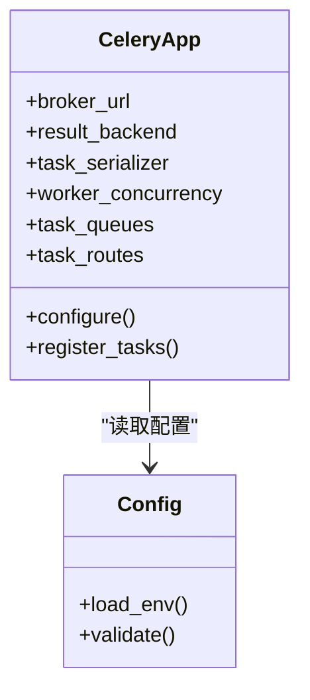

图表来源
- [backend/app/celery_app.py](file://backend/app/celery_app.py)
- [backend/app/core/config.py](file://backend/app/core/config.py)

章节来源
- [backend/app/celery_app.py](file://backend/app/celery_app.py)
- [backend/app/core/config.py](file://backend/app/core/config.py)

### 任务定义与执行器（DreamWeaver）
- 任务函数接收标准化参数，进行输入校验、资源准备、调用媒体适配器、结果持久化与事件推送。
- 支持重试策略（指数退避）、超时控制、失败补偿（回滚或降级）。
- 使用分布式锁避免重复执行相同任务。

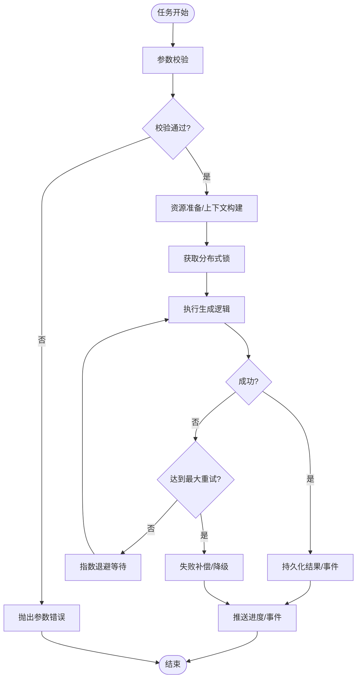

图表来源
- [backend/app/tasks/dreamweaver_tasks.py](file://backend/app/tasks/dreamweaver_tasks.py)
- [backend/app/services/generation_lock.py](file://backend/app/services/generation_lock.py)
- [backend/app/services/rate_limit_handler.py](file://backend/app/services/rate_limit_handler.py)

章节来源
- [backend/app/tasks/dreamweaver_tasks.py](file://backend/app/tasks/dreamweaver_tasks.py)
- [backend/app/services/generation_lock.py](file://backend/app/services/generation_lock.py)
- [backend/app/services/rate_limit_handler.py](file://backend/app/services/rate_limit_handler.py)

### 任务生命周期与状态跟踪
- 状态机覆盖：待处理、进行中、成功、失败、重试中、已取消。
- 每个状态变更均持久化至数据库，并触发WebSocket事件推送。
- 支持查询历史事件与审计日志。

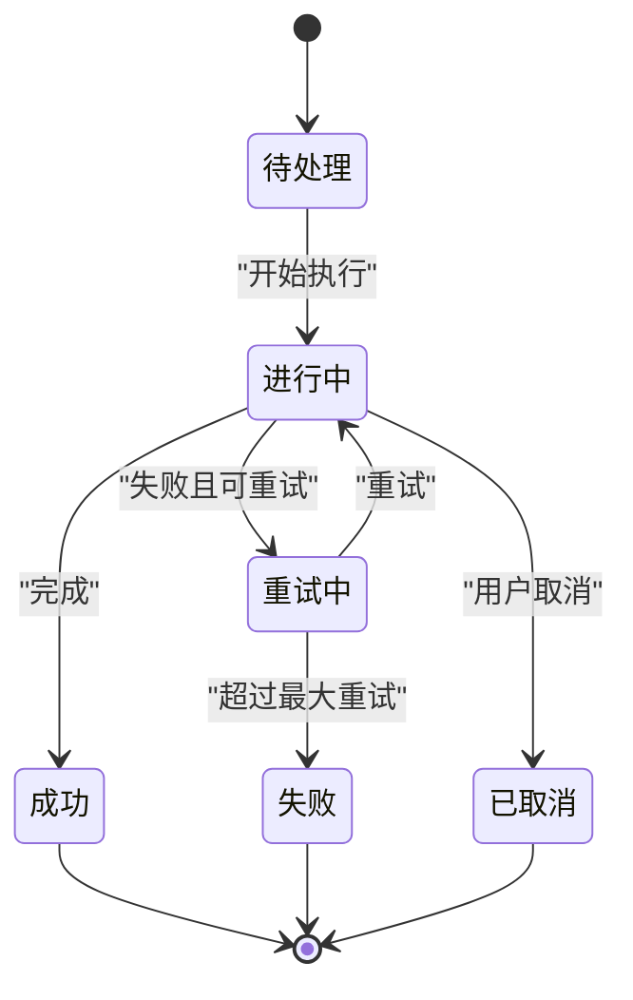

图表来源
- [backend/app/models/dreamweaver.py](file://backend/app/models/dreamweaver.py)
- [backend/app/websocket/manager.py](file://backend/app/websocket/manager.py)

章节来源
- [backend/app/models/dreamweaver.py](file://backend/app/models/dreamweaver.py)
- [backend/app/websocket/manager.py](file://backend/app/websocket/manager.py)

### 持久化存储与数据模型
- 任务主表记录任务ID、类型、状态、优先级、创建时间、更新时间、结果路径等。
- 事件表记录每次状态变更、错误信息、重试次数、耗时等。
- 支持索引优化查询性能，便于监控与审计。

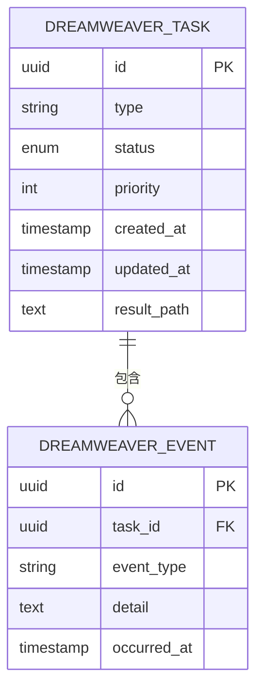

图表来源
- [backend/app/models/dreamweaver.py](file://backend/app/models/dreamweaver.py)

章节来源
- [backend/app/models/dreamweaver.py](file://backend/app/models/dreamweaver.py)

### 重试策略、超时处理与失败补偿
- 重试策略：指数退避、最大重试次数、抖动随机化。
- 超时处理：任务级与步骤级超时，防止长时间阻塞。
- 失败补偿：回滚中间结果、降级到备用模型或缓存结果、通知告警。

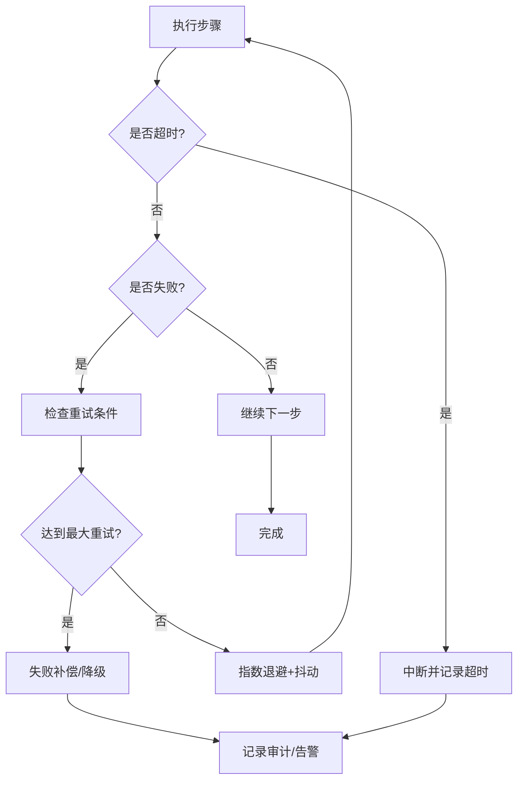

图表来源
- [backend/app/tasks/dreamweaver_tasks.py](file://backend/app/tasks/dreamweaver_tasks.py)
- [backend/app/services/rate_limit_handler.py](file://backend/app/services/rate_limit_handler.py)

章节来源
- [backend/app/tasks/dreamweaver_tasks.py](file://backend/app/tasks/dreamweaver_tasks.py)
- [backend/app/services/rate_limit_handler.py](file://backend/app/services/rate_limit_handler.py)

### 并发控制与优先级管理
- 并发控制：基于Celery worker进程/线程数限制，结合分布式锁避免竞争。
- 优先级管理：通过队列与任务路由键区分高/中/低优先级，关键任务优先。
- 限流：对上游API调用进行速率限制，防止过载。

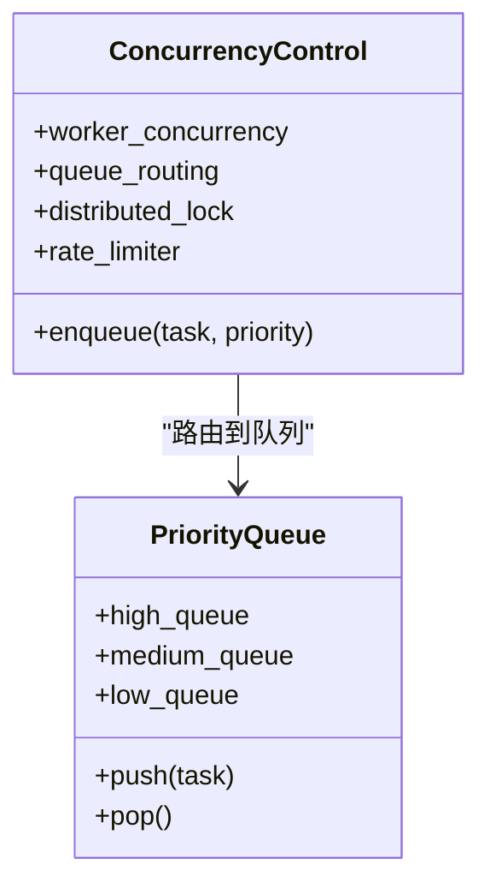

图表来源
- [backend/app/celery_app.py](file://backend/app/celery_app.py)
- [backend/app/services/generation_lock.py](file://backend/app/services/generation_lock.py)
- [backend/app/services/rate_limit_handler.py](file://backend/app/services/rate_limit_handler.py)

章节来源
- [backend/app/celery_app.py](file://backend/app/celery_app.py)
- [backend/app/services/generation_lock.py](file://backend/app/services/generation_lock.py)
- [backend/app/services/rate_limit_handler.py](file://backend/app/services/rate_limit_handler.py)

### 监控仪表板、日志收集与性能分析
- 监控服务采集任务成功率、延迟、吞吐、错误率等指标。
- 日志收集结构化输出，包含链路ID、任务ID、阶段耗时。
- 性能分析工具定位瓶颈（CPU、IO、外部API）。

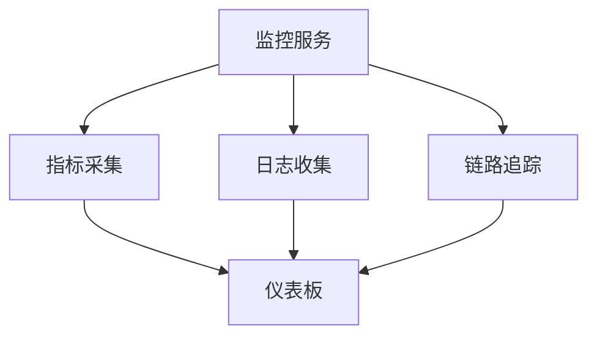

图表来源
- [backend/app/services/monitoring/monitoring_service.py](file://backend/app/services/monitoring/monitoring_service.py)
- [backend/app/api/v1/monitoring.py](file://backend/app/api/v1/monitoring.py)
- [backend/app/services/ai_trace_storage.py](file://backend/app/services/ai_trace_storage.py)

章节来源
- [backend/app/services/monitoring/monitoring_service.py](file://backend/app/services/monitoring/monitoring_service.py)
- [backend/app/api/v1/monitoring.py](file://backend/app/api/v1/monitoring.py)
- [backend/app/services/ai_trace_storage.py](file://backend/app/services/ai_trace_storage.py)

### 扩展接口与自定义处理器开发
- 任务扩展：通过注册新任务函数与路由键，接入现有队列与监控。
- 处理器开发：遵循统一接口，实现输入校验、执行逻辑、结果持久化与事件推送。
- 调试方法：本地模拟Broker与Worker，断点调试任务执行路径。

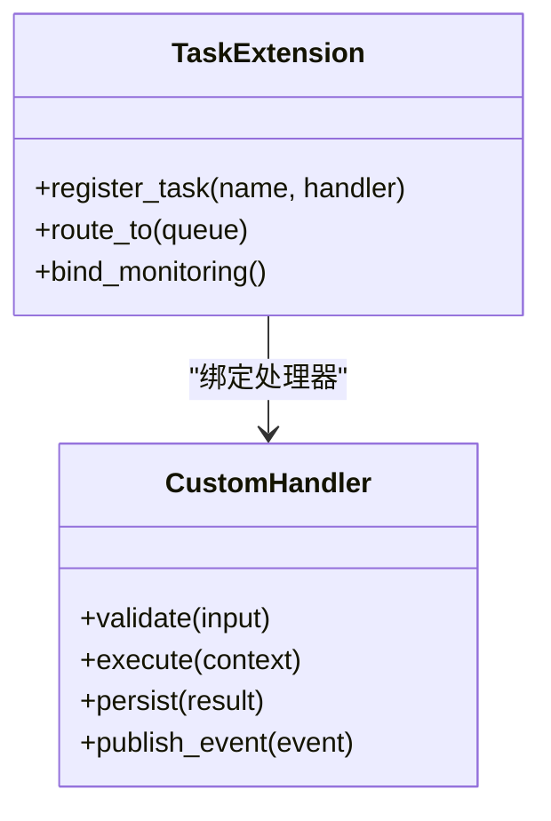

图表来源
- [backend/app/celery_app.py](file://backend/app/celery_app.py)
- [backend/app/tasks/dreamweaver_tasks.py](file://backend/app/tasks/dreamweaver_tasks.py)

章节来源
- [backend/app/celery_app.py](file://backend/app/celery_app.py)
- [backend/app/tasks/dreamweaver_tasks.py](file://backend/app/tasks/dreamweaver_tasks.py)

### 工作流上下文构建与批处理
- 上下文构建：聚合项目、角色、脚本、资产等信息，供任务执行使用。
- 批处理：批量任务提交与结果聚合，提升吞吐。
- 缓存系统：热点数据缓存，减少重复计算。

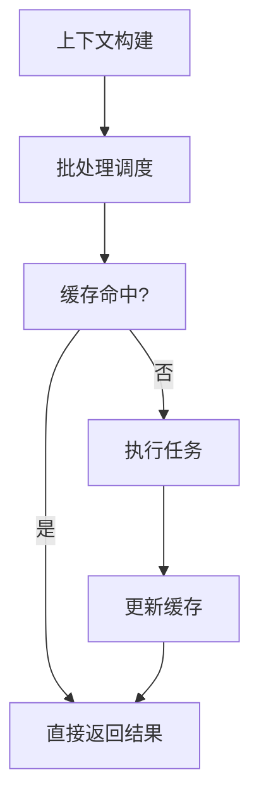

图表来源
- [backend/app/services/workflow_context_builder.py](file://backend/app/services/workflow_context_builder.py)
- [backend/app/services/batch_processor.py](file://backend/app/services/batch_processor.py)
- [backend/app/services/cache_system.py](file://backend/app/services/cache_system.py)

章节来源
- [backend/app/services/workflow_context_builder.py](file://backend/app/services/workflow_context_builder.py)
- [backend/app/services/batch_processor.py](file://backend/app/services/batch_processor.py)
- [backend/app/services/cache_system.py](file://backend/app/services/cache_system.py)

### 提示词演化与实验调度（可选扩展）
- 实验管理：创建实验、分配样本、评估质量、晋升冠军。
- 影子执行：并行运行新旧策略，对比效果。
- 调度器：定时触发实验与评估任务。

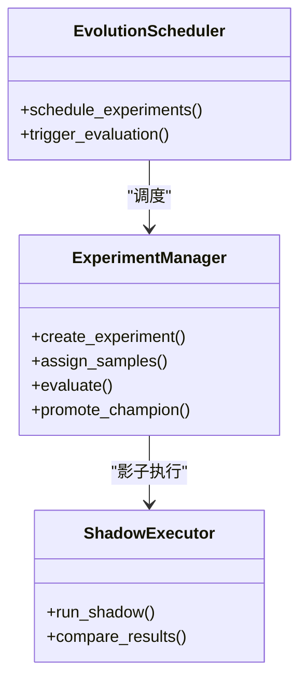

图表来源
- [backend/app/services/prompt_evolution/experiment_manager.py](file://backend/app/services/prompt_evolution/experiment_manager.py)
- [backend/app/services/prompt_evolution/shadow_executor.py](file://backend/app/services/prompt_evolution/shadow_executor.py)
- [backend/app/services/prompt_evolution/evolution_scheduler.py](file://backend/app/services/prompt_evolution/evolution_scheduler.py)

章节来源
- [backend/app/services/prompt_evolution/experiment_manager.py](file://backend/app/services/prompt_evolution/experiment_manager.py)
- [backend/app/services/prompt_evolution/shadow_executor.py](file://backend/app/services/prompt_evolution/shadow_executor.py)
- [backend/app/services/prompt_evolution/evolution_scheduler.py](file://backend/app/services/prompt_evolution/evolution_scheduler.py)

## 依赖关系分析
- API层依赖服务层，服务层依赖Celery应用与任务实现。
- 任务实现依赖数据模型、缓存、WebSocket、监控与追踪。
- 监控与追踪贯穿全链路，提供可观测性。

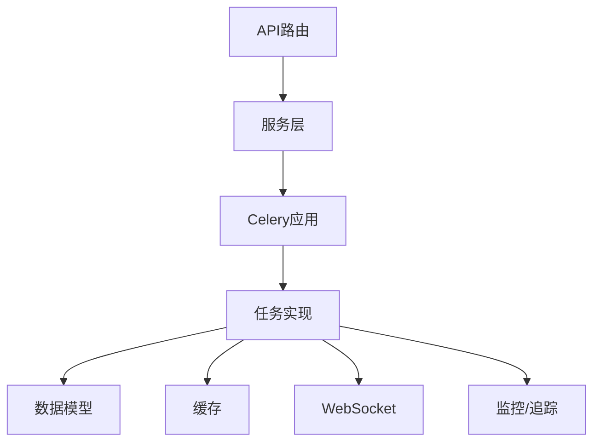

图表来源
- [backend/app/api/v1/dreamweaver_api/dreamweaver_routes.py](file://backend/app/api/v1/dreamweaver_api/dreamweaver_routes.py)
- [backend/app/services/dreamweaver/dreamweaver_service.py](file://backend/app/services/dreamweaver/dreamweaver_service.py)
- [backend/app/celery_app.py](file://backend/app/celery_app.py)
- [backend/app/tasks/dreamweaver_tasks.py](file://backend/app/tasks/dreamweaver_tasks.py)
- [backend/app/models/dreamweaver.py](file://backend/app/models/dreamweaver.py)
- [backend/app/websocket/manager.py](file://backend/app/websocket/manager.py)
- [backend/app/services/monitoring/monitoring_service.py](file://backend/app/services/monitoring/monitoring_service.py)

章节来源
- [backend/app/api/v1/dreamweaver_api/dreamweaver_routes.py](file://backend/app/api/v1/dreamweaver_api/dreamweaver_routes.py)
- [backend/app/services/dreamweaver/dreamweaver_service.py](file://backend/app/services/dreamweaver/dreamweaver_service.py)
- [backend/app/celery_app.py](file://backend/app/celery_app.py)
- [backend/app/tasks/dreamweaver_tasks.py](file://backend/app/tasks/dreamweaver_tasks.py)
- [backend/app/models/dreamweaver.py](file://backend/app/models/dreamweaver.py)
- [backend/app/websocket/manager.py](file://backend/app/websocket/manager.py)
- [backend/app/services/monitoring/monitoring_service.py](file://backend/app/services/monitoring/monitoring_service.py)

## 性能考量
- 合理设置worker并发与队列数量，避免资源争用。
- 使用缓存与批处理降低重复计算与IO开销。
- 引入限流与熔断保护上游服务。
- 监控关键指标（延迟、吞吐、错误率）并动态调优。

[本节为通用指导，不直接分析具体文件]

## 故障排查指南
- 常见问题：任务堆积、超时失败、重试风暴、锁冲突。
- 排查步骤：查看任务状态与事件、检查日志与链路ID、验证配置与资源。
- 恢复策略：清理死信队列、重置锁、调整重试策略与超时。

章节来源
- [backend/app/utils/api_errors.py](file://backend/app/utils/api_errors.py)
- [backend/app/websocket/manager.py](file://backend/app/websocket/manager.py)
- [backend/app/services/monitoring/monitoring_service.py](file://backend/app/services/monitoring/monitoring_service.py)

## 结论
本系统通过Celery实现高可靠的任务队列与调度，结合优先级、并发控制、重试与超时、失败补偿、监控与追踪，支撑梦境编织者在复杂媒体生成场景下的稳定运行。开发者可通过扩展接口与自定义处理器快速集成新能力，并通过完善的调试与监控手段保障生产稳定性。

[本节为总结，不直接分析具体文件]

## 附录
- 环境变量与配置项说明（Broker、结果后端、并发、队列、优先级等）。
- API契约与错误码参考。
- 调试清单与最佳实践。

[本节为补充信息，不直接分析具体文件]