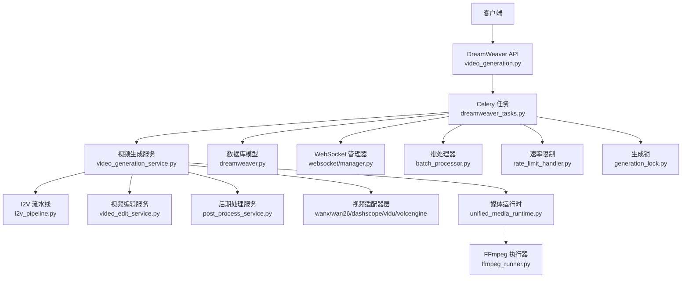
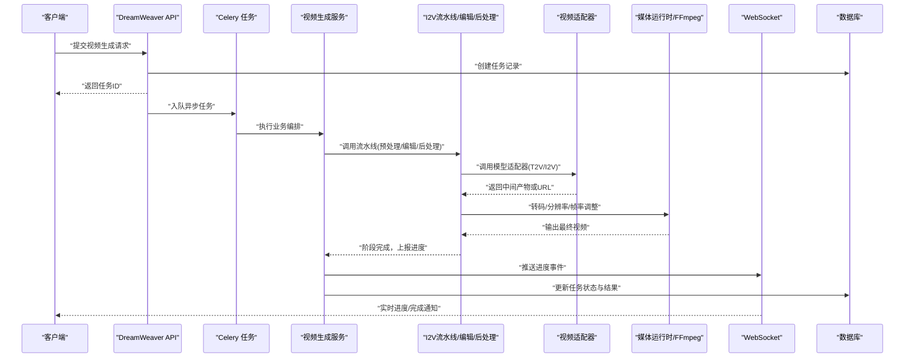
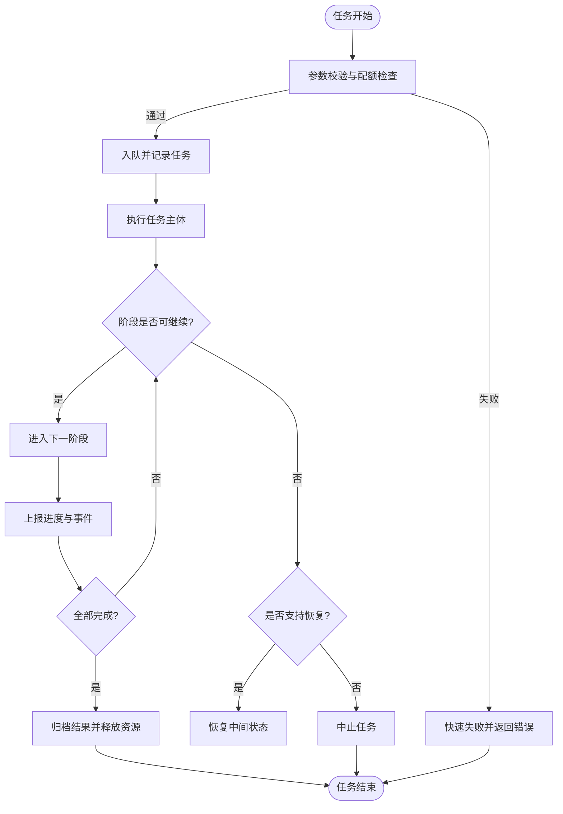
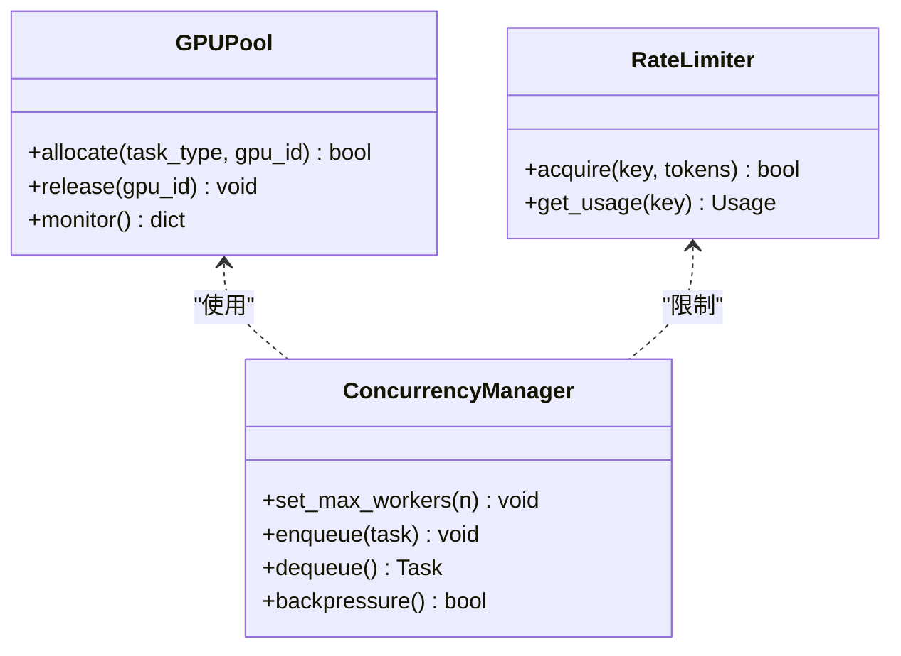
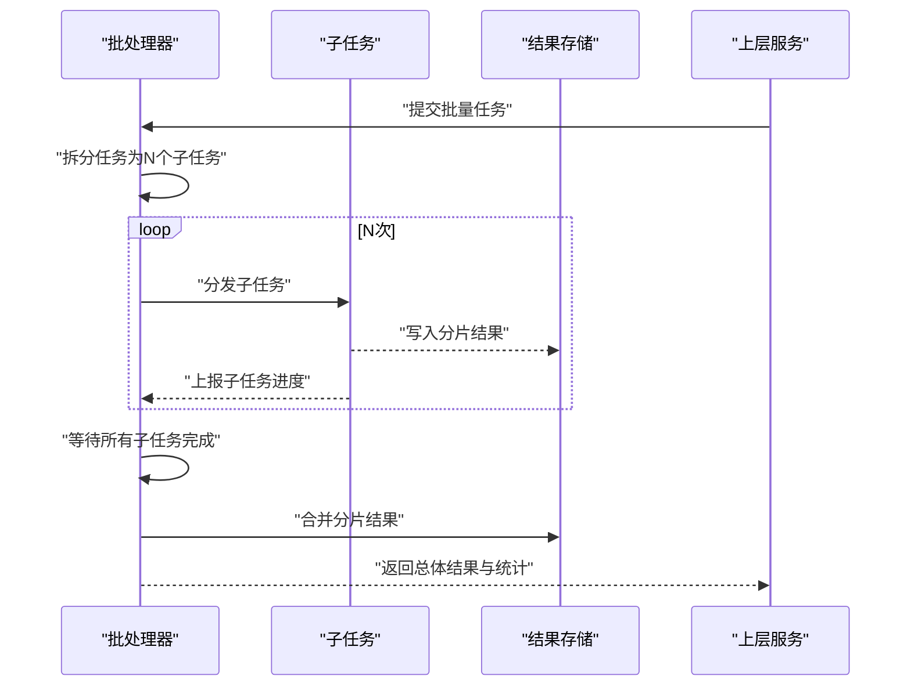
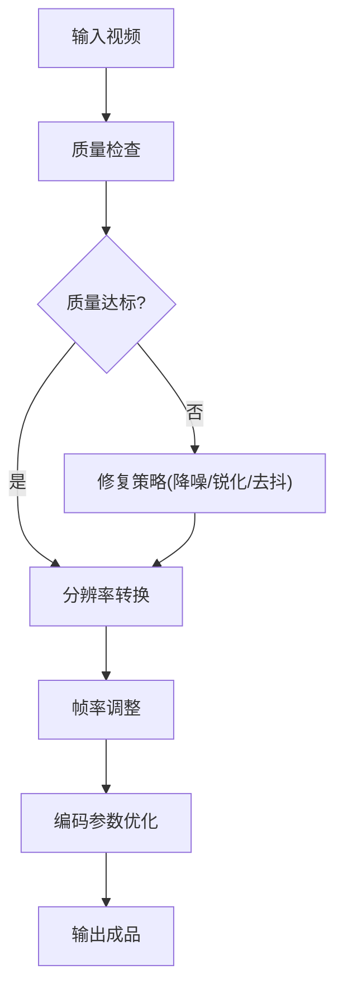
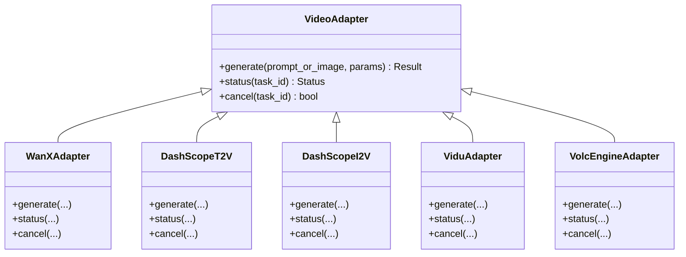
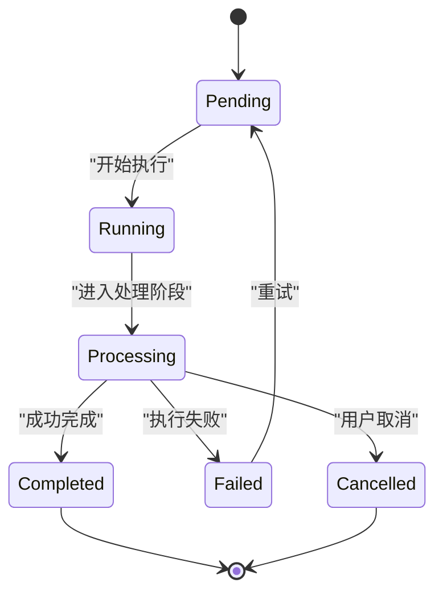
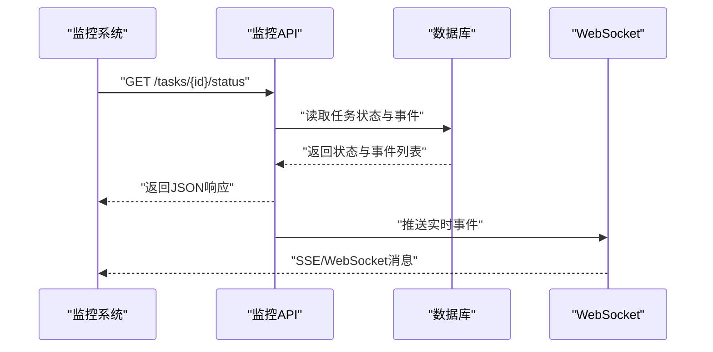
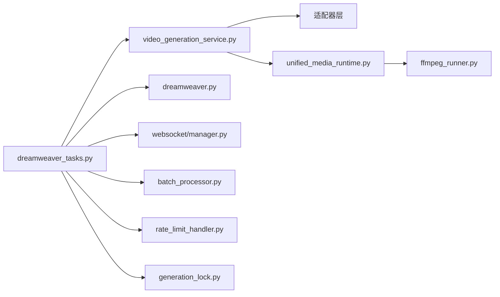

# 梦境编织者视频任务

<cite>
**本文引用的文件**   
- [backend/app/celery_app.py](file://backend/app/celery_app.py)
- [backend/app/tasks/dreamweaver_tasks.py](file://backend/app/tasks/dreamweaver_tasks.py)
- [backend/app/services/dreamweaver/video_generation_service.py](file://backend/app/services/dreamweaver/video_generation_service.py)
- [backend/app/services/dreamweaver/i2v_pipeline.py](file://backend/app/services/dreamweaver/i2v_pipeline.py)
- [backend/app/services/dreamweaver/video_edit_service.py](file://backend/app/services/dreamweaver/video_edit_service.py)
- [backend/app/services/dreamweaver/post_process_service.py](file://backend/app/services/dreamweaver/post_process_service.py)
- [backend/app/api/v1/dreamweaver_api/video_generation.py](file://backend/app/api/v1/dreamweaver_api/video_generation.py)
- [backend/app/models/dreamweaver.py](file://backend/app/models/dreamweaver.py)
- [backend/app/schemas/dreamweaver_contract.py](file://backend/app/schemas/dreamweaver_contract.py)
- [adapters/wanx_adapter.py](file://adapters/wanx_adapter.py)
- [adapters/wan26_video_adapter.py](file://adapters/wan26_video_adapter.py)
- [adapters/dashscope/video_t2v.py](file://adapters/dashscope/video_t2v.py)
- [adapters/dashscope/video_i2v.py](file://adapters/dashscope/video_i2v.py)
- [adapters/vidu_platform/video.py](file://adapters/vidu_platform/video.py)
- [adapters/volcengine/video.py](file://adapters/volcengine/video.py)
- [pipeline/ffmpeg_runner.py](file://pipeline/ffmpeg_runner.py)
- [pipeline/media_presets.py](file://pipeline/media_presets.py)
- [core/unified_media_runtime.py](file://core/unified_media_runtime.py)
- [backend/app/core/config.py](file://backend/app/core/config.py)
- [backend/app/websocket/manager.py](file://backend/app/websocket/manager.py)
- [backend/app/services/batch_processor.py](file://backend/app/services/batch_processor.py)
- [backend/app/services/rate_limit_handler.py](file://backend/app/services/rate_limit_handler.py)
- [backend/app/services/generation_lock.py](file://backend/app/services/generation_lock.py)
</cite>

## 目录
1. [简介](#简介)
2. [项目结构](#项目结构)
3. [核心组件](#核心组件)
4. [架构总览](#架构总览)
5. [详细组件分析](#详细组件分析)
6. [依赖关系分析](#依赖关系分析)
7. [性能考量](#性能考量)
8. [故障诊断与排错](#故障诊断与排错)
9. [结论](#结论)
10. [附录](#附录)

## 简介
本文件为“梦境编织者”视频生成异步任务的权威技术文档，覆盖以下关键能力：
- 文本到视频（T2V）、图像到视频（I2V）的异步任务编排与执行
- 视频编辑与后期处理流水线（转码、分辨率/帧率调整、拼接、水印等）
- 任务调度策略、GPU资源管理与批量处理能力
- 视频质量控制、帧率与分辨率转换流程
- 任务状态跟踪、进度反馈与中断恢复机制
- 监控API、性能分析与故障诊断方法
- 多模型支持、负载均衡与容错设计

## 项目结构
围绕视频任务的核心代码分布在后端服务、Celery任务、适配器层与媒体处理管线中。整体组织遵循分层与按功能域划分的原则：
- API层：暴露视频生成相关接口，负责请求校验、鉴权与响应封装
- 服务层：编排具体业务逻辑（T2V/I2V、编辑、后处理），管理并发、锁与限流
- 任务层：基于Celery的异步任务定义、重试、幂等与持久化
- 适配器层：对接多家视频模型供应商（通义万相、DashScope、Vidu、火山引擎等）
- 媒体管线：FFmpeg封装、预设参数、统一媒体运行时
- 数据模型与Schema：任务、运行记录、事件与契约定义
- 配置与基础设施：环境配置、WebSocket推送、批处理器、速率限制、生成锁

**图表来源** 
- [backend/app/api/v1/dreamweaver_api/video_generation.py](file://backend/app/api/v1/dreamweaver_api/video_generation.py)
- [backend/app/tasks/dreamweaver_tasks.py](file://backend/app/tasks/dreamweaver_tasks.py)
- [backend/app/services/dreamweaver/video_generation_service.py](file://backend/app/services/dreamweaver/video_generation_service.py)
- [backend/app/services/dreamweaver/i2v_pipeline.py](file://backend/app/services/dreamweaver/i2v_pipeline.py)
- [backend/app/services/dreamweaver/video_edit_service.py](file://backend/app/services/dreamweaver/video_edit_service.py)
- [backend/app/services/dreamweaver/post_process_service.py](file://backend/app/services/dreamweaver/post_process_service.py)
- [adapters/wanx_adapter.py](file://adapters/wanx_adapter.py)
- [adapters/wan26_video_adapter.py](file://adapters/wan26_video_adapter.py)
- [adapters/dashscope/video_t2v.py](file://adapters/dashscope/video_t2v.py)
- [adapters/dashscope/video_i2v.py](file://adapters/dashscope/video_i2v.py)
- [adapters/vidu_platform/video.py](file://adapters/vidu_platform/video.py)
- [adapters/volcengine/video.py](file://adapters/volcengine/video.py)
- [core/unified_media_runtime.py](file://core/unified_media_runtime.py)
- [pipeline/ffmpeg_runner.py](file://pipeline/ffmpeg_runner.py)
- [backend/app/models/dreamweaver.py](file://backend/app/models/dreamweaver.py)
- [backend/app/websocket/manager.py](file://backend/app/websocket/manager.py)
- [backend/app/services/batch_processor.py](file://backend/app/services/batch_processor.py)
- [backend/app/services/rate_limit_handler.py](file://backend/app/services/rate_limit_handler.py)
- [backend/app/services/generation_lock.py](file://backend/app/services/generation_lock.py)

**章节来源**
- [backend/app/api/v1/dreamweaver_api/video_generation.py](file://backend/app/api/v1/dreamweaver_api/video_generation.py)
- [backend/app/tasks/dreamweaver_tasks.py](file://backend/app/tasks/dreamweaver_tasks.py)
- [backend/app/services/dreamweaver/video_generation_service.py](file://backend/app/services/dreamweaver/video_generation_service.py)
- [backend/app/models/dreamweaver.py](file://backend/app/models/dreamweaver.py)
- [backend/app/schemas/dreamweaver_contract.py](file://backend/app/schemas/dreamweaver_contract.py)

## 核心组件
- Celery应用与任务注册：集中式任务入口，定义队列、重试策略与幂等键
- DreamWeaver任务模块：封装T2V/I2V、编辑、后处理的异步任务，包含状态机推进与事件上报
- 视频生成服务：协调模型选择、参数规范化、并发控制、结果聚合
- I2V流水线：图像预处理、参考图增强、提示词优化、调用适配器
- 视频编辑服务：片段裁剪、拼接、转场、字幕叠加、音频对齐
- 后期处理服务：质量检查、分辨率/帧率转换、编码参数调优、输出归档
- 适配器层：统一接口抽象，屏蔽不同供应商差异，实现负载均衡与降级
- 媒体运行时与FFmpeg：跨平台媒体处理，预设参数与性能优化
- WebSocket管理器：实时进度推送与中断信号下发
- 批处理器：批量任务拆分、分片、合并与失败重试
- 速率限制与生成锁：保护下游配额与避免重复生成

**章节来源**
- [backend/app/celery_app.py](file://backend/app/celery_app.py)
- [backend/app/tasks/dreamweaver_tasks.py](file://backend/app/tasks/dreamweaver_tasks.py)
- [backend/app/services/dreamweaver/video_generation_service.py](file://backend/app/services/dreamweaver/video_generation_service.py)
- [backend/app/services/dreamweaver/i2v_pipeline.py](file://backend/app/services/dreamweaver/i2v_pipeline.py)
- [backend/app/services/dreamweaver/video_edit_service.py](file://backend/app/services/dreamweaver/video_edit_service.py)
- [backend/app/services/dreamweaver/post_process_service.py](file://backend/app/services/dreamweaver/post_process_service.py)
- [core/unified_media_runtime.py](file://core/unified_media_runtime.py)
- [pipeline/ffmpeg_runner.py](file://pipeline/ffmpeg_runner.py)
- [backend/app/websocket/manager.py](file://backend/app/websocket/manager.py)
- [backend/app/services/batch_processor.py](file://backend/app/services/batch_processor.py)
- [backend/app/services/rate_limit_handler.py](file://backend/app/services/rate_limit_handler.py)
- [backend/app/services/generation_lock.py](file://backend/app/services/generation_lock.py)

## 架构总览
系统采用“API -> 任务 -> 服务 -> 适配器/媒体管线”的分层架构，结合Celery进行异步编排，通过WebSocket提供实时反馈，并通过数据库持久化任务状态与事件。

**图表来源** 
- [backend/app/api/v1/dreamweaver_api/video_generation.py](file://backend/app/api/v1/dreamweaver_api/video_generation.py)
- [backend/app/tasks/dreamweaver_tasks.py](file://backend/app/tasks/dreamweaver_tasks.py)
- [backend/app/services/dreamweaver/video_generation_service.py](file://backend/app/services/dreamweaver/video_generation_service.py)
- [backend/app/services/dreamweaver/i2v_pipeline.py](file://backend/app/services/dreamweaver/i2v_pipeline.py)
- [backend/app/services/dreamweaver/video_edit_service.py](file://backend/app/services/dreamweaver/video_edit_service.py)
- [backend/app/services/dreamweaver/post_process_service.py](file://backend/app/services/dreamweaver/post_process_service.py)
- [adapters/dashscope/video_t2v.py](file://adapters/dashscope/video_t2v.py)
- [adapters/dashscope/video_i2v.py](file://adapters/dashscope/video_i2v.py)
- [adapters/wanx_adapter.py](file://adapters/wanx_adapter.py)
- [adapters/wan26_video_adapter.py](file://adapters/wan26_video_adapter.py)
- [adapters/vidu_platform/video.py](file://adapters/vidu_platform/video.py)
- [adapters/volcengine/video.py](file://adapters/volcengine/video.py)
- [core/unified_media_runtime.py](file://core/unified_media_runtime.py)
- [pipeline/ffmpeg_runner.py](file://pipeline/ffmpeg_runner.py)
- [backend/app/websocket/manager.py](file://backend/app/websocket/manager.py)
- [backend/app/models/dreamweaver.py](file://backend/app/models/dreamweaver.py)

## 详细组件分析

### 任务调度与生命周期
- 任务类型：T2V生成、I2V生成、视频编辑、后期处理、批量任务
- 生命周期：入队 -> 执行 -> 阶段推进 -> 完成/失败 -> 清理
- 重试与幂等：基于幂等键与最大重试次数，支持指数退避
- 中断恢复：支持断点续跑，保存中间产物与状态快照

**图表来源** 
- [backend/app/tasks/dreamweaver_tasks.py](file://backend/app/tasks/dreamweaver_tasks.py)
- [backend/app/services/batch_processor.py](file://backend/app/services/batch_processor.py)
- [backend/app/services/generation_lock.py](file://backend/app/services/generation_lock.py)
- [backend/app/websocket/manager.py](file://backend/app/websocket/manager.py)

**章节来源**
- [backend/app/tasks/dreamweaver_tasks.py](file://backend/app/tasks/dreamweaver_tasks.py)
- [backend/app/services/batch_processor.py](file://backend/app/services/batch_processor.py)
- [backend/app/services/generation_lock.py](file://backend/app/services/generation_lock.py)

### GPU资源管理与并发控制
- 资源隔离：按任务类型分配GPU池，限制单任务显存占用
- 并发策略：动态线程池与进程池混合，依据负载自适应扩缩
- 优先级队列：高优先级任务抢占低优先级任务
- 背压与限流：全局与租户级速率限制，防止下游过载

**图表来源** 
- [backend/app/services/rate_limit_handler.py](file://backend/app/services/rate_limit_handler.py)
- [backend/app/services/batch_processor.py](file://backend/app/services/batch_processor.py)
- [backend/app/core/config.py](file://backend/app/core/config.py)

**章节来源**
- [backend/app/services/rate_limit_handler.py](file://backend/app/services/rate_limit_handler.py)
- [backend/app/core/config.py](file://backend/app/core/config.py)

### 批量处理能力
- 任务拆分：将大任务拆分为多个子任务，独立执行与重试
- 分片合并：各子任务完成后合并结果，保证顺序与一致性
- 失败重试：针对失败子任务进行局部重试，不影响其他分片
- 进度汇总：聚合子任务进度，向上层汇报总体进展

**图表来源** 
- [backend/app/services/batch_processor.py](file://backend/app/services/batch_processor.py)
- [backend/app/tasks/dreamweaver_tasks.py](file://backend/app/tasks/dreamweaver_tasks.py)

**章节来源**
- [backend/app/services/batch_processor.py](file://backend/app/services/batch_processor.py)
- [backend/app/tasks/dreamweaver_tasks.py](file://backend/app/tasks/dreamweaver_tasks.py)

### 视频质量控制、帧率与分辨率转换
- 质量门控：检测模糊、过曝、色彩异常、抖动等指标
- 帧率调整：根据目标设备与带宽自动选择合适帧率
- 分辨率转换：保持宽高比，适配常见分辨率档位
- 编码优化：H.264/H.265编码参数调优，平衡体积与画质

**图表来源** 
- [pipeline/media_presets.py](file://pipeline/media_presets.py)
- [pipeline/ffmpeg_runner.py](file://pipeline/ffmpeg_runner.py)
- [core/unified_media_runtime.py](file://core/unified_media_runtime.py)

**章节来源**
- [pipeline/media_presets.py](file://pipeline/media_presets.py)
- [pipeline/ffmpeg_runner.py](file://pipeline/ffmpeg_runner.py)
- [core/unified_media_runtime.py](file://core/unified_media_runtime.py)

### 多模型支持与负载均衡
- 模型注册：统一适配器接口，支持T2V/I2V多供应商
- 路由策略：基于延迟、成功率、配额与成本进行智能路由
- 降级与熔断：当某模型不可用时自动切换备选模型
- 负载均衡：轮询、加权与亲和性策略组合

**图表来源** 
- [adapters/wanx_adapter.py](file://adapters/wanx_adapter.py)
- [adapters/wan26_video_adapter.py](file://adapters/wan26_video_adapter.py)
- [adapters/dashscope/video_t2v.py](file://adapters/dashscope/video_t2v.py)
- [adapters/dashscope/video_i2v.py](file://adapters/dashscope/video_i2v.py)
- [adapters/vidu_platform/video.py](file://adapters/vidu_platform/video.py)
- [adapters/volcengine/video.py](file://adapters/volcengine/video.py)

**章节来源**
- [adapters/wanx_adapter.py](file://adapters/wanx_adapter.py)
- [adapters/wan26_video_adapter.py](file://adapters/wan26_video_adapter.py)
- [adapters/dashscope/video_t2v.py](file://adapters/dashscope/video_t2v.py)
- [adapters/dashscope/video_i2v.py](file://adapters/dashscope/video_i2v.py)
- [adapters/vidu_platform/video.py](file://adapters/vidu_platform/video.py)
- [adapters/volcengine/video.py](file://adapters/volcengine/video.py)

### 任务状态跟踪、进度反馈与中断恢复
- 状态机：Pending -> Running -> Processing -> Completed/Failed
- 进度事件：阶段级与子任务级进度，支持增量上报
- 中断恢复：保存中间产物与状态快照，支持从断点继续
- 取消机制：支持任务级与子任务级取消，及时释放资源

**图表来源** 
- [backend/app/models/dreamweaver.py](file://backend/app/models/dreamweaver.py)
- [backend/app/websocket/manager.py](file://backend/app/websocket/manager.py)
- [backend/app/tasks/dreamweaver_tasks.py](file://backend/app/tasks/dreamweaver_tasks.py)

**章节来源**
- [backend/app/models/dreamweaver.py](file://backend/app/models/dreamweaver.py)
- [backend/app/websocket/manager.py](file://backend/app/websocket/manager.py)
- [backend/app/tasks/dreamweaver_tasks.py](file://backend/app/tasks/dreamweaver_tasks.py)

### 任务监控API与性能分析
- 监控端点：查询任务状态、进度、错误日志与资源使用
- 性能指标：吞吐、延迟、成功率、GPU利用率与内存峰值
- 追踪链路：任务ID贯穿全链路，便于问题定位
- 告警规则：阈值触发告警，自动扩容或降级

**图表来源** 
- [backend/app/api/v1/dreamweaver_api/video_generation.py](file://backend/app/api/v1/dreamweaver_api/video_generation.py)
- [backend/app/models/dreamweaver.py](file://backend/app/models/dreamweaver.py)
- [backend/app/websocket/manager.py](file://backend/app/websocket/manager.py)

**章节来源**
- [backend/app/api/v1/dreamweaver_api/video_generation.py](file://backend/app/api/v1/dreamweaver_api/video_generation.py)
- [backend/app/models/dreamweaver.py](file://backend/app/models/dreamweaver.py)
- [backend/app/websocket/manager.py](file://backend/app/websocket/manager.py)

## 依赖关系分析
- 任务模块依赖服务层进行业务编排，服务层依赖适配器与媒体运行时
- 数据库用于持久化任务状态、事件与结果元数据
- WebSocket用于实时推送进度与事件
- 批处理器、速率限制与生成锁作为横切关注点被广泛复用

**图表来源** 
- [backend/app/tasks/dreamweaver_tasks.py](file://backend/app/tasks/dreamweaver_tasks.py)
- [backend/app/services/dreamweaver/video_generation_service.py](file://backend/app/services/dreamweaver/video_generation_service.py)
- [core/unified_media_runtime.py](file://core/unified_media_runtime.py)
- [pipeline/ffmpeg_runner.py](file://pipeline/ffmpeg_runner.py)
- [backend/app/models/dreamweaver.py](file://backend/app/models/dreamweaver.py)
- [backend/app/websocket/manager.py](file://backend/app/websocket/manager.py)
- [backend/app/services/batch_processor.py](file://backend/app/services/batch_processor.py)
- [backend/app/services/rate_limit_handler.py](file://backend/app/services/rate_limit_handler.py)
- [backend/app/services/generation_lock.py](file://backend/app/services/generation_lock.py)

**章节来源**
- [backend/app/tasks/dreamweaver_tasks.py](file://backend/app/tasks/dreamweaver_tasks.py)
- [backend/app/services/dreamweaver/video_generation_service.py](file://backend/app/services/dreamweaver/video_generation_service.py)
- [core/unified_media_runtime.py](file://core/unified_media_runtime.py)
- [pipeline/ffmpeg_runner.py](file://pipeline/ffmpeg_runner.py)
- [backend/app/models/dreamweaver.py](file://backend/app/models/dreamweaver.py)
- [backend/app/websocket/manager.py](file://backend/app/websocket/manager.py)
- [backend/app/services/batch_processor.py](file://backend/app/services/batch_processor.py)
- [backend/app/services/rate_limit_handler.py](file://backend/app/services/rate_limit_handler.py)
- [backend/app/services/generation_lock.py](file://backend/app/services/generation_lock.py)

## 性能考量
- 并行度调优：根据CPU/GPU资源与IO瓶颈调整并发数
- 缓存策略：对重复请求与中间产物进行缓存，减少重复计算
- 批处理优化：合并小任务，降低调度开销
- 编码优化：选择合适的编码器与参数，平衡速度与质量
- 监控与告警：实时监控关键指标，及时发现问题

[本节为通用指导，不直接分析具体文件]

## 故障诊断与排错
- 常见问题：模型超时、配额不足、网络异常、编码失败
- 诊断步骤：查看任务状态与事件日志，检查适配器返回码与错误信息
- 恢复策略：重试、降级、切换模型、回滚中间产物
- 工具支持：监控API、WebSocket事件、数据库查询与日志检索

**章节来源**
- [backend/app/api/v1/dreamweaver_api/video_generation.py](file://backend/app/api/v1/dreamweaver_api/video_generation.py)
- [backend/app/models/dreamweaver.py](file://backend/app/models/dreamweaver.py)
- [backend/app/websocket/manager.py](file://backend/app/websocket/manager.py)
- [backend/app/tasks/dreamweaver_tasks.py](file://backend/app/tasks/dreamweaver_tasks.py)

## 结论
本系统通过分层架构与异步任务编排，实现了稳定高效的视频生成与处理能力。多模型支持与负载均衡确保了高可用与弹性扩展，完善的监控与诊断机制提升了运维效率。建议在生产环境中持续优化并发与编码参数，完善告警与自动化恢复策略，以进一步提升系统稳定性与用户体验。

[本节为总结性内容，不直接分析具体文件]

## 附录
- 术语表：T2V、I2V、FFmpeg、Celery、WebSocket等
- 配置项说明：GPU池大小、并发上限、速率限制阈值、编码参数等
- 最佳实践：任务拆分策略、质量门控阈值、监控告警规则

[本节为补充信息，不直接分析具体文件]