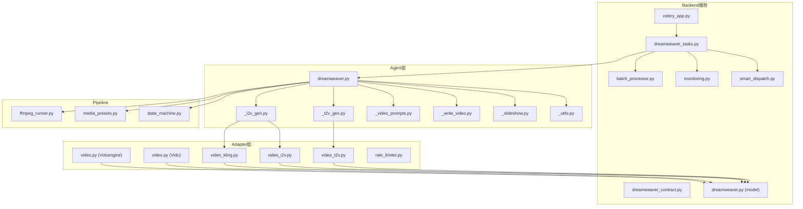
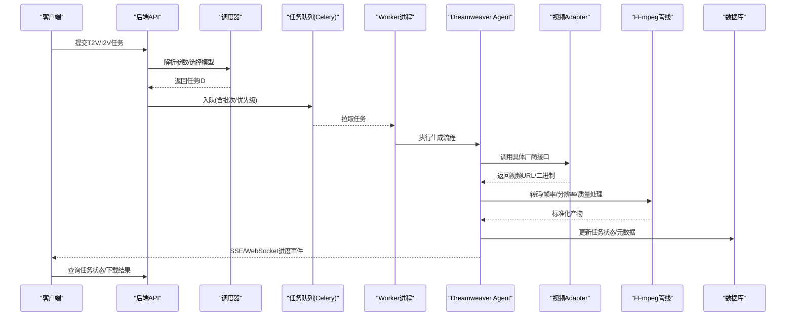
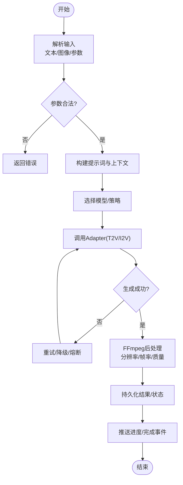
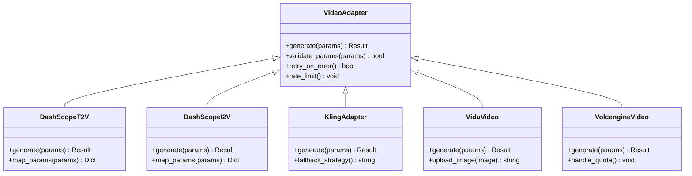
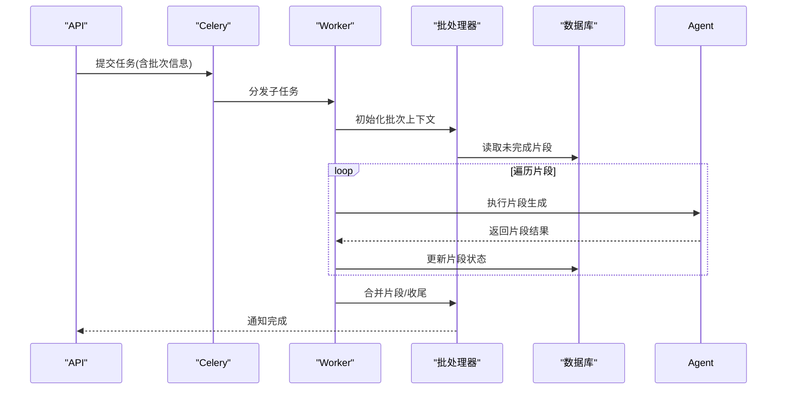
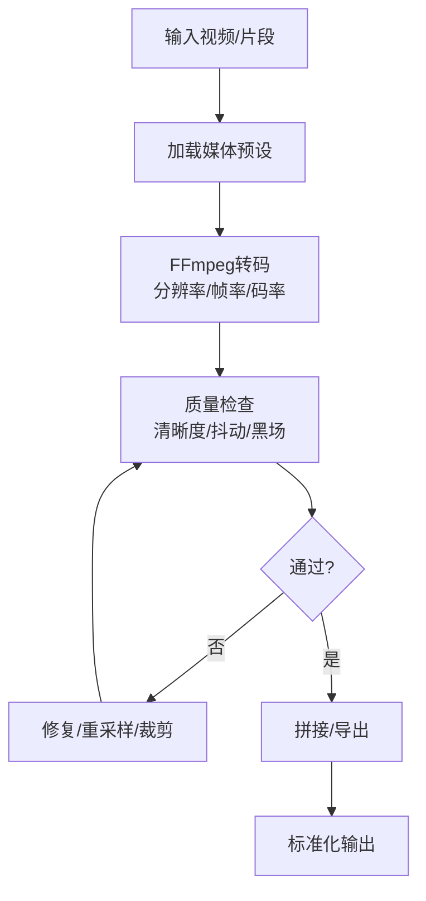
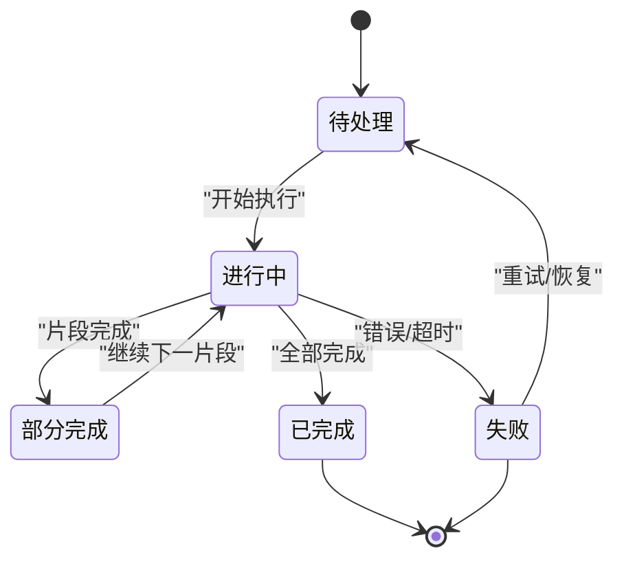
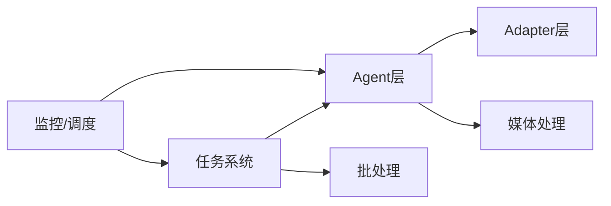

# 视频生成任务

<cite>
**本文引用的文件**   
- [dreamweaver.py](file://agents/dreamweaver.py)
- [_t2v_gen.py](file://agents/dreamweaver_agent_pkg/_t2v_gen.py)
- [_i2v_gen.py](file://agents/dreamweaver_agent_pkg/_i2v_gen.py)
- [_video_prompts.py](file://agents/dreamweaver_agent_pkg/_video_prompts.py)
- [_write_video.py](file://agents/dreamweaver_agent_pkg/_write_video.py)
- [_slideshow.py](file://agents/dreamweaver_agent_pkg/_slideshow.py)
- [_utils.py](file://agents/dreamweaver_agent_pkg/_utils.py)
- [video_t2v.py](file://adapters/dashscope/video_t2v.py)
- [video_i2v.py](file://adapters/dashscope/video_i2v.py)
- [video_kling.py](file://adapters/dashscope/video_kling.py)
- [video.py](file://adapters/vidu_platform/video.py)
- [video.py](file://adapters/volcengine/video.py)
- [celery_app.py](file://backend/app/celery_app.py)
- [dreamweaver_tasks.py](file://backend/app/tasks/dreamweaver_tasks.py)
- [batch_processor.py](file://backend/app/services/batch_processor.py)
- [dreamweaver_contract.py](file://backend/app/schemas/dreamweaver_contract.py)
- [dreamweaver.py](file://backend/app/models/dreamweaver.py)
- [monitoring.py](file://backend/app/api/v1/monitoring.py)
- [smart_dispatch.py](file://backend/app/api/v1/smart_dispatch.py)
- [ffmpeg_runner.py](file://pipeline/ffmpeg_runner.py)
- [media_presets.py](file://pipeline/media_presets.py)
- [state_machine.py](file://pipeline/state_machine.py)
- [rate_limiter.py](file://adapters/rate_limiter.py)
</cite>

## 目录
1. [简介](#简介)
2. [项目结构](#项目结构)
3. [核心组件](#核心组件)
4. [架构总览](#架构总览)
5. [详细组件分析](#详细组件分析)
6. [依赖关系分析](#依赖关系分析)
7. [性能考量](#性能考量)
8. [故障诊断指南](#故障诊断指南)
9. [结论](#结论)
10. [附录](#附录)

## 简介
本文件面向“梦境编织者”视频生成任务，系统性梳理文本转视频（T2V）与图像转视频（I2V）的实现机制。内容覆盖：
- 任务调度策略、GPU资源管理与批量处理能力
- 视频质量控制、帧率调整与分辨率转换流程
- 任务状态跟踪、进度反馈与中断恢复
- 监控API、性能分析与故障诊断方法
- 多模型支持、负载均衡与容错设计

## 项目结构
围绕视频生成的代码主要分布在以下层次：
- Agent层：负责编排T2V/I2V生成流程、提示词构建、分镜与幻灯片合成等
- Adapter层：对接多家视频生成厂商（如DashScope、Vidu、Volcengine等），屏蔽差异
- Backend服务：提供Celery异步任务、批处理、数据库持久化、监控与调度API
- Pipeline：统一媒体处理（FFmpeg）、预设参数、状态机驱动

**图表来源** 
- [dreamweaver.py](file://agents/dreamweaver.py)
- [_t2v_gen.py](file://agents/dreamweaver_agent_pkg/_t2v_gen.py)
- [_i2v_gen.py](file://agents/dreamweaver_agent_pkg/_i2v_gen.py)
- [video_t2v.py](file://adapters/dashscope/video_t2v.py)
- [video_i2v.py](file://adapters/dashscope/video_i2v.py)
- [video_kling.py](file://adapters/dashscope/video_kling.py)
- [video.py](file://adapters/vidu_platform/video.py)
- [video.py](file://adapters/volcengine/video.py)
- [celery_app.py](file://backend/app/celery_app.py)
- [dreamweaver_tasks.py](file://backend/app/tasks/dreamweaver_tasks.py)
- [batch_processor.py](file://backend/app/services/batch_processor.py)
- [ffmpeg_runner.py](file://pipeline/ffmpeg_runner.py)
- [media_presets.py](file://pipeline/media_presets.py)
- [state_machine.py](file://pipeline/state_machine.py)

**章节来源**
- [dreamweaver.py](file://agents/dreamweaver.py)
- [celery_app.py](file://backend/app/celery_app.py)
- [dreamweaver_tasks.py](file://backend/app/tasks/dreamweaver_tasks.py)
- [ffmpeg_runner.py](file://pipeline/ffmpeg_runner.py)
- [media_presets.py](file://pipeline/media_presets.py)
- [state_machine.py](file://pipeline/state_machine.py)

## 核心组件
- T2V/I2V生成器：封装提示词构造、参数校验、调用适配器、结果回写
- 适配器层：抽象各厂商接口，统一输入输出格式，内置限流与重试
- 任务队列与批处理：Celery任务拆分、并发控制、失败重试与断点续跑
- 媒体处理流水线：FFmpeg统一转码、分辨率/帧率对齐、质量后处理
- 监控与调度：任务状态追踪、SSE/WebSocket进度推送、智能路由与负载均衡

**章节来源**
- [_t2v_gen.py](file://agents/dreamweaver_agent_pkg/_t2v_gen.py)
- [_i2v_gen.py](file://agents/dreamweaver_agent_pkg/_i2v_gen.py)
- [video_t2v.py](file://adapters/dashscope/video_t2v.py)
- [video_i2v.py](file://adapters/dashscope/video_i2v.py)
- [video_kling.py](file://adapters/dashscope/video_kling.py)
- [celery_app.py](file://backend/app/celery_app.py)
- [dreamweaver_tasks.py](file://backend/app/tasks/dreamweaver_tasks.py)
- [batch_processor.py](file://backend/app/services/batch_processor.py)
- [ffmpeg_runner.py](file://pipeline/ffmpeg_runner.py)
- [media_presets.py](file://pipeline/media_presets.py)
- [state_machine.py](file://pipeline/state_machine.py)

## 架构总览
整体采用“Agent编排 + 多Adapter适配 + Celery异步任务 + FFmpeg后处理”的分层架构。请求进入后端API后，由调度模块选择合适模型与策略，将任务入队；Worker消费任务，调用对应Adapter生成视频；完成后经FFmpeg进行统一质量与规格处理，最终落库并推送进度。

**图表来源** 
- [dreamweaver_tasks.py](file://backend/app/tasks/dreamweaver_tasks.py)
- [celery_app.py](file://backend/app/celery_app.py)
- [dreamweaver.py](file://agents/dreamweaver.py)
- [_t2v_gen.py](file://agents/dreamweaver_agent_pkg/_t2v_gen.py)
- [_i2v_gen.py](file://agents/dreamweaver_agent_pkg/_i2v_gen.py)
- [video_t2v.py](file://adapters/dashscope/video_t2v.py)
- [video_i2v.py](file://adapters/dashscope/video_i2v.py)
- [video_kling.py](file://adapters/dashscope/video_kling.py)
- [ffmpeg_runner.py](file://pipeline/ffmpeg_runner.py)
- [dreamweaver_contract.py](file://backend/app/schemas/dreamweaver_contract.py)
- [dreamweaver.py](file://backend/app/models/dreamweaver.py)

## 详细组件分析

### T2V/I2V生成器（Agent）
- 职责：组装提示词、参数校验、调用Adapter、聚合结果、触发后处理
- 关键能力：
  - 提示词模板与上下文注入（场景/角色/风格）
  - 参数规范化（时长、分辨率、帧率、质量档位）
  - 错误分类与重试策略（网络/配额/超时）
  - 中间产物缓存与断点续跑

**图表来源** 
- [_t2v_gen.py](file://agents/dreamweaver_agent_pkg/_t2v_gen.py)
- [_i2v_gen.py](file://agents/dreamweaver_agent_pkg/_i2v_gen.py)
- [_video_prompts.py](file://agents/dreamweaver_agent_pkg/_video_prompts.py)
- [ffmpeg_runner.py](file://pipeline/ffmpeg_runner.py)
- [dreamweaver_contract.py](file://backend/app/schemas/dreamweaver_contract.py)

**章节来源**
- [_t2v_gen.py](file://agents/dreamweaver_agent_pkg/_t2v_gen.py)
- [_i2v_gen.py](file://agents/dreamweaver_agent_pkg/_i2v_gen.py)
- [_video_prompts.py](file://agents/dreamweaver_agent_pkg/_video_prompts.py)
- [_write_video.py](file://agents/dreamweaver_agent_pkg/_write_video.py)
- [_slideshow.py](file://agents/dreamweaver_agent_pkg/_slideshow.py)
- [_utils.py](file://agents/dreamweaver_agent_pkg/_utils.py)

### 适配器层（多模型支持）
- 统一抽象：输入输出契约一致，内部处理鉴权、限流、重试、计费
- 典型实现：
  - DashScope T2V/I2V/Kling
  - Vidu平台视频接口
  - Volcengine视频接口
- 特性：
  - 动态参数映射（分辨率/帧率/时长/质量）
  - 速率限制与退避策略
  - 失败快速失败与自动切换备选模型

**图表来源** 
- [video_t2v.py](file://adapters/dashscope/video_t2v.py)
- [video_i2v.py](file://adapters/dashscope/video_i2v.py)
- [video_kling.py](file://adapters/dashscope/video_kling.py)
- [video.py](file://adapters/vidu_platform/video.py)
- [video.py](file://adapters/volcengine/video.py)
- [rate_limiter.py](file://adapters/rate_limiter.py)

**章节来源**
- [video_t2v.py](file://adapters/dashscope/video_t2v.py)
- [video_i2v.py](file://adapters/dashscope/video_i2v.py)
- [video_kling.py](file://adapters/dashscope/video_kling.py)
- [video.py](file://adapters/vidu_platform/video.py)
- [video.py](file://adapters/volcengine/video.py)
- [rate_limiter.py](file://adapters/rate_limiter.py)

### 任务调度与批处理（Celery + Batch）
- 任务拆分：按片段/镜头/批次切分，提升吞吐与可恢复性
- 并发控制：基于队列容量与GPU内存上限的并发度
- 失败重试：指数退避、最大重试次数、死信队列
- 断点续跑：记录已完成的子任务，避免重复计算

**图表来源** 
- [celery_app.py](file://backend/app/celery_app.py)
- [dreamweaver_tasks.py](file://backend/app/tasks/dreamweaver_tasks.py)
- [batch_processor.py](file://backend/app/services/batch_processor.py)
- [dreamweaver_contract.py](file://backend/app/schemas/dreamweaver_contract.py)
- [dreamweaver.py](file://backend/app/models/dreamweaver.py)

**章节来源**
- [celery_app.py](file://backend/app/celery_app.py)
- [dreamweaver_tasks.py](file://backend/app/tasks/dreamweaver_tasks.py)
- [batch_processor.py](file://backend/app/services/batch_processor.py)

### 媒体处理与质量控制（FFmpeg + 预设）
- 统一转码：分辨率归一化、帧率对齐、码率控制、色彩空间校正
- 质量门控：清晰度/抖动检测、黑场/过曝检查、音频同步校验
- 预设管理：按用途（短视频/横屏/竖屏/直播切片）加载参数集

**图表来源** 
- [ffmpeg_runner.py](file://pipeline/ffmpeg_runner.py)
- [media_presets.py](file://pipeline/media_presets.py)
- [state_machine.py](file://pipeline/state_machine.py)

**章节来源**
- [ffmpeg_runner.py](file://pipeline/ffmpeg_runner.py)
- [media_presets.py](file://pipeline/media_presets.py)
- [state_machine.py](file://pipeline/state_machine.py)

### 状态机与进度跟踪
- 状态定义：待处理、进行中、部分完成、已完成、失败、取消
- 事件驱动：每个阶段推进时写入事件日志，供前端实时展示
- 中断恢复：异常时保存当前状态与偏移量，重启后从断点继续

**图表来源** 
- [state_machine.py](file://pipeline/state_machine.py)
- [dreamweaver_contract.py](file://backend/app/schemas/dreamweaver_contract.py)
- [dreamweaver.py](file://backend/app/models/dreamweaver.py)

**章节来源**
- [state_machine.py](file://pipeline/state_machine.py)
- [dreamweaver_contract.py](file://backend/app/schemas/dreamweaver_contract.py)
- [dreamweaver.py](file://backend/app/models/dreamweaver.py)

### 监控API与性能分析
- 监控端点：任务列表、状态查询、进度事件、资源使用统计
- 性能指标：QPS、延迟分布、GPU利用率、队列深度、失败率
- 诊断工具：链路追踪、错误堆栈、慢查询定位、适配器响应时间

**章节来源**
- [monitoring.py](file://backend/app/api/v1/monitoring.py)
- [smart_dispatch.py](file://backend/app/api/v1/smart_dispatch.py)

## 依赖关系分析
- Agent依赖Adapter抽象，屏蔽厂商差异
- Task依赖Celery与批处理器，确保高可用与可扩展
- Pipeline依赖FFmpeg与预设，保证输出一致性
- 监控与调度为横向支撑，贯穿全链路

**图表来源** 
- [dreamweaver.py](file://agents/dreamweaver.py)
- [celery_app.py](file://backend/app/celery_app.py)
- [dreamweaver_tasks.py](file://backend/app/tasks/dreamweaver_tasks.py)
- [batch_processor.py](file://backend/app/services/batch_processor.py)
- [ffmpeg_runner.py](file://pipeline/ffmpeg_runner.py)
- [monitoring.py](file://backend/app/api/v1/monitoring.py)
- [smart_dispatch.py](file://backend/app/api/v1/smart_dispatch.py)

**章节来源**
- [dreamweaver.py](file://agents/dreamweaver.py)
- [celery_app.py](file://backend/app/celery_app.py)
- [dreamweaver_tasks.py](file://backend/app/tasks/dreamweaver_tasks.py)
- [batch_processor.py](file://backend/app/services/batch_processor.py)
- [ffmpeg_runner.py](file://pipeline/ffmpeg_runner.py)
- [monitoring.py](file://backend/app/api/v1/monitoring.py)
- [smart_dispatch.py](file://backend/app/api/v1/smart_dispatch.py)

## 性能考量
- GPU资源管理：根据显存峰值设定并发度，避免OOM；支持多卡分配与隔离
- 批处理优化：合并小任务、减少IO开销、利用零拷贝路径
- 缓存与预热：热点提示词与模型权重预加载，降低冷启动延迟
- 自适应降级：在高峰期自动切换轻量模型或降低分辨率/帧率
- 背压与限流：上游限流保护下游，防止雪崩

[本节为通用指导，不直接分析具体文件]

## 故障诊断指南
- 常见问题：
  - 适配器超时/配额不足：检查限流配置与重试策略
  - FFmpeg失败：核对输入格式、预设参数与编码选项
  - 任务堆积：观察队列深度与Worker数量，扩容或降载
  - 结果不一致：检查随机种子、提示词版本与参数漂移
- 诊断步骤：
  - 查看任务事件日志与状态机流转
  - 抓取Adapter请求/响应报文与耗时
  - 检查FFmpeg输出与质量检测结果
  - 关联监控指标（延迟、错误率、GPU占用）

**章节来源**
- [dreamweaver_tasks.py](file://backend/app/tasks/dreamweaver_tasks.py)
- [monitoring.py](file://backend/app/api/v1/monitoring.py)
- [ffmpeg_runner.py](file://pipeline/ffmpeg_runner.py)
- [state_machine.py](file://pipeline/state_machine.py)

## 结论
本方案以分层解耦与多模型适配为核心，结合Celery异步任务、批处理与FFmpeg统一后处理，实现了稳定高效的T2V/I2V视频生成流水线。通过状态机与监控API，提供了完善的进度跟踪与故障诊断能力。未来可进一步引入更细粒度的GPU调度、端到端质量评估与自动化A/B测试，持续提升吞吐与质量稳定性。

[本节为总结性内容，不直接分析具体文件]

## 附录
- 术语表：T2V（文本转视频）、I2V（图像转视频）、FFmpeg、Celery、SSE/WebSocket
- 参考配置：媒体预设、限流阈值、重试策略、队列大小
- 最佳实践：提示词工程、参数调优、监控告警、灰度发布

[本节为补充信息，不直接分析具体文件]