# 视频编辑任务

<cite>
**本文引用的文件**   
- [FFMPEG_VIDEO_EDIT_GUIDE.md](file://FFMPEG_VIDEO_EDIT_GUIDE.md)
- [ffmpeg_runner.py](file://pipeline/ffmpeg_runner.py)
- [_video_edit.py](file://pipeline/autoqc_pkg/_video_edit.py)
- [_video_clip_checks.py](file://pipeline/autoqc_pkg/_video_clip_checks.py)
- [dreamweaver_tasks.py](file://backend/app/tasks/dreamweaver_tasks.py)
- [dreamweaver.py](file://agents/dreamweaver.py)
- [editor.py](file://agents/editor.py)
- [media_presets.py](file://pipeline/media_presets.py)
- [smart_tuning.py](file://pipeline/smart_tuning.py)
- [state_machine.py](file://pipeline/state_machine.py)
- [_audio_sync.py](file://agents/storyboarder_pkg/_audio_sync.py)
- [_duration.py](file://agents/storyboarder_pkg/_duration.py)
- [batch_processor.py](file://backend/app/services/batch_processor.py)
- [streaming_service.py](file://backend/app/services/streaming_service.py)
- [api_errors.py](file://backend/app/utils/api_errors.py)
</cite>

## 目录
1. [简介](#简介)
2. [项目结构](#项目结构)
3. [核心组件](#核心组件)
4. [架构总览](#架构总览)
5. [详细组件分析](#详细组件分析)
6. [依赖关系分析](#依赖关系分析)
7. [性能考量](#性能考量)
8. [故障排查指南](#故障排查指南)
9. [结论](#结论)
10. [附录](#附录)

## 简介
本文件面向“梦境编织者”视频编辑任务，系统化记录视频片段拼接、转场效果、字幕添加与音频同步等编辑能力；说明 FFmpeg 集成方式、编码参数配置与格式转换流程；阐述视频质量检查、码率优化与文件大小控制策略；覆盖编辑任务的状态管理、错误处理与重试机制；并提供编辑预览、批量处理与性能优化方法。文档兼顾技术深度与可读性，帮助开发者与使用者快速理解并高效使用系统。

## 项目结构
围绕视频编辑的核心代码分布在 pipeline（媒体处理与自动化质检）、agents（编排与业务逻辑）、backend（任务调度与服务）以及脚本与文档中。关键路径包括：
- pipeline/ffmpeg_runner.py：FFmpeg 执行封装与命令构建
- pipeline/autoqc_pkg/_video_edit.py：视频编辑流水线（拼接、转场、字幕、音频对齐）
- pipeline/autoqc_pkg/_video_clip_checks.py：视频片段质量检查
- pipeline/media_presets.py：媒体预设（分辨率、帧率、码率、容器）
- pipeline/smart_tuning.py：智能调参（码率、质量、大小控制）
- pipeline/state_machine.py：状态机（任务生命周期）
- agents/editor.py：编辑器入口与编排
- agents/dreamweaver.py：梦境编织者主流程
- backend/app/tasks/dreamweaver_tasks.py：后台任务队列与重试
- backend/app/services/batch_processor.py：批量处理服务
- backend/app/services/streaming_service.py：流式预览与进度推送
- scripts/ffmpeg/*：FFmpeg 转场脚本（快/慢过渡）
- FFMPEG_VIDEO_EDIT_GUIDE.md：FFmpeg 编辑指南

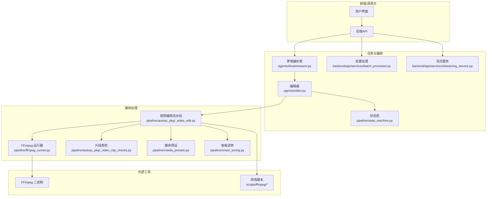

图表来源 
- [ffmpeg_runner.py](file://pipeline/ffmpeg_runner.py)
- [_video_edit.py](file://pipeline/autoqc_pkg/_video_edit.py)
- [_video_clip_checks.py](file://pipeline/autoqc_pkg/_video_clip_checks.py)
- [media_presets.py](file://pipeline/media_presets.py)
- [smart_tuning.py](file://pipeline/smart_tuning.py)
- [state_machine.py](file://pipeline/state_machine.py)
- [dreamweaver.py](file://agents/dreamweaver.py)
- [editor.py](file://agents/editor.py)
- [batch_processor.py](file://backend/app/services/batch_processor.py)
- [streaming_service.py](file://backend/app/services/streaming_service.py)
- [FFMPEG_VIDEO_EDIT_GUIDE.md](file://FFMPEG_VIDEO_EDIT_GUIDE.md)

章节来源
- [FFMPEG_VIDEO_EDIT_GUIDE.md](file://FFMPEG_VIDEO_EDIT_GUIDE.md)
- [ffmpeg_runner.py](file://pipeline/ffmpeg_runner.py)
- [_video_edit.py](file://pipeline/autoqc_pkg/_video_edit.py)
- [_video_clip_checks.py](file://pipeline/autoqc_pkg/_video_clip_checks.py)
- [media_presets.py](file://pipeline/media_presets.py)
- [smart_tuning.py](file://pipeline/smart_tuning.py)
- [state_machine.py](file://pipeline/state_machine.py)
- [dreamweaver.py](file://agents/dreamweaver.py)
- [editor.py](file://agents/editor.py)
- [batch_processor.py](file://backend/app/services/batch_processor.py)
- [streaming_service.py](file://backend/app/services/streaming_service.py)

## 核心组件
- FFmpeg 运行器：统一封装 FFmpeg 命令构建、参数校验、进程管理与输出日志，支持并发与超时控制。
- 视频编辑流水线：负责片段拼接、转场合成、字幕叠加、音轨对齐与混音、导出目标格式。
- 片段质检：对输入/输出片段进行时长、分辨率、帧率、码率、黑场、静音等检查，保障质量基线。
- 媒体预设：集中管理分辨率、帧率、编码器、码率模式（CBR/VBR/CRF）、容器与字幕封装。
- 智能调参：根据目标文件大小、网络带宽或平台限制自动调整码率与编码参数。
- 状态机：定义任务状态流转（创建、排队、执行、质检、导出、完成、失败），支撑可恢复与重试。
- 编辑器与梦境编织者：将业务需求转化为编辑计划，协调各子任务并按序执行。
- 批量处理与流式服务：提供批处理调度与实时进度/预览推送。

章节来源
- [ffmpeg_runner.py](file://pipeline/ffmpeg_runner.py)
- [_video_edit.py](file://pipeline/autoqc_pkg/_video_edit.py)
- [_video_clip_checks.py](file://pipeline/autoqc_pkg/_video_clip_checks.py)
- [media_presets.py](file://pipeline/media_presets.py)
- [smart_tuning.py](file://pipeline/smart_tuning.py)
- [state_machine.py](file://pipeline/state_machine.py)
- [editor.py](file://agents/editor.py)
- [dreamweaver.py](file://agents/dreamweaver.py)
- [batch_processor.py](file://backend/app/services/batch_processor.py)
- [streaming_service.py](file://backend/app/services/streaming_service.py)

## 架构总览
整体采用“编排层 + 处理层 + 基础设施”的分层架构：
- 编排层：梦境编织者与编辑器解析需求，生成编辑计划与任务图。
- 处理层：视频编辑流水线调用 FFmpeg 运行器执行具体操作，并通过质检与调参模块保证质量与体积。
- 基础设施：状态机持久化任务状态，批量处理器调度并发，流式服务推送进度与预览。

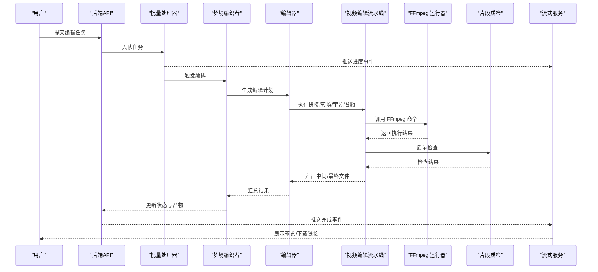

图表来源 
- [dreamweaver.py](file://agents/dreamweaver.py)
- [editor.py](file://agents/editor.py)
- [_video_edit.py](file://pipeline/autoqc_pkg/_video_edit.py)
- [ffmpeg_runner.py](file://pipeline/ffmpeg_runner.py)
- [_video_clip_checks.py](file://pipeline/autoqc_pkg/_video_clip_checks.py)
- [batch_processor.py](file://backend/app/services/batch_processor.py)
- [streaming_service.py](file://backend/app/services/streaming_service.py)

## 详细组件分析

### FFmpeg 运行器（pipeline/ffmpeg_runner.py）
- 职责：构建 FFmpeg 命令、设置超时与并发、捕获标准输出/错误、解析关键指标（时长、码率、分辨率）。
- 关键点：
  - 参数校验与模板化，避免注入风险
  - 进程池/线程池复用，降低启动开销
  - 异常分类（超时、权限、编码失败）与可重试标记
  - 日志结构化，便于追踪与审计

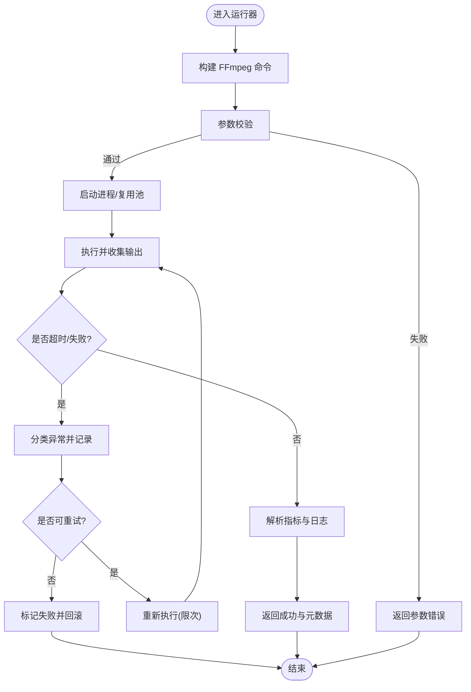

图表来源 
- [ffmpeg_runner.py](file://pipeline/ffmpeg_runner.py)

章节来源
- [ffmpeg_runner.py](file://pipeline/ffmpeg_runner.py)

### 视频编辑流水线（pipeline/autoqc_pkg/_video_edit.py）
- 职责：串联片段拼接、转场合成、字幕叠加、音频对齐与混音、格式导出。
- 关键点：
  - 输入片段规范化（分辨率、帧率、色彩空间）
  - 转场类型选择（淡入淡出、滑动、缩放等）与时长控制
  - 字幕轨道生成（SRT/ASS/VTT）与样式映射
  - 音频时间轴对齐、音量归一化、降噪与响度标准化
  - 多阶段中间产物缓存，支持断点续编

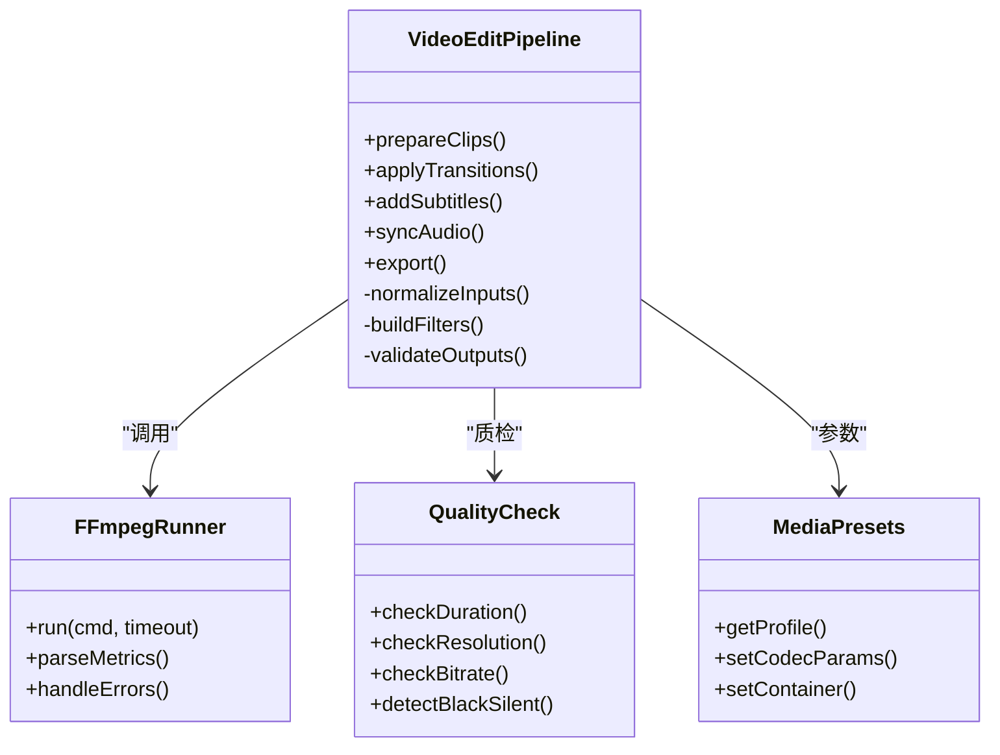

图表来源 
- [_video_edit.py](file://pipeline/autoqc_pkg/_video_edit.py)
- [ffmpeg_runner.py](file://pipeline/ffmpeg_runner.py)
- [_video_clip_checks.py](file://pipeline/autoqc_pkg/_video_clip_checks.py)
- [media_presets.py](file://pipeline/media_presets.py)

章节来源
- [_video_edit.py](file://pipeline/autoqc_pkg/_video_edit.py)

### 片段质检（pipeline/autoqc_pkg/_video_clip_checks.py）
- 职责：对输入/输出片段进行基础质量检查，确保一致性并拦截低质素材。
- 检查项：
  - 时长范围、分辨率与帧率合规
  - 码率上下限与波动阈值
  - 黑场/静音检测、过曝/欠曝判定
  - 字幕轨道存在性与时间戳合法性

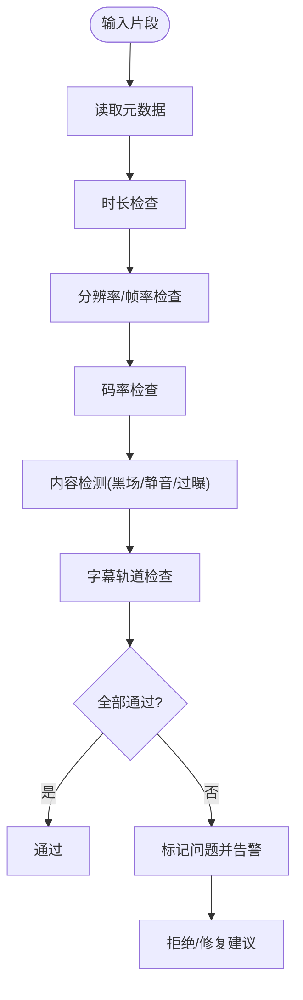

图表来源 
- [_video_clip_checks.py](file://pipeline/autoqc_pkg/_video_clip_checks.py)

章节来源
- [_video_clip_checks.py](file://pipeline/autoqc_pkg/_video_clip_checks.py)

### 媒体预设与智能调参（pipeline/media_presets.py, pipeline/smart_tuning.py）
- 媒体预设：集中管理分辨率、帧率、编码器、码率模式、容器与字幕封装策略。
- 智能调参：基于目标文件大小、平台限制或网络条件动态调整 CRF/CBR/VBR、GOP、滤镜强度等。

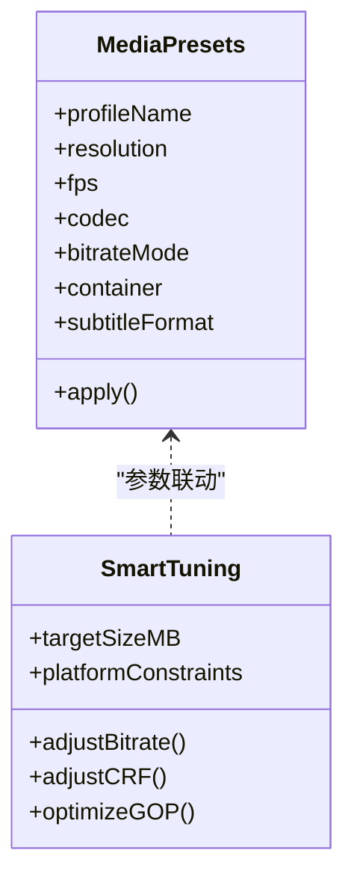

图表来源 
- [media_presets.py](file://pipeline/media_presets.py)
- [smart_tuning.py](file://pipeline/smart_tuning.py)

章节来源
- [media_presets.py](file://pipeline/media_presets.py)
- [smart_tuning.py](file://pipeline/smart_tuning.py)

### 音频同步与时长估算（agents/storyboarder_pkg/_audio_sync.py, _duration.py）
- 音频同步：依据文本/ASR 时间戳对齐语音与画面，处理停顿、加速/减速与交叉淡入淡出。
- 时长估算：结合镜头时长、转场时长与字幕显示时长，计算最终输出时长与缓冲区间。

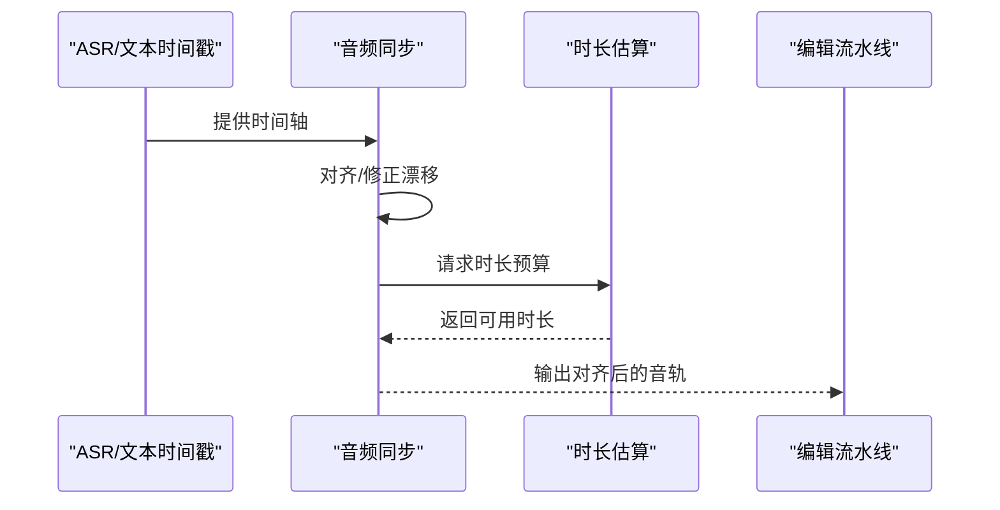

图表来源 
- [_audio_sync.py](file://agents/storyboarder_pkg/_audio_sync.py)
- [_duration.py](file://agents/storyboarder_pkg/_duration.py)

章节来源
- [_audio_sync.py](file://agents/storyboarder_pkg/_audio_sync.py)
- [_duration.py](file://agents/storyboarder_pkg/_duration.py)

### 状态机与任务生命周期（pipeline/state_machine.py）
- 状态定义：创建、排队、执行、质检、导出、完成、失败、重试。
- 转移规则：明确每个动作触发的状态变更与副作用（如清理临时文件、记录审计日志）。
- 持久化：状态变更写入数据库，支持查询、恢复与审计。

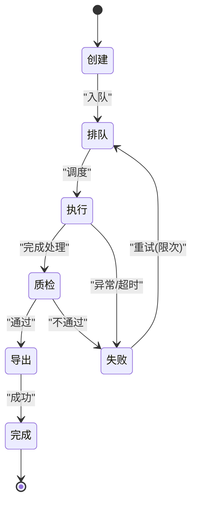

图表来源 
- [state_machine.py](file://pipeline/state_machine.py)

章节来源
- [state_machine.py](file://pipeline/state_machine.py)

### 编辑器与梦境编织者（agents/editor.py, agents/dreamweaver.py）
- 编辑器：将高层编辑意图转换为可执行的步骤序列（片段顺序、转场策略、字幕样式、音频处理）。
- 梦境编织者：整合多模态资源（图像、视频、音频、文本），驱动编辑器与流水线，维护上下文与版本。

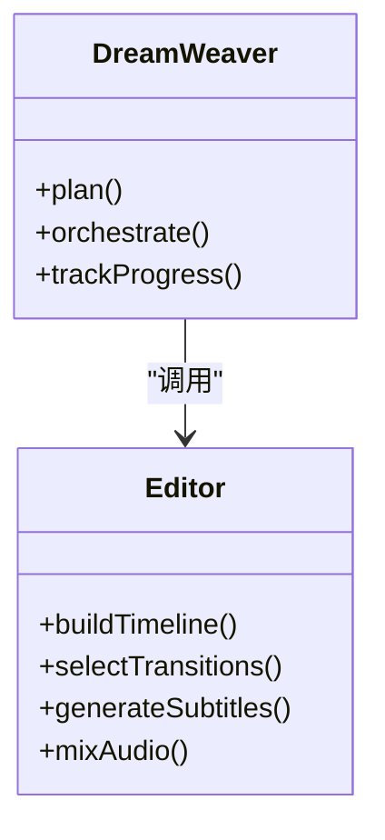

图表来源 
- [dreamweaver.py](file://agents/dreamweaver.py)
- [editor.py](file://agents/editor.py)

章节来源
- [dreamweaver.py](file://agents/dreamweaver.py)
- [editor.py](file://agents/editor.py)

### 后台任务与重试（backend/app/tasks/dreamweaver_tasks.py）
- 任务队列：接收编辑任务，分配工作进程，监控执行状态。
- 重试机制：按错误类型区分重试策略（指数退避、最大次数、死信队列）。
- 回调通知：完成后通过流式服务推送结果与产物链接。

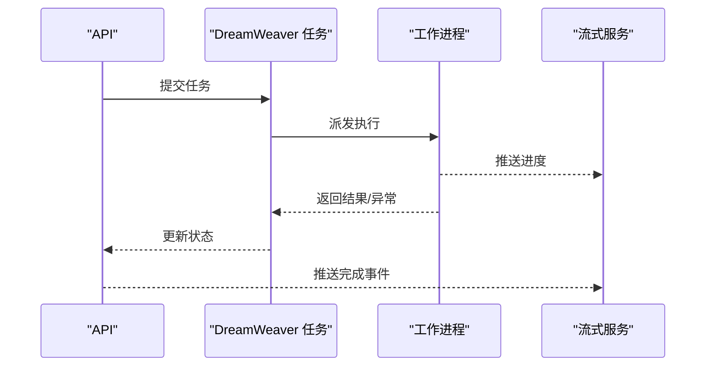

图表来源 
- [dreamweaver_tasks.py](file://backend/app/tasks/dreamweaver_tasks.py)
- [streaming_service.py](file://backend/app/services/streaming_service.py)

章节来源
- [dreamweaver_tasks.py](file://backend/app/tasks/dreamweaver_tasks.py)
- [streaming_service.py](file://backend/app/services/streaming_service.py)

### 批量处理（backend/app/services/batch_processor.py）
- 功能：并行处理多个编辑任务，限制并发度，避免资源争用。
- 特性：任务优先级、资源配额、失败隔离与补偿。

章节来源
- [batch_processor.py](file://backend/app/services/batch_processor.py)

## 依赖关系分析
- 组件耦合：
  - 视频编辑流水线强依赖 FFmpeg 运行器与媒体预设，弱依赖质检与调参。
  - 编辑器与梦境编织者通过接口解耦，便于替换实现。
  - 状态机贯穿所有组件，提供一致的生命周期语义。
- 外部依赖：
  - FFmpeg 二进制必须可用且版本兼容。
  - 存储介质需满足 I/O 吞吐要求（SSD 推荐）。
  - 可选的 ASR/TTS 服务用于字幕与配音。

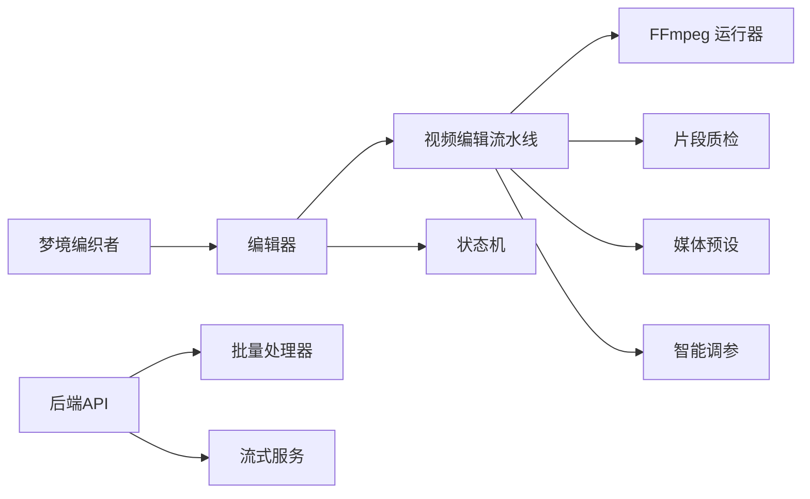

图表来源 
- [dreamweaver.py](file://agents/dreamweaver.py)
- [editor.py](file://agents/editor.py)
- [_video_edit.py](file://pipeline/autoqc_pkg/_video_edit.py)
- [ffmpeg_runner.py](file://pipeline/ffmpeg_runner.py)
- [_video_clip_checks.py](file://pipeline/autoqc_pkg/_video_clip_checks.py)
- [media_presets.py](file://pipeline/media_presets.py)
- [smart_tuning.py](file://pipeline/smart_tuning.py)
- [state_machine.py](file://pipeline/state_machine.py)
- [batch_processor.py](file://backend/app/services/batch_processor.py)
- [streaming_service.py](file://backend/app/services/streaming_service.py)

章节来源
- [dreamweaver.py](file://agents/dreamweaver.py)
- [editor.py](file://agents/editor.py)
- [_video_edit.py](file://pipeline/autoqc_pkg/_video_edit.py)
- [ffmpeg_runner.py](file://pipeline/ffmpeg_runner.py)
- [_video_clip_checks.py](file://pipeline/autoqc_pkg/_video_clip_checks.py)
- [media_presets.py](file://pipeline/media_presets.py)
- [smart_tuning.py](file://pipeline/smart_tuning.py)
- [state_machine.py](file://pipeline/state_machine.py)
- [batch_processor.py](file://backend/app/services/batch_processor.py)
- [streaming_service.py](file://backend/app/services/streaming_service.py)

## 性能考量
- 并发与资源：
  - 合理设置 FFmpeg 进程池大小，避免 CPU/GPU 过载。
  - 使用 SSD 存储减少 I/O 瓶颈，启用临时文件合并以减少磁盘碎片。
- 编码优化：
  - 优先使用硬件加速（NVENC/QSV/VideoToolbox）提升速度。
  - 选择合适的 GOP 结构与 B 帧数量平衡画质与压缩效率。
  - 使用 CRF 模式配合目标文件大小约束进行自适应调参。
- 预处理与缓存：
  - 对重复使用的片段与转场进行预渲染缓存。
  - 字幕样式与字体资源本地化，避免运行时加载延迟。
- 内存与流式：
  - 大文件处理采用分块与流式读写，降低峰值内存占用。
  - 预览生成采用低分辨率/降采样策略，提升交互体验。

[本节为通用指导，不直接分析具体文件]

## 故障排查指南
- 常见问题定位：
  - FFmpeg 执行失败：检查二进制路径、权限、参数合法性与依赖库。
  - 超时与中断：调整超时阈值，增加重试上限，观察系统负载。
  - 质量不达标：查看质检报告，调整码率/滤镜强度，复核输入素材。
  - 音频不同步：核对时间戳与采样率，检查重采样与延迟滤镜。
- 错误分类与处理：
  - 参数错误：立即失败，提示修正。
  - 资源不足：降级处理或排队等待。
  - 编码失败：切换编码器或回退到软编码。
- 日志与追踪：
  - 结构化日志包含任务 ID、步骤、耗时、错误码与堆栈。
  - 关键指标（码率、分辨率、时长）持久化以便回溯。

章节来源
- [api_errors.py](file://backend/app/utils/api_errors.py)
- [ffmpeg_runner.py](file://pipeline/ffmpeg_runner.py)
- [_video_clip_checks.py](file://pipeline/autoqc_pkg/_video_clip_checks.py)

## 结论
本方案以 FFmpeg 为核心，结合视频编辑流水线、质检与调参模块，形成完整的“梦境编织者”视频编辑能力。通过状态机与任务队列实现可靠的任务生命周期管理，借助批量处理与流式服务提升用户体验与系统吞吐。建议在部署时关注硬件加速、I/O 性能与参数调优，以获得最佳质量与效率平衡。

[本节为总结，不直接分析具体文件]

## 附录
- FFmpeg 转场脚本：scripts/ffmpeg/fast_transit.sh、scripts/ffmpeg/slow_transit.sh
- FFmpeg 编辑指南：FFMPEG_VIDEO_EDIT_GUIDE.md

[本节为参考信息，不直接分析具体文件]