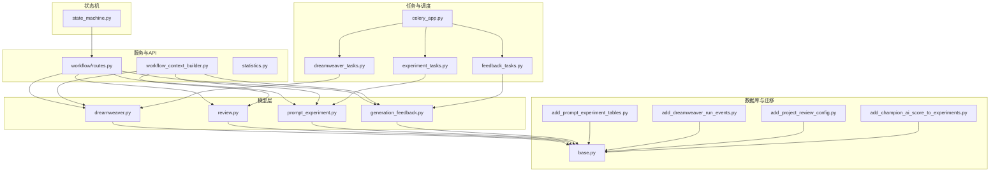
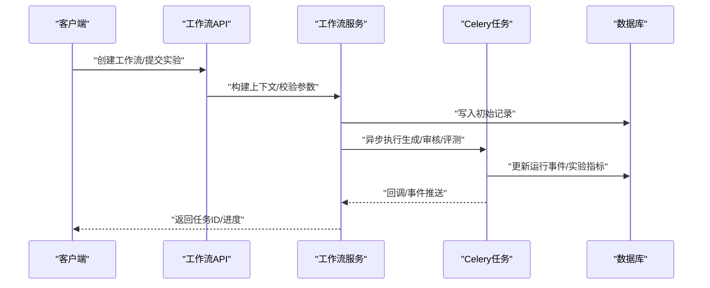
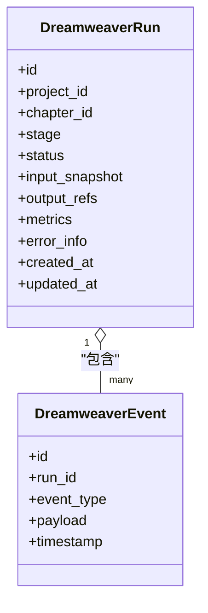
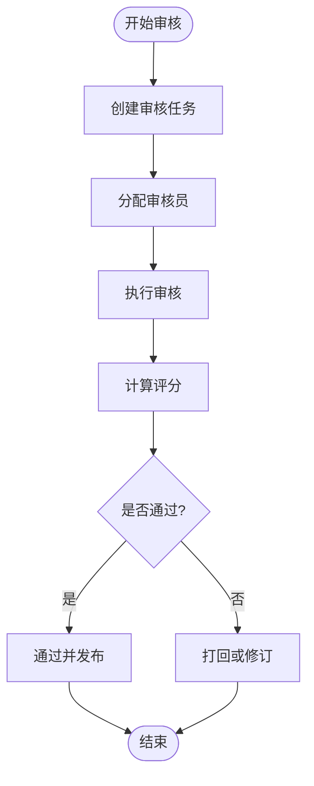
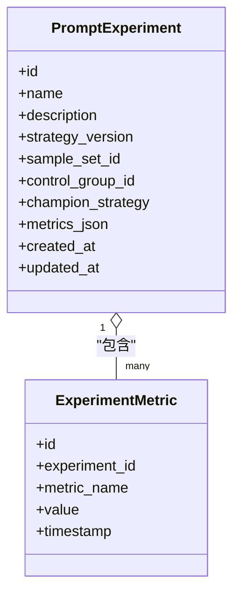
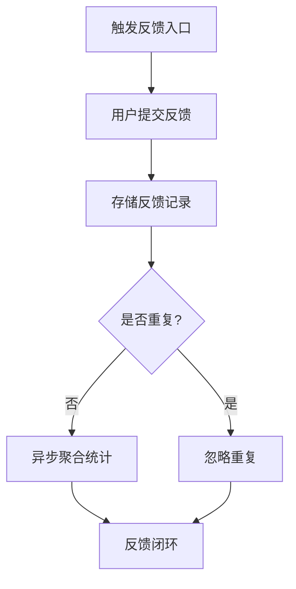
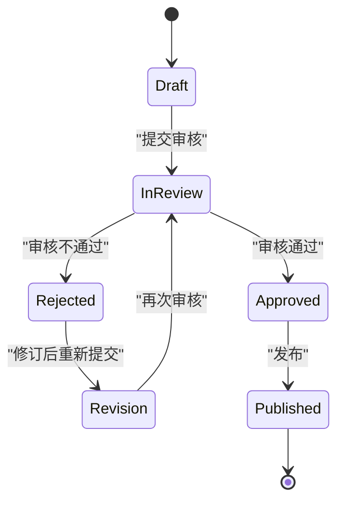
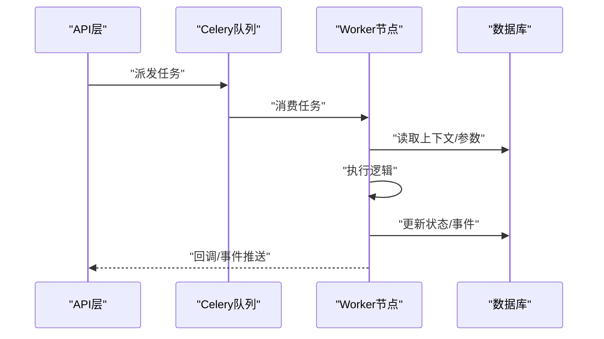
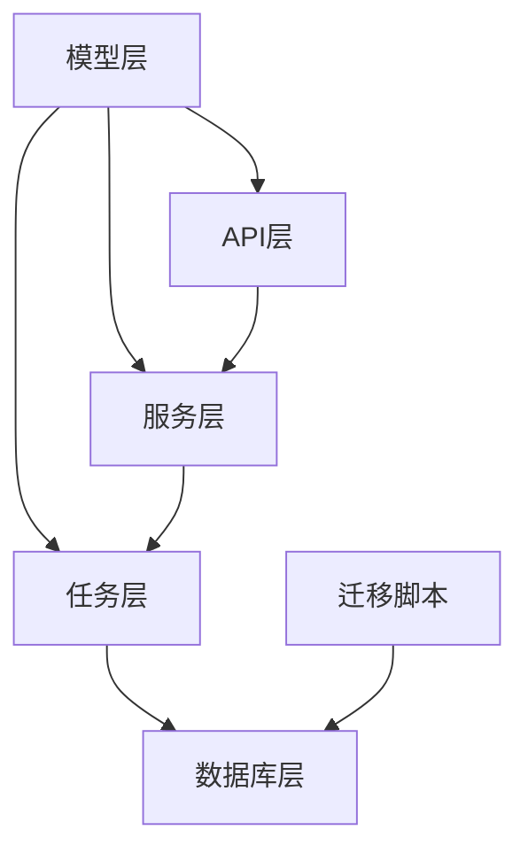

# 工作流相关模型

<cite>
**本文引用的文件**   
- [backend/app/models/dreamweaver.py](file://backend/app/models/dreamweaver.py)
- [backend/app/models/review.py](file://backend/app/models/review.py)
- [backend/app/models/prompt_experiment.py](file://backend/app/models/prompt_experiment.py)
- [backend/app/models/generation_feedback.py](file://backend/app/models/generation_feedback.py)
- [backend/app/api/v1/workflow/routes.py](file://backend/app/api/v1/workflow/routes.py)
- [backend/app/services/workflow_context_builder.py](file://backend/app/services/workflow_context_builder.py)
- [backend/app/tasks/dreamweaver_tasks.py](file://backend/app/tasks/dreamweaver_tasks.py)
- [backend/app/tasks/experiment_tasks.py](file://backend/app/tasks/experiment_tasks.py)
- [backend/app/tasks/feedback_tasks.py](file://backend/app/tasks/feedback_tasks.py)
- [backend/app/celery_app.py](file://backend/app/celery_app.py)
- [backend/app/db/base.py](file://backend/app/db/base.py)
- [alembic/versions/add_prompt_experiment_tables.py](file://alembic/versions/add_prompt_experiment_tables.py)
- [alembic/versions/add_dreamweaver_run_events.py](file://alembic/versions/add_dreamweaver_run_events.py)
- [alembic/versions/add_project_review_config.py](file://alembic/versions/add_project_review_config.py)
- [alembic/versions/add_champion_ai_score_to_experiments.py](file://alembic/versions/add_champion_ai_score_to_experiments.py)
- [pipeline/state_machine.py](file://pipeline/state_machine.py)
- [backend/app/api/v1/statistics.py](file://backend/app/api/v1/statistics.py)
</cite>

## 目录
1. [引言](#引言)
2. [项目结构](#项目结构)
3. [核心组件](#核心组件)
4. [架构总览](#架构总览)
5. [详细组件分析](#详细组件分析)
6. [依赖关系分析](#依赖关系分析)
7. [性能考虑](#性能考虑)
8. [故障排查指南](#故障排查指南)
9. [结论](#结论)
10. [附录](#附录)

## 引言
本文件面向工作流与实验系统的数据模型，系统性梳理 Dreamweaver（梦境编织者）、Review（审核）、PromptExperiment（提示词实验）、GenerationFeedback（生成反馈）等实体的数据结构设计，并解释工作流状态机、任务调度、审核流程与实验管理的数据库实现。文档涵盖复杂状态转换、并发控制与事务管理，以及实验数据的统计分析、反馈收集与质量评估机制，并提供工作流编排示例、实验对比分析与性能监控方案，帮助读者快速理解并高效使用该系统。

## 项目结构
围绕工作流与实验的核心代码主要分布在以下位置：
- 数据模型定义：backend/app/models 下的 dreamweaver.py、review.py、prompt_experiment.py、generation_feedback.py
- 工作流 API 路由：backend/app/api/v1/workflow/routes.py
- 工作流上下文构建：backend/app/services/workflow_context_builder.py
- 异步任务与调度：backend/app/tasks 下的 dreamweaver_tasks.py、experiment_tasks.py、feedback_tasks.py，以及 celery_app.py
- 数据库迁移：alembic/versions 中与实验表、Dreamweaver 运行事件、审核配置等相关的迁移脚本
- 状态机：pipeline/state_machine.py
- 统计接口：backend/app/api/v1/statistics.py

图表来源
- [backend/app/models/dreamweaver.py](file://backend/app/models/dreamweaver.py)
- [backend/app/models/review.py](file://backend/app/models/review.py)
- [backend/app/models/prompt_experiment.py](file://backend/app/models/prompt_experiment.py)
- [backend/app/models/generation_feedback.py](file://backend/app/models/generation_feedback.py)
- [backend/app/api/v1/workflow/routes.py](file://backend/app/api/v1/workflow/routes.py)
- [backend/app/services/workflow_context_builder.py](file://backend/app/services/workflow_context_builder.py)
- [backend/app/tasks/dreamweaver_tasks.py](file://backend/app/tasks/dreamweaver_tasks.py)
- [backend/app/tasks/experiment_tasks.py](file://backend/app/tasks/experiment_tasks.py)
- [backend/app/tasks/feedback_tasks.py](file://backend/app/tasks/feedback_tasks.py)
- [backend/app/celery_app.py](file://backend/app/celery_app.py)
- [backend/app/db/base.py](file://backend/app/db/base.py)
- [alembic/versions/add_prompt_experiment_tables.py](file://alembic/versions/add_prompt_experiment_tables.py)
- [alembic/versions/add_dreamweaver_run_events.py](file://alembic/versions/add_dreamweaver_run_events.py)
- [alembic/versions/add_project_review_config.py](file://alembic/versions/add_project_review_config.py)
- [alembic/versions/add_champion_ai_score_to_experiments.py](file://alembic/versions/add_champion_ai_score_to_experiments.py)
- [pipeline/state_machine.py](file://pipeline/state_machine.py)

章节来源
- [backend/app/models/dreamweaver.py](file://backend/app/models/dreamweaver.py)
- [backend/app/models/review.py](file://backend/app/models/review.py)
- [backend/app/models/prompt_experiment.py](file://backend/app/models/prompt_experiment.py)
- [backend/app/models/generation_feedback.py](file://backend/app/models/generation_feedback.py)
- [backend/app/api/v1/workflow/routes.py](file://backend/app/api/v1/workflow/routes.py)
- [backend/app/services/workflow_context_builder.py](file://backend/app/services/workflow_context_builder.py)
- [backend/app/tasks/dreamweaver_tasks.py](file://backend/app/tasks/dreamweaver_tasks.py)
- [backend/app/tasks/experiment_tasks.py](file://backend/app/tasks/experiment_tasks.py)
- [backend/app/tasks/feedback_tasks.py](file://backend/app/tasks/feedback_tasks.py)
- [backend/app/celery_app.py](file://backend/app/celery_app.py)
- [backend/app/db/base.py](file://backend/app/db/base.py)
- [pipeline/state_machine.py](file://pipeline/state_machine.py)

## 核心组件
- Dreamweaver（梦境编织者）：负责多模态内容生成的运行记录与事件追踪，包含运行ID、阶段、输入输出元数据、资源消耗与错误信息。
- Review（审核）：用于对生成结果进行质量与合规性审核，支持多维度评分、审核意见、版本对比与审批流转。
- PromptExperiment（提示词实验）：管理提示词策略的实验集，包括实验定义、样本集、对照组与冠军策略、指标统计与版本演进。
- GenerationFeedback（生成反馈）：收集用户对生成结果的反馈，包括评分、标签、评论与改进建议，驱动后续优化。

章节来源
- [backend/app/models/dreamweaver.py](file://backend/app/models/dreamweaver.py)
- [backend/app/models/review.py](file://backend/app/models/review.py)
- [backend/app/models/prompt_experiment.py](file://backend/app/models/prompt_experiment.py)
- [backend/app/models/generation_feedback.py](file://backend/app/models/generation_feedback.py)

## 架构总览
工作流与实验系统的整体架构由“模型层 + API层 + 服务层 + 任务调度层 + 数据库层”组成。API 层暴露工作流编排与查询接口；服务层负责上下文构建与业务编排；任务调度层通过 Celery 执行耗时操作；数据库层通过 Alembic 管理迁移，持久化实体与事件。

图表来源
- [backend/app/api/v1/workflow/routes.py](file://backend/app/api/v1/workflow/routes.py)
- [backend/app/services/workflow_context_builder.py](file://backend/app/services/workflow_context_builder.py)
- [backend/app/tasks/dreamweaver_tasks.py](file://backend/app/tasks/dreamweaver_tasks.py)
- [backend/app/tasks/experiment_tasks.py](file://backend/app/tasks/experiment_tasks.py)
- [backend/app/celery_app.py](file://backend/app/celery_app.py)
- [backend/app/db/base.py](file://backend/app/db/base.py)

## 详细组件分析

### Dreamweaver（梦境编织者）数据模型与事件
- 实体职责：记录一次或多步内容生成任务的完整生命周期，包括阶段划分、输入参数、输出产物、资源用量、错误堆栈与重试次数。
- 关键字段：运行ID、项目/章节关联、阶段枚举、状态机状态、输入快照、输出引用、时间戳、错误码、重试计数。
- 事件追踪：通过运行事件表记录每个阶段的开始、完成、失败与中间产物，便于回溯与审计。
- 并发控制：基于运行ID与阶段锁避免重复执行；任务幂等性与重试策略保障稳定性。
- 事务管理：关键写入采用原子事务，确保状态与事件一致性。

图表来源
- [backend/app/models/dreamweaver.py](file://backend/app/models/dreamweaver.py)
- [alembic/versions/add_dreamweaver_run_events.py](file://alembic/versions/add_dreamweaver_run_events.py)

章节来源
- [backend/app/models/dreamweaver.py](file://backend/app/models/dreamweaver.py)
- [alembic/versions/add_dreamweaver_run_events.py](file://alembic/versions/add_dreamweaver_run_events.py)

### Review（审核）数据模型与流程
- 实体职责：对生成结果进行多维度的质量与合规性审核，支持人工与自动审核结合，形成可追溯的审核记录。
- 关键字段：审核ID、关联运行/实验ID、审核维度（如语义一致性、画面质量、音频清晰度）、评分、意见、审核人、版本对比。
- 流程设计：创建审核任务 -> 分配审核员 -> 执行审核 -> 汇总评分 -> 决策（通过/打回/修订）。
- 并发控制：审核任务按资源隔离，避免同一对象被重复审核；支持乐观锁防止覆盖。
- 事务管理：审核结果与版本对比在同一事务中提交，保证一致性。

图表来源
- [backend/app/models/review.py](file://backend/app/models/review.py)
- [alembic/versions/add_project_review_config.py](file://alembic/versions/add_project_review_config.py)

章节来源
- [backend/app/models/review.py](file://backend/app/models/review.py)
- [alembic/versions/add_project_review_config.py](file://alembic/versions/add_project_review_config.py)

### PromptExperiment（提示词实验）数据模型与管理
- 实体职责：管理提示词策略的实验集，包括实验定义、样本集、对照组与冠军策略、指标统计与版本演进。
- 关键字段：实验ID、名称、描述、策略版本、样本集合、对照组、冠军策略、指标（准确率、召回率、F1、用户满意度等）、时间戳。
- 管理流程：创建实验 -> 准备样本 -> 执行评测 -> 统计指标 -> 选择冠军 -> 发布新版本。
- 并发控制：实验执行采用队列化调度，避免样本冲突；指标聚合在独立事务中合并。
- 事务管理：样本写入、指标计算与冠军选择需保持原子性。

图表来源
- [backend/app/models/prompt_experiment.py](file://backend/app/models/prompt_experiment.py)
- [alembic/versions/add_prompt_experiment_tables.py](file://alembic/versions/add_prompt_experiment_tables.py)
- [alembic/versions/add_champion_ai_score_to_experiments.py](file://alembic/versions/add_champion_ai_score_to_experiments.py)

章节来源
- [backend/app/models/prompt_experiment.py](file://backend/app/models/prompt_experiment.py)
- [alembic/versions/add_prompt_experiment_tables.py](file://alembic/versions/add_prompt_experiment_tables.py)
- [alembic/versions/add_champion_ai_score_to_experiments.py](file://alembic/versions/add_champion_ai_score_to_experiments.py)

### GenerationFeedback（生成反馈）数据模型与收集
- 实体职责：收集用户对生成结果的反馈，包括评分、标签、评论与改进建议，驱动后续优化。
- 关键字段：反馈ID、关联运行/实验ID、评分、标签、评论内容、用户ID、时间戳。
- 收集流程：触发反馈入口 -> 用户提交 -> 存储与去重 -> 聚合统计 -> 反馈闭环。
- 并发控制：反馈写入采用幂等键避免重复；聚合统计异步处理。
- 事务管理：反馈写入与统计增量在同一事务中提交。

图表来源
- [backend/app/models/generation_feedback.py](file://backend/app/models/generation_feedback.py)
- [backend/app/tasks/feedback_tasks.py](file://backend/app/tasks/feedback_tasks.py)

章节来源
- [backend/app/models/generation_feedback.py](file://backend/app/models/generation_feedback.py)
- [backend/app/tasks/feedback_tasks.py](file://backend/app/tasks/feedback_tasks.py)

### 工作流状态机与编排
- 状态机设计：定义工作流各阶段的状态与转换规则，确保状态变更的可预测性与一致性。
- 编排示例：以“章节生成”为例，展示从“草稿”到“审核”再到“发布”的状态流转。
- 并发控制：状态转换采用乐观锁与版本号控制，避免竞态条件。
- 事务管理：状态转换与事件记录在同一事务中提交，保证最终一致性。

图表来源
- [pipeline/state_machine.py](file://pipeline/state_machine.py)
- [backend/app/api/v1/workflow/routes.py](file://backend/app/api/v1/workflow/routes.py)

章节来源
- [pipeline/state_machine.py](file://pipeline/state_machine.py)
- [backend/app/api/v1/workflow/routes.py](file://backend/app/api/v1/workflow/routes.py)

### 任务调度与异步执行
- 调度框架：基于 Celery 的任务队列，支持延迟执行、重试与优先级。
- 任务类型：Dreamweaver 生成任务、实验评测任务、反馈聚合任务等。
- 并发控制：任务幂等性、分布式锁与限流策略保障高并发下的稳定性。
- 监控与追踪：任务执行日志、指标上报与异常告警。

图表来源
- [backend/app/celery_app.py](file://backend/app/celery_app.py)
- [backend/app/tasks/dreamweaver_tasks.py](file://backend/app/tasks/dreamweaver_tasks.py)
- [backend/app/tasks/experiment_tasks.py](file://backend/app/tasks/experiment_tasks.py)
- [backend/app/tasks/feedback_tasks.py](file://backend/app/tasks/feedback_tasks.py)

章节来源
- [backend/app/celery_app.py](file://backend/app/celery_app.py)
- [backend/app/tasks/dreamweaver_tasks.py](file://backend/app/tasks/dreamweaver_tasks.py)
- [backend/app/tasks/experiment_tasks.py](file://backend/app/tasks/experiment_tasks.py)
- [backend/app/tasks/feedback_tasks.py](file://backend/app/tasks/feedback_tasks.py)

## 依赖关系分析
- 模型依赖：所有实体均依赖 base.py 中的基础模型定义，确保字段类型与约束一致。
- API与服务依赖：工作流 API 依赖服务层进行上下文构建与业务编排。
- 任务依赖：任务层依赖模型与数据库访问，执行异步逻辑。
- 迁移依赖：Alembic 迁移脚本确保数据库结构与模型同步。

图表来源
- [backend/app/db/base.py](file://backend/app/db/base.py)
- [backend/app/api/v1/workflow/routes.py](file://backend/app/api/v1/workflow/routes.py)
- [backend/app/services/workflow_context_builder.py](file://backend/app/services/workflow_context_builder.py)
- [backend/app/tasks/dreamweaver_tasks.py](file://backend/app/tasks/dreamweaver_tasks.py)
- [alembic/versions/add_prompt_experiment_tables.py](file://alembic/versions/add_prompt_experiment_tables.py)

章节来源
- [backend/app/db/base.py](file://backend/app/db/base.py)
- [backend/app/api/v1/workflow/routes.py](file://backend/app/api/v1/workflow/routes.py)
- [backend/app/services/workflow_context_builder.py](file://backend/app/services/workflow_context_builder.py)
- [backend/app/tasks/dreamweaver_tasks.py](file://backend/app/tasks/dreamweaver_tasks.py)
- [alembic/versions/add_prompt_experiment_tables.py](file://alembic/versions/add_prompt_experiment_tables.py)

## 性能考虑
- 数据库优化：为高频查询字段建立索引，避免全表扫描；分库分表策略适用于大规模数据。
- 缓存策略：热点数据（如模型配置、审核规则）使用缓存降低数据库压力。
- 异步处理：将耗时操作（如生成、评测、聚合）放入任务队列，提升响应速度。
- 批处理：批量写入与更新减少事务开销，提高吞吐。
- 监控与告警：实时监控任务队列长度、数据库连接池与错误率，及时告警。

## 故障排查指南
- 常见问题：任务执行失败、状态不一致、数据丢失、并发冲突。
- 排查步骤：检查任务日志、数据库事务日志、状态机转换记录、错误堆栈。
- 恢复策略：重试机制、补偿事务、数据修复脚本。
- 预防措施：加强输入校验、增加幂等性、完善监控与告警。

章节来源
- [backend/app/tasks/dreamweaver_tasks.py](file://backend/app/tasks/dreamweaver_tasks.py)
- [backend/app/tasks/experiment_tasks.py](file://backend/app/tasks/experiment_tasks.py)
- [backend/app/tasks/feedback_tasks.py](file://backend/app/tasks/feedback_tasks.py)

## 结论
本文件全面梳理了工作流与实验系统的数据模型与实现细节，涵盖 Dreamweaver、Review、PromptExperiment、GenerationFeedback 等核心实体，解释了状态机、任务调度、审核流程与实验管理的数据库实现。通过并发控制、事务管理与性能优化策略，系统在高并发场景下保持稳定与高效。建议在实际使用中结合监控与告警，持续优化系统性能与用户体验。

## 附录
- 工作流编排示例：以“章节生成”为例，展示从草稿到发布的完整流程。
- 实验对比分析：通过指标统计与冠军策略选择，评估不同提示词策略的效果。
- 性能监控方案：实时监控任务队列、数据库连接池与错误率，确保系统稳定运行。