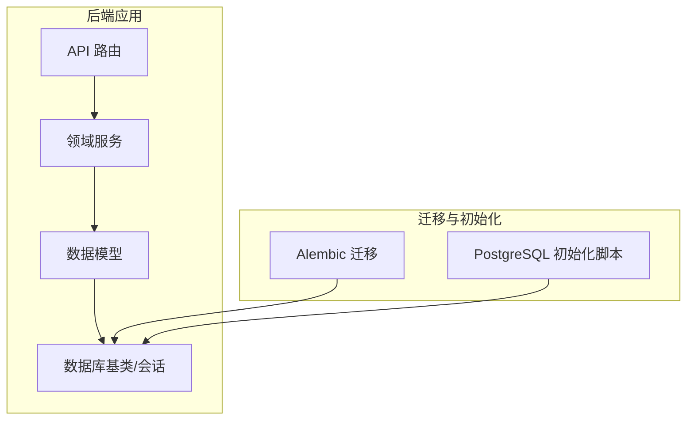
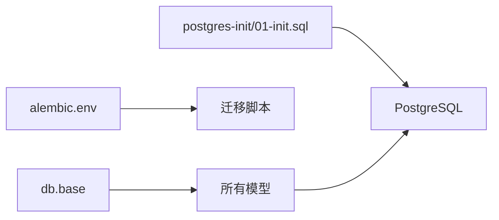

# 数据库模型

<cite>
**本文引用的文件**
- [backend/app/models/project.py](file://backend/app/models/project.py)
- [backend/app/models/character.py](file://backend/app/models/character.py)
- [backend/app/models/audiobook.py](file://backend/app/models/audiobook.py)
- [backend/app/models/user.py](file://backend/app/models/user.py)
- [backend/app/models/role.py](file://backend/app/models/role.py)
- [backend/app/models/admin_log.py](file://backend/app/models/admin_log.py)
- [backend/app/models/memory.py](file://backend/app/models/memory.py)
- [backend/app/models/graph.py](file://backend/app/models/graph.py)
- [backend/app/models/audio_library_asset.py](file://backend/app/models/audio_library_asset.py)
- [backend/app/models/voice_reference_asset.py](file://backend/app/models/voice_reference_asset.py)
- [backend/app/models/voice_pool_publication.py](file://backend/app/models/voice_pool_publication.py)
- [backend/app/models/voice_pool_rating.py](file://backend/app/models/voice_pool_rating.py)
- [backend/app/models/user_asset_record.py](file://backend/app/models/user_asset_record.py)
- [backend/app/models/voice_asset_billing_ledger.py](file://backend/app/models/voice_asset_billing_ledger.py)
- [backend/app/models/book_parser.py](file://backend/app/models/book_parser.py)
- [backend/app/models/dreamweaver.py](file://backend/app/models/dreamweaver.py)
- [backend/app/models/review.py](file://backend/app/models/review.py)
- [backend/app/models/prompt_experiment.py](file://backend/app/models/prompt_experiment.py)
- [backend/app/models/model_catalog.py](file://backend/app/models/model_catalog.py)
- [backend/app/models/setting.py](file://backend/app/models/setting.py)
- [backend/app/db/base.py](file://backend/app/db/base.py)
- [backend/app/db/schema_compat.py](file://backend/app/db/schema_compat.py)
- [backend/alembic/env.py](file://backend/alembic/env.py)
- [backend/alembic.ini](file://backend/alembic.ini)
- [postgres-init/01-init.sql](file://postgres-init/01-init.sql)
- [DATABASE_MIGRATION_GUIDE.md](file://DATABASE_MIGRATION_GUIDE.md)
</cite>

## 目录
1. [简介](#简介)
2. [项目结构](#项目结构)
3. [核心组件](#核心组件)
4. [架构总览](#架构总览)
5. [详细组件分析](#详细组件分析)
6. [依赖关系分析](#依赖关系分析)
7. [性能考虑](#性能考虑)
8. [故障排查指南](#故障排查指南)
9. [结论](#结论)
10. [附录](#附录)

## 简介
本文件为小说创作代理系统的数据库模型提供系统化文档，覆盖实体与关系、字段定义、约束与索引策略、ORM映射配置、数据验证与业务规则、迁移与版本管理、备份恢复方案、SQL查询示例、性能优化建议以及安全访问控制与审计日志实现。读者可据此快速理解系统的数据层设计与运维要点。

## 项目结构
后端采用分层架构：API路由位于 backend/app/api，领域服务在 backend/app/services，数据模型集中在 backend/app/models，数据库基础配置与兼容性工具在 backend/app/db，迁移脚本由 Alembic 管理于 backend/alembic。PostgreSQL 初始化脚本位于 postgres-init。

图表来源
- [backend/app/db/base.py](file://backend/app/db/base.py)
- [backend/alembic/env.py](file://backend/alembic/env.py)
- [postgres-init/01-init.sql](file://postgres-init/01-init.sql)

章节来源
- [backend/app/db/base.py](file://backend/app/db/base.py)
- [backend/alembic/env.py](file://backend/alembic/env.py)
- [postgres-init/01-init.sql](file://postgres-init/01-init.sql)

## 核心组件
- 项目 Project：作品级聚合根，包含元数据、设置、音频配置、展示编号等。
- 角色 Character：角色设定、定位、风格、故事立场等。
- 有声书 Audiobook：按项目生成的有声内容集合，含任务、删除审计、时间戳对齐等。
- 用户 User：账户信息、第三方登录、手机号等。
- 角色 Role：RBAC 权限角色。
- 资产与声音库：音频库资源、语音参考资产、公开声池发布与评分、用户资产记录、计费台账。
- 解析与生成：书籍解析、Dreamweaver 运行事件、评测与实验、模型目录、设置项。
- 记忆与图谱：记忆条目、图结构（知识图谱或剧情关系）。
- 审计日志：管理员操作审计。

章节来源
- [backend/app/models/project.py](file://backend/app/models/project.py)
- [backend/app/models/character.py](file://backend/app/models/character.py)
- [backend/app/models/audiobook.py](file://backend/app/models/audiobook.py)
- [backend/app/models/user.py](file://backend/app/models/user.py)
- [backend/app/models/role.py](file://backend/app/models/role.py)
- [backend/app/models/audio_library_asset.py](file://backend/app/models/audio_library_asset.py)
- [backend/app/models/voice_reference_asset.py](file://backend/app/models/voice_reference_asset.py)
- [backend/app/models/voice_pool_publication.py](file://backend/app/models/voice_pool_publication.py)
- [backend/app/models/voice_pool_rating.py](file://backend/app/models/voice_pool_rating.py)
- [backend/app/models/user_asset_record.py](file://backend/app/models/user_asset_record.py)
- [backend/app/models/voice_asset_billing_ledger.py](file://backend/app/models/voice_asset_billing_ledger.py)
- [backend/app/models/book_parser.py](file://backend/app/models/book_parser.py)
- [backend/app/models/dreamweaver.py](file://backend/app/models/dreamweaver.py)
- [backend/app/models/review.py](file://backend/app/models/review.py)
- [backend/app/models/prompt_experiment.py](file://backend/app/models/prompt_experiment.py)
- [backend/app/models/model_catalog.py](file://backend/app/models/model_catalog.py)
- [backend/app/models/setting.py](file://backend/app/models/setting.py)
- [backend/app/models/memory.py](file://backend/app/models/memory.py)
- [backend/app/models/graph.py](file://backend/app/models/graph.py)
- [backend/app/models/admin_log.py](file://backend/app/models/admin_log.py)

## 架构总览
数据层以 SQLAlchemy ORM 为核心，通过 base 模块统一会话与引擎配置；使用 Alembic 进行迁移管理与版本控制；PostgreSQL 作为主存储。模型之间通过外键与逻辑关联组织，形成“项目-角色-有声书”的主干关系，并辅以资产、评测、实验、设置、记忆与图谱等扩展域。

```mermaid
classDiagram
class Project {
+id
+title
+settings
+audio_config
+display_no
+timestamps
}
class Character {
+id
+project_id
+name
+position
+story_stance
+timestamps
}
class Audiobook {
+id
+project_id
+status
+deleted_at
+timestamps
}
class User {
+id
+username
+phone
+third_party_fields
+timestamps
}
class Role {
+id
+name
+permissions
}
class AdminLog {
+id
+actor_id
+action
+detail
+timestamps
}
class AudioLibraryAsset {
+id
+project_id
+meta
+ratings
}
class VoiceReferenceAsset {
+id
+project_id
+sample_meta
}
class VoicePoolPublication {
+id
+voice_id
+public_flag
}
class VoicePoolRating {
+id
+publication_id
+score
}
class UserAssetRecord {
+id
+user_id
+asset_ref
+local_first_flag
}
class VoiceAssetBillingLedger {
+id
+user_id
+asset_ref
+billing_event
}
class BookParser {
+id
+project_id
+parsed_meta
}
class DreamweaverRun {
+id
+project_id
+event_type
+payload
}
class Review {
+id
+subject_type
+subject_id
+verdict
}
class PromptExperiment {
+id
+project_id
+experiment_meta
}
class ModelCatalog {
+id
+model_key
+catalog_meta
}
class Setting {
+id
+entity_type
+entity_id
+key
+value
}
class Memory {
+id
+entity_type
+entity_id
+content
}
class Graph {
+id
+entity_type
+entity_id
+edges
}
Project "1" -- "n" Character : "拥有"
Project "1" -- "n" Audiobook : "生成"
Project "1" -- "n" BookParser : "解析"
Project "1" -- "n" DreamweaverRun : "运行事件"
Project "1" -- "n" AudioLibraryAsset : "素材"
Project "1" -- "n" VoiceReferenceAsset : "参考音"
Project "1" -- "n" PromptExperiment : "实验"
Project "1" -- "n" Setting : "设置项"
Project "1" -- "n" Memory : "记忆"
Project "1" -- "n" Graph : "图谱"
User "1" -- "n" UserAssetRecord : "资产记录"
User "1" -- "n" VoiceAssetBillingLedger : "计费台账"
Role "1" -- "n" AdminLog : "审计主体"
VoicePoolPublication "1" -- "n" VoicePoolRating : "评分"
```

图表来源
- [backend/app/models/project.py](file://backend/app/models/project.py)
- [backend/app/models/character.py](file://backend/app/models/character.py)
- [backend/app/models/audiobook.py](file://backend/app/models/audiobook.py)
- [backend/app/models/user.py](file://backend/app/models/user.py)
- [backend/app/models/role.py](file://backend/app/models/role.py)
- [backend/app/models/audio_library_asset.py](file://backend/app/models/audio_library_asset.py)
- [backend/app/models/voice_reference_asset.py](file://backend/app/models/voice_reference_asset.py)
- [backend/app/models/voice_pool_publication.py](file://backend/app/models/voice_pool_publication.py)
- [backend/app/models/voice_pool_rating.py](file://backend/app/models/voice_pool_rating.py)
- [backend/app/models/user_asset_record.py](file://backend/app/models/user_asset_record.py)
- [backend/app/models/voice_asset_billing_ledger.py](file://backend/app/models/voice_asset_billing_ledger.py)
- [backend/app/models/book_parser.py](file://backend/app/models/book_parser.py)
- [backend/app/models/dreamweaver.py](file://backend/app/models/dreamweaver.py)
- [backend/app/models/review.py](file://backend/app/models/review.py)
- [backend/app/models/prompt_experiment.py](file://backend/app/models/prompt_experiment.py)
- [backend/app/models/model_catalog.py](file://backend/app/models/model_catalog.py)
- [backend/app/models/setting.py](file://backend/app/models/setting.py)
- [backend/app/models/memory.py](file://backend/app/models/memory.py)
- [backend/app/models/graph.py](file://backend/app/models/graph.py)

## 详细组件分析

### 项目 Project
- 职责：承载小说项目的元数据、全局设置、音频配置、展示编号等。
- 关键字段：标识、标题、JSON 设置、音频配置、展示编号、时间戳。
- 约束与索引：唯一性约束（如展示编号）、常用查询字段索引（标题、创建时间）。
- 关联：一对多关联到角色、有声书、书籍解析、Dreamweaver 运行事件、音频库资产、语音参考资产、提示词实验、设置项、记忆、图谱。
- 业务规则：音频配置影响有声书生成流程；设置项用于项目级行为开关。

章节来源
- [backend/app/models/project.py](file://backend/app/models/project.py)

### 角色 Character
- 职责：描述角色名称、定位、故事立场、风格等。
- 关键字段：所属项目、名称、角色定位、故事立场、时间戳。
- 约束与索引：项目内唯一性（视需求），名称与定位的查询索引。
- 关联：属于某项目，参与有声书场景与评测。

章节来源
- [backend/app/models/character.py](file://backend/app/models/character.py)

### 有声书 Audiobook
- 职责：记录项目下的有声书产物与任务状态，支持软删除与审计。
- 关键字段：所属项目、状态、删除标记、时间戳、章节音频脚本字段等。
- 约束与索引：项目内唯一性（视阶段），状态与时间戳索引。
- 业务规则：任务执行过程中状态机流转；删除走审计表记录。

章节来源
- [backend/app/models/audiobook.py](file://backend/app/models/audiobook.py)

### 用户 User
- 职责：账户信息与第三方登录、手机号等。
- 关键字段：用户名、手机号、第三方登录字段、时间戳。
- 约束与索引：用户名唯一、手机号唯一（可选）。
- 关联：用户资产记录、计费台账、管理员审计主体。

章节来源
- [backend/app/models/user.py](file://backend/app/models/user.py)

### 角色 Role
- 职责：RBAC 权限角色定义。
- 关键字段：角色名、权限集。
- 约束与索引：角色名唯一。

章节来源
- [backend/app/models/role.py](file://backend/app/models/role.py)

### 资产与声音库
- 音频库资产：项目级素材，含元数据与评分。
- 语音参考资产：项目级参考音样本与元数据。
- 公开声池发布与评分：对外发布的声纹资产及评分。
- 用户资产记录：用户与资产的引用关系，支持本地优先策略。
- 计费台账：用户资产使用的计费事件流水。

章节来源
- [backend/app/models/audio_library_asset.py](file://backend/app/models/audio_library_asset.py)
- [backend/app/models/voice_reference_asset.py](file://backend/app/models/voice_reference_asset.py)
- [backend/app/models/voice_pool_publication.py](file://backend/app/models/voice_pool_publication.py)
- [backend/app/models/voice_pool_rating.py](file://backend/app/models/voice_pool_rating.py)
- [backend/app/models/user_asset_record.py](file://backend/app/models/user_asset_record.py)
- [backend/app/models/voice_asset_billing_ledger.py](file://backend/app/models/voice_asset_billing_ledger.py)

### 解析与生成
- 书籍解析：项目级文本解析结果与元数据。
- Dreamweaver 运行事件：视频/多媒体生成过程的事件记录。
- 评测与实验：评测结果与提示词实验元数据。
- 模型目录：模型注册与目录信息。

章节来源
- [backend/app/models/book_parser.py](file://backend/app/models/book_parser.py)
- [backend/app/models/dreamweaver.py](file://backend/app/models/dreamweaver.py)
- [backend/app/models/review.py](file://backend/app/models/review.py)
- [backend/app/models/prompt_experiment.py](file://backend/app/models/prompt_experiment.py)
- [backend/app/models/model_catalog.py](file://backend/app/models/model_catalog.py)

### 设置、记忆与图谱
- 设置 Setting：实体级键值对配置，支持 JSON 值。
- 记忆 Memory：实体相关记忆片段。
- 图谱 Graph：实体间的边与关系存储。

章节来源
- [backend/app/models/setting.py](file://backend/app/models/setting.py)
- [backend/app/models/memory.py](file://backend/app/models/memory.py)
- [backend/app/models/graph.py](file://backend/app/models/graph.py)

### 审计日志 AdminLog
- 职责：记录管理员操作，便于追溯与合规。
- 关键字段：操作者、动作、详情、时间戳。
- 约束与索引：操作者、动作、时间戳索引。

章节来源
- [backend/app/models/admin_log.py](file://backend/app/models/admin_log.py)

## 依赖关系分析
- ORM 基类与会话：base 模块提供统一的数据库连接与会话管理。
- 迁移与环境：Alembic env 负责加载配置与执行迁移脚本。
- 初始化脚本：PostgreSQL 初始化 SQL 用于环境搭建。

图表来源
- [backend/app/db/base.py](file://backend/app/db/base.py)
- [backend/alembic/env.py](file://backend/alembic/env.py)
- [postgres-init/01-init.sql](file://postgres-init/01-init.sql)

章节来源
- [backend/app/db/base.py](file://backend/app/db/base.py)
- [backend/alembic/env.py](file://backend/alembic/env.py)
- [postgres-init/01-init.sql](file://postgres-init/01-init.sql)

## 性能考虑
- 索引策略：对高频查询字段建立索引（如项目标题、时间戳、状态、用户ID、资产ID等）；复合索引用于常见过滤组合。
- 分页与投影：大表查询使用分页与必要字段投影，避免全量返回。
- 连接池与事务：合理配置连接池大小与事务边界，减少锁竞争。
- 批量写入：资产导入、计费流水等使用批量插入提升吞吐。
- 缓存与物化：热点数据（如模型目录、设置项）可结合缓存层降低数据库压力。
- 分区与归档：历史日志与审计表可按时间分区，定期归档冷数据。

[本节为通用指导，不直接分析具体文件]

## 故障排查指南
- 迁移失败：检查 alembic 环境与数据库连接，确认迁移脚本顺序与幂等性。
- 外键冲突：新增或删除数据时注意级联约束，必要时先处理依赖数据。
- 唯一约束冲突：用户名、手机号、展示编号等唯一字段需确保输入校验。
- 审计缺失：关键操作未落盘审计日志，检查事务提交与异常路径。
- 性能退化：慢查询需分析执行计划，补充索引或改写 SQL。

章节来源
- [backend/alembic.ini](file://backend/alembic.ini)
- [DATABASE_MIGRATION_GUIDE.md](file://DATABASE_MIGRATION_GUIDE.md)

## 结论
本数据库模型围绕“项目-角色-有声书”主干展开，辅以资产、评测、实验、设置、记忆与图谱等扩展域，形成完整的内容生产与运营数据体系。通过 Alembic 迁移与 PostgreSQL 初始化脚本保障版本一致性与环境可重复性。建议在高频查询路径上完善索引与分页策略，结合缓存与分区优化性能，并通过 RBAC 与审计日志强化安全与合规。

[本节为总结，不直接分析具体文件]

## 附录

### 实体关系图（ERD）

```mermaid
erDiagram
PROJECT {
uuid id PK
string title
json settings
json audio_config
int display_no
timestamp created_at
timestamp updated_at
}
CHARACTER {
uuid id PK
uuid project_id FK
string name
string position
string story_stance
timestamp created_at
timestamp updated_at
}
AUDIOBOOK {
uuid id PK
uuid project_id FK
enum status
timestamp deleted_at
timestamp created_at
timestamp updated_at
}
USER {
uuid id PK
string username UK
string phone UK
json third_party_fields
timestamp created_at
timestamp updated_at
}
ROLE {
uuid id PK
string name UK
json permissions
}
ADMIN_LOG {
uuid id PK
uuid actor_id FK
string action
json detail
timestamp created_at
}
AUDIO_LIBRARY_ASSET {
uuid id PK
uuid project_id FK
json meta
}
VOICE_REFERENCE_ASSET {
uuid id PK
uuid project_id FK
json sample_meta
}
VOICE_POOL_PUBLICATION {
uuid id PK
uuid voice_id FK
boolean public_flag
}
VOICE_POOL_RATING {
uuid id PK
uuid publication_id FK
float score
}
USER_ASSET_RECORD {
uuid id PK
uuid user_id FK
json asset_ref
boolean local_first
}
VOICE_ASSET_BILLING_LEDGER {
uuid id PK
uuid user_id FK
json asset_ref
string billing_event
}
BOOK_PARSER {
uuid id PK
uuid project_id FK
json parsed_meta
}
DREAMWEAVER_RUN {
uuid id PK
uuid project_id FK
string event_type
json payload
}
REVIEW {
uuid id PK
string subject_type
uuid subject_id
string verdict
}
PROMPT_EXPERIMENT {
uuid id PK
uuid project_id FK
json experiment_meta
}
MODEL_CATALOG {
uuid id PK
string model_key
json catalog_meta
}
SETTING {
uuid id PK
string entity_type
uuid entity_id
string key
json value
}
MEMORY {
uuid id PK
string entity_type
uuid entity_id
text content
}
GRAPH {
uuid id PK
string entity_type
uuid entity_id
json edges
}
PROJECT ||--o{ CHARACTER : "拥有"
PROJECT ||--o{ AUDIOBOOK : "生成"
PROJECT ||--o{ BOOK_PARSER : "解析"
PROJECT ||--o{ DREAMWEAVER_RUN : "运行事件"
PROJECT ||--o{ AUDIO_LIBRARY_ASSET : "素材"
PROJECT ||--o{ VOICE_REFERENCE_ASSET : "参考音"
PROJECT ||--o{ PROMPT_EXPERIMENT : "实验"
PROJECT ||--o{ SETTING : "设置项"
PROJECT ||--o{ MEMORY : "记忆"
PROJECT ||--o{ GRAPH : "图谱"
USER ||--o{ USER_ASSET_RECORD : "资产记录"
USER ||--o{ VOICE_ASSET_BILLING_LEDGER : "计费台账"
ROLE ||--o{ ADMIN_LOG : "审计主体"
VOICE_POOL_PUBLICATION ||--o{ VOICE_POOL_RATING : "评分"
```

[本图为概念性 ERD，不直接映射具体源码文件，故无图表来源]

### ORM 映射与配置
- 基类与会话：通过 base 模块统一引擎与会话生命周期管理。
- 模型声明：各模型文件定义表结构与字段类型，使用 SQLAlchemy 装饰器与关系定义。
- 兼容层：schema_compat 提供跨版本兼容与字段降级映射。

章节来源
- [backend/app/db/base.py](file://backend/app/db/base.py)
- [backend/app/db/schema_compat.py](file://backend/app/db/schema_compat.py)

### 数据验证与业务规则
- 输入校验：在 API 层与 Schema 层进行参数校验，确保必填、格式与范围。
- 业务规则：项目设置驱动生成流程；有声书状态机约束任务流转；删除操作触发审计记录。
- 约束与唯一性：用户名、手机号、展示编号等唯一性约束防止重复。

章节来源
- [backend/app/schemas/](file://backend/app/schemas/)
- [backend/app/models/audiobook.py](file://backend/app/models/audiobook.py)
- [backend/app/models/user.py](file://backend/app/models/user.py)
- [backend/app/models/project.py](file://backend/app/models/project.py)

### 迁移策略与版本管理
- 工具链：Alembic 管理迁移脚本，env.py 加载配置，alembic.ini 指定数据库 URL。
- 版本控制：每次变更生成独立迁移文件，保证可回滚与幂等。
- 初始化：postgres-init/01-init.sql 用于容器化环境的初始建库。

章节来源
- [backend/alembic/env.py](file://backend/alembic/env.py)
- [backend/alembic.ini](file://backend/alembic.ini)
- [postgres-init/01-init.sql](file://postgres-init/01-init.sql)
- [DATABASE_MIGRATION_GUIDE.md](file://DATABASE_MIGRATION_GUIDE.md)

### 备份与恢复方案
- 全量备份：定期导出数据库快照（pg_dump），保留多份历史副本。
- 增量备份：基于 WAL 的连续归档，缩短 RPO。
- 恢复演练：定期在测试环境演练恢复流程，验证完整性与一致性。
- 异地容灾：将备份同步至异地存储，防范单点故障。

[本节为通用指导，不直接分析具体文件]

### SQL 查询示例
- 获取项目下所有角色：SELECT * FROM character WHERE project_id = ?;
- 统计有声书状态分布：SELECT status, COUNT(*) FROM audiobook GROUP BY status;
- 用户资产使用汇总：SELECT user_id, COUNT(*) FROM user_asset_record GROUP BY user_id;
- 计费流水按日统计：SELECT DATE(created_at), SUM(1) FROM voice_asset_billing_ledger GROUP BY DATE(created_at);

[本节为通用示例，不直接分析具体文件]

### 数据安全、访问控制与审计日志
- 访问控制：基于角色的权限模型（Role）限制敏感操作。
- 审计日志：AdminLog 记录管理员操作，便于追踪与合规审查。
- 数据脱敏：敏感字段在输出层进行脱敏处理。
- 传输加密：HTTPS 与数据库连接加密。

章节来源
- [backend/app/models/role.py](file://backend/app/models/role.py)
- [backend/app/models/admin_log.py](file://backend/app/models/admin_log.py)