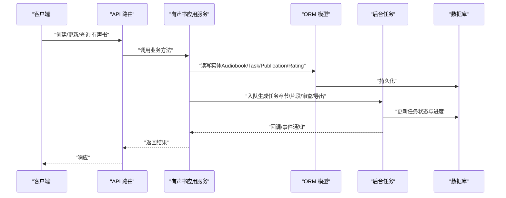
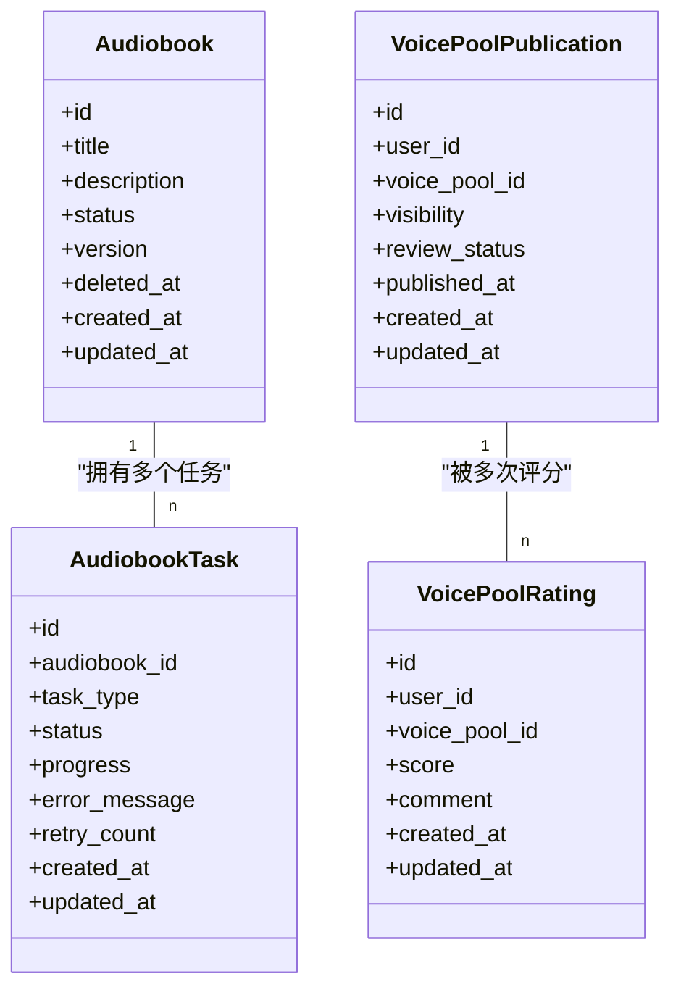
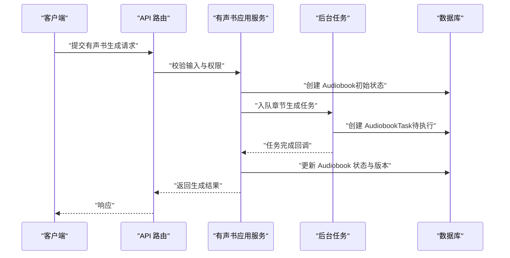
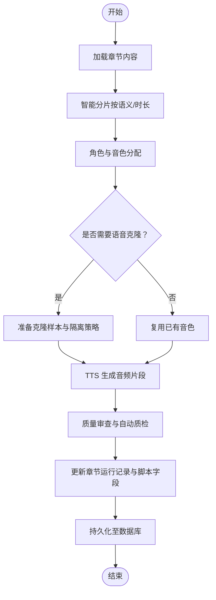
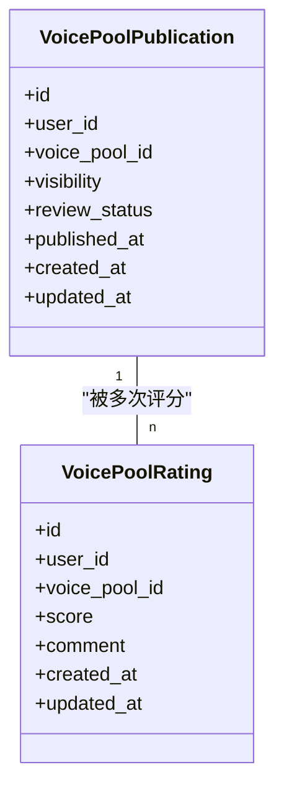
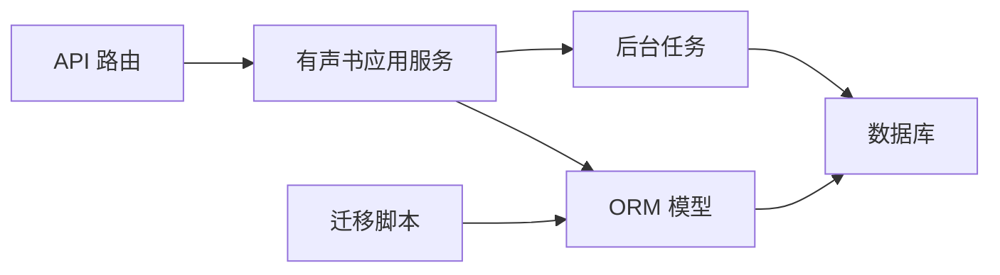
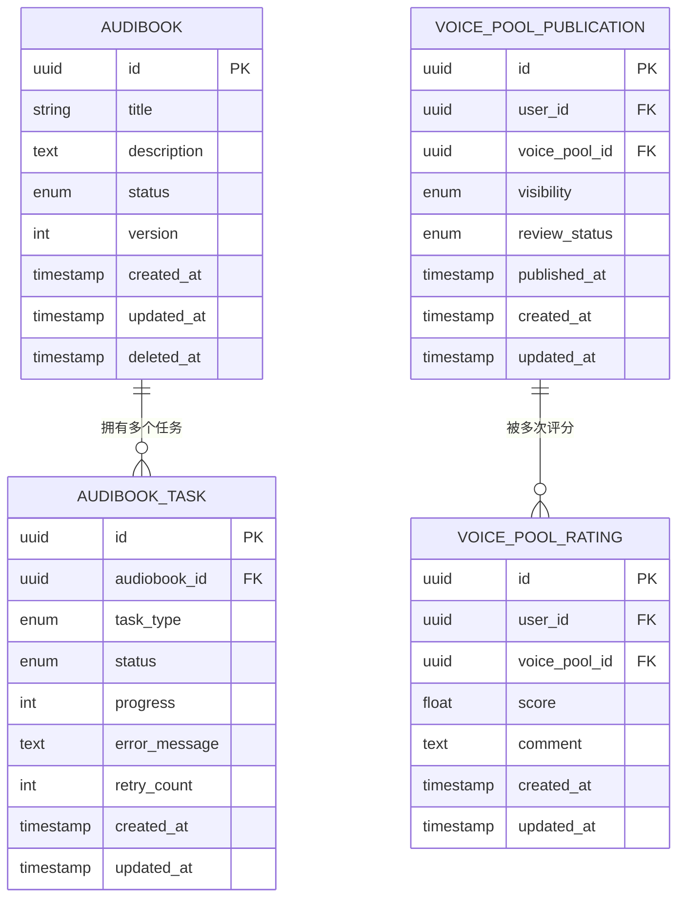

# 有声书相关模型

<cite>
**本文引用的文件**   
- [backend/app/models/audiobook.py](file://backend/app/models/audiobook.py)
- [backend/app/models/audiobook_task.py](file://backend/app/models/audiobook_task.py)
- [backend/app/models/voice_pool_publication.py](file://backend/app/models/voice_pool_publication.py)
- [backend/app/models/voice_pool_rating.py](file://backend/app/models/voice_pool_rating.py)
- [backend/app/schemas/audiobook.py](file://backend/app/schemas/audiobook.py)
- [backend/app/services/audiobook/audiobook_app_service.py](file://backend/app/services/audiobook/audiobook_app_service.py)
- [backend/app/tasks/audiobook_tasks.py](file://backend/app/tasks/audiobook_tasks.py)
- [backend/alembic/versions/add_audiobook_models.py](file://backend/alembic/versions/add_audiobook_models.py)
- [backend/alembic/versions/add_deleted_at_to_audiobook_models.py](file://backend/alembic/versions/add_deleted_at_to_audiobook_models.py)
- [backend/alembic/versions/add_chapter_audio_runs.py](file://backend/alembic/versions/add_chapter_audio_runs.py)
- [backend/alembic/versions/add_script_fields_to_chapter_audios.py](file://backend/alembic/versions/add_script_fields_to_chapter_audios.py)
- [backend/alembic/versions/add_user_voice_isolation_and_public_pool.py](file://backend/alembic/versions/add_user_voice_isolation_and_public_pool.py)
- [backend/alembic/versions/add_audio_library_asset_ratings.py](file://backend/alembic/versions/add_audio_library_asset_ratings.py)
- [backend/alembic/versions/add_voice_reference_assets.py](file://backend/alembic/versions/add_voice_reference_assets.py)
- [backend/alembic/versions/add_cascade_delete_constraints.py](file://backend/alembic/versions/add_cascade_delete_constraints.py)
- [backend/app/api/v1/audiobook_api/routes.py](file://backend/app/api/v1/audiobook_api/routes.py)
- [backend/app/api/v1/audiobook.py](file://backend/app/api/v1/audiobook.py)
</cite>

## 目录
1. [简介](#简介)
2. [项目结构](#项目结构)
3. [核心组件](#核心组件)
4. [架构总览](#架构总览)
5. [详细组件分析](#详细组件分析)
6. [依赖关系分析](#依赖关系分析)
7. [性能考虑](#性能考虑)
8. [故障排查指南](#故障排查指南)
9. [结论](#结论)
10. [附录](#附录)

## 简介
本文件为“有声书”功能模块的数据库模型与数据流文档，聚焦以下实体：Audiobook（有声书）、AudiobookTask（任务）、VoicePoolPublication（声音池发布）、VoicePoolRating（评分），并覆盖章节、音频片段、角色分配、语音克隆等相关表的设计模式与关联关系。文档同时解释有声书生成流程中的数据流转、版本控制与状态管理，给出复杂业务规则验证、数据一致性保证与批量操作优化建议，并提供数据模型图、CRUD 操作示例与性能调优指南。

## 项目结构
后端采用分层架构：API 层暴露 REST 接口；服务层封装业务编排；模型层定义 ORM 实体；迁移脚本维护数据库演进；任务层处理异步生成与队列消费。

```mermaid
graph TB
subgraph "API 层"
A1["audiobook_api/routes.py"]
A2["api/v1/audiobook.py"]
end
subgraph "服务层"
S1["services/audiobook/audiobook_app_service.py"]
end
subgraph "模型层"
M1["models/audiobook.py"]
M2["models/audiobook_task.py"]
M3["models/voice_pool_publication.py"]
M4["models/voice_pool_rating.py"]
end
subgraph "任务层"
T1["tasks/audiobook_tasks.py"]
end
subgraph "迁移"
V1["alembic/versions/add_audiobook_models.py"]
V2["alembic/versions/add_chapter_audio_runs.py"]
V3["alembic/versions/add_script_fields_to_chapter_audios.py"]
V4["alembic/versions/add_user_voice_isolation_and_public_pool.py"]
V5["alembic/versions/add_audio_library_asset_ratings.py"]
V6["alembic/versions/add_voice_reference_assets.py"]
V7["alembic/versions/add_cascade_delete_constraints.py"]
V8["alembic/versions/add_deleted_at_to_audiobook_models.py"]
end
A1 --> S1
A2 --> S1
S1 --> M1
S1 --> M2
S1 --> M3
S1 --> M4
S1 --> T1
V1 --> M1
V2 --> M1
V3 --> M1
V4 --> M3
V5 --> M4
V6 --> M3
V7 --> M1
V8 --> M1
```

图表来源
- [backend/app/api/v1/audiobook_api/routes.py](file://backend/app/api/v1/audiobook_api/routes.py)
- [backend/app/api/v1/audiobook.py](file://backend/app/api/v1/audiobook.py)
- [backend/app/services/audiobook/audiobook_app_service.py](file://backend/app/services/audiobook/audiobook_app_service.py)
- [backend/app/models/audiobook.py](file://backend/app/models/audiobook.py)
- [backend/app/models/audiobook_task.py](file://backend/app/models/audiobook_task.py)
- [backend/app/models/voice_pool_publication.py](file://backend/app/models/voice_pool_publication.py)
- [backend/app/models/voice_pool_rating.py](file://backend/app/models/voice_pool_rating.py)
- [backend/app/tasks/audiobook_tasks.py](file://backend/app/tasks/audiobook_tasks.py)
- [backend/alembic/versions/add_audiobook_models.py](file://backend/alembic/versions/add_audiobook_models.py)
- [backend/alembic/versions/add_chapter_audio_runs.py](file://backend/alembic/versions/add_chapter_audio_runs.py)
- [backend/alembic/versions/add_script_fields_to_chapter_audios.py](file://backend/alembic/versions/add_script_fields_to_chapter_audios.py)
- [backend/alembic/versions/add_user_voice_isolation_and_public_pool.py](file://backend/alembic/versions/add_user_voice_isolation_and_public_pool.py)
- [backend/alembic/versions/add_audio_library_asset_ratings.py](file://backend/alembic/versions/add_audio_library_asset_ratings.py)
- [backend/alembic/versions/add_voice_reference_assets.py](file://backend/alembic/versions/add_voice_reference_assets.py)
- [backend/alembic/versions/add_cascade_delete_constraints.py](file://backend/alembic/versions/add_cascade_delete_constraints.py)
- [backend/alembic/versions/add_deleted_at_to_audiobook_models.py](file://backend/alembic/versions/add_deleted_at_to_audiobook_models.py)

章节来源
- [backend/app/api/v1/audiobook_api/routes.py](file://backend/app/api/v1/audiobook_api/routes.py)
- [backend/app/api/v1/audiobook.py](file://backend/app/api/v1/audiobook.py)
- [backend/app/services/audiobook/audiobook_app_service.py](file://backend/app/services/audiobook/audiobook_app_service.py)

## 核心组件
- Audiobook（有声书）：代表一个有声书项目，包含标题、描述、项目元信息、状态机字段、版本控制字段、软删除标记等。
- AudiobookTask（任务）：表示一次具体的生成或处理任务，如章节生成、片段合成、质量审查、导出等，包含任务类型、状态、进度、错误信息、重试计数、创建/更新时间等。
- VoicePoolPublication（声音池发布）：记录用户或系统对声音池的发布行为，包括发布范围、可见性、审核状态、发布时间等。
- VoicePoolRating（评分）：用户对声音池条目进行评分与反馈，用于质量评估与推荐排序。

章节、音频片段、角色分配、语音克隆等通过上述实体的关联表与扩展字段实现，例如：
- 章节与音频片段：通过章节运行记录与脚本字段表关联，支持分片管理与时间戳对齐。
- 角色分配：在章节/片段级别绑定角色与音色，确保角色一致性。
- 语音克隆：通过参考资产与隔离策略，保障克隆样本的安全与可追溯。

章节来源
- [backend/app/models/audiobook.py](file://backend/app/models/audiobook.py)
- [backend/app/models/audiobook_task.py](file://backend/app/models/audiobook_task.py)
- [backend/app/models/voice_pool_publication.py](file://backend/app/models/voice_pool_publication.py)
- [backend/app/models/voice_pool_rating.py](file://backend/app/models/voice_pool_rating.py)

## 架构总览
下图展示从 API 到服务、模型、任务的调用链，以及迁移对模型演进的支撑。

图表来源
- [backend/app/api/v1/audiobook_api/routes.py](file://backend/app/api/v1/audiobook_api/routes.py)
- [backend/app/api/v1/audiobook.py](file://backend/app/api/v1/audiobook.py)
- [backend/app/services/audiobook/audiobook_app_service.py](file://backend/app/services/audiobook/audiobook_app_service.py)
- [backend/app/tasks/audiobook_tasks.py](file://backend/app/tasks/audiobook_tasks.py)

## 详细组件分析

### 数据模型类图

图表来源
- [backend/app/models/audiobook.py](file://backend/app/models/audiobook.py)
- [backend/app/models/audiobook_task.py](file://backend/app/models/audiobook_task.py)
- [backend/app/models/voice_pool_publication.py](file://backend/app/models/voice_pool_publication.py)
- [backend/app/models/voice_pool_rating.py](file://backend/app/models/voice_pool_rating.py)

章节来源
- [backend/app/models/audiobook.py](file://backend/app/models/audiobook.py)
- [backend/app/models/audiobook_task.py](file://backend/app/models/audiobook_task.py)
- [backend/app/models/voice_pool_publication.py](file://backend/app/models/voice_pool_publication.py)
- [backend/app/models/voice_pool_rating.py](file://backend/app/models/voice_pool_rating.py)

### 有声书生成流程（序列图）

图表来源
- [backend/app/api/v1/audiobook_api/routes.py](file://backend/app/api/v1/audiobook_api/routes.py)
- [backend/app/services/audiobook/audiobook_app_service.py](file://backend/app/services/audiobook/audiobook_app_service.py)
- [backend/app/tasks/audiobook_tasks.py](file://backend/app/tasks/audiobook_tasks.py)

### 章节与音频片段、角色分配、语音克隆（流程图）

图表来源
- [backend/alembic/versions/add_chapter_audio_runs.py](file://backend/alembic/versions/add_chapter_audio_runs.py)
- [backend/alembic/versions/add_script_fields_to_chapter_audios.py](file://backend/alembic/versions/add_script_fields_to_chapter_audios.py)
- [backend/alembic/versions/add_user_voice_isolation_and_public_pool.py](file://backend/alembic/versions/add_user_voice_isolation_and_public_pool.py)
- [backend/alembic/versions/add_voice_reference_assets.py](file://backend/alembic/versions/add_voice_reference_assets.py)

章节来源
- [backend/alembic/versions/add_chapter_audio_runs.py](file://backend/alembic/versions/add_chapter_audio_runs.py)
- [backend/alembic/versions/add_script_fields_to_chapter_audios.py](file://backend/alembic/versions/add_script_fields_to_chapter_audios.py)
- [backend/alembic/versions/add_user_voice_isolation_and_public_pool.py](file://backend/alembic/versions/add_user_voice_isolation_and_public_pool.py)
- [backend/alembic/versions/add_voice_reference_assets.py](file://backend/alembic/versions/add_voice_reference_assets.py)

### 声音池发布与评分（类图与说明）
- 发布：记录用户或系统对声音池条目的发布动作，包含可见性、审核状态、发布时间等，便于后续检索与审计。
- 评分：用户对声音池条目进行打分与评论，形成质量指标与推荐依据。

图表来源
- [backend/app/models/voice_pool_publication.py](file://backend/app/models/voice_pool_publication.py)
- [backend/app/models/voice_pool_rating.py](file://backend/app/models/voice_pool_rating.py)

章节来源
- [backend/app/models/voice_pool_publication.py](file://backend/app/models/voice_pool_publication.py)
- [backend/app/models/voice_pool_rating.py](file://backend/app/models/voice_pool_rating.py)

## 依赖关系分析
- API 路由依赖服务层进行业务编排，服务层依赖模型层进行数据持久化，并通过任务层进行异步处理。
- 迁移脚本驱动模型演进，确保数据库结构与代码一致。
- 关键依赖关系如下：

图表来源
- [backend/app/api/v1/audiobook_api/routes.py](file://backend/app/api/v1/audiobook_api/routes.py)
- [backend/app/services/audiobook/audiobook_app_service.py](file://backend/app/services/audiobook/audiobook_app_service.py)
- [backend/app/models/audiobook.py](file://backend/app/models/audiobook.py)
- [backend/app/tasks/audiobook_tasks.py](file://backend/app/tasks/audiobook_tasks.py)
- [backend/alembic/versions/add_audiobook_models.py](file://backend/alembic/versions/add_audiobook_models.py)

章节来源
- [backend/app/api/v1/audiobook_api/routes.py](file://backend/app/api/v1/audiobook_api/routes.py)
- [backend/app/services/audiobook/audiobook_app_service.py](file://backend/app/services/audiobook/audiobook_app_service.py)
- [backend/app/models/audiobook.py](file://backend/app/models/audiobook.py)
- [backend/app/tasks/audiobook_tasks.py](file://backend/app/tasks/audiobook_tasks.py)
- [backend/alembic/versions/add_audiobook_models.py](file://backend/alembic/versions/add_audiobook_models.py)

## 性能考虑
- 批量写入与事务：在创建章节运行记录与脚本字段时，使用批量插入与事务边界减少锁竞争与网络往返。
- 索引设计：为常用查询字段（如 audiobook_id、task_type、status、user_id、voice_pool_id）建立索引，提升检索效率。
- 分页与投影：对外提供分页接口，仅返回必要字段，降低传输与序列化开销。
- 异步任务：将耗时操作（TTS 生成、质量审查、导出）放入后台任务队列，避免阻塞请求线程。
- 缓存策略：对热点数据（如声音池列表、评分统计）进行缓存，减轻数据库压力。
- 连接池与超时：合理配置数据库连接池大小与超时参数，避免连接耗尽。

[本节为通用性能指导，不直接分析具体文件]

## 故障排查指南
- 任务失败诊断：检查 AudiobookTask 的错误信息与重试计数，定位失败阶段与原因。
- 状态不一致：核对 Audiobook 的状态机字段与任务状态，必要时回滚或补偿。
- 权限与校验：确认 API 层的权限校验与输入校验是否通过，避免非法操作进入服务层。
- 迁移问题：核对迁移脚本的执行顺序与约束变更，确保数据库结构与模型一致。
- 日志与追踪：结合任务追踪上下文与服务日志，快速定位问题链路。

章节来源
- [backend/app/models/audiobook_task.py](file://backend/app/models/audiobook_task.py)
- [backend/app/models/audiobook.py](file://backend/app/models/audiobook.py)
- [backend/app/api/v1/audiobook.py](file://backend/app/api/v1/audiobook.py)

## 结论
本文件系统化梳理了有声书功能模块的数据模型与数据流，涵盖核心实体设计、关联关系、生成流程、版本控制与状态管理，并提供了性能优化与故障排查建议。通过清晰的架构图与流程图，帮助开发者与维护者快速理解与扩展该模块。

[本节为总结性内容，不直接分析具体文件]

## 附录

### 数据模型图（ER 图）

图表来源
- [backend/app/models/audiobook.py](file://backend/app/models/audiobook.py)
- [backend/app/models/audiobook_task.py](file://backend/app/models/audiobook_task.py)
- [backend/app/models/voice_pool_publication.py](file://backend/app/models/voice_pool_publication.py)
- [backend/app/models/voice_pool_rating.py](file://backend/app/models/voice_pool_rating.py)

### CRUD 操作示例（路径引用）
- 创建有声书：参见 API 路由与服务方法的创建入口。
- 更新有声书状态与版本：参见服务层的状态机更新逻辑。
- 创建任务：参见任务入队与任务模型创建。
- 查询声音池发布与评分：参见对应模型的查询方法与聚合计算。

章节来源
- [backend/app/api/v1/audiobook_api/routes.py](file://backend/app/api/v1/audiobook_api/routes.py)
- [backend/app/services/audiobook/audiobook_app_service.py](file://backend/app/services/audiobook/audiobook_app_service.py)
- [backend/app/models/voice_pool_publication.py](file://backend/app/models/voice_pool_publication.py)
- [backend/app/models/voice_pool_rating.py](file://backend/app/models/voice_pool_rating.py)

### 版本控制与状态管理
- 版本控制：Audiobook 的版本字段随每次重大变更递增，便于回溯与对比。
- 状态管理：Audiobook 与 AudiobookTask 均具备明确的状态机，确保流程可控与可恢复。

章节来源
- [backend/app/models/audiobook.py](file://backend/app/models/audiobook.py)
- [backend/app/models/audiobook_task.py](file://backend/app/models/audiobook_task.py)

### 复杂业务规则验证
- 输入校验：API 层对请求体进行严格校验，防止非法数据进入服务层。
- 权限校验：基于用户角色与资源归属进行访问控制。
- 一致性约束：通过外键与唯一索引保证数据一致性。

章节来源
- [backend/app/api/v1/audiobook.py](file://backend/app/api/v1/audiobook.py)
- [backend/app/schemas/audiobook.py](file://backend/app/schemas/audiobook.py)

### 数据一致性保证与批量操作优化
- 事务边界：在创建与更新多表数据时使用事务，确保原子性。
- 批量写入：对章节运行记录与脚本字段进行批量插入，减少锁竞争。
- 约束与索引：合理使用外键、唯一索引与复合索引，提升查询与写入性能。

章节来源
- [backend/alembic/versions/add_chapter_audio_runs.py](file://backend/alembic/versions/add_chapter_audio_runs.py)
- [backend/alembic/versions/add_script_fields_to_chapter_audios.py](file://backend/alembic/versions/add_script_fields_to_chapter_audios.py)
- [backend/alembic/versions/add_cascade_delete_constraints.py](file://backend/alembic/versions/add_cascade_delete_constraints.py)