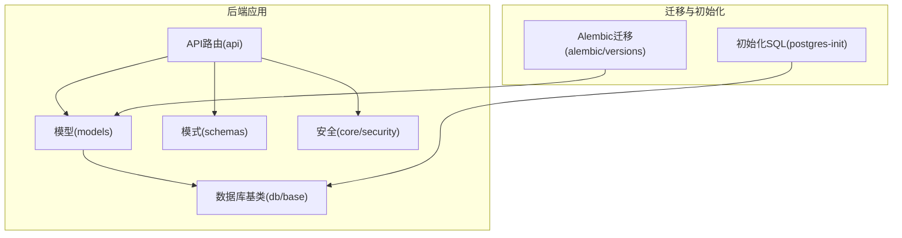
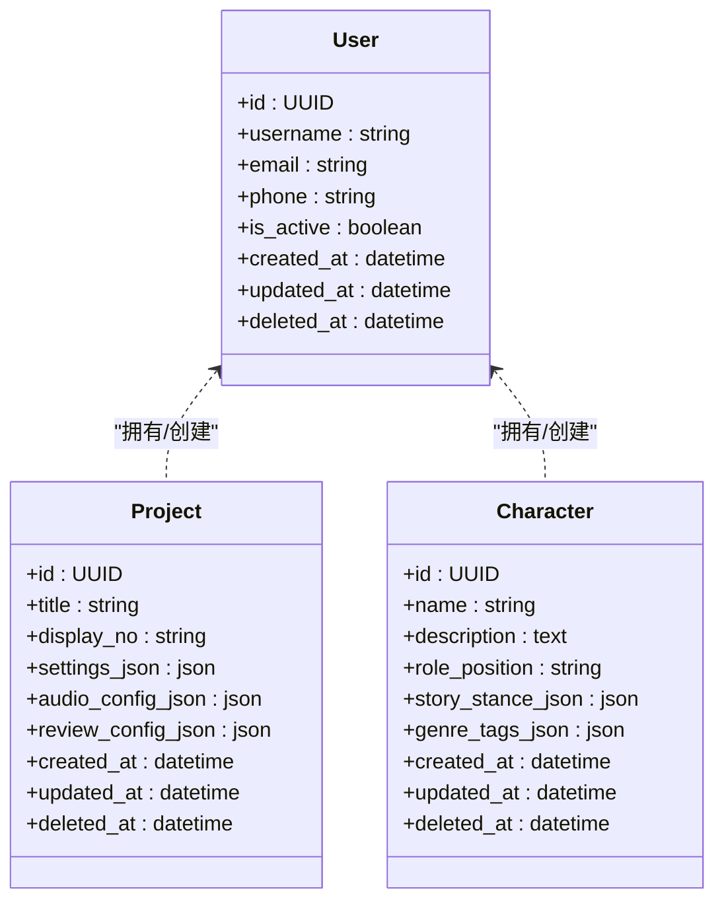
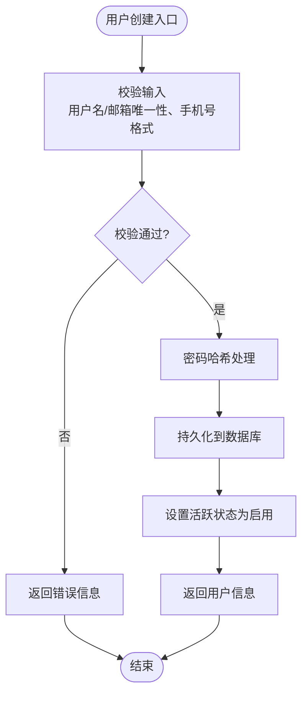
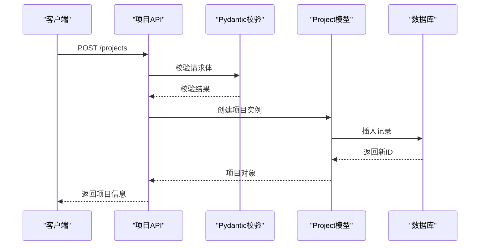
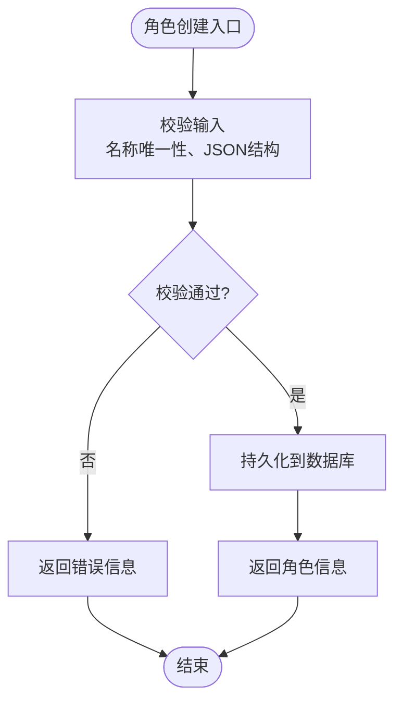
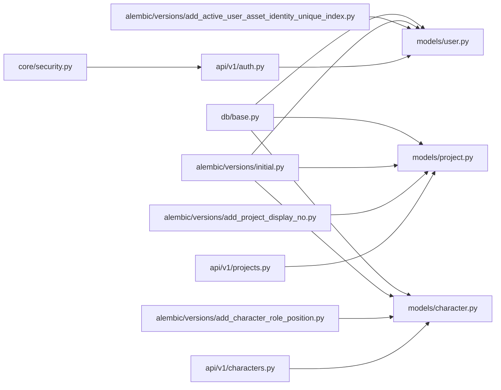

# 核心实体模型

<cite>
**本文引用的文件**   
- [backend/app/models/project.py](file://backend/app/models/project.py)
- [backend/app/models/character.py](file://backend/app/models/character.py)
- [backend/app/models/user.py](file://backend/app/models/user.py)
- [backend/app/db/base.py](file://backend/app/db/base.py)
- [backend/alembic/versions/initial.py](file://backend/alembic/versions/initial.py)
- [backend/alembic/versions/add_project_display_no.py](file://backend/alembic/versions/add_project_display_no.py)
- [backend/alembic/versions/add_character_role_position.py](file://backend/alembic/versions/add_character_role_position.py)
- [backend/alembic/versions/add_active_user_asset_identity_unique_index.py](file://backend/alembic/versions/add_active_user_asset_identity_unique索引.py)
- [backend/app/schemas/project.py](file://backend/app/schemas/project.py)
- [backend/app/schemas/character.py](file://backend/app/schemas/character.py)
- [backend/app/schemas/user.py](file://backend/app/schemas/user.py)
- [backend/app/api/v1/projects.py](file://backend/app/api/v1/projects.py)
- [backend/app/api/v1/characters.py](file://backend/app/api/v1/characters.py)
- [backend/app/api/v1/auth.py](file://backend/app/api/v1/auth.py)
- [backend/app/core/security.py](file://backend/app/core/security.py)
- [postgres-init/01-init.sql](file://postgres-init/01-init.sql)
</cite>

## 目录
1. [简介](#简介)
2. [项目结构](#项目结构)
3. [核心组件](#核心组件)
4. [架构总览](#架构总览)
5. [详细组件分析](#详细组件分析)
6. [依赖关系分析](#依赖关系分析)
7. [性能考虑](#性能考虑)
8. [故障排查指南](#故障排查指南)
9. [结论](#结论)
10. [附录](#附录)

## 简介
本文件面向小说创作代理系统的核心实体模型，聚焦 Project（项目）、Character（角色）、User（用户）三大基础实体的数据结构设计、ORM 映射、主外键与索引策略、生命周期与状态转换、业务规则验证、SQL 建表语句、数据迁移脚本、示例查询、性能优化建议、数据完整性保证与安全访问控制。文档力求在技术细节与可读性之间取得平衡，便于不同背景的读者理解和使用。

## 项目结构
围绕核心实体模型的代码主要分布在以下位置：
- ORM 模型定义：backend/app/models/*.py
- Pydantic 校验与序列化：backend/app/schemas/*.py
- API 路由与权限控制：backend/app/api/v1/*.py, backend/app/core/security.py
- Alembic 数据库迁移：backend/alembic/versions/*.py
- 初始化 SQL：postgres-init/01-init.sql

图表来源
- [backend/app/models/project.py](file://backend/app/models/project.py)
- [backend/app/models/character.py](file://backend/app/models/character.py)
- [backend/app/models/user.py](file://backend/app/models/user.py)
- [backend/app/db/base.py](file://backend/app/db/base.py)
- [backend/alembic/versions/initial.py](file://backend/alembic/versions/initial.py)
- [postgres-init/01-init.sql](file://postgres-init/01-init.sql)

章节来源
- [backend/app/models/project.py](file://backend/app/models/project.py)
- [backend/app/models/character.py](file://backend/app/models/character.py)
- [backend/app/models/user.py](file://backend/app/models/user.py)
- [backend/app/db/base.py](file://backend/app/db/base.py)
- [backend/alembic/versions/initial.py](file://backend/alembic/versions/initial.py)
- [postgres-init/01-init.sql](file://postgres-init/01-init.sql)

## 核心组件
- User（用户）
  - 职责：系统用户身份、认证与授权、资源归属与权限边界
  - 关键字段：唯一标识、用户名/邮箱、密码哈希、手机号、活跃状态、时间戳等
  - 约束：用户名/邮箱唯一、手机号可选但需格式校验、软删除字段
  - 关联：与资产记录、语音参考资产、评分、发布等存在一对多或多对多关系（由其他模型通过外键引用）
- Project（项目）
  - 职责：小说项目的元数据、设置、展示编号、音频配置、评审配置、结构化记忆等
  - 关键字段：唯一标识、标题、显示编号、JSON 配置项、时间戳、软删除等
  - 约束：显示编号在项目维度唯一或全局唯一（取决于迁移策略），JSON 字段具备结构校验
  - 关联：被章节、任务、评测、实验等模块引用
- Character（角色）
  - 职责：角色设定、角色定位/立场、类型标签、故事立场证据、时间戳、软删除等
  - 关键字段：唯一标识、名称、描述、角色定位、故事立场、JSON 扩展字段、时间戳等
  - 约束：名称在所属项目内唯一或全局唯一（视业务而定），JSON 字段具备结构校验
  - 关联：被章节、评测、生成反馈等模块引用

章节来源
- [backend/app/models/user.py](file://backend/app/models/user.py)
- [backend/app/models/project.py](file://backend/app/models/project.py)
- [backend/app/models/character.py](file://backend/app/models/character.py)

## 架构总览
核心实体模型采用“模型 + 模式 + 路由 + 迁移”的分层设计：
- 模型层（models）：使用 ORM 框架定义表结构与关系
- 模式层（schemas）：使用 Pydantic 进行请求/响应校验与序列化
- 路由层（api）：暴露 RESTful 接口，结合安全模块实现鉴权与访问控制
- 迁移层（alembic）：管理数据库结构演进，确保版本一致性
- 初始化（postgres-init）：提供首次部署的数据库初始化脚本

图表来源
- [backend/app/models/user.py](file://backend/app/models/user.py)
- [backend/app/models/project.py](file://backend/app/models/project.py)
- [backend/app/models/character.py](file://backend/app/models/character.py)

## 详细组件分析

### User（用户）实体
- 字段定义与数据类型
  - id：UUID，主键
  - username：字符串，唯一
  - email：字符串，唯一
  - phone：字符串，可选，格式校验
  - is_active：布尔，默认启用
  - created_at/updated_at/deleted_at：时间戳，支持软删除
- 约束条件
  - 唯一性：username、email
  - 非空：username、email
  - 软删除：deleted_at 用于逻辑删除
- 关联关系
  - 与其他资源（如资产记录、语音参考资产、评分、发布等）通过外键引用形成一对多关系
- ORM 映射与索引
  - 主键：id
  - 唯一索引：username、email
  - 常用查询索引：is_active、deleted_at
- 生命周期与状态转换
  - 创建：注册流程生成用户记录
  - 更新：修改基本信息、手机号、激活状态
  - 软删除：标记 deleted_at，避免物理删除导致的数据不一致
- 业务规则验证
  - 用户名/邮箱唯一性检查
  - 手机号格式校验
  - 密码哈希存储（不在模型中明文保存）
- 安全访问控制
  - 基于 JWT 的认证与授权
  - 资源级权限：仅允许用户操作自己的资源

图表来源
- [backend/app/schemas/user.py](file://backend/app/schemas/user.py)
- [backend/app/api/v1/auth.py](file://backend/app/api/v1/auth.py)
- [backend/app/core/security.py](file://backend/app/core/security.py)

章节来源
- [backend/app/models/user.py](file://backend/app/models/user.py)
- [backend/app/schemas/user.py](file://backend/app/schemas/user.py)
- [backend/app/api/v1/auth.py](file://backend/app/api/v1/auth.py)
- [backend/app/core/security.py](file://backend/app/core/security.py)

### Project（项目）实体
- 字段定义与数据类型
  - id：UUID，主键
  - title：字符串，项目名称
  - display_no：字符串，展示编号（可能具有唯一性约束）
  - settings_json：JSON，项目设置
  - audio_config_json：JSON，音频配置
  - review_config_json：JSON，评审配置
  - created_at/updated_at/deleted_at：时间戳，支持软删除
- 约束条件
  - 唯一性：display_no（根据迁移策略决定唯一范围）
  - JSON 字段：结构校验与默认值
- 关联关系
  - 被章节、评测、实验、任务等模块引用
- ORM 映射与索引
  - 主键：id
  - 唯一索引：display_no（若业务要求全局唯一）
  - 常用查询索引：deleted_at、created_at
- 生命周期与状态转换
  - 创建：初始化项目元数据与默认设置
  - 更新：调整设置、音频配置、评审配置
  - 软删除：标记 deleted_at
- 业务规则验证
  - 显示编号唯一性检查
  - JSON 字段结构校验（如必填键、枚举值）
- 安全访问控制
  - 基于用户与项目的归属关系进行访问控制

图表来源
- [backend/app/api/v1/projects.py](file://backend/app/api/v1/projects.py)
- [backend/app/schemas/project.py](file://backend/app/schemas/project.py)
- [backend/app/models/project.py](file://backend/app/models/project.py)

章节来源
- [backend/app/models/project.py](file://backend/app/models/project.py)
- [backend/app/schemas/project.py](file://backend/app/schemas/project.py)
- [backend/app/api/v1/projects.py](file://backend/app/api/v1/projects.py)

### Character（角色）实体
- 字段定义与数据类型
  - id：UUID，主键
  - name：字符串，角色名称
  - description：文本，角色描述
  - role_position：字符串，角色定位
  - story_stance_json：JSON，故事立场证据
  - genre_tags_json：JSON，类型标签
  - created_at/updated_at/deleted_at：时间戳，支持软删除
- 约束条件
  - 唯一性：name（可能在项目维度或全局维度）
  - JSON 字段：结构校验与默认值
- 关联关系
  - 被章节、评测、生成反馈等模块引用
- ORM 映射与索引
  - 主键：id
  - 唯一索引：name（视业务需求）
  - 常用查询索引：deleted_at、created_at
- 生命周期与状态转换
  - 创建：初始化角色基本信息与默认标签
  - 更新：调整描述、定位、标签、立场证据
  - 软删除：标记 deleted_at
- 业务规则验证
  - 名称唯一性检查
  - JSON 字段结构校验（如标签枚举、立场证据格式）
- 安全访问控制
  - 基于用户与项目归属关系进行访问控制

图表来源
- [backend/app/api/v1/characters.py](file://backend/app/api/v1/characters.py)
- [backend/app/schemas/character.py](file://backend/app/schemas/character.py)
- [backend/app/models/character.py](file://backend/app/models/character.py)

章节来源
- [backend/app/models/character.py](file://backend/app/models/character.py)
- [backend/app/schemas/character.py](file://backend/app/schemas/character.py)
- [backend/app/api/v1/characters.py](file://backend/app/api/v1/characters.py)

## 依赖关系分析
- 模型依赖
  - User、Project、Character 均继承自统一的数据库基类，共享通用字段（如 id、时间戳、软删除）
- 迁移依赖
  - initial.py 定义初始表结构
  - add_project_display_no.py 为 Project 添加 display_no 字段及索引
  - add_character_role_position.py 为 Character 添加 role_position 字段
  - add_active_user_asset_identity_unique_index.py 为用户资产相关表添加唯一索引
- API 依赖
  - projects.py、characters.py、auth.py 分别对应项目、角色、认证的 API 路由
  - security.py 提供认证与授权中间件

图表来源
- [backend/app/db/base.py](file://backend/app/db/base.py)
- [backend/app/models/user.py](file://backend/app/models/user.py)
- [backend/app/models/project.py](file://backend/app/models/project.py)
- [backend/app/models/character.py](file://backend/app/models/character.py)
- [backend/alembic/versions/initial.py](file://backend/alembic/versions/initial.py)
- [backend/alembic/versions/add_project_display_no.py](file://backend/alembic/versions/add_project_display_no.py)
- [backend/alembic/versions/add_character_role_position.py](file://backend/alembic/versions/add_character_role_position.py)
- [backend/alembic/versions/add_active_user_asset_identity_unique_index.py](file://backend/alembic/versions/add_active_user_asset_identity_unique索引.py)
- [backend/app/api/v1/projects.py](file://backend/app/api/v1/projects.py)
- [backend/app/api/v1/characters.py](file://backend/app/api/v1/characters.py)
- [backend/app/api/v1/auth.py](file://backend/app/api/v1/auth.py)
- [backend/app/core/security.py](file://backend/app/core/security.py)

章节来源
- [backend/app/db/base.py](file://backend/app/db/base.py)
- [backend/alembic/versions/initial.py](file://backend/alembic/versions/initial.py)
- [backend/alembic/versions/add_project_display_no.py](file://backend/alembic/versions/add_project_display_no.py)
- [backend/alembic/versions/add_character_role_position.py](file://backend/alembic/versions/add_character_role_position.py)
- [backend/alembic/versions/add_active_user_asset_identity_unique_index.py](file://backend/alembic/versions/add_active_user_asset_identity_unique索引.py)

## 性能考虑
- 索引策略
  - 为频繁查询字段建立索引：deleted_at、created_at、is_active、display_no、name
  - 复合索引：针对多条件查询（如 user_id + deleted_at）
- 查询优化
  - 使用选择性高的字段过滤
  - 避免 N+1 查询，使用预加载或 JOIN
  - 分页查询限制返回数量
- 存储优化
  - JSON 字段按需展开为列（热点字段）
  - 大文本字段使用压缩或外部存储
- 事务与锁
  - 短事务减少锁持有时间
  - 并发写入时使用乐观锁或行级锁

[本节为通用指导，不直接分析具体文件]

## 故障排查指南
- 常见错误
  - 唯一性冲突：用户名、邮箱、显示编号、角色名称重复
  - JSON 字段校验失败：缺少必填键、枚举值非法
  - 软删除误用：查询未包含 deleted_at 条件导致数据泄露
- 排查步骤
  - 检查 API 请求体是否符合 schema 定义
  - 查看数据库约束与索引是否生效
  - 审查迁移脚本是否正确执行
  - 确认权限与归属关系是否正确
- 日志与监控
  - 记录关键操作的审计日志
  - 监控慢查询与异常堆栈

章节来源
- [backend/app/schemas/user.py](file://backend/app/schemas/user.py)
- [backend/app/schemas/project.py](file://backend/app/schemas/project.py)
- [backend/app/schemas/character.py](file://backend/app/schemas/character.py)
- [backend/app/core/security.py](file://backend/app/core/security.py)

## 结论
User、Project、Character 作为小说创作代理系统的核心实体，通过清晰的字段设计、严格的约束与校验、完善的迁移管理与安全控制，构成了系统数据层的基石。遵循本文档的设计与实践建议，可确保数据一致性、性能与安全性，支撑上层业务的高效迭代。

[本节为总结性内容，不直接分析具体文件]

## 附录

### SQL 建表语句（PostgreSQL）
以下为基于模型定义的典型建表语句（示意）：
- users 表
  - id UUID PRIMARY KEY
  - username VARCHAR UNIQUE NOT NULL
  - email VARCHAR UNIQUE NOT NULL
  - phone VARCHAR
  - is_active BOOLEAN DEFAULT TRUE
  - created_at TIMESTAMP
  - updated_at TIMESTAMP
  - deleted_at TIMESTAMP
- projects 表
  - id UUID PRIMARY KEY
  - title VARCHAR NOT NULL
  - display_no VARCHAR UNIQUE
  - settings_json JSONB
  - audio_config_json JSONB
  - review_config_json JSONB
  - created_at TIMESTAMP
  - updated_at TIMESTAMP
  - deleted_at TIMESTAMP
- characters 表
  - id UUID PRIMARY KEY
  - name VARCHAR UNIQUE
  - description TEXT
  - role_position VARCHAR
  - story_stance_json JSONB
  - genre_tags_json JSONB
  - created_at TIMESTAMP
  - updated_at TIMESTAMP
  - deleted_at TIMESTAMP

章节来源
- [postgres-init/01-init.sql](file://postgres-init/01-init.sql)
- [backend/alembic/versions/initial.py](file://backend/alembic/versions/initial.py)
- [backend/alembic/versions/add_project_display_no.py](file://backend/alembic/versions/add_project_display_no.py)
- [backend/alembic/versions/add_character_role_position.py](file://backend/alembic/versions/add_character_role_position.py)

### 数据迁移脚本
- 初始迁移：创建 users、projects、characters 表及基础索引
- 添加 display_no：为 projects 表新增 display_no 字段并建立唯一索引
- 添加 role_position：为 characters 表新增 role_position 字段
- 唯一索引：为用户资产相关表添加 active 与 identity 的唯一索引

章节来源
- [backend/alembic/versions/initial.py](file://backend/alembic/versions/initial.py)
- [backend/alembic/versions/add_project_display_no.py](file://backend/alembic/versions/add_project_display_no.py)
- [backend/alembic/versions/add_character_role_position.py](file://backend/alembic/versions/add_character_role_position.py)
- [backend/alembic/versions/add_active_user_asset_identity_unique_index.py](file://backend/alembic/versions/add_active_user_asset_identity_unique索引.py)

### 示例查询
- 查询活跃用户
  - SELECT * FROM users WHERE is_active = TRUE AND deleted_at IS NULL;
- 查询项目显示编号
  - SELECT * FROM projects WHERE display_no = 'P001' AND deleted_at IS NULL;
- 查询角色名称
  - SELECT * FROM characters WHERE name = '主角' AND deleted_at IS NULL;

[本节为通用示例，不直接分析具体文件]

### 安全访问控制实现
- 认证：JWT 令牌签发与验证
- 授权：基于用户与资源的归属关系进行访问控制
- 中间件：在 API 路由层统一拦截与校验

章节来源
- [backend/app/api/v1/auth.py](file://backend/app/api/v1/auth.py)
- [backend/app/core/security.py](file://backend/app/core/security.py)