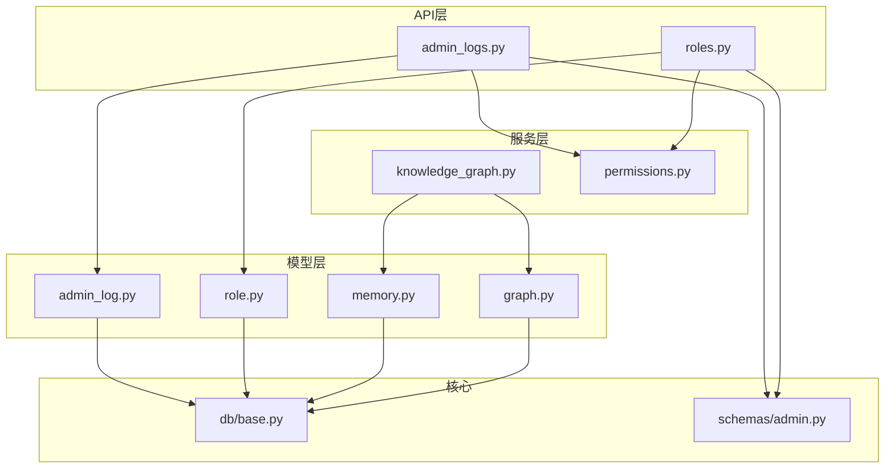
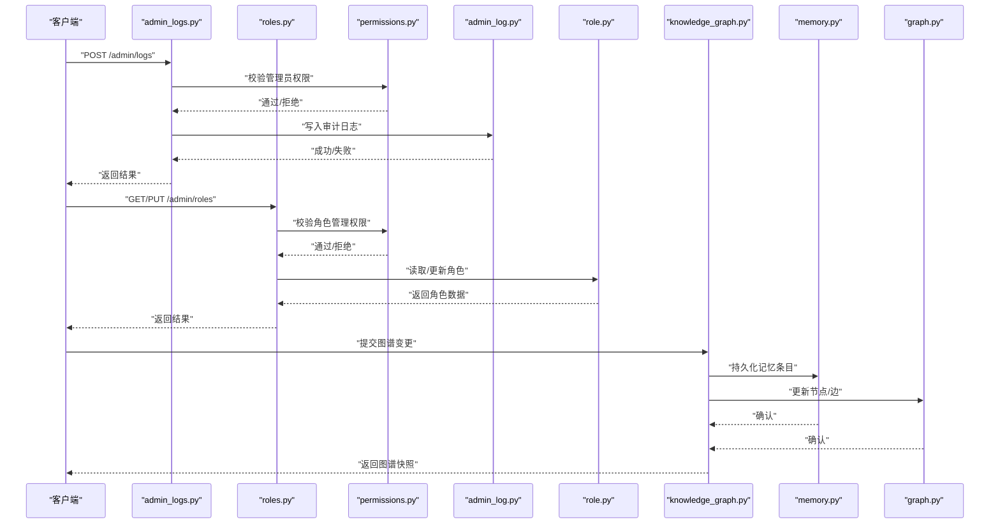
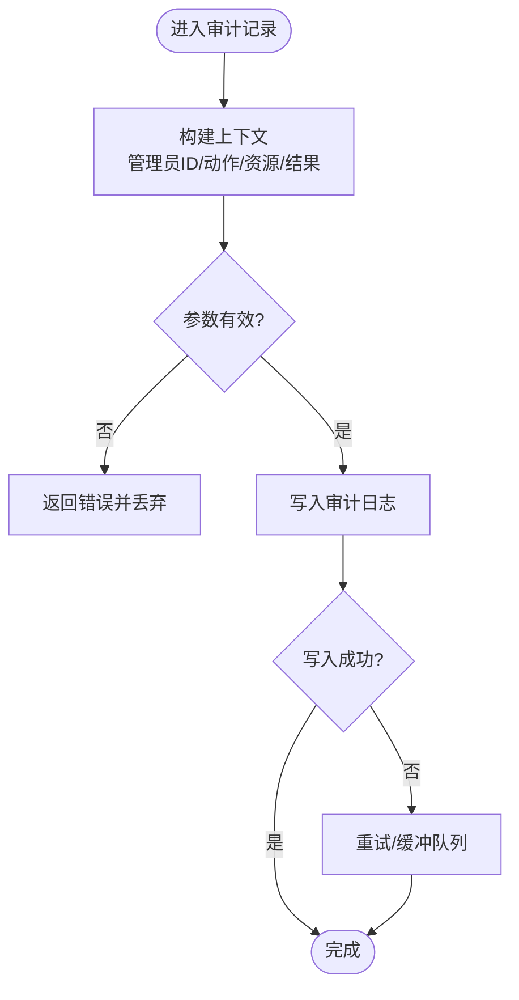
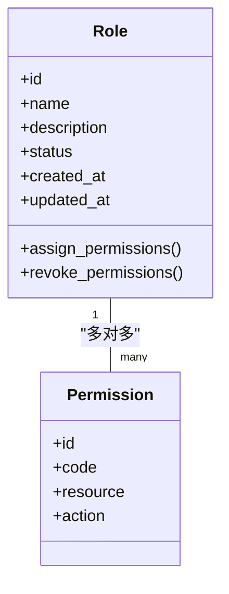
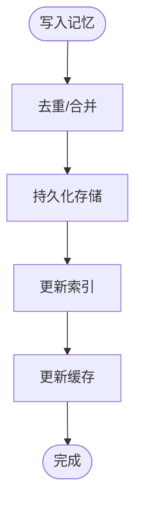
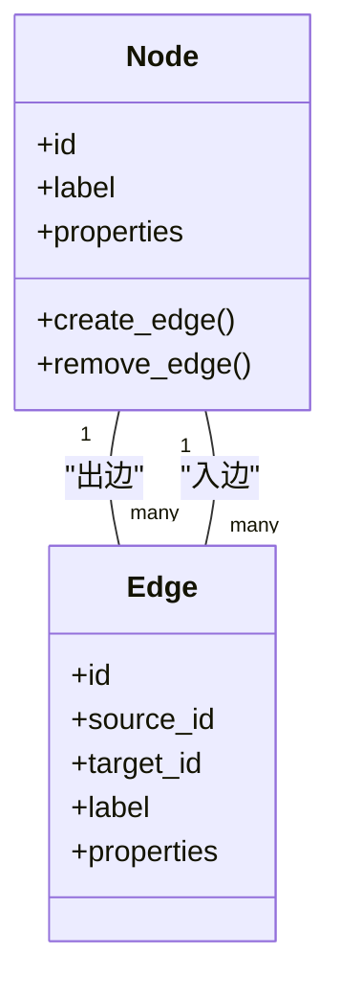
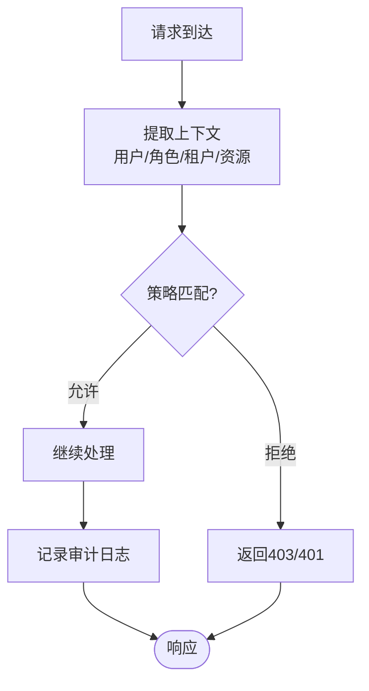
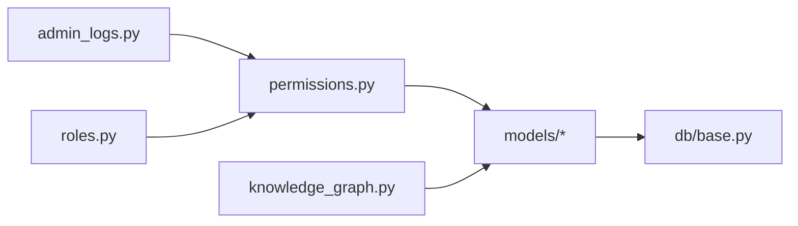

# 系统和管理员模型

<cite>
**本文引用的文件**   
- [backend/app/models/admin_log.py](file://backend/app/models/admin_log.py)
- [backend/app/models/role.py](file://backend/app/models/role.py)
- [backend/app/models/memory.py](file://backend/app/models/memory.py)
- [backend/app/models/graph.py](file://backend/app/models/graph.py)
- [backend/app/core/permissions.py](file://backend/app/core/permissions.py)
- [backend/app/api/v1/admin/admin_logs.py](file://backend/app/api/v1/admin/admin_logs.py)
- [backend/app/api/v1/admin/roles.py](file://backend/app/api/v1/admin/roles.py)
- [backend/app/services/knowledge_graph.py](file://backend/app/services/knowledge_graph.py)
- [backend/app/db/base.py](file://backend/app/db/base.py)
- [backend/app/schemas/admin.py](file://backend/app/schemas/admin.py)
</cite>

## 目录
1. [简介](#简介)
2. [项目结构](#项目结构)
3. [核心组件](#核心组件)
4. [架构总览](#架构总览)
5. [详细组件分析](#详细组件分析)
6. [依赖关系分析](#依赖关系分析)
7. [性能考虑](#性能考虑)
8. [故障排查指南](#故障排查指南)
9. [结论](#结论)
10. [附录](#附录)

## 简介
本文件面向系统管理与后台功能的数据模型，围绕管理员日志（AdminLog）、角色（Role）、记忆（Memory）、知识图谱（Graph）等实体进行系统化说明。文档涵盖RBAC权限控制、操作审计、知识库与关系图谱的数据库实现，解释复杂安全策略、数据隔离与访问控制机制，并提供监控、性能分析与故障诊断的数据支撑，以及管理员操作示例、安全配置指南与维护最佳实践。

## 项目结构
本项目采用分层架构：
- API层：提供REST接口，负责请求校验、鉴权、路由分发。
- 服务层：封装业务逻辑，如知识图谱构建与管理、权限策略执行。
- 模型层：基于ORM定义数据表结构与关系。
- 核心模块：权限、安全、配置等横切能力。
- 数据库迁移：Alembic版本管理。

**图表来源** 
- [backend/app/api/v1/admin/admin_logs.py](file://backend/app/api/v1/admin/admin_logs.py)
- [backend/app/api/v1/admin/roles.py](file://backend/app/api/v1/admin/roles.py)
- [backend/app/services/knowledge_graph.py](file://backend/app/services/knowledge_graph.py)
- [backend/app/core/permissions.py](file://backend/app/core/permissions.py)
- [backend/app/models/admin_log.py](file://backend/app/models/admin_log.py)
- [backend/app/models/role.py](file://backend/app/models/role.py)
- [backend/app/models/memory.py](file://backend/app/models/memory.py)
- [backend/app/models/graph.py](file://backend/app/models/graph.py)
- [backend/app/db/base.py](file://backend/app/db/base.py)
- [backend/app/schemas/admin.py](file://backend/app/schemas/admin.py)

**章节来源**
- [backend/app/models/admin_log.py](file://backend/app/models/admin_log.py)
- [backend/app/models/role.py](file://backend/app/models/role.py)
- [backend/app/models/memory.py](file://backend/app/models/memory.py)
- [backend/app/models/graph.py](file://backend/app/models/graph.py)
- [backend/app/core/permissions.py](file://backend/app/core/permissions.py)
- [backend/app/api/v1/admin/admin_logs.py](file://backend/app/api/v1/admin/admin_logs.py)
- [backend/app/api/v1/admin/roles.py](file://backend/app/api/v1/admin/roles.py)
- [backend/app/services/knowledge_graph.py](file://backend/app/services/knowledge_graph.py)
- [backend/app/db/base.py](file://backend/app/db/base.py)
- [backend/app/schemas/admin.py](file://backend/app/schemas/admin.py)

## 核心组件
- AdminLog（管理员日志）：记录管理员关键操作的审计信息，包括操作人、时间、动作类型、资源标识、结果状态、IP与详情等，用于合规审计与问题回溯。
- Role（角色）：RBAC的核心实体，承载角色名、描述、状态、创建/更新时间等，并与权限集合关联，支持细粒度授权。
- Memory（记忆）：结构化存储用户或会话级上下文信息，支持键值、元数据、过期策略与检索索引，服务于个性化与连续性体验。
- Graph（知识图谱）：以节点与边表示领域概念及其关系，支持图谱查询、更新与可视化，为智能推荐、推理与内容生成提供语义基础。

这些组件共同构成系统管理后台的数据基石，确保可审计、可治理、可扩展。

**章节来源**
- [backend/app/models/admin_log.py](file://backend/app/models/admin_log.py)
- [backend/app/models/role.py](file://backend/app/models/role.py)
- [backend/app/models/memory.py](file://backend/app/models/memory.py)
- [backend/app/models/graph.py](file://backend/app/models/graph.py)

## 架构总览
下图展示从API到模型与服务的关键调用路径，体现RBAC鉴权、审计记录与知识图谱管理的整体流程。

**图表来源** 
- [backend/app/api/v1/admin/admin_logs.py](file://backend/app/api/v1/admin/admin_logs.py)
- [backend/app/api/v1/admin/roles.py](file://backend/app/api/v1/admin/roles.py)
- [backend/app/core/permissions.py](file://backend/app/core/permissions.py)
- [backend/app/models/admin_log.py](file://backend/app/models/admin_log.py)
- [backend/app/models/role.py](file://backend/app/models/role.py)
- [backend/app/services/knowledge_graph.py](file://backend/app/services/knowledge_graph.py)
- [backend/app/models/memory.py](file://backend/app/models/memory.py)
- [backend/app/models/graph.py](file://backend/app/models/graph.py)

## 详细组件分析

### AdminLog（管理员日志）
- 设计要点
  - 字段覆盖操作主体、动作类型、目标资源、结果状态、时间戳、IP地址、请求ID、详情JSON等，便于审计与追踪。
  - 支持按时间范围、操作人、动作类型、资源类型等维度筛选，满足合规报表与问题定位。
  - 高吞吐写入场景下建议异步落库与批量插入，避免阻塞主流程。
- 数据流
  - API层在关键操作前后记录审计日志，统一由权限中间件注入上下文（如当前管理员ID）。
  - 写入失败时降级为本地缓冲或重试队列，保证审计不丢失。
- 复杂度与优化
  - 写入O(1)，查询按索引字段过滤；对高频查询字段建立复合索引。
  - 历史归档策略：按月分表或冷热分离，降低热表规模。

**图表来源** 
- [backend/app/models/admin_log.py](file://backend/app/models/admin_log.py)
- [backend/app/api/v1/admin/admin_logs.py](file://backend/app/api/v1/admin/admin_logs.py)

**章节来源**
- [backend/app/models/admin_log.py](file://backend/app/models/admin_log.py)
- [backend/app/api/v1/admin/admin_logs.py](file://backend/app/api/v1/admin/admin_logs.py)

### Role（角色）
- 设计要点
  - 角色作为权限容器，包含名称、描述、状态、创建/更新时间等。
  - 与权限点（如菜单、按钮、接口）多对多关联，支持继承与组合。
  - 支持软删除与版本化，保障权限变更可追溯。
- RBAC策略
  - 基于角色的访问控制（RBAC），结合资源作用域（租户/项目）实现数据隔离。
  - 权限校验在服务层集中处理，避免重复逻辑。
- 复杂度与优化
  - 角色-权限映射查询需建立联合索引；热点角色缓存至内存以提升鉴权速度。

**图表来源** 
- [backend/app/models/role.py](file://backend/app/models/role.py)

**章节来源**
- [backend/app/models/role.py](file://backend/app/models/role.py)
- [backend/app/core/permissions.py](file://backend/app/core/permissions.py)

### Memory（记忆）
- 设计要点
  - 存储用户或会话级上下文，支持键值、标签、元数据、过期时间。
  - 提供检索接口（关键词、标签、时间范围），支持增量更新与一致性保证。
  - 与知识图谱联动，将结构化记忆转化为图谱节点/边。
- 数据流
  - 写入时进行去重与合并，避免冗余；读取时优先缓存命中。
  - 定期清理过期条目，释放空间。
- 复杂度与优化
  - 读写O(logN)或O(1)取决于索引策略；热点键使用内存缓存。

**图表来源** 
- [backend/app/models/memory.py](file://backend/app/models/memory.py)
- [backend/app/services/knowledge_graph.py](file://backend/app/services/knowledge_graph.py)

**章节来源**
- [backend/app/models/memory.py](file://backend/app/models/memory.py)
- [backend/app/services/knowledge_graph.py](file://backend/app/services/knowledge_graph.py)

### Graph（知识图谱）
- 设计要点
  - 节点与边模型支持属性扩展，便于表达复杂领域关系。
  - 提供增删改查与批量操作接口，支持事务性更新。
  - 与记忆模块协作，将非结构化文本抽取为结构化知识。
- 数据流
  - 接收来自服务层的图谱变更请求，校验约束后写入。
  - 查询时支持路径搜索、子图提取与聚合统计。
- 复杂度与优化
  - 图遍历复杂度与边数相关；对常用查询模式建立物化视图或索引。

**图表来源** 
- [backend/app/models/graph.py](file://backend/app/models/graph.py)

**章节来源**
- [backend/app/models/graph.py](file://backend/app/models/graph.py)
- [backend/app/services/knowledge_graph.py](file://backend/app/services/knowledge_graph.py)

### RBAC权限控制与数据隔离
- 权限模型
  - 角色-权限多对多，支持资源与作用域限定。
  - 权限校验在服务层统一拦截，结合上下文（用户、租户、项目）判断。
- 数据隔离
  - 基于租户/项目ID的过滤条件，确保跨租户不可见。
  - 敏感操作需二次确认与审计记录。
- 安全策略
  - 最小权限原则，默认拒绝未明确授权的访问。
  - 动态权限生效，无需重启服务。

**图表来源** 
- [backend/app/core/permissions.py](file://backend/app/core/permissions.py)
- [backend/app/schemas/admin.py](file://backend/app/schemas/admin.py)

**章节来源**
- [backend/app/core/permissions.py](file://backend/app/core/permissions.py)
- [backend/app/schemas/admin.py](file://backend/app/schemas/admin.py)

## 依赖关系分析
- 组件耦合
  - API层依赖权限服务与模型层；服务层依赖模型层与外部工具。
  - 模型层通过基类共享通用字段与行为。
- 外部依赖
  - 数据库驱动、缓存、消息队列（可选）用于审计与图谱同步。
- 循环依赖
  - 通过接口抽象与服务拆分避免循环引用。

**图表来源** 
- [backend/app/api/v1/admin/admin_logs.py](file://backend/app/api/v1/admin/admin_logs.py)
- [backend/app/api/v1/admin/roles.py](file://backend/app/api/v1/admin/roles.py)
- [backend/app/core/permissions.py](file://backend/app/core/permissions.py)
- [backend/app/services/knowledge_graph.py](file://backend/app/services/knowledge_graph.py)
- [backend/app/db/base.py](file://backend/app/db/base.py)

**章节来源**
- [backend/app/api/v1/admin/admin_logs.py](file://backend/app/api/v1/admin/admin_logs.py)
- [backend/app/api/v1/admin/roles.py](file://backend/app/api/v1/admin/roles.py)
- [backend/app/core/permissions.py](file://backend/app/core/permissions.py)
- [backend/app/services/knowledge_graph.py](file://backend/app/services/knowledge_graph.py)
- [backend/app/db/base.py](file://backend/app/db/base.py)

## 性能考虑
- 审计日志
  - 批量写入、异步落库、冷热分离与归档策略。
  - 高频字段索引优化，避免全表扫描。
- 角色与权限
  - 角色-权限映射缓存，减少数据库压力。
  - 权限校验短路策略，快速失败。
- 记忆与图谱
  - 热点键缓存、惰性加载、分页与游标查询。
  - 图查询预计算与物化视图，提升复杂查询性能。

[本节为通用指导，不直接分析具体文件]

## 故障排查指南
- 常见问题
  - 权限不足：检查角色分配与权限代码是否一致。
  - 审计缺失：确认写入链路是否被跳过或异常吞掉。
  - 图谱不一致：核对事务边界与并发更新冲突。
- 诊断步骤
  - 查看审计日志定位操作时间与责任人。
  - 检查权限策略配置与上下文注入是否正确。
  - 验证记忆与图谱的索引与缓存一致性。
- 恢复措施
  - 回滚变更、重建索引、清理脏数据。
  - 启用重试与补偿机制，保证最终一致性。

**章节来源**
- [backend/app/models/admin_log.py](file://backend/app/models/admin_log.py)
- [backend/app/core/permissions.py](file://backend/app/core/permissions.py)
- [backend/app/services/knowledge_graph.py](file://backend/app/services/knowledge_graph.py)

## 结论
AdminLog、Role、Memory、Graph四大模型构成了系统管理与后台能力的核心数据基础。通过RBAC权限控制、操作审计、知识库与知识图谱的协同，系统在安全性、可审计性与智能化方面具备坚实基础。配合合理的性能优化与故障排查策略，可有效支撑大规模生产环境的管理需求。

[本节为总结，不直接分析具体文件]

## 附录
- 管理员操作示例
  - 创建角色并分配权限：通过角色管理接口创建角色，绑定权限点，验证访问控制。
  - 记录审计日志：在关键操作前后调用审计接口，确保操作可追溯。
  - 更新知识图谱：提交节点/边变更，验证查询与可视化效果。
- 安全配置指南
  - 最小权限原则，默认拒绝未授权访问。
  - 敏感操作二次确认与审计记录。
  - 定期审查角色与权限分配，清理闲置账号。
- 系统维护最佳实践
  - 定期归档审计日志，清理过期记忆条目。
  - 监控图谱大小与查询延迟，优化索引与缓存。
  - 建立变更审批与回滚流程，确保稳定性。

[本节为通用指导，不直接分析具体文件]