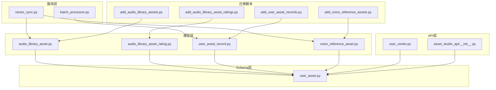
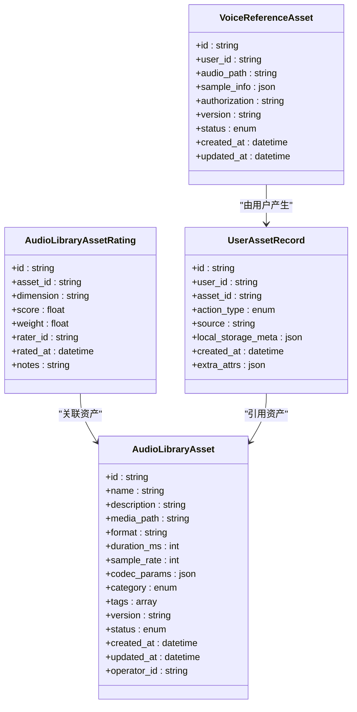
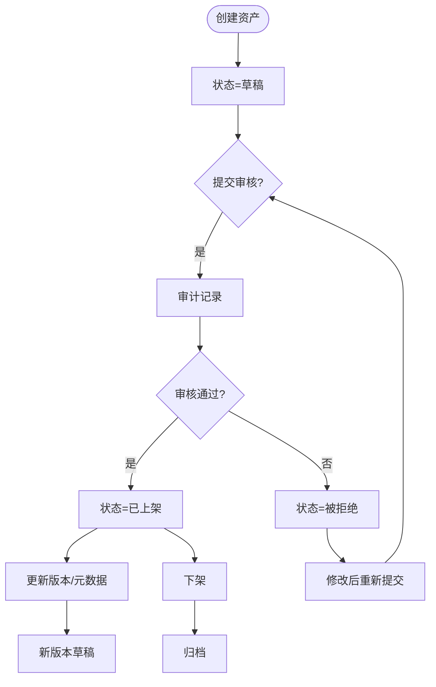
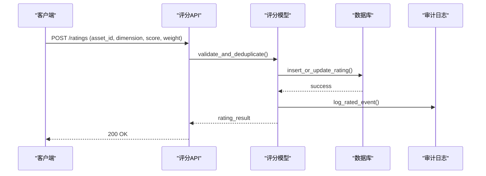
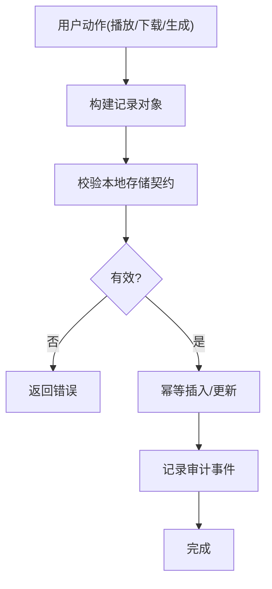
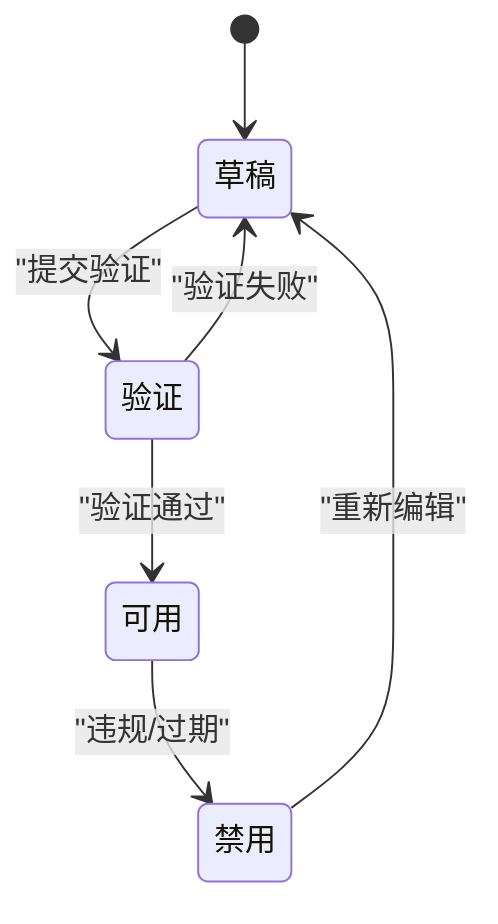
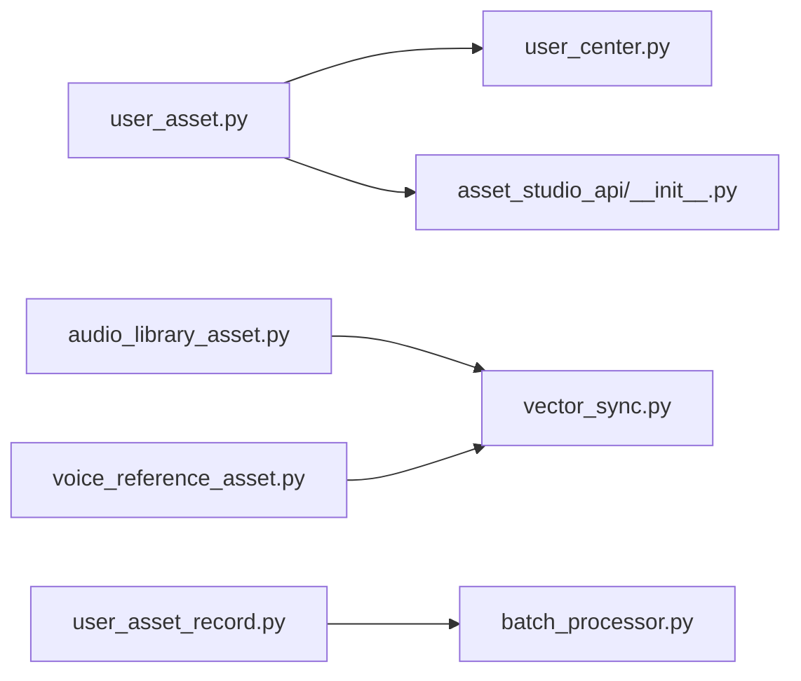

# 资产管理模型

<cite>
**本文档引用的文件**   
- [audio_library_asset.py](file://backend/app/models/audio_library_asset.py)
- [audio_library_asset_rating.py](file://backend/app/models/audio_library_asset_rating.py)
- [user_asset_record.py](file://backend/app/models/user_asset_record.py)
- [voice_reference_asset.py](file://backend/app/models/voice_reference_asset.py)
- [user_asset.py](file://backend/app/schemas/user_asset.py)
- [user_center.py](file://backend/app/api/v1/user_center.py)
- [asset_studio_api/__init__.py](file://backend/app/api/v1/asset_studio_api/__init__.py)
- [vector_sync.py](file://backend/app/services/vector_sync.py)
- [batch_processor.py](file://backend/app/services/batch_processor.py)
- [alembic/add_audio_library_assets.py](file://backend/alembic/versions/add_audio_library_assets.py)
- [alembic/add_audio_library_asset_ratings.py](file://backend/alembic/versions/add_audio_library_asset_ratings.py)
- [alembic/add_user_asset_records.py](file://backend/alembic/versions/add_user_asset_records.py)
- [alembic/add_voice_reference_assets.py](file://backend/alembic/versions/add_voice_reference_assets.py)
- [test_audio_library_asset_repository.py](file://backend/tests/test_audio_library_asset_repository.py)
- [test_audiobook_audio_library_ratings.py](file://backend/tests/test_audiobook_audio_library_ratings.py)
- [test_voice_reference_asset_repository.py](file://backend/tests/test_voice_reference_asset_repository.py)
- [test_user_asset_metadata_contract.py](file://backend/tests/test_user_asset_metadata_contract.py)
</cite>

## 目录
1. [简介](#简介)
2. [项目结构](#项目结构)
3. [核心组件](#核心组件)
4. [架构总览](#架构总览)
5. [详细组件分析](#详细组件分析)
6. [依赖关系分析](#依赖关系分析)
7. [性能考量](#性能考量)
8. [故障排查指南](#故障排查指南)
9. [结论](#结论)
10. [附录](#附录)

## 简介
本文件面向资产管理系统的数据模型，围绕以下实体展开：AudioLibraryAsset（音频库资产）、AudioLibraryAssetRating（资产评分）、UserAssetRecord（用户资产记录）、VoiceReferenceAsset（语音参考资产）。文档将系统阐述这些实体的设计模式、分类体系、元数据结构与版本管理机制；并覆盖资产生命周期管理、权限控制与审计追踪；同时给出复杂搜索索引策略、批量导入导出功能、数据同步机制的说明。最后提供API接口示例、数据迁移方案与性能优化最佳实践，帮助读者快速理解与高效使用。

## 项目结构
资产相关的数据模型主要位于后端模型的模块中，并通过Alembic进行数据库迁移管理。相关的Schema定义位于schemas目录，API路由在api目录下，服务层包含向量同步与批处理等能力。测试用例覆盖了关键路径与边界场景。

图表来源
- [audio_library_asset.py](file://backend/app/models/audio_library_asset.py)
- [audio_library_asset_rating.py](file://backend/app/models/audio_library_asset_rating.py)
- [user_asset_record.py](file://backend/app/models/user_asset_record.py)
- [voice_reference_asset.py](file://backend/app/models/voice_reference_asset.py)
- [user_asset.py](file://backend/app/schemas/user_asset.py)
- [user_center.py](file://backend/app/api/v1/user_center.py)
- [asset_studio_api/__init__.py](file://backend/app/api/v1/asset_studio_api/__init__.py)
- [vector_sync.py](file://backend/app/services/vector_sync.py)
- [batch_processor.py](file://backend/app/services/batch_processor.py)
- [alembic/add_audio_library_assets.py](file://backend/alembic/versions/add_audio_library_assets.py)
- [alembic/add_audio_library_asset_ratings.py](file://backend/alembic/versions/add_audio_library_asset_ratings.py)
- [alembic/add_user_asset_records.py](file://backend/alembic/versions/add_user_asset_records.py)
- [alembic/add_voice_reference_assets.py](file://backend/alembic/versions/add_voice_reference_assets.py)

章节来源
- [audio_library_asset.py](file://backend/app/models/audio_library_asset.py)
- [audio_library_asset_rating.py](file://backend/app/models/audio_library_asset_rating.py)
- [user_asset_record.py](file://backend/app/models/user_asset_record.py)
- [voice_reference_asset.py](file://backend/app/models/voice_reference_asset.py)
- [user_asset.py](file://backend/app/schemas/user_asset.py)
- [user_center.py](file://backend/app/api/v1/user_center.py)
- [asset_studio_api/__init__.py](file://backend/app/api/v1/asset_studio_api/__init__.py)
- [vector_sync.py](file://backend/app/services/vector_sync.py)
- [batch_processor.py](file://backend/app/services/batch_processor.py)
- [alembic/add_audio_library_assets.py](file://backend/alembic/versions/add_audio_library_assets.py)
- [alembic/add_audio_library_asset_ratings.py](file://backend/alembic/versions/add_audio_library_asset_ratings.py)
- [alembic/add_user_asset_records.py](file://backend/alembic/versions/add_user_asset_records.py)
- [alembic/add_voice_reference_assets.py](file://backend/alembic/versions/add_voice_reference_assets.py)

## 核心组件
本节聚焦四大核心实体及其关联关系，解释其职责边界与设计模式。

- AudioLibraryAsset（音频库资产）
  - 职责：表示平台级音频资源，支持分类、标签、元数据、版本与状态管理。
  - 设计要点：采用“领域模型+枚举”的方式表达类型与状态；通过外键或引用字段与评分、用户记录建立关系。
  - 典型字段：唯一标识、名称、描述、媒体路径、格式、时长、采样率、编码参数、分类、标签、版本、状态、创建/更新时间、操作者。

- AudioLibraryAssetRating（资产评分）
  - 职责：对音频库资产进行质量与可用性评分，支持多维度打分与权重聚合。
  - 设计要点：评分与资产多对一；支持去重与幂等写入；可结合审计日志记录评分来源与依据。
  - 典型字段：评分ID、资产ID、评分维度、分数、权重、评分人/系统、时间戳、备注。

- UserAssetRecord（用户资产记录）
  - 职责：记录用户对资产的访问、使用、生成与消费行为，支撑计费、统计与个性化推荐。
  - 设计要点：与用户、资产双向关联；支持本地存储契约与外部源映射；具备幂等与去重策略。
  - 典型字段：记录ID、用户ID、资产ID、动作类型、来源、本地存储元数据、时间戳、扩展属性。

- VoiceReferenceAsset（语音参考资产）
  - 职责：作为TTS或语音克隆的参考样本，承载音色特征与授权信息。
  - 设计要点：与音频库资产解耦但可复用；强调隐私与合规字段；支持版本化与发布状态。
  - 典型字段：参考ID、用户ID、音频路径、采样信息、授权声明、版本、状态、时间戳。

章节来源
- [audio_library_asset.py](file://backend/app/models/audio_library_asset.py)
- [audio_library_asset_rating.py](file://backend/app/models/audio_library_asset_rating.py)
- [user_asset_record.py](file://backend/app/models/user_asset_record.py)
- [voice_reference_asset.py](file://backend/app/models/voice_reference_asset.py)

## 架构总览
资产模型贯穿“模型层—Schema层—API层—服务层—迁移脚本”，形成从数据定义到对外暴露与后台处理的完整链路。

图表来源
- [audio_library_asset.py](file://backend/app/models/audio_library_asset.py)
- [audio_library_asset_rating.py](file://backend/app/models/audio_library_asset_rating.py)
- [user_asset_record.py](file://backend/app/models/user_asset_record.py)
- [voice_reference_asset.py](file://backend/app/models/voice_reference_asset.py)

## 详细组件分析

### AudioLibraryAsset（音频库资产）
- 分类体系
  - 通过枚举或分类字段表达类型（如音效、环境音、音乐片段等），便于检索与过滤。
- 元数据结构
  - 媒体路径、格式、时长、采样率、编码参数构成基础元数据；可扩展JSON字段容纳动态属性。
- 版本管理
  - 版本号与状态字段共同实现版本演进与发布控制；支持回滚与灰度发布。
- 生命周期
  - 草稿→审核→上架→下架→归档；状态机驱动变更，配合审计日志记录操作轨迹。
- 权限控制
  - 基于角色与资源的访问控制，限制编辑、删除与公开可见性。
- 搜索索引
  - 全文检索与向量检索结合，支持语义搜索与标签过滤。

章节来源
- [audio_library_asset.py](file://backend/app/models/audio_library_asset.py)
- [alembic/add_audio_library_assets.py](file://backend/alembic/versions/add_audio_library_assets.py)

### AudioLibraryAssetRating（资产评分）
- 评分维度
  - 清晰度、情感匹配、噪声水平、版权合规等多维度评分。
- 幂等与去重
  - 同一用户/系统对同一资产在同一维度的评分需保证幂等写入。
- 权重聚合
  - 支持按权重计算综合得分，用于排序与推荐。
- 审计追踪
  - 记录评分来源、时间与备注，便于追溯与复核。

章节来源
- [audio_library_asset_rating.py](file://backend/app/models/audio_library_asset_rating.py)
- [alembic/add_audio_library_asset_ratings.py](file://backend/alembic/versions/add_audio_library_asset_ratings.py)

### UserAssetRecord（用户资产记录）
- 行为建模
  - 记录播放、下载、生成、预览等行为，支撑计费与统计。
- 本地存储契约
  - 通过Schema约束本地存储元数据的形状，确保一致性。
- 幂等写入
  - 基于用户ID、资产ID与动作类型的组合键避免重复记录。
- 审计与追踪
  - 记录来源与时间戳，便于问题定位与合规审计。

章节来源
- [user_asset_record.py](file://backend/app/models/user_asset_record.py)
- [user_asset.py](file://backend/app/schemas/user_asset.py)
- [alembic/add_user_asset_records.py](file://backend/alembic/versions/add_user_asset_records.py)

### VoiceReferenceAsset（语音参考资产）
- 参考样本管理
  - 存储音频路径与采样信息，支持版本化与发布状态。
- 授权与合规
  - 明确授权声明与隐私字段，保障合规使用。
- 与资产库复用
  - 可与音频库资产解耦，但允许复用公共音频资源。
- 生命周期
  - 草稿→验证→可用→禁用；状态变更触发索引与缓存更新。

章节来源
- [voice_reference_asset.py](file://backend/app/models/voice_reference_asset.py)
- [alembic/add_voice_reference_assets.py](file://backend/alembic/versions/add_voice_reference_assets.py)

## 依赖关系分析
- 模型与Schema
  - 用户资产记录与用户资产Schema存在强耦合，确保元数据一致性与契约约束。
- API与服务
  - 用户中心与资产工作室API依赖Schema进行请求校验与响应序列化。
- 向量同步
  - 向量同步服务监听资产与参考资产的状态变化，更新语义索引。
- 批处理
  - 批处理器负责批量导入导出用户资产记录，提升吞吐与稳定性。

图表来源
- [user_asset.py](file://backend/app/schemas/user_asset.py)
- [user_center.py](file://backend/app/api/v1/user_center.py)
- [asset_studio_api/__init__.py](file://backend/app/api/v1/asset_studio_api/__init__.py)
- [audio_library_asset.py](file://backend/app/models/audio_library_asset.py)
- [voice_reference_asset.py](file://backend/app/models/voice_reference_asset.py)
- [user_asset_record.py](file://backend/app/models/user_asset_record.py)
- [vector_sync.py](file://backend/app/services/vector_sync.py)
- [batch_processor.py](file://backend/app/services/batch_processor.py)

章节来源
- [user_asset.py](file://backend/app/schemas/user_asset.py)
- [user_center.py](file://backend/app/api/v1/user_center.py)
- [asset_studio_api/__init__.py](file://backend/app/api/v1/asset_studio_api/__init__.py)
- [vector_sync.py](file://backend/app/services/vector_sync.py)
- [batch_processor.py](file://backend/app/services/batch_processor.py)

## 性能考量
- 索引策略
  - 为高频查询字段建立复合索引（如用户ID+资产ID+动作类型），加速幂等写入与统计。
  - 全文与向量索引分离，避免写放大；增量更新语义索引。
- 批处理与异步
  - 批量导入导出使用队列与分片处理，降低峰值压力。
- 缓存与预取
  - 热点资产元数据与评分结果缓存，减少数据库压力。
- 幂等与去重
  - 通过唯一约束与重试策略保证一致性，避免重复记录。
- 读写分离
  - 读多写少场景下，使用只读副本分担查询负载。

[本节为通用指导，不直接分析具体文件]

## 故障排查指南
- 常见问题
  - 幂等冲突：检查唯一约束与去重逻辑，确认请求幂等键。
  - 索引不一致：核对向量同步任务是否成功执行，必要时重建索引。
  - 权限不足：确认角色与资源绑定是否正确，检查RBAC配置。
  - 审计缺失：核查审计日志写入流程与权限。
- 调试建议
  - 启用详细日志与追踪ID，定位调用链。
  - 使用测试用例复现问题，逐步缩小范围。

章节来源
- [test_audio_library_asset_repository.py](file://backend/tests/test_audio_library_asset_repository.py)
- [test_audiobook_audio_library_ratings.py](file://backend/tests/test_audiobook_audio_library_ratings.py)
- [test_voice_reference_asset_repository.py](file://backend/tests/test_voice_reference_asset_repository.py)
- [test_user_asset_metadata_contract.py](file://backend/tests/test_user_asset_metadata_contract.py)

## 结论
通过对AudioLibraryAsset、AudioLibraryAssetRating、UserAssetRecord、VoiceReferenceAsset四个核心实体的深入分析，我们明确了资产分类体系、元数据结构与版本管理机制，并阐述了生命周期、权限控制与审计追踪的设计要点。结合复杂的搜索索引策略、批量导入导出与数据同步机制，系统在可扩展性、一致性与性能方面具备良好的工程实践。建议在后续迭代中持续优化索引与批处理策略，完善权限与审计能力，以提升整体用户体验与运维效率。

[本节为总结性内容，不直接分析具体文件]

## 附录

### API接口示例（概念性）
- 资产评分
  - 方法：POST
  - 路径：/api/v1/ratings
  - 请求体：{asset_id, dimension, score, weight, notes}
  - 响应：{rating_id, status}
- 用户资产记录
  - 方法：POST
  - 路径：/api/v1/user-assets/records
  - 请求体：{user_id, asset_id, action_type, source, local_storage_meta}
  - 响应：{record_id, status}
- 语音参考资产
  - 方法：POST
  - 路径：/api/v1/voice-references
  - 请求体：{user_id, audio_path, sample_info, authorization, version}
  - 响应：{reference_id, status}

[本节为概念性示例，不直接分析具体文件]

### 数据迁移方案（概念性）
- 新增表与字段
  - 使用Alembic迁移脚本分别创建资产、评分、用户记录与参考资产表。
- 数据回填
  - 对历史数据进行清洗与回填，确保字段完整性与一致性。
- 回滚策略
  - 每个迁移脚本支持回滚，确保升级过程安全可控。

章节来源
- [alembic/add_audio_library_assets.py](file://backend/alembic/versions/add_audio_library_assets.py)
- [alembic/add_audio_library_asset_ratings.py](file://backend/alembic/versions/add_audio_library_asset_ratings.py)
- [alembic/add_user_asset_records.py](file://backend/alembic/versions/add_user_asset_records.py)
- [alembic/add_voice_reference_assets.py](file://backend/alembic/versions/add_voice_reference_assets.py)

### 性能优化最佳实践（概念性）
- 索引优化：为高频查询建立复合索引，避免全表扫描。
- 批处理优化：分片与并行处理，合理设置批次大小与并发度。
- 缓存策略：热点数据缓存，失效策略与一致性保障。
- 异步处理：耗时操作入队，提升响应速度。
- 监控与告警：关键指标监控，异常及时告警。

[本节为通用指导，不直接分析具体文件]