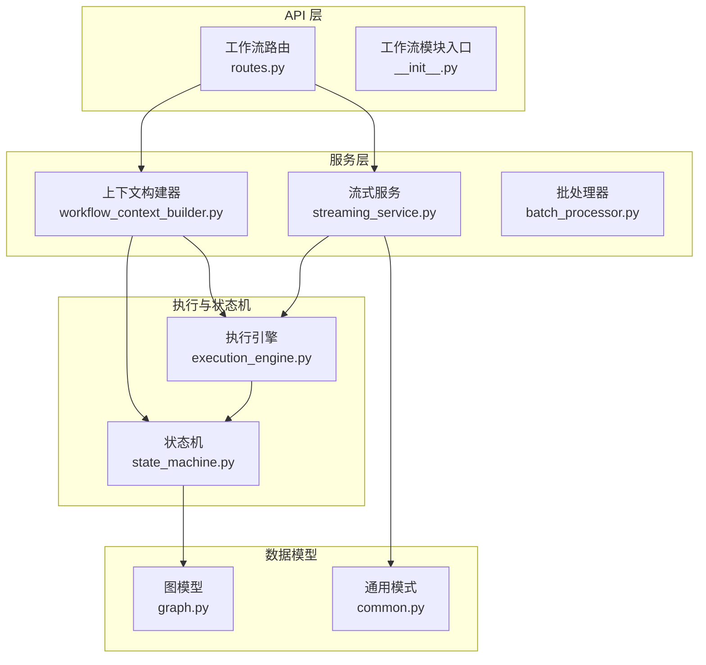
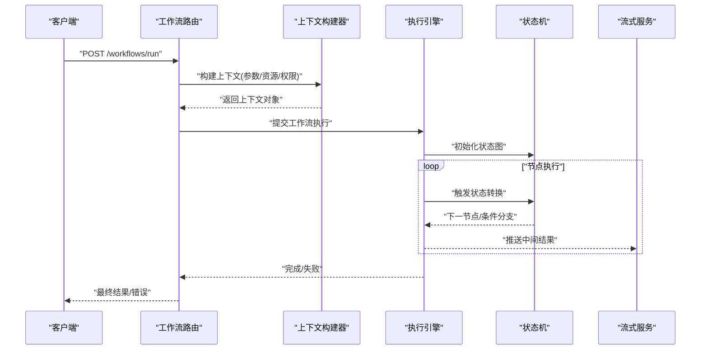
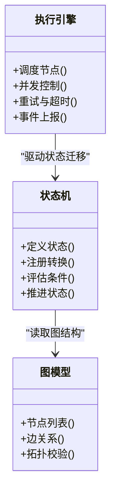
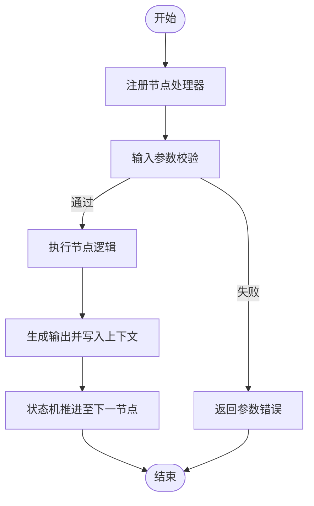
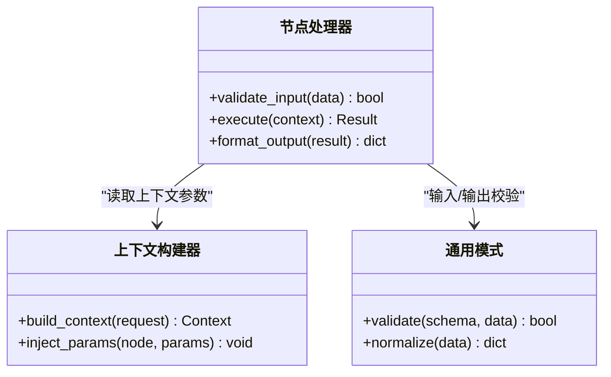
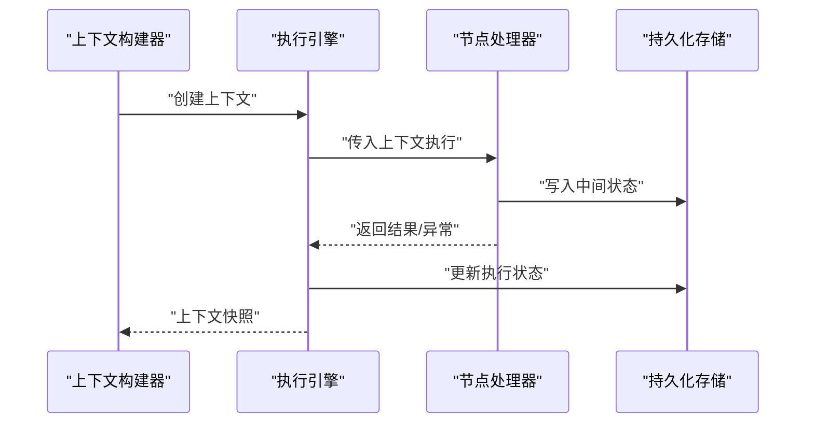
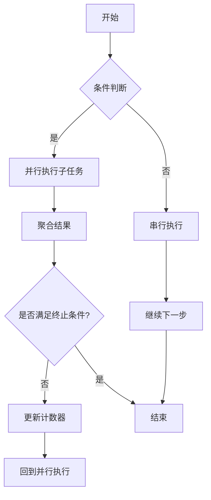
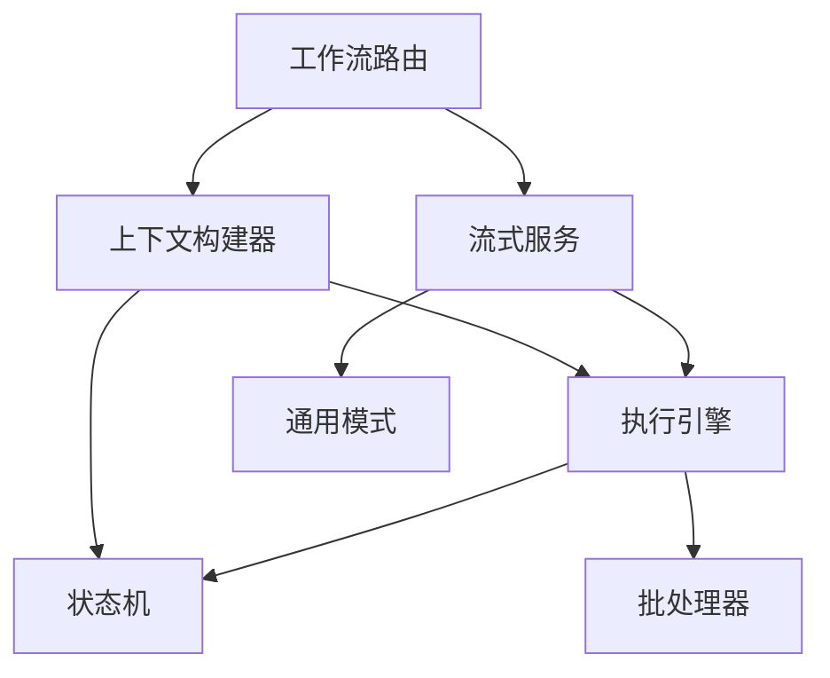

# 工作流扩展

<cite>
**本文引用的文件**   
- [backend/app/api/v1/workflow/__init__.py](file://backend/app/api/v1/workflow/__init__.py)
- [backend/app/api/v1/workflow/routes.py](file://backend/app/api/v1/workflow/routes.py)
- [backend/app/services/workflow_context_builder.py](file://backend/app/services/workflow_context_builder.py)
- [pipeline/state_machine.py](file://pipeline/state_machine.py)
- [core/execution_engine.py](file://core/execution_engine.py)
- [backend/app/services/batch_processor.py](file://backend/app/services/batch_processor.py)
- [backend/app/services/streaming_service.py](file://backend/app/services/streaming_service.py)
- [backend/app/models/graph.py](file://backend/app/models/graph.py)
- [backend/app/schemas/common.py](file://backend/app/schemas/common.py)
- [backend/tests/test_workflow_context_builder.py](file://backend/tests/test_workflow_context_builder.py)
- [backend/tests/test_workflow_runtime_concept_prompts.py](file://backend/tests/test_workflow_runtime_concept_prompts.py)
</cite>

## 目录
1. [简介](#简介)
2. [项目结构](#项目结构)
3. [核心组件](#核心组件)
4. [架构总览](#架构总览)
5. [详细组件分析](#详细组件分析)
6. [依赖关系分析](#依赖关系分析)
7. [性能考虑](#性能考虑)
8. [故障排查指南](#故障排查指南)
9. [结论](#结论)
10. [附录](#附录)

## 简介
本指南面向希望为“小说创作代理系统”开发工作流扩展的工程师与高级用户。内容围绕工作流状态机的设计原理、扩展点（状态定义、转换规则、条件判断）、节点注册机制与参数配置、自定义节点模板（输入校验、执行逻辑、输出处理）、上下文管理（数据传递、状态持久化、错误恢复），以及复杂编排技巧（并行执行、条件分支、循环）展开，并提供测试方法与性能优化建议。

## 项目结构
工作流相关代码主要分布在以下位置：
- API 路由层：用于暴露工作流运行、查询、管理等接口
- 服务层：负责构建工作流上下文、编排执行、流式输出等
- 状态机与执行引擎：定义状态机模型、节点调度、并发控制与重试
- 数据模型与模式：描述图结构、任务与结果的结构化约束
- 测试：覆盖上下文构建、运行时概念提示、路由状态保存等场景

图表来源
- [backend/app/api/v1/workflow/routes.py](file://backend/app/api/v1/workflow/routes.py)
- [backend/app/api/v1/workflow/__init__.py](file://backend/app/api/v1/workflow/__init__.py)
- [backend/app/services/workflow_context_builder.py](file://backend/app/services/workflow_context_builder.py)
- [backend/app/services/streaming_service.py](file://backend/app/services/streaming_service.py)
- [backend/app/services/batch_processor.py](file://backend/app/services/batch_processor.py)
- [pipeline/state_machine.py](file://pipeline/state_machine.py)
- [core/execution_engine.py](file://core/execution_engine.py)
- [backend/app/models/graph.py](file://backend/app/models/graph.py)
- [backend/app/schemas/common.py](file://backend/app/schemas/common.py)

章节来源
- [backend/app/api/v1/workflow/routes.py](file://backend/app/api/v1/workflow/routes.py)
- [backend/app/api/v1/workflow/__init__.py](file://backend/app/api/v1/workflow/__init__.py)
- [backend/app/services/workflow_context_builder.py](file://backend/app/services/workflow_context_builder.py)
- [pipeline/state_machine.py](file://pipeline/state_machine.py)
- [core/execution_engine.py](file://core/execution_engine.py)
- [backend/app/services/batch_processor.py](file://backend/app/services/batch_processor.py)
- [backend/app/services/streaming_service.py](file://backend/app/services/streaming_service.py)
- [backend/app/models/graph.py](file://backend/app/models/graph.py)
- [backend/app/schemas/common.py](file://backend/app/schemas/common.py)

## 核心组件
- 工作流路由：提供 RESTful 接口，接收工作流启动、进度查询、结果获取等请求，并委托给服务层处理。
- 上下文构建器：根据请求参数与项目/章节上下文，组装工作流初始状态、节点参数、资源引用等。
- 状态机：定义状态集合、转换规则、条件判断与回退策略；驱动节点按图执行。
- 执行引擎：负责节点调度、并发控制、重试与超时、事件上报与追踪。
- 流式服务：将执行过程中的中间结果以流式方式推送给客户端。
- 批处理器：对批量节点或分片任务进行并行处理与聚合。
- 图模型与通用模式：描述工作流图结构、节点类型、边关系与结果数据结构。

章节来源
- [backend/app/api/v1/workflow/routes.py](file://backend/app/api/v1/workflow/routes.py)
- [backend/app/services/workflow_context_builder.py](file://backend/app/services/workflow_context_builder.py)
- [pipeline/state_machine.py](file://pipeline/state_machine.py)
- [core/execution_engine.py](file://core/execution_engine.py)
- [backend/app/services/streaming_service.py](file://backend/app/services/streaming_service.py)
- [backend/app/services/batch_processor.py](file://backend/app/services/batch_processor.py)
- [backend/app/models/graph.py](file://backend/app/models/graph.py)
- [backend/app/schemas/common.py](file://backend/app/schemas/common.py)

## 架构总览
下图展示了从 API 到执行引擎与状态机的调用链，以及上下文构建与流式输出的关键交互。

图表来源
- [backend/app/api/v1/workflow/routes.py](file://backend/app/api/v1/workflow/routes.py)
- [backend/app/services/workflow_context_builder.py](file://backend/app/services/workflow_context_builder.py)
- [core/execution_engine.py](file://core/execution_engine.py)
- [pipeline/state_machine.py](file://pipeline/state_machine.py)
- [backend/app/services/streaming_service.py](file://backend/app/services/streaming_service.py)

## 详细组件分析

### 工作流状态机设计与扩展点
- 状态定义：通过图模型定义节点类型与边关系，支持顺序、分支、汇聚等拓扑。
- 转换规则：在状态机中声明合法的状态迁移路径，结合条件表达式决定下一步。
- 条件判断：基于上下文变量、外部服务响应或业务规则计算布尔条件，驱动分支。
- 扩展点：新增节点类型时，需在状态机注册该节点的入边/出边与转换条件；在执行引擎中注册节点处理器。

图表来源
- [pipeline/state_machine.py](file://pipeline/state_machine.py)
- [backend/app/models/graph.py](file://backend/app/models/graph.py)
- [core/execution_engine.py](file://core/execution_engine.py)

章节来源
- [pipeline/state_machine.py](file://pipeline/state_machine.py)
- [backend/app/models/graph.py](file://backend/app/models/graph.py)
- [core/execution_engine.py](file://core/execution_engine.py)

### 节点注册机制与参数配置
- 注册机制：执行引擎维护节点处理器注册表，新节点需实现统一接口并在启动时注册。
- 参数配置：节点参数由上下文构建器注入，支持必填/可选、默认值、类型校验与范围限制。
- 生命周期：节点执行前进行输入校验，执行后产出结果并写入上下文，供后续节点使用。

图表来源
- [core/execution_engine.py](file://core/execution_engine.py)
- [backend/app/services/workflow_context_builder.py](file://backend/app/services/workflow_context_builder.py)

章节来源
- [core/execution_engine.py](file://core/execution_engine.py)
- [backend/app/services/workflow_context_builder.py](file://backend/app/services/workflow_context_builder.py)

### 自定义工作流节点开发模板
- 输入验证：在节点处理器中定义输入 schema，使用通用模式进行校验，确保字段类型、长度、枚举值等符合预期。
- 执行逻辑：实现核心业务逻辑，支持同步/异步调用、外部服务集成、资源访问与异常捕获。
- 输出处理：标准化输出结构，包含成功标志、数据负载、元数据与追踪信息；失败时返回结构化错误码与消息。

图表来源
- [backend/app/services/workflow_context_builder.py](file://backend/app/services/workflow_context_builder.py)
- [backend/app/schemas/common.py](file://backend/app/schemas/common.py)
- [core/execution_engine.py](file://core/execution_engine.py)

章节来源
- [backend/app/services/workflow_context_builder.py](file://backend/app/services/workflow_context_builder.py)
- [backend/app/schemas/common.py](file://backend/app/schemas/common.py)
- [core/execution_engine.py](file://core/execution_engine.py)

### 工作流上下文管理
- 数据传递：上下文对象贯穿整个执行过程，节点可读写共享数据，避免全局变量。
- 状态持久化：关键状态与中间结果持久化到数据库或对象存储，支持断点续跑。
- 错误恢复：遇到异常时记录错误上下文，支持重试、补偿与回滚策略。

图表来源
- [backend/app/services/workflow_context_builder.py](file://backend/app/services/workflow_context_builder.py)
- [core/execution_engine.py](file://core/execution_engine.py)
- [backend/app/models/graph.py](file://backend/app/models/graph.py)

章节来源
- [backend/app/services/workflow_context_builder.py](file://backend/app/services/workflow_context_builder.py)
- [core/execution_engine.py](file://core/execution_engine.py)
- [backend/app/models/graph.py](file://backend/app/models/graph.py)

### 复杂工作流编排技巧
- 并行执行：批处理器支持多节点并行执行与结果聚合，适用于独立子任务。
- 条件分支：状态机根据上下文变量动态选择分支路径，实现灵活的业务流程。
- 循环处理：通过状态机自环与计数器控制迭代次数，适合批量处理与重试。

图表来源
- [backend/app/services/batch_processor.py](file://backend/app/services/batch_processor.py)
- [pipeline/state_machine.py](file://pipeline/state_machine.py)

章节来源
- [backend/app/services/batch_processor.py](file://backend/app/services/batch_processor.py)
- [pipeline/state_machine.py](file://pipeline/state_machine.py)

### 实际扩展示例
- 示例一：新增“角色一致性检查”节点
  - 输入：角色档案、当前章节文本
  - 逻辑：调用语义匹配服务，检测角色行为与设定的一致性
  - 输出：一致性评分与建议修改项
- 示例二：新增“音频质量审核”节点
  - 输入：音频片段、质量阈值
  - 逻辑：调用音频分析服务，检测噪声、响度、时长合规性
  - 输出：质量报告与合格标记

章节来源
- [backend/app/services/workflow_context_builder.py](file://backend/app/services/workflow_context_builder.py)
- [pipeline/state_machine.py](file://pipeline/state_machine.py)
- [core/execution_engine.py](file://core/execution_engine.py)

## 依赖关系分析
工作流各组件之间的依赖关系如下：
- 路由依赖上下文构建器与服务层
- 上下文构建器依赖执行引擎与状态机
- 执行引擎依赖状态机与批处理器
- 流式服务依赖执行引擎与通用模式

图表来源
- [backend/app/api/v1/workflow/routes.py](file://backend/app/api/v1/workflow/routes.py)
- [backend/app/services/workflow_context_builder.py](file://backend/app/services/workflow_context_builder.py)
- [backend/app/services/streaming_service.py](file://backend/app/services/streaming_service.py)
- [core/execution_engine.py](file://core/execution_engine.py)
- [pipeline/state_machine.py](file://pipeline/state_machine.py)
- [backend/app/services/batch_processor.py](file://backend/app/services/batch_processor.py)
- [backend/app/schemas/common.py](file://backend/app/schemas/common.py)

章节来源
- [backend/app/api/v1/workflow/routes.py](file://backend/app/api/v1/workflow/routes.py)
- [backend/app/services/workflow_context_builder.py](file://backend/app/services/workflow_context_builder.py)
- [backend/app/services/streaming_service.py](file://backend/app/services/streaming_service.py)
- [core/execution_engine.py](file://core/execution_engine.py)
- [pipeline/state_machine.py](file://pipeline/state_machine.py)
- [backend/app/services/batch_processor.py](file://backend/app/services/batch_processor.py)
- [backend/app/schemas/common.py](file://backend/app/schemas/common.py)

## 性能考虑
- 并发控制：合理设置节点并行度，避免资源争用与下游限流。
- 缓存策略：对重复计算的结果进行缓存，减少外部服务调用。
- 流式输出：使用流式服务逐步推送中间结果，降低内存占用与延迟。
- 批处理优化：对批量任务进行分片与合并，提升吞吐能力。
- 监控与追踪：记录关键指标与链路追踪，便于定位瓶颈。

[本节为通用指导，不直接分析具体文件]

## 故障排查指南
- 常见问题
  - 节点参数校验失败：检查输入 schema 与默认值配置
  - 状态转换非法：确认状态机定义的迁移路径与条件表达式
  - 执行超时或重试过多：调整超时阈值与重试策略
  - 上下文数据缺失：检查上下文构建器是否正确注入参数
- 调试方法
  - 启用详细日志与追踪 ID
  - 使用测试用例复现问题
  - 查看中间状态快照与错误上下文

章节来源
- [backend/tests/test_workflow_context_builder.py](file://backend/tests/test_workflow_context_builder.py)
- [backend/tests/test_workflow_runtime_concept_prompts.py](file://backend/tests/test_workflow_runtime_concept_prompts.py)

## 结论
通过明确的状态机设计、灵活的节点注册机制与完善的上下文管理，工作流扩展能够高效支撑小说创作代理系统的多样化业务需求。遵循本指南中的最佳实践，开发者可以快速实现高质量的工作流节点，并通过并行、分支与循环等编排技巧构建复杂流程。同时，结合测试与性能优化策略，确保系统的稳定性与可扩展性。

[本节为总结性内容，不直接分析具体文件]

## 附录
- 术语表
  - 工作流：由多个节点组成的有向图，表示业务流程的执行顺序与依赖关系
  - 状态机：定义状态集合与转换规则的抽象模型
  - 上下文：贯穿执行过程的共享数据载体
  - 节点处理器：实现具体业务逻辑的可插拔组件
- 参考文件
  - 工作流路由与模块入口
  - 上下文构建器与流式服务
  - 状态机与执行引擎
  - 图模型与通用模式
  - 测试用例与示例

[本节为补充信息，不直接分析具体文件]