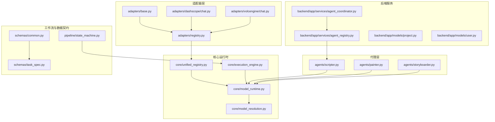
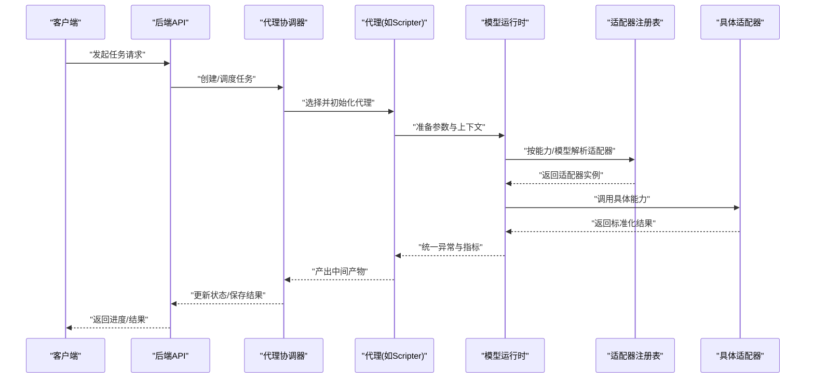
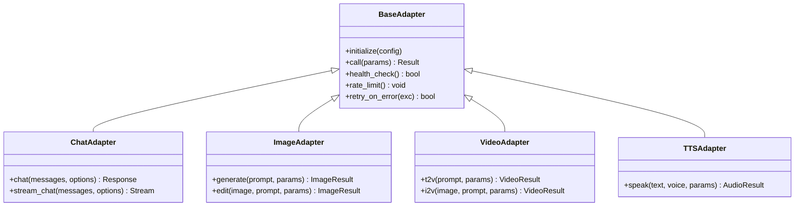
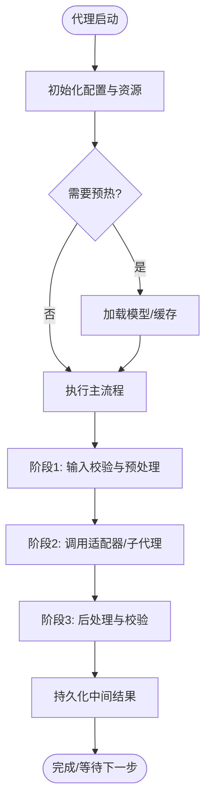
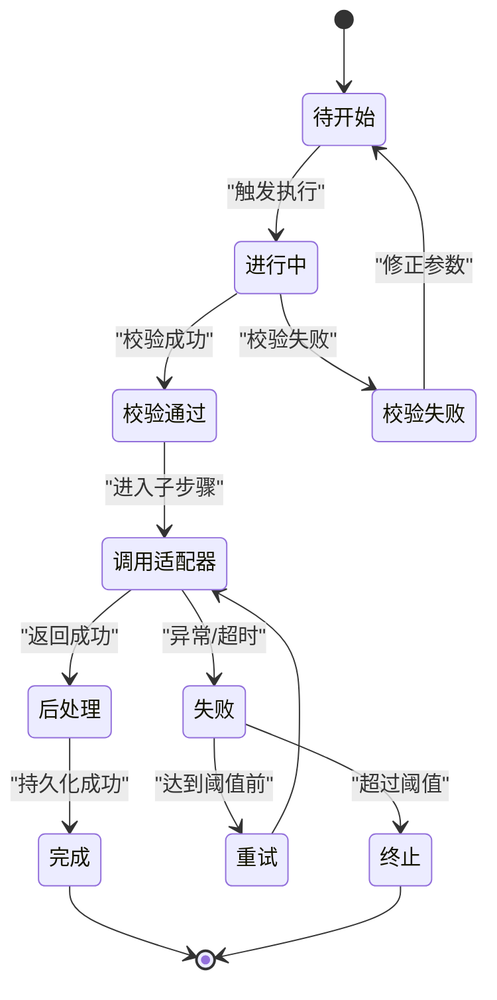
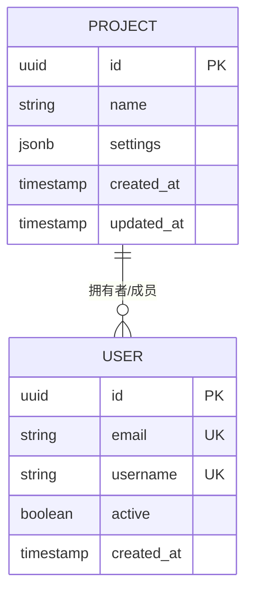
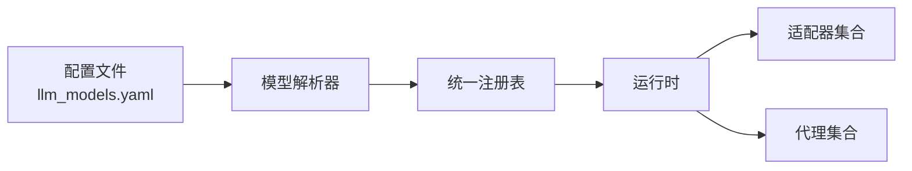
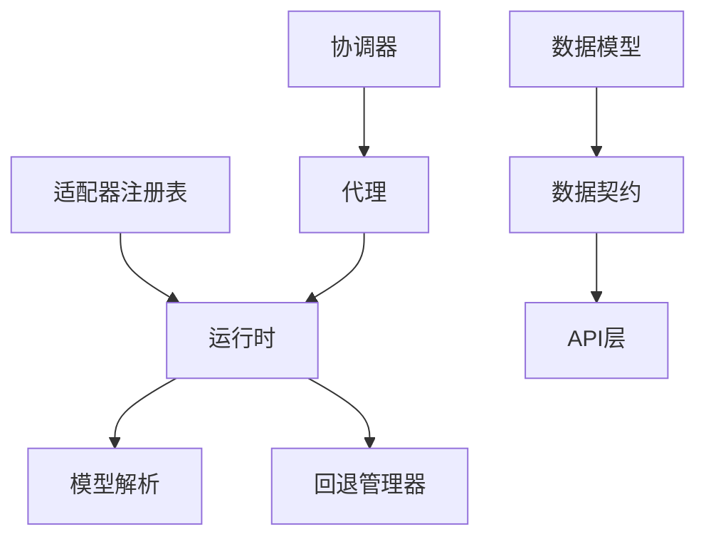

# 扩展开发

<cite>
**本文引用的文件**   
- [adapters/base.py](file://adapters/base.py)
- [adapters/registry.py](file://adapters/registry.py)
- [adapters/_shared.py](file://adapters/_shared.py)
- [adapters/model_adapters.py](file://adapters/model_adapters.py)
- [adapters/new_models_adapters.py](file://adapters/new_models_adapters.py)
- [adapters/dashscope/chat.py](file://adapters/dashscope/chat.py)
- [adapters/volcengine/chat.py](file://adapters/volcengine/chat.py)
- [core/unified_registry.py](file://core/unified_registry.py)
- [core/model_runtime.py](file://core/model_runtime.py)
- [core/model_resolution.py](file://core/model_resolution.py)
- [agents/__init__.py](file://agents/__init__.py)
- [agents/scripter.py](file://agents/scripter.py)
- [agents/painter.py](file://agents/painter.py)
- [agents/storyboarder.py](file://agents/storyboarder.py)
- [backend/app/services/agent_registry.py](file://backend/app/services/agent_registry.py)
- [backend/app/services/agent_coordinator.py](file://backend/app/services/agent_coordinator.py)
- [backend/app/models/project.py](file://backend/app/models/project.py)
- [backend/app/models/user.py](file://backend/app/models/user.py)
- [backend/app/schemas/project.py](file://backend/app/schemas/project.py)
- [backend/app/schemas/user.py](file://backend/app/schemas/user.py)
- [backend/alembic/versions/initial.py](file://backend/alembic/versions/initial.py)
- [schemas/common.py](file://schemas/common.py)
- [schemas/task_spec.py](file://schemas/task_spec.py)
- [pipeline/state_machine.py](file://pipeline/state_machine.py)
- [core/domain_loader.py](file://core/domain_loader.py)
- [core/fallback_manager.py](file://core/fallback_manager.py)
- [core/execution_engine.py](file://core/execution_engine.py)
- [config/llm_models.yaml](file://config/llm_models.yaml)
- [scripts/verify_all_adapters.py](file://scripts/verify_all_adapters.py)
- [tests/test_model_adapters_legacy_delegate.py](file://tests/test_model_adapters_legacy_delegate.py)
</cite>

## 目录
1. [简介](#简介)
2. [项目结构](#项目结构)
3. [核心组件](#核心组件)
4. [架构总览](#架构总览)
5. [详细组件分析](#详细组件分析)
6. [依赖关系分析](#依赖关系分析)
7. [性能考虑](#性能考虑)
8. [故障排查指南](#故障排查指南)
9. [结论](#结论)
10. [附录](#附录)

## 简介
本指南面向希望为小说创作代理系统扩展能力的开发者，覆盖以下主题：
- 自定义AI适配器开发（接口规范、实现模板、测试方法）
- 新代理类型开发（基类继承、生命周期管理、通信协议）
- 工作流节点扩展（节点定义、参数配置、执行逻辑）
- 数据模型扩展（ORM映射、验证规则、迁移脚本）
- 插件系统与注册机制、依赖管理
- 完整开发示例（从简单文本处理到复杂多模态处理）
- 代码规范、测试策略与发布流程

本指南以仓库现有实现为依据，提供循序渐进的说明与图示，帮助你在不破坏既有能力的前提下安全扩展。

## 项目结构
系统采用分层与模块化组织：
- adapters：各类AI能力适配器（LLM、图像、视频、TTS等），统一抽象与注册
- agents：业务代理（编剧、绘画、分镜等），封装领域任务编排
- backend：Web服务、数据库模型、API路由、任务与服务层
- core：运行时、模型解析、统一注册表、执行引擎等基础设施
- pipeline：状态机与工作流编排
- schemas：跨模块的数据契约与校验
- scripts：工具与验证脚本
- tests：单元测试与集成测试

图表来源
- [adapters/base.py](file://adapters/base.py)
- [adapters/registry.py](file://adapters/registry.py)
- [adapters/dashscope/chat.py](file://adapters/dashscope/chat.py)
- [adapters/volcengine/chat.py](file://adapters/volcengine/chat.py)
- [core/unified_registry.py](file://core/unified_registry.py)
- [core/model_runtime.py](file://core/model_runtime.py)
- [core/model_resolution.py](file://core/model_resolution.py)
- [core/execution_engine.py](file://core/execution_engine.py)
- [agents/scripter.py](file://agents/scripter.py)
- [agents/painter.py](file://agents/painter.py)
- [agents/storyboarder.py](file://agents/storyboarder.py)
- [backend/app/services/agent_registry.py](file://backend/app/services/agent_registry.py)
- [backend/app/services/agent_coordinator.py](file://backend/app/services/agent_coordinator.py)
- [pipeline/state_machine.py](file://pipeline/state_machine.py)
- [schemas/common.py](file://schemas/common.py)
- [schemas/task_spec.py](file://schemas/task_spec.py)

章节来源
- [adapters/base.py](file://adapters/base.py)
- [adapters/registry.py](file://adapters/registry.py)
- [core/unified_registry.py](file://core/unified_registry.py)
- [core/model_runtime.py](file://core/model_runtime.py)
- [core/model_resolution.py](file://core/model_resolution.py)
- [core/execution_engine.py](file://core/execution_engine.py)
- [agents/scripter.py](file://agents/scripter.py)
- [agents/painter.py](file://agents/painter.py)
- [agents/storyboarder.py](file://agents/storyboarder.py)
- [backend/app/services/agent_registry.py](file://backend/app/services/agent_registry.py)
- [backend/app/services/agent_coordinator.py](file://backend/app/services/agent_coordinator.py)
- [pipeline/state_machine.py](file://pipeline/state_machine.py)
- [schemas/common.py](file://schemas/common.py)
- [schemas/task_spec.py](file://schemas/task_spec.py)

## 核心组件
- 适配器抽象与注册
  - 适配器基类定义统一的调用接口与生命周期钩子，便于不同厂商或能力类型的适配
  - 注册表集中管理适配器实例，支持按能力维度查找与切换
- 运行时与模型解析
  - 运行时负责连接具体适配器、参数标准化、错误归一化与重试
  - 模型解析根据配置与上下文选择最优模型或回退策略
- 代理与编排
  - 代理封装领域任务（如剧本生成、图像绘制、分镜构建），通过运行时调用适配器
  - 协调器与服务层将HTTP请求转化为代理任务，并持久化结果
- 工作流与数据契约
  - 状态机驱动阶段推进，确保可恢复与可观测
  - 共享Schema保证输入输出一致性

章节来源
- [adapters/base.py](file://adapters/base.py)
- [adapters/registry.py](file://adapters/registry.py)
- [core/model_runtime.py](file://core/model_runtime.py)
- [core/model_resolution.py](file://core/model_resolution.py)
- [agents/scripter.py](file://agents/scripter.py)
- [agents/painter.py](file://agents/painter.py)
- [agents/storyboarder.py](file://agents/storyboarder.py)
- [backend/app/services/agent_registry.py](file://backend/app/services/agent_registry.py)
- [backend/app/services/agent_coordinator.py](file://backend/app/services/agent_coordinator.py)
- [pipeline/state_machine.py](file://pipeline/state_machine.py)
- [schemas/common.py](file://schemas/common.py)
- [schemas/task_spec.py](file://schemas/task_spec.py)

## 架构总览
下图展示从请求进入后端到适配器调用的关键路径，以及代理在工作流中的位置。

图表来源
- [backend/app/services/agent_coordinator.py](file://backend/app/services/agent_coordinator.py)
- [backend/app/services/agent_registry.py](file://backend/app/services/agent_registry.py)
- [agents/scripter.py](file://agents/scripter.py)
- [core/model_runtime.py](file://core/model_runtime.py)
- [core/unified_registry.py](file://core/unified_registry.py)
- [adapters/registry.py](file://adapters/registry.py)
- [adapters/base.py](file://adapters/base.py)

## 详细组件分析

### 自定义AI适配器开发
- 接口规范
  - 基于适配器基类定义统一方法签名（如文本对话、图像生成、视频生成、TTS等）
  - 必须实现参数标准化、响应规范化、错误归一化、速率限制与重试
- 实现模板
  - 新建适配器包（如 vendors/my_adapter），在包内实现各能力模块
  - 在适配器注册表中声明能力键、默认模型、版本兼容信息
  - 使用运行时提供的通用工具进行鉴权、限流、缓存与追踪
- 测试方法
  - 单元测试：模拟网络与外部依赖，断言参数转换与错误处理
  - 集成测试：使用真实或Mock端点，验证端到端调用链路与数据格式
  - 回归测试：覆盖常见失败场景（超时、限流、空响应、字段缺失）

图表来源
- [adapters/base.py](file://adapters/base.py)
- [adapters/dashscope/chat.py](file://adapters/dashscope/chat.py)
- [adapters/volcengine/chat.py](file://adapters/volcengine/chat.py)

章节来源
- [adapters/base.py](file://adapters/base.py)
- [adapters/registry.py](file://adapters/registry.py)
- [adapters/dashscope/chat.py](file://adapters/dashscope/chat.py)
- [adapters/volcengine/chat.py](file://adapters/volcengine/chat.py)
- [core/model_runtime.py](file://core/model_runtime.py)
- [scripts/verify_all_adapters.py](file://scripts/verify_all_adapters.py)
- [tests/test_model_adapters_legacy_delegate.py](file://tests/test_model_adapters_legacy_delegate.py)

### 新代理类型开发
- 基类继承
  - 继承代理基类，定义任务输入输出契约、阶段划分与中间状态
- 生命周期管理
  - 初始化、预热、运行、清理；支持中断与恢复
- 通信协议
  - 与运行时交互的参数格式、事件上报、错误码约定
- 编排与协作
  - 与其他代理或适配器组合，形成流水线

图表来源
- [agents/scripter.py](file://agents/scripter.py)
- [agents/painter.py](file://agents/painter.py)
- [agents/storyboarder.py](file://agents/storyboarder.py)
- [core/execution_engine.py](file://core/execution_engine.py)

章节来源
- [agents/scripter.py](file://agents/scripter.py)
- [agents/painter.py](file://agents/painter.py)
- [agents/storyboarder.py](file://agents/storyboarder.py)
- [core/execution_engine.py](file://core/execution_engine.py)

### 工作流节点扩展
- 节点定义
  - 在状态机中新增节点类型，定义入参、出参与条件分支
- 参数配置
  - 通过配置中心或YAML/JSON注入，支持环境变量覆盖
- 执行逻辑
  - 节点处理器实现幂等性、重试与回滚；记录审计日志

图表来源
- [pipeline/state_machine.py](file://pipeline/state_machine.py)
- [core/execution_engine.py](file://core/execution_engine.py)

章节来源
- [pipeline/state_machine.py](file://pipeline/state_machine.py)
- [core/execution_engine.py](file://core/execution_engine.py)

### 数据模型扩展
- ORM映射
  - 在models目录下新增实体类，定义字段、索引与关联关系
- 验证规则
  - 在schemas中定义Pydantic模型，约束必填、类型与范围
- 迁移脚本
  - 使用Alembic生成迁移，确保向后兼容与可回滚

图表来源
- [backend/app/models/project.py](file://backend/app/models/project.py)
- [backend/app/models/user.py](file://backend/app/models/user.py)
- [backend/app/schemas/project.py](file://backend/app/schemas/project.py)
- [backend/app/schemas/user.py](file://backend/app/schemas/user.py)
- [backend/alembic/versions/initial.py](file://backend/alembic/versions/initial.py)

章节来源
- [backend/app/models/project.py](file://backend/app/models/project.py)
- [backend/app/models/user.py](file://backend/app/models/user.py)
- [backend/app/schemas/project.py](file://backend/app/schemas/project.py)
- [backend/app/schemas/user.py](file://backend/app/schemas/user.py)
- [backend/alembic/versions/initial.py](file://backend/alembic/versions/initial.py)

### 插件系统与注册机制
- 统一注册表
  - 通过统一注册表集中管理适配器、代理与能力项，支持动态发现与热插拔
- 依赖管理
  - 在运行时解析依赖图，避免循环依赖；提供降级与回退策略
- 配置驱动
  - 使用YAML/JSON描述模型与能力，结合环境变量覆盖

图表来源
- [core/unified_registry.py](file://core/unified_registry.py)
- [core/model_resolution.py](file://core/model_resolution.py)
- [core/model_runtime.py](file://core/model_runtime.py)
- [adapters/registry.py](file://adapters/registry.py)
- [config/llm_models.yaml](file://config/llm_models.yaml)

章节来源
- [core/unified_registry.py](file://core/unified_registry.py)
- [core/model_resolution.py](file://core/model_resolution.py)
- [core/model_runtime.py](file://core/model_runtime.py)
- [adapters/registry.py](file://adapters/registry.py)
- [config/llm_models.yaml](file://config/llm_models.yaml)

### 完整开发示例
- 简单文本处理
  - 目标：新增一个文本摘要适配器
  - 步骤：
    - 在适配器包下实现文本摘要能力，遵循基类接口
    - 在注册表中登记能力键与默认模型
    - 编写单元测试与集成测试，覆盖正常与异常路径
    - 通过验证脚本快速自检
- 复杂多模态处理
  - 目标：新增“文生视频”适配器
  - 步骤：
    - 实现视频生成能力，处理长任务异步回调与进度上报
    - 在运行时中增加重试与超时策略
    - 在代理层编排“提示词优化→视频生成→质量评估”流水线
    - 添加状态机节点与审计日志，确保可恢复

章节来源
- [adapters/base.py](file://adapters/base.py)
- [adapters/registry.py](file://adapters/registry.py)
- [core/model_runtime.py](file://core/model_runtime.py)
- [core/model_resolution.py](file://core/model_resolution.py)
- [scripts/verify_all_adapters.py](file://scripts/verify_all_adapters.py)
- [pipeline/state_machine.py](file://pipeline/state_machine.py)

## 依赖关系分析
- 适配器与运行时
  - 适配器通过注册表暴露能力，运行时负责选择与调用
- 代理与协调器
  - 代理由协调器按需实例化与调度，共享运行时上下文
- 数据模型与迁移
  - 模型变更需配套迁移脚本，保持数据库与代码一致

图表来源
- [adapters/registry.py](file://adapters/registry.py)
- [core/model_runtime.py](file://core/model_runtime.py)
- [core/model_resolution.py](file://core/model_resolution.py)
- [core/fallback_manager.py](file://core/fallback_manager.py)
- [backend/app/services/agent_coordinator.py](file://backend/app/services/agent_coordinator.py)
- [backend/app/services/agent_registry.py](file://backend/app/services/agent_registry.py)
- [backend/app/models/project.py](file://backend/app/models/project.py)
- [backend/app/schemas/project.py](file://backend/app/schemas/project.py)

章节来源
- [adapters/registry.py](file://adapters/registry.py)
- [core/model_runtime.py](file://core/model_runtime.py)
- [core/model_resolution.py](file://core/model_resolution.py)
- [core/fallback_manager.py](file://core/fallback_manager.py)
- [backend/app/services/agent_coordinator.py](file://backend/app/services/agent_coordinator.py)
- [backend/app/services/agent_registry.py](file://backend/app/services/agent_registry.py)
- [backend/app/models/project.py](file://backend/app/models/project.py)
- [backend/app/schemas/project.py](file://backend/app/schemas/project.py)

## 性能考虑
- 适配器层
  - 启用连接池与并发控制，合理设置超时与重试次数
  - 对热点数据进行本地缓存，减少重复请求
- 运行时
  - 模型解析时优先命中缓存，降低解析开销
  - 统一错误分类，避免频繁重试无效请求
- 代理层
  - 拆分大任务为小阶段，提升可恢复性与吞吐
  - 使用异步I/O与流式处理，降低内存峰值
- 工作流
  - 状态机节点幂等设计，支持断点续跑
  - 批量操作合并IO，减少磁盘与网络抖动

[本节为通用指导，无需特定文件引用]

## 故障排查指南
- 常见问题
  - 适配器未注册：检查注册表是否包含能力键与版本
  - 模型解析失败：核对配置与运行时环境变量
  - 代理卡住：查看状态机节点与审计日志
  - 数据不一致：对比Schema与ORM映射，检查迁移历史
- 定位手段
  - 使用验证脚本快速检测适配器连通性
  - 开启详细日志与追踪ID，串联请求链路
  - 使用最小复现用例隔离问题域

章节来源
- [scripts/verify_all_adapters.py](file://scripts/verify_all_adapters.py)
- [core/fallback_manager.py](file://core/fallback_manager.py)
- [pipeline/state_machine.py](file://pipeline/state_machine.py)
- [backend/app/services/agent_coordinator.py](file://backend/app/services/agent_coordinator.py)

## 结论
通过统一的适配器抽象、运行时与注册表、代理编排与工作流状态机，系统提供了稳定可扩展的基础设施。按照本指南的步骤与规范，你可以安全地扩展新的AI能力、代理类型与工作流节点，并确保数据一致性与可观测性。建议在每次扩展时同步完善测试与文档，持续改进系统的健壮性与可维护性。

[本节为总结，无需特定文件引用]

## 附录
- 代码规范
  - 命名与模块划分遵循现有风格；适配器与代理职责单一
  - 错误处理统一归一，避免泄露内部细节
  - 配置与常量集中管理，避免硬编码
- 测试策略
  - 单元测试覆盖参数转换、边界条件与异常路径
  - 集成测试使用Mock或沙箱环境，验证端到端流程
  - 回归测试纳入CI，防止能力退化
- 发布流程
  - 提交前运行验证脚本与测试套件
  - 更新Schema与迁移脚本，确保数据库一致性
  - 发布说明包含能力变更、兼容性与回滚方案

[本节为通用指导，无需特定文件引用]