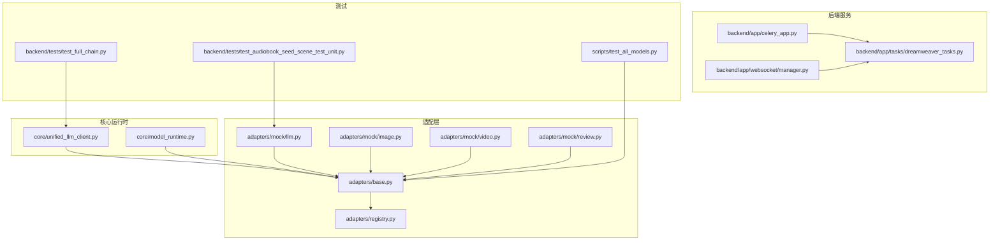
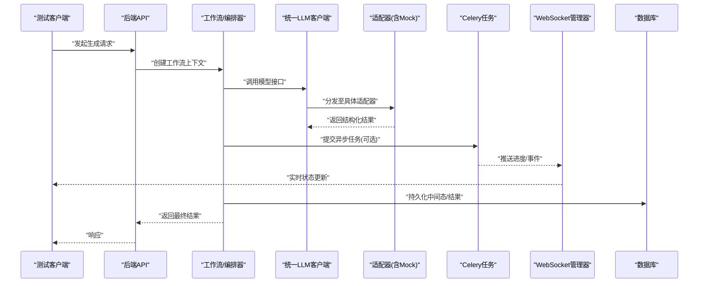
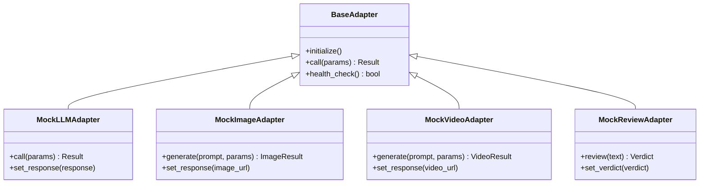
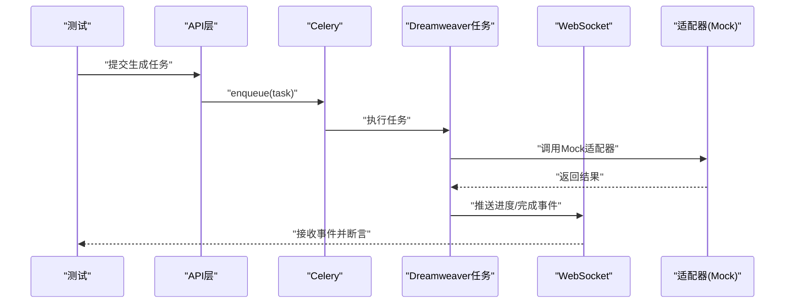
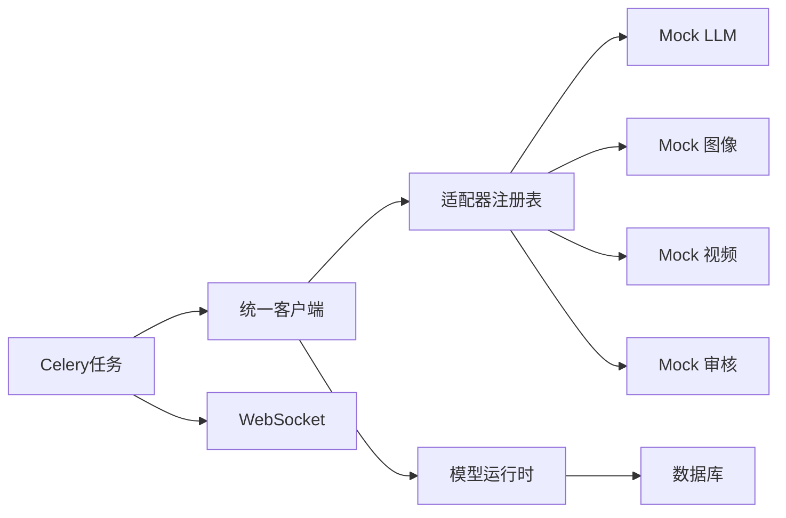

# 扩展测试

<cite>
**本文引用的文件**   
- [README.md](file://README.md)
- [docker-compose.yml](file://docker-compose.yml)
- [backend/tests/test_full_chain.py](file://backend/tests/test_full_chain.py)
- [backend/tests/test_audiobook_seed_scene_test_unit.py](file://backend/tests/test_audiobook_seed_scene_test_unit.py)
- [backend/tests/test_dreamweaver_video_generation.py](file://backend/tests/test_dreamweaver_video_generation.py)
- [backend/tests/test_ai_trace_multimodel_optimization.py](file://backend/tests/test_ai_trace_multimodel_optimization.py)
- [adapters/mock/llm.py](file://adapters/mock/llm.py)
- [adapters/mock/image.py](file://adapters/mock/image.py)
- [adapters/mock/video.py](file://adapters/mock/video.py)
- [adapters/mock/review.py](file://adapters/mock/review.py)
- [adapters/base.py](file://adapters/base.py)
- [adapters/registry.py](file://adapters/registry.py)
- [adapters/_shared.py](file://adapters/_shared.py)
- [core/unified_llm_client.py](file://core/unified_llm_client.py)
- [core/model_runtime.py](file://core/model_runtime.py)
- [backend/app/celery_app.py](file://backend/app/celery_app.py)
- [backend/app/tasks/dreamweaver_tasks.py](file://backend/app/tasks/dreamweaver_tasks.py)
- [backend/app/websocket/manager.py](file://backend/app/websocket/manager.py)
- [scripts/test_all_models.py](file://scripts/test_all_models.py)
- [scripts/verify_seed_tts_websocket_v2.py](file://scripts/verify_seed_tts_websocket_v2.py)
- [backend/tests/test_audiobook_sse_progress.py](file://backend/tests/test_audiobook_sse_progress.py)
- [backend/tests/test_audiobook_stream_routes.py](file://backend/tests/test_audiobook_stream_routes.py)
- [backend/tests/test_audiobook_task_repository.py](file://backend/tests/test_audiobook_task_repository.py)
- [backend/tests/test_audiobook_quality_gate.py](file://backend/tests/test_audiobook_quality_gate.py)
- [backend/tests/test_workflow_context_builder.py](file://backend/tests/test_workflow_context_builder.py)
- [backend/tests/test_agent_registry.py](file://backend/tests/test_agent_registry.py)
- [backend/tests/test_dreamweaver_config_lock.py](file://backend/tests/test_dreamweaver_config_lock.py)
- [backend/tests/test_audiobook_seed_scene_provider_attempt_ledger.py](file://backend/tests/test_audiobook_seed_scene_provider_attemptLedger.py)
- [backend/tests/test_audiobook_seed_scene_billing_wiring.py](file://backend/tests/test_audiobook_seed_scene_billing_wiring.py)
</cite>

## 目录
1. [简介](#简介)
2. [项目结构](#项目结构)
3. [核心组件](#核心组件)
4. [架构总览](#架构总览)
5. [详细组件分析](#详细组件分析)
6. [依赖分析](#依赖分析)
7. [性能考虑](#性能考虑)
8. [故障排查指南](#故障排查指南)
9. [结论](#结论)
10. [附录](#附录)

## 简介
本指南面向小说创作代理系统的扩展测试，覆盖单元测试、集成测试与端到端测试策略；重点说明如何对适配器、新代理与工作流节点进行高质量测试。文档包含：
- Mock/Stub 使用规范（特别是对外部 AI 服务的模拟）
- 测试环境搭建（数据库、消息队列、文件存储）
- 异步代码测试（Celery 任务、WebSocket）
- 性能与压力测试方法
- 完整测试用例示例与覆盖率统计、质量门禁设置

## 项目结构
本项目采用分层与按功能域组织相结合的结构：
- adapters：各外部模型/媒体能力适配器及 mock 实现
- agents：业务代理与编排逻辑
- backend/app：后端服务（API、Celery、WebSocket、DB、Schemas、Services、Tasks）
- tests/backend：后端测试套件
- scripts：辅助脚本（模型验证、WebSocket 验证等）
- core：统一客户端、模型运行时、路由与工具

图表来源
- [adapters/base.py](file://adapters/base.py)
- [adapters/registry.py](file://adapters/registry.py)
- [adapters/mock/llm.py](file://adapters/mock/llm.py)
- [adapters/mock/image.py](file://adapters/mock/image.py)
- [adapters/mock/video.py](file://adapters/mock/video.py)
- [adapters/mock/review.py](file://adapters/mock/review.py)
- [core/unified_llm_client.py](file://core/unified_llm_client.py)
- [core/model_runtime.py](file://core/model_runtime.py)
- [backend/app/celery_app.py](file://backend/app/celery_app.py)
- [backend/app/websocket/manager.py](file://backend/app/websocket/manager.py)
- [backend/app/tasks/dreamweaver_tasks.py](file://backend/app/tasks/dreamweaver_tasks.py)
- [backend/tests/test_full_chain.py](file://backend/tests/test_full_chain.py)
- [backend/tests/test_audiobook_seed_scene_test_unit.py](file://backend/tests/test_audiobook_seed_scene_test_unit.py)
- [scripts/test_all_models.py](file://scripts/test_all_models.py)

章节来源
- [README.md](file://README.md)
- [docker-compose.yml](file://docker-compose.yml)

## 核心组件
- 适配器基类与注册表
  - 所有适配器继承自统一基类，便于在测试中替换为 Mock 实现
  - 注册表集中管理适配器实例，支持按模型/能力选择
- 统一 LLM 客户端与模型运行时
  - 屏蔽底层差异，向上提供一致接口
  - 测试时可通过注入 Mock 客户端或切换运行时配置
- Celery 任务与 WebSocket
  - 长耗时任务通过 Celery 异步执行
  - WebSocket 用于实时进度与结果推送
- 测试套件与脚本
  - 端到端链路测试、单元与集成测试、模型验证脚本

章节来源
- [adapters/base.py](file://adapters/base.py)
- [adapters/registry.py](file://adapters/registry.py)
- [core/unified_llm_client.py](file://core/unified_llm_client.py)
- [core/model_runtime.py](file://core/model_runtime.py)
- [backend/app/celery_app.py](file://backend/app/celery_app.py)
- [backend/app/websocket/manager.py](file://backend/app/websocket/manager.py)

## 架构总览
下图展示从 API 到适配器、任务与 WS 的调用链，以及测试如何介入替换外部依赖。

图表来源
- [core/unified_llm_client.py](file://core/unified_llm_client.py)
- [adapters/base.py](file://adapters/base.py)
- [adapters/registry.py](file://adapters/registry.py)
- [backend/app/celery_app.py](file://backend/app/celery_app.py)
- [backend/app/websocket/manager.py](file://backend/app/websocket/manager.py)

## 详细组件分析

### 适配器与 Mock 测试
- 设计要点
  - 所有适配器遵循统一接口，便于在测试中用 Mock 替换真实实现
  - Mock 适配器覆盖 LLM、图像、视频、审核等常见外部能力
- 测试策略
  - 单元测试：直接调用适配器接口，断言输入输出结构与边界条件
  - 集成测试：通过统一客户端与注册表，验证 Mock 适配器的装配与路由
  - 端到端：在工作流中注入 Mock 适配器，验证整条链路行为稳定

图表来源
- [adapters/base.py](file://adapters/base.py)
- [adapters/mock/llm.py](file://adapters/mock/llm.py)
- [adapters/mock/image.py](file://adapters/mock/image.py)
- [adapters/mock/video.py](file://adapters/mock/video.py)
- [adapters/mock/review.py](file://adapters/mock/review.py)

章节来源
- [adapters/base.py](file://adapters/base.py)
- [adapters/mock/llm.py](file://adapters/mock/llm.py)
- [adapters/mock/image.py](file://adapters/mock/image.py)
- [adapters/mock/video.py](file://adapters/mock/video.py)
- [adapters/mock/review.py](file://adapters/mock/review.py)

### 统一 LLM 客户端与模型运行时
- 职责
  - 统一抽象不同模型提供方，暴露一致的调用接口
  - 支持在测试中注入 Mock 客户端或切换运行时配置
- 测试要点
  - 校验参数规范化、错误映射、重试与超时处理
  - 验证在 Mock 模式下不触发真实网络请求

章节来源
- [core/unified_llm_client.py](file://core/unified_llm_client.py)
- [core/model_runtime.py](file://core/model_runtime.py)

### Celery 任务与 WebSocket 通信
- 职责
  - 将耗时任务放入队列，避免阻塞请求
  - 通过 WebSocket 推送任务进度与结果
- 测试要点
  - 任务入队与执行路径：使用测试 worker 或直接调用任务函数
  - WebSocket 事件：连接、订阅、消息序列与超时处理
  - 幂等性与失败重试：重复入队、退避策略、补偿机制

图表来源
- [backend/app/celery_app.py](file://backend/app/celery_app.py)
- [backend/app/tasks/dreamweaver_tasks.py](file://backend/app/tasks/dreamweaver_tasks.py)
- [backend/app/websocket/manager.py](file://backend/app/websocket/manager.py)
- [adapters/mock/llm.py](file://adapters/mock/llm.py)

章节来源
- [backend/app/celery_app.py](file://backend/app/celery_app.py)
- [backend/app/tasks/dreamweaver_tasks.py](file://backend/app/tasks/dreamweaver_tasks.py)
- [backend/app/websocket/manager.py](file://backend/app/websocket/manager.py)

### 工作流与上下文构建
- 职责
  - 组装工作流上下文、阶段内容与状态流转
  - 在测试中验证上下文完整性与阶段间数据一致性
- 测试要点
  - 上下文初始化、字段校验、默认值填充
  - 阶段内容编码/解码、异常恢复

章节来源
- [backend/tests/test_workflow_context_builder.py](file://backend/tests/test_workflow_context_builder.py)

### 端到端与集成测试示例
- 全链路测试
  - 通过端到端用例验证从 API 到适配器、任务、WS 的完整流程
- 种子场景测试
  - 针对音频/视频生成的种子场景，验证关键路径与边界条件
- 多模型优化与追踪
  - 验证多模型路由、追踪与回退策略

章节来源
- [backend/tests/test_full_chain.py](file://backend/tests/test_full_chain.py)
- [backend/tests/test_audiobook_seed_scene_test_unit.py](file://backend/tests/test_audiobook_seed_scene_test_unit.py)
- [backend/tests/test_dreamweaver_video_generation.py](file://backend/tests/test_dreamweaver_video_generation.py)
- [backend/tests/test_ai_trace_multimodel_optimization.py](file://backend/tests/test_ai_trace_multimodel_optimization.py)

### SSE 与流式响应测试
- 目标
  - 验证服务端事件流（SSE）与流式接口的正确性
- 要点
  - 事件顺序、延迟与中断恢复
  - 客户端重连与去抖

章节来源
- [backend/tests/test_audiobook_sse_progress.py](file://backend/tests/test_audiobook_sse_progress.py)
- [backend/tests/test_audiobook_stream_routes.py](file://backend/tests/test_audiobook_stream_routes.py)

### 任务与计费/审计相关测试
- 目标
  - 验证任务生命周期、尝试记录、计费与审计一致性
- 要点
  - 任务状态机、重试次数限制、幂等键
  - 计费事件与账单明细对齐

章节来源
- [backend/tests/test_audiobook_task_repository.py](file://backend/tests/test_audiobook_task_repository.py)
- [backend/tests/test_audiobook_seed_scene_provider_attempt_ledger.py](file://backend/tests/test_audiobook_seed_scene_provider_attempt_ledger.py)
- [backend/tests/test_audiobook_seed_scene_billing_wiring.py](file://backend/tests/test_audiobook_seed_scene_billing_wiring.py)

### 质量门禁与回归
- 目标
  - 确保质量门控规则生效，防止退化
- 要点
  - 质量检查点、阈值与告警
  - 回归用例集与自动化门禁

章节来源
- [backend/tests/test_audiobook_quality_gate.py](file://backend/tests/test_audiobook_quality_gate.py)

### 配置与锁机制测试
- 目标
  - 验证配置加载、并发访问与锁机制
- 要点
  - 配置变更热更新、分布式锁冲突与释放

章节来源
- [backend/tests/test_dreamweaver_config_lock.py](file://backend/tests/test_dreamweaver_config_lock.py)

### 代理注册表与调度
- 目标
  - 验证代理注册、发现与调度一致性
- 要点
  - 动态注册、优先级与权重、健康检查

章节来源
- [backend/tests/test_agent_registry.py](file://backend/tests/test_agent_registry.py)

## 依赖分析
- 组件耦合
  - 适配器与统一客户端松耦合，通过注册表解耦
  - 任务与 WS 通过事件驱动，降低同步依赖
- 外部依赖
  - 数据库、Redis、对象存储、第三方 AI 服务
- 测试隔离
  - 使用 Mock 适配器与内存/测试数据库，避免外部依赖

图表来源
- [core/unified_llm_client.py](file://core/unified_llm_client.py)
- [adapters/registry.py](file://adapters/registry.py)
- [adapters/mock/llm.py](file://adapters/mock/llm.py)
- [adapters/mock/image.py](file://adapters/mock/image.py)
- [adapters/mock/video.py](file://adapters/mock/video.py)
- [adapters/mock/review.py](file://adapters/mock/review.py)
- [core/model_runtime.py](file://core/model_runtime.py)
- [backend/app/celery_app.py](file://backend/app/celery_app.py)
- [backend/app/websocket/manager.py](file://backend/app/websocket/manager.py)

章节来源
- [adapters/_shared.py](file://adapters/_shared.py)
- [adapters/registry.py](file://adapters/registry.py)

## 性能考虑
- 基准与压测
  - 使用脚本批量验证模型与适配器性能
  - 针对高并发场景构造负载，观察延迟与吞吐
- 缓存与限流
  - 启用本地/分布式缓存，减少重复计算
  - 合理设置速率限制与超时
- 资源隔离
  - 测试环境与生产环境资源隔离，避免相互影响

章节来源
- [scripts/test_all_models.py](file://scripts/test_all_models.py)

## 故障排查指南
- 常见问题
  - 适配器未正确注册或 Mock 未生效
  - Celery Worker 未启动或队列堆积
  - WebSocket 连接断开或事件丢失
  - 数据库迁移不一致导致查询失败
- 定位步骤
  - 检查日志与追踪信息
  - 使用最小复现用例逐步缩小范围
  - 切换 Mock 适配器验证是否为外部依赖问题
- 修复建议
  - 完善健康检查与降级策略
  - 增加重试与幂等保护
  - 补充回归用例与监控告警

章节来源
- [backend/tests/test_full_chain.py](file://backend/tests/test_full_chain.py)
- [backend/tests/test_audiobook_task_repository.py](file://backend/tests/test_audiobook_task_repository.py)
- [backend/tests/test_audiobook_sse_progress.py](file://backend/tests/test_audiobook_sse_progress.py)

## 结论
通过统一的适配器抽象、Mock 策略与完善的测试体系，系统能够在保证质量的同时快速迭代扩展。建议持续完善覆盖率与质量门禁，结合性能与稳定性测试，确保在高负载与复杂场景下的可靠性。

## 附录

### 测试环境搭建
- 依赖服务
  - 数据库：PostgreSQL（容器化部署）
  - 缓存/队列：Redis（容器化部署）
  - 对象存储：本地或云存储（可配置）
- 启动方式
  - 使用 docker-compose 一键拉起依赖服务
  - 运行测试前执行数据库迁移与种子数据准备

章节来源
- [docker-compose.yml](file://docker-compose.yml)

### 单元测试策略
- 目标
  - 验证适配器接口、参数校验、错误映射与边界条件
- 实践
  - 使用 Mock 适配器替代外部依赖
  - 断言返回值结构与异常类型
  - 覆盖正常路径与异常路径

章节来源
- [adapters/mock/llm.py](file://adapters/mock/llm.py)
- [adapters/mock/image.py](file://adapters/mock/image.py)
- [adapters/mock/video.py](file://adapters/mock/video.py)
- [adapters/mock/review.py](file://adapters/mock/review.py)

### 集成测试策略
- 目标
  - 验证模块间协作与数据一致性
- 实践
  - 使用测试数据库与 Redis
  - 注入 Mock 适配器，验证路由与装配
  - 覆盖跨模块的数据流转

章节来源
- [backend/tests/test_audiobook_seed_scene_test_unit.py](file://backend/tests/test_audiobook_seed_scene_test_unit.py)
- [backend/tests/test_ai_trace_multimodel_optimization.py](file://backend/tests/test_ai_trace_multimodel_optimization.py)

### 端到端测试策略
- 目标
  - 验证从 API 到适配器、任务、WS 的全链路
- 实践
  - 使用真实依赖或轻量替代（如内存存储）
  - 断言最终结果与事件序列
  - 覆盖失败与重试场景

章节来源
- [backend/tests/test_full_chain.py](file://backend/tests/test_full_chain.py)
- [backend/tests/test_dreamweaver_video_generation.py](file://backend/tests/test_dreamweaver_video_generation.py)

### 异步代码测试（Celery 与 WebSocket）
- Celery
  - 使用测试 worker 或直接调用任务函数
  - 验证任务入队、执行、结果与重试
- WebSocket
  - 建立连接、订阅频道、断言事件顺序
  - 模拟断连与重连

章节来源
- [backend/app/celery_app.py](file://backend/app/celery_app.py)
- [backend/app/websocket/manager.py](file://backend/app/websocket/manager.py)
- [scripts/verify_seed_tts_websocket_v2.py](file://scripts/verify_seed_tts_websocket_v2.py)

### 自定义适配器与新代理测试
- 自定义适配器
  - 实现统一接口，注册到注册表
  - 编写 Mock 版本用于隔离测试
  - 覆盖参数校验、错误映射与性能边界
- 新代理
  - 定义输入输出契约
  - 在工作流中注入并验证编排逻辑
  - 验证健康检查与降级策略

章节来源
- [adapters/base.py](file://adapters/base.py)
- [adapters/registry.py](file://adapters/registry.py)
- [backend/tests/test_agent_registry.py](file://backend/tests/test_agent_registry.py)

### 工作流节点测试
- 目标
  - 验证节点输入输出、状态转换与错误处理
- 实践
  - 构造典型与边界输入
  - 断言节点输出与副作用（如写入 DB）
  - 验证失败回滚与补偿

章节来源
- [backend/tests/test_workflow_context_builder.py](file://backend/tests/test_workflow_context_builder.py)

### 性能与压力测试
- 基准测试
  - 使用脚本批量验证模型与适配器
  - 采集延迟、吞吐与资源占用
- 压力测试
  - 构造高并发请求，观察系统稳定性
  - 识别瓶颈并优化（缓存、限流、并行度）

章节来源
- [scripts/test_all_models.py](file://scripts/test_all_models.py)

### 测试覆盖率与质量门禁
- 覆盖率统计
  - 使用覆盖率工具收集单测与集成测试覆盖
  - 设定最低覆盖率阈值
- 质量门禁
  - 在 CI 中集成测试与覆盖率检查
  - 失败阻断合并，确保主干质量

章节来源
- [backend/tests/test_audiobook_quality_gate.py](file://backend/tests/test_audiobook_quality_gate.py)