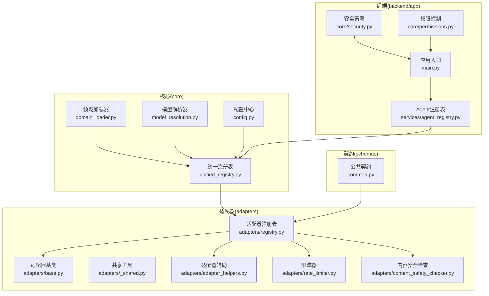
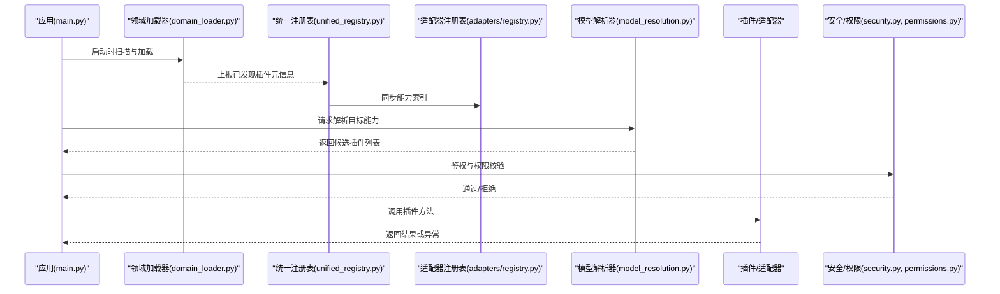
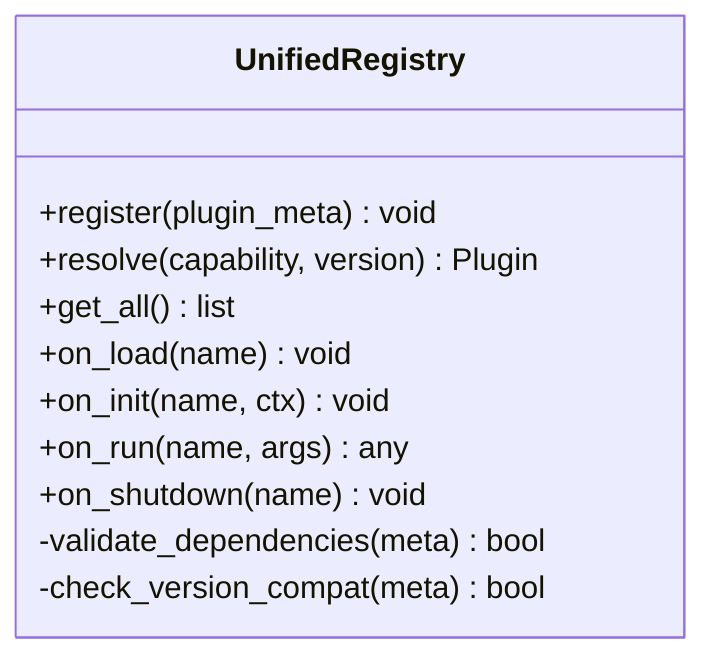
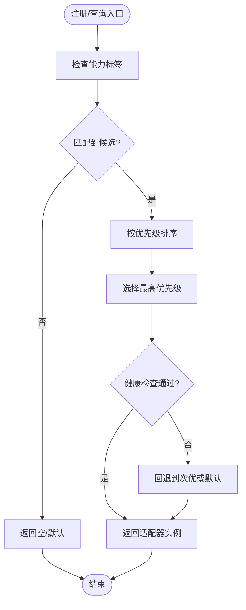
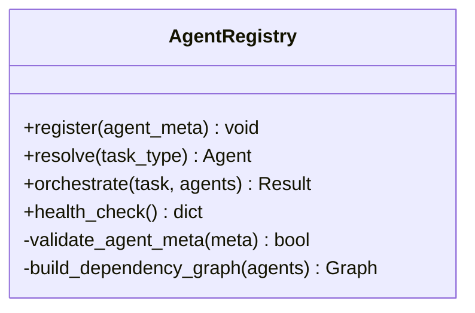
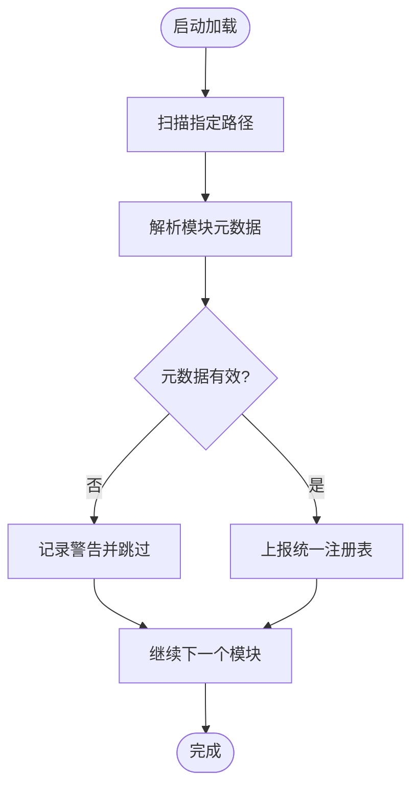
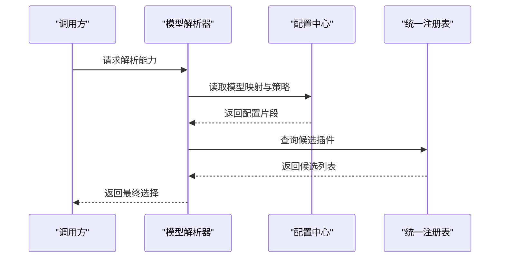
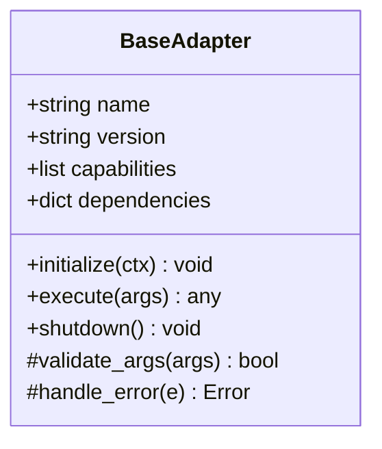
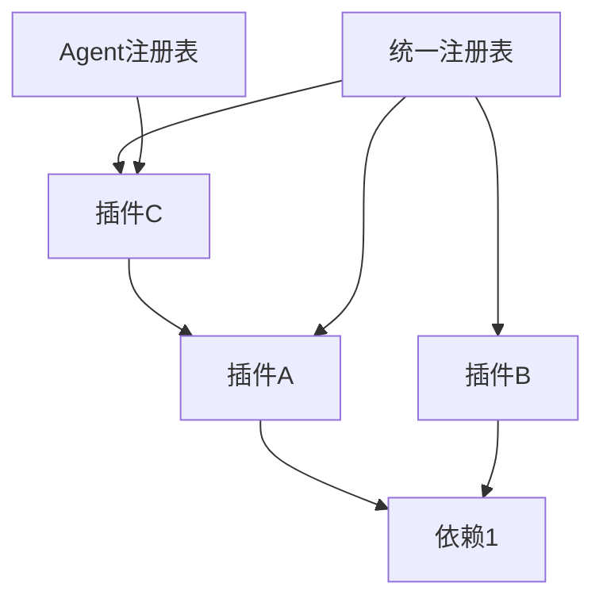

# 插件系统

<cite>
**本文引用的文件**   
- [README.md](file://README.md)
- [core/unified_registry.py](file://core/unified_registry.py)
- [adapters/registry.py](file://adapters/registry.py)
- [backend/app/services/agent_registry.py](file://backend/app/services/agent_registry.py)
- [core/domain_loader.py](file://core/domain_loader.py)
- [core/model_resolution.py](file://core/model_resolution.py)
- [core/config.py](file://core/config.py)
- [adapters/base.py](file://adapters/base.py)
- [adapters/_shared.py](file://adapters/_shared.py)
- [adapters/adapter_helpers.py](file://adapters/adapter_helpers.py)
- [adapters/rate_limiter.py](file://adapters/rate_limiter.py)
- [adapters/content_safety_checker.py](file://adapters/content_safety_checker.py)
- [backend/app/core/security.py](file://backend/app/core/security.py)
- [backend/app/core/permissions.py](file://backend/app/core/permissions.py)
- [backend/app/main.py](file://backend/app/main.py)
- [scripts/protocols.py](file://scripts/protocols.py)
- [schemas/common.py](file://schemas/common.py)
</cite>

## 目录
1. [简介](#简介)
2. [项目结构](#项目结构)
3. [核心组件](#核心组件)
4. [架构总览](#架构总览)
5. [详细组件分析](#详细组件分析)
6. [依赖分析](#依赖分析)
7. [性能考虑](#性能考虑)
8. [故障排查指南](#故障排查指南)
9. [结论](#结论)
10. [附录](#附录)

## 简介
本指南面向“小说创作代理系统”的插件系统开发，目标是帮助开发者理解并扩展系统的可插拔能力。文档覆盖以下关键主题：
- 插件注册机制：动态发现、依赖解析与版本管理
- 插件生命周期：加载、初始化、运行与卸载
- 插件开发规范与模板：接口定义、配置管理与错误处理
- 插件间通信与数据共享
- 安全考量：权限控制、资源隔离与沙箱机制
- 实际插件示例：实现可插拔功能模块
- 打包、分发与安装流程

本指南基于仓库现有代码结构与模式进行提炼与归纳，确保建议与既有实现保持一致。

## 项目结构
从仓库结构可以看出，系统采用分层与模块化组织方式：
- core：统一注册表、模型解析、领域加载、配置等基础设施
- adapters：适配器层，提供外部模型/服务的统一接入，内含注册表与通用工具
- backend/app：后端服务（FastAPI），包含服务层、路由、权限与安全等
- schemas：统一的请求/响应与契约定义
- scripts：脚本与协议定义，用于测试与集成

图表来源 
- [core/unified_registry.py](file://core/unified_registry.py)
- [adapters/registry.py](file://adapters/registry.py)
- [backend/app/services/agent_registry.py](file://backend/app/services/agent_registry.py)
- [core/domain_loader.py](file://core/domain_loader.py)
- [core/model_resolution.py](file://core/model_resolution.py)
- [core/config.py](file://core/config.py)
- [adapters/base.py](file://adapters/base.py)
- [adapters/_shared.py](file://adapters/_shared.py)
- [adapters/adapter_helpers.py](file://adapters/adapter_helpers.py)
- [adapters/rate_limiter.py](file://adapters/rate_limiter.py)
- [adapters/content_safety_checker.py](file://adapters/content_safety_checker.py)
- [backend/app/core/security.py](file://backend/app/core/security.py)
- [backend/app/core/permissions.py](file://backend/app/core/permissions.py)
- [backend/app/main.py](file://backend/app/main.py)
- [schemas/common.py](file://schemas/common.py)

章节来源
- [README.md](file://README.md)

## 核心组件
- 统一注册表（core/unified_registry.py）：集中管理插件/适配器的注册、查询与生命周期钩子，是插件生态的核心枢纽。
- 适配器注册表（adapters/registry.py）：面向具体适配器能力的注册与选择，支持按能力维度查找与优先级排序。
- Agent注册表（backend/app/services/agent_registry.py）：面向业务Agent的注册与编排，协调多Agent协作。
- 领域加载器（core/domain_loader.py）：负责动态发现与加载领域相关模块，为插件的动态发现提供基础。
- 模型解析器（core/model_resolution.py）：根据配置与运行时上下文解析目标模型/能力，驱动插件选择。
- 配置中心（core/config.py）：集中读取与合并配置，为插件提供稳定的配置访问。
- 适配器基类（adapters/base.py）：定义插件/适配器必须实现的接口与约定，保证一致性。
- 共享工具（adapters/_shared.py, adapter_helpers.py）：通用工具函数、校验与转换逻辑，降低重复实现。
- 限流器（adapters/rate_limiter.py）：对插件调用进行速率限制，保护下游服务。
- 内容安全检查（adapters/content_safety_checker.py）：在插件输出前进行内容安全检查。
- 安全与权限（backend/app/core/security.py, permissions.py）：统一鉴权、授权与访问控制策略。
- 应用入口（backend/app/main.py）：启动时装配各注册表与中间件，完成插件生态初始化。

章节来源
- [core/unified_registry.py](file://core/unified_registry.py)
- [adapters/registry.py](file://adapters/registry.py)
- [backend/app/services/agent_registry.py](file://backend/app/services/agent_registry.py)
- [core/domain_loader.py](file://core/domain_loader.py)
- [core/model_resolution.py](file://core/model_resolution.py)
- [core/config.py](file://core/config.py)
- [adapters/base.py](file://adapters/base.py)
- [adapters/_shared.py](file://adapters/_shared.py)
- [adapters/adapter_helpers.py](file://adapters/adapter_helpers.py)
- [adapters/rate_limiter.py](file://adapters/rate_limiter.py)
- [adapters/content_safety_checker.py](file://adapters/content_safety_checker.py)
- [backend/app/core/security.py](file://backend/app/core/security.py)
- [backend/app/core/permissions.py](file://backend/app/core/permissions.py)
- [backend/app/main.py](file://backend/app/main.py)

## 架构总览
插件系统以“注册表+适配器基类+配置/解析”为核心，形成“发现—解析—选择—执行—治理”的闭环。

图表来源 
- [backend/app/main.py](file://backend/app/main.py)
- [core/domain_loader.py](file://core/domain_loader.py)
- [core/unified_registry.py](file://core/unified_registry.py)
- [adapters/registry.py](file://adapters/registry.py)
- [core/model_resolution.py](file://core/model_resolution.py)
- [backend/app/core/security.py](file://backend/app/core/security.py)
- [backend/app/core/permissions.py](file://backend/app/core/permissions.py)

## 详细组件分析

### 统一注册表（core/unified_registry.py）
- 职责：维护插件/适配器的全局注册表，提供按能力、版本、优先级的查询与选择；暴露生命周期钩子（如on_load、on_init、on_shutdown）。
- 关键点：
  - 动态发现：结合领域加载器上报的元数据进行注册
  - 依赖解析：记录插件声明的依赖，并在初始化阶段验证
  - 版本管理：维护版本元数据，支持兼容性与回滚策略
  - 生命周期：集中管理加载、初始化、运行、卸载阶段

图表来源 
- [core/unified_registry.py](file://core/unified_registry.py)

章节来源
- [core/unified_registry.py](file://core/unified_registry.py)

### 适配器注册表（adapters/registry.py）
- 职责：针对适配器能力（如LLM、图像、视频、TTS等）进行注册与检索，支持按能力维度与优先级选择。
- 关键点：
  - 能力标签：每个适配器声明其支持的能力集合
  - 优先级：当多个适配器满足同一能力时，依据优先级选择
  - 健康检查：可选的健康检查与降级策略

图表来源 
- [adapters/registry.py](file://adapters/registry.py)

章节来源
- [adapters/registry.py](file://adapters/registry.py)

### Agent注册表（backend/app/services/agent_registry.py）
- 职责：管理业务Agent的注册、编排与协作，协调多Agent之间的任务分配与状态同步。
- 关键点：
  - Agent元数据：名称、版本、能力、依赖
  - 编排策略：顺序、并行、条件分支
  - 状态管理：运行态上下文与结果传递

图表来源 
- [backend/app/services/agent_registry.py](file://backend/app/services/agent_registry.py)

章节来源
- [backend/app/services/agent_registry.py](file://backend/app/services/agent_registry.py)

### 领域加载器（core/domain_loader.py）
- 职责：动态发现与加载领域模块，将发现的插件元信息上报给统一注册表。
- 关键点：
  - 扫描路径：指定目录或包名
  - 元数据提取：从模块中读取声明的元数据
  - 错误隔离：单个模块加载失败不影响整体

图表来源 
- [core/domain_loader.py](file://core/domain_loader.py)

章节来源
- [core/domain_loader.py](file://core/domain_loader.py)

### 模型解析器（core/model_resolution.py）
- 职责：根据配置与运行时上下文解析目标模型/能力，返回候选插件列表。
- 关键点：
  - 配置驱动：从配置中心读取模型映射与策略
  - 上下文感知：根据任务类型、用户偏好等选择
  - 兼容性检查：版本与能力匹配

图表来源 
- [core/model_resolution.py](file://core/model_resolution.py)
- [core/config.py](file://core/config.py)
- [core/unified_registry.py](file://core/unified_registry.py)

章节来源
- [core/model_resolution.py](file://core/model_resolution.py)
- [core/config.py](file://core/config.py)

### 适配器基类（adapters/base.py）
- 职责：定义插件/适配器必须实现的接口与约定，确保一致性与可替换性。
- 关键点：
  - 标准方法：initialize、execute、shutdown等
  - 元数据：name、version、capabilities、dependencies
  - 错误约定：统一异常类型与错误码

图表来源 
- [adapters/base.py](file://adapters/base.py)

章节来源
- [adapters/base.py](file://adapters/base.py)

### 共享工具与辅助（adapters/_shared.py, adapter_helpers.py）
- 职责：提供通用工具函数、参数校验、数据转换等，减少重复实现。
- 关键点：
  - 参数校验：统一输入格式与必填字段检查
  - 数据转换：适配不同上游/下游的数据格式
  - 日志与追踪：标准化日志输出与链路追踪

章节来源
- [adapters/_shared.py](file://adapters/_shared.py)
- [adapters/adapter_helpers.py](file://adapters/adapter_helpers.py)

### 限流器（adapters/rate_limiter.py）
- 职责：对插件调用进行速率限制，保护下游服务不被突发流量打垮。
- 关键点：
  - 策略：固定窗口、滑动窗口、令牌桶等
  - 粒度：按插件、按用户、按能力维度
  - 监控：统计与告警

章节来源
- [adapters/rate_limiter.py](file://adapters/rate_limiter.py)

### 内容安全检查（adapters/content_safety_checker.py）
- 职责：在插件输出前进行内容安全检查，防止违规内容扩散。
- 关键点：
  - 规则引擎：关键词、语义模型、策略组合
  - 拦截与放行：命中规则后拦截并记录
  - 审计：输出审计日志与报告

章节来源
- [adapters/content_safety_checker.py](file://adapters/content_safety_checker.py)

### 安全与权限（backend/app/core/security.py, permissions.py）
- 职责：统一鉴权、授权与访问控制策略，保障插件系统的安全运行。
- 关键点：
  - 鉴权：JWT/OAuth等认证方案
  - 授权：基于角色/资源的访问控制
  - 隔离：插件运行环境隔离与资源配额

章节来源
- [backend/app/core/security.py](file://backend/app/core/security.py)
- [backend/app/core/permissions.py](file://backend/app/core/permissions.py)

### 应用入口（backend/app/main.py）
- 职责：启动时装配各注册表与中间件，完成插件生态初始化。
- 关键点：
  - 启动顺序：加载配置→发现插件→解析模型→挂载路由
  - 中间件：安全、限流、日志、追踪
  - 优雅关闭：触发插件卸载与资源释放

章节来源
- [backend/app/main.py](file://backend/app/main.py)

## 依赖分析
插件间的依赖关系通过统一注册表与Agent注册表进行管理，确保加载顺序与可用性。

图表来源 
- [core/unified_registry.py](file://core/unified_registry.py)
- [backend/app/services/agent_registry.py](file://backend/app/services/agent_registry.py)

章节来源
- [core/unified_registry.py](file://core/unified_registry.py)
- [backend/app/services/agent_registry.py](file://backend/app/services/agent_registry.py)

## 性能考虑
- 缓存策略：对频繁查询的插件元数据与解析结果进行缓存
- 懒加载：按需加载插件，减少启动时间
- 并发控制：合理设置线程池与队列，避免阻塞
- 资源隔离：限制CPU/内存使用，防止单插件影响整体
- 监控与告警：采集关键指标，及时发现瓶颈

[本节为通用指导，不直接分析具体文件]

## 故障排查指南
- 常见问题：
  - 插件未注册：检查元数据与加载路径
  - 依赖缺失：查看依赖声明与解析日志
  - 版本冲突：确认兼容性策略与回滚机制
  - 权限不足：检查鉴权与授权配置
  - 限流触发：调整限流策略或扩容
- 定位步骤：
  - 查看统一注册表的注册日志
  - 检查适配器注册表的候选列表
  - 核对模型解析器的配置与上下文
  - 审查安全与权限的拦截日志
  - 使用限流器与内容安全检查的审计日志

章节来源
- [adapters/rate_limiter.py](file://adapters/rate_limiter.py)
- [adapters/content_safety_checker.py](file://adapters/content_safety_checker.py)
- [backend/app/core/security.py](file://backend/app/core/security.py)
- [backend/app/core/permissions.py](file://backend/app/core/permissions.py)

## 结论
本指南基于仓库现有代码结构，提炼出插件系统的核心组件与最佳实践。通过统一注册表、适配器基类、配置与解析机制，系统实现了可扩展、可治理、可安全的插件生态。开发者可据此快速实现可插拔的功能模块，并遵循规范进行打包、分发与安装。

[本节为总结，不直接分析具体文件]

## 附录

### 插件开发规范与模板
- 接口定义：继承适配器基类，实现标准方法与元数据声明
- 配置管理：通过配置中心读取插件配置，支持热更新
- 错误处理：统一异常类型与错误码，便于诊断与恢复
- 通信机制：通过统一注册表与Agent注册表进行事件发布与订阅
- 数据共享：使用共享存储或消息总线，确保一致性与隔离性

章节来源
- [adapters/base.py](file://adapters/base.py)
- [core/config.py](file://core/config.py)
- [core/unified_registry.py](file://core/unified_registry.py)
- [backend/app/services/agent_registry.py](file://backend/app/services/agent_registry.py)

### 插件打包、分发与安装流程
- 打包：生成插件包（含元数据、依赖清单、配置文件）
- 分发：上传至内部仓库或市场，提供版本与签名
- 安装：通过命令行或API安装，自动解析依赖并注册
- 升级：支持灰度发布与回滚，确保稳定性

[本节为通用指导，不直接分析具体文件]

### 实际插件开发示例
- 示例场景：新增一个图像增强插件
- 步骤：
  - 定义插件元数据与能力标签
  - 实现适配器基类的方法
  - 注册到适配器注册表
  - 配置模型解析策略
  - 编写单元测试与集成测试
- 参考文件：
  - [adapters/base.py](file://adapters/base.py)
  - [adapters/registry.py](file://adapters/registry.py)
  - [core/model_resolution.py](file://core/model_resolution.py)

章节来源
- [adapters/base.py](file://adapters/base.py)
- [adapters/registry.py](file://adapters/registry.py)
- [core/model_resolution.py](file://core/model_resolution.py)

### 插件间通信与数据共享
- 通信机制：事件总线、消息队列、RPC
- 数据共享：共享存储、缓存、数据库
- 一致性：事务、补偿、幂等
- 安全性：加密、脱敏、审计

[本节为通用指导，不直接分析具体文件]

### 安全考虑
- 权限控制：基于角色的访问控制（RBAC）
- 资源隔离：容器化、命名空间、配额
- 沙箱机制：受限执行环境、白名单、黑名单
- 审计与合规：操作日志、合规检查、报告

章节来源
- [backend/app/core/security.py](file://backend/app/core/security.py)
- [backend/app/core/permissions.py](file://backend/app/core/permissions.py)