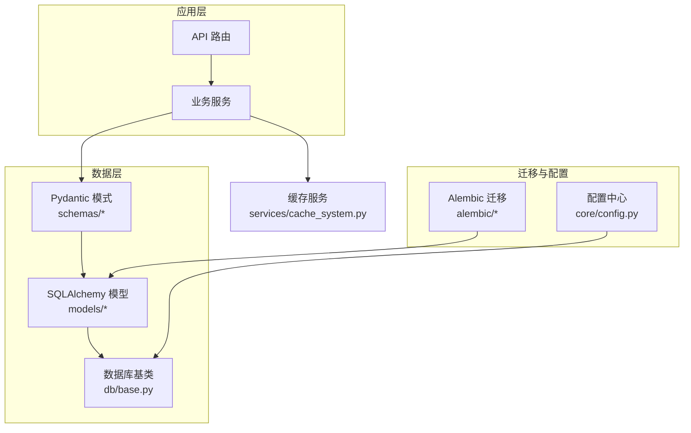
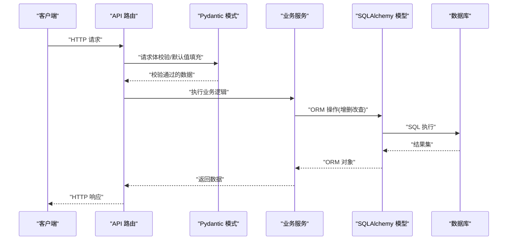
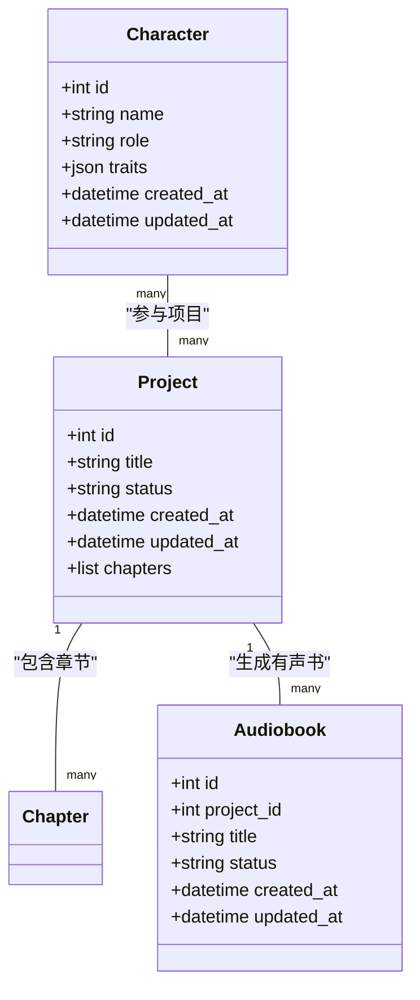
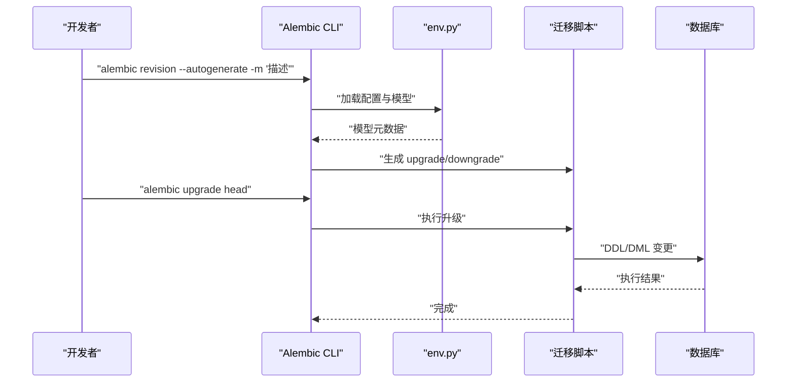
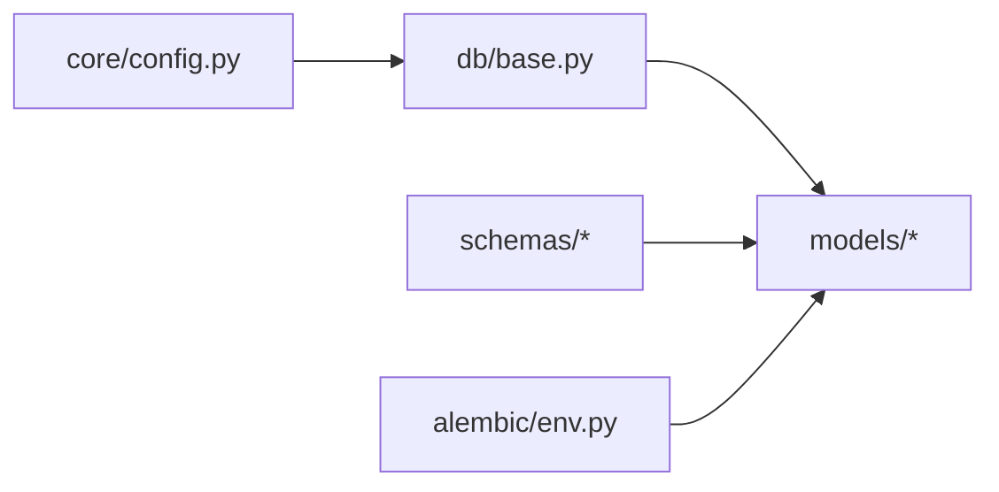

# 数据模型扩展

<cite>
**本文引用的文件**   
- [backend/app/db/base.py](file://backend/app/db/base.py)
- [backend/app/models/__init__.py](file://backend/app/models/__init__.py)
- [backend/app/models/project.py](file://backend/app/models/project.py)
- [backend/app/models/character.py](file://backend/app/models/character.py)
- [backend/app/models/audiobook.py](file://backend/app/models/audiobook.py)
- [backend/app/schemas/project.py](file://backend/app/schemas/project.py)
- [backend/app/schemas/character.py](file://backend/app/schemas/character.py)
- [backend/app/schemas/audiobook.py](file://backend/app/schemas/audiobook.py)
- [backend/alembic.ini](file://backend/alembic.ini)
- [backend/alembic/env.py](file://backend/alembic/env.py)
- [backend/alembic/script.py.mako](file://backend/alembic/script.py.mako)
- [backend/alembic/versions/initial.py](file://backend/alembic/versions/initial.py)
- [backend/alembic/versions/add_project_display_no.py](file://backend/alembic/versions/add_project_display_no.py)
- [backend/app/core/config.py](file://backend/app/core/config.py)
- [backend/app/utils/sql_validator.py](file://backend/app/utils/sql_validator.py)
- [backend/app/services/cache_system.py](file://backend/app/services/cache_system.py)
</cite>

## 目录
1. [简介](#简介)
2. [项目结构](#项目结构)
3. [核心组件](#核心组件)
4. [架构总览](#架构总览)
5. [详细组件分析](#详细组件分析)
6. [依赖关系分析](#依赖关系分析)
7. [性能考虑](#性能考虑)
8. [故障排查指南](#故障排查指南)
9. [结论](#结论)
10. [附录](#附录)

## 简介
本指南面向小说创作代理系统的数据模型扩展开发，聚焦以下目标：
- 使用 SQLAlchemy ORM 定义实体、字段类型、关系映射与约束
- 使用 Pydantic 模式进行数据验证、序列化与反序列化
- 编写 Alembic 数据库迁移脚本（增量迁移与回滚策略）
- 数据模型的版本管理与兼容性处理
- 数据访问层最佳实践（查询优化、缓存策略、事务管理）
- 提供从简单到复杂的完整扩展示例
- 数据模型测试方法与性能调优技巧

## 项目结构
后端采用分层组织：
- 数据模型层：SQLAlchemy ORM 模型位于 backend/app/models
- 接口模式层：Pydantic 模式位于 backend/app/schemas
- 数据库基础与连接：backend/app/db/base.py
- 配置与环境：backend/app/core/config.py
- 迁移工具：backend/alembic/*
- 工具与辅助：backend/app/utils/sql_validator.py、backend/app/services/cache_system.py

图表来源
- [backend/app/db/base.py](file://backend/app/db/base.py)
- [backend/app/models/__init__.py](file://backend/app/models/__init__.py)
- [backend/app/schemas/project.py](file://backend/app/schemas/project.py)
- [backend/app/core/config.py](file://backend/app/core/config.py)
- [backend/alembic/env.py](file://backend/alembic/env.py)
- [backend/app/services/cache_system.py](file://backend/app/services/cache_system.py)

章节来源
- [backend/app/db/base.py](file://backend/app/db/base.py)
- [backend/app/models/__init__.py](file://backend/app/models/__init__.py)
- [backend/app/core/config.py](file://backend/app/core/config.py)
- [backend/alembic/env.py](file://backend/alembic/env.py)

## 核心组件
- SQLAlchemy 基类与会话管理：通过 db/base.py 暴露 Base、SessionLocal、get_db 等基础设施
- 领域模型：project.py、character.py、audiobook.py 等定义了实体表、字段类型、索引与关系
- Pydantic 模式：project.py、character.py、audiobook.py 等用于请求/响应校验、默认值与转换
- 迁移脚本：alembic 版本目录下的 .py 文件负责 schema 演进与数据修复
- 配置与连接：core/config.py 提供数据库 URL、连接池参数等
- SQL 校验与缓存：utils/sql_validator.py 与 services/cache_system.py 提升安全性与性能

章节来源
- [backend/app/db/base.py](file://backend/app/db/base.py)
- [backend/app/models/project.py](file://backend/app/models/project.py)
- [backend/app/models/character.py](file://backend/app/models/character.py)
- [backend/app/models/audiobook.py](file://backend/app/models/audiobook.py)
- [backend/app/schemas/project.py](file://backend/app/schemas/project.py)
- [backend/app/schemas/character.py](file://backend/app/schemas/character.py)
- [backend/app/schemas/audiobook.py](file://backend/app/schemas/audiobook.py)
- [backend/app/core/config.py](file://backend/app/core/config.py)
- [backend/alembic/env.py](file://backend/alembic/env.py)

## 架构总览
数据流从 API 进入，经 Pydantic 模式校验后，调用服务层，再通过 SQLAlchemy 模型持久化。迁移脚本保证数据库结构与模型一致。

图表来源
- [backend/app/schemas/project.py](file://backend/app/schemas/project.py)
- [backend/app/models/project.py](file://backend/app/models/project.py)
- [backend/app/db/base.py](file://backend/app/db/base.py)

## 详细组件分析

### SQLAlchemy ORM 模型定义规范
- 基类与元数据：在 db/base.py 中统一声明 Base、命名约定、索引生成策略
- 字段类型：常用类型包括 Integer、String、Text、Boolean、DateTime、JSON、Enum 等；对大文本使用 Text，对结构化数据使用 JSON
- 约束规则：主键、唯一约束、非空、检查约束、外键级联策略（如 ondelete='CASCADE'）
- 关系映射：使用 relationship() 建立一对多、多对一、多对多；合理设置 back_populates 或 backref
- 索引与查询友好：为高频查询列添加索引；避免 N+1 查询，使用 joinedload/selectinload

章节来源
- [backend/app/db/base.py](file://backend/app/db/base.py)
- [backend/app/models/project.py](file://backend/app/models/project.py)
- [backend/app/models/character.py](file://backend/app/models/character.py)
- [backend/app/models/audiobook.py](file://backend/app/models/audiobook.py)

#### 类图示例（以 Project、Character、Audiobook 为例）

图表来源
- [backend/app/models/project.py](file://backend/app/models/project.py)
- [backend/app/models/character.py](file://backend/app/models/character.py)
- [backend/app/models/audiobook.py](file://backend/app/models/audiobook.py)

### Pydantic 模式验证与序列化
- 用途：统一输入输出格式、默认值、类型转换、可选字段、枚举校验
- 建议：
  - 将 ORM 模型与 Pydantic 模式解耦，避免直接暴露内部结构
  - 使用 model_config 控制行为（如 from_attributes=True）
  - 对复杂嵌套结构使用子模式与列表校验
  - 对外暴露的响应模式与请求模式分离，确保最小暴露原则

章节来源
- [backend/app/schemas/project.py](file://backend/app/schemas/project.py)
- [backend/app/schemas/character.py](file://backend/app/schemas/character.py)
- [backend/app/schemas/audiobook.py](file://backend/app/schemas/audiobook.py)

### 数据库迁移脚本（Alembic）
- 初始化与配置：alembic.ini 与 alembic/env.py 指定目标数据库与模型导入
- 生成迁移：根据模型变更自动生成 upgrade/downgrade 脚本
- 版本管理：每个迁移脚本对应一个版本号，保持幂等性与可回滚性
- 数据修复：在迁移中执行数据清洗、默认值回填、索引重建等

章节来源
- [backend/alembic.ini](file://backend/alembic.ini)
- [backend/alembic/env.py](file://backend/alembic/env.py)
- [backend/alembic/script.py.mako](file://backend/alembic/script.py.mako)
- [backend/alembic/versions/initial.py](file://backend/alembic/versions/initial.py)
- [backend/alembic/versions/add_project_display_no.py](file://backend/alembic/versions/add_project_display_no.py)

#### 迁移流程时序图

图表来源
- [backend/alembic/env.py](file://backend/alembic/env.py)
- [backend/alembic/script.py.mako](file://backend/alembic/script.py.mako)
- [backend/alembic/versions/initial.py](file://backend/alembic/versions/initial.py)

### 数据模型版本管理与兼容性
- 向后兼容：新增字段设置默认值，删除字段先标记废弃再移除
- 数据迁移：在 downgrade 中实现安全回滚（如恢复默认值、清理临时列）
- 环境隔离：不同环境（dev/test/prod）使用独立数据库与迁移头
- 冲突合并：分支迁移合并时注意顺序与幂等性，必要时手动编辑迁移脚本

章节来源
- [backend/alembic/versions/add_project_display_no.py](file://backend/alembic/versions/add_project_display_no.py)
- [backend/alembic/versions/initial.py](file://backend/alembic/versions/initial.py)

### 数据访问层最佳实践
- 查询优化：
  - 使用 selectinload/joinedload 避免 N+1
  - 分页查询限制返回大小，避免全表扫描
  - 为高频过滤与排序列建立索引
- 缓存策略：
  - 热点数据使用 Redis 缓存，设置过期与失效策略
  - 读写分离场景下注意一致性
- 事务管理：
  - 短事务原则，减少锁持有时间
  - 失败回滚与重试机制，确保幂等性

章节来源
- [backend/app/utils/sql_validator.py](file://backend/app/utils/sql_validator.py)
- [backend/app/services/cache_system.py](file://backend/app/services/cache_system.py)

### 完整扩展示例（从简单到复杂）
- 简单实体表：Project（项目）、Character（角色）、Audiobook（有声书）
- 关联关系：Project 与 Audiobook 一对多；Character 与 Project 多对多（通过中间表或属性）
- 复杂场景：审计字段（created_at/updated_at）、软删除（deleted_at）、状态机（status 枚举）

章节来源
- [backend/app/models/project.py](file://backend/app/models/project.py)
- [backend/app/models/character.py](file://backend/app/models/character.py)
- [backend/app/models/audiobook.py](file://backend/app/models/audiobook.py)

## 依赖关系分析
- 模型与模式：schemas 依赖 models 的字段语义，但不直接耦合 ORM 细节
- 配置与连接：core/config.py 提供数据库连接参数，db/base.py 构建引擎与会话
- 迁移与模型：alembic/env.py 导入 models 包以生成迁移

图表来源
- [backend/app/core/config.py](file://backend/app/core/config.py)
- [backend/app/db/base.py](file://backend/app/db/base.py)
- [backend/app/models/__init__.py](file://backend/app/models/__init__.py)
- [backend/alembic/env.py](file://backend/alembic/env.py)

章节来源
- [backend/app/core/config.py](file://backend/app/core/config.py)
- [backend/app/db/base.py](file://backend/app/db/base.py)
- [backend/app/models/__init__.py](file://backend/app/models/__init__.py)
- [backend/alembic/env.py](file://backend/alembic/env.py)

## 性能考虑
- 索引设计：为外键、过滤条件、排序字段创建合适索引；避免过多索引影响写入
- 查询计划：使用 EXPLAIN 分析慢查询，调整 JOIN 与 WHERE 条件
- 批量操作：使用 bulk_insert/bulk_update 减少往返开销
- 缓存命中：热点读路径加缓存，写路径及时失效
- 连接池：合理设置 pool_size、max_overflow、pool_recycle

[本节为通用指导，不直接分析具体文件]

## 故障排查指南
- 常见错误：
  - 字段类型不匹配导致插入失败
  - 外键约束违反（缺少父记录或级联删除）
  - 迁移冲突（分支未正确合并）
- 排查步骤：
  - 检查 alembic history 与当前版本
  - 查看数据库日志与 SQLAlchemy 日志
  - 使用 sql_validator 校验 SQL 片段
  - 回滚迁移并修正后再试

章节来源
- [backend/alembic/versions/add_project_display_no.py](file://backend/alembic/versions/add_project_display_no.py)
- [backend/app/utils/sql_validator.py](file://backend/app/utils/sql_validator.py)

## 结论
通过统一的 SQLAlchemy 模型定义、严格的 Pydantic 模式校验、规范的 Alembic 迁移流程以及良好的数据访问实践，可以构建稳定、可扩展且高性能的小说创作代理系统数据层。建议在团队内制定模型与迁移规范，持续优化查询与缓存策略，保障数据一致性与系统可维护性。

[本节为总结性内容，不直接分析具体文件]

## 附录
- 快速开始：
  - 安装依赖并初始化数据库
  - 运行首次迁移：alembic upgrade head
  - 启动服务并验证 API
- 参考文档：
  - DATABASE_MIGRATION_GUIDE.md（项目根目录）
  - POSTGRESQL_DEPLOYMENT.md（部署说明）

[本节为补充信息，不直接分析具体文件]