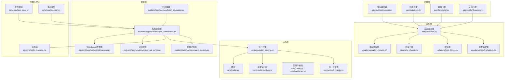
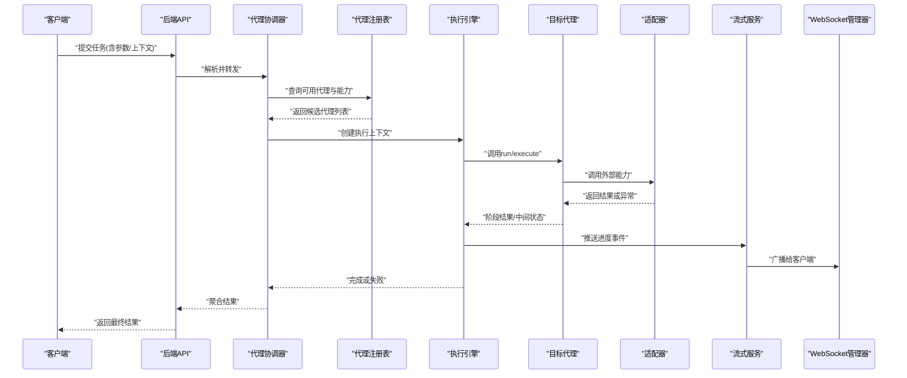
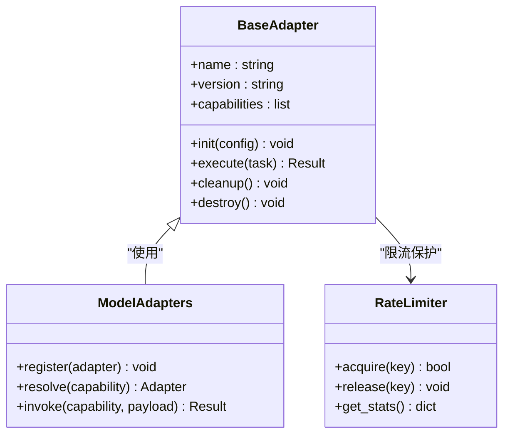
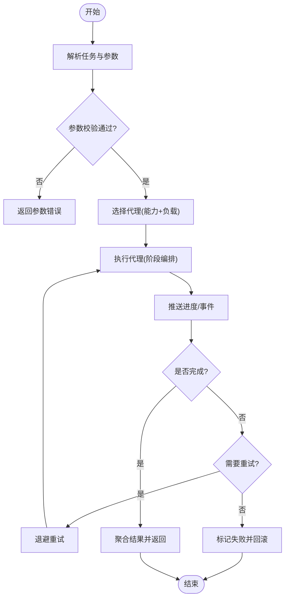
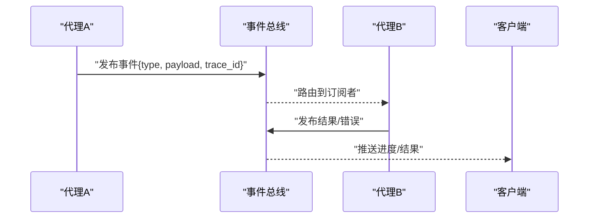
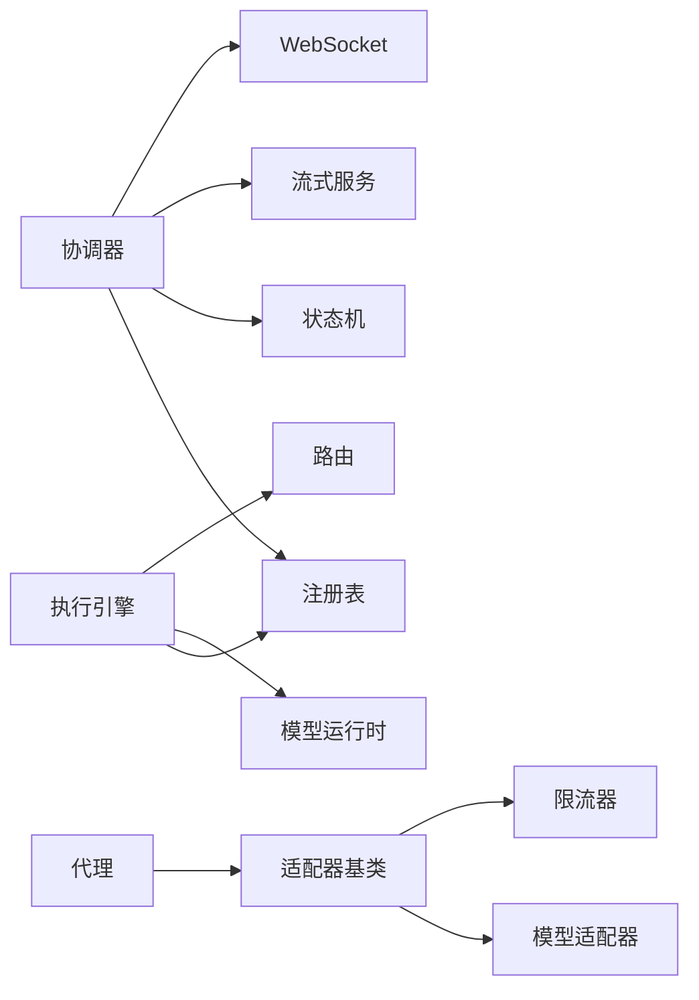

# 新代理开发

<cite>
**本文引用的文件**
- [agent_coordinator.py](file://agent_coordinator.py)
- [split_agent_coordinator.py](file://split_agent_coordinator.py)
- [core/execution_engine.py](file://core/execution_engine.py)
- [core/unified_registry.py](file://core/unified_registry.py)
- [adapters/base.py](file://adapters/base.py)
- [adapters/model_adapters.py](file://adapters/model_adapters.py)
- [backend/app/services/agent_coordinator.py](file://backend/app/services/agent_coordinator.py)
- [backend/app/services/agent_registry.py](file://backend/app/services/agent_registry.py)
- [agents/dreamweaver.py](file://agents/dreamweaver.py)
- [agents/painter.py](file://agents/painter.py)
- [agents/scripter.py](file://agents/scripter.py)
- [agents/storyboarder.py](file://agents/storyboarder.py)
- [core/config.py](file://core/config.py)
- [core/validators.py](file://core/validators.py)
- [schemas/task_spec.py](file://schemas/task_spec.py)
- [schemas/common.py](file://schemas/common.py)
- [pipeline/state_machine.py](file://pipeline/state_machine.py)
- [core/router.py](file://core/router.py)
- [core/model_runtime.py](file://core/model_runtime.py)
- [core/unified_media_runtime.py](file://core/unified_media_runtime.py)
- [adapters/rate_limiter.py](file://adapters/rate_limiter.py)
- [adapters/_shared.py](file://adapters/_shared.py)
- [adapters/adapter_helpers.py](file://adapters/adapter_helpers.py)
- [backend/app/services/batch_processor.py](file://backend/app/services/batch_processor.py)
- [backend/app/services/streaming_service.py](file://backend/app/services/streaming_service.py)
- [backend/app/websocket/manager.py](file://backend/app/websocket/manager.py)
- [scripts/protocols.py](file://scripts/protocols.py)
</cite>

## 目录
1. [简介](#简介)
2. [项目结构](#项目结构)
3. [核心组件](#核心组件)
4. [架构总览](#架构总览)
5. [详细组件分析](#详细组件分析)
6. [依赖关系分析](#依赖关系分析)
7. [性能考量](#性能考量)
8. [故障排查指南](#故障排查指南)
9. [结论](#结论)
10. [附录](#附录)

## 简介
本指南面向希望为“小说创作代理系统”开发新代理的工程师与研究者。内容覆盖：
- 代理基类继承结构与生命周期管理
- 代理协调器的工作机制（任务分发、负载均衡、状态同步）
- 文本处理、媒体生成、数据分析三类代理的开发模板
- 代理间通信协议（消息格式、事件处理、错误传播）
- 配置管理、参数校验与资源清理的最佳实践
- 从简单单功能到复杂多步骤工作流的完整示例
- 测试策略与调试方法

## 项目结构
本项目采用分层与模块化组织，关键目录与职责如下：
- core：执行引擎、统一注册表、模型运行时、路由、配置与校验等基础设施
- adapters：各类外部能力适配层（LLM、图像、视频、TTS、限流等）
- agents：领域代理实现（编剧、分镜、绘画、梦织器等）
- backend/app/services：服务端服务层（协调器、批处理、流式服务等）
- pipeline：流程编排与状态机
- schemas：数据契约与任务规范
- scripts：脚本与协议定义

图表来源
- [core/execution_engine.py](file://core/execution_engine.py)
- [core/unified_registry.py](file://core/unified_registry.py)
- [core/model_runtime.py](file://core/model_runtime.py)
- [core/router.py](file://core/router.py)
- [adapters/base.py](file://adapters/base.py)
- [adapters/model_adapters.py](file://adapters/model_adapters.py)
- [adapters/rate_limiter.py](file://adapters/rate_limiter.py)
- [adapters/_shared.py](file://adapters/_shared.py)
- [adapters/adapter_helpers.py](file://adapters/adapter_helpers.py)
- [agents/dreamweaver.py](file://agents/dreamweaver.py)
- [agents/painter.py](file://agents/painter.py)
- [agents/scripter.py](file://agents/scripter.py)
- [agents/storyboarder.py](file://agents/storyboarder.py)
- [backend/app/services/agent_coordinator.py](file://backend/app/services/agent_coordinator.py)
- [backend/app/services/agent_registry.py](file://backend/app/services/agent_registry.py)
- [backend/app/services/batch_processor.py](file://backend/app/services/batch_processor.py)
- [backend/app/services/streaming_service.py](file://backend/app/services/streaming_service.py)
- [backend/app/websocket/manager.py](file://backend/app/websocket/manager.py)
- [pipeline/state_machine.py](file://pipeline/state_machine.py)
- [schemas/task_spec.py](file://schemas/task_spec.py)
- [schemas/common.py](file://schemas/common.py)

章节来源
- [core/execution_engine.py](file://core/execution_engine.py)
- [core/unified_registry.py](file://core/unified_registry.py)
- [backend/app/services/agent_coordinator.py](file://backend/app/services/agent_coordinator.py)
- [backend/app/services/agent_registry.py](file://backend/app/services/agent_registry.py)
- [pipeline/state_machine.py](file://pipeline/state_machine.py)

## 核心组件
- 执行引擎：负责调度任务、维护上下文、驱动状态机流转与结果聚合
- 统一注册表：集中管理代理与适配器的发现、版本与能力声明
- 模型运行时：封装对外部模型能力的调用、重试、超时与缓存
- 代理协调器：接收请求、解析任务、选择代理、编排执行、同步状态
- 代理注册表：维护代理实例、健康检查与负载信息
- 状态机：定义阶段、转换条件与回滚策略
- 适配器基类：抽象外部能力调用，提供统一的输入输出与错误语义
- 限流器：保护外部接口，避免超限与雪崩
- WebSocket管理器：实时推送进度与事件

章节来源
- [core/execution_engine.py](file://core/execution_engine.py)
- [core/unified_registry.py](file://core/unified_registry.py)
- [core/model_runtime.py](file://core/model_runtime.py)
- [backend/app/services/agent_coordinator.py](file://backend/app/services/agent_coordinator.py)
- [backend/app/services/agent_registry.py](file://backend/app/services/agent_registry.py)
- [pipeline/state_machine.py](file://pipeline/state_machine.py)
- [adapters/base.py](file://adapters/base.py)
- [adapters/rate_limiter.py](file://adapters/rate_limiter.py)
- [backend/app/websocket/manager.py](file://backend/app/websocket/manager.py)

## 架构总览
下图展示从请求进入到代理执行、状态同步与结果返回的整体流程。

图表来源
- [backend/app/services/agent_coordinator.py](file://backend/app/services/agent_coordinator.py)
- [backend/app/services/agent_registry.py](file://backend/app/services/agent_registry.py)
- [core/execution_engine.py](file://core/execution_engine.py)
- [adapters/base.py](file://adapters/base.py)
- [backend/app/services/streaming_service.py](file://backend/app/services/streaming_service.py)
- [backend/app/websocket/manager.py](file://backend/app/websocket/manager.py)

## 详细组件分析

### 代理基类与生命周期
- 基类职责
  - 定义统一的输入输出契约与错误语义
  - 提供生命周期钩子：初始化、预热、执行、清理、销毁
  - 暴露能力元数据：名称、版本、支持的能力域、参数约束
- 生命周期要点
  - 初始化：加载配置、建立连接池、预热缓存
  - 执行：幂等性保障、重试策略、超时控制、断点续跑
  - 清理：释放锁、关闭连接、清理临时文件
  - 销毁：优雅退出、上报指标、持久化状态

图表来源
- [adapters/base.py](file://adapters/base.py)
- [adapters/model_adapters.py](file://adapters/model_adapters.py)
- [adapters/rate_limiter.py](file://adapters/rate_limiter.py)

章节来源
- [adapters/base.py](file://adapters/base.py)
- [adapters/model_adapters.py](file://adapters/model_adapters.py)
- [adapters/rate_limiter.py](file://adapters/rate_limiter.py)

### 代理协调器与工作流编排
- 任务分发
  - 基于能力匹配与负载信息选择最优代理
  - 支持并行/串行编排、分支与合并
- 负载均衡
  - 按健康度、延迟、配额、权重进行动态分配
  - 自动熔断与降级
- 状态同步
  - 通过状态机推进阶段，记录中间态
  - 借助流式服务与WebSocket向客户端推送进度

图表来源
- [backend/app/services/agent_coordinator.py](file://backend/app/services/agent_coordinator.py)
- [pipeline/state_machine.py](file://pipeline/state_machine.py)
- [backend/app/services/streaming_service.py](file://backend/app/services/streaming_service.py)

章节来源
- [backend/app/services/agent_coordinator.py](file://backend/app/services/agent_coordinator.py)
- [pipeline/state_machine.py](file://pipeline/state_machine.py)
- [backend/app/services/streaming_service.py](file://backend/app/services/streaming_service.py)

### 文本处理代理模板（编剧/提示词优化）
- 适用场景：大纲生成、章节扩写、风格迁移、提示词优化
- 关键步骤
  - 输入：文本片段、上下文、风格约束
  - 处理：调用LLM适配器、结构化抽取、一致性校验
  - 输出：结构化文本、变更摘要、质量评分
- 最佳实践
  - 使用统一注册表获取模型能力
  - 对长文本进行分块与增量更新
  - 保留版本与差异以便回滚

章节来源
- [agents/scripter.py](file://agents/scripter.py)
- [adapters/model_adapters.py](file://adapters/model_adapters.py)
- [core/unified_registry.py](file://core/unified_registry.py)

### 媒体生成代理模板（图像/视频/TTS）
- 适用场景：角色图生成、分镜画面、背景音乐、配音合成
- 关键步骤
  - 输入：描述、参考素材、参数预设
  - 处理：调用图像/视频/TTS适配器，必要时串联多步
  - 输出：媒体文件路径、元数据、质量评估
- 最佳实践
  - 使用批处理器提升吞吐
  - 利用缓存与去重减少重复计算
  - 严格限流与配额管理

章节来源
- [agents/painter.py](file://agents/painter.py)
- [agents/dreamweaver.py](file://agents/dreamweaver.py)
- [adapters/model_adapters.py](file://adapters/model_adapters.py)
- [backend/app/services/batch_processor.py](file://backend/app/services/batch_processor.py)

### 数据分析代理模板（统计/质检/对齐）
- 适用场景：音频时长估算、音画对齐、质量审查、指标统计
- 关键步骤
  - 输入：原始素材、规则集、阈值
  - 处理：特征提取、规则判定、结果聚合
  - 输出：报告、问题清单、修复建议
- 最佳实践
  - 将规则与实现解耦，便于扩展
  - 使用状态机跟踪质检阶段
  - 提供可解释性与证据链

章节来源
- [pipeline/state_machine.py](file://pipeline/state_machine.py)
- [adapters/_shared.py](file://adapters/_shared.py)
- [adapters/adapter_helpers.py](file://adapters/adapter_helpers.py)

### 代理间通信协议
- 消息格式
  - 统一任务规范：类型、版本、参数、上下文、追踪ID
  - 事件消息：进度、警告、错误、完成
- 事件处理
  - 基于发布/订阅模式，支持过滤与重试
  - 通过WebSocket推送至前端
- 错误传播
  - 标准化错误码与消息
  - 支持级联失败与补偿操作

图表来源
- [backend/app/websocket/manager.py](file://backend/app/websocket/manager.py)
- [scripts/protocols.py](file://scripts/protocols.py)
- [schemas/task_spec.py](file://schemas/task_spec.py)

章节来源
- [backend/app/websocket/manager.py](file://backend/app/websocket/manager.py)
- [scripts/protocols.py](file://scripts/protocols.py)
- [schemas/task_spec.py](file://schemas/task_spec.py)

### 配置管理与参数验证
- 配置来源
  - 环境变量、配置文件、运行时注入
  - 模型目录与能力清单
- 参数校验
  - 类型、范围、必填项、依赖关系
  - 失败时快速返回并给出明确提示
- 资源清理
  - 显式释放连接、锁、临时文件
  - 进程退出前上报指标与状态

章节来源
- [core/config.py](file://core/config.py)
- [core/validators.py](file://core/validators.py)
- [adapters/_shared.py](file://adapters/_shared.py)

### 完整开发示例
- 简单单功能代理
  - 目标：根据文本生成一段配音
  - 步骤：注册能力 -> 校验参数 -> 调用TTS适配器 -> 返回音频路径
- 复杂多步骤工作流代理
  - 目标：从大纲生成分镜脚本并产出关键帧
  - 步骤：文本生成 -> 结构化抽取 -> 图像生成 -> 质量审查 -> 结果聚合
  - 编排：串行阶段、分支重试、失败回滚、进度推送

章节来源
- [agents/scripter.py](file://agents/scripter.py)
- [agents/painter.py](file://agents/painter.py)
- [backend/app/services/agent_coordinator.py](file://backend/app/services/agent_coordinator.py)
- [pipeline/state_machine.py](file://pipeline/state_machine.py)

### 测试策略与调试方法
- 单元测试
  - 针对适配器、校验器、状态机阶段
  - Mock外部依赖，确保隔离与稳定
- 集成测试
  - 端到端任务编排、并发与限流
  - 真实适配器灰度接入
- 调试技巧
  - 启用详细日志与追踪ID
  - 使用WebSocket查看实时事件
  - 回放失败任务并定位根因

章节来源
- [backend/app/websocket/manager.py](file://backend/app/websocket/manager.py)
- [adapters/rate_limiter.py](file://adapters/rate_limiter.py)
- [core/execution_engine.py](file://core/execution_engine.py)

## 依赖关系分析
- 低耦合高内聚
  - 代理仅依赖适配器基类与注册表
  - 协调器通过统一接口编排，不关心具体实现
- 直接依赖
  - 执行引擎依赖注册表、模型运行时、路由
  - 协调器依赖注册表、状态机、流式服务、WebSocket
- 潜在循环依赖
  - 避免在适配器中反向引用协调器
  - 通过事件总线解耦

图表来源
- [backend/app/services/agent_coordinator.py](file://backend/app/services/agent_coordinator.py)
- [core/execution_engine.py](file://core/execution_engine.py)
- [adapters/base.py](file://adapters/base.py)
- [adapters/model_adapters.py](file://adapters/model_adapters.py)
- [adapters/rate_limiter.py](file://adapters/rate_limiter.py)

章节来源
- [backend/app/services/agent_coordinator.py](file://backend/app/services/agent_coordinator.py)
- [core/execution_engine.py](file://core/execution_engine.py)
- [adapters/base.py](file://adapters/base.py)

## 性能考量
- 并发与批处理
  - 使用批处理器聚合相似任务，降低外部调用开销
  - 合理设置线程/进程池大小
- 缓存与去重
  - 对相同输入进行哈希缓存，避免重复计算
  - 对大对象使用惰性加载
- 限流与熔断
  - 按能力维度限流，防止雪崩
  - 失败率阈值触发熔断与降级
- 内存与I/O
  - 流式处理大文件，避免一次性加载
  - 及时释放临时资源，避免泄漏

[本节为通用指导，无需特定文件来源]

## 故障排查指南
- 常见问题
  - 参数校验失败：检查必填项、类型与范围
  - 外部接口超时：调整超时与重试策略
  - 限流触发：检查配额与并发上限
  - 状态卡住：检查状态机转换条件与回滚逻辑
- 诊断手段
  - 查看追踪ID关联的日志与事件
  - 通过WebSocket观察实时进度
  - 回放失败任务并逐步定位

章节来源
- [adapters/rate_limiter.py](file://adapters/rate_limiter.py)
- [backend/app/websocket/manager.py](file://backend/app/websocket/manager.py)
- [pipeline/state_machine.py](file://pipeline/state_machine.py)

## 结论
通过统一的基类、注册表、协调器与状态机，系统实现了可扩展、可观测、可编排的代理生态。遵循本文的模板与实践，开发者可以快速构建高质量的新代理，并在复杂工作流中稳定运行。

[本节为总结，无需特定文件来源]

## 附录
- 术语表
  - 代理：封装特定能力的可编排单元
  - 适配器：对外部模型的统一封装
  - 协调器：任务编排与状态同步的核心
  - 状态机：阶段与转换的规则集合
- 参考文件
  - 任务规范与通用契约
  - 协议定义与WebSocket事件
  - 批处理与流式服务

章节来源
- [schemas/task_spec.py](file://schemas/task_spec.py)
- [schemas/common.py](file://schemas/common.py)
- [scripts/protocols.py](file://scripts/protocols.py)
- [backend/app/services/batch_processor.py](file://backend/app/services/batch_processor.py)
- [backend/app/services/streaming_service.py](file://backend/app/services/streaming_service.py)