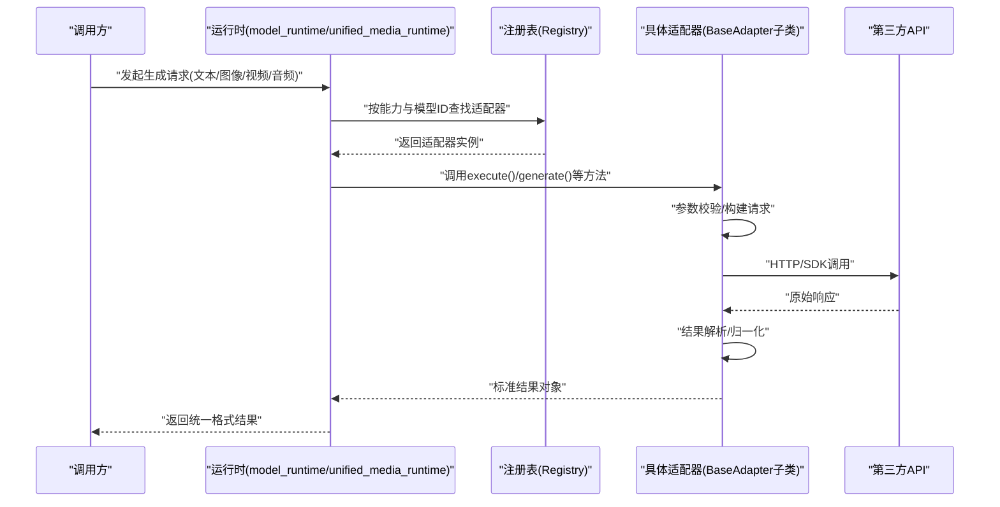
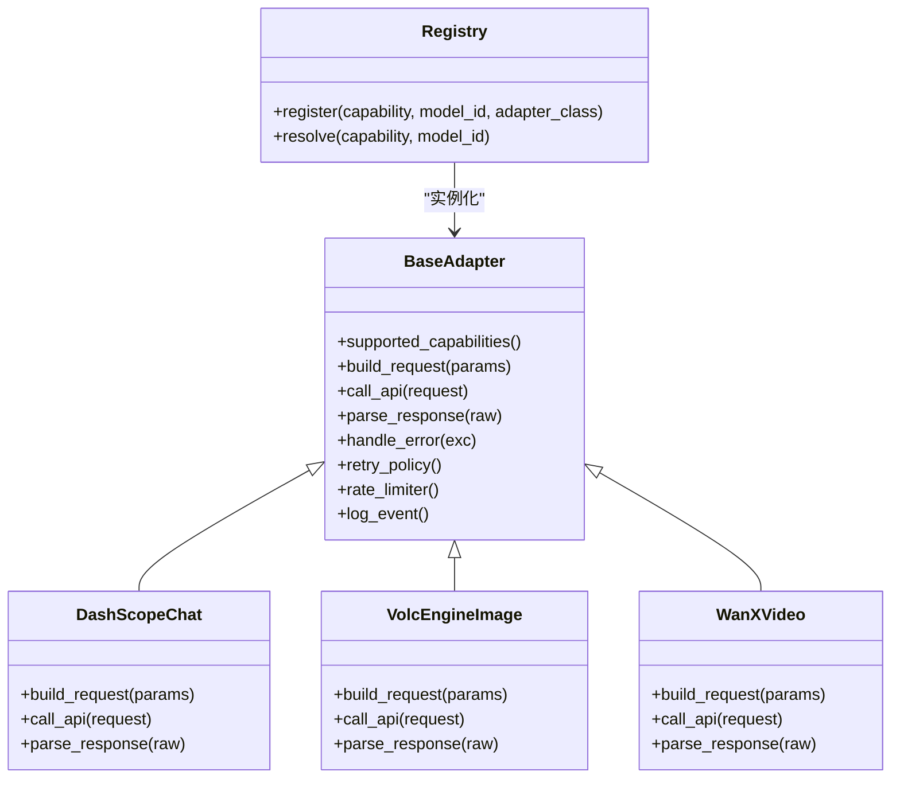

# 自定义适配器开发

<cite>
**本文引用的文件**   
- [adapters/base.py](file://adapters/base.py)
- [adapters/registry.py](file://adapters/registry.py)
- [adapters/_shared.py](file://adapters/_shared.py)
- [adapters/adapter_helpers.py](file://adapters/adapter_helpers.py)
- [adapters/dashscope/chat.py](file://adapters/dashscope/chat.py)
- [adapters/dashscope/image_sync.py](file://adapters/dashscope/image_sync.py)
- [adapters/dashscope/video_t2v.py](file://adapters/dashscope/video_t2v.py)
- [adapters/dashscope/tts.py](file://adapters/dashscope/tts.py)
- [adapters/mock/llm.py](file://adapters/mock/llm.py)
- [adapters/mock/image.py](file://adapters/mock/image.py)
- [adapters/mock/video.py](file://adapters/mock/video.py)
- [adapters/volcengine/chat.py](file://adapters/volcengine/chat.py)
- [adapters/volcengine/image.py](file://adapters/volcengine/image.py)
- [adapters/volcengine/audio_generation.py](file://adapters/volcengine/audio_generation.py)
- [adapters/volcengine/video.py](file://adapters/volcengine/video.py)
- [adapters/wanx_adapter.py](file://adapters/wanx_adapter.py)
- [adapters/wan26_video_adapter.py](file://adapters/wan26_video_adapter.py)
- [core/unified_registry.py](file://core/unified_registry.py)
- [core/model_runtime.py](file://core/model_runtime.py)
- [core/unified_media_runtime.py](file://core/unified_media_runtime.py)
- [scripts/verify_all_adapters.py](file://scripts/verify_all_adapters.py)
- [tests/test_wanx_adapter.py](file://tests/test_wanx_adapter.py)
- [tests/test_wan26_video_adapter.py](file://tests/test_wan26_video_adapter.py)
</cite>

## 目录
1. [简介](#简介)
2. [项目结构](#项目结构)
3. [核心组件](#核心组件)
4. [架构总览](#架构总览)
5. [详细组件分析](#详细组件分析)
6. [依赖关系分析](#依赖关系分析)
7. [性能考量](#性能考量)
8. [故障排查指南](#故障排查指南)
9. [结论](#结论)
10. [附录](#附录)

## 简介
本指南面向希望为小说创作代理系统扩展新的AI服务或第三方API的开发者。文档围绕适配器体系展开，重点说明：
- 如何继承适配器基类BaseAdapter并实现必要接口
- 如何在注册中心注册新适配器类型
- 文本生成、图像生成、视频生成与音频处理的适配器模板与最佳实践
- 配置管理、错误处理与日志记录规范
- 单元测试与集成测试策略
- 对接新服务的端到端示例路径

## 项目结构
适配器相关代码主要位于adapters目录，按提供方（如dashscope、volcengine）与功能域（chat、image、video、tts等）组织；通用能力集中在base、registry、_shared与adapter_helpers中；运行时与统一注册在core下提供支撑。

```mermaid
graph TB
subgraph "适配器层"
BASE["adapters/base.py<br/>抽象基类"]
REG["adapters/registry.py<br/>适配器注册表"]
SHARED["adapters/_shared.py<br/>共享工具"]
HELPERS["adapters/adapter_helpers.py<br/>辅助函数"]
DS_CHAT["adapters/dashscope/chat.py"]
DS_IMG["adapters/dashscope/image_sync.py"]
DS_VID["adapters/dashscope/video_t2v.py"]
DS_TTS["adapters/dashscope/tts.py"]
VE_CHAT["adapters/volcengine/chat.py"]
VE_IMG["adapters/volcengine/image.py"]
VE_AUD["adapters/volcengine/audio_generation.py"]
VE_VID["adapters/volcengine/video.py"]
MOCK_LLM["adapters/mock/llm.py"]
MOCK_IMG["adapters/mock/image.py"]
MOCK_VID["adapters/mock/video.py"]
WANX["adapters/wanx_adapter.py"]
WAN26["adapters/wan26_video_adapter.py"]
end
subgraph "运行时与注册"
CORE_REG["core/unified_registry.py"]
CORE_RT["core/model_runtime.py"]
CORE_MRT["core/unified_media_runtime.py"]
end
BASE --> REG
REG --> CORE_REG
CORE_RT --> REG
CORE_MRT --> REG
DS_CHAT --> BASE
DS_IMG --> BASE
DS_VID --> BASE
DS_TTS --> BASE
VE_CHAT --> BASE
VE_IMG --> BASE
VE_AUD --> BASE
VE_VID --> BASE
MOCK_LLM --> BASE
MOCK_IMG --> BASE
MOCK_VID --> BASE
WANX --> BASE
WAN26 --> BASE
```

图表来源
- [adapters/base.py](file://adapters/base.py)
- [adapters/registry.py](file://adapters/registry.py)
- [core/unified_registry.py](file://core/unified_registry.py)
- [core/model_runtime.py](file://core/model_runtime.py)
- [core/unified_media_runtime.py](file://core/unified_media_runtime.py)

章节来源
- [adapters/base.py](file://adapters/base.py)
- [adapters/registry.py](file://adapters/registry.py)
- [adapters/_shared.py](file://adapters/_shared.py)
- [adapters/adapter_helpers.py](file://adapters/adapter_helpers.py)
- [core/unified_registry.py](file://core/unified_registry.py)
- [core/model_runtime.py](file://core/model_runtime.py)
- [core/unified_media_runtime.py](file://core/unified_media_runtime.py)

## 核心组件
- BaseAdapter：定义适配器的抽象契约，包括初始化、能力声明、请求构建、调用执行、结果解析、重试与限流、错误处理与日志等。
- Registry：维护适配器类型到实现的映射，支持按能力维度（文本、图像、视频、音频）查找与实例化。
- _shared与adapter_helpers：跨适配器的通用逻辑，如参数标准化、响应归一化、鉴权头构造、速率限制、超时控制等。
- 具体适配器：针对各提供方（DashScope、火山引擎、WanX等）实现差异化细节，遵循BaseAdapter契约。
- 运行时与统一注册：core下的unified_registry与model_runtime负责全局注册、模型路由与生命周期管理；unified_media_runtime负责媒体类任务的编排。

章节来源
- [adapters/base.py](file://adapters/base.py)
- [adapters/registry.py](file://adapters/registry.py)
- [adapters/_shared.py](file://adapters/_shared.py)
- [adapters/adapter_helpers.py](file://adapters/adapter_helpers.py)
- [core/unified_registry.py](file://core/unified_registry.py)
- [core/model_runtime.py](file://core/model_runtime.py)
- [core/unified_media_runtime.py](file://core/unified_media_runtime.py)

## 架构总览
适配器通过Registry集中注册，运行时根据任务类型与模型标识选择对应适配器实例。媒体任务由unified_media_runtime协调，文本任务由model_runtime调度。所有适配器统一输出规范化结果，便于上层Agent与Pipeline消费。

图表来源
- [core/model_runtime.py](file://core/model_runtime.py)
- [core/unified_media_runtime.py](file://core/unified_media_runtime.py)
- [adapters/registry.py](file://adapters/registry.py)
- [adapters/base.py](file://adapters/base.py)

## 详细组件分析

### BaseAdapter抽象基类
- 职责
  - 定义适配器必须实现的抽象方法：如能力描述、请求构建、调用执行、结果解析、错误处理、重试策略、限流与超时。
  - 提供可选重写点：日志记录、指标上报、缓存、降级与回退。
  - 统一输入输出规范，确保上层无需关心底层差异。
- 关键设计要点
  - 能力声明：明确支持的模态（文本、图像、视频、音频）与子能力（如T2I、I2V、TTS）。
  - 参数标准化：将上游参数转换为下游API所需格式。
  - 异常映射：将第三方异常映射为系统内统一错误码与消息。
  - 可观测性：结构化日志、耗时统计、失败率埋点。

章节来源
- [adapters/base.py](file://adapters/base.py)

### 适配器注册机制（Registry）
- 职责
  - 维护“能力类型 + 模型标识 -> 适配器类”的映射。
  - 提供按能力与模型ID查找、实例化与缓存的方法。
  - 支持动态加载与热更新（按需）。
- 使用方式
  - 在新适配器模块中完成类定义后，在注册表中登记其能力与模型ID。
  - 运行时通过统一入口获取适配器实例，避免硬编码依赖。

章节来源
- [adapters/registry.py](file://adapters/registry.py)
- [core/unified_registry.py](file://core/unified_registry.py)

### 文本生成适配器（以DashScope为例）
- 典型流程
  - 接收文本上下文与提示词
  - 构建对话/生成请求
  - 调用LLM接口
  - 解析响应并归一化为标准文本结果
- 关键点
  - 上下文窗口与分片策略
  - 流式与非流式两种模式
  - 安全过滤与内容审核

章节来源
- [adapters/dashscope/chat.py](file://adapters/dashscope/chat.py)
- [adapters/mock/llm.py](file://adapters/mock/llm.py)

### 图像生成适配器（以DashScope与VolcEngine为例）
- 典型流程
  - 接收文本提示与可选参考图
  - 构建图像生成请求（分辨率、风格、数量等）
  - 调用图像生成API
  - 下载/转存结果并返回URL或二进制
- 关键点
  - 异步轮询与进度回调
  - 图片尺寸与格式约束
  - 失败重试与配额控制

章节来源
- [adapters/dashscope/image_sync.py](file://adapters/dashscope/image_sync.py)
- [adapters/volcengine/image.py](file://adapters/volcengine/image.py)
- [adapters/mock/image.py](file://adapters/mock/image.py)

### 视频生成适配器（以DashScope与Wan系列为例）
- 典型流程
  - 接收文本/图像提示与时长、帧率等参数
  - 提交视频生成任务
  - 轮询任务状态直至完成
  - 下载视频并返回元数据
- 关键点
  - 长任务状态机与断点续查
  - 资源清理与临时文件管理
  - 并发与队列控制

章节来源
- [adapters/dashscope/video_t2v.py](file://adapters/dashscope/video_t2v.py)
- [adapters/wanx_adapter.py](file://adapters/wanx_adapter.py)
- [adapters/wan26_video_adapter.py](file://adapters/wan26_video_adapter.py)
- [adapters/mock/video.py](file://adapters/mock/video.py)

### 音频处理适配器（TTS与音频生成）
- 典型流程
  - 接收文本与音色/语速等参数
  - 调用TTS或音频生成接口
  - 返回音频文件或流式片段
- 关键点
  - 采样率与编码格式转换
  - 大文本分段与静音拼接
  - 音质校验与失败回退

章节来源
- [adapters/dashscope/tts.py](file://adapters/dashscope/tts.py)
- [adapters/volcengine/audio_generation.py](file://adapters/volcengine/audio_generation.py)

### 适配器实现模板（建议结构）
- 类名与命名空间
  - 放在对应提供方目录下，如adapters/<provider>/<capability>.py
- 必需实现
  - 能力声明：supported_capabilities()
  - 请求构建：build_request(params)
  - 调用执行：call_api(request)
  - 结果解析：parse_response(raw)
  - 错误处理：handle_error(exc)
- 可选重写
  - 重试策略：retry_policy()
  - 限流器：rate_limiter()
  - 日志与指标：log_event(), metrics()
  - 缓存与降级：cache_key(), fallback()

章节来源
- [adapters/base.py](file://adapters/base.py)
- [adapters/_shared.py](file://adapters/_shared.py)
- [adapters/adapter_helpers.py](file://adapters/adapter_helpers.py)

### 配置管理最佳实践
- 环境变量优先：密钥、端点、超时、重试次数等通过环境变量注入
- 配置文件分层：默认值、环境覆盖、运行时覆盖
- 敏感信息隔离：不在代码与日志中打印密钥
- 配置校验：启动时校验必填项与取值范围

章节来源
- [adapters/_shared.py](file://adapters/_shared.py)
- [adapters/adapter_helpers.py](file://adapters/adapter_helpers.py)

### 错误处理与日志记录最佳实践
- 错误分类：网络错误、认证错误、业务错误、参数错误
- 统一异常映射：对外暴露稳定错误码与可读消息
- 结构化日志：包含请求ID、模型ID、耗时、状态码
- 失败可恢复：对幂等操作实施指数退避重试

章节来源
- [adapters/base.py](file://adapters/base.py)
- [adapters/adapter_helpers.py](file://adapters/adapter_helpers.py)

### 适配器测试策略
- 单元测试
  - 使用Mock适配器模拟第三方API行为
  - 验证参数构建、响应解析、错误映射
- 集成测试
  - 使用沙箱或测试账号调用真实API
  - 覆盖成功、失败、超时、限流场景
- 回归与验收
  - 全量适配器验证脚本
  - 关键用例快照对比

章节来源
- [adapters/mock/llm.py](file://adapters/mock/llm.py)
- [adapters/mock/image.py](file://adapters/mock/image.py)
- [adapters/mock/video.py](file://adapters/mock/video.py)
- [scripts/verify_all_adapters.py](file://scripts/verify_all_adapters.py)
- [tests/test_wanx_adapter.py](file://tests/test_wanx_adapter.py)
- [tests/test_wan26_video_adapter.py](file://tests/test_wan26_video_adapter.py)

### 对接新AI服务或第三方API的步骤
- 新建适配器类
  - 继承BaseAdapter，实现必需方法
- 注册适配器
  - 在注册表中登记能力与模型ID
- 配置接入
  - 设置端点、鉴权、超时与重试
- 编写测试
  - Mock与集成测试覆盖关键路径
- 联调与上线
  - 灰度发布与监控告警

章节来源
- [adapters/base.py](file://adapters/base.py)
- [adapters/registry.py](file://adapters/registry.py)
- [core/unified_registry.py](file://core/unified_registry.py)

## 依赖关系分析
适配器与运行时之间的依赖清晰且低耦合：
- 适配器仅依赖BaseAdapter契约与共享工具
- 运行时通过Registry解耦具体实现
- 第三方API调用封装在适配器内部

图表来源
- [adapters/base.py](file://adapters/base.py)
- [adapters/dashscope/chat.py](file://adapters/dashscope/chat.py)
- [adapters/volcengine/image.py](file://adapters/volcengine/image.py)
- [adapters/wanx_adapter.py](file://adapters/wanx_adapter.py)
- [adapters/registry.py](file://adapters/registry.py)

章节来源
- [adapters/base.py](file://adapters/base.py)
- [adapters/registry.py](file://adapters/registry.py)
- [adapters/dashscope/chat.py](file://adapters/dashscope/chat.py)
- [adapters/volcengine/image.py](file://adapters/volcengine/image.py)
- [adapters/wanx_adapter.py](file://adapters/wanx_adapter.py)

## 性能考量
- 连接复用与池化：HTTP客户端连接池、SDK连接复用
- 并发控制：令牌桶/漏桶限流、最大并发数限制
- 缓存策略：热点请求结果缓存、模型能力探测缓存
- 批处理与合并：批量请求减少往返开销
- 资源回收：及时释放临时文件与内存占用

[本节为通用指导，不直接分析具体文件]

## 故障排查指南
- 常见问题定位
  - 认证失败：检查密钥、端点、签名算法
  - 参数错误：核对必填字段与取值范围
  - 超时/限流：调整超时与重试策略，观察QPS
  - 结果异常：检查响应结构与解析逻辑
- 诊断手段
  - 启用调试日志与请求追踪
  - 使用Mock适配器复现问题
  - 运行全量适配器验证脚本

章节来源
- [adapters/adapter_helpers.py](file://adapters/adapter_helpers.py)
- [scripts/verify_all_adapters.py](file://scripts/verify_all_adapters.py)

## 结论
通过统一的BaseAdapter契约与Registry注册机制，系统能够以最小改动接入新的AI服务。遵循本文的配置、错误处理、日志与测试规范，可显著提升适配器的稳定性与可维护性。建议在新增适配器时同步完善Mock与集成测试，并在上线前进行全量验证。

[本节为总结性内容，不直接分析具体文件]

## 附录
- 快速上手清单
  - 继承BaseAdapter并实现必需方法
  - 在Registry中登记能力与模型ID
  - 配置环境变量与默认值
  - 编写Mock与集成测试
  - 运行verify_all_adapters进行回归
- 参考实现
  - 文本：DashScope Chat
  - 图像：DashScope Image、VolcEngine Image
  - 视频：DashScope Video T2V、WanX/Wan26
  - 音频：DashScope TTS、VolcEngine Audio Generation

章节来源
- [adapters/dashscope/chat.py](file://adapters/dashscope/chat.py)
- [adapters/dashscope/image_sync.py](file://adapters/dashscope/image_sync.py)
- [adapters/dashscope/video_t2v.py](file://adapters/dashscope/video_t2v.py)
- [adapters/dashscope/tts.py](file://adapters/dashscope/tts.py)
- [adapters/volcengine/image.py](file://adapters/volcengine/image.py)
- [adapters/volcengine/audio_generation.py](file://adapters/volcengine/audio_generation.py)
- [adapters/wanx_adapter.py](file://adapters/wanx_adapter.py)
- [adapters/wan26_video_adapter.py](file://adapters/wan26_video_adapter.py)
- [scripts/verify_all_adapters.py](file://scripts/verify_all_adapters.py)