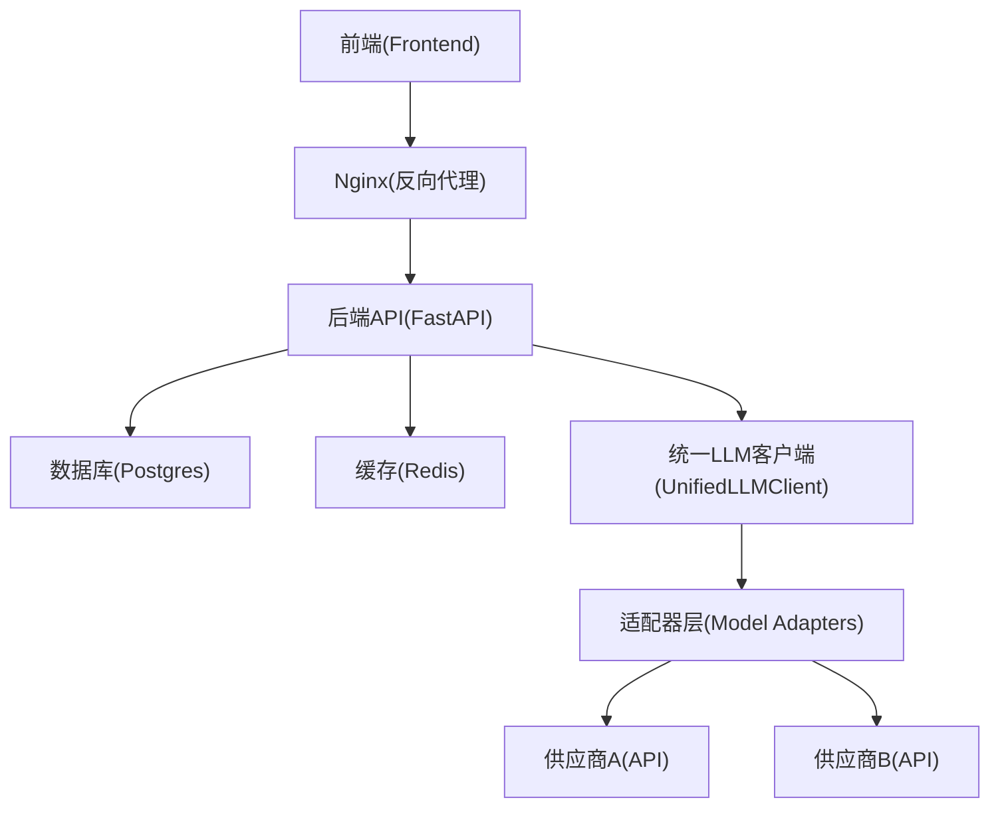
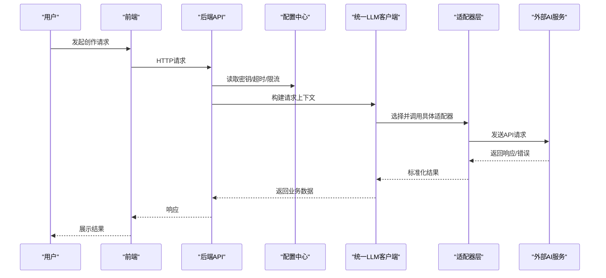
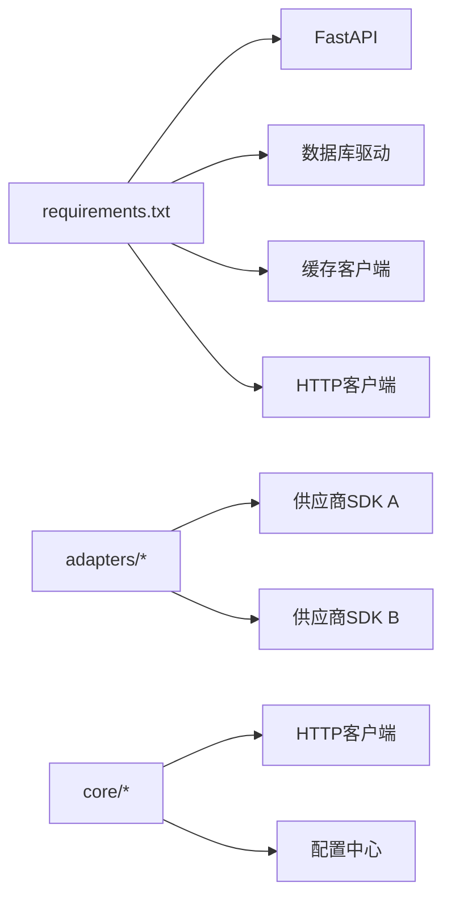

# 常见问题解决

<cite>
**本文引用的文件**   
- [README.md](file://README.md)
- [config.py](file://config.py)
- [start_backend.py](file://start_backend.py)
- [backend/app/main.py](file://backend/app/main.py)
- [backend/app/core/config.py](file://backend/app/core/config.py)
- [backend/requirements.txt](file://backend/requirements.txt)
- [docker-compose.yml](file://docker-compose.yml)
- [nginx.conf](file://nginx.conf)
- [core/unified_llm_client.py](file://core/unified_llm_client.py)
- [adapters/base.py](file://adapters/base.py)
- [adapters/model_adapters.py](file://adapters/model_adapters.py)
- [agents/llm_client.py](file://agents/llm_client.py)
- [scripts/check_all_models_status.py](file://scripts/check_all_models_status.py)
- [scripts/test_all_models.py](file://scripts/test_all_models.py)
- [backend/app/services/streaming_service.py](file://backend/app/services/streaming_service.py)
- [backend/app/api/v1/monitoring.py](file://backend/app/api/v1/monitoring.py)
</cite>

## 目录
1. [简介](#简介)
2. [项目结构](#项目结构)
3. [核心组件](#核心组件)
4. [架构总览](#架构总览)
5. [详细组件分析](#详细组件分析)
6. [依赖关系分析](#依赖关系分析)
7. [性能注意事项](#性能注意事项)
8. [故障排查指南](#故障排查指南)
9. [结论](#结论)
10. [附录](#附录)

## 简介
本文件面向小说创作代理系统的运维与开发者，聚焦“安装部署”“运行时错误”“AI服务调用失败”三类典型问题，提供症状描述、根因分析、逐步修复步骤与预防措施，并附带常见错误代码对照表与快速修复命令。文档内容基于仓库中的配置、启动脚本、后端主入口、统一LLM客户端、适配器基类与模型适配层等源码进行归纳总结，确保可操作性和可追溯性。

## 项目结构
系统采用前后端分离与多模块组织：
- 前端：React/Vite应用，位于 frontend 目录
- 后端：FastAPI应用，位于 backend/app，包含路由、服务、任务、数据库迁移等
- 核心引擎与适配器：core 与 adapters 目录实现统一的模型调度、媒体运行与第三方适配
- 代理与工作流：agents 与 pipeline 目录编排生成流程
- 配置与环境：config.py、backend/app/core/config.py、docker-compose.yml、nginx*.conf
- 工具脚本：scripts 目录提供健康检查、模型验证、调试等能力

图表来源
- [docker-compose.yml](file://docker-compose.yml)
- [nginx.conf](file://nginx.conf)
- [backend/app/main.py](file://backend/app/main.py)
- [core/unified_llm_client.py](file://core/unified_llm_client.py)
- [adapters/base.py](file://adapters/base.py)

章节来源
- [README.md](file://README.md)
- [docker-compose.yml](file://docker-compose.yml)
- [nginx.conf](file://nginx.conf)
- [backend/app/main.py](file://backend/app/main.py)

## 核心组件
- 统一LLM客户端：封装对外部大模型的请求、重试、超时、鉴权与结果解析
- 适配器层：按供应商或能力（文本/图像/视频/TTS）抽象接口，屏蔽差异
- 后端主入口：注册路由、加载配置、初始化中间件与依赖
- 配置中心：集中管理环境变量、密钥、端口、超时、限流等
- 监控与健康检查：暴露健康端点、模型状态探测、流式服务状态

章节来源
- [core/unified_llm_client.py](file://core/unified_llm_client.py)
- [adapters/base.py](file://adapters/base.py)
- [adapters/model_adapters.py](file://adapters/model_adapters.py)
- [backend/app/main.py](file://backend/app/main.py)
- [backend/app/core/config.py](file://backend/app/core/config.py)

## 架构总览
下图展示从前端到后端再到外部AI服务的完整调用链，以及关键配置与依赖注入点。

图表来源
- [backend/app/main.py](file://backend/app/main.py)
- [core/unified_llm_client.py](file://core/unified_llm_client.py)
- [adapters/base.py](file://adapters/base.py)
- [adapters/model_adapters.py](file://adapters/model_adapters.py)

## 详细组件分析

### 安装部署问题
- 依赖包冲突
  - 症状：启动时报版本不兼容、导入错误或功能缺失
  - 根因：不同模块对同一库的版本要求不一致；虚拟环境未隔离
  - 解决步骤：
    1) 使用独立虚拟环境安装后端依赖
    2) 优先使用 requirements-simple.txt 或 requirements-dev.txt 明确依赖集
    3) 若仍冲突，锁定冲突包版本后重新安装
  - 预防：在CI中固定依赖版本，发布前执行依赖校验脚本
  - 参考路径：[backend/requirements.txt](file://backend/requirements.txt)

- 端口占用
  - 症状：后端或Nginx无法绑定端口，启动失败
  - 根因：默认端口被其他进程占用；容器网络端口映射冲突
  - 解决步骤：
    1) 修改后端监听端口并在配置中同步
    2) 调整Nginx上游端口映射
    3) 使用端口扫描工具定位占用进程并终止
  - 预防：在部署脚本中增加端口可用性检测
  - 参考路径：[nginx.conf](file://nginx.conf), [backend/app/core/config.py](file://backend/app/core/config.py)

- 权限问题
  - 症状：读写日志、上传目录、音频/视频输出失败
  - 根因：运行用户无写入权限；容器卷挂载权限不正确
  - 解决步骤：
    1) 修正目录属主与权限位
    2) 在Docker Compose中设置正确的用户与卷权限
    3) 避免以root运行生产服务
  - 预防：最小权限原则，按需授权
  - 参考路径：[docker-compose.yml](file://docker-compose.yml)

章节来源
- [backend/requirements.txt](file://backend/requirements.txt)
- [nginx.conf](file://nginx.conf)
- [backend/app/core/config.py](file://backend/app/core/config.py)
- [docker-compose.yml](file://docker-compose.yml)

### 运行时错误
- 内存溢出
  - 症状：进程被OOM Killer终止；生成任务中断
  - 根因：批量处理过大、缓存未清理、并发过高
  - 解决步骤：
    1) 降低并发度与批大小
    2) 启用流式处理与分块处理
    3) 限制单任务最大内存使用
  - 预防：压测评估峰值内存，设置资源上限
  - 参考路径：[backend/app/services/streaming_service.py](file://backend/app/services/streaming_service.py)

- 连接超时
  - 症状：HTTP请求超时、WebSocket断开
  - 根因：下游服务慢、网络抖动、超时配置过小
  - 解决步骤：
    1) 增大超时阈值并重试
    2) 启用指数退避与熔断
    3) 检查DNS与代理配置
  - 预防：健康检查与自动切换备用供应商
  - 参考路径：[core/unified_llm_client.py](file://core/unified_llm_client.py)

- 文件访问失败
  - 症状：读写临时文件、字幕、音频片段失败
  - 根因：路径不存在、磁盘满、权限不足
  - 解决步骤：
    1) 创建必要目录并赋权
    2) 检查磁盘空间与配额
    3) 使用绝对路径与规范化路径
  - 预防：启动时自检关键路径与容量
  - 参考路径：[backend/app/core/config.py](file://backend/app/core/config.py)

章节来源
- [backend/app/services/streaming_service.py](file://backend/app/services/streaming_service.py)
- [core/unified_llm_client.py](file://core/unified_llm_client.py)
- [backend/app/core/config.py](file://backend/app/core/config.py)

### AI服务调用失败
- API密钥无效
  - 症状：401/403错误、鉴权失败
  - 根因：密钥过期、配置错误、环境变量未生效
  - 解决步骤：
    1) 核对密钥与供应商控制台
    2) 重启服务使配置生效
    3) 查看鉴权日志定位原因
  - 预防：密钥轮换与告警
  - 参考路径：[backend/app/core/config.py](file://backend/app/core/config.py)

- 模型加载失败
  - 症状：模型初始化报错、路由失败
  - 根因：模型ID不匹配、权重缺失、依赖库缺失
  - 解决步骤：
    1) 校验模型清单与版本
    2) 下载缺失权重或安装依赖
    3) 使用诊断脚本验证
  - 预防：预检与灰度上线
  - 参考路径：[adapters/model_adapters.py](file://adapters/model_adapters.py), [scripts/check_all_models_status.py](file://scripts/check_all_models_status.py)

- 网络请求超时
  - 症状：请求长时间无响应
  - 根因：网络拥塞、供应商限流、证书问题
  - 解决步骤：
    1) 调整超时与重试策略
    2) 切换备用供应商或区域
    3) 检查证书与代理
  - 预防：多供应商冗余与自动降级
  - 参考路径：[core/unified_llm_client.py](file://core/unified_llm_client.py)

章节来源
- [backend/app/core/config.py](file://backend/app/core/config.py)
- [adapters/model_adapters.py](file://adapters/model_adapters.py)
- [core/unified_llm_client.py](file://core/unified_llm_client.py)
- [scripts/check_all_models_status.py](file://scripts/check_all_models_status.py)

## 依赖关系分析
- 后端依赖：FastAPI、数据库驱动、缓存客户端、HTTP客户端
- 模型依赖：各供应商SDK、本地推理库（可选）
- 基础设施：Postgres、Redis、Nginx、FFmpeg（媒体处理）

图表来源
- [backend/requirements.txt](file://backend/requirements.txt)
- [adapters/base.py](file://adapters/base.py)
- [core/unified_llm_client.py](file://core/unified_llm_client.py)

章节来源
- [backend/requirements.txt](file://backend/requirements.txt)
- [adapters/base.py](file://adapters/base.py)
- [core/unified_llm_client.py](file://core/unified_llm_client.py)

## 性能注意事项
- 合理设置并发与批大小，避免内存峰值
- 启用流式传输与增量处理，减少等待时间
- 使用缓存与预热，降低冷启动开销
- 为外部API设置超时、重试与熔断，提升鲁棒性
- 监控关键指标：QPS、延迟、错误率、内存/CPU

## 故障排查指南
- 快速定位
  - 使用健康检查端点确认服务状态
  - 查看模型状态与供应商连通性
  - 检查日志中的错误码与堆栈
- 常用命令
  - 检查所有模型状态：[scripts/check_all_models_status.py](file://scripts/check_all_models_status.py)
  - 全链路模型测试：[scripts/test_all_models.py](file://scripts/test_all_models.py)
  - 后端启动入口：[start_backend.py](file://start_backend.py)
  - 后端主应用：[backend/app/main.py](file://backend/app/main.py)
- 常见错误码对照
  - 401/403：鉴权失败，核对密钥与权限
  - 429：限流触发，降低频率或扩容
  - 500/502/503：服务端错误/网关错误/不可用，检查依赖与负载
  - 超时：调整超时与重试策略
- 预防措施
  - 启动自检：路径、端口、依赖、密钥
  - 健康探针：周期性探测关键依赖
  - 灰度发布：小流量验证后再全量

章节来源
- [scripts/check_all_models_status.py](file://scripts/check_all_models_status.py)
- [scripts/test_all_models.py](file://scripts/test_all_models.py)
- [start_backend.py](file://start_backend.py)
- [backend/app/main.py](file://backend/app/main.py)
- [backend/app/api/v1/monitoring.py](file://backend/app/api/v1/monitoring.py)

## 结论
通过规范化的配置管理、健壮的适配器层与完善的监控诊断，系统能够在复杂环境下稳定运行。针对安装部署、运行时错误与AI服务调用失败的常见问题，建议建立标准排障流程与自动化巡检，持续优化性能与可靠性。

## 附录
- 快速修复命令示例（根据实际环境替换参数）
  - 检查端口占用：netstat -ano | findstr :端口号
  - 重启后端服务：python start_backend.py
  - 验证模型连通性：python scripts/check_all_models_status.py
  - 全量模型测试：python scripts/test_all_models.py
- 相关参考路径
  - 配置中心：[backend/app/core/config.py](file://backend/app/core/config.py)
  - 统一LLM客户端：[core/unified_llm_client.py](file://core/unified_llm_client.py)
  - 适配器基类：[adapters/base.py](file://adapters/base.py)
  - 模型适配层：[adapters/model_adapters.py](file://adapters/model_adapters.py)
  - 后端主入口：[backend/app/main.py](file://backend/app/main.py)
  - 启动脚本：[start_backend.py](file://start_backend.py)
  - 依赖清单：[backend/requirements.txt](file://backend/requirements.txt)
  - 容器编排：[docker-compose.yml](file://docker-compose.yml)
  - Nginx配置：[nginx.conf](file://nginx.conf)
  - 监控端点：[backend/app/api/v1/monitoring.py](file://backend/app/api/v1/monitoring.py)