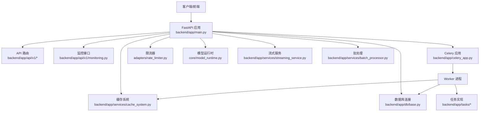
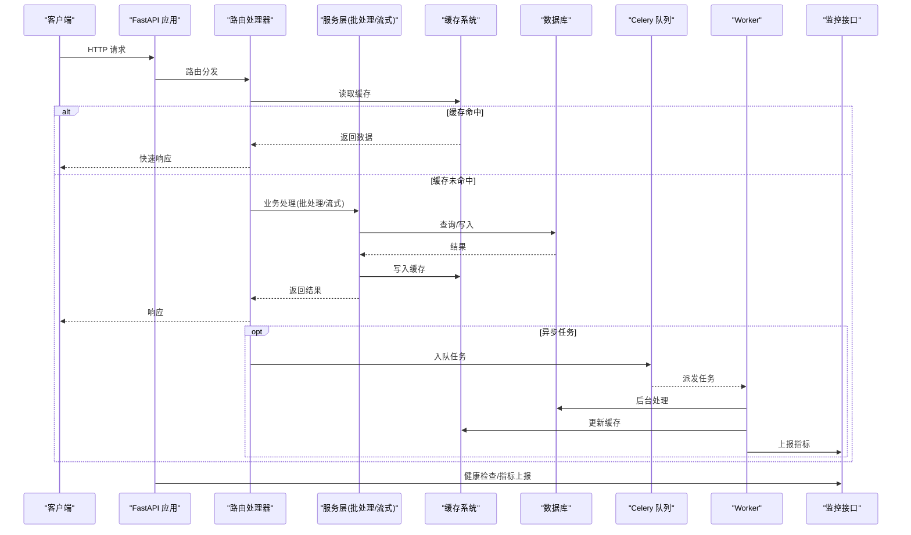
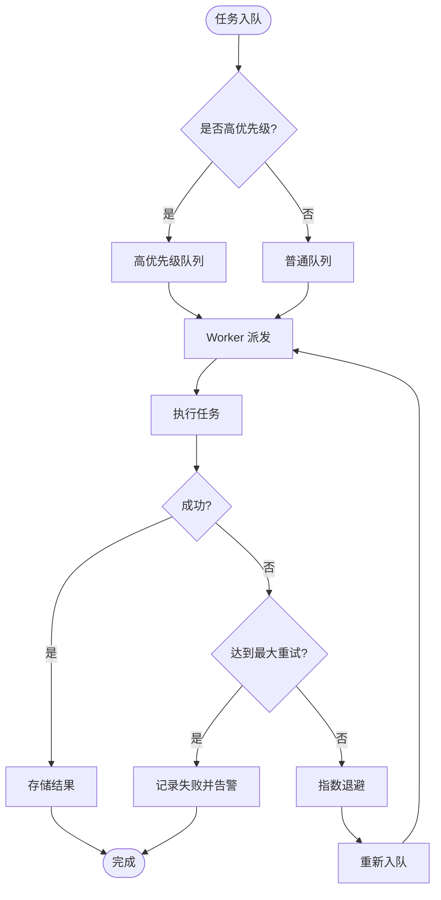
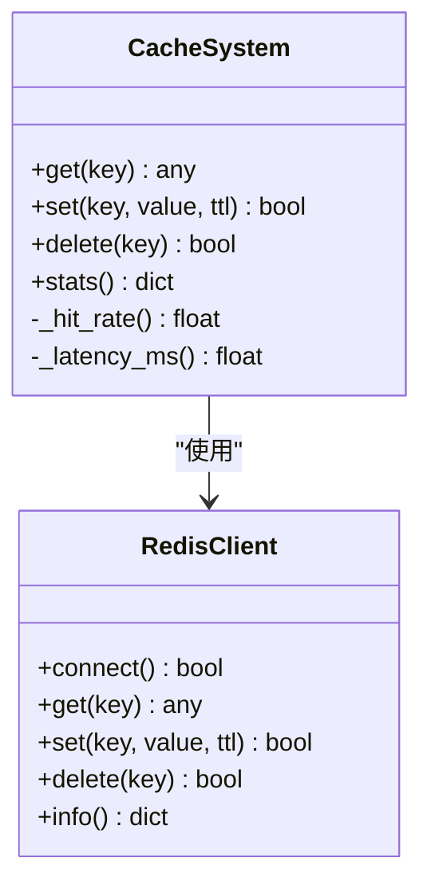
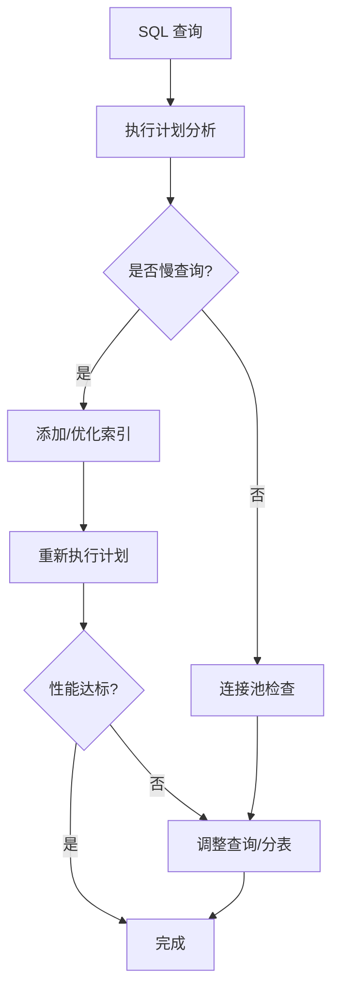
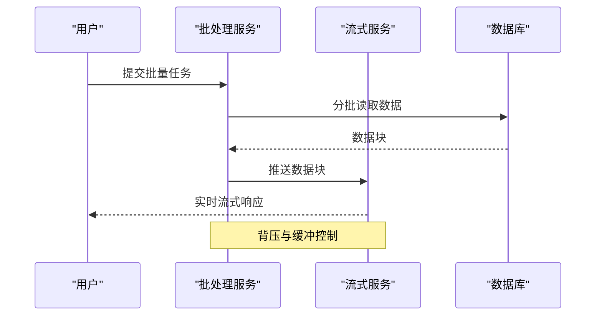
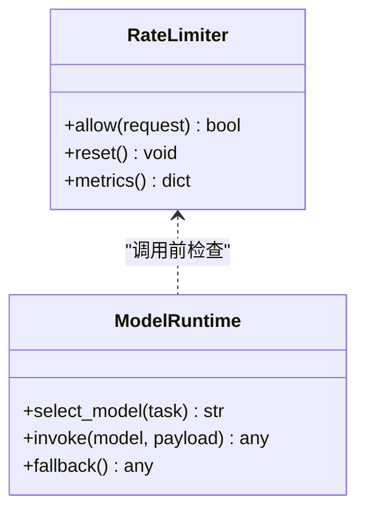
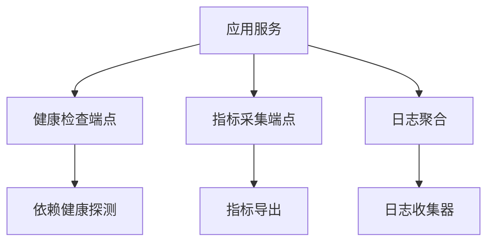
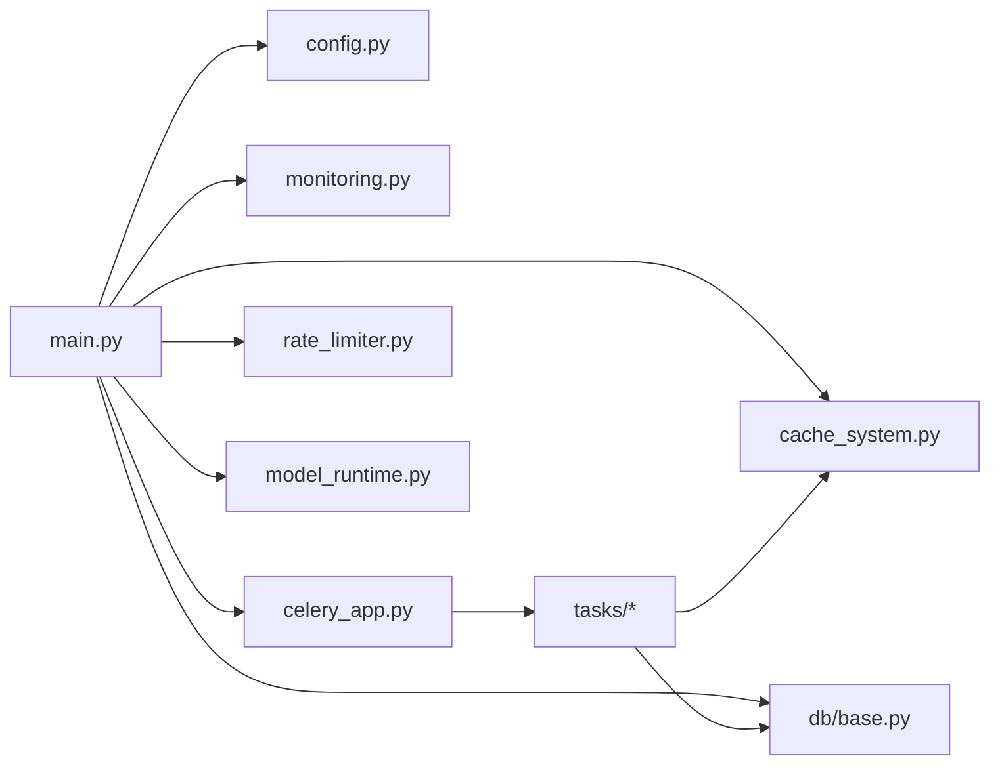

# 性能优化与诊断

<cite>
**本文引用的文件**   
- [backend/app/celery_app.py](file://backend/app/celery_app.py)
- [backend/app/main.py](file://backend/app/main.py)
- [backend/app/core/config.py](file://backend/app/core/config.py)
- [backend/app/services/cache_system.py](file://backend/app/services/cache_system.py)
- [backend/app/api/v1/monitoring.py](file://backend/app/api/v1/monitoring.py)
- [backend/app/db/base.py](file://backend/app/db/base.py)
- [backend/app/services/batch_processor.py](file://backend/app/services/batch_processor.py)
- [backend/app/services/streaming_service.py](file://backend/app/services/streaming_service.py)
- [backend/app/tasks/dreamweaver_tasks.py](file://backend/app/tasks/dreamweaver_tasks.py)
- [backend/app/services/prompt_evolution/coordinator.py](file://backend/app/services/prompt_evolution/coordinator.py)
- [adapters/rate_limiter.py](file://adapters/rate_limiter.py)
- [core/model_runtime.py](file://core/model_runtime.py)
- [scripts/story_expansion_benchmark.py](file://scripts/story_expansion_benchmark.py)
- [redis.conf](file://redis.conf)
- [docker-compose.yml](file://docker-compose.yml)
</cite>

## 目录
1. [简介](#简介)
2. [项目结构](#项目结构)
3. [核心组件](#核心组件)
4. [架构总览](#架构总览)
5. [详细组件分析](#详细组件分析)
6. [依赖关系分析](#依赖关系分析)
7. [性能考量](#性能考量)
8. [故障排查指南](#故障排查指南)
9. [结论](#结论)
10. [附录](#附录)

## 简介
本指南面向小说创作代理系统的运维与研发人员，聚焦性能瓶颈识别与优化、可观测性建设以及关键子系统（Celery 任务队列、数据库、缓存、I/O）的调优实践。内容涵盖：
- CPU 使用率过高、内存泄漏、慢查询、I/O 阻塞等典型问题的定位方法
- Python 性能分析器、数据库查询分析、Redis 缓存命中率监控的使用要点
- Celery worker 数量、任务优先级、重试机制的调优策略
- 内存使用分析与垃圾回收优化、并发处理最佳实践
- 结合系统现有模块（缓存、流式服务、批处理、限流、模型运行时）给出落地建议

## 项目结构
系统采用后端 FastAPI 应用 + Celery 异步任务 + PostgreSQL + Redis 的典型架构。关键路径包括：
- Web 入口与路由注册
- 配置与环境加载
- 数据库连接与 ORM 基类
- 缓存系统与中间件
- 监控与指标暴露
- Celery 应用与任务定义
- 批处理与流式输出
- 外部适配器与限流控制
- 基准测试脚本

**图表来源** 
- [backend/app/main.py](file://backend/app/main.py)
- [backend/app/celery_app.py](file://backend/app/celery_app.py)
- [backend/app/services/cache_system.py](file://backend/app/services/cache_system.py)
- [backend/app/db/base.py](file://backend/app/db/base.py)
- [backend/app/api/v1/monitoring.py](file://backend/app/api/v1/monitoring.py)
- [adapters/rate_limiter.py](file://adapters/rate_limiter.py)
- [core/model_runtime.py](file://core/model_runtime.py)
- [backend/app/services/streaming_service.py](file://backend/app/services/streaming_service.py)
- [backend/app/services/batch_processor.py](file://backend/app/services/batch_processor.py)

**章节来源**
- [backend/app/main.py](file://backend/app/main.py)
- [backend/app/celery_app.py](file://backend/app/celery_app.py)
- [backend/app/core/config.py](file://backend/app/core/config.py)

## 核心组件
- 配置与环境：集中管理环境变量、数据库连接参数、缓存配置、Celery 设置等
- 缓存系统：提供统一的缓存读写、过期策略、命中率统计
- 监控接口：暴露健康检查、指标采集、日志聚合端点
- 数据库层：ORM 基类、连接池、事务管理
- Celery 应用：任务注册、执行器、结果存储、重试与优先级
- 批处理与流式服务：批量数据处理、SSE/流式响应
- 限流与模型运行时：外部调用限速、模型选择与降级

**章节来源**
- [backend/app/core/config.py](file://backend/app/core/config.py)
- [backend/app/services/cache_system.py](file://backend/app/services/cache_system.py)
- [backend/app/api/v1/monitoring.py](file://backend/app/api/v1/monitoring.py)
- [backend/app/db/base.py](file://backend/app/db/base.py)
- [backend/app/celery_app.py](file://backend/app/celery_app.py)
- [backend/app/services/batch_processor.py](file://backend/app/services/batch_processor.py)
- [backend/app/services/streaming_service.py](file://backend/app/services/streaming_service.py)
- [adapters/rate_limiter.py](file://adapters/rate_limiter.py)
- [core/model_runtime.py](file://core/model_runtime.py)

## 架构总览
下图展示请求从进入 FastAPI 到任务调度、缓存命中、数据库访问及监控上报的整体流程。

**图表来源** 
- [backend/app/main.py](file://backend/app/main.py)
- [backend/app/services/batch_processor.py](file://backend/app/services/batch_processor.py)
- [backend/app/services/streaming_service.py](file://backend/app/services/streaming_service.py)
- [backend/app/services/cache_system.py](file://backend/app/services/cache_system.py)
- [backend/app/db/base.py](file://backend/app/db/base.py)
- [backend/app/celery_app.py](file://backend/app/celery_app.py)
- [backend/app/api/v1/monitoring.py](file://backend/app/api/v1/monitoring.py)

## 详细组件分析

### Celery 任务队列性能调优
- Worker 数量配置：根据 CPU 核数与 I/O 密集型任务比例调整并发度，避免上下文切换开销过大
- 任务优先级：为高优先级任务配置独立队列或优先级字段，确保关键链路优先执行
- 重试机制：合理设置最大重试次数与退避策略，避免雪崩；对幂等任务启用去重
- 结果存储：使用高效的结果后端（如 Redis），并设置合理的过期时间
- 监控与追踪：通过监控接口采集任务耗时、失败率、队列长度等指标

**图表来源** 
- [backend/app/celery_app.py](file://backend/app/celery_app.py)
- [backend/app/tasks/dreamweaver_tasks.py](file://backend/app/tasks/dreamweaver_tasks.py)

**章节来源**
- [backend/app/celery_app.py](file://backend/app/celery_app.py)
- [backend/app/tasks/dreamweaver_tasks.py](file://backend/app/tasks/dreamweaver_tasks.py)

### 缓存系统命中率监控与优化
- 命中率统计：在缓存读写路径埋点，统计命中率、延迟分布
- 热点键保护：对高频访问键设置更长 TTL 或本地缓存
- 一致性策略：多实例间通过分布式锁或版本号保证一致性
- 失效策略：基于事件驱动的失效与预取，降低冷启动抖动

**图表来源** 
- [backend/app/services/cache_system.py](file://backend/app/services/cache_system.py)

**章节来源**
- [backend/app/services/cache_system.py](file://backend/app/services/cache_system.py)
- [redis.conf](file://redis.conf)

### 数据库慢查询与连接池优化
- 慢查询定位：开启慢查询日志，结合 EXPLAIN 分析执行计划
- 索引优化：针对高频过滤与排序字段建立合适索引
- 连接池：调整连接池大小、超时与回收策略，避免连接耗尽
- 事务边界：缩短事务范围，减少锁竞争

**图表来源** 
- [backend/app/db/base.py](file://backend/app/db/base.py)

**章节来源**
- [backend/app/db/base.py](file://backend/app/db/base.py)

### 批处理与流式服务性能
- 批处理：合理设置批次大小，平衡吞吐与延迟；使用内存映射或零拷贝提升效率
- 流式服务：SSE/流式响应减少首字节延迟；背压控制防止下游过载
- 资源隔离：CPU/内存配额限制，避免单任务占用过多资源

**图表来源** 
- [backend/app/services/batch_processor.py](file://backend/app/services/batch_processor.py)
- [backend/app/services/streaming_service.py](file://backend/app/services/streaming_service.py)

**章节来源**
- [backend/app/services/batch_processor.py](file://backend/app/services/batch_processor.py)
- [backend/app/services/streaming_service.py](file://backend/app/services/streaming_service.py)

### 限流与模型运行时优化
- 限流器：基于令牌桶或漏桶算法，保护下游服务不被打爆
- 模型运行时：动态选择模型、降级策略、缓存推理结果
- 并发控制：限制并发请求数，避免资源争用

**图表来源** 
- [adapters/rate_limiter.py](file://adapters/rate_limiter.py)
- [core/model_runtime.py](file://core/model_runtime.py)

**章节来源**
- [adapters/rate_limiter.py](file://adapters/rate_limiter.py)
- [core/model_runtime.py](file://core/model_runtime.py)

### 监控与可观测性
- 健康检查：服务存活、依赖健康（DB、Redis、外部 API）
- 指标采集：QPS、延迟、错误率、缓存命中率、队列长度
- 日志聚合：结构化日志、Trace ID 贯穿链路

**图表来源** 
- [backend/app/api/v1/monitoring.py](file://backend/app/api/v1/monitoring.py)

**章节来源**
- [backend/app/api/v1/monitoring.py](file://backend/app/api/v1/monitoring.py)

## 依赖关系分析
- 耦合度：Web 层与服务层解耦，服务层与基础设施（DB、Cache、Queue）通过抽象接口交互
- 直接依赖：缓存系统依赖 Redis 客户端；任务队列依赖消息代理与结果后端
- 间接依赖：监控接口依赖系统指标库；限流器依赖全局状态存储
- 循环依赖：通过分层与接口避免循环引用

**图表来源** 
- [backend/app/main.py](file://backend/app/main.py)
- [backend/app/core/config.py](file://backend/app/core/config.py)
- [backend/app/services/cache_system.py](file://backend/app/services/cache_system.py)
- [backend/app/db/base.py](file://backend/app/db/base.py)
- [backend/app/api/v1/monitoring.py](file://backend/app/api/v1/monitoring.py)
- [backend/app/celery_app.py](file://backend/app/celery_app.py)
- [backend/app/tasks/dreamweaver_tasks.py](file://backend/app/tasks/dreamweaver_tasks.py)
- [adapters/rate_limiter.py](file://adapters/rate_limiter.py)
- [core/model_runtime.py](file://core/model_runtime.py)

**章节来源**
- [backend/app/main.py](file://backend/app/main.py)
- [backend/app/core/config.py](file://backend/app/core/config.py)
- [backend/app/services/cache_system.py](file://backend/app/services/cache_system.py)
- [backend/app/db/base.py](file://backend/app/db/base.py)
- [backend/app/api/v1/monitoring.py](file://backend/app/api/v1/monitoring.py)
- [backend/app/celery_app.py](file://backend/app/celery_app.py)
- [backend/app/tasks/dreamweaver_tasks.py](file://backend/app/tasks/dreamweaver_tasks.py)
- [adapters/rate_limiter.py](file://adapters/rate_limiter.py)
- [core/model_runtime.py](file://core/model_runtime.py)

## 性能考量
- CPU 使用率过高
  - 热点函数剖析：使用 cProfile/py-spy 定位 CPU 热点
  - 算法优化：减少重复计算，引入缓存或增量更新
  - 并行化：将 I/O 密集任务移至线程/进程池，CPU 密集任务使用多进程
- 内存泄漏
  - 对象生命周期：避免长生命周期容器累积大对象
  - 生成器与迭代器：惰性处理大数据集
  - 垃圾回收：调整 GC 阈值，定期触发 full GC
- 数据库慢查询
  - 索引与执行计划：EXPLAIN ANALYZE 分析，补充缺失索引
  - 连接池与事务：合理配置池大小，缩短事务范围
- I/O 阻塞
  - 异步 I/O：使用 aiohttp/asyncpg 等异步库
  - 缓冲区与分页：避免一次性加载大文件/大结果集
- 并发处理最佳实践
  - 背压与限流：防止下游过载
  - 资源隔离：CPU/内存配额，避免相互影响
  - 监控与告警：实时监控关键指标

[本节为通用指导，不直接分析具体文件]

## 故障排查指南
- 性能分析工具
  - Python 性能分析器：cProfile、line_profiler、py-spy、memory_profiler
  - 数据库查询分析：慢查询日志、EXPLAIN、pg_stat_statements
  - Redis 缓存命中率：INFO stats、KEYSPACE 统计、慢命令分析
- Celery 任务队列
  - Worker 状态：查看任务队列长度、执行耗时、失败率
  - 重试与死信：检查重试策略与死信队列
  - 资源使用：监控 Worker 进程的 CPU/内存
- 常见问题定位
  - 高 CPU：热点函数、锁竞争、频繁序列化
  - 内存增长：对象泄漏、缓存未清理、大对象常驻
  - 慢查询：缺少索引、N+1 查询、全表扫描
  - I/O 阻塞：同步阻塞调用、大文件上传/下载

**章节来源**
- [scripts/story_expansion_benchmark.py](file://scripts/story_expansion_benchmark.py)
- [backend/app/api/v1/monitoring.py](file://backend/app/api/v1/monitoring.py)
- [redis.conf](file://redis.conf)
- [docker-compose.yml](file://docker-compose.yml)

## 结论
通过系统化的性能监控、瓶颈定位与针对性优化，可显著提升小说创作代理系统的稳定性与吞吐量。建议持续集成性能测试与监控告警，形成闭环优化机制。

[本节为总结性内容，不直接分析具体文件]

## 附录
- 环境部署参考：docker-compose.yml 中服务编排与资源限制
- 基准测试：story_expansion_benchmark.py 用于评估扩展性能
- 监控接口：monitoring.py 提供健康检查与指标采集

**章节来源**
- [docker-compose.yml](file://docker-compose.yml)
- [scripts/story_expansion_benchmark.py](file://scripts/story_expansion_benchmark.py)
- [backend/app/api/v1/monitoring.py](file://backend/app/api/v1/monitoring.py)