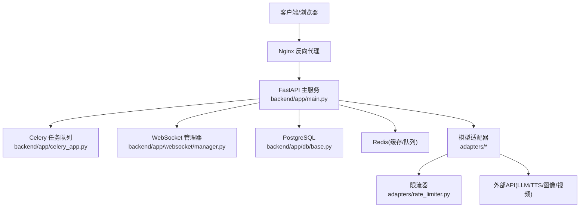
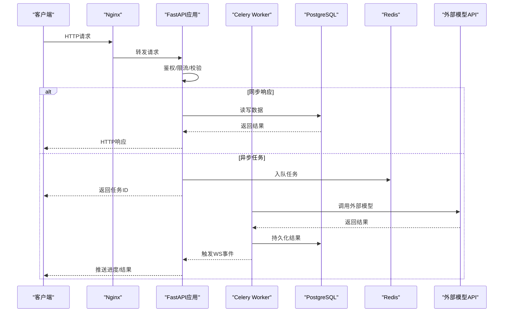
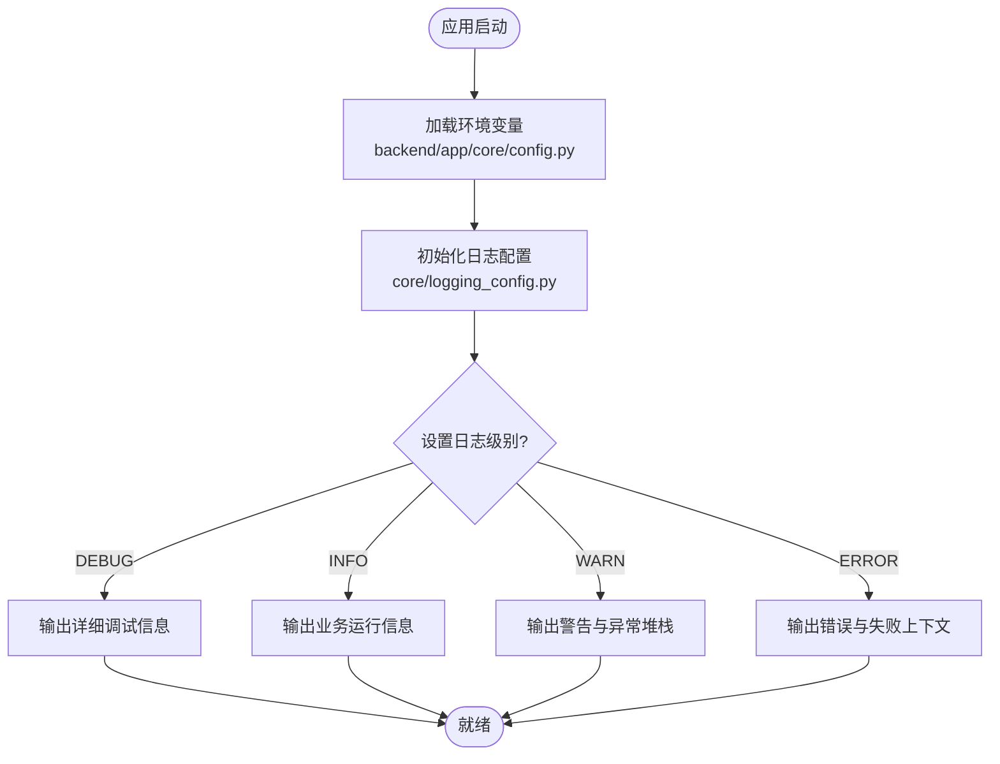
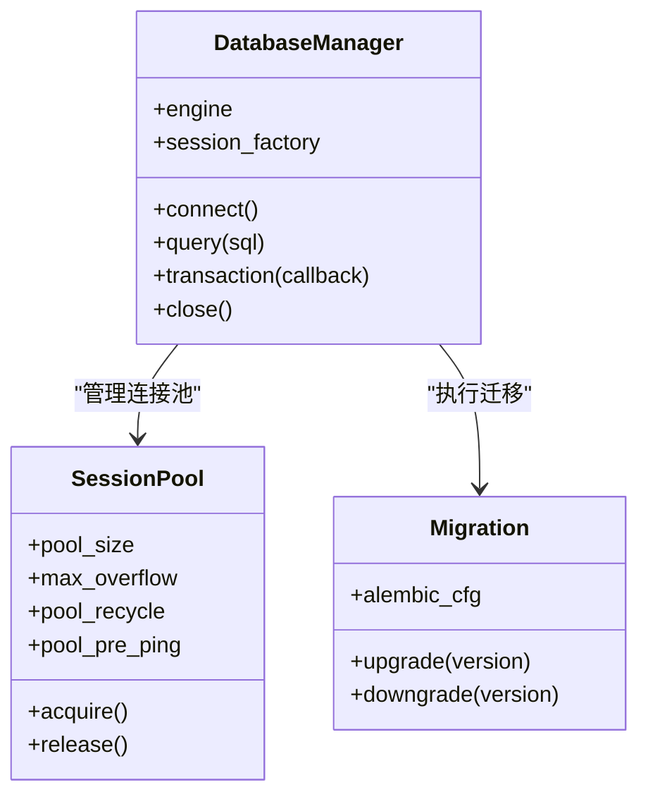
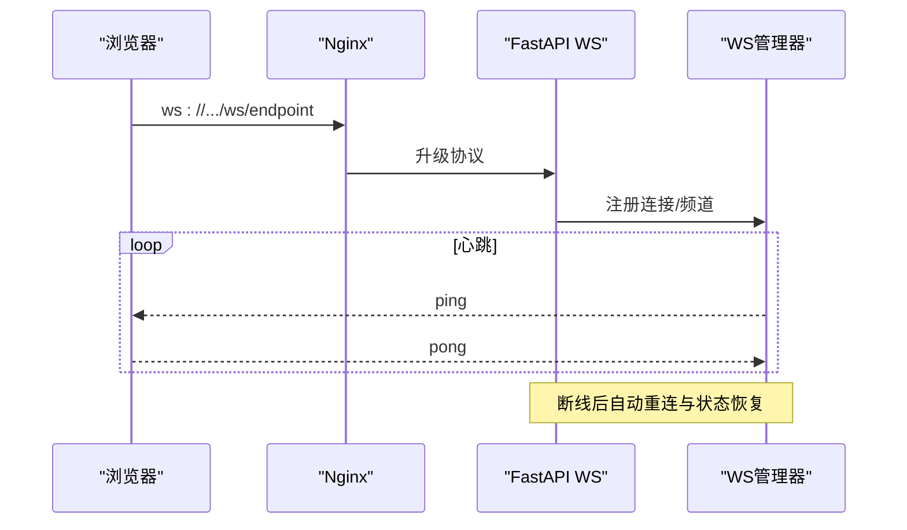
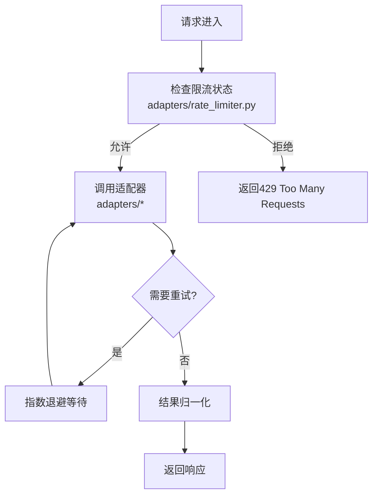
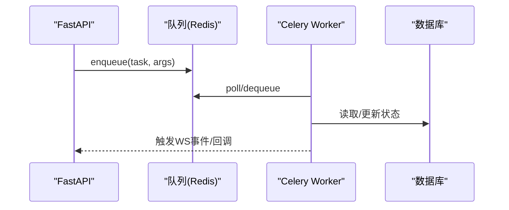
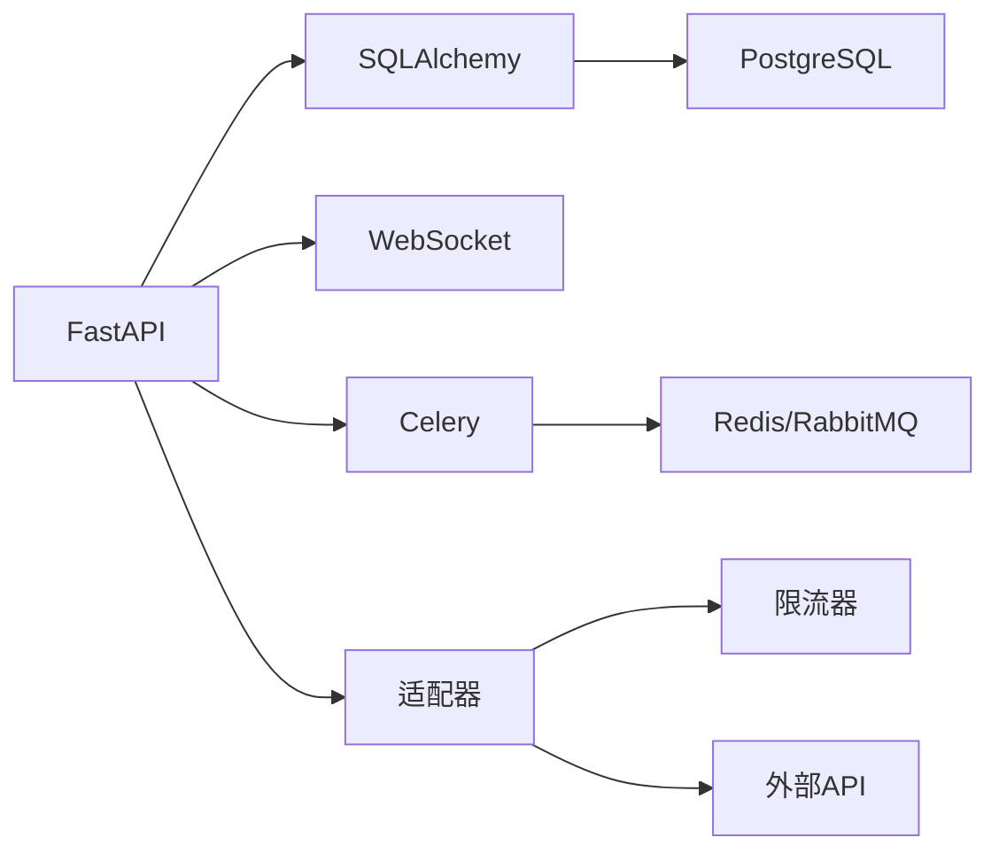

# 故障排除指南

<cite>
**本文引用的文件**   
- [backend/app/main.py](file://backend/app/main.py)
- [backend/app/celery_app.py](file://backend/app/celery_app.py)
- [core/logging_config.py](file://core/logging_config.py)
- [backend/app/core/config.py](file://backend/app/core/config.py)
- [backend/app/db/base.py](file://backend/app/db/base.py)
- [backend/app/websocket/manager.py](file://backend/app/websocket/manager.py)
- [adapters/rate_limiter.py](file://adapters/rate_limiter.py)
- [scripts/verify_seed_tts_websocket.py](file://scripts/verify_seed_tts_websocket.py)
- [docker-compose.yml](file://docker-compose.yml)
- [nginx.conf](file://nginx.conf)
- [README.md](file://README.md)
</cite>

## 目录
1. [简介](#简介)
2. [项目结构](#项目结构)
3. [核心组件](#核心组件)
4. [架构总览](#架构总览)
5. [详细组件分析](#详细组件分析)
6. [依赖关系分析](#依赖关系分析)
7. [性能注意事项](#性能注意事项)
8. [故障排除指南](#故障排除指南)
9. [结论](#结论)
10. [附录](#附录)

## 简介
本指南面向小说创作代理系统的运维与开发者，提供系统化的问题定位、日志采集与分析、性能诊断、网络与数据库问题排查、调试工具使用以及复现与提报Bug的完整流程。内容覆盖应用层（FastAPI/Celery）、消息队列与任务执行、WebSocket实时通信、外部模型适配器与限流、数据库连接池与慢查询、以及容器化部署与反向代理等关键环节。

## 项目结构
系统采用前后端分离与多模块协作：
- 后端服务：基于FastAPI的REST API与WebSocket服务，Celery异步任务处理。
- 数据层：PostgreSQL与Alembic迁移，Redis用于缓存与任务队列。
- 适配器层：多模型供应商适配（LLM、图像、视频、TTS等），统一限流与重试策略。
- 前端：React/Vite构建，通过Nginx反向代理与后端交互。
- 配置与部署：Docker Compose编排，Nginx作为入口网关。

**图表来源** 
- [backend/app/main.py](file://backend/app/main.py)
- [backend/app/celery_app.py](file://backend/app/celery_app.py)
- [backend/app/websocket/manager.py](file://backend/app/websocket/manager.py)
- [backend/app/db/base.py](file://backend/app/db/base.py)
- [adapters/rate_limiter.py](file://adapters/rate_limiter.py)

**章节来源**
- [README.md](file://README.md)

## 核心组件
- 应用启动与路由：FastAPI主入口负责HTTP路由、中间件、生命周期钩子与错误处理。
- 异步任务：Celery Worker执行耗时任务（如音频生成、视频处理、批量导入）。
- WebSocket：实时推送进度、事件与结果，支持断线重连与心跳。
- 数据库：SQLAlchemy+Alembic管理ORM与迁移，连接池参数影响并发与稳定性。
- 适配器与限流：统一封装外部模型调用，内置限流、重试与降级策略。
- 日志与配置：集中式日志配置与环境变量加载，便于调参与排障。

**章节来源**
- [backend/app/main.py](file://backend/app/main.py)
- [backend/app/celery_app.py](file://backend/app/celery_app.py)
- [backend/app/websocket/manager.py](file://backend/app/websocket/manager.py)
- [backend/app/db/base.py](file://backend/app/db/base.py)
- [adapters/rate_limiter.py](file://adapters/rate_limiter.py)
- [core/logging_config.py](file://core/logging_config.py)
- [backend/app/core/config.py](file://backend/app/core/config.py)

## 架构总览
下图展示请求从客户端到后端、再到外部服务与数据库的完整链路，并标注关键可观测点（日志、指标、追踪ID）。

**图表来源** 
- [backend/app/main.py](file://backend/app/main.py)
- [backend/app/celery_app.py](file://backend/app/celery_app.py)
- [backend/app/websocket/manager.py](file://backend/app/websocket/manager.py)
- [backend/app/db/base.py](file://backend/app/db/base.py)
- [adapters/rate_limiter.py](file://adapters/rate_limiter.py)

## 详细组件分析

### 日志与配置
- 日志框架：集中式配置，支持按模块分级输出、JSON结构化日志、滚动文件与stdout输出。
- 环境变量：通过配置模块加载数据库、Redis、外部API密钥、限流阈值、日志级别等。
- 建议：生产环境开启INFO及以上级别，关键路径开启DEBUG；为每个请求注入trace_id以便跨服务追踪。

**图表来源** 
- [core/logging_config.py](file://core/logging_config.py)
- [backend/app/core/config.py](file://backend/app/core/config.py)

**章节来源**
- [core/logging_config.py](file://core/logging_config.py)
- [backend/app/core/config.py](file://backend/app/core/config.py)

### 数据库与连接池
- ORM与迁移：SQLAlchemy + Alembic，迁移脚本位于alembic版本目录。
- 连接池：通过引擎参数控制pool_size、max_overflow、pool_recycle、pool_pre_ping等，避免连接耗尽与僵尸连接。
- 慢查询：启用慢查询日志与EXPLAIN分析，结合索引优化与分页限制。
- 死锁检测：监控事务等待图与锁冲突，必要时缩短事务范围或引入重试退避。

**图表来源** 
- [backend/app/db/base.py](file://backend/app/db/base.py)

**章节来源**
- [backend/app/db/base.py](file://backend/app/db/base.py)

### WebSocket实时通信
- 连接管理：维护会话、心跳、断线重连与广播机制。
- 常见问题：握手失败、频繁断开、消息丢失、内存泄漏。
- 排查要点：检查Nginx超时与缓冲、服务端心跳间隔、订阅频道是否正确、消息序列化大小。

**图表来源** 
- [backend/app/websocket/manager.py](file://backend/app/websocket/manager.py)
- [nginx.conf](file://nginx.conf)

**章节来源**
- [backend/app/websocket/manager.py](file://backend/app/websocket/manager.py)
- [nginx.conf](file://nginx.conf)

### 适配器与限流
- 适配器：统一封装各模型供应商接口，处理认证、重试、降级与结果归一化。
- 限流：令牌桶/滑动窗口实现，防止突发流量导致下游限频或熔断。
- 重试与退避：指数退避与最大重试次数，避免雪崩效应。

**图表来源** 
- [adapters/rate_limiter.py](file://adapters/rate_limiter.py)

**章节来源**
- [adapters/rate_limiter.py](file://adapters/rate_limiter.py)

### Celery任务执行
- 任务调度：通过Redis/RabbitMQ分发任务，Worker消费执行。
- 常见故障：Worker未启动、队列堆积、任务失败无重试、资源不足。
- 监控：查看任务状态、执行时长、失败堆栈与重试计数。

**图表来源** 
- [backend/app/celery_app.py](file://backend/app/celery_app.py)

**章节来源**
- [backend/app/celery_app.py](file://backend/app/celery_app.py)

## 依赖关系分析
- 外部依赖：PostgreSQL、Redis、Nginx、各类模型API（LLM/TTS/图像/视频）。
- 内部依赖：FastAPI路由→服务层→ORM→数据库；WebSocket管理器→连接与会话；适配器→限流与重试。
- 风险点：外部API不稳定、连接池耗尽、队列阻塞、Nginx超时。

**图表来源** 
- [backend/app/main.py](file://backend/app/main.py)
- [backend/app/db/base.py](file://backend/app/db/base.py)
- [backend/app/celery_app.py](file://backend/app/celery_app.py)
- [adapters/rate_limiter.py](file://adapters/rate_limiter.py)

**章节来源**
- [docker-compose.yml](file://docker-compose.yml)

## 性能注意事项
- CPU瓶颈：识别热点函数与循环，减少重复计算，启用并行与缓存。
- 内存泄漏：监控进程RSS与GC行为，避免大对象常驻内存，及时释放文件句柄。
- I/O瓶颈：优化磁盘读写（批量写入、异步I/O）、网络请求（连接复用、超时与重试）。
- 数据库优化：索引设计、查询计划分析、分页与投影字段最小化。
- 队列与任务：合理拆分任务粒度，避免长事务与阻塞操作。

[本节为通用指导，不直接分析具体文件]

## 故障排除指南

### 常见问题清单与解决方案
- 症状：页面加载缓慢或接口超时
  - 可能原因：Nginx超时配置过低、上游服务响应慢、数据库慢查询、外部API限频。
  - 解决步骤：检查Nginx日志与上游响应时间；启用慢查询日志；调整超时与重试；对热点查询加索引。
- 症状：WebSocket频繁断开
  - 可能原因：心跳间隔过长、Nginx代理超时、服务端内存不足。
  - 解决步骤：调优心跳间隔与超时；检查WS管理器连接数与内存占用；增加Worker与连接池上限。
- 症状：任务堆积无法完成
  - 可能原因：Worker数量不足、任务失败未重试、外部API不可用。
  - 解决步骤：扩容Worker；检查任务失败日志与重试策略；临时切换备用适配器或降级策略。
- 症状：数据库连接耗尽
  - 可能原因：连接池过小、长事务未提交、连接泄露。
  - 解决步骤：增大pool_size与max_overflow；缩短事务范围；启用pool_pre_ping；排查未关闭的连接。
- 症状：外部模型调用失败
  - 可能原因：密钥错误、配额耗尽、网络抖动、限流。
  - 解决步骤：验证密钥与配额；启用重试与指数退避；检查限流器阈值；记录失败详情与Trace ID。

**章节来源**
- [nginx.conf](file://nginx.conf)
- [backend/app/websocket/manager.py](file://backend/app/websocket/manager.py)
- [backend/app/celery_app.py](file://backend/app/celery_app.py)
- [backend/app/db/base.py](file://backend/app/db/base.py)
- [adapters/rate_limiter.py](file://adapters/rate_limiter.py)

### 日志收集与解读
- 应用日志：
  - 位置：stdout与滚动文件；按模块分级输出；包含trace_id与请求上下文。
  - 解读：关注ERROR/WARN级别；定位异常堆栈与失败原因；关联trace_id跨服务追踪。
- 数据库日志：
  - 位置：PostgreSQL慢查询日志与审计日志；Alembic迁移日志。
  - 解读：分析慢查询SQL与执行计划；检查锁等待与死锁；确认迁移是否成功。
- 系统日志：
  - 位置：容器日志、Nginx访问与错误日志、内核与系统资源日志。
  - 解读：观察CPU/内存/磁盘IO峰值；定位OOM与端口占用；检查SSL证书与权限。

**章节来源**
- [core/logging_config.py](file://core/logging_config.py)
- [backend/app/core/config.py](file://backend/app/core/config.py)

### 性能问题诊断方法
- CPU：使用性能分析器（如cProfile）定位热点；减少Python解释器开销；利用多线程/多进程。
- 内存：使用内存分析器（如memory_profiler）检测泄漏；避免全局大对象；及时释放资源。
- I/O：监控磁盘与网络I/O；启用异步I/O与连接池；压缩传输与缓存热点数据。
- 数据库：启用EXPLAIN ANALYZE；优化索引与查询；分库分表与读写分离。

[本节为通用指导，不直接分析具体文件]

### 网络问题排查步骤
- 连接超时：检查DNS解析、防火墙与负载均衡；调整超时与重试策略。
- API调用失败：验证签名与密钥；检查速率限制与配额；记录请求体与响应头。
- WebSocket断开：确认心跳与保活；检查代理超时与缓冲区；重连策略与状态同步。

**章节来源**
- [nginx.conf](file://nginx.conf)
- [backend/app/websocket/manager.py](file://backend/app/websocket/manager.py)
- [adapters/rate_limiter.py](file://adapters/rate_limiter.py)

### 数据库问题诊断
- 连接池耗尽：监控活跃连接与等待队列；增大池大小与回收周期；修复连接泄露。
- 慢查询优化：分析执行计划；添加合适索引；重写复杂查询；使用物化视图。
- 死锁检测：监控锁等待图；缩短事务；引入重试与退避；避免不一致的锁顺序。

**章节来源**
- [backend/app/db/base.py](file://backend/app/db/base.py)

### 调试工具使用指南
- 日志级别调整：通过环境变量动态调整；生产环境谨慎开启DEBUG。
- 性能分析器：使用cProfile/memory_profiler定位热点与泄漏；结合APM工具。
- 内存分析器：采样堆快照；分析对象引用链；清理无用缓存。
- 网络抓包：使用tcpdump/wireshark捕获报文；分析握手与重传。

**章节来源**
- [core/logging_config.py](file://core/logging_config.py)
- [backend/app/core/config.py](file://backend/app/core/config.py)

### 问题复现与Bug报告
- 复现步骤：
  - 明确环境与版本（Docker镜像、依赖版本、配置差异）。
  - 提供最小可复现代码或请求样例（含Headers与Body）。
  - 附上相关日志片段（应用、数据库、系统）与Trace ID。
- 有效Bug报告要素：
  - 问题描述与预期行为；实际行为与影响范围。
  - 复现频率与触发条件；已尝试的解决措施。
  - 性能指标与截图/录屏（如有）。

[本节为通用指导，不直接分析具体文件]

## 结论
通过系统化的日志采集、性能分析与网络/数据库诊断，能够快速定位并解决小说创作代理系统中的常见问题。建议在生产环境建立完善的监控与告警体系，持续优化连接池、限流与重试策略，确保系统稳定与高可用。

[本节为总结性内容，不直接分析具体文件]

## 附录
- 常用命令与脚本：
  - 验证WebSocket连通性：参考脚本路径 [scripts/verify_seed_tts_websocket.py](file://scripts/verify_seed_tts_websocket.py)。
  - 容器编排与服务启停：参考 [docker-compose.yml](file://docker-compose.yml)。
  - 反向代理配置：参考 [nginx.conf](file://nginx.conf)。

**章节来源**
- [scripts/verify_seed_tts_websocket.py](file://scripts/verify_seed_tts_websocket.py)
- [docker-compose.yml](file://docker-compose.yml)
- [nginx.conf](file://nginx.conf)