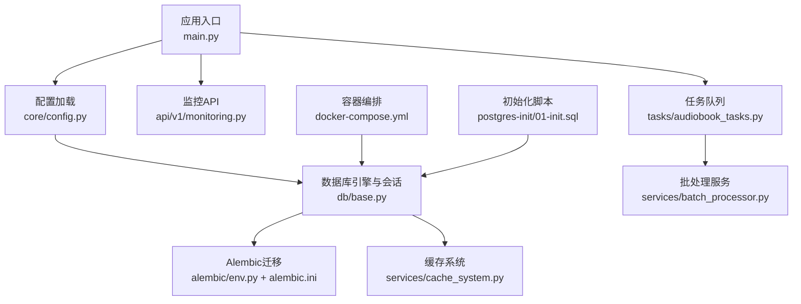
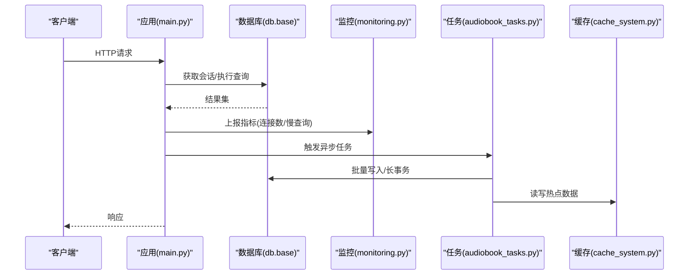
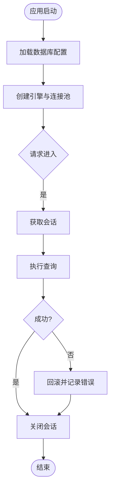
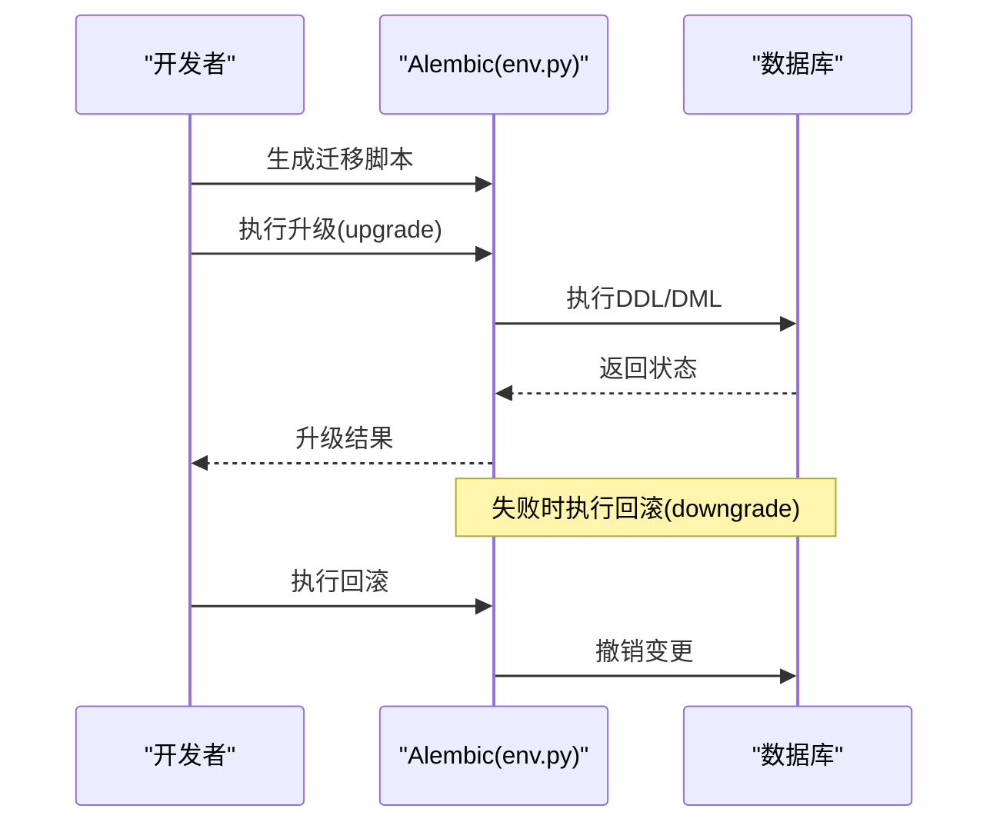
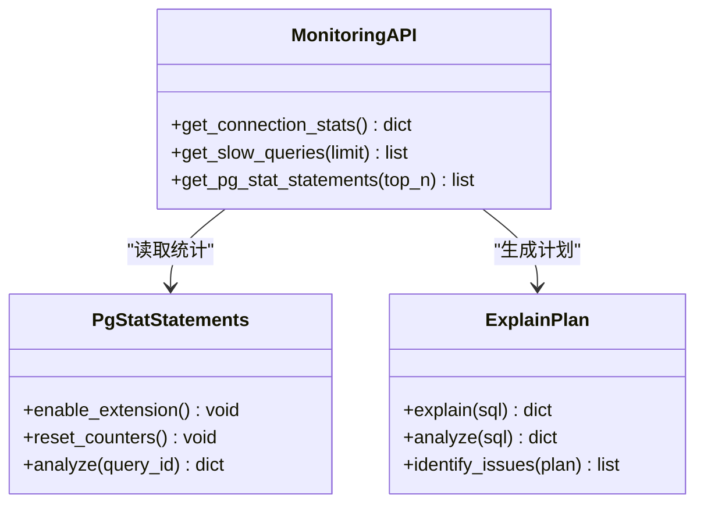
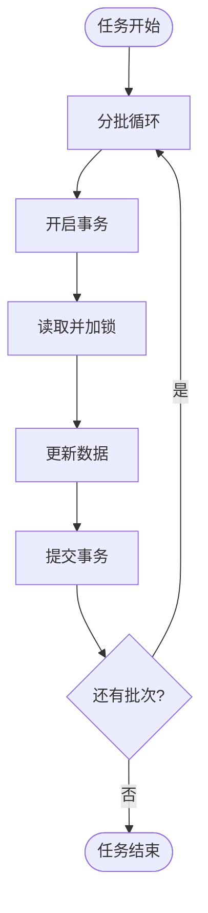
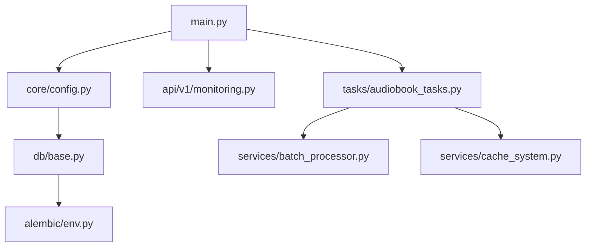

# 数据库问题诊断

<cite>
**本文引用的文件**
- [backend/app/db/base.py](file://backend/app/db/base.py)
- [backend/alembic/env.py](file://backend/alembic/env.py)
- [backend/alembic.ini](file://backend/alembic.ini)
- [postgres-init/01-init.sql](file://postgres-init/01-init.sql)
- [docker-compose.yml](file://docker-compose.yml)
- [backend/app/core/config.py](file://backend/app/core/config.py)
- [backend/app/main.py](file://backend/app/main.py)
- [backend/app/api/v1/monitoring.py](file://backend/app/api/v1/monitoring.py)
- [backend/app/services/cache_system.py](file://backend/app/services/cache_system.py)
- [backend/app/tasks/audiobook_tasks.py](file://backend/app/tasks/audiobook_tasks.py)
- [backend/app/services/batch_processor.py](file://backend/app/services/batch_processor.py)
- [backend/app/utils/sql_validator.py](file://backend/app/utils/sql_validator.py)
- [backend/tests/test_audiobook_query_counts.py](file://backend/tests/test_audiobook_query_counts.py)
- [backend/tests/test_generation_lock.py](file://backend/tests/test_generation_lock.py)
- [docs/POSTGRESQL_DEPLOYMENT.md](file://docs/POSTGRESQL_DEPLOYMENT.md)
</cite>

## 目录
1. [简介](#简介)
2. [项目结构](#项目结构)
3. [核心组件](#核心组件)
4. [架构总览](#架构总览)
5. [详细组件分析](#详细组件分析)
6. [依赖关系分析](#依赖关系分析)
7. [性能考量](#性能考量)
8. [故障排查指南](#故障排查指南)
9. [结论](#结论)
10. [附录](#附录)

## 简介
本指南面向PostgreSQL数据库在小说创作代理系统中的常见问题与解决方案，覆盖连接池耗尽、慢查询优化、索引失效、死锁检测、数据一致性、Alembic迁移失败回滚与修复、备份恢复、主从复制故障处理以及存储空间管理。文档结合仓库中的数据库配置、模型定义、迁移脚本、监控接口与任务系统，提供可操作的诊断流程与最佳实践。

## 项目结构
本项目在后端模块中集中管理数据库相关能力：
- 数据库连接与引擎初始化位于后端应用启动流程中，通过配置文件加载连接参数。
- Alembic用于版本化迁移，包含大量版本脚本以演进表结构与索引。
- 监控API暴露数据库运行态指标，便于定位连接池与慢查询问题。
- 任务系统与批处理器负责长事务与批量写入，需关注事务边界与锁竞争。
- 测试用例覆盖查询计数与并发锁场景，有助于复现与验证问题。

**图表来源**
- [backend/app/main.py](file://backend/app/main.py)
- [backend/app/core/config.py](file://backend/app/core/config.py)
- [backend/app/db/base.py](file://backend/app/db/base.py)
- [backend/alembic/env.py](file://backend/alembic/env.py)
- [backend/alembic.ini](file://backend/alembic.ini)
- [backend/app/api/v1/monitoring.py](file://backend/app/api/v1/monitoring.py)
- [backend/app/tasks/audiobook_tasks.py](file://backend/app/tasks/audiobook_tasks.py)
- [backend/app/services/batch_processor.py](file://backend/app/services/batch_processor.py)
- [backend/app/services/cache_system.py](file://backend/app/services/cache_system.py)
- [docker-compose.yml](file://docker-compose.yml)
- [postgres-init/01-init.sql](file://postgres-init/01-init.sql)

**章节来源**
- [backend/app/main.py](file://backend/app/main.py)
- [backend/app/core/config.py](file://backend/app/core/config.py)
- [backend/app/db/base.py](file://backend/app/db/base.py)
- [backend/alembic/env.py](file://backend/alembic/env.py)
- [backend/alembic.ini](file://backend/alembic.ini)
- [docker-compose.yml](file://docker-compose.yml)
- [postgres-init/01-init.sql](file://postgres-init/01-init.sql)

## 核心组件
- 数据库连接与会话管理：负责引擎创建、连接池参数、会话生命周期与事务边界控制。
- Alembic迁移：版本化DDL变更，支持增量升级与回滚，维护迁移历史与依赖关系。
- 监控与可观测性：暴露数据库连接数、活跃会话、慢查询统计等关键指标。
- 任务与批处理：长事务、批量写入与重试策略，影响锁竞争与连接占用。
- 缓存系统：减少热点读压力，降低数据库负载。

**章节来源**
- [backend/app/db/base.py](file://backend/app/db/base.py)
- [backend/alembic/env.py](file://backend/alembic/env.py)
- [backend/alembic.ini](file://backend/alembic.ini)
- [backend/app/api/v1/monitoring.py](file://backend/app/api/v1/monitoring.py)
- [backend/app/tasks/audiobook_tasks.py](file://backend/app/tasks/audiobook_tasks.py)
- [backend/app/services/batch_processor.py](file://backend/app/services/batch_processor.py)
- [backend/app/services/cache_system.py](file://backend/app/services/cache_system.py)

## 架构总览
下图展示应用层到数据库层的调用路径与关键子系统交互，包括连接池、迁移、监控、任务与缓存。

**图表来源**
- [backend/app/main.py](file://backend/app/main.py)
- [backend/app/db/base.py](file://backend/app/db/base.py)
- [backend/app/api/v1/monitoring.py](file://backend/app/api/v1/monitoring.py)
- [backend/app/tasks/audiobook_tasks.py](file://backend/app/tasks/audiobook_tasks.py)
- [backend/app/services/cache_system.py](file://backend/app/services/cache_system.py)

## 详细组件分析

### 连接池与会话管理
- 连接池参数（最小/最大连接数、超时、回收策略）直接影响高并发下的连接占用与耗尽风险。
- 会话生命周期需严格遵循“短事务”原则，避免长事务持有锁与连接。
- 建议对热点查询引入缓存，降低数据库压力。

**图表来源**
- [backend/app/db/base.py](file://backend/app/db/base.py)
- [backend/app/core/config.py](file://backend/app/core/config.py)

**章节来源**
- [backend/app/db/base.py](file://backend/app/db/base.py)
- [backend/app/core/config.py](file://backend/app/core/config.py)

### Alembic迁移与回滚策略
- 使用Alembic进行版本化DDL变更，确保迁移脚本幂等与可回滚。
- 迁移失败时优先回滚至上一稳定版本，再逐步修复脚本。
- 数据修复脚本应独立于迁移，避免破坏迁移历史。

**图表来源**
- [backend/alembic/env.py](file://backend/alembic/env.py)
- [backend/alembic.ini](file://backend/alembic.ini)

**章节来源**
- [backend/alembic/env.py](file://backend/alembic/env.py)
- [backend/alembic.ini](file://backend/alembic.ini)

### 监控与慢查询分析
- 通过监控API获取连接数、活跃会话、慢查询统计等指标。
- 启用pg_stat_statements扩展，按query_id聚合耗时与调用次数，定位Top N慢查询。
- 结合EXPLAIN/EXPLAIN ANALYZE分析执行计划，识别全表扫描、低效连接与排序。

**图表来源**
- [backend/app/api/v1/monitoring.py](file://backend/app/api/v1/monitoring.py)

**章节来源**
- [backend/app/api/v1/monitoring.py](file://backend/app/api/v1/monitoring.py)

### 任务与批处理的锁与事务
- 长事务与批量写入易引发锁竞争与死锁，需拆分批次、缩短事务、合理加锁顺序。
- 使用唯一约束或乐观锁避免重复写入；对热点行加行级锁时需评估冲突概率。
- 任务重试需幂等，避免重复提交导致数据不一致。

**图表来源**
- [backend/app/tasks/audiobook_tasks.py](file://backend/app/tasks/audiobook_tasks.py)
- [backend/app/services/batch_processor.py](file://backend/app/services/batch_processor.py)

**章节来源**
- [backend/app/tasks/audiobook_tasks.py](file://backend/app/tasks/audiobook_tasks.py)
- [backend/app/services/batch_processor.py](file://backend/app/services/batch_processor.py)

### 缓存系统
- 缓存热点数据可降低数据库读压力，缓解连接池耗尽。
- 缓存失效策略需与数据一致性权衡，必要时采用双写或延迟双删。
- 缓存穿透与雪崩防护：设置空值缓存、随机过期时间、限流降级。

**章节来源**
- [backend/app/services/cache_system.py](file://backend/app/services/cache_system.py)

## 依赖关系分析
- 应用入口依赖配置模块加载数据库连接参数。
- 数据库模块依赖Alembic进行DDL演进。
- 监控API依赖数据库视图与扩展统计信息。
- 任务系统依赖批处理与缓存，间接影响数据库负载。

**图表来源**
- [backend/app/main.py](file://backend/app/main.py)
- [backend/app/core/config.py](file://backend/app/core/config.py)
- [backend/app/db/base.py](file://backend/app/db/base.py)
- [backend/alembic/env.py](file://backend/alembic/env.py)
- [backend/app/api/v1/monitoring.py](file://backend/app/api/v1/monitoring.py)
- [backend/app/tasks/audiobook_tasks.py](file://backend/app/tasks/audiobook_tasks.py)
- [backend/app/services/batch_processor.py](file://backend/app/services/batch_processor.py)
- [backend/app/services/cache_system.py](file://backend/app/services/cache_system.py)

**章节来源**
- [backend/app/main.py](file://backend/app/main.py)
- [backend/app/core/config.py](file://backend/app/core/config.py)
- [backend/app/db/base.py](file://backend/app/db/base.py)
- [backend/alembic/env.py](file://backend/alembic/env.py)
- [backend/app/api/v1/monitoring.py](file://backend/app/api/v1/monitoring.py)
- [backend/app/tasks/audiobook_tasks.py](file://backend/app/tasks/audiobook_tasks.py)
- [backend/app/services/batch_processor.py](file://backend/app/services/batch_processor.py)
- [backend/app/services/cache_system.py](file://backend/app/services/cache_system.py)

## 性能考量
- 连接池调优：根据并发量与查询耗时调整最大连接数与超时，避免耗尽与频繁重建。
- 慢查询治理：基于pg_stat_statements筛选Top N，结合EXPLAIN优化SQL与索引。
- 索引设计：覆盖高频查询条件，避免过度索引导致写入放大。
- 事务与锁：缩短事务、减少锁粒度，避免死锁与长事务阻塞。
- 缓存与分片：热点数据缓存，大表分库分表或归档冷数据。

[本节为通用指导，不直接分析具体文件]

## 故障排查指南

### PostgreSQL连接池耗尽
- 现象：应用报连接数不足、请求超时、任务堆积。
- 排查步骤：
  - 检查连接池配置与当前活跃连接数。
  - 查看慢查询与长事务，定位未释放的会话。
  - 分析任务是否持有长事务或未正确关闭会话。
  - 临时扩容连接池上限，观察是否缓解。
- 解决建议：
  - 优化SQL与索引，减少单次查询耗时。
  - 拆分长事务为多个短事务。
  - 引入缓存降低读压力。
  - 增加连接池上限与超时阈值，配合告警。

**章节来源**
- [backend/app/db/base.py](file://backend/app/db/base.py)
- [backend/app/core/config.py](file://backend/app/core/config.py)
- [backend/app/api/v1/monitoring.py](file://backend/app/api/v1/monitoring.py)

### 慢查询优化与EXPLAIN解读
- 启用pg_stat_statements，收集Top N慢查询。
- 对目标SQL执行EXPLAIN/EXPLAIN ANALYZE，关注：
  - 全表扫描、嵌套循环、低效排序与哈希。
  - 索引未命中或选择性差。
- 优化手段：
  - 添加合适索引，避免函数包裹列导致索引失效。
  - 重写SQL，减少JOIN与子查询复杂度。
  - 分页与限制返回行数，避免大结果集。

**章节来源**
- [backend/app/api/v1/monitoring.py](file://backend/app/api/v1/monitoring.py)
- [backend/app/utils/sql_validator.py](file://backend/app/utils/sql_validator.py)

### 索引失效与表结构优化
- 常见失效原因：函数包裹列、类型转换、隐式转换、LIKE前缀通配符。
- 表结构优化：
  - 拆分宽表，分离冷热字段。
  - 使用JSONB存储灵活字段，建立GIN索引。
  - 分区表按时间或范围划分，提升查询与维护效率。

**章节来源**
- [backend/app/utils/sql_validator.py](file://backend/app/utils/sql_validator.py)

### 死锁检测与预防
- 检测：查询pg_locks与pg_stat_activity，识别等待链与冲突锁。
- 预防：
  - 统一加锁顺序，避免交叉锁。
  - 缩短事务，减少锁持有时间。
  - 使用行级锁与唯一约束避免重复写入。
  - 任务幂等与重试退避。

**章节来源**
- [backend/app/tasks/audiobook_tasks.py](file://backend/app/tasks/audiobook_tasks.py)
- [backend/tests/test_generation_lock.py](file://backend/tests/test_generation_lock.py)

### 数据一致性与校验
- 使用唯一约束与外键保证引用完整性。
- 对关键业务字段添加CHECK约束，防止非法值。
- 定期数据校验脚本比对源系统与副本一致性。

**章节来源**
- [backend/tests/test_audiobook_query_counts.py](file://backend/tests/test_audiobook_query_counts.py)

### Alembic迁移失败与回滚
- 失败处理：
  - 立即回滚至上一版本，恢复服务可用性。
  - 分析迁移脚本错误，修正后重新执行。
- 数据修复：
  - 编写独立修复脚本，避免污染迁移历史。
  - 在低峰期执行，分批处理，监控进度。

**章节来源**
- [backend/alembic/env.py](file://backend/alembic/env.py)
- [backend/alembic.ini](file://backend/alembic.ini)

### 备份恢复与主从复制故障
- 备份：
  - 逻辑备份：pg_dump导出结构与数据。
  - 物理备份：WAL归档与时间点恢复(PITR)。
- 恢复：
  - 先恢复结构，再导入数据，校验一致性。
  - 主从切换：提升从库为主库，更新应用连接。
- 故障处理：
  - 检查复制槽与WAL发送进程。
  - 同步延迟监控与告警。

**章节来源**
- [docker-compose.yml](file://docker-compose.yml)
- [postgres-init/01-init.sql](file://postgres-init/01-init.sql)
- [docs/POSTGRESQL_DEPLOYMENT.md](file://docs/POSTGRESQL_DEPLOYMENT.md)

### 存储空间管理
- 监控表空间与VACUUM状态，清理膨胀元组。
- 归档日志与旧数据，释放磁盘空间。
- 分区表与冷热分离，降低单表体积。

**章节来源**
- [docs/POSTGRESQL_DEPLOYMENT.md](file://docs/POSTGRESQL_DEPLOYMENT.md)

## 结论
通过系统化监控、迁移管理与性能优化，可有效应对PostgreSQL在高并发与复杂业务场景下的连接池、慢查询、索引、锁与一致性等问题。结合Alembic的版本化管理与备份恢复策略，保障系统的稳定性与可恢复性。建议持续完善监控告警与自动化运维脚本，提升故障定位与处理能力。

[本节为总结性内容，不直接分析具体文件]

## 附录
- pg_stat_statements启用与查询示例请参考监控API与数据库扩展文档。
- EXPLAIN输出关键字段说明参见PostgreSQL官方手册。
- Alembic常用命令与回滚策略参考迁移配置文件与环境脚本。

[本节为补充说明，不直接分析具体文件]