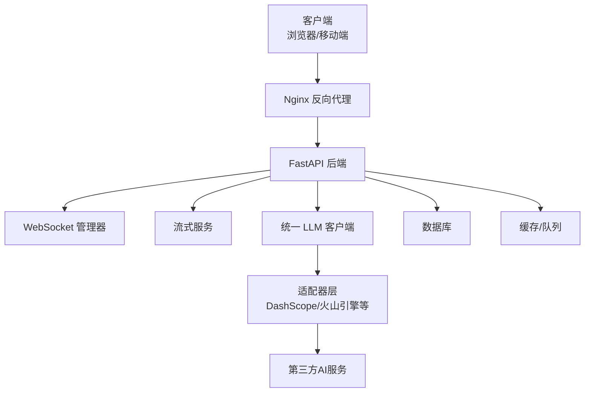
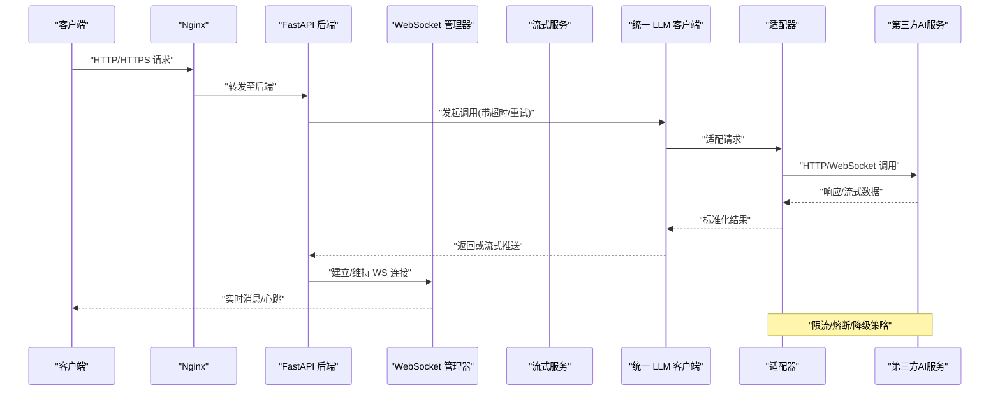
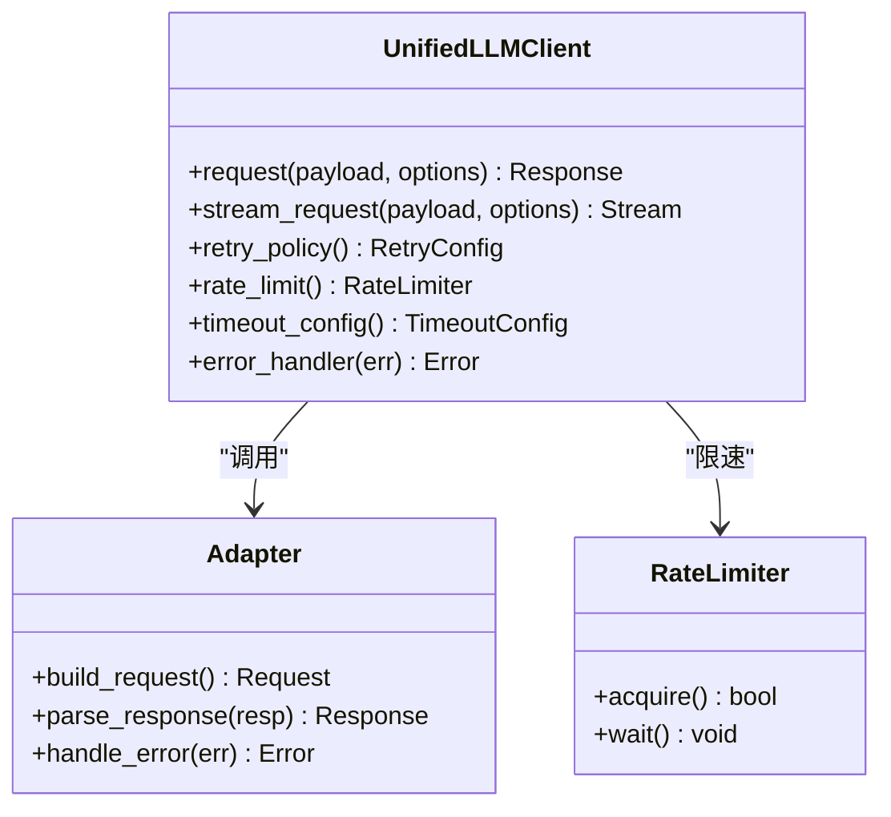
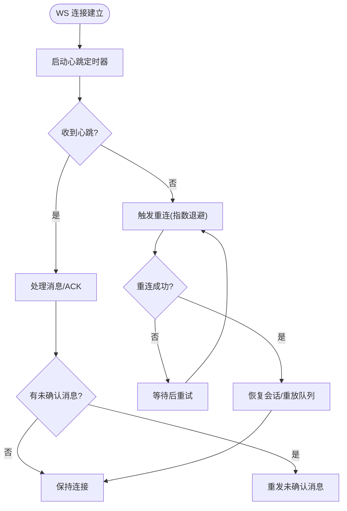
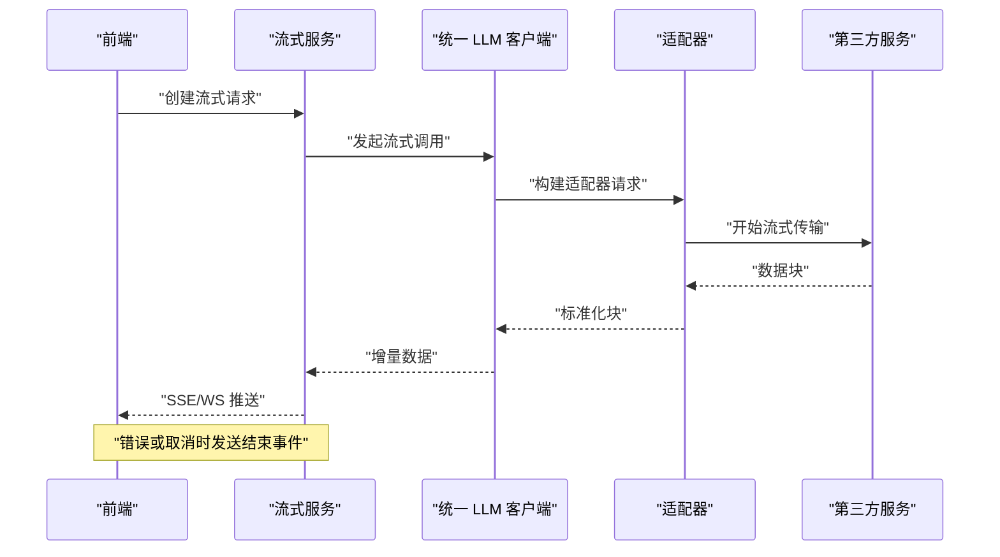
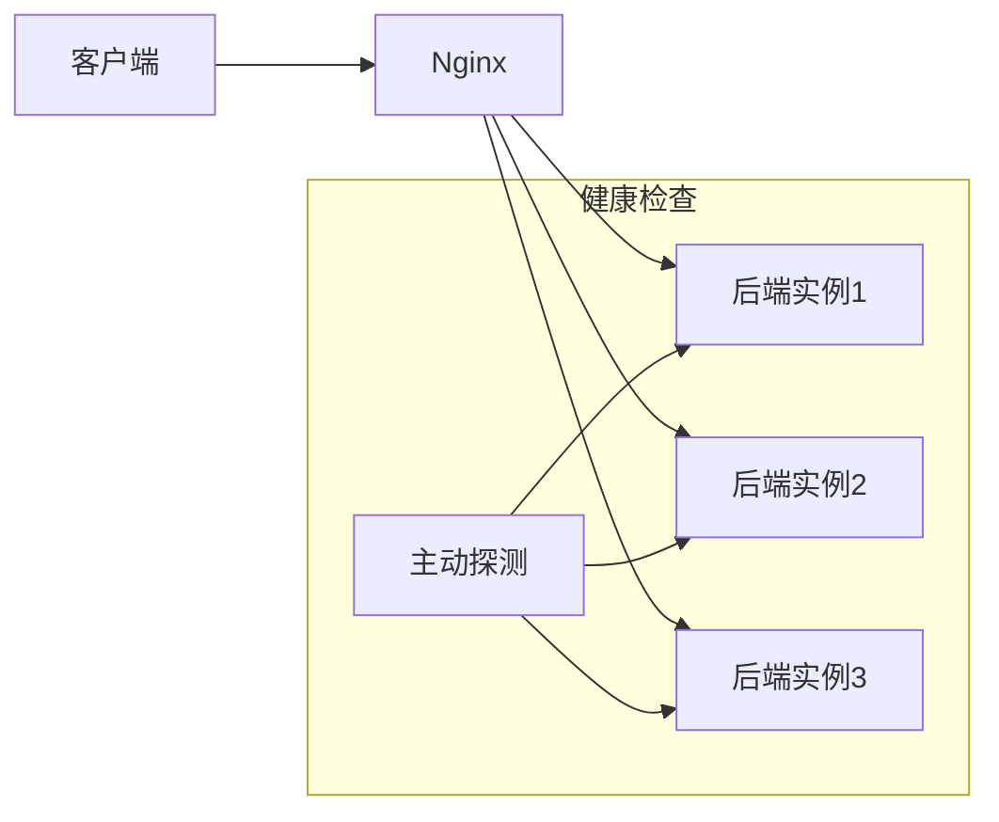
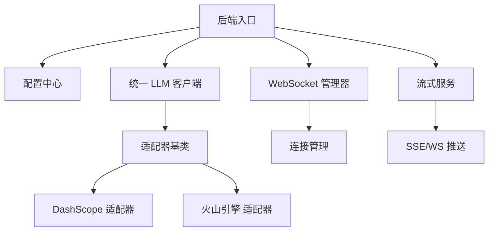
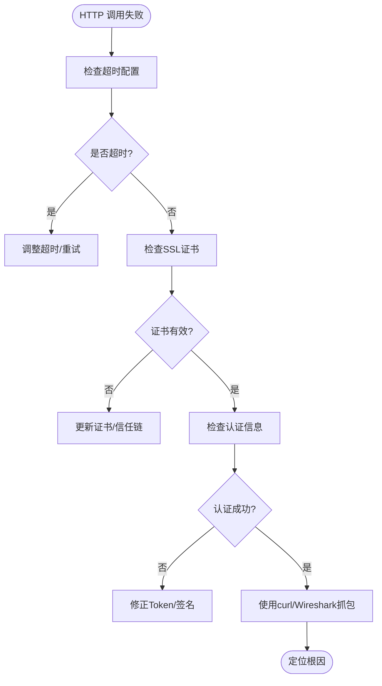
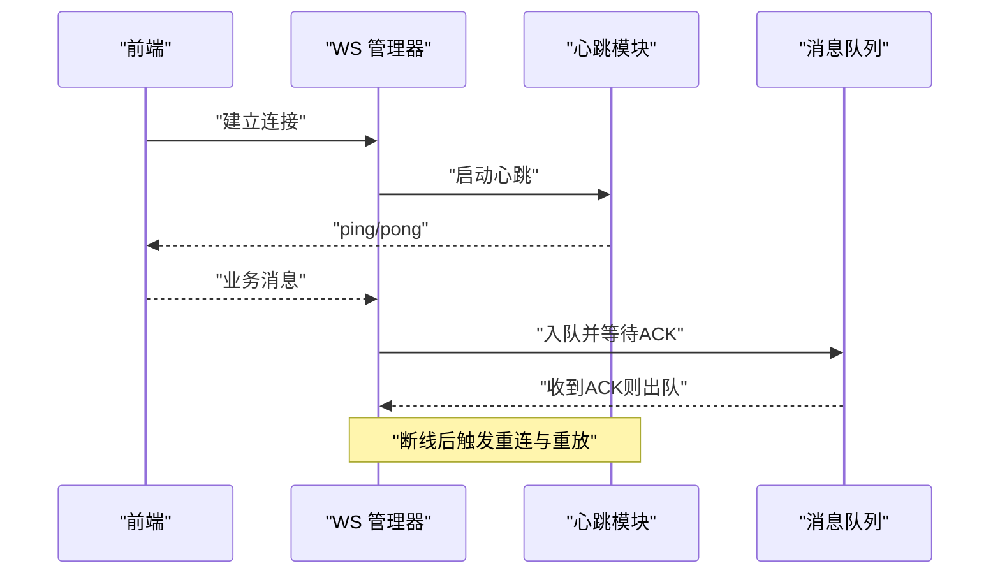
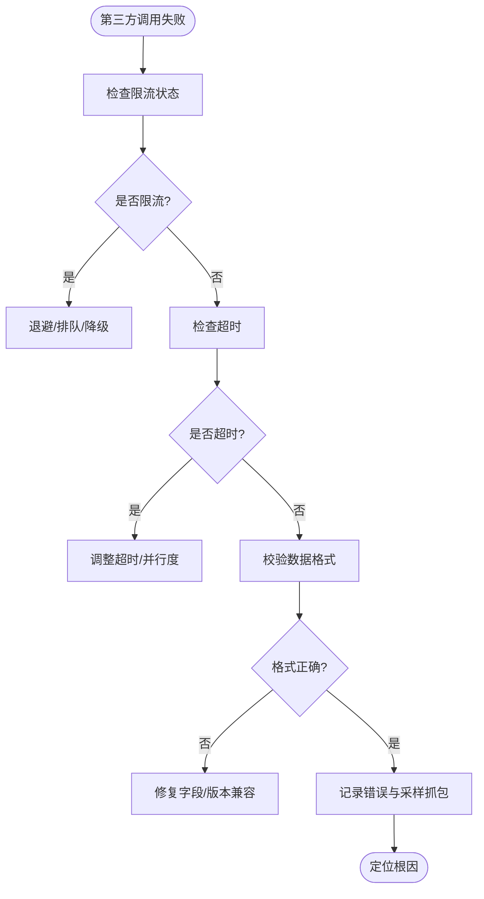

# 网络问题排查

<cite>
**本文引用的文件**   
- [backend/app/main.py](file://backend/app/main.py)
- [backend/app/core/config.py](file://backend/app/core/config.py)
- [adapters/base.py](file://adapters/base.py)
- [adapters/rate_limiter.py](file://adapters/rate_limiter.py)
- [core/unified_llm_client.py](file://core/unified_llm_client.py)
- [core/model_runtime.py](file://core/model_runtime.py)
- [backend/app/services/streaming_service.py](file://backend/app/services/streaming_service.py)
- [backend/app/websocket/manager.py](file://backend/app/websocket/manager.py)
- [scripts/verify_seed_tts_websocket.py](file://scripts/verify_seed_tts_websocket.py)
- [nginx.conf](file://nginx.conf)
- [nginx-prod.conf](file://nginx-prod.conf)
- [docker-compose.yml](file://docker-compose.yml)
- [ssl/README.md](file://ssl/README.md)
- [SSL_CERTIFICATE_GUIDE.md](file://SSL_CERTIFICATE_GUIDE.md)
- [SEED_TTS_WEBSOCKET_IMPLEMENTATION.md](file://SEED_TTS_WEBSOCKET_IMPLEMENTATION.md)
</cite>

## 目录
1. [简介](#简介)
2. [项目结构](#项目结构)
3. [核心组件](#核心组件)
4. [架构总览](#架构总览)
5. [详细组件分析](#详细组件分析)
6. [依赖关系分析](#依赖关系分析)
7. [性能考量](#性能考量)
8. [故障排查指南](#故障排查指南)
9. [结论](#结论)
10. [附录](#附录)

## 简介
本指南面向网络相关问题的系统化排查与优化，覆盖以下典型场景：
- HTTP API 调用失败（连接超时、SSL 证书问题、认证失败）
- WebSocket 连接断开（心跳检测、重连机制、消息丢失）
- 第三方 AI 服务集成问题（API 限流、响应超时、数据格式不匹配）
同时提供网络抓包与调试工具使用建议（curl、Wireshark、浏览器开发者工具），并给出代理配置、负载均衡、故障转移的排查方法，以及网络延迟优化与连接池调优建议。

## 项目结构
本项目采用前后端分离与多适配器架构：
- 后端 FastAPI 应用入口与路由位于 backend/app
- 模型与第三方服务通过 adapters 层统一封装
- 统一的 LLM 客户端与运行时管理位于 core 层
- WebSocket 管理与流式服务位于 backend/app/websocket 与 services
- Nginx 作为反向代理与负载均衡器
- Docker Compose 编排服务与依赖

**图示来源**
- [backend/app/main.py](file://backend/app/main.py)
- [backend/app/websocket/manager.py](file://backend/app/websocket/manager.py)
- [backend/app/services/streaming_service.py](file://backend/app/services/streaming_service.py)
- [core/unified_llm_client.py](file://core/unified_llm_client.py)
- [adapters/base.py](file://adapters/base.py)
- [nginx.conf](file://nginx.conf)

**章节来源**
- [backend/app/main.py](file://backend/app/main.py)
- [nginx.conf](file://nginx.conf)
- [docker-compose.yml](file://docker-compose.yml)

## 核心组件
- 统一 LLM 客户端：封装 HTTP/WebSocket 请求、重试、超时、限流、错误处理
- 适配器层：对接多家第三方 AI 服务，屏蔽差异，统一接口
- WebSocket 管理器：维护连接、心跳、断线重连、消息队列
- 流式服务：SSE/WS 流式输出，分块传输与进度上报
- Nginx：反向代理、TLS 终止、负载均衡、健康检查
- 配置中心：环境变量与配置文件加载，含 SSL、代理、超时、连接池参数

**章节来源**
- [core/unified_llm_client.py](file://core/unified_llm_client.py)
- [adapters/base.py](file://adapters/base.py)
- [adapters/rate_limiter.py](file://adapters/rate_limiter.py)
- [backend/app/websocket/manager.py](file://backend/app/websocket/manager.py)
- [backend/app/services/streaming_service.py](file://backend/app/services/streaming_service.py)
- [backend/app/core/config.py](file://backend/app/core/config.py)

## 架构总览
下图展示从客户端到第三方 AI 服务的完整链路，包括代理、负载均衡、流式处理与错误恢复路径。

**图示来源**
- [backend/app/main.py](file://backend/app/main.py)
- [backend/app/websocket/manager.py](file://backend/app/websocket/manager.py)
- [backend/app/services/streaming_service.py](file://backend/app/services/streaming_service.py)
- [core/unified_llm_client.py](file://core/unified_llm_client.py)
- [adapters/base.py](file://adapters/base.py)

## 详细组件分析

### 统一 LLM 客户端（HTTP/WebSocket 调用）
- 职责：封装对外部 AI 服务的 HTTP 与 WebSocket 调用，实现超时控制、重试、限流、错误分类与日志追踪
- 关键能力：
  - 连接与请求超时设置
  - 指数退避重试与幂等性保护
  - 速率限制与令牌桶
  - 错误码映射与异常包装
  - 流式读取与背压处理

**图示来源**
- [core/unified_llm_client.py](file://core/unified_llm_client.py)
- [adapters/base.py](file://adapters/base.py)
- [adapters/rate_limiter.py](file://adapters/rate_limiter.py)

**章节来源**
- [core/unified_llm_client.py](file://core/unified_llm_client.py)
- [adapters/base.py](file://adapters/base.py)
- [adapters/rate_limiter.py](file://adapters/rate_limiter.py)

### WebSocket 管理器（心跳与重连）
- 职责：维护长连接、心跳检测、断线自动重连、消息顺序保证与丢失恢复
- 关键能力：
  - 心跳间隔与超时阈值
  - 指数退避重连与最大重试次数
  - 未确认消息队列与重发
  - 连接状态监控与告警

**图示来源**
- [backend/app/websocket/manager.py](file://backend/app/websocket/manager.py)
- [scripts/verify_seed_tts_websocket.py](file://scripts/verify_seed_tts_websocket.py)

**章节来源**
- [backend/app/websocket/manager.py](file://backend/app/websocket/manager.py)
- [scripts/verify_seed_tts_websocket.py](file://scripts/verify_seed_tts_websocket.py)

### 流式服务（SSE/WS 流式输出）
- 职责：将第三方服务的流式响应转换为前端可消费的增量数据，支持进度事件与错误中断
- 关键能力：
  - 分块读取与缓冲控制
  - 事件类型区分（数据/进度/错误）
  - 背压与消费者快速失败
  - 优雅关闭与资源释放

**图示来源**
- [backend/app/services/streaming_service.py](file://backend/app/services/streaming_service.py)
- [core/unified_llm_client.py](file://core/unified_llm_client.py)
- [adapters/base.py](file://adapters/base.py)

**章节来源**
- [backend/app/services/streaming_service.py](file://backend/app/services/streaming_service.py)
- [core/unified_llm_client.py](file://core/unified_llm_client.py)

### Nginx 反向代理与负载均衡
- 职责：TLS 终止、请求转发、负载均衡、健康检查、缓存与压缩
- 关键能力：
  - upstream 多后端实例轮询/权重
  - 健康检查与故障节点剔除
  - 代理超时与缓冲配置
  - HTTPS 证书管理与自动续期

**图示来源**
- [nginx.conf](file://nginx.conf)
- [nginx-prod.conf](file://nginx-prod.conf)
- [docker-compose.yml](file://docker-compose.yml)

**章节来源**
- [nginx.conf](file://nginx.conf)
- [nginx-prod.conf](file://nginx-prod.conf)
- [docker-compose.yml](file://docker-compose.yml)

### 配置与环境（SSL、代理、超时、连接池）
- 职责：集中管理网络相关配置，包括 TLS、代理、超时、连接池大小、重试策略
- 关键项：
  - SSL 证书路径与自动续期
  - 上游代理地址与认证
  - HTTP/WebSocket 超时阈值
  - 连接池大小与空闲回收

**章节来源**
- [backend/app/core/config.py](file://backend/app/core/config.py)
- [ssl/README.md](file://ssl/README.md)
- [SSL_CERTIFICATE_GUIDE.md](file://SSL_CERTIFICATE_GUIDE.md)

## 依赖关系分析
- 后端依赖 Nginx 进行流量接入与负载均衡
- 统一 LLM 客户端依赖适配器层屏蔽第三方差异
- WebSocket 管理器与流式服务共同支撑实时交互
- 配置模块为各组件提供网络参数

**图示来源**
- [backend/app/main.py](file://backend/app/main.py)
- [backend/app/core/config.py](file://backend/app/core/config.py)
- [backend/app/websocket/manager.py](file://backend/app/websocket/manager.py)
- [backend/app/services/streaming_service.py](file://backend/app/services/streaming_service.py)
- [core/unified_llm_client.py](file://core/unified_llm_client.py)
- [adapters/base.py](file://adapters/base.py)

**章节来源**
- [backend/app/main.py](file://backend/app/main.py)
- [backend/app/core/config.py](file://backend/app/core/config.py)
- [backend/app/websocket/manager.py](file://backend/app/websocket/manager.py)
- [backend/app/services/streaming_service.py](file://backend/app/services/streaming_service.py)
- [core/unified_llm_client.py](file://core/unified_llm_client.py)
- [adapters/base.py](file://adapters/base.py)

## 性能考量
- 连接池调优：根据并发与上游 QPS 调整最大连接数、空闲回收时间，避免连接耗尽与频繁握手
- 超时与重试：合理设置连接/读写超时，配合指数退避与熔断，降低雪崩风险
- 流式传输：优先使用流式接口减少内存占用与首字节延迟
- 代理与缓存：在 Nginx 层启用合适的缓冲与缓存策略，减轻后端压力
- 心跳与重连：缩短心跳间隔但避免过多开销，重连采用指数退避与上限控制

[本节为通用指导，无需特定文件引用]

## 故障排查指南

### HTTP API 调用失败（连接超时、SSL 证书问题、认证失败）
- 连接超时
  - 检查 Nginx 代理超时与后端服务响应时间
  - 查看统一 LLM 客户端超时配置与重试策略
  - 使用 curl 验证连通性与延迟
- SSL 证书问题
  - 校验证书链与有效期，确认证书自动续期正常
  - 检查系统 CA 信任库与中间证书
  - 使用 openssl 与浏览器开发者工具查看握手细节
- 认证失败
  - 核对 Token/密钥与签名算法
  - 检查代理鉴权与网关白名单
  - 查看适配器错误映射与日志

**章节来源**
- [backend/app/core/config.py](file://backend/app/core/config.py)
- [core/unified_llm_client.py](file://core/unified_llm_client.py)
- [ssl/README.md](file://ssl/README.md)
- [SSL_CERTIFICATE_GUIDE.md](file://SSL_CERTIFICATE_GUIDE.md)

### WebSocket 连接断开（心跳检测、重连机制、消息丢失）
- 心跳检测
  - 确认心跳间隔与超时阈值合理
  - 观察心跳报文是否被代理或防火墙拦截
- 重连机制
  - 检查指数退避与最大重试次数
  - 确保会话上下文恢复与未确认消息重放
- 消息丢失
  - 引入 ACK 机制与去重
  - 记录消息序列号与消费位点

**章节来源**
- [backend/app/websocket/manager.py](file://backend/app/websocket/manager.py)
- [scripts/verify_seed_tts_websocket.py](file://scripts/verify_seed_tts_websocket.py)
- [SEED_TTS_WEBSOCKET_IMPLEMENTATION.md](file://SEED_TTS_WEBSOCKET_IMPLEMENTATION.md)

### 第三方 AI 服务集成问题（API 限流、响应超时、数据格式不匹配）
- API 限流
  - 启用令牌桶或滑动窗口限流
  - 观察 429 错误与退避策略
- 响应超时
  - 调整客户端与服务端超时
  - 使用流式接口降低长耗时影响
- 数据格式不匹配
  - 校验请求/响应 Schema
  - 增加字段兼容与降级逻辑

**章节来源**
- [adapters/rate_limiter.py](file://adapters/rate_limiter.py)
- [core/unified_llm_client.py](file://core/unified_llm_client.py)
- [adapters/base.py](file://adapters/base.py)

### 网络抓包与调试工具使用方法
- curl 调试
  - 测试连通性与延迟：curl -v --resolve 指定解析
  - 跳过证书校验（仅调试）：--insecure
  - 设置代理：--proxy http://host:port
- Wireshark 分析
  - 过滤 HTTP/TLS/WS 流量
  - 跟踪 TCP 握手与重传
  - 导出 TLS 会话密钥以解密
- 浏览器开发者工具
  - Network 面板查看请求头/响应体/时序
  - WebSocket 面板查看帧内容与心跳
  - Performance 面板分析首字节与渲染耗时

[本节为通用指导，无需特定文件引用]

### 代理配置、负载均衡、故障转移机制的排查方法
- 代理配置
  - 检查 Nginx upstream 与 proxy_pass
  - 确认代理超时、缓冲与 gzip 设置
- 负载均衡
  - 观察各后端实例负载与健康状态
  - 调整权重与最小连接数
- 故障转移
  - 启用健康检查与自动剔除
  - 配置备用后端与回滚策略

**章节来源**
- [nginx.conf](file://nginx.conf)
- [nginx-prod.conf](file://nginx-prod.conf)
- [docker-compose.yml](file://docker-compose.yml)

### 网络延迟优化与连接池调优建议
- 延迟优化
  - 就近部署与 CDN 加速静态资源
  - 减少跨域与多次握手
  - 使用 HTTP/2 与连接复用
- 连接池调优
  - 根据并发与上游 QPS 计算池大小
  - 设置合理的空闲回收与超时
  - 监控连接泄漏与等待队列

[本节为通用指导，无需特定文件引用]

## 结论
通过分层排查（客户端—代理—后端—适配器—第三方服务）与工具辅助（curl/Wireshark/浏览器工具），结合合理的超时、重试、限流与连接池配置，可有效定位并解决 HTTP 与 WebSocket 的网络问题。对于第三方 AI 服务集成，需重点关注限流、超时与数据格式兼容性，并通过流式传输与稳健的重连机制提升用户体验与系统稳定性。

[本节为总结，无需特定文件引用]

## 附录
- 参考文档
  - WebSocket 实现说明：[SEED_TTS_WEBSOCKET_IMPLEMENTATION.md](file://SEED_TTS_WEBSOCKET_IMPLEMENTATION.md)
  - SSL 证书指南：[SSL_CERTIFICATE_GUIDE.md](file://SSL_CERTIFICATE_GUIDE.md)
  - SSL 配置说明：[ssl/README.md](file://ssl/README.md)

[本节为补充信息，无需特定文件引用]