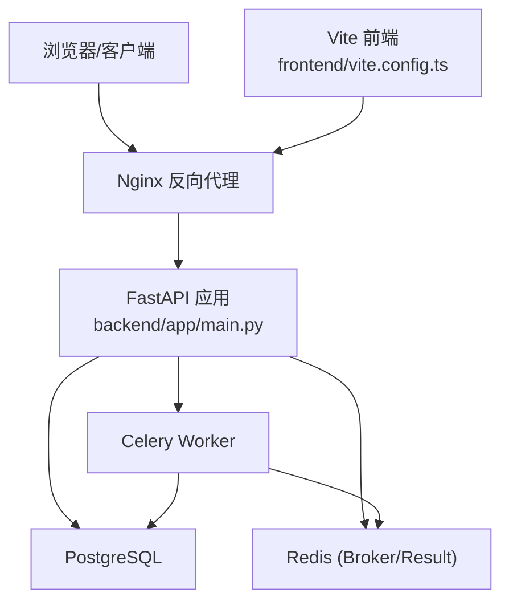
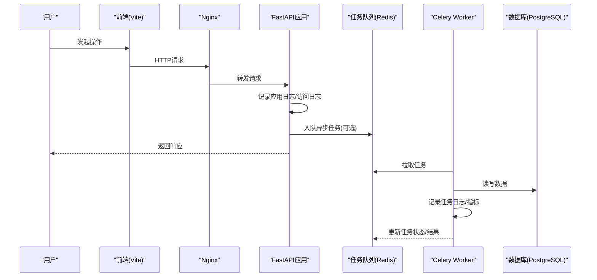
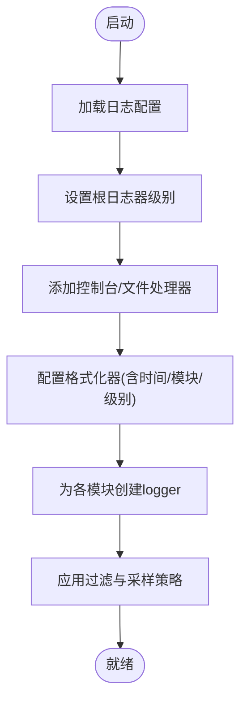
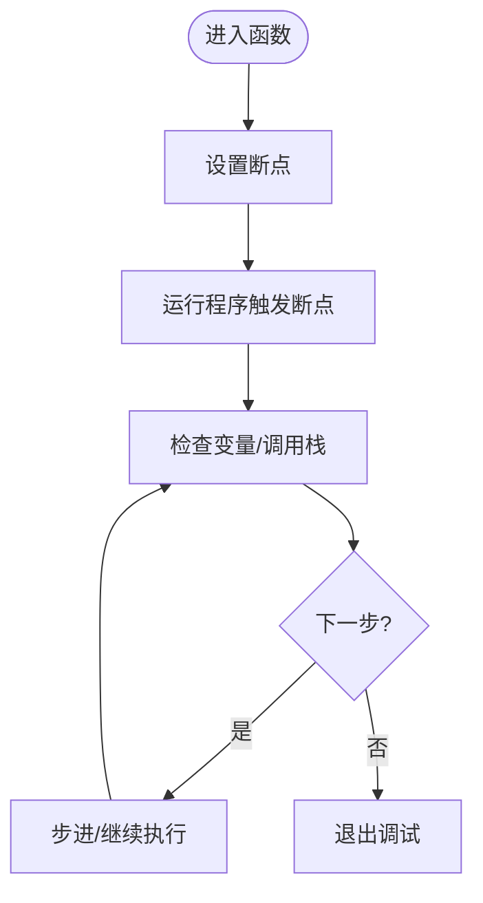
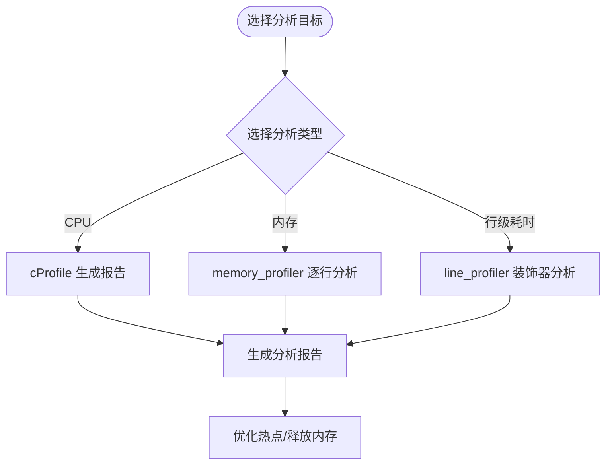
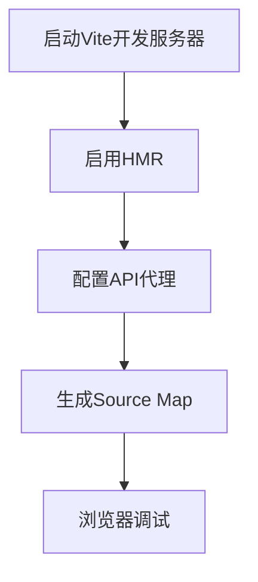
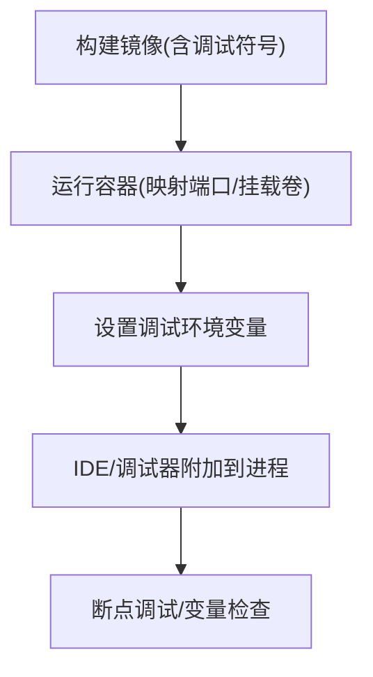
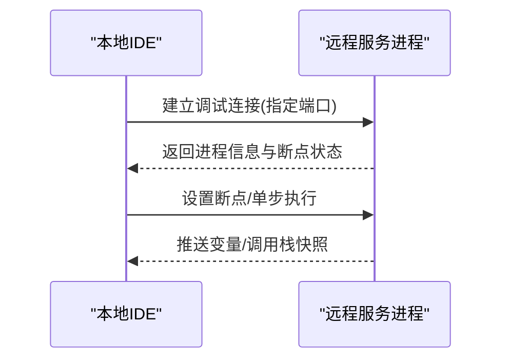
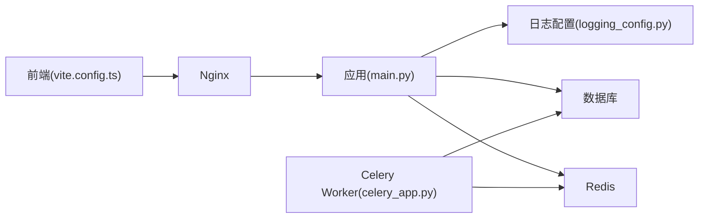

# 调试工具使用

<cite>
**本文档引用的文件**   
- [backend/app/main.py](file://backend/app/main.py)
- [backend/app/celery_app.py](file://backend/app/celery_app.py)
- [core/logging_config.py](file://core/logging_config.py)
- [backend/core/config.py](file://backend/core/config.py)
- [docker-compose.yml](file://docker-compose.yml)
- [frontend/vite.config.ts](file://frontend/vite.config.ts)
- [backend/Dockerfile](file://backend/Dockerfile)
- [nginx.conf](file://nginx.conf)
- [scripts/debug_single_voice.py](file://scripts/debug_single_voice.py)
</cite>

## 目录
1. [简介](#简介)
2. [项目结构](#项目结构)
3. [核心组件](#核心组件)
4. [架构总览](#架构总览)
5. [详细组件分析](#详细组件分析)
6. [依赖关系分析](#依赖关系分析)
7. [性能考虑](#性能考虑)
8. [故障排查指南](#故障排查指南)
9. [结论](#结论)
10. [附录](#附录)

## 简介
本指南面向开发者与运维人员，系统讲解如何在项目中配置与调整日志级别、收集与分析应用日志、数据库日志、Celery任务日志以及前端控制台日志；并详细介绍Python调试器（pdb/ipdb）的使用、断点调试与变量检查；同时覆盖性能分析工具（cProfile、memory_profiler、line_profiler）、热重载开发环境、Docker容器内调试与远程调试的设置步骤。文档结合仓库中的实际代码位置进行说明，便于快速定位与落地。

## 项目结构
本项目采用前后端分离与多进程异步任务架构：
- 后端：FastAPI应用、Celery任务、SQLAlchemy/数据库迁移、统一日志配置
- 前端：Vite + React，支持开发模式热重载与调试
- 部署：Docker Compose编排，Nginx反向代理
- 脚本：调试与验证脚本位于scripts目录

**图示来源**
- [backend/app/main.py](file://backend/app/main.py)
- [backend/app/celery_app.py](file://backend/app/celery_app.py)
- [docker-compose.yml](file://docker-compose.yml)
- [frontend/vite.config.ts](file://frontend/vite.config.ts)
- [nginx.conf](file://nginx.conf)

**章节来源**
- [backend/app/main.py](file://backend/app/main.py)
- [backend/app/celery_app.py](file://backend/app/celery_app.py)
- [docker-compose.yml](file://docker-compose.yml)
- [frontend/vite.config.ts](file://frontend/vite.config.ts)
- [nginx.conf](file://nginx.conf)

## 核心组件
- 应用入口与中间件：负责路由注册、异常处理、请求生命周期钩子
- 日志配置：统一日志初始化、分级输出、结构化字段注入
- Celery任务：异步任务调度、重试、结果存储与追踪
- 前端开发服务器：Vite热重载、源码映射、调试端口
- 容器化与代理：Docker Compose服务编排、Nginx转发与静态资源托管

**章节来源**
- [backend/app/main.py](file://backend/app/main.py)
- [core/logging_config.py](file://core/logging_config.py)
- [backend/app/celery_app.py](file://backend/app/celery_app.py)
- [frontend/vite.config.ts](file://frontend/vite.config.ts)
- [docker-compose.yml](file://docker-compose.yml)
- [nginx.conf](file://nginx.conf)

## 架构总览
下图展示了从前端到后端、再到任务执行与数据落库的完整链路，以及日志与监控在关键节点的接入点。

**图示来源**
- [backend/app/main.py](file://backend/app/main.py)
- [backend/app/celery_app.py](file://backend/app/celery_app.py)
- [docker-compose.yml](file://docker-compose.yml)

## 详细组件分析

### 日志配置与级别管理
- 统一日志初始化：通过核心日志配置模块集中设置根日志器、处理器、格式化器与过滤器
- 应用日志：按模块划分logger，支持DEBUG/INFO/WARNING/ERROR等级，建议生产默认INFO
- 数据库日志：可开启SQLAlchemy事件监听或驱动级日志，注意避免在生产环境打印大量SQL
- Celery任务日志：为worker与beat分别配置独立logger，包含任务ID、重试次数、耗时等上下文
- 前端控制台日志：开发模式下启用source map，限制console.log输出，生产关闭调试信息

**图示来源**
- [core/logging_config.py](file://core/logging_config.py)

**章节来源**
- [core/logging_config.py](file://core/logging_config.py)
- [backend/core/config.py](file://backend/core/config.py)

### Python调试器使用（pdb/ipdb）
- 基础用法：在目标位置插入断点，运行后进入交互调试会话
- 常用命令：查看变量、步进执行、继续运行、退出调试
- ipdb增强：支持Tab补全、历史命令、更好的交互体验
- 条件断点与批量断点：针对复杂分支与循环场景提升效率
- 注意事项：避免在生产环境启用交互式调试；确保环境变量与依赖一致

**图示来源**
- [scripts/debug_single_voice.py](file://scripts/debug_single_voice.py)

**章节来源**
- [scripts/debug_single_voice.py](file://scripts/debug_single_voice.py)

### 性能分析工具
- cProfile：统计函数调用次数与耗时，适合定位热点函数
- memory_profiler：逐行内存占用分析，识别内存泄漏与峰值
- line_profiler：细粒度行级耗时分析，配合装饰器使用
- 使用建议：仅在开发/预发环境启用；对高频路径抽样分析；结合日志与指标交叉验证

**图示来源**
- [scripts/debug_single_voice.py](file://scripts/debug_single_voice.py)

**章节来源**
- [scripts/debug_single_voice.py](file://scripts/debug_single_voice.py)

### 热重载开发环境（前端）
- Vite开发服务器：启用热模块替换(HMR)，修改源码即时生效
- Source Map：开启以便在浏览器中定位原始源码
- 代理配置：将API请求转发至后端，避免跨域问题
- 调试端口：暴露调试端口供IDE或浏览器连接

**图示来源**
- [frontend/vite.config.ts](file://frontend/vite.config.ts)

**章节来源**
- [frontend/vite.config.ts](file://frontend/vite.config.ts)

### Docker容器内调试
- 镜像构建：保留调试符号，安装必要调试工具
- 环境变量：注入调试开关、日志级别、断点监听端口
- 端口映射：将调试端口映射到宿主机，便于外部IDE连接
- 卷挂载：挂载源码目录，实现热更新与实时编辑

**图示来源**
- [backend/Dockerfile](file://backend/Dockerfile)
- [docker-compose.yml](file://docker-compose.yml)

**章节来源**
- [backend/Dockerfile](file://backend/Dockerfile)
- [docker-compose.yml](file://docker-compose.yml)

### 远程调试设置
- 服务端：启用调试监听端口，允许指定IP访问
- 客户端：配置远程解释器与项目路径映射
- 网络与安全：仅对内网开放调试端口，必要时使用SSH隧道
- 最佳实践：临时启用、最小权限、及时关闭

**图示来源**
- [docker-compose.yml](file://docker-compose.yml)
- [nginx.conf](file://nginx.conf)

**章节来源**
- [docker-compose.yml](file://docker-compose.yml)
- [nginx.conf](file://nginx.conf)

## 依赖关系分析
- 应用与日志：应用入口依赖统一日志配置，所有模块通过logger实例输出
- 任务与队列：Celery Worker依赖Redis作为消息代理，任务日志与结果持久化
- 前端与代理：Vite开发服务器通过Nginx或内置代理转发API请求
- 容器编排：Docker Compose统一管理后端、数据库、缓存、代理与服务间通信

**图示来源**
- [backend/app/main.py](file://backend/app/main.py)
- [core/logging_config.py](file://core/logging_config.py)
- [backend/app/celery_app.py](file://backend/app/celery_app.py)
- [frontend/vite.config.ts](file://frontend/vite.config.ts)
- [nginx.conf](file://nginx.conf)

**章节来源**
- [backend/app/main.py](file://backend/app/main.py)
- [core/logging_config.py](file://core/logging_config.py)
- [backend/app/celery_app.py](file://backend/app/celery_app.py)
- [frontend/vite.config.ts](file://frontend/vite.config.ts)
- [nginx.conf](file://nginx.conf)

## 性能考虑
- 日志开销：生产环境降低日志级别，避免频繁I/O；对高频路径使用采样或异步写入
- 数据库查询：减少N+1查询，合理使用索引与分页；谨慎开启SQL日志
- 任务队列：合理拆分任务、设置超时与重试策略，避免阻塞主流程
- 前端渲染：按需加载与懒加载，减少首屏体积；禁用不必要的console输出
- 容器资源：限制CPU与内存配额，避免争抢导致抖动

[本节为通用指导，不直接分析具体文件]

## 故障排查指南
- 日志定位：根据模块名与级别筛选关键错误；结合请求ID追踪链路
- 数据库问题：检查连接池、慢查询与锁等待；必要时临时开启SQL日志
- 任务失败：查看Worker日志、重试计数与异常堆栈；确认依赖服务可用性
- 前端调试：打开Network与Console面板，核对API响应与错误码；检查代理配置
- 容器问题：查看容器日志、端口冲突与卷挂载权限；逐步缩小范围定位

**章节来源**
- [backend/app/main.py](file://backend/app/main.py)
- [backend/app/celery_app.py](file://backend/app/celery_app.py)
- [core/logging_config.py](file://core/logging_config.py)

## 结论
通过统一的日志配置、完善的调试工具链与容器化支持，本项目能够在开发与生产环境中高效定位问题、优化性能并确保稳定性。建议团队遵循本文档的最佳实践，结合实际情况灵活调整日志级别与调试策略，持续提升交付质量与排障效率。

[本节为总结性内容，不直接分析具体文件]

## 附录
- 常用命令速查：pdb/ipdb基本命令、cProfile报告解读、memory_profiler输出示例
- 环境变量清单：日志级别、调试开关、代理地址、数据库连接参数
- 参考脚本：单一语音调试脚本用于快速复现与验证问题

[本节为补充信息，不直接分析具体文件]