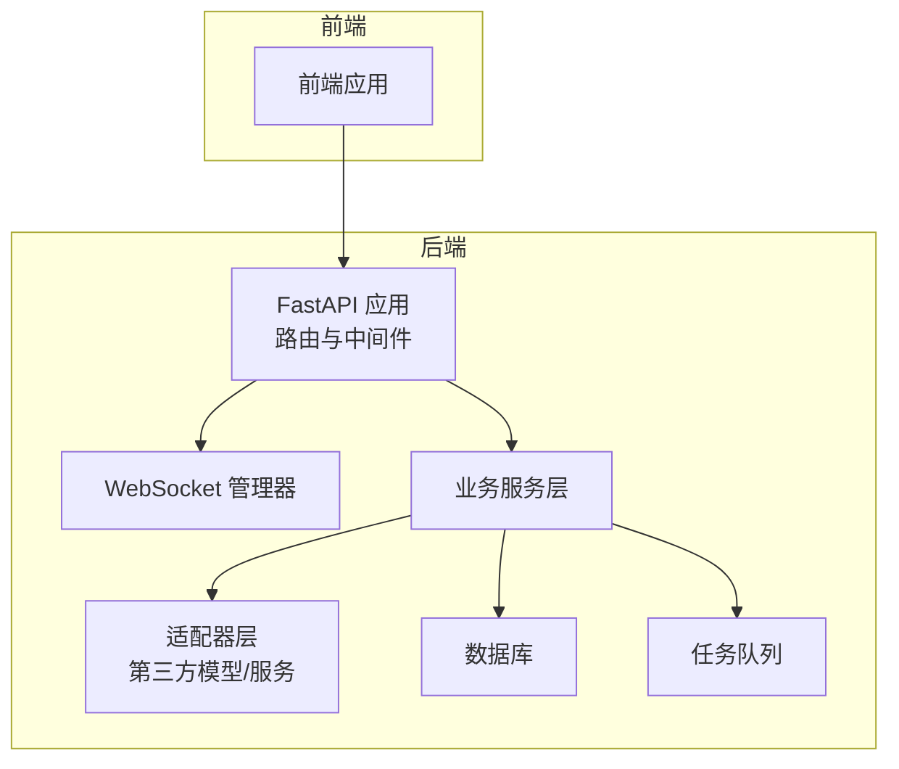
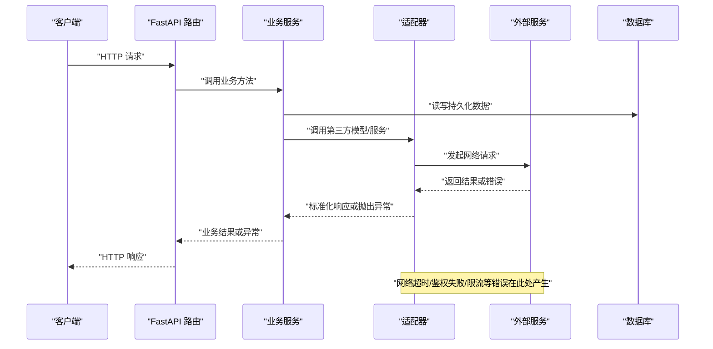
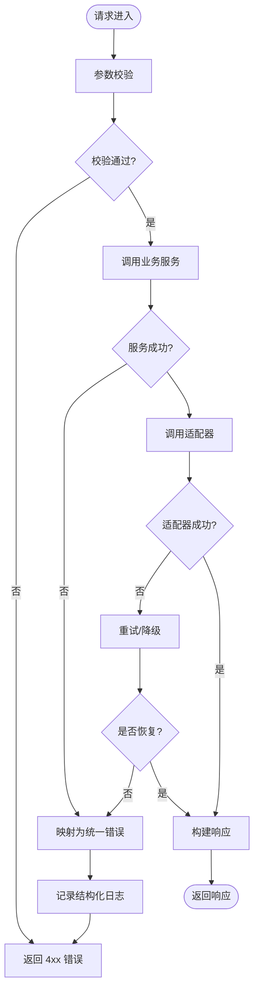
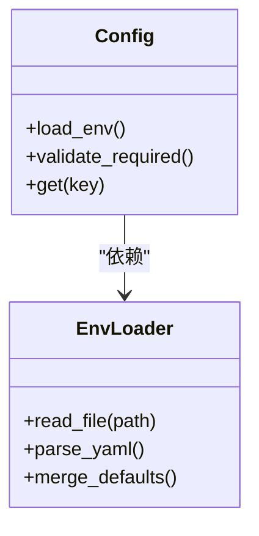
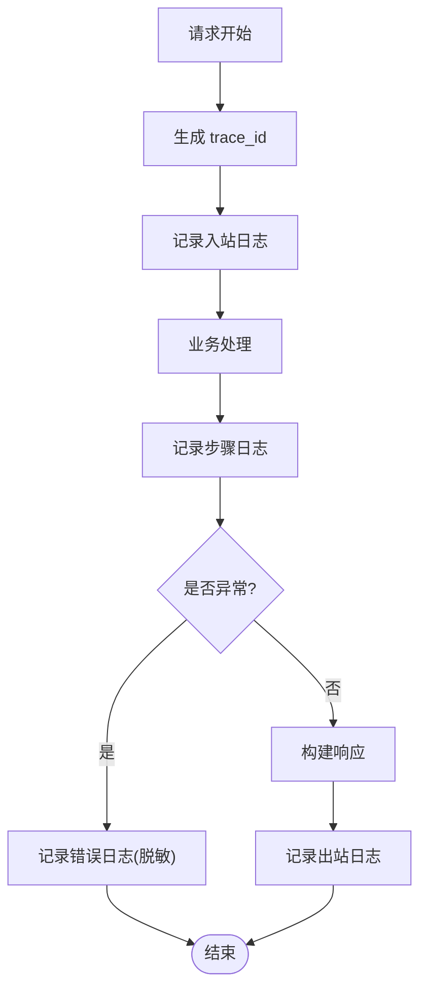
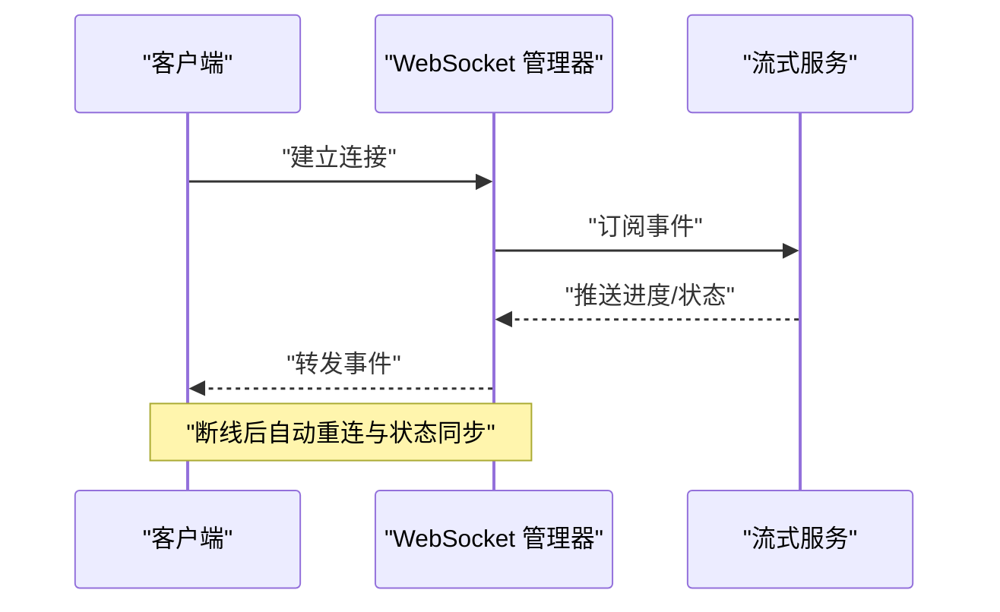
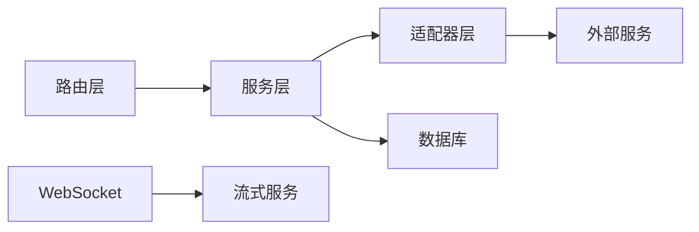

# 错误报告与复现

<cite>
**本文引用的文件**   
- [backend/app/main.py](file://backend/app/main.py)
- [backend/app/core/config.py](file://backend/app/core/config.py)
- [backend/app/utils/api_errors.py](file://backend/app/utils/api_errors.py)
- [core/logging_config.py](file://core/logging_config.py)
- [core/config.py](file://core/config.py)
- [backend/requirements.txt](file://backend/requirements.txt)
- [docker-compose.yml](file://docker-compose.yml)
- [scripts/create_test_fixtures.py](file://scripts/create_test_fixtures.py)
- [tests/test_full_chain.py](file://tests/test_full_chain.py)
- [tests/test_audiobook_tts_routes_observability.py](file://tests/test_audiobook_tts_routes_observability.py)
- [backend/app/api/v1/dreamweaver_api/routes.py](file://backend/app/api/v1/dreamweaver_api/routes.py)
- [adapters/base.py](file://adapters/base.py)
- [adapters/model_adapters.py](file://adapters/model_adapters.py)
- [backend/app/services/streaming_service.py](file://backend/app/services/streaming_service.py)
- [backend/app/websocket/manager.py](file://backend/app/websocket/manager.py)
</cite>

## 目录
1. [简介](#简介)
2. [项目结构](#项目结构)
3. [核心组件](#核心组件)
4. [架构总览](#架构总览)
5. [详细组件分析](#详细组件分析)
6. [依赖关系分析](#依赖关系分析)
7. [性能考量](#性能考量)
8. [故障排查指南](#故障排查指南)
9. [结论](#结论)
10. [附录](#附录)

## 简介
本指南面向开发者与测试人员，系统化说明如何在小说创作代理项目中收集、整理和提交高质量错误报告，以及如何编写最小化复现案例与自动化测试用例，确保问题可定位、可修复、可回归验证。内容覆盖：
- 错误信息收集清单（完整堆栈、环境变量、配置、输入数据、预期输出）
- 最小化复现步骤（测试数据准备、依赖服务模拟、关键步骤记录）
- 高质量Bug报告模板与优先级评估标准
- 自动化测试用例编写指导（验证修复与防止回归）

## 项目结构
本项目采用前后端分离与多模块组织方式：
- 后端基于 FastAPI，提供 REST API、WebSocket、任务队列与数据库访问能力
- 适配器层封装第三方模型与服务调用
- 核心配置与日志集中在 core 与 backend/app/core
- 测试位于 tests 与 scripts，便于快速复现与回归

**图表来源** 
- [backend/app/main.py](file://backend/app/main.py)
- [backend/app/websocket/manager.py](file://backend/app/websocket/manager.py)
- [adapters/base.py](file://adapters/base.py)

**章节来源**
- [backend/app/main.py](file://backend/app/main.py)
- [docker-compose.yml](file://docker-compose.yml)

## 核心组件
- 应用入口与全局异常处理：统一捕获并返回结构化错误响应，便于前端展示与日志追踪
- 配置与环境加载：集中管理环境变量、密钥与外部服务地址，避免硬编码
- 日志系统：结构化日志、请求链路追踪、敏感信息脱敏
- 适配器抽象：标准化第三方调用接口，统一错误码与重试策略
- WebSocket 与流式服务：长连接状态推送与进度上报

**章节来源**
- [backend/app/main.py](file://backend/app/main.py)
- [backend/app/core/config.py](file://backend/app/core/config.py)
- [core/logging_config.py](file://core/logging_config.py)
- [adapters/base.py](file://adapters/base.py)
- [backend/app/services/streaming_service.py](file://backend/app/services/streaming_service.py)
- [backend/app/websocket/manager.py](file://backend/app/websocket/manager.py)

## 架构总览
下图展示了从请求进入、业务处理、适配器调用到结果返回的完整流程，以及错误在各个环节的产生与传播路径。

**图表来源** 
- [backend/app/api/v1/dreamweaver_api/routes.py](file://backend/app/api/v1/dreamweaver_api/routes.py)
- [adapters/base.py](file://adapters/base.py)
- [adapters/model_adapters.py](file://adapters/model_adapters.py)

## 详细组件分析

### 错误处理与异常传播
- 统一异常捕获：在应用入口处注册全局异常处理器，将内部异常转换为标准 HTTP 错误码与消息体
- 结构化错误响应：包含错误类型、消息、请求ID、时间戳，便于前端提示与后端检索
- 适配器层错误归一化：不同第三方服务的错误码映射为统一错误类型，支持重试与降级

**图表来源** 
- [backend/app/utils/api_errors.py](file://backend/app/utils/api_errors.py)
- [adapters/base.py](file://adapters/base.py)
- [adapters/model_adapters.py](file://adapters/model_adapters.py)

**章节来源**
- [backend/app/utils/api_errors.py](file://backend/app/utils/api_errors.py)
- [adapters/base.py](file://adapters/base.py)
- [adapters/model_adapters.py](file://adapters/model_adapters.py)

### 配置与环境变量
- 集中配置加载：从环境变量与配置文件读取数据库、缓存、第三方服务地址与密钥
- 安全最佳实践：敏感字段不落地日志，启动时校验必填项
- 环境隔离：开发、测试、生产使用独立配置源

**图表来源** 
- [backend/app/core/config.py](file://backend/app/core/config.py)
- [core/config.py](file://core/config.py)

**章节来源**
- [backend/app/core/config.py](file://backend/app/core/config.py)
- [core/config.py](file://core/config.py)

### 日志与追踪
- 结构化日志：JSON 格式输出，包含请求ID、用户ID、耗时、错误码
- 链路追踪：跨服务调用传递 trace_id，便于端到端定位
- 敏感信息脱敏：自动过滤密码、令牌等字段

**图表来源** 
- [core/logging_config.py](file://core/logging_config.py)

**章节来源**
- [core/logging_config.py](file://core/logging_config.py)

### WebSocket 与流式输出
- 长连接管理：维护连接池、心跳检测、断线重连
- 事件推送：进度、状态、错误事件实时推送至前端
- 背压控制：限制并发与消息速率，避免内存溢出

**图表来源** 
- [backend/app/websocket/manager.py](file://backend/app/websocket/manager.py)
- [backend/app/services/streaming_service.py](file://backend/app/services/streaming_service.py)

**章节来源**
- [backend/app/websocket/manager.py](file://backend/app/websocket/manager.py)
- [backend/app/services/streaming_service.py](file://backend/app/services/streaming_service.py)

## 依赖关系分析
- 外部依赖：数据库、缓存、第三方模型服务、对象存储
- 内部依赖：路由→服务→适配器→外部服务；服务→数据库；WebSocket→流式服务
- 潜在循环依赖：通过接口解耦与依赖注入避免

**图表来源** 
- [backend/app/api/v1/dreamweaver_api/routes.py](file://backend/app/api/v1/dreamweaver_api/routes.py)
- [adapters/base.py](file://adapters/base.py)
- [backend/app/services/streaming_service.py](file://backend/app/services/streaming_service.py)

**章节来源**
- [backend/app/api/v1/dreamweaver_api/routes.py](file://backend/app/api/v1/dreamweaver_api/routes.py)
- [adapters/base.py](file://adapters/base.py)
- [backend/app/services/streaming_service.py](file://backend/app/services/streaming_service.py)

## 性能考量
- 适配器层增加重试与熔断，降低外部服务抖动影响
- 流式输出减少大对象内存占用，提升吞吐
- 数据库查询优化与索引设计，避免慢查询
- 日志采样与异步写入，降低IO开销

[本节为通用指导，无需特定文件引用]

## 故障排查指南

### 错误信息收集清单
- 完整错误堆栈：包括异常类型、消息、调用链、trace_id
- 环境变量：数据库连接、缓存地址、第三方服务密钥与版本
- 配置文件：相关模块的配置片段（脱敏）
- 输入数据：请求体、参数、文件上传内容与元数据
- 预期输出与实际输出：对比差异与失败点
- 时间与频率：首次出现时间、复现概率、影响范围

### 最小化复现案例编写
- 测试数据准备：构造最小可用数据集，覆盖边界条件
- 依赖服务模拟：使用 Mock 或本地替代服务，隔离外部因素
- 关键步骤记录：按顺序记录每一步操作与期望结果
- 自动化脚本：提供一键复现脚本，便于他人快速验证

**章节来源**
- [scripts/create_test_fixtures.py](file://scripts/create_test_fixtures.py)
- [tests/test_full_chain.py](file://tests/test_full_chain.py)

### 高质量 Bug 报告模板
- 标题：简明扼要描述问题现象
- 环境：操作系统、Python 版本、依赖版本、部署方式
- 复现步骤：逐步操作，附带输入数据与截图
- 期望行为：明确预期结果
- 实际行为：描述错误现象与错误码
- 日志与堆栈：附上结构化日志与完整堆栈
- 附件：配置文件（脱敏）、请求/响应样例、视频/音频片段
- 优先级评估标准：
  - P0：线上阻断、数据丢失、安全漏洞
  - P1：核心功能不可用、影响大量用户
  - P2：非核心功能异常、影响部分用户
  - P3：体验优化、低优先级问题

### 自动化测试用例编写指导
- 单元测试：针对函数与类进行隔离测试，覆盖正常与异常路径
- 集成测试：验证服务间交互与外部依赖，使用 Mock 替代真实服务
- 端到端测试：模拟用户操作，验证完整业务流程
- 回归测试：针对历史问题添加用例，防止再次发生
- 持续集成：在 CI 中运行测试，阻塞合并分支

**章节来源**
- [tests/test_audiobook_tts_routes_observability.py](file://tests/test_audiobook_tts_routes_observability.py)
- [tests/test_full_chain.py](file://tests/test_full_chain.py)

## 结论
通过系统化收集错误信息、编写最小化复现案例与自动化测试，可以显著提升问题定位效率与修复质量。建议团队遵循本指南，形成标准化的错误报告与测试流程，保障项目稳定演进。

[本节为总结性内容，无需特定文件引用]

## 附录

### 依赖与环境
- Python 依赖：参见 requirements.txt
- 容器编排：docker-compose.yml 定义服务依赖

**章节来源**
- [backend/requirements.txt](file://backend/requirements.txt)
- [docker-compose.yml](file://docker-compose.yml)