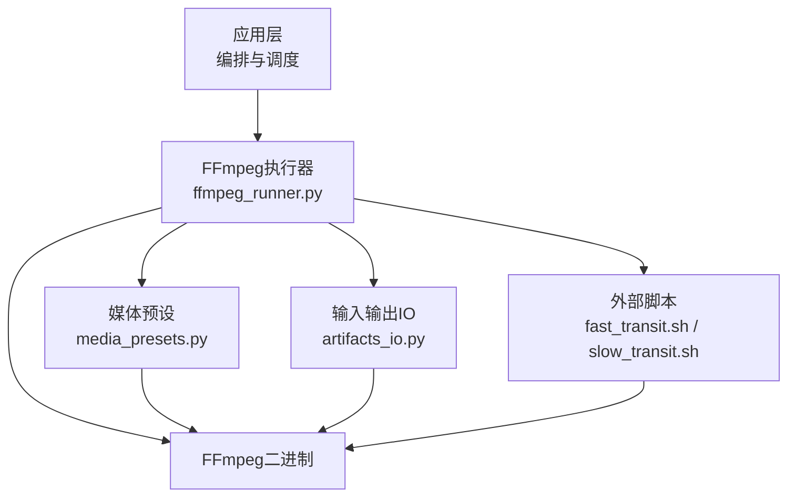
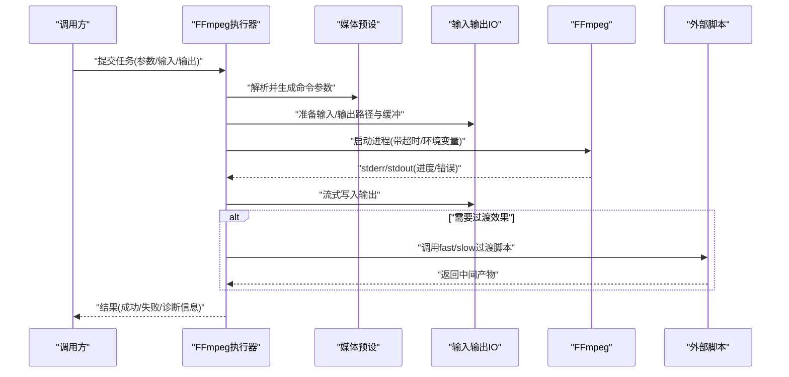
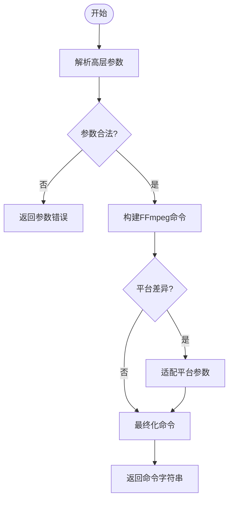
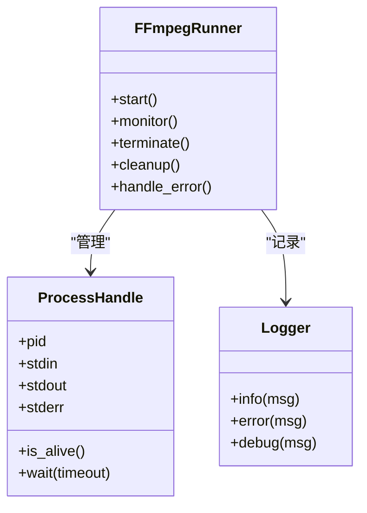
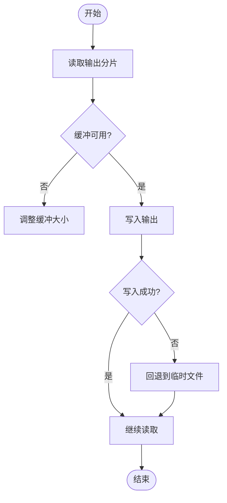
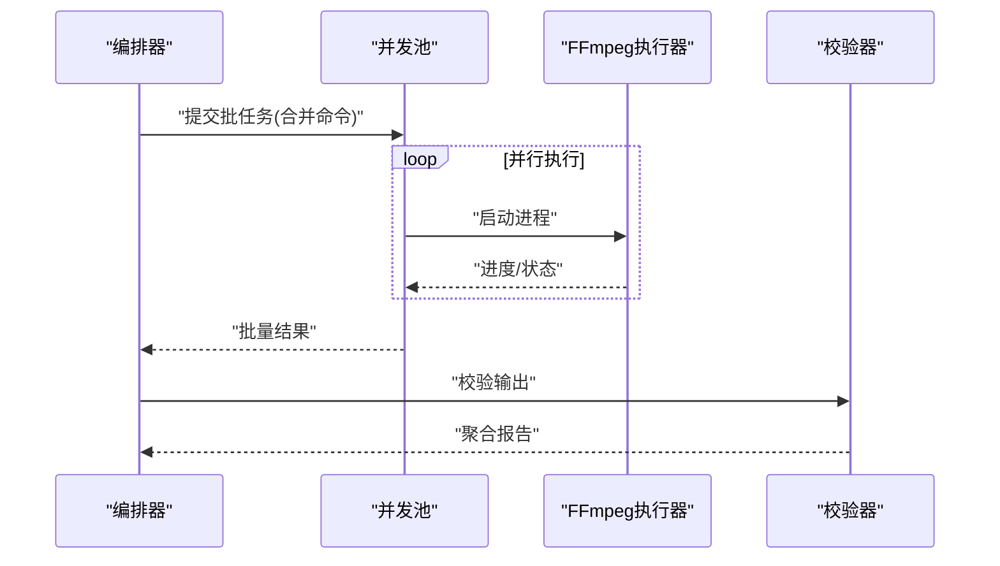
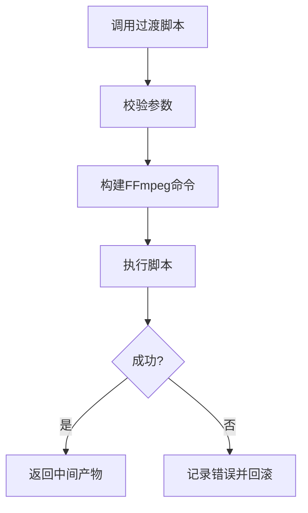
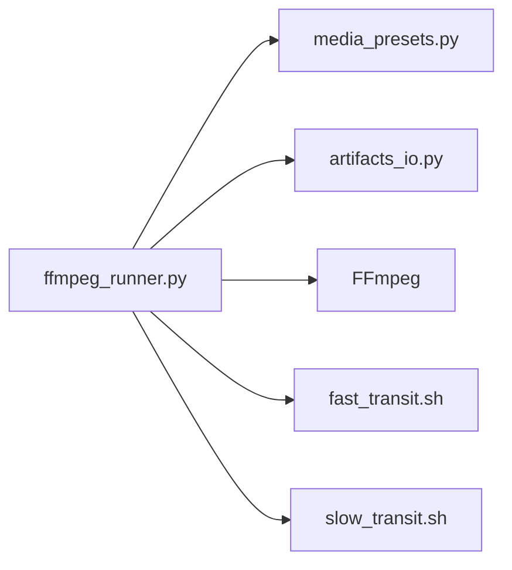

# FFmpeg集成引擎

<cite>
**本文档引用的文件**   
- [FFMPEG_VIDEO_EDIT_GUIDE.md](file://FFMPEG_VIDEO_EDIT_GUIDE.md)
- [ffmpeg_runner.py](file://pipeline/ffmpeg_runner.py)
- [media_presets.py](file://pipeline/media_presets.py)
- [artifacts_io.py](file://pipeline/artifacts_io.py)
- [scripts/ffmpeg/fast_transit.sh](file://scripts/ffmpeg/fast_transit.sh)
- [scripts/ffmpeg/slow_transit.sh](file://scripts/ffmpeg/slow_transit.sh)
</cite>

## 目录
1. [简介](#简介)
2. [项目结构](#项目结构)
3. [核心组件](#核心组件)
4. [架构总览](#架构总览)
5. [详细组件分析](#详细组件分析)
6. [依赖关系分析](#依赖关系分析)
7. [性能考虑](#性能考虑)
8. [故障排查指南](#故障排查指南)
9. [结论](#结论)
10. [附录](#附录)

## 简介
本技术文档面向小说创作代理系统中的FFmpeg集成引擎，聚焦以下目标：
- FFmpeg命令构建器：参数组装、语法验证与平台兼容性处理
- 进程管理机制：启动、监控、终止与资源清理
- 输出处理系统：流式读取、缓冲管理与错误捕获
- 批处理优化：命令合并、并行执行与结果聚合
- 错误处理与日志记录：错误分类、重试策略与调试信息
- 性能优化技巧：硬件加速、内存管理与CPU利用率优化

该引擎通过统一的Python接口封装FFmpeg调用，提供跨平台兼容的命令生成、健壮的执行与监控、以及高效的批处理能力，服务于视频转码、拼接、滤镜、字幕合成等媒体处理任务。

## 项目结构
FFmpeg相关代码主要分布在以下位置：
- pipeline/ffmpeg_runner.py：FFmpeg执行器与进程管理核心
- pipeline/media_presets.py：媒体预设（编码参数、滤镜链、输出格式）
- pipeline/artifacts_io.py：输入输出路径、临时文件与缓存管理
- scripts/ffmpeg/*.sh：平台脚本（如快速/慢速过渡），供外部调用或辅助流程
- FFMPEG_VIDEO_EDIT_GUIDE.md：FFmpeg使用指南与最佳实践参考

图表来源
- [ffmpeg_runner.py](file://pipeline/ffmpeg_runner.py)
- [media_presets.py](file://pipeline/media_presets.py)
- [artifacts_io.py](file://pipeline/artifacts_io.py)
- [scripts/ffmpeg/fast_transit.sh](file://scripts/ffmpeg/fast_transit.sh)
- [scripts/ffmpeg/slow_transit.sh](file://scripts/ffmpeg/slow_transit.sh)

章节来源
- [FFMPEG_VIDEO_EDIT_GUIDE.md](file://FFMPEG_VIDEO_EDIT_GUIDE.md)
- [ffmpeg_runner.py](file://pipeline/ffmpeg_runner.py)
- [media_presets.py](file://pipeline/media_presets.py)
- [artifacts_io.py](file://pipeline/artifacts_io.py)
- [scripts/ffmpeg/fast_transit.sh](file://scripts/ffmpeg/fast_transit.sh)
- [scripts/ffmpeg/slow_transit.sh](file://scripts/ffmpeg/slow_transit.sh)

## 核心组件
- FFmpeg命令构建器
  - 负责将高层参数（分辨率、码率、编码器、滤镜链、字幕、音频通道等）转换为FFmpeg命令行
  - 内置语法校验（参数合法性、冲突检测、平台差异适配）
  - 支持多平台路径与可执行名解析（Windows/macOS/Linux）
- 进程管理器
  - 启动FFmpeg子进程，设置超时、优先级与环境变量
  - 实时读取stderr/stdout用于进度与错误捕获
  - 优雅终止（SIGTERM/SIGKILL）、僵尸进程清理、句柄释放
- 输出处理系统
  - 流式读取输出片段，按块写入磁盘或管道
  - 缓冲策略（大小、阈值、回退到文件）
  - 错误捕获与重试（网络/磁盘/编码失败）
- 批处理优化
  - 命令合并（多段转码/滤镜合并为单次FFmpeg调用）
  - 并行执行（线程池/进程池控制并发度）
  - 结果聚合（校验、去重、索引更新）
- 错误处理与日志
  - 错误分类（参数错误、编码错误、I/O错误、超时）
  - 重试策略（指数退避、最大重试次数）
  - 结构化日志（请求ID、阶段、耗时、资源占用）
- 性能优化
  - 硬件加速（NVENC/QSV/VAAPI/VideoToolbox）
  - 内存管理（限制缓冲区、避免大对象驻留）
  - CPU利用率（合理线程数、批大小、I/O并发）

章节来源
- [ffmpeg_runner.py](file://pipeline/ffmpeg_runner.py)
- [media_presets.py](file://pipeline/media_presets.py)
- [artifacts_io.py](file://pipeline/artifacts_io.py)
- [FFMPEG_VIDEO_EDIT_GUIDE.md](file://FFMPEG_VIDEO_EDIT_GUIDE.md)

## 架构总览
下图展示FFmpeg集成引擎的整体架构与数据流：

图表来源
- [ffmpeg_runner.py](file://pipeline/ffmpeg_runner.py)
- [media_presets.py](file://pipeline/media_presets.py)
- [artifacts_io.py](file://pipeline/artifacts_io.py)
- [scripts/ffmpeg/fast_transit.sh](file://scripts/ffmpeg/fast_transit.sh)
- [scripts/ffmpeg/slow_transit.sh](file://scripts/ffmpeg/slow_transit.sh)

## 详细组件分析

### FFmpeg命令构建器
- 参数组装
  - 输入源配置（文件/管道/设备）
  - 编码器选择与参数（H.264/H.265/VP9/AV1，码率模式CBR/VBR/CRF）
  - 滤镜链（缩放、裁剪、旋转、色彩空间、降噪、字幕叠加）
  - 音频配置（采样率、声道、编解码器、音量/均衡）
  - 输出容器与元数据（MP4/MKV/WebM，标题、作者、时间戳）
- 语法验证
  - 参数白名单与黑名单检查
  - 冲突检测（如同时指定不兼容的滤镜与编码器）
  - 平台差异适配（Windows路径分隔符、macOS VideoToolbox、Linux VAAPI/NVENC）
- 示例参考
  - 参见“FFmpeg使用指南”中的典型命令与参数组合

图表来源
- [media_presets.py](file://pipeline/media_presets.py)
- [FFMPEG_VIDEO_EDIT_GUIDE.md](file://FFMPEG_VIDEO_EDIT_GUIDE.md)

章节来源
- [media_presets.py](file://pipeline/media_presets.py)
- [FFMPEG_VIDEO_EDIT_GUIDE.md](file://FFMPEG_VIDEO_EDIT_GUIDE.md)

### 进程管理机制
- 启动
  - 创建子进程，设置工作目录、环境变量（如CUDA_VISIBLE_DEVICES、VA_DRIVERS）
  - 配置stdin/stdout/stderr管道，启用非阻塞读取
- 监控
  - 实时解析stderr获取进度（帧率、耗时、剩余时间）
  - 心跳检测与超时控制
- 终止与清理
  - 优雅终止（发送SIGTERM等待退出），失败则强制SIGKILL
  - 关闭文件句柄、删除临时文件、释放锁与队列项
- 错误捕获
  - 区分编码错误、I/O错误、权限错误、资源不足
  - 收集诊断信息（FFmpeg版本、参数、环境、堆栈）

图表来源
- [ffmpeg_runner.py](file://pipeline/ffmpeg_runner.py)

章节来源
- [ffmpeg_runner.py](file://pipeline/ffmpeg_runner.py)

### 输出处理系统
- 流式读取
  - 从FFmpeg stdout读取分片，按固定大小缓冲
  - 支持管道输出（直接转发至下游服务）
- 缓冲管理
  - 动态调整缓冲大小（根据内存与I/O负载）
  - 写失败时回退到临时文件，保证不丢帧
- 错误捕获
  - 捕获I/O异常、磁盘满、权限不足
  - 自动重试与降级（降低码率/分辨率）

图表来源
- [artifacts_io.py](file://pipeline/artifacts_io.py)

章节来源
- [artifacts_io.py](file://pipeline/artifacts_io.py)

### 批处理优化
- 命令合并
  - 将多个转码/滤镜步骤合并为单次FFmpeg调用，减少进程开销
  - 使用滤镜图（filter_complex）串联多路输入
- 并行执行
  - 基于线程池/进程池控制并发度，避免资源争用
  - 按任务优先级与资源配额调度
- 结果聚合
  - 校验输出完整性（哈希、时长、帧数）
  - 去重与索引更新（媒体库元数据同步）

图表来源
- [ffmpeg_runner.py](file://pipeline/ffmpeg_runner.py)
- [artifacts_io.py](file://pipeline/artifacts_io.py)

章节来源
- [ffmpeg_runner.py](file://pipeline/ffmpeg_runner.py)
- [artifacts_io.py](file://pipeline/artifacts_io.py)

### 外部脚本集成
- fast_transit.sh / slow_transit.sh
  - 用于快速/慢速过渡效果的FFmpeg命令封装
  - 支持传入输入/输出路径、持续时间、过渡类型
  - 由执行器在特定阶段调用，确保一致性

图表来源
- [scripts/ffmpeg/fast_transit.sh](file://scripts/ffmpeg/fast_transit.sh)
- [scripts/ffmpeg/slow_transit.sh](file://scripts/ffmpeg/slow_transit.sh)

章节来源
- [scripts/ffmpeg/fast_transit.sh](file://scripts/ffmpeg/fast_transit.sh)
- [scripts/ffmpeg/slow_transit.sh](file://scripts/ffmpeg/slow_transit.sh)

## 依赖关系分析
- 内部依赖
  - ffmpeg_runner.py依赖media_presets.py（参数预设）与artifacts_io.py（I/O）
  - 外部脚本作为可选增强模块，按需调用
- 外部依赖
  - FFmpeg二进制（版本与功能集影响命令可用性）
  - 操作系统API（进程管理、信号、文件系统）
  - 硬件驱动（NVIDIA NVENC、Intel QSV、AMD VAAPI、Apple VideoToolbox）

图表来源
- [ffmpeg_runner.py](file://pipeline/ffmpeg_runner.py)
- [media_presets.py](file://pipeline/media_presets.py)
- [artifacts_io.py](file://pipeline/artifacts_io.py)
- [scripts/ffmpeg/fast_transit.sh](file://scripts/ffmpeg/fast_transit.sh)
- [scripts/ffmpeg/slow_transit.sh](file://scripts/ffmpeg/slow_transit.sh)

章节来源
- [ffmpeg_runner.py](file://pipeline/ffmpeg_runner.py)
- [media_presets.py](file://pipeline/media_presets.py)
- [artifacts_io.py](file://pipeline/artifacts_io.py)
- [scripts/ffmpeg/fast_transit.sh](file://scripts/ffmpeg/fast_transit.sh)
- [scripts/ffmpeg/slow_transit.sh](file://scripts/ffmpeg/slow_transit.sh)

## 性能考虑
- 硬件加速
  - 优先使用GPU编码器（NVENC/H.265、QSV、VAAPI）
  - 正确设置环境变量与驱动加载顺序
- 内存管理
  - 限制缓冲大小，避免大对象常驻内存
  - 及时释放临时文件与句柄
- CPU利用率
  - 合理设置线程数（编码器线程、滤镜线程）
  - 批大小与并发度调优，避免上下文切换开销
- I/O优化
  - 使用高速存储（SSD/NVMe）存放临时文件
  - 避免频繁小文件读写，合并写入

[本节为通用指导，无需具体文件引用]

## 故障排查指南
- 常见错误分类
  - 参数错误：非法参数、冲突滤镜、不支持的编码器
  - 编码错误：码率过高、关键帧间隔不当、滤镜链错误
  - I/O错误：路径不存在、权限不足、磁盘满
  - 超时错误：进程无响应、资源竞争
- 调试信息收集
  - FFmpeg版本与编译选项
  - 完整命令与参数
  - stderr/stdout日志片段
  - 系统资源快照（CPU/内存/磁盘/GPU）
- 重试策略
  - 指数退避（初始延迟、最大重试次数）
  - 降级策略（降低分辨率/码率、切换编码器）
- 日志记录
  - 结构化日志（请求ID、阶段、耗时、资源占用）
  - 错误堆栈与上下文信息

章节来源
- [ffmpeg_runner.py](file://pipeline/ffmpeg_runner.py)
- [artifacts_io.py](file://pipeline/artifacts_io.py)
- [FFMPEG_VIDEO_EDIT_GUIDE.md](file://FFMPEG_VIDEO_EDIT_GUIDE.md)

## 结论
FFmpeg集成引擎通过统一的命令构建、健壮的进程管理、高效的输出处理与批处理能力，为小说创作代理系统提供了稳定可靠的媒体处理基础设施。结合硬件加速与性能调优，可在保证质量的前提下显著提升处理效率。建议在生产环境中持续监控资源使用与错误率，并根据业务需求动态调整并发度与参数预设。

[本节为总结性内容，无需具体文件引用]

## 附录
- 参考文档
  - FFMPEG_VIDEO_EDIT_GUIDE.md：FFmpeg使用指南与最佳实践
- 常用命令模板
  - 转码、拼接、滤镜、字幕叠加、音频混音等
- 环境变量清单
  - CUDA_VISIBLE_DEVICES、VA_DRIVERS、QT_PLUGIN_PATH等

[本节为补充信息，无需具体文件引用]