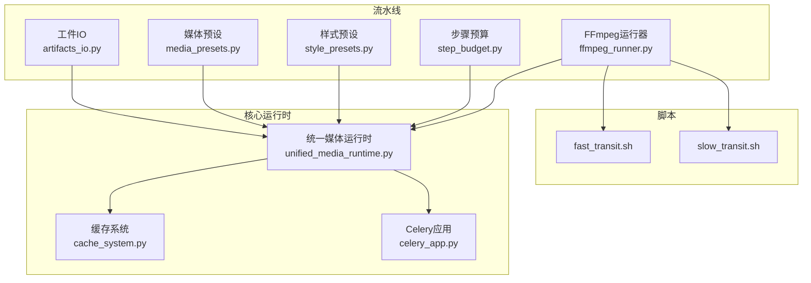
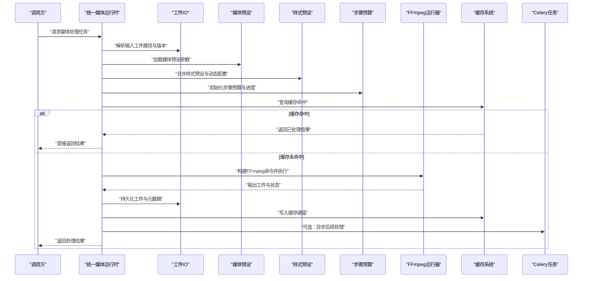
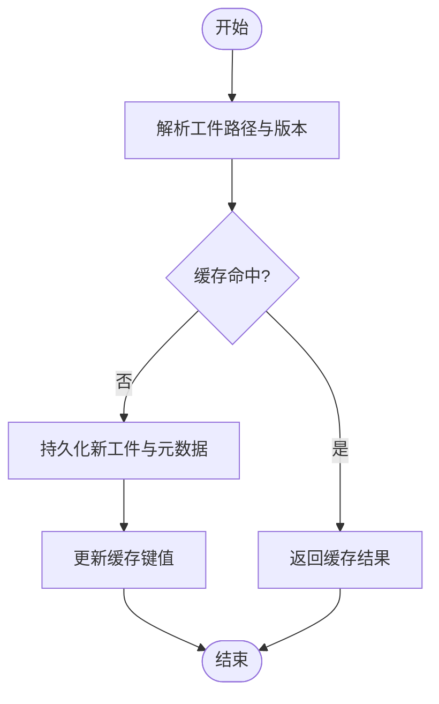
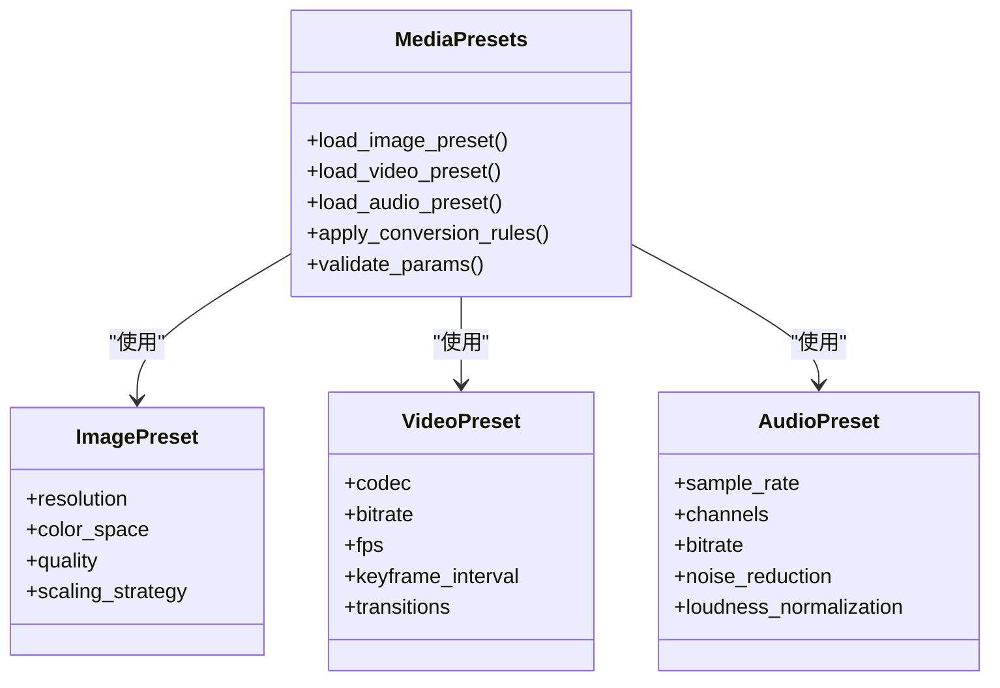
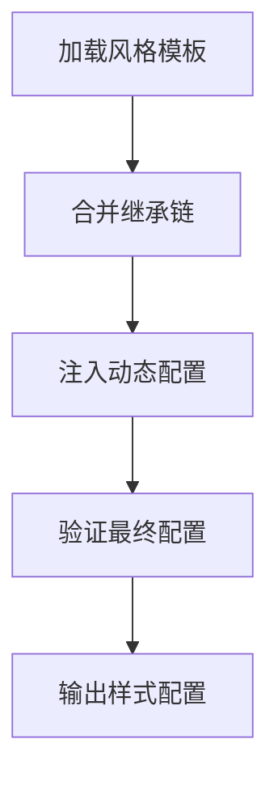
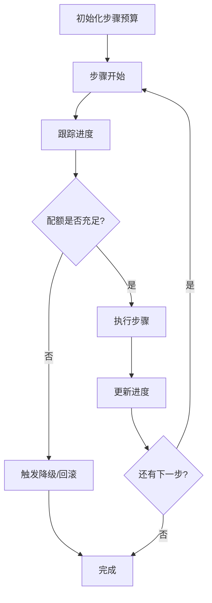
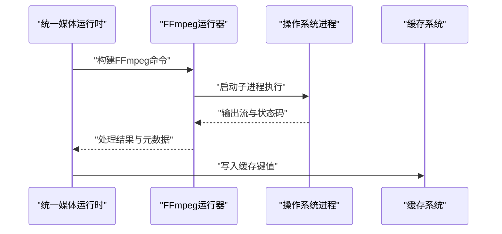
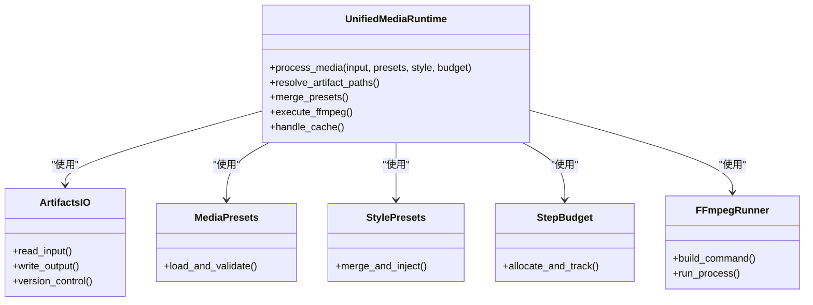
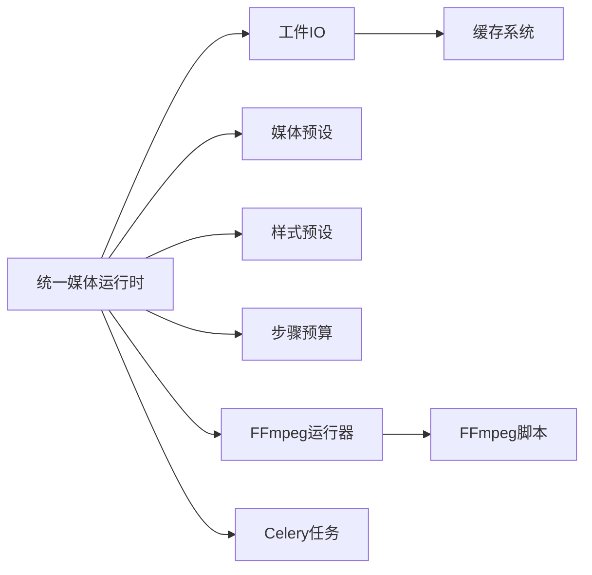

# 媒体处理流水线

<cite>
**本文引用的文件**   
- [pipeline/artifacts_io.py](file://pipeline/artifacts_io.py)
- [pipeline/media_presets.py](file://pipeline/media_presets.py)
- [pipeline/style_presets.py](file://pipeline/style_presets.py)
- [pipeline/step_budget.py](file://pipeline/step_budget.py)
- [pipeline/ffmpeg_runner.py](file://pipeline/ffmpeg_runner.py)
- [core/unified_media_runtime.py](file://core/unified_media_runtime.py)
- [backend/app/services/cache_system.py](file://backend/app/services/cache_system.py)
- [backend/app/celery_app.py](file://backend/app/celery_app.py)
- [scripts/ffmpeg/fast_transit.sh](file://scripts/ffmpeg/fast_transit.sh)
- [scripts/ffmpeg/slow_transit.sh](file://scripts/ffmpeg/slow_transit.sh)
</cite>

## 目录
1. [简介](#简介)
2. [项目结构](#项目结构)
3. [核心组件](#核心组件)
4. [架构总览](#架构总览)
5. [详细组件分析](#详细组件分析)
6. [依赖关系分析](#依赖关系分析)
7. [性能考虑](#性能考虑)
8. [故障排查指南](#故障排查指南)
9. [结论](#结论)
10. [附录](#附录)

## 简介
本技术文档面向小说创作代理系统中的“媒体处理流水线”，聚焦以下目标：
- 工件IO系统的数据持久化机制（文件存储策略、版本控制与缓存管理）
- 媒体预设配置系统（图像、视频、音频的格式参数、质量设置与转换规则）
- 样式预设管理机制（风格模板、参数继承与动态配置）
- 步骤预算控制（资源分配、进度跟踪与异常恢复）
- FFmpeg集成实现（命令构建、进程管理与输出处理）
- 媒体处理的性能优化（批处理、内存管理与并发控制）
- 错误处理与日志记录实践

## 项目结构
媒体处理流水线位于 pipeline 目录，关键模块包括：
- artifacts_io.py：工件IO抽象与持久化
- media_presets.py：媒体预设（图像/视频/音频）
- style_presets.py：样式预设（风格模板与继承）
- step_budget.py：步骤预算控制（配额与进度）
- ffmpeg_runner.py：FFmpeg执行器（命令构建与进程管理）
- core/unified_media_runtime.py：统一媒体运行时（跨适配器的媒体能力封装）
- backend/app/services/cache_system.py：缓存服务（分布式缓存与本地缓存）
- backend/app/celery_app.py：任务队列（Celery应用入口）
- scripts/ffmpeg/*.sh：FFmpeg脚本（快速/慢速转场）

**图表来源** 
- [pipeline/artifacts_io.py](file://pipeline/artifacts_io.py)
- [pipeline/media_presets.py](file://pipeline/media_presets.py)
- [pipeline/style_presets.py](file://pipeline/style_presets.py)
- [pipeline/step_budget.py](file://pipeline/step_budget.py)
- [pipeline/ffmpeg_runner.py](file://pipeline/ffmpeg_runner.py)
- [core/unified_media_runtime.py](file://core/unified_media_runtime.py)
- [backend/app/services/cache_system.py](file://backend/app/services/cache_system.py)
- [backend/app/celery_app.py](file://backend/app/celery_app.py)
- [scripts/ffmpeg/fast_transit.sh](file://scripts/ffmpeg/fast_transit.sh)
- [scripts/ffmpeg/slow_transit.sh](file://scripts/ffmpeg/slow_transit.sh)

**章节来源**
- [pipeline/artifacts_io.py](file://pipeline/artifacts_io.py)
- [pipeline/media_presets.py](file://pipeline/media_presets.py)
- [pipeline/style_presets.py](file://pipeline/style_presets.py)
- [pipeline/step_budget.py](file://pipeline/step_budget.py)
- [pipeline/ffmpeg_runner.py](file://pipeline/ffmpeg_runner.py)
- [core/unified_media_runtime.py](file://core/unified_media_runtime.py)
- [backend/app/services/cache_system.py](file://backend/app/services/cache_system.py)
- [backend/app/celery_app.py](file://backend/app/celery_app.py)
- [scripts/ffmpeg/fast_transit.sh](file://scripts/ffmpeg/fast_transit.sh)
- [scripts/ffmpeg/slow_transit.sh](file://scripts/ffmpeg/slow_transit.sh)

## 核心组件
- 工件IO系统：负责输入/输出的路径规划、版本化存储、元数据记录与缓存键生成。
- 媒体预设：集中管理图像、视频、音频的编码参数、质量阈值与转换规则。
- 样式预设：定义风格模板、参数继承链与动态配置注入。
- 步骤预算：为每个处理阶段设定配额、追踪进度并在超限时回滚或降级。
- FFmpeg运行器：构建命令行、管理子进程、捕获输出并处理失败重试。
- 统一媒体运行时：对外暴露一致的媒体处理能力，屏蔽底层适配器差异。
- 缓存系统：提供多级缓存（内存/Redis），支持失效策略与一致性校验。
- Celery应用：异步任务编排与调度，支撑高吞吐媒体处理。

**章节来源**
- [pipeline/artifacts_io.py](file://pipeline/artifacts_io.py)
- [pipeline/media_presets.py](file://pipeline/media_presets.py)
- [pipeline/style_presets.py](file://pipeline/style_presets.py)
- [pipeline/step_budget.py](file://pipeline/step_budget.py)
- [pipeline/ffmpeg_runner.py](file://pipeline/ffmpeg_runner.py)
- [core/unified_media_runtime.py](file://core/unified_media_runtime.py)
- [backend/app/services/cache_system.py](file://backend/app/services/cache_system.py)
- [backend/app/celery_app.py](file://backend/app/celery_app.py)

## 架构总览
媒体处理流水线以“统一媒体运行时”为中心，协调工件IO、媒体预设、样式预设、步骤预算与FFmpeg运行器，并通过缓存系统与Celery进行外部交互。

**图表来源** 
- [core/unified_media_runtime.py](file://core/unified_media_runtime.py)
- [pipeline/artifacts_io.py](file://pipeline/artifacts_io.py)
- [pipeline/media_presets.py](file://pipeline/media_presets.py)
- [pipeline/style_presets.py](file://pipeline/style_presets.py)
- [pipeline/step_budget.py](file://pipeline/step_budget.py)
- [pipeline/ffmpeg_runner.py](file://pipeline/ffmpeg_runner.py)
- [backend/app/services/cache_system.py](file://backend/app/services/cache_system.py)
- [backend/app/celery_app.py](file://backend/app/celery_app.py)

## 详细组件分析

### 工件IO系统（持久化、版本控制与缓存）
- 文件存储策略：按项目/任务维度组织目录，使用唯一ID与时间戳组合命名，避免冲突。
- 版本控制：每次写入生成新版本号，保留历史版本以便回滚与审计。
- 缓存管理：基于内容哈希或参数指纹生成缓存键，支持TTL与失效策略。
- 元数据记录：保存输入/输出路径、处理参数、时间戳与状态码。

**图表来源** 
- [pipeline/artifacts_io.py](file://pipeline/artifacts_io.py)
- [backend/app/services/cache_system.py](file://backend/app/services/cache_system.py)

**章节来源**
- [pipeline/artifacts_io.py](file://pipeline/artifacts_io.py)
- [backend/app/services/cache_system.py](file://backend/app/services/cache_system.py)

### 媒体预设（图像/视频/音频参数与转换规则）
- 图像预设：分辨率、色彩空间、压缩质量、缩放策略。
- 视频预设：编码器、码率、帧率、关键帧间隔、转场效果。
- 音频预设：采样率、声道数、比特率、降噪与响度标准化。
- 转换规则：根据输入类型自动选择最佳预设，支持覆盖与优先级。

**图表来源** 
- [pipeline/media_presets.py](file://pipeline/media_presets.py)

**章节来源**
- [pipeline/media_presets.py](file://pipeline/media_presets.py)

### 样式预设（风格模板、参数继承与动态配置）
- 风格模板：定义视觉/听觉风格基线（如色调、滤镜、音效库）。
- 参数继承：支持多层级继承（全局→项目→任务），后者优先级更高。
- 动态配置：运行时注入用户偏好或上下文变量，形成最终配置。

**图表来源** 
- [pipeline/style_presets.py](file://pipeline/style_presets.py)

**章节来源**
- [pipeline/style_presets.py](file://pipeline/style_presets.py)

### 步骤预算控制（资源分配、进度跟踪与异常恢复）
- 资源分配：为每个步骤分配CPU/内存/时间配额，防止单步占用过多。
- 进度跟踪：记录每步完成比例与累计进度，支持中断续跑。
- 异常恢复：超时或失败时触发回滚、重试或降级策略。

**图表来源** 
- [pipeline/step_budget.py](file://pipeline/step_budget.py)

**章节来源**
- [pipeline/step_budget.py](file://pipeline/step_budget.py)

### FFmpeg集成实现（命令构建、进程管理与输出处理）
- 命令构建：根据媒体预设与样式预设生成FFmpeg命令行。
- 进程管理：启动子进程、监控状态、捕获标准输出/错误流。
- 输出处理：解析输出元数据、校验完整性、处理失败重试。

**图表来源** 
- [pipeline/ffmpeg_runner.py](file://pipeline/ffmpeg_runner.py)
- [scripts/ffmpeg/fast_transit.sh](file://scripts/ffmpeg/fast_transit.sh)
- [scripts/ffmpeg/slow_transit.sh](file://scripts/ffmpeg/slow_transit.sh)

**章节来源**
- [pipeline/ffmpeg_runner.py](file://pipeline/ffmpeg_runner.py)
- [scripts/ffmpeg/fast_transit.sh](file://scripts/ffmpeg/fast_transit.sh)
- [scripts/ffmpeg/slow_transit.sh](file://scripts/ffmpeg/slow_transit.sh)

### 统一媒体运行时（核心协调器）
- 职责：协调工件IO、媒体预设、样式预设、步骤预算与FFmpeg运行器。
- 接口：提供统一的媒体处理能力，屏蔽底层适配器差异。
- 扩展性：支持插件式接入新的媒体处理器或缓存后端。

**图表来源** 
- [core/unified_media_runtime.py](file://core/unified_media_runtime.py)
- [pipeline/artifacts_io.py](file://pipeline/artifacts_io.py)
- [pipeline/media_presets.py](file://pipeline/media_presets.py)
- [pipeline/style_presets.py](file://pipeline/style_presets.py)
- [pipeline/step_budget.py](file://pipeline/step_budget.py)
- [pipeline/ffmpeg_runner.py](file://pipeline/ffmpeg_runner.py)

**章节来源**
- [core/unified_media_runtime.py](file://core/unified_media_runtime.py)

## 依赖关系分析
- 内聚性：各组件职责清晰，通过统一媒体运行时解耦。
- 耦合度：工件IO与缓存系统强相关；FFmpeg运行器依赖系统命令。
- 外部依赖：Celery用于异步任务；缓存系统可能依赖Redis。
- 循环依赖：无直接循环依赖，通过运行时协调。

**图表来源** 
- [core/unified_media_runtime.py](file://core/unified_media_runtime.py)
- [pipeline/artifacts_io.py](file://pipeline/artifacts_io.py)
- [pipeline/media_presets.py](file://pipeline/media_presets.py)
- [pipeline/style_presets.py](file://pipeline/style_presets.py)
- [pipeline/step_budget.py](file://pipeline/step_budget.py)
- [pipeline/ffmpeg_runner.py](file://pipeline/ffmpeg_runner.py)
- [backend/app/services/cache_system.py](file://backend/app/services/cache_system.py)
- [backend/app/celery_app.py](file://backend/app/celery_app.py)
- [scripts/ffmpeg/fast_transit.sh](file://scripts/ffmpeg/fast_transit.sh)
- [scripts/ffmpeg/slow_transit.sh](file://scripts/ffmpeg/slow_transit.sh)

**章节来源**
- [core/unified_media_runtime.py](file://core/unified_media_runtime.py)
- [pipeline/artifacts_io.py](file://pipeline/artifacts_io.py)
- [pipeline/media_presets.py](file://pipeline/media_presets.py)
- [pipeline/style_presets.py](file://pipeline/style_presets.py)
- [pipeline/step_budget.py](file://pipeline/step_budget.py)
- [pipeline/ffmpeg_runner.py](file://pipeline/ffmpeg_runner.py)
- [backend/app/services/cache_system.py](file://backend/app/services/cache_system.py)
- [backend/app/celery_app.py](file://backend/app/celery_app.py)
- [scripts/ffmpeg/fast_transit.sh](file://scripts/ffmpeg/fast_transit.sh)
- [scripts/ffmpeg/slow_transit.sh](file://scripts/ffmpeg/slow_transit.sh)

## 性能考虑
- 批处理：批量处理相似媒体任务，减少重复计算与I/O开销。
- 内存管理：流式处理大文件，避免一次性加载到内存。
- 并发控制：通过Celery限制并发任务数，避免资源争用。
- 缓存优化：合理设置TTL与失效策略，提高命中率。
- FFmpeg优化：选择合适的编码器与参数，利用硬件加速。

[本节为通用指导，无需特定文件引用]

## 故障排查指南
- 常见问题：
  - FFmpeg命令构建失败：检查预设参数合法性与路径有效性。
  - 缓存不一致：清理缓存键或强制刷新。
  - 步骤预算耗尽：调整配额或优化处理逻辑。
  - 进程崩溃：查看错误日志与输出流。
- 调试建议：
  - 启用详细日志记录，定位问题阶段。
  - 使用最小化复现用例隔离问题。
  - 监控资源使用情况（CPU/内存/磁盘）。

**章节来源**
- [pipeline/ffmpeg_runner.py](file://pipeline/ffmpeg_runner.py)
- [backend/app/services/cache_system.py](file://backend/app/services/cache_system.py)
- [pipeline/step_budget.py](file://pipeline/step_budget.py)

## 结论
媒体处理流水线通过模块化设计与统一运行时协调，实现了高效、可扩展的媒体处理能力。工件IO、媒体预设、样式预设、步骤预算与FFmpeg运行器各司其职，结合缓存系统与Celery任务，满足高吞吐与高可用的需求。未来可进一步优化批处理与并发控制，提升整体性能。

[本节为总结，无需特定文件引用]

## 附录
- 术语表：工件、预设、预算、运行时等。
- 配置示例：媒体预设与样式预设的典型配置。
- 部署指南：环境要求与依赖安装。

[本节为补充信息，无需特定文件引用]