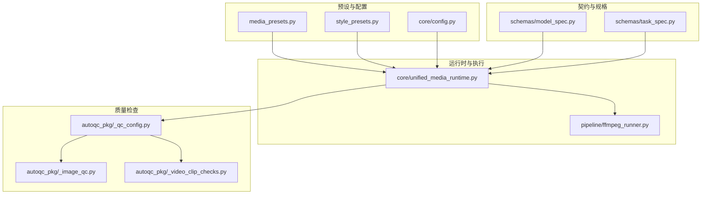
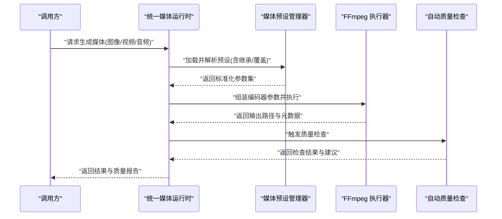
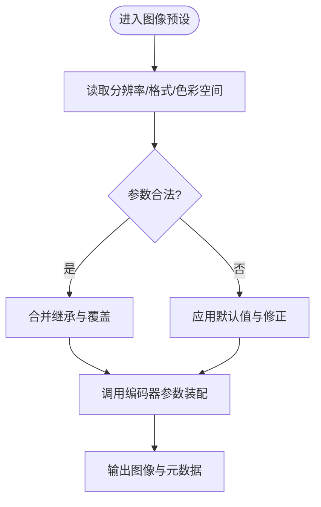
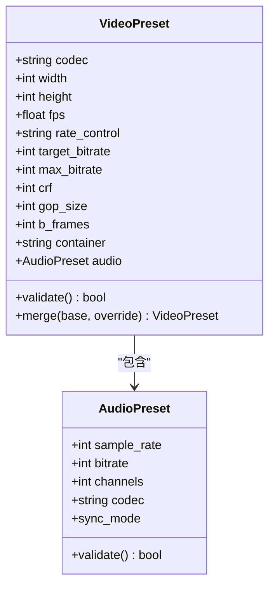
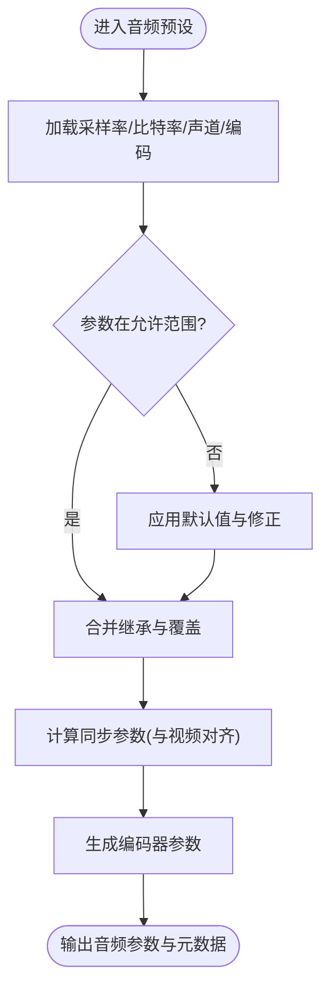
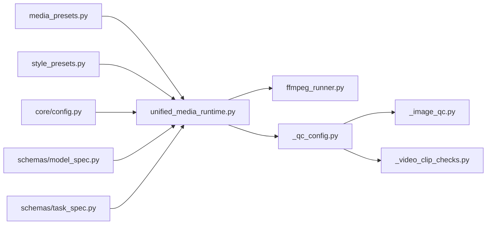

# 媒体预设配置

<cite>
**本文引用的文件**   
- [media_presets.py](file://pipeline/media_presets.py)
- [style_presets.py](file://pipeline/style_presets.py)
- [ffmpeg_runner.py](file://pipeline/ffmpeg_runner.py)
- [_qc_config.py](file://pipeline/autoqc_pkg/_qc_config.py)
- [_image_qc.py](file://pipeline/autoqc_pkg/_image_qc.py)
- [_video_clip_checks.py](file://pipeline/autoqc_pkg/_video_clip_checks.py)
- [config.py](file://core/config.py)
- [unified_media_runtime.py](file://core/unified_media_runtime.py)
- [model_spec.py](file://schemas/model_spec.py)
- [task_spec.py](file://schemas/task_spec.py)
</cite>

## 目录
1. [简介](#简介)
2. [项目结构](#项目结构)
3. [核心组件](#核心组件)
4. [架构总览](#架构总览)
5. [详细组件分析](#详细组件分析)
6. [依赖关系分析](#依赖关系分析)
7. [性能考虑](#性能考虑)
8. [故障排查指南](#故障排查指南)
9. [结论](#结论)
10. [附录](#附录)

## 简介
本技术文档面向小说创作代理系统中的“媒体预设配置系统”，聚焦图像、视频与音频三类媒体的预设定义、继承覆盖规则、参数校验与默认值处理，以及在不同媒体类型下的最佳实践与性能调优建议。文档旨在帮助开发者快速理解并扩展媒体预设体系，确保生成质量与资源消耗的可控性。

## 项目结构
媒体预设相关代码主要位于 pipeline 目录，其中：
- media_presets.py：集中管理图像、视频、音频的预设结构与解析逻辑
- style_presets.py：风格化相关的预设（如滤镜、调色）与媒体预设的联动
- ffmpeg_runner.py：基于 FFmpeg 的转码与合成执行器，使用预设参数驱动编码流程
- autoqc_pkg/_qc_config.py 等：自动质量检查（AutoQC）对预设参数的约束与验证
- core/config.py 与 core/unified_media_runtime.py：运行时配置加载与统一媒体运行时的参数装配
- schemas/model_spec.py、schemas/task_spec.py：模型与任务规格中对媒体参数的契约定义

图表来源
- [media_presets.py](file://pipeline/media_presets.py)
- [style_presets.py](file://pipeline/style_presets.py)
- [core/config.py](file://core/config.py)
- [core/unified_media_runtime.py](file://core/unified_media_runtime.py)
- [pipeline/ffmpeg_runner.py](file://pipeline/ffmpeg_runner.py)
- [pipeline/autoqc_pkg/_qc_config.py](file://pipeline/autoqc_pkg/_qc_config.py)
- [pipeline/autoqc_pkg/_image_qc.py](file://pipeline/autoqc_pkg/_image_qc.py)
- [pipeline/autoqc_pkg/_video_clip_checks.py](file://pipeline/autoqc_pkg/_video_clip_checks.py)
- [schemas/model_spec.py](file://schemas/model_spec.py)
- [schemas/task_spec.py](file://schemas/task_spec.py)

章节来源
- [media_presets.py](file://pipeline/media_presets.py)
- [style_presets.py](file://pipeline/style_presets.py)
- [ffmpeg_runner.py](file://pipeline/ffmpeg_runner.py)
- [_qc_config.py](file://pipeline/autoqc_pkg/_qc_config.py)
- [_image_qc.py](file://pipeline/autoqc_pkg/_image_qc.py)
- [_video_clip_checks.py](file://pipeline/autoqc_pkg/_video_clip_checks.py)
- [config.py](file://core/config.py)
- [unified_media_runtime.py](file://core/unified_media_runtime.py)
- [model_spec.py](file://schemas/model_spec.py)
- [task_spec.py](file://schemas/task_spec.py)

## 核心组件
- 媒体预设管理器（media_presets.py）
  - 负责图像、视频、音频三类预设的结构定义、合并与覆盖、默认值填充与校验
  - 提供按媒体类型获取预设、按环境或任务上下文选择预设的能力
- 风格预设（style_presets.py）
  - 管理与媒体渲染相关的风格化参数（如色彩空间、滤镜、色调映射），可与媒体预设组合
- 统一媒体运行时（unified_media_runtime.py）
  - 将预设转换为具体执行参数，协调编码器、转码器与质量检查
- FFmpeg 执行器（ffmpeg_runner.py）
  - 根据运行时参数调用 FFmpeg，完成编码、转码、合成等操作
- 自动质量检查（autoqc_pkg/_qc_config.py 及相关模块）
  - 对预设参数进行合法性校验与范围约束，输出质量报告与修正建议

章节来源
- [media_presets.py](file://pipeline/media_presets.py)
- [style_presets.py](file://pipeline/style_presets.py)
- [unified_media_runtime.py](file://core/unified_media_runtime.py)
- [ffmpeg_runner.py](file://pipeline/ffmpeg_runner.py)
- [_qc_config.py](file://pipeline/autoqc_pkg/_qc_config.py)
- [_image_qc.py](file://pipeline/autoqc_pkg/_image_qc.py)
- [_video_clip_checks.py](file://pipeline/autoqc_pkg/_video_clip_checks.py)

## 架构总览
媒体预设系统在运行时的工作流如下：
- 配置加载：从 core/config.py 读取全局与项目级配置
- 预设解析：通过 media_presets.py 解析用户或模板提供的预设，应用继承与覆盖规则
- 运行时装配：unified_media_runtime.py 将预设转为编码器可接受的参数集
- 执行与转码：ffmpeg_runner.py 调用 FFmpeg 完成实际编码与合成
- 质量检查：autoqc_pkg 对输出进行质量检查，必要时回退或提示调整

图表来源
- [unified_media_runtime.py](file://core/unified_media_runtime.py)
- [media_presets.py](file://pipeline/media_presets.py)
- [ffmpeg_runner.py](file://pipeline/ffmpeg_runner.py)
- [_qc_config.py](file://pipeline/autoqc_pkg/_qc_config.py)

## 详细组件分析

### 图像预设
- 分辨率与尺寸
  - 支持指定宽度/高度、长宽比、最大边限制；当未指定时由默认策略推导
  - 常见场景：横图（16:9）、竖图（9:16）、方形（1:1）
- 格式与压缩
  - 输出格式：JPEG、PNG、WebP 等；JPEG 支持质量等级与渐进式选项
  - 压缩策略：有损/无损开关、质量阈值、文件大小上限
- 色彩空间
  - 支持 sRGB、Adobe RGB、Rec.709 等；转换时进行色域适配与白点校正
- 其他参数
  - 锐化、降噪、EXIF 保留、元数据清理

图表来源
- [media_presets.py](file://pipeline/media_presets.py)
- [_image_qc.py](file://pipeline/autoqc_pkg/_image_qc.py)

章节来源
- [media_presets.py](file://pipeline/media_presets.py)
- [_image_qc.py](file://pipeline/autoqc_pkg/_image_qc.py)

### 视频预设
- 编码格式与容器
  - 编码：H.264/H.265、AV1 等；容器：MP4、MKV、MOV
- 码率控制
  - CBR/VBR/CRF 模式；目标码率、峰值码率、缓冲大小
- 帧率与同步
  - 帧率固定或自适应；音频同步选项（A/V 对齐、延迟补偿）
- 关键帧与 GOP
  - 关键帧间隔、B 帧数量、参考帧数
- 音频通道
  - 采样率、比特率、声道数、编码格式（AAC、Opus 等）

图表来源
- [media_presets.py](file://pipeline/media_presets.py)
- [_video_clip_checks.py](file://pipeline/autoqc_pkg/_video_clip_checks.py)

章节来源
- [media_presets.py](file://pipeline/media_presets.py)
- [_video_clip_checks.py](file://pipeline/autoqc_pkg/_video_clip_checks.py)

### 音频预设
- 采样率与比特率
  - 常用采样率：44.1kHz、48kHz；比特率：CBR/VBR 模式
- 声道数与编码格式
  - 单声道/立体声/多声道；编码格式：AAC、Opus、FLAC 等
- 音频同步选项
  - 与视频时间轴对齐、延迟补偿、静音裁剪

图表来源
- [media_presets.py](file://pipeline/media_presets.py)

章节来源
- [media_presets.py](file://pipeline/media_presets.py)

### 预设继承机制与参数覆盖规则
- 继承链
  - 基础预设 → 项目预设 → 任务预设 → 用户覆盖
- 覆盖优先级
  - 用户覆盖 > 任务预设 > 项目预设 > 基础预设
- 合并策略
  - 标量字段直接覆盖；数组/对象字段深度合并；冲突项以高优先级为准
- 不可变性与快照
  - 合并后生成只读副本，避免副作用；记录变更轨迹便于审计

图表来源
- [media_presets.py](file://pipeline/media_presets.py)

章节来源
- [media_presets.py](file://pipeline/media_presets.py)

### 预设验证与默认值处理
- 校验维度
  - 类型检查、取值范围、兼容性（编码与容器、分辨率与帧率）
- 默认值策略
  - 缺失字段按媒体类型与应用场景填充；冲突字段给出警告并修正
- 错误处理
  - 非法参数抛出明确错误；部分不兼容参数降级为安全默认值

图表来源
- [_qc_config.py](file://pipeline/autoqc_pkg/_qc_config.py)
- [_image_qc.py](file://pipeline/autoqc_pkg/_image_qc.py)
- [_video_clip_checks.py](file://pipeline/autoqc_pkg/_video_clip_checks.py)

章节来源
- [_qc_config.py](file://pipeline/autoqc_pkg/_qc_config.py)
- [_image_qc.py](file://pipeline/autoqc_pkg/_image_qc.py)
- [_video_clip_checks.py](file://pipeline/autoqc_pkg/_video_clip_checks.py)

### 不同媒体类型的最佳实践配置示例
- 图像
  - 社交媒体横图：1920x1080、JPEG、质量 85%、sRGB
  - 高清封面：2048x2048、PNG（无损）、sRGB、保留 EXIF
- 视频
  - 短视频平台：H.264、MP4、CRF 23、30fps、AAC 128kbps、立体声
  - 高质量存档：H.265、MKV、CRF 18、60fps、AAC 256kbps、立体声
- 音频
  - 播客旁白：AAC 48kHz、192kbps、立体声
  - 音乐片段：Opus 48kHz、VBR、立体声

[本节为概念性指导，不直接分析具体文件]

### 性能调优建议
- 图像
  - 批量处理时使用并行与缓存；合理设置 JPEG 质量与 WebP 压缩级别
- 视频
  - 选择合适的 CRF/CBR；减少 B 帧与参考帧数以降低编码耗时
  - 利用硬件加速（如 NVENC、QSV）提升吞吐
- 音频
  - 根据内容复杂度选择比特率；避免不必要的重采样
- 通用
  - 启用预编译与内存池；监控 CPU/GPU 占用与磁盘 I/O

[本节为通用性能建议，不直接分析具体文件]

## 依赖关系分析
媒体预设系统与运行时、执行器、质量检查之间的依赖关系如下：

图表来源
- [media_presets.py](file://pipeline/media_presets.py)
- [style_presets.py](file://pipeline/style_presets.py)
- [core/config.py](file://core/config.py)
- [core/unified_media_runtime.py](file://core/unified_media_runtime.py)
- [pipeline/ffmpeg_runner.py](file://pipeline/ffmpeg_runner.py)
- [pipeline/autoqc_pkg/_qc_config.py](file://pipeline/autoqc_pkg/_qc_config.py)
- [pipeline/autoqc_pkg/_image_qc.py](file://pipeline/autoqc_pkg/_image_qc.py)
- [pipeline/autoqc_pkg/_video_clip_checks.py](file://pipeline/autoqc_pkg/_video_clip_checks.py)
- [schemas/model_spec.py](file://schemas/model_spec.py)
- [schemas/task_spec.py](file://schemas/task_spec.py)

章节来源
- [media_presets.py](file://pipeline/media_presets.py)
- [style_presets.py](file://pipeline/style_presets.py)
- [core/config.py](file://core/config.py)
- [core/unified_media_runtime.py](file://core/unified_media_runtime.py)
- [pipeline/ffmpeg_runner.py](file://pipeline/ffmpeg_runner.py)
- [pipeline/autoqc_pkg/_qc_config.py](file://pipeline/autoqc_pkg/_qc_config.py)
- [pipeline/autoqc_pkg/_image_qc.py](file://pipeline/autoqc_pkg/_image_qc.py)
- [pipeline/autoqc_pkg/_video_clip_checks.py](file://pipeline/autoqc_pkg/_video_clip_checks.py)
- [schemas/model_spec.py](file://schemas/model_spec.py)
- [schemas/task_spec.py](file://schemas/task_spec.py)

## 性能考虑
- 编码效率
  - 选择合适的编码参数（CRF/CBR、GOP、B 帧）平衡质量与速度
- 资源利用
  - 启用硬件加速、合理分配线程与缓冲区
- I/O 优化
  - 使用高速存储、减少临时文件读写、启用流式处理
- 监控与诊断
  - 记录关键指标（编码时长、CPU/GPU 利用率、输出大小）

[本节为通用性能讨论，不直接分析具体文件]

## 故障排查指南
- 常见问题
  - 参数非法或不兼容：检查类型与取值范围，查看警告与修正日志
  - 编码失败：确认编码器与容器支持、分辨率与帧率匹配
  - 音视频不同步：检查同步选项与延迟补偿参数
- 定位方法
  - 查看 AutoQC 报告与 FFmpeg 输出日志
  - 逐步缩小覆盖范围，定位冲突参数
- 修复建议
  - 回退到安全默认值；调整编码参数；更新依赖库版本

章节来源
- [_qc_config.py](file://pipeline/autoqc_pkg/_qc_config.py)
- [_image_qc.py](file://pipeline/autoqc_pkg/_image_qc.py)
- [_video_clip_checks.py](file://pipeline/autoqc_pkg/_video_clip_checks.py)
- [ffmpeg_runner.py](file://pipeline/ffmpeg_runner.py)

## 结论
媒体预设配置系统通过清晰的层次化预设、严格的参数校验与灵活的覆盖机制，为图像、视频与音频的生成提供了稳定且高效的支撑。结合 AutoQC 的质量保障与 FFmpeg 的强大编码能力，系统能够在保证输出质量的同时实现良好的性能表现。建议在实际使用中遵循最佳实践配置，并根据业务需求进行适度调优。

[本节为总结性内容，不直接分析具体文件]

## 附录
- 术语表
  - 预设：一组用于媒体处理的参数集合
  - 继承：低层级预设向高层级传递默认值
  - 覆盖：高层级预设替换低层级预设中的特定参数
  - CRF：恒定质量因子，用于可变码率编码
  - CBR/VBR：恒定/可变码率控制
- 参考文件
  - 媒体预设与运行时：见上述引用文件列表

[本节为补充信息，不直接分析具体文件]