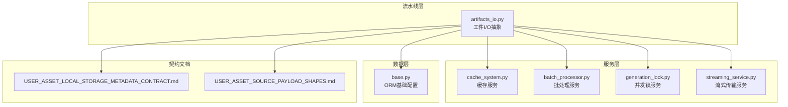
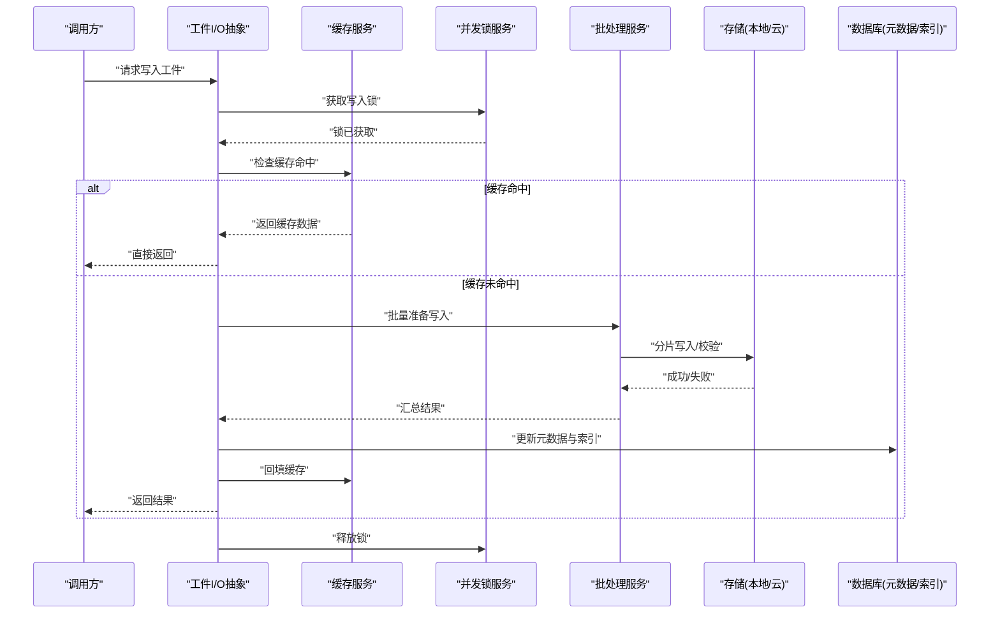
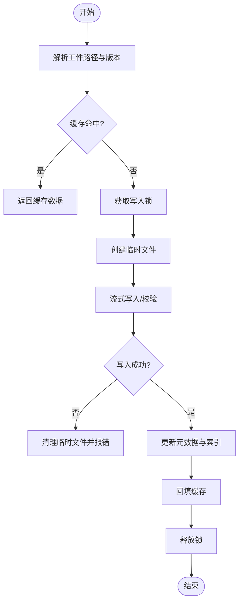
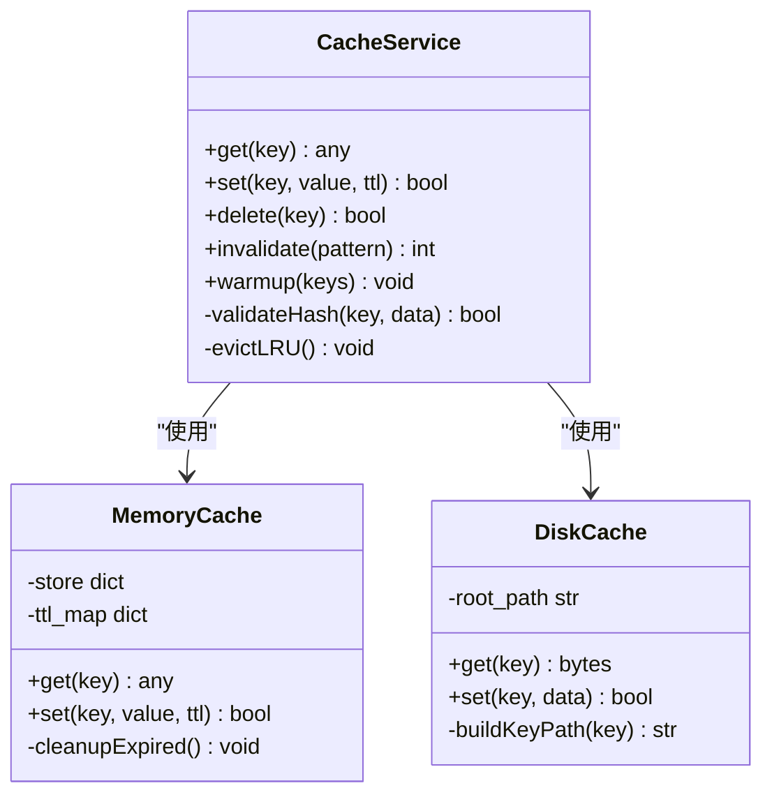
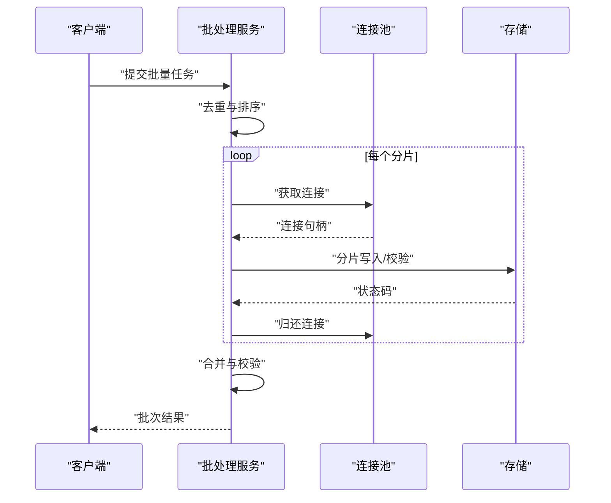
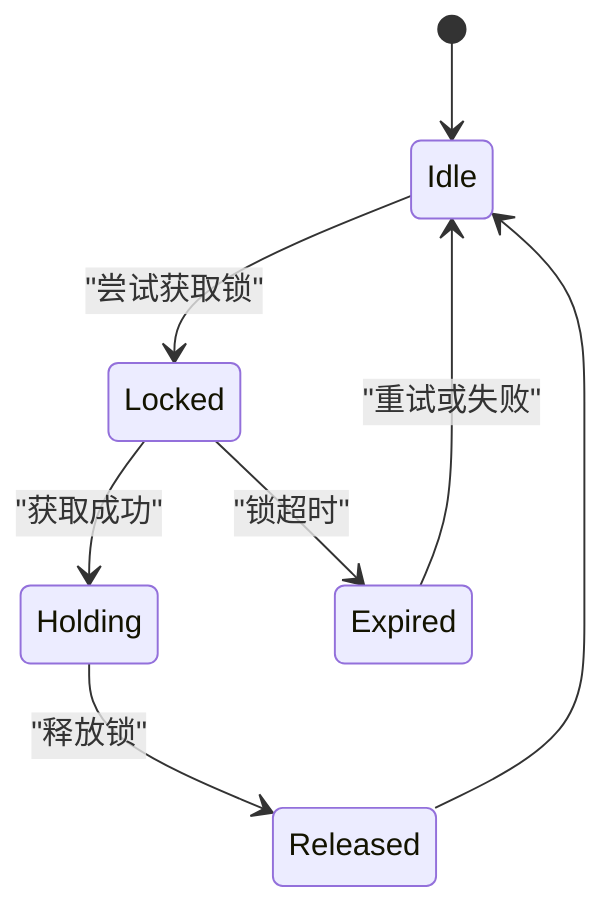
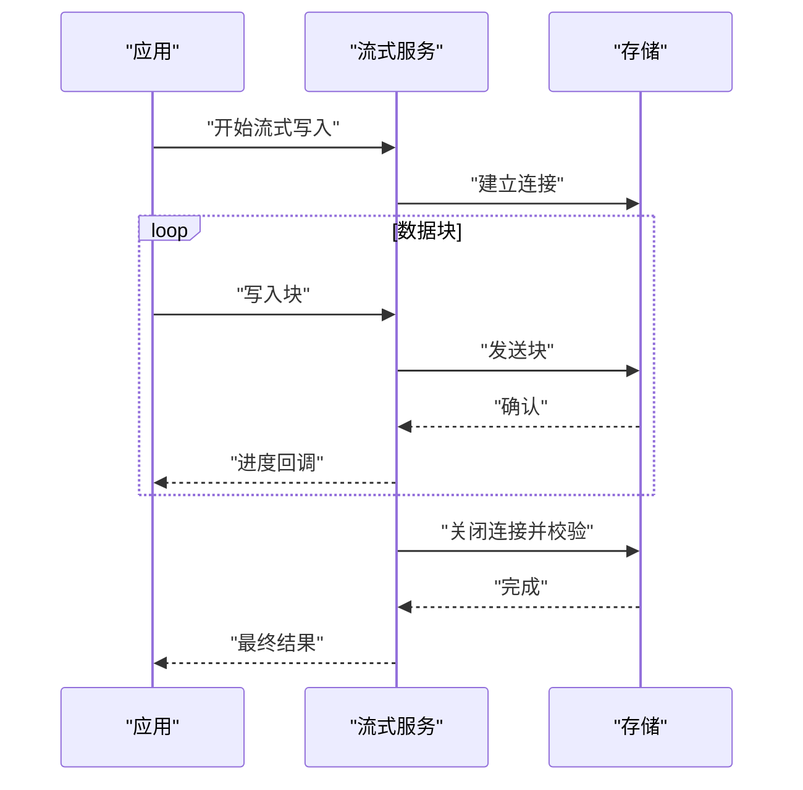
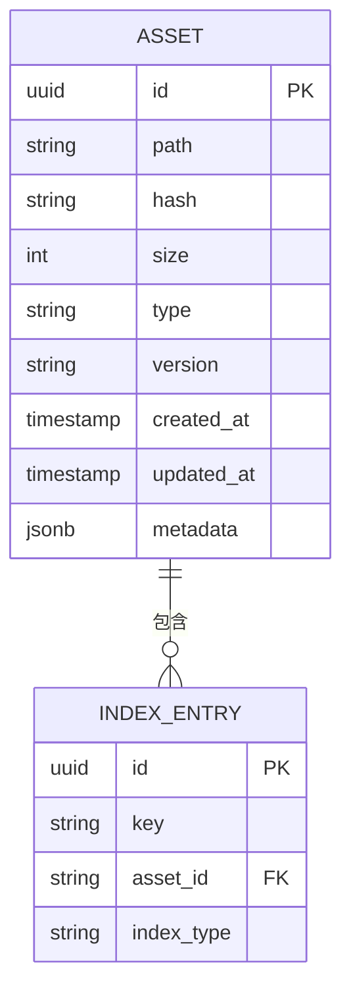
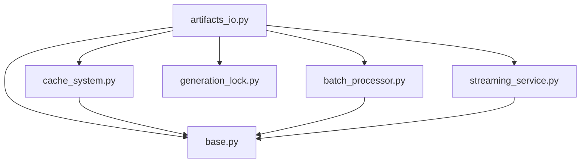

# 工件IO系统

<cite>
**本文引用的文件**   
- [artifacts_io.py](file://pipeline/artifacts_io.py)
- [cache_system.py](file://backend/app/services/cache_system.py)
- [batch_processor.py](file://backend/app/services/batch_processor.py)
- [generation_lock.py](file://backend/app/services/generation_lock.py)
- [streaming_service.py](file://backend/app/services/streaming_service.py)
- [USER_ASSET_LOCAL_STORAGE_METADATA_CONTRACT.md](file://docs/contracts/USER_ASSET_LOCAL_STORAGE_METADATA_CONTRACT.md)
- [USER_ASSET_SOURCE_PAYLOAD_SHAPES.md](file://docs/contracts/USER_ASSET_SOURCE_PAYLOAD_SHAPES.md)
- [main.py](file://backend/app/main.py)
- [celery_app.py](file://backend/app/celery_app.py)
- [base.py](file://backend/app/db/base.py)
</cite>

## 目录
1. [简介](#简介)
2. [项目结构](#项目结构)
3. [核心组件](#核心组件)
4. [架构总览](#架构总览)
5. [详细组件分析](#详细组件分析)
6. [依赖关系分析](#依赖关系分析)
7. [性能考虑](#性能考虑)
8. [故障排查指南](#故障排查指南)
9. [结论](#结论)
10. [附录](#附录)

## 简介
本技术文档聚焦于小说创作代理系统的“工件IO系统”，围绕工件的持久化、缓存管理、文件读写抽象接口、元数据管理与索引、性能优化与故障恢复等方面，提供系统化、可落地的设计与实现说明。该子系统贯穿内容生成、编辑、审核与交付的全链路，确保多模态工件（文本、图像、音频、视频等）在本地与云端存储之间高效、可靠地流转，并提供一致的访问语义与事务性保障。

## 项目结构
工件IO系统主要分布在以下位置：
- pipeline 层：定义统一的工件I/O抽象与流程编排
- backend/app/services：缓存、批处理、锁、流式传输等服务
- backend/app/db：数据库模型与迁移，支撑元数据与索引
- docs/contracts：工件本地存储契约与载荷形状规范

**图示来源** 
- [artifacts_io.py](file://pipeline/artifacts_io.py)
- [cache_system.py](file://backend/app/services/cache_system.py)
- [batch_processor.py](file://backend/app/services/batch_processor.py)
- [generation_lock.py](file://backend/app/services/generation_lock.py)
- [streaming_service.py](file://backend/app/services/streaming_service.py)
- [base.py](file://backend/app/db/base.py)
- [USER_ASSET_LOCAL_STORAGE_METADATA_CONTRACT.md](file://docs/contracts/USER_ASSET_LOCAL_STORAGE_METADATA_CONTRACT.md)
- [USER_ASSET_SOURCE_PAYLOAD_SHAPES.md](file://docs/contracts/USER_ASSET_SOURCE_PAYLOAD_SHAPES.md)

**章节来源**
- [artifacts_io.py](file://pipeline/artifacts_io.py)
- [cache_system.py](file://backend/app/services/cache_system.py)
- [batch_processor.py](file://backend/app/services/batch_processor.py)
- [generation_lock.py](file://backend/app/services/generation_lock.py)
- [streaming_service.py](file://backend/app/services/streaming_service.py)
- [base.py](file://backend/app/db/base.py)
- [USER_ASSET_LOCAL_STORAGE_METADATA_CONTRACT.md](file://docs/contracts/USER_ASSET_LOCAL_STORAGE_METADATA_CONTRACT.md)
- [USER_ASSET_SOURCE_PAYLOAD_SHAPES.md](file://docs/contracts/USER_ASSET_SOURCE_PAYLOAD_SHAPES.md)

## 核心组件
- 工件I/O抽象：统一封装本地/云存储的文件读写、目录组织、命名规则与版本控制策略，提供异步写入、断点续传、校验与回滚能力。
- 缓存服务：多级缓存（内存+磁盘），支持LRU/TTL失效、热点预热、一致性校验与跨进程共享。
- 批处理服务：批量上传/下载、分片合并、去重与幂等提交，提升吞吐并降低网络开销。
- 并发锁服务：基于分布式锁或文件锁的互斥机制，避免重复生成与覆盖写冲突。
- 流式传输服务：面向大文件的流式读取/写入、进度上报与中断恢复。
- 元数据与索引：通过数据库记录文件属性、哈希、版本、路径映射；构建倒排/向量索引以支持检索与溯源。

**章节来源**
- [artifacts_io.py](file://pipeline/artifacts_io.py)
- [cache_system.py](file://backend/app/services/cache_system.py)
- [batch_processor.py](file://backend/app/services/batch_processor.py)
- [generation_lock.py](file://backend/app/services/generation_lock.py)
- [streaming_service.py](file://backend/app/services/streaming_service.py)
- [USER_ASSET_LOCAL_STORAGE_METADATA_CONTRACT.md](file://docs/contracts/USER_ASSET_LOCAL_STORAGE_METADATA_CONTRACT.md)
- [USER_ASSET_SOURCE_PAYLOAD_SHAPES.md](file://docs/contracts/USER_ASSET_SOURCE_PAYLOAD_SHAPES.md)

## 架构总览
工件IO系统采用分层设计：上层为应用与流水线调用，中层为服务层（缓存、批处理、锁、流式传输），底层为持久化（文件系统与数据库）。所有操作遵循契约文档定义的元数据结构与载荷格式，保证跨模块一致性与可演进性。

**图示来源** 
- [artifacts_io.py](file://pipeline/artifacts_io.py)
- [cache_system.py](file://backend/app/services/cache_system.py)
- [batch_processor.py](file://backend/app/services/batch_processor.py)
- [generation_lock.py](file://backend/app/services/generation_lock.py)
- [streaming_service.py](file://backend/app/services/streaming_service.py)
- [base.py](file://backend/app/db/base.py)

## 详细组件分析

### 工件I/O抽象（artifacts_io.py）
- 职责：统一文件路径解析、目录结构设计、命名规范、版本控制、异步读写、错误重试与事务边界。
- 关键特性：
  - 目录结构：按项目/任务维度划分，子目录按类型（文本/图像/音频/视频）与时间戳组织，便于归档与清理。
  - 命名规范：包含业务ID、版本号、哈希片段与扩展名，确保唯一性与可追溯性。
  - 版本控制：同一路径下保留历史版本，支持快照回滚与差异对比。
  - 异步处理：基于事件循环的异步读写，结合流式传输减少内存峰值。
  - 错误重试：指数退避与最大重试次数限制，区分可恢复与不可恢复错误。
  - 事务支持：写入前创建临时文件，成功后原子替换目标文件，失败则清理临时文件。

**图示来源** 
- [artifacts_io.py](file://pipeline/artifacts_io.py)

**章节来源**
- [artifacts_io.py](file://pipeline/artifacts_io.py)

### 缓存服务（cache_system.py）
- 策略：多级缓存（内存L1 + 磁盘L2），支持TTL与LRU淘汰，热点数据自动预热。
- 失效机制：基于时间过期、显式失效键、内容哈希变更触发失效。
- 内存优化：对象池复用、压缩存储、按需加载与分页读取。
- 一致性：读时校验哈希，写时原子更新，跨进程共享通过文件或外部缓存后端。

**图示来源** 
- [cache_system.py](file://backend/app/services/cache_system.py)

**章节来源**
- [cache_system.py](file://backend/app/services/cache_system.py)

### 批处理服务（batch_processor.py）
- 功能：批量上传/下载、分片合并、去重与幂等提交。
- 优化：并行度控制、连接池复用、断点续传、失败重试与补偿任务。
- 事务：批次级事务，全部成功才提交，部分失败进行回滚或重试。

**图示来源** 
- [batch_processor.py](file://backend/app/services/batch_processor.py)

**章节来源**
- [batch_processor.py](file://backend/app/services/batch_processor.py)

### 并发锁服务（generation_lock.py）
- 目的：防止同一工件的重复生成与覆盖写冲突。
- 实现：基于分布式锁或文件锁，支持超时与看门狗续约。
- 场景：生成任务、导出任务、批量导入等需要互斥的操作。

**图示来源** 
- [generation_lock.py](file://backend/app/services/generation_lock.py)

**章节来源**
- [generation_lock.py](file://backend/app/services/generation_lock.py)

### 流式传输服务（streaming_service.py）
- 能力：大文件流式读取/写入、进度回调、中断恢复、带宽限速。
- 集成：与工件I/O抽象协作，提供异步流式API，适配不同存储后端。
- 可靠性：校验和验证、分段重试、异常隔离。

**图示来源** 
- [streaming_service.py](file://backend/app/services/streaming_service.py)

**章节来源**
- [streaming_service.py](file://backend/app/services/streaming_service.py)

### 元数据与索引（base.py 与契约文档）
- 元数据：记录文件路径、哈希、大小、类型、版本、创建时间、关联任务等。
- 索引：构建倒排索引与向量索引，支持关键词搜索与语义检索。
- 契约：遵循本地存储元数据契约与源载荷形状规范，确保前后端一致。

**图示来源** 
- [base.py](file://backend/app/db/base.py)
- [USER_ASSET_LOCAL_STORAGE_METADATA_CONTRACT.md](file://docs/contracts/USER_ASSET_LOCAL_STORAGE_METADATA_CONTRACT.md)
- [USER_ASSET_SOURCE_PAYLOAD_SHAPES.md](file://docs/contracts/USER_ASSET_SOURCE_PAYLOAD_SHAPES.md)

**章节来源**
- [base.py](file://backend/app/db/base.py)
- [USER_ASSET_LOCAL_STORAGE_METADATA_CONTRACT.md](file://docs/contracts/USER_ASSET_LOCAL_STORAGE_METADATA_CONTRACT.md)
- [USER_ASSET_SOURCE_PAYLOAD_SHAPES.md](file://docs/contracts/USER_ASSET_SOURCE_PAYLOAD_SHAPES.md)

## 依赖关系分析
工件IO系统与缓存、批处理、锁、流式传输及数据库紧密耦合，形成稳定的依赖层次。上层调用通过I/O抽象屏蔽底层实现细节，服务层提供横向能力，数据层保障一致性与可查询性。

**图示来源** 
- [artifacts_io.py](file://pipeline/artifacts_io.py)
- [cache_system.py](file://backend/app/services/cache_system.py)
- [batch_processor.py](file://backend/app/services/batch_processor.py)
- [generation_lock.py](file://backend/app/services/generation_lock.py)
- [streaming_service.py](file://backend/app/services/streaming_service.py)
- [base.py](file://backend/app/db/base.py)

**章节来源**
- [artifacts_io.py](file://pipeline/artifacts_io.py)
- [cache_system.py](file://backend/app/services/cache_system.py)
- [batch_processor.py](file://backend/app/services/batch_processor.py)
- [generation_lock.py](file://backend/app/services/generation_lock.py)
- [streaming_service.py](file://backend/app/services/streaming_service.py)
- [base.py](file://backend/app/db/base.py)

## 性能考虑
- 批量操作：合并小文件写入、分片并行上传、去重与幂等提交，显著降低I/O与网络开销。
- 连接池管理：复用HTTP/存储连接，减少握手成本；设置合理的超时与重试策略。
- 磁盘I/O优化：顺序写入优先、预分配空间、异步刷盘与缓冲池；对热点数据启用内存缓存。
- 缓存命中率：热点预热、LRU淘汰、TTL合理设置；读路径优先走缓存，写路径同步更新。
- 流式处理：避免全量加载到内存，使用分块传输与增量校验，降低峰值内存占用。
- 索引构建：增量更新与后台重建，避免阻塞主流程；使用合适的索引结构与查询计划。

[本节为通用指导，不直接分析具体文件]

## 故障排查指南
- 常见问题：
  - 写入失败：检查临时文件是否清理、锁是否释放、存储连接是否正常。
  - 缓存不一致：核对哈希校验、TTL设置与失效策略；查看缓存回填日志。
  - 批处理失败：定位失败分片、检查重试计数与补偿任务；确认去重逻辑。
  - 流式中断：检查带宽限速与超时设置；确认进度回调与断点续传。
  - 元数据错误：核对数据库约束与索引完整性；验证契约字段与载荷形状。
- 诊断手段：
  - 启用详细日志与追踪ID，定位调用链路与失败点。
  - 使用健康检查接口监控缓存命中率、连接池状态与队列积压。
  - 定期运行一致性校验脚本，修复损坏的元数据与索引。

**章节来源**
- [artifacts_io.py](file://pipeline/artifacts_io.py)
- [cache_system.py](file://backend/app/services/cache_system.py)
- [batch_processor.py](file://backend/app/services/batch_processor.py)
- [generation_lock.py](file://backend/app/services/generation_lock.py)
- [streaming_service.py](file://backend/app/services/streaming_service.py)
- [USER_ASSET_LOCAL_STORAGE_METADATA_CONTRACT.md](file://docs/contracts/USER_ASSET_LOCAL_STORAGE_METADATA_CONTRACT.md)
- [USER_ASSET_SOURCE_PAYLOAD_SHAPES.md](file://docs/contracts/USER_ASSET_SOURCE_PAYLOAD_SHAPES.md)

## 结论
工件IO系统通过清晰的层次划分与稳健的服务能力，实现了高吞吐、低延迟、强一致的内容生产与交付。借助缓存、批处理、锁与流式传输等横向能力，系统在大规模多模态工件场景下具备可扩展性与可维护性。配合完善的元数据与索引体系，以及严格的契约规范，确保了端到端的数据一致性与可追溯性。

[本节为总结性内容，不直接分析具体文件]

## 附录
- 相关入口与服务：
  - 应用入口：[main.py](file://backend/app/main.py)
  - 任务调度：[celery_app.py](file://backend/app/celery_app.py)
- 契约与规范：
  - 本地存储元数据契约：[USER_ASSET_LOCAL_STORAGE_METADATA_CONTRACT.md](file://docs/contracts/USER_ASSET_LOCAL_STORAGE_METADATA_CONTRACT.md)
  - 源载荷形状规范：[USER_ASSET_SOURCE_PAYLOAD_SHAPES.md](file://docs/contracts/USER_ASSET_SOURCE_PAYLOAD_SHAPES.md)

**章节来源**
- [main.py](file://backend/app/main.py)
- [celery_app.py](file://backend/app/celery_app.py)
- [USER_ASSET_LOCAL_STORAGE_METADATA_CONTRACT.md](file://docs/contracts/USER_ASSET_LOCAL_STORAGE_METADATA_CONTRACT.md)
- [USER_ASSET_SOURCE_PAYLOAD_SHAPES.md](file://docs/contracts/USER_ASSET_SOURCE_PAYLOAD_SHAPES.md)