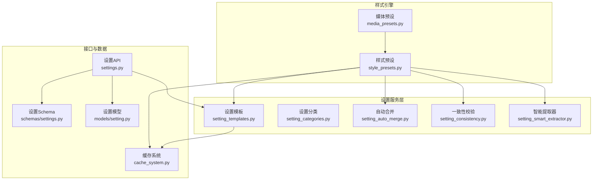
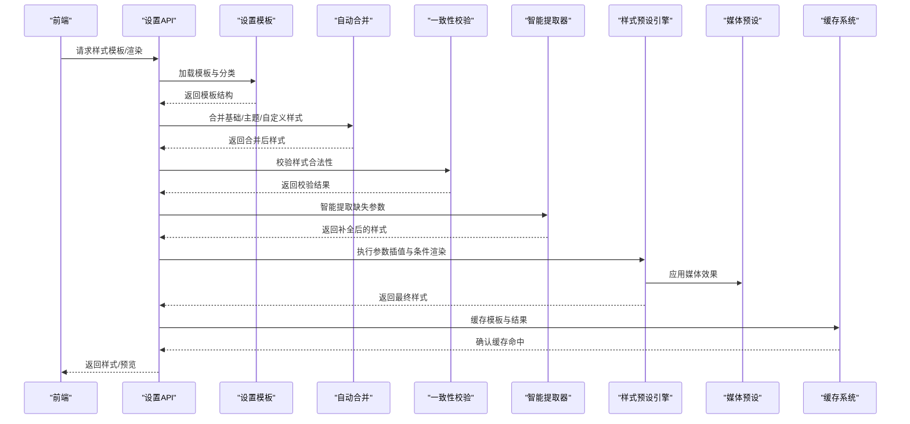
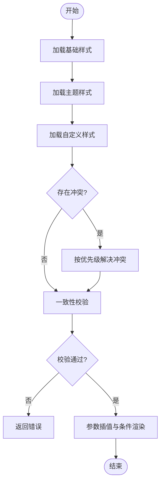
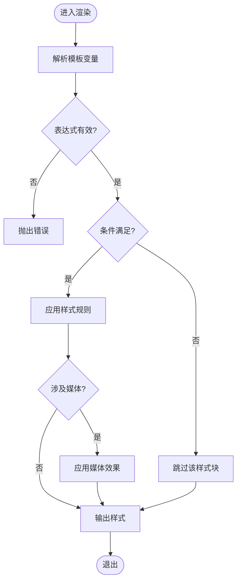
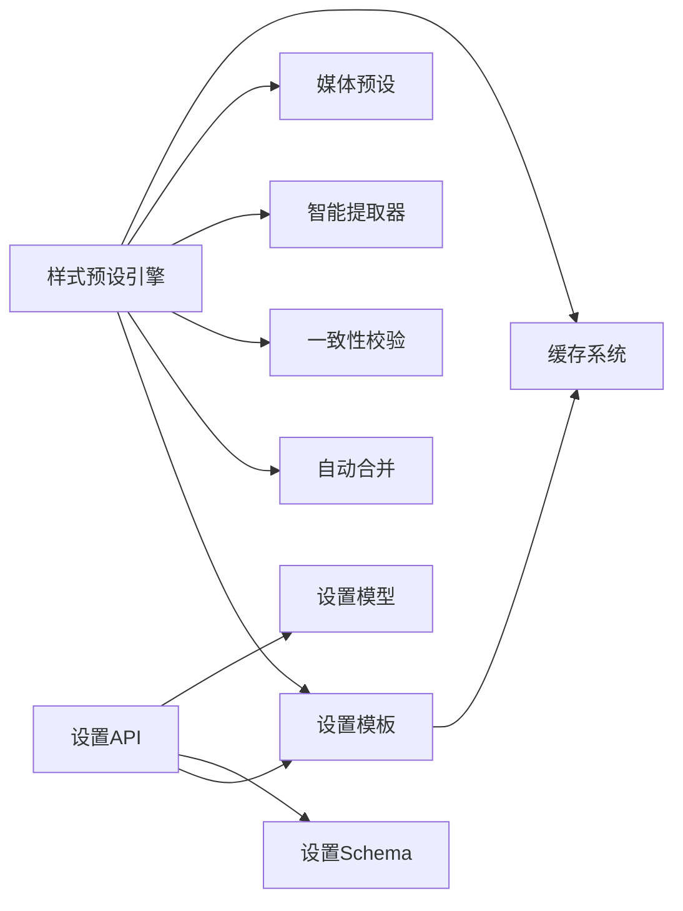

# 样式预设管理

<cite>
**本文引用的文件**   
- [style_presets.py](file://pipeline/style_presets.py)
- [media_presets.py](file://pipeline/media_presets.py)
- [setting_templates.py](file://backend/app/services/setting_templates.py)
- [setting_categories.py](file://backend/app/services/setting_categories.py)
- [setting_auto_merge.py](file://backend/app/services/setting_auto_merge.py)
- [setting_consistency.py](file://backend/app/services/setting_consistency.py)
- [setting_smart_extractor.py](file://backend/app/services/setting_smart_extractor.py)
- [settings.py](file://backend/app/api/v1/settings_api/settings.py)
- [schemas/settings.py](file://backend/app/schemas/settings.py)
- [models/setting.py](file://backend/app/models/setting.py)
- [services/cache_system.py](file://backend/app/services/cache_system.py)
</cite>

## 目录
1. [简介](#简介)
2. [项目结构](#项目结构)
3. [核心组件](#核心组件)
4. [架构总览](#架构总览)
5. [详细组件分析](#详细组件分析)
6. [依赖关系分析](#依赖关系分析)
7. [性能考虑](#性能考虑)
8. [故障排查指南](#故障排查指南)
9. [结论](#结论)
10. [附录](#附录)

## 简介
本技术文档面向“小说创作代理系统”的样式预设管理系统，聚焦以下目标：
- 样式模板定义结构：视觉风格参数、文本样式规则、多媒体效果配置
- 样式继承机制：基础样式、主题样式、自定义样式的层次关系与合并策略
- 动态样式生成算法：参数插值、条件渲染、实时调整
- 样式缓存与预编译：性能优化与热重载支持
- 调试工具与使用示例：预览功能与错误诊断
- 扩展与自定义开发指导原则

本系统通过后端服务层对样式模板进行统一建模、解析、合并与渲染，并通过API对外暴露能力；同时在前端提供预览与交互入口。

## 项目结构
样式相关代码主要分布在以下位置：
- pipeline/style_presets.py：样式预设的核心处理逻辑（解析、合并、渲染）
- pipeline/media_presets.py：媒体资源与多媒体效果的预设管理
- backend/app/services/setting_templates.py：设置模板的定义与加载
- backend/app/services/setting_categories.py：设置分类与分组
- backend/app/services/setting_auto_merge.py：自动合并策略
- backend/app/services/setting_consistency.py：一致性校验
- backend/app/services/setting_smart_extractor.py：智能提取器（从内容推导样式）
- backend/app/api/v1/settings_api/settings.py：设置相关的API路由
- backend/app/schemas/settings.py：设置数据模型与校验
- backend/app/models/setting.py：持久化模型
- backend/app/services/cache_system.py：缓存系统（用于样式缓存与预编译）

图表来源
- [style_presets.py](file://pipeline/style_presets.py)
- [media_presets.py](file://pipeline/media_presets.py)
- [setting_templates.py](file://backend/app/services/setting_templates.py)
- [setting_categories.py](file://backend/app/services/setting_categories.py)
- [setting_auto_merge.py](file://backend/app/services/setting_auto_merge.py)
- [setting_consistency.py](file://backend/app/services/setting_consistency.py)
- [setting_smart_extractor.py](file://backend/app/services/setting_smart_extractor.py)
- [settings.py](file://backend/app/api/v1/settings_api/settings.py)
- [schemas/settings.py](file://backend/app/schemas/settings.py)
- [models/setting.py](file://backend/app/models/setting.py)
- [cache_system.py](file://backend/app/services/cache_system.py)

章节来源
- [style_presets.py](file://pipeline/style_presets.py)
- [media_presets.py](file://pipeline/media_presets.py)
- [setting_templates.py](file://backend/app/services/setting_templates.py)
- [setting_categories.py](file://backend/app/services/setting_categories.py)
- [setting_auto_merge.py](file://backend/app/services/setting_auto_merge.py)
- [setting_consistency.py](file://backend/app/services/setting_consistency.py)
- [setting_smart_extractor.py](file://backend/app/services/setting_smart_extractor.py)
- [settings.py](file://backend/app/api/v1/settings_api/settings.py)
- [schemas/settings.py](file://backend/app/schemas/settings.py)
- [models/setting.py](file://backend/app/models/setting.py)
- [cache_system.py](file://backend/app/services/cache_system.py)

## 核心组件
- 样式预设引擎（style_presets.py）
  - 负责样式模板的解析、继承合并、参数插值、条件渲染与最终输出
  - 提供渲染管线，将基础样式、主题样式与自定义样式按优先级合并
- 媒体预设（media_presets.py）
  - 管理图片、音频、视频等多媒体资源的样式配置（如滤镜、转场、音量曲线等）
- 设置模板与分类（setting_templates.py, setting_categories.py）
  - 定义可复用的样式模板结构与分类体系，便于组织与管理
- 自动合并与一致性（setting_auto_merge.py, setting_consistency.py）
  - 实现多源样式的冲突解决策略与约束校验
- 智能提取器（setting_smart_extractor.py）
  - 从文本或上下文推断样式参数，辅助自动生成或补全样式
- 缓存系统（cache_system.py）
  - 为样式模板与渲染结果提供缓存，支持预编译与热重载

章节来源
- [style_presets.py](file://pipeline/style_presets.py)
- [media_presets.py](file://pipeline/media_presets.py)
- [setting_templates.py](file://backend/app/services/setting_templates.py)
- [setting_categories.py](file://backend/app/services/setting_categories.py)
- [setting_auto_merge.py](file://backend/app/services/setting_auto_merge.py)
- [setting_consistency.py](file://backend/app/services/setting_consistency.py)
- [setting_smart_extractor.py](file://backend/app/services/setting_smart_extractor.py)
- [cache_system.py](file://backend/app/services/cache_system.py)

## 架构总览
样式预设管理的整体流程如下：
- 前端通过设置API请求样式模板或渲染结果
- 后端根据模板ID与上下文构建样式树（基础→主题→自定义）
- 自动合并策略解决冲突，一致性校验确保合法
- 智能提取器补充缺失参数，生成最终样式对象
- 渲染管线执行参数插值与条件渲染，输出最终样式
- 缓存系统存储模板与渲染结果，支持热重载

图表来源
- [settings.py](file://backend/app/api/v1/settings_api/settings.py)
- [setting_templates.py](file://backend/app/services/setting_templates.py)
- [setting_auto_merge.py](file://backend/app/services/setting_auto_merge.py)
- [setting_consistency.py](file://backend/app/services/setting_consistency.py)
- [setting_smart_extractor.py](file://backend/app/services/setting_smart_extractor.py)
- [style_presets.py](file://pipeline/style_presets.py)
- [media_presets.py](file://pipeline/media_presets.py)
- [cache_system.py](file://backend/app/services/cache_system.py)

## 详细组件分析

### 样式模板定义结构
- 视觉风格参数
  - 颜色、字体、间距、阴影、透明度等
  - 由模板字段定义，支持变量与表达式
- 文本样式规则
  - 段落、标题、引用、列表等文本元素的样式规则
  - 支持条件渲染（如按章节类型切换）
- 多媒体效果配置
  - 图片滤镜、音频淡入淡出、视频转场等
  - 由媒体预设统一管理，并与样式模板联动

章节来源
- [style_presets.py](file://pipeline/style_presets.py)
- [media_presets.py](file://pipeline/media_presets.py)
- [setting_templates.py](file://backend/app/services/setting_templates.py)

### 样式继承机制
- 基础样式：系统默认样式，不可覆盖
- 主题样式：项目级主题，覆盖基础样式
- 自定义样式：用户级定制，覆盖主题样式
- 合并策略：自底向上合并，冲突时以高优先级为准

图表来源
- [setting_auto_merge.py](file://backend/app/services/setting_auto_merge.py)
- [setting_consistency.py](file://backend/app/services/setting_consistency.py)
- [style_presets.py](file://pipeline/style_presets.py)

章节来源
- [setting_auto_merge.py](file://backend/app/services/setting_auto_merge.py)
- [setting_consistency.py](file://backend/app/services/setting_consistency.py)
- [style_presets.py](file://pipeline/style_presets.py)

### 动态样式生成算法
- 参数插值：支持变量替换与数学表达式计算
- 条件渲染：基于上下文（章节类型、角色状态等）动态选择样式
- 实时调整：监听用户输入或运行时事件，即时更新样式

图表来源
- [style_presets.py](file://pipeline/style_presets.py)
- [media_presets.py](file://pipeline/media_presets.py)

章节来源
- [style_presets.py](file://pipeline/style_presets.py)
- [media_presets.py](file://pipeline/media_presets.py)

### 样式缓存与预编译
- 模板缓存：按模板ID缓存解析后的结构
- 渲染缓存：按上下文哈希缓存渲染结果
- 预编译：启动时预编译常用模板，减少首次延迟
- 热重载：监听模板变更，自动失效并重建缓存

章节来源
- [cache_system.py](file://backend/app/services/cache_system.py)
- [setting_templates.py](file://backend/app/services/setting_templates.py)

### 调试工具与使用示例
- 预览功能：前端提供样式预览面板，实时显示渲染结果
- 错误诊断：记录模板解析错误、条件判断失败、媒体加载异常等
- 使用示例：通过API创建、更新、删除样式模板，并获取预览

章节来源
- [settings.py](file://backend/app/api/v1/settings_api/settings.py)
- [schemas/settings.py](file://backend/app/schemas/settings.py)
- [models/setting.py](file://backend/app/models/setting.py)

### 扩展与自定义开发指导原则
- 新增样式类型：在模板结构中定义新字段，并在渲染管线中处理
- 自定义合并策略：实现新的冲突解决逻辑，注册到合并器
- 媒体效果扩展：在媒体预设中添加新效果，并确保与样式模板兼容
- 智能提取规则：扩展提取器，支持从更多上下文推断样式

章节来源
- [style_presets.py](file://pipeline/style_presets.py)
- [media_presets.py](file://pipeline/media_presets.py)
- [setting_auto_merge.py](file://backend/app/services/setting_auto_merge.py)
- [setting_smart_extractor.py](file://backend/app/services/setting_smart_extractor.py)

## 依赖关系分析
样式预设管理与设置服务层紧密耦合，依赖关系如下：
- 样式预设引擎依赖设置模板、自动合并、一致性校验、智能提取器
- 媒体预设与样式预设引擎协作，提供多媒体效果
- API层依赖设置模板、Schema与模型，提供外部接口
- 缓存系统为模板与渲染结果提供缓存支持

图表来源
- [style_presets.py](file://pipeline/style_presets.py)
- [setting_templates.py](file://backend/app/services/setting_templates.py)
- [setting_auto_merge.py](file://backend/app/services/setting_auto_merge.py)
- [setting_consistency.py](file://backend/app/services/setting_consistency.py)
- [setting_smart_extractor.py](file://backend/app/services/setting_smart_extractor.py)
- [media_presets.py](file://pipeline/media_presets.py)
- [settings.py](file://backend/app/api/v1/settings_api/settings.py)
- [schemas/settings.py](file://backend/app/schemas/settings.py)
- [models/setting.py](file://backend/app/models/setting.py)
- [cache_system.py](file://backend/app/services/cache_system.py)

章节来源
- [style_presets.py](file://pipeline/style_presets.py)
- [setting_templates.py](file://backend/app/services/setting_templates.py)
- [setting_auto_merge.py](file://backend/app/services/setting_auto_merge.py)
- [setting_consistency.py](file://backend/app/services/setting_consistency.py)
- [setting_smart_extractor.py](file://backend/app/services/setting_smart_extractor.py)
- [media_presets.py](file://pipeline/media_presets.py)
- [settings.py](file://backend/app/api/v1/settings_api/settings.py)
- [schemas/settings.py](file://backend/app/schemas/settings.py)
- [models/setting.py](file://backend/app/models/setting.py)
- [cache_system.py](file://backend/app/services/cache_system.py)

## 性能考虑
- 模板预编译：启动时预编译高频模板，减少首次渲染延迟
- 渲染结果缓存：按上下文哈希缓存渲染结果，避免重复计算
- 增量更新：仅重新渲染变更的样式块，提升实时调整性能
- 媒体懒加载：按需加载媒体资源，减少初始负载

## 故障排查指南
- 模板解析错误：检查模板语法与变量定义
- 条件渲染失败：验证条件表达式与上下文数据
- 媒体加载异常：检查媒体路径与权限
- 缓存不一致：清理缓存并重新加载模板

章节来源
- [style_presets.py](file://pipeline/style_presets.py)
- [media_presets.py](file://pipeline/media_presets.py)
- [cache_system.py](file://backend/app/services/cache_system.py)

## 结论
样式预设管理系统通过清晰的模板结构、继承机制、动态渲染与缓存策略，为小说创作代理提供了灵活高效的样式管理能力。开发者可基于现有框架扩展新功能，满足多样化需求。

## 附录
- API参考：设置模板CRUD、样式渲染、预览接口
- 模板示例：基础样式、主题样式、自定义样式模板
- 最佳实践：命名规范、性能优化、错误处理