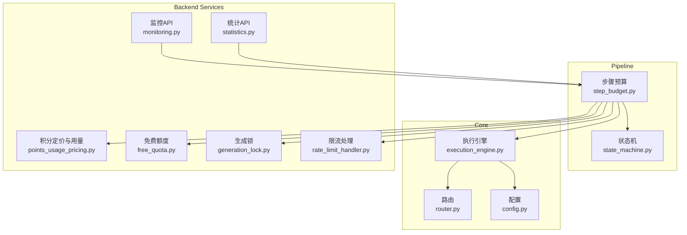
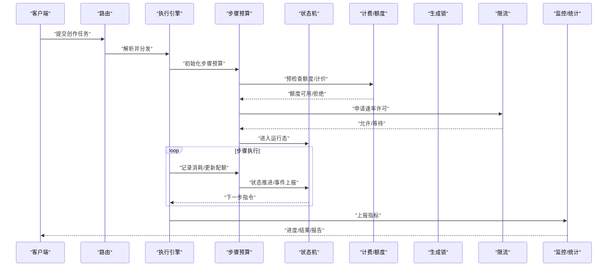
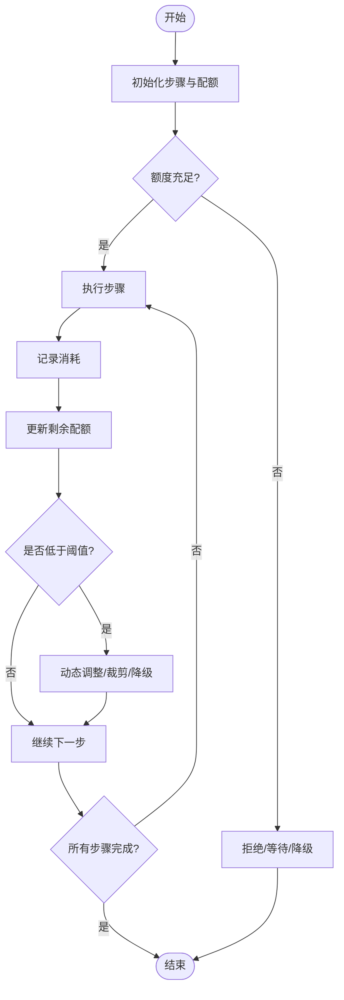
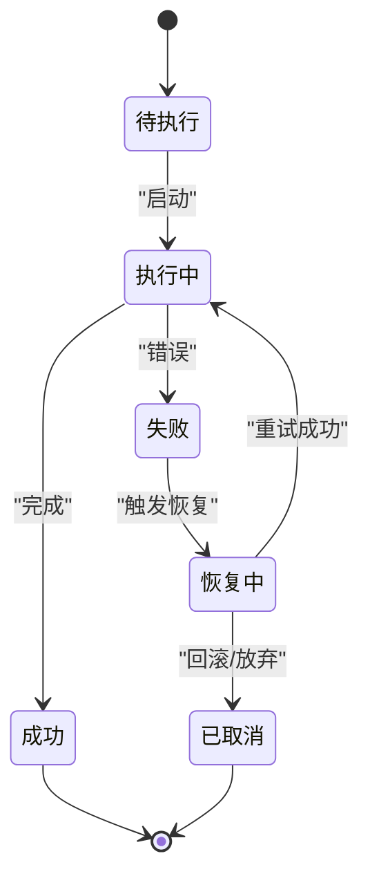
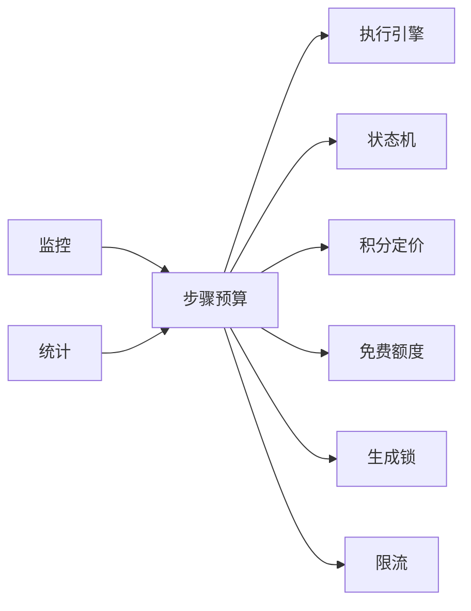

# 步骤预算控制

<cite>
**本文引用的文件**   
- [step_budget.py](file://pipeline/step_budget.py)
- [state_machine.py](file://pipeline/state_machine.py)
- [agent_coordinator.py](file://agent_coordinator.py)
- [execution_engine.py](file://core/execution_engine.py)
- [router.py](file://core/router.py)
- [config.py](file://core/config.py)
- [points_usage_pricing.py](file://backend/app/services/points_usage_pricing.py)
- [free_quota.py](file://backend/app/services/free_quota.py)
- [generation_lock.py](file://backend/app/services/generation_lock.py)
- [rate_limit_handler.py](file://backend/app/services/rate_limit_handler.py)
- [monitoring.py](file://backend/app/api/v1/monitoring.py)
- [statistics.py](file://backend/app/api/v1/statistics.py)
- [test_budget_ledger.py](file://backend/tests/test_budget_ledger.py)
</cite>

## 目录
1. [简介](#简介)
2. [项目结构](#项目结构)
3. [核心组件](#核心组件)
4. [架构总览](#架构总览)
5. [详细组件分析](#详细组件分析)
6. [依赖关系分析](#依赖关系分析)
7. [性能考虑](#性能考虑)
8. [故障排查指南](#故障排查指南)
9. [结论](#结论)
10. [附录](#附录)

## 简介
本技术文档面向“小说创作代理系统”的步骤预算控制系统，聚焦以下目标：
- 预算分配算法：资源配额计算、优先级排序与动态调整机制
- 进度跟踪实现：任务状态监控、完成度计算与剩余时间估算
- 异常恢复策略：断点续传、状态回滚与资源清理
- 并发控制机制：线程安全、锁管理与死锁预防
- 预算监控与报告：使用统计、瓶颈分析与优化建议
- 性能调优与资源配置最佳实践

该文档以代码仓库中的实际实现为依据，结合相关服务与API模块，提供从架构到细节的系统化说明。

## 项目结构
步骤预算控制涉及的核心位置包括：
- pipeline 层：步骤级预算与状态机编排
- core 层：执行引擎、路由与配置
- backend 服务层：积分计费、免费额度、生成锁、限流、监控与统计
- 测试：预算账本与相关行为的验证用例

图表来源
- [step_budget.py](file://pipeline/step_budget.py)
- [state_machine.py](file://pipeline/state_machine.py)
- [execution_engine.py](file://core/execution_engine.py)
- [router.py](file://core/router.py)
- [config.py](file://core/config.py)
- [points_usage_pricing.py](file://backend/app/services/points_usage_pricing.py)
- [free_quota.py](file://backend/app/services/free_quota.py)
- [generation_lock.py](file://backend/app/services/generation_lock.py)
- [rate_limit_handler.py](file://backend/app/services/rate_limit_handler.py)
- [monitoring.py](file://backend/app/api/v1/monitoring.py)
- [statistics.py](file://backend/app/api/v1/statistics.py)

章节来源
- [step_budget.py](file://pipeline/step_budget.py)
- [state_machine.py](file://pipeline/state_machine.py)
- [execution_engine.py](file://core/execution_engine.py)
- [router.py](file://core/router.py)
- [config.py](file://core/config.py)
- [points_usage_pricing.py](file://backend/app/services/points_usage_pricing.py)
- [free_quota.py](file://backend/app/services/free_quota.py)
- [generation_lock.py](file://backend/app/services/generation_lock.py)
- [rate_limit_handler.py](file://backend/app/services/rate_limit_handler.py)
- [monitoring.py](file://backend/app/api/v1/monitoring.py)
- [statistics.py](file://backend/app/api/v1/statistics.py)

## 核心组件
- 步骤预算控制器（StepBudget）：负责为每个步骤分配预算、记录消耗、判定是否超支并触发动态调整或降级策略
- 状态机（StateMachine）：驱动步骤生命周期，维护状态转换与事件回调，支撑进度跟踪与断点续传
- 执行引擎（ExecutionEngine）：调度步骤执行、管理上下文、协调外部适配器与资源
- 路由（Router）：将请求分发至具体处理器，配合预算控制进行前置校验与后置审计
- 计费与额度服务（PointsUsagePricing / FreeQuota）：统一计价、扣减与免费额度校验
- 并发与限流（GenerationLock / RateLimitHandler）：保证生成任务的互斥与速率限制，避免资源争用
- 监控与统计（Monitoring / Statistics）：采集指标、输出报表，支持瓶颈分析与优化建议

章节来源
- [step_budget.py](file://pipeline/step_budget.py)
- [state_machine.py](file://pipeline/state_machine.py)
- [execution_engine.py](file://core/execution_engine.py)
- [router.py](file://core/router.py)
- [points_usage_pricing.py](file://backend/app/services/points_usage_pricing.py)
- [free_quota.py](file://backend/app/services/free_quota.py)
- [generation_lock.py](file://backend/app/services/generation_lock.py)
- [rate_limit_handler.py](file://backend/app/services/rate_limit_handler.py)
- [monitoring.py](file://backend/app/api/v1/monitoring.py)
- [statistics.py](file://backend/app/api/v1/statistics.py)

## 架构总览
步骤预算控制在整体流程中处于“编排与治理”的关键位置：上游由路由与执行引擎发起调用，下游通过状态机推进步骤，同时与计费、额度、锁与限流等服务交互，最终由监控与统计模块收集数据形成可观测性闭环。

图表来源
- [router.py](file://core/router.py)
- [execution_engine.py](file://core/execution_engine.py)
- [step_budget.py](file://pipeline/step_budget.py)
- [state_machine.py](file://pipeline/state_machine.py)
- [points_usage_pricing.py](file://backend/app/services/points_usage_pricing.py)
- [free_quota.py](file://backend/app/services/free_quota.py)
- [generation_lock.py](file://backend/app/services/generation_lock.py)
- [rate_limit_handler.py](file://backend/app/services/rate_limit_handler.py)
- [monitoring.py](file://backend/app/api/v1/monitoring.py)
- [statistics.py](file://backend/app/api/v1/statistics.py)

## 详细组件分析

### 步骤预算控制器（StepBudget）
- 职责
  - 预算分配：按步骤类型、复杂度与历史基线计算初始配额
  - 消耗追踪：实时记录各步骤的Token、时长、模型调用次数等
  - 动态调整：根据剩余配额与进度偏差触发重试、降级或裁剪
  - 阈值保护：超支时立即熔断并回滚已变更状态
- 关键能力
  - 资源配额计算：基于规则与权重模型，结合用户等级与套餐策略
  - 优先级排序：对多步骤队列按紧急度、依赖关系与成本效益排序
  - 动态调整：在线学习历史耗时与成功率，滚动修正配额
- 错误处理
  - 配额不足：返回可恢复错误，触发重试或降级路径
  - 外部失败：记录失败原因，支持断点续传与部分回滚

图表来源
- [step_budget.py](file://pipeline/step_budget.py)
- [state_machine.py](file://pipeline/state_machine.py)

章节来源
- [step_budget.py](file://pipeline/step_budget.py)
- [state_machine.py](file://pipeline/state_machine.py)

### 状态机（StateMachine）
- 职责
  - 定义步骤状态集合与合法转换
  - 维护事件驱动的状态推进与回调钩子
  - 持久化快照，支撑断点续传与回滚
- 关键能力
  - 进度跟踪：累计已完成步骤数、当前阶段、阻塞原因
  - 完成度计算：加权平均（按步骤成本或重要性）
  - 剩余时间估算：基于历史均值与当前吞吐率预测
- 错误处理
  - 非法转换拦截并记录审计日志
  - 异常分支转入恢复态，触发补偿动作

图表来源
- [state_machine.py](file://pipeline/state_machine.py)

章节来源
- [state_machine.py](file://pipeline/state_machine.py)

### 执行引擎（ExecutionEngine）
- 职责
  - 编排步骤执行顺序，注入上下文与资源
  - 与预算控制器协作，确保每次调用前校验配额
  - 管理异步任务、超时与重试策略
- 关键能力
  - 上下文隔离：每步独立上下文，避免污染
  - 资源池：连接池、缓存与临时文件的统一管理
  - 可观测性：埋点、指标上报与链路追踪

章节来源
- [execution_engine.py](file://core/execution_engine.py)

### 路由（Router）
- 职责
  - 请求解析与分发
  - 前置校验（鉴权、配额预检）
  - 后置审计（结果归档、计费结算）
- 关键能力
  - 插件式处理器注册
  - 错误码标准化与响应封装

章节来源
- [router.py](file://core/router.py)

### 计费与额度（PointsUsagePricing / FreeQuota）
- 职责
  - 统一计价策略：按模型、输入长度、输出长度、功能模块计费
  - 免费额度校验：新用户或活动赠送额度的优先使用
  - 扣减原子性：事务性扣减与回滚，保证一致性
- 关键能力
  - 价格表版本化管理
  - 用量聚合与对账
  - 超限告警与冻结

章节来源
- [points_usage_pricing.py](file://backend/app/services/points_usage_pricing.py)
- [free_quota.py](file://backend/app/services/free_quota.py)

### 并发与限流（GenerationLock / RateLimitHandler）
- 职责
  - 生成锁：同一资源或任务互斥，防止重复生成
  - 限流：令牌桶/漏桶策略，平滑突发流量
- 关键能力
  - 分布式锁适配（Redis/DB）
  - 细粒度限流（用户、模型、接口维度）
  - 死锁预防：锁顺序约定、超时与回退

章节来源
- [generation_lock.py](file://backend/app/services/generation_lock.py)
- [rate_limit_handler.py](file://backend/app/services/rate_limit_handler.py)

### 监控与统计（Monitoring / Statistics）
- 职责
  - 采集指标：配额使用、步骤耗时、失败率、吞吐
  - 生成报表：日/周/月维度汇总，瓶颈定位
  - 优化建议：基于趋势与阈值的自动提示
- 关键能力
  - 实时流式上报（SSE/WebSocket）
  - 多维查询（项目、章节、步骤、模型）
  - 导出与集成（CSV/JSON）

章节来源
- [monitoring.py](file://backend/app/api/v1/monitoring.py)
- [statistics.py](file://backend/app/api/v1/statistics.py)

## 依赖关系分析
步骤预算控制依赖多个子系统，耦合点清晰且边界明确：
- 与执行引擎：强依赖，用于步骤调度与上下文传递
- 与状态机：强依赖，用于状态推进与事件回调
- 与计费/额度：弱依赖，通过服务接口访问，支持离线对账
- 与锁/限流：弱依赖，作为横切关注点嵌入
- 与监控/统计：弱依赖，异步上报，不影响主流程

图表来源
- [step_budget.py](file://pipeline/step_budget.py)
- [execution_engine.py](file://core/execution_engine.py)
- [state_machine.py](file://pipeline/state_machine.py)
- [points_usage_pricing.py](file://backend/app/services/points_usage_pricing.py)
- [free_quota.py](file://backend/app/services/free_quota.py)
- [generation_lock.py](file://backend/app/services/generation_lock.py)
- [rate_limit_handler.py](file://backend/app/services/rate_limit_handler.py)
- [monitoring.py](file://backend/app/api/v1/monitoring.py)
- [statistics.py](file://backend/app/api/v1/statistics.py)

章节来源
- [step_budget.py](file://pipeline/step_budget.py)
- [execution_engine.py](file://core/execution_engine.py)
- [state_machine.py](file://pipeline/state_machine.py)
- [points_usage_pricing.py](file://backend/app/services/points_usage_pricing.py)
- [free_quota.py](file://backend/app/services/free_quota.py)
- [generation_lock.py](file://backend/app/services/generation_lock.py)
- [rate_limit_handler.py](file://backend/app/services/rate_limit_handler.py)
- [monitoring.py](file://backend/app/api/v1/monitoring.py)
- [statistics.py](file://backend/app/api/v1/statistics.py)

## 性能考虑
- 预算计算开销
  - 采用增量更新与缓存，避免全量重算
  - 批量扣减与合并上报，降低数据库压力
- 状态机效率
  - 状态转换O(1)查找，事件派发异步化
  - 快照压缩与分片存储，减少I/O
- 并发与锁
  - 细粒度锁，缩短持有时间
  - 锁超时与快速失败，避免长尾延迟
- 限流与削峰
  - 自适应令牌桶，按负载动态调节
  - 队列背压与消费者并行度调优
- 监控与采样
  - 关键路径全量采集，非关键路径采样
  - 指标降采样与滚动窗口聚合

[本节为通用指导，不直接分析具体文件]

## 故障排查指南
- 常见问题
  - 配额不足：检查计费策略与额度上限，确认扣减是否成功
  - 步骤卡住：查看状态机快照与事件日志，确认是否存在循环依赖
  - 生成冲突：核对生成锁键空间与过期策略
  - 限流触发：观察限流器计数与阈值配置
- 诊断手段
  - 启用详细日志与链路追踪
  - 导出监控指标与统计报表
  - 复现最小用例并回放事件序列
- 恢复策略
  - 断点续传：从最近快照恢复执行
  - 状态回滚：撤销未持久化的变更
  - 资源清理：释放临时文件与连接

章节来源
- [test_budget_ledger.py](file://backend/tests/test_budget_ledger.py)
- [state_machine.py](file://pipeline/state_machine.py)
- [generation_lock.py](file://backend/app/services/generation_lock.py)
- [rate_limit_handler.py](file://backend/app/services/rate_limit_handler.py)
- [monitoring.py](file://backend/app/api/v1/monitoring.py)
- [statistics.py](file://backend/app/api/v1/statistics.py)

## 结论
步骤预算控制系统通过“预算分配—状态推进—计费扣减—并发控制—监控统计”的闭环设计，实现了高可靠、可观测、可优化的创作流水线治理。建议在大规模部署中持续完善价格策略、动态配额与智能降级，并结合A/B实验验证优化效果。

[本节为总结性内容，不直接分析具体文件]

## 附录
- 术语
  - 步骤：流水线中的最小执行单元
  - 配额：步骤级别的资源限额（如Token、时长、调用次数）
  - 快照：步骤状态的持久化表示，用于恢复与审计
- 最佳实践
  - 预算阈值分层设置，预留缓冲
  - 状态机事件命名规范化，便于检索与分析
  - 计费与额度分离，便于策略演进
  - 监控指标覆盖端到端SLA

[本节为补充信息，不直接分析具体文件]