# 数据处理流水线

<cite>
**本文引用的文件**   
- [pipeline/autoqc.py](file://pipeline/autoqc.py)
- [pipeline/state_machine.py](file://pipeline/state_machine.py)
- [pipeline/artifacts_io.py](file://pipeline/artifacts_io.py)
- [pipeline/media_presets.py](file://pipeline/media_presets.py)
- [pipeline/ffmpeg_runner.py](file://pipeline/ffmpeg_runner.py)
- [pipeline/autoqc_pkg/_run.py](file://pipeline/autoqc_pkg/_run.py)
- [pipeline/autoqc_pkg/_scoring.py](file://pipeline/autoqc_pkg/_scoring.py)
- [pipeline/autoqc_pkg/_image_qc.py](file://pipeline/autoqc_pkg/_image_qc.py)
- [pipeline/autoqc_pkg/_video_clip_checks.py](file://pipeline/autoqc_pkg/_video_clip_checks.py)
- [pipeline/autoqc_pkg/_semantic_checks.py](file://pipeline/autoqc_pkg/_semantic_checks.py)
- [pipeline/autoqc_pkg/_state_continuity.py](file://pipeline/autoqc_pkg/_state_continuity.py)
- [pipeline/autoqc_pkg/_qc_config.py](file://pipeline/autoqc_pkg/_qc_config.py)
- [pipeline/autoqc_pkg/_dataclasses.py](file://pipeline/autoqc_pkg/_dataclasses.py)
- [pipeline/autoqc_pkg/_utils.py](file://pipeline/autoqc_pkg/_utils.py)
- [pipeline/autoqc_pkg/_routing.py](file://pipeline/autoqc_pkg/_routing.py)
- [pipeline/autoqc_pkg/_state_checks.py](file://pipeline/autoqc_pkg/_state_checks.py)
- [pipeline/autoqc_pkg/_video_edit.py](file://pipeline/autoqc_pkg/_video_edit.py)
- [adapters/base.py](file://adapters/base.py)
- [adapters/registry.py](file://adapters/registry.py)
- [adapters/content_safety_checker.py](file://adapters/content_safety_checker.py)
- [backend/app/services/cache_system.py](file://backend/app/services/cache_system.py)
- [backend/app/models/dreamweaver.py](file://backend/app/models/dreamweaver.py)
- [backend/app/api/v1/workflow/routes.py](file://backend/app/api/v1/workflow/routes.py)
- [core/unified_media_runtime.py](file://core/unified_media_runtime.py)
</cite>

## 目录
1. [简介](#简介)
2. [项目结构](#项目结构)
3. [核心组件](#核心组件)
4. [架构总览](#架构总览)
5. [详细组件分析](#详细组件分析)
6. [依赖关系分析](#依赖关系分析)
7. [性能考量](#性能考量)
8. [故障排查指南](#故障排查指南)
9. [结论](#结论)
10. [附录](#附录)

## 简介
本技术文档面向小说创作代理系统的数据处理流水线，聚焦以下目标：
- 自动质量控制（AutoQC）子系统：规则、评分算法与问题修复机制
- 媒体处理流水线：图像、视频、音频的处理流程设计
- 状态机：状态转换、事件处理与错误恢复
- 工件IO系统：数据持久化、版本控制与缓存策略
- 媒体预设：配置与管理
- 扩展开发：自定义检查规则与处理器实现
- 性能优化与监控指标

## 项目结构
流水线相关代码主要位于 pipeline 目录，配合 adapters 适配器层、backend 服务层以及 core 统一运行时。关键模块包括：
- 自动质量控制系统 autoqc_pkg 及其入口 autoqc.py
- 状态机 state_machine.py
- 工件IO artifacts_io.py
- 媒体预设 media_presets.py
- FFmpeg 执行器 ffmpeg_runner.py
- 适配器注册与基础接口 base.py、registry.py
- 后端工作流路由与缓存系统

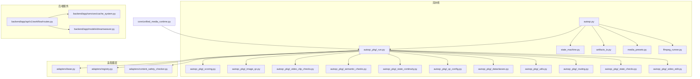

图表来源 
- [pipeline/autoqc.py](file://pipeline/autoqc.py)
- [pipeline/autoqc_pkg/_run.py](file://pipeline/autoqc_pkg/_run.py)
- [pipeline/state_machine.py](file://pipeline/state_machine.py)
- [pipeline/artifacts_io.py](file://pipeline/artifacts_io.py)
- [pipeline/media_presets.py](file://pipeline/media_presets.py)
- [pipeline/ffmpeg_runner.py](file://pipeline/ffmpeg_runner.py)
- [adapters/base.py](file://adapters/base.py)
- [adapters/registry.py](file://adapters/registry.py)
- [adapters/content_safety_checker.py](file://adapters/content_safety_checker.py)
- [backend/app/services/cache_system.py](file://backend/app/services/cache_system.py)
- [backend/app/models/dreamweaver.py](file://backend/app/models/dreamweaver.py)
- [backend/app/api/v1/workflow/routes.py](file://backend/app/api/v1/workflow/routes.py)
- [core/unified_media_runtime.py](file://core/unified_media_runtime.py)

章节来源
- [pipeline/autoqc.py](file://pipeline/autoqc.py)
- [pipeline/autoqc_pkg/_run.py](file://pipeline/autoqc_pkg/_run.py)
- [pipeline/state_machine.py](file://pipeline/state_machine.py)
- [pipeline/artifacts_io.py](file://pipeline/artifacts_io.py)
- [pipeline/media_presets.py](file://pipeline/media_presets.py)
- [pipeline/ffmpeg_runner.py](file://pipeline/ffmpeg_runner.py)

## 核心组件
- 自动质量控制（AutoQC）：负责在流水线各阶段对文本、图像、视频、音频进行质量检查、评分与修复建议生成，支持语义一致性、状态连续性、内容安全等规则。
- 状态机：管理任务生命周期与阶段转换，提供事件驱动的状态迁移与错误恢复路径。
- 工件IO：负责中间产物与最终产物的持久化、版本管理与缓存命中策略。
- 媒体预设：集中管理图像、视频、音频处理的参数模板与默认值。
- FFmpeg执行器：封装音视频转码、剪辑、合成等操作。
- 适配器层：抽象多模型与多提供商的调用接口，统一输入输出格式。
- 后端服务：工作流路由、缓存系统与领域模型（如 Dreamweaver 运行记录）。

章节来源
- [pipeline/autoqc_pkg/_run.py](file://pipeline/autoqc_pkg/_run.py)
- [pipeline/state_machine.py](file://pipeline/state_machine.py)
- [pipeline/artifacts_io.py](file://pipeline/artifacts_io.py)
- [pipeline/media_presets.py](file://pipeline/media_presets.py)
- [pipeline/ffmpeg_runner.py](file://pipeline/ffmpeg_runner.py)
- [adapters/base.py](file://adapters/base.py)
- [adapters/registry.py](file://adapters/registry.py)
- [backend/app/services/cache_system.py](file://backend/app/services/cache_system.py)
- [backend/app/models/dreamweaver.py](file://backend/app/models/dreamweaver.py)

## 架构总览
流水线以 AutoQC 为质量门控中枢，结合状态机驱动阶段推进，通过工件IO完成数据落盘与缓存，使用媒体预设与FFmpeg执行器完成媒体处理，并通过适配器层对接外部模型与服务。

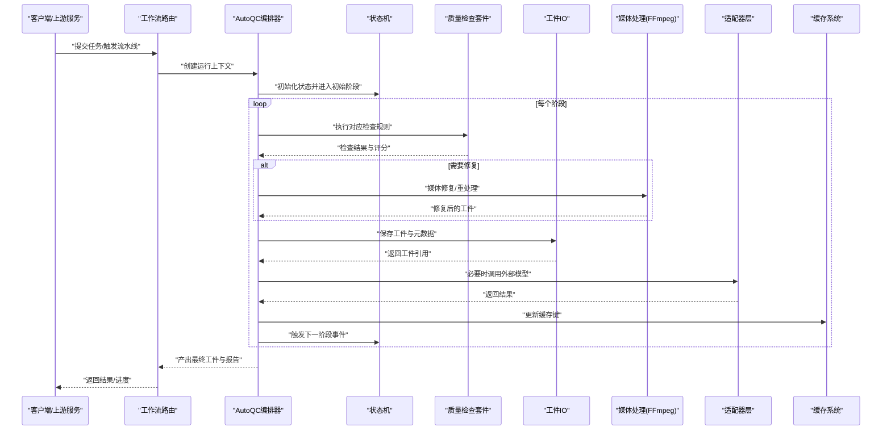

图表来源 
- [backend/app/api/v1/workflow/routes.py](file://backend/app/api/v1/workflow/routes.py)
- [pipeline/autoqc_pkg/_run.py](file://pipeline/autoqc_pkg/_run.py)
- [pipeline/state_machine.py](file://pipeline/state_machine.py)
- [pipeline/artifacts_io.py](file://pipeline/artifacts_io.py)
- [pipeline/ffmpeg_runner.py](file://pipeline/ffmpeg_runner.py)
- [adapters/base.py](file://adapters/base.py)
- [adapters/registry.py](file://adapters/registry.py)
- [backend/app/services/cache_system.py](file://backend/app/services/cache_system.py)

## 详细组件分析

### 自动质量控制（AutoQC）子系统
- 编排入口：_run.py 定义检查流程编排、调度与结果聚合
- 评分算法：_scoring.py 实现加权评分、阈值判定与等级划分
- 图像检查：_image_qc.py 分辨率、清晰度、色彩空间、尺寸合规性
- 视频片段检查：_video_clip_checks.py 时长、帧率、码率、编码格式、字幕轨道
- 语义检查：_semantic_checks.py 文本一致性、角色设定匹配、剧情连贯性
- 状态连续性：_state_continuity.py 跨阶段属性一致性校验
- 配置管理：_qc_config.py 规则开关、权重、阈值、黑白名单
- 数据结构：_dataclasses.py 定义检查项、评分对象、问题清单
- 工具函数：_utils.py 通用计算、格式化、日志辅助
- 路由分发：_routing.py 按类型与阶段选择检查器
- 状态检查：_state_checks.py 前置条件与后置条件验证
- 视频编辑：_video_edit.py 剪辑、拼接、转场、字幕嵌入

```mermaid
classDiagram
class QCRunner {
+execute(context) Result
+aggregate_scores() ScoreSummary
+apply_fixes(context) Context
}
class Scorer {
+compute(item) float
+threshold(score, rule) bool
+weight(rule, priority) float
}
class ImageQC {
+check(image_meta) Issues
+validate_resolution(meta) bool
+validate_clarity(image_bytes) float
}
class VideoClipChecks {
+check(video_meta) Issues
+validate_duration(seconds) bool
+validate_codec(codec) bool
}
class SemanticChecks {
+check(text_context) Issues
+match_character(name, profile) bool
+coherence_score(prev, curr) float
}
class StateContinuity {
+check(stage, prev_state, curr_state) bool
+detect_drift(fields) List
}
class QCConfig {
+rules : Dict
+thresholds : Dict
+weights : Dict
}
class DataModels {
<<dataclass>>
+CheckItem
+ScoreResult
+IssueReport
}
class Utils {
+format_issue(issue) str
+log_check(name, result) void
}
class Routing {
+select_checker(type, stage) Checker
+dispatch(context) Result
}
class StateChecks {
+precondition(stage) bool
+postcondition(stage) bool
}
class VideoEdit {
+cut(start, end) Path
+concat(paths) Path
+add_subtitles(video_path, srt_path) Path
}
QCRunner --> Scorer : "使用"
QCRunner --> ImageQC : "调用"
QCRunner --> VideoClipChecks : "调用"
QCRunner --> SemanticChecks : "调用"
QCRunner --> StateContinuity : "调用"
QCRunner --> QCConfig : "读取"
QCRunner --> DataModels : "构造"
QCRunner --> Utils : "辅助"
QCRunner --> Routing : "分发"
QCRunner --> StateChecks : "校验"
QCRunner --> VideoEdit : "修复"
```

图表来源 
- [pipeline/autoqc_pkg/_run.py](file://pipeline/autoqc_pkg/_run.py)
- [pipeline/autoqc_pkg/_scoring.py](file://pipeline/autoqc_pkg/_scoring.py)
- [pipeline/autoqc_pkg/_image_qc.py](file://pipeline/autoqc_pkg/_image_qc.py)
- [pipeline/autoqc_pkg/_video_clip_checks.py](file://pipeline/autoqc_pkg/_video_clip_checks.py)
- [pipeline/autoqc_pkg/_semantic_checks.py](file://pipeline/autoqc_pkg/_semantic_checks.py)
- [pipeline/autoqc_pkg/_state_continuity.py](file://pipeline/autoqc_pkg/_state_continuity.py)
- [pipeline/autoqc_pkg/_qc_config.py](file://pipeline/autoqc_pkg/_qc_config.py)
- [pipeline/autoqc_pkg/_dataclasses.py](file://pipeline/autoqc_pkg/_dataclasses.py)
- [pipeline/autoqc_pkg/_utils.py](file://pipeline/autoqc_pkg/_utils.py)
- [pipeline/autoqc_pkg/_routing.py](file://pipeline/autoqc_pkg/_routing.py)
- [pipeline/autoqc_pkg/_state_checks.py](file://pipeline/autoqc_pkg/_state_checks.py)
- [pipeline/autoqc_pkg/_video_edit.py](file://pipeline/autoqc_pkg/_video_edit.py)

章节来源
- [pipeline/autoqc_pkg/_run.py](file://pipeline/autoqc_pkg/_run.py)
- [pipeline/autoqc_pkg/_scoring.py](file://pipeline/autoqc_pkg/_scoring.py)
- [pipeline/autoqc_pkg/_image_qc.py](file://pipeline/autoqc_pkg/_image_qc.py)
- [pipeline/autoqc_pkg/_video_clip_checks.py](file://pipeline/autoqc_pkg/_video_clip_checks.py)
- [pipeline/autoqc_pkg/_semantic_checks.py](file://pipeline/autoqc_pkg/_semantic_checks.py)
- [pipeline/autoqc_pkg/_state_continuity.py](file://pipeline/autoqc_pkg/_state_continuity.py)
- [pipeline/autoqc_pkg/_qc_config.py](file://pipeline/autoqc_pkg/_qc_config.py)
- [pipeline/autoqc_pkg/_dataclasses.py](file://pipeline/autoqc_pkg/_dataclasses.py)
- [pipeline/autoqc_pkg/_utils.py](file://pipeline/autoqc_pkg/_utils.py)
- [pipeline/autoqc_pkg/_routing.py](file://pipeline/autoqc_pkg/_routing.py)
- [pipeline/autoqc_pkg/_state_checks.py](file://pipeline/autoqc_pkg/_state_checks.py)
- [pipeline/autoqc_pkg/_video_edit.py](file://pipeline/autoqc_pkg/_video_edit.py)

#### 评分算法与阈值判定
- 加权评分：根据规则优先级与权重计算综合得分
- 阈值判定：单项或整体得分低于阈值触发修复或拒绝
- 等级划分：优秀、合格、需改进、不合格等分级

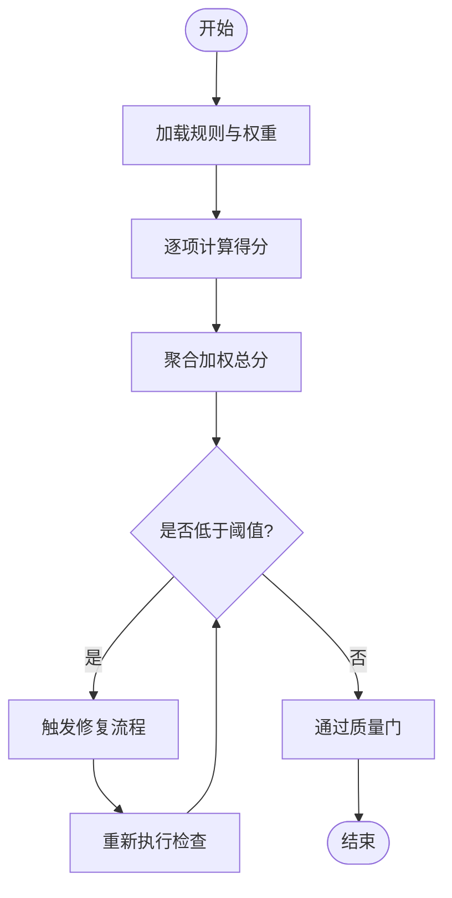

图表来源 
- [pipeline/autoqc_pkg/_scoring.py](file://pipeline/autoqc_pkg/_scoring.py)
- [pipeline/autoqc_pkg/_qc_config.py](file://pipeline/autoqc_pkg/_qc_config.py)

章节来源
- [pipeline/autoqc_pkg/_scoring.py](file://pipeline/autoqc_pkg/_scoring.py)
- [pipeline/autoqc_pkg/_qc_config.py](file://pipeline/autoqc_pkg/_qc_config.py)

#### 问题修复机制
- 图像修复：分辨率调整、清晰度增强、色彩校正
- 视频修复：转码、裁剪、拼接、字幕嵌入、码率调整
- 文本修复：语义修正、角色一致性调整、剧情连贯性优化

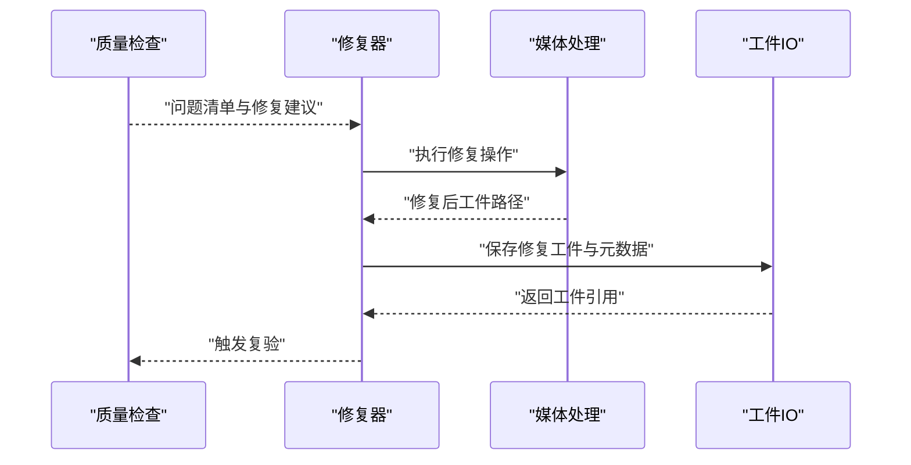

图表来源 
- [pipeline/autoqc_pkg/_video_edit.py](file://pipeline/autoqc_pkg/_video_edit.py)
- [pipeline/ffmpeg_runner.py](file://pipeline/ffmpeg_runner.py)
- [pipeline/artifacts_io.py](file://pipeline/artifacts_io.py)

章节来源
- [pipeline/autoqc_pkg/_video_edit.py](file://pipeline/autoqc_pkg/_video_edit.py)
- [pipeline/ffmpeg_runner.py](file://pipeline/ffmpeg_runner.py)
- [pipeline/artifacts_io.py](file://pipeline/artifacts_io.py)

### 媒体处理流水线
- 图像处理：解码、缩放、滤镜、编码、水印、元数据写入
- 视频编辑：剪辑、拼接、转场、字幕、音轨混合、导出
- 音频处理：降噪、均衡、响度标准化、格式转换、分段

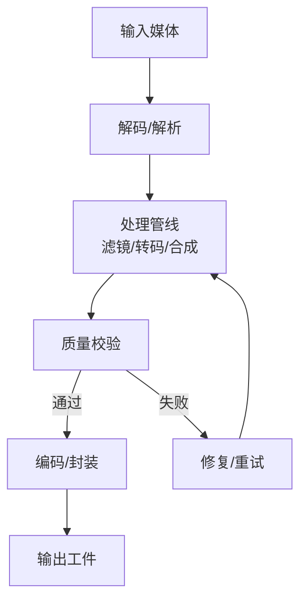

图表来源 
- [pipeline/ffmpeg_runner.py](file://pipeline/ffmpeg_runner.py)
- [pipeline/media_presets.py](file://pipeline/media_presets.py)

章节来源
- [pipeline/ffmpeg_runner.py](file://pipeline/ffmpeg_runner.py)
- [pipeline/media_presets.py](file://pipeline/media_presets.py)

### 状态机工作原理
- 状态定义：任务阶段（如准备、生成、质检、修复、发布）
- 事件处理：阶段完成、失败、重试、跳过等事件
- 错误恢复：回滚、补偿、降级、告警

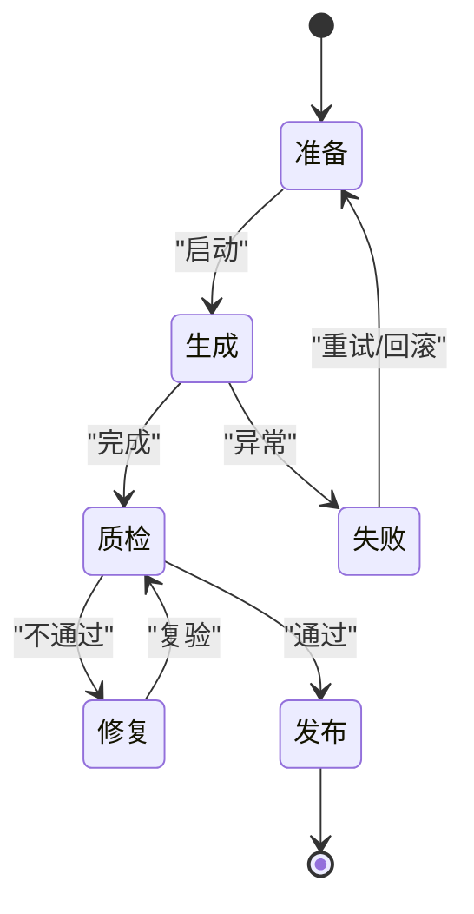

图表来源 
- [pipeline/state_machine.py](file://pipeline/state_machine.py)

章节来源
- [pipeline/state_machine.py](file://pipeline/state_machine.py)

### 工件IO系统
- 数据持久化：结构化元数据与二进制工件分离存储
- 版本控制：每次变更生成新版本，保留历史快照
- 缓存策略：基于键的缓存命中、失效与预热

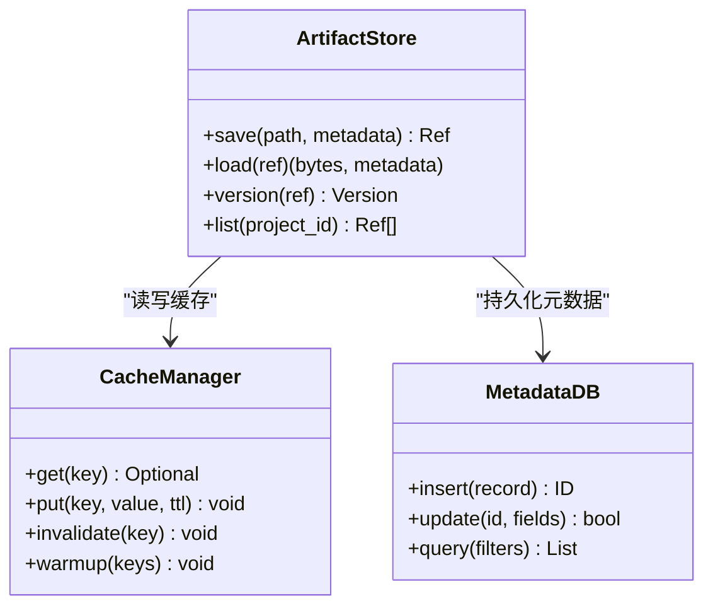

图表来源 
- [pipeline/artifacts_io.py](file://pipeline/artifacts_io.py)
- [backend/app/services/cache_system.py](file://backend/app/services/cache_system.py)

章节来源
- [pipeline/artifacts_io.py](file://pipeline/artifacts_io.py)
- [backend/app/services/cache_system.py](file://backend/app/services/cache_system.py)

### 媒体预设的配置与管理
- 预设分类：图像、视频、音频三类模板
- 参数项：分辨率、帧率、码率、编码器、滤镜链、输出格式
- 管理方式：配置文件加载、运行时覆盖、环境变量注入

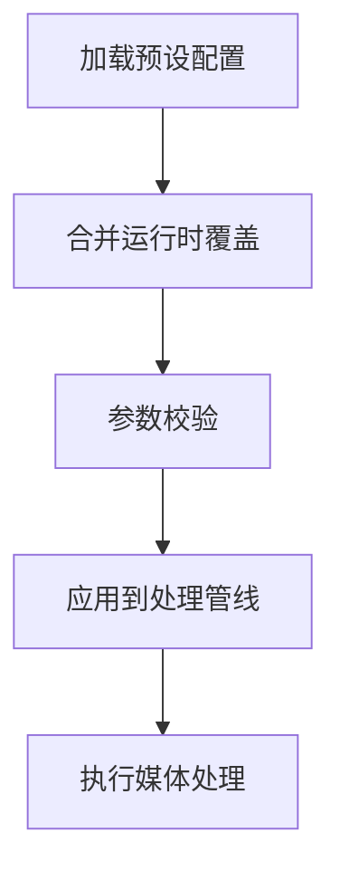

图表来源 
- [pipeline/media_presets.py](file://pipeline/media_presets.py)

章节来源
- [pipeline/media_presets.py](file://pipeline/media_presets.py)

### 适配器层与统一运行时
- 基础接口：统一输入输出契约、错误码、重试策略
- 注册中心：动态发现与选择适配器
- 内容安全：敏感词过滤、违规检测、白名单放行

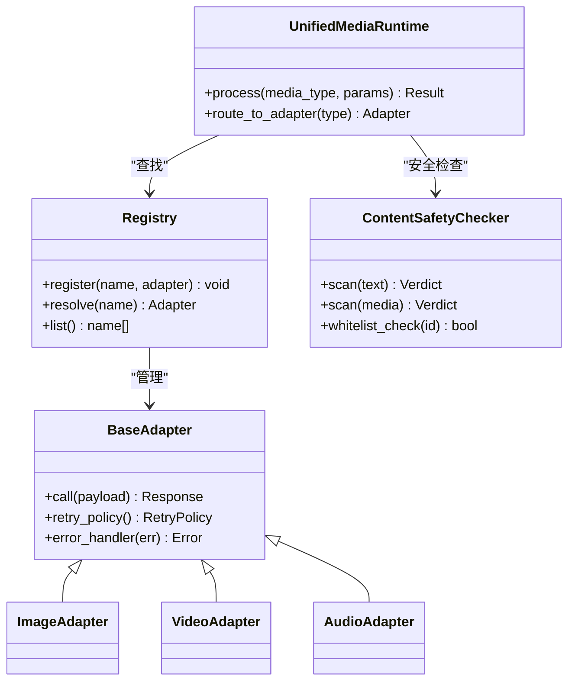

图表来源 
- [adapters/base.py](file://adapters/base.py)
- [adapters/registry.py](file://adapters/registry.py)
- [adapters/content_safety_checker.py](file://adapters/content_safety_checker.py)
- [core/unified_media_runtime.py](file://core/unified_media_runtime.py)

章节来源
- [adapters/base.py](file://adapters/base.py)
- [adapters/registry.py](file://adapters/registry.py)
- [adapters/content_safety_checker.py](file://adapters/content_safety_checker.py)
- [core/unified_media_runtime.py](file://core/unified_media_runtime.py)

### 后端集成与工作流路由
- 路由层：接收请求、构建上下文、派发任务
- 缓存系统：热点数据缓存、预取与失效策略
- 领域模型：Dreamweaver 运行记录、审计与追踪

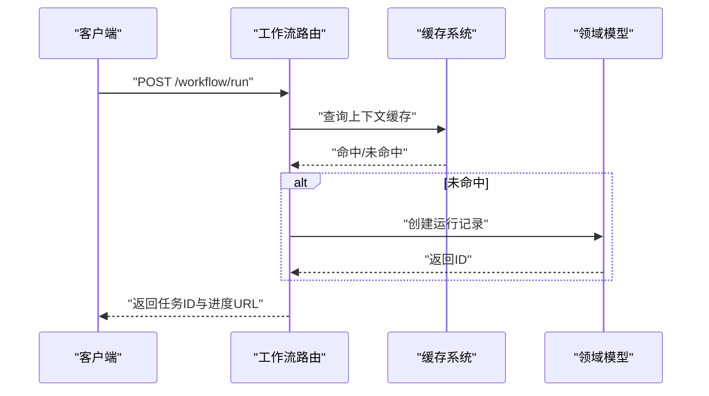

图表来源 
- [backend/app/api/v1/workflow/routes.py](file://backend/app/api/v1/workflow/routes.py)
- [backend/app/services/cache_system.py](file://backend/app/services/cache_system.py)
- [backend/app/models/dreamweaver.py](file://backend/app/models/dreamweaver.py)

章节来源
- [backend/app/api/v1/workflow/routes.py](file://backend/app/api/v1/workflow/routes.py)
- [backend/app/services/cache_system.py](file://backend/app/services/cache_system.py)
- [backend/app/models/dreamweaver.py](file://backend/app/models/dreamweaver.py)

## 依赖关系分析
- 内聚性：AutoQC 内部模块职责清晰，评分、检查、修复解耦
- 耦合度：通过适配器注册中心降低对外部模型的直接依赖
- 循环依赖：避免模块间相互导入，采用事件与回调通信
- 外部依赖：FFmpeg、数据库、缓存、外部模型API

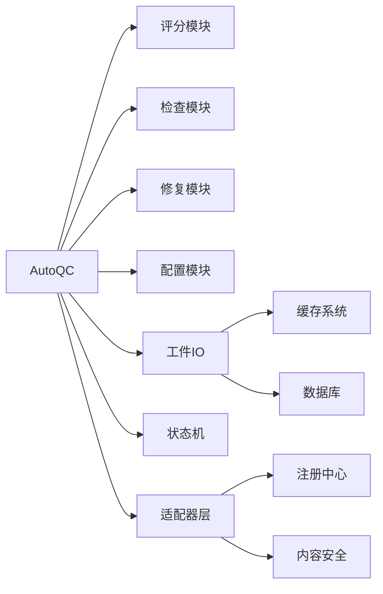

图表来源 
- [pipeline/autoqc_pkg/_run.py](file://pipeline/autoqc_pkg/_run.py)
- [adapters/registry.py](file://adapters/registry.py)
- [adapters/content_safety_checker.py](file://adapters/content_safety_checker.py)
- [pipeline/artifacts_io.py](file://pipeline/artifacts_io.py)
- [backend/app/services/cache_system.py](file://backend/app/services/cache_system.py)

章节来源
- [pipeline/autoqc_pkg/_run.py](file://pipeline/autoqc_pkg/_run.py)
- [adapters/registry.py](file://adapters/registry.py)
- [adapters/content_safety_checker.py](file://adapters/content_safety_checker.py)
- [pipeline/artifacts_io.py](file://pipeline/artifacts_io.py)
- [backend/app/services/cache_system.py](file://backend/app/services/cache_system.py)

## 性能考量
- 并行处理：图像与视频片段并行检查与修复
- 缓存命中：热点工件与中间结果缓存，减少重复计算
- 批处理：批量提交检查任务，降低I/O开销
- 资源限制：FFmpeg进程池与内存上限控制
- 监控指标：延迟、吞吐、错误率、缓存命中率、CPU/GPU利用率

[本节为通用指导，无需特定文件来源]

## 故障排查指南
- 常见问题：
  - 质量检查失败：查看规则配置与阈值设置
  - 媒体处理失败：检查FFmpeg命令与输入格式
  - 缓存未命中：确认键生成逻辑与TTL设置
  - 适配器调用失败：检查网络、密钥与限流策略
- 诊断步骤：
  - 启用详细日志，定位失败阶段
  - 检查工件元数据与版本信息
  - 复现最小用例，隔离问题模块
  - 使用调试工具验证输入输出

章节来源
- [pipeline/autoqc_pkg/_utils.py](file://pipeline/autoqc_pkg/_utils.py)
- [pipeline/ffmpeg_runner.py](file://pipeline/ffmpeg_runner.py)
- [backend/app/services/cache_system.py](file://backend/app/services/cache_system.py)

## 结论
本流水线通过AutoQC实现全面的质量控制，结合状态机与工件IO确保流程稳定与可追溯，媒体预设与FFmpeg执行器提供灵活的媒体处理能力，适配器层屏蔽外部差异，后端服务提供完整的集成与监控能力。通过合理的性能优化与故障排查策略，系统能够高效支撑小说创作的自动化生产。

[本节为总结，无需特定文件来源]

## 附录
- 扩展开发指南：
  - 自定义检查规则：继承基础检查类，实现校验逻辑与评分方法
  - 自定义处理器：实现媒体处理接口，注册到管道中
  - 配置管理：在预设配置中添加新参数，支持运行时覆盖
  - 测试策略：单元测试覆盖边界情况，集成测试验证端到端流程
- 最佳实践：
  - 保持模块高内聚低耦合
  - 使用事件驱动架构提升可扩展性
  - 实施完善的日志与监控
  - 定期审查与优化规则与阈值

[本节为补充说明，无需特定文件来源]