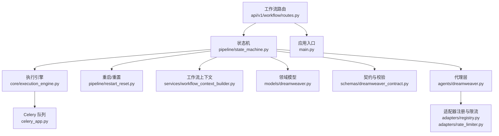
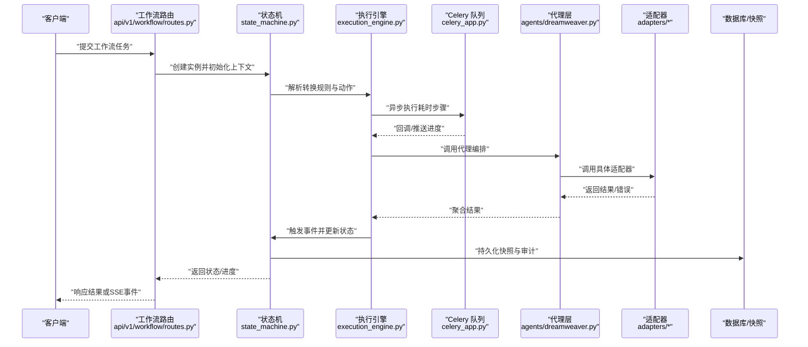
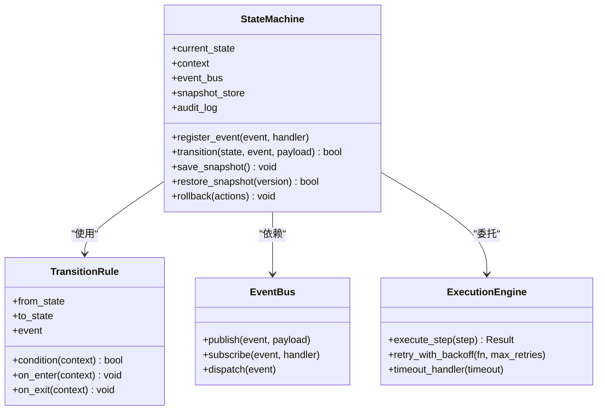
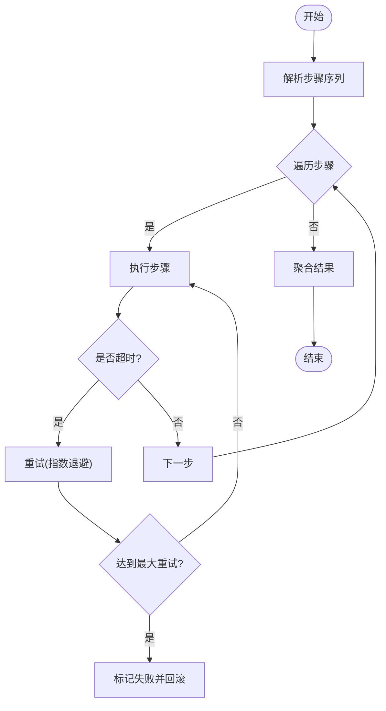
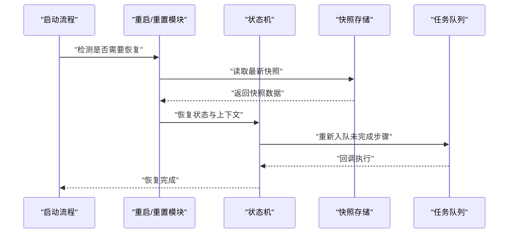
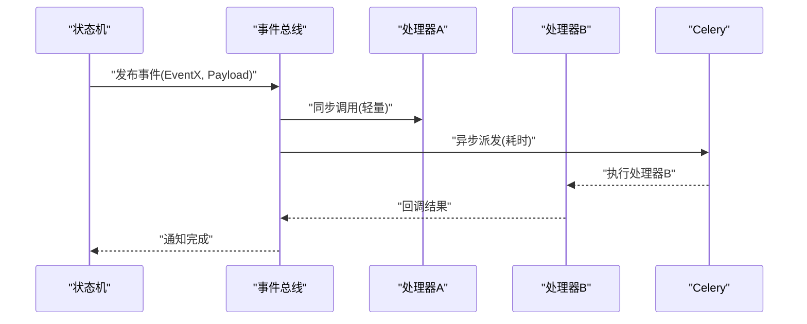
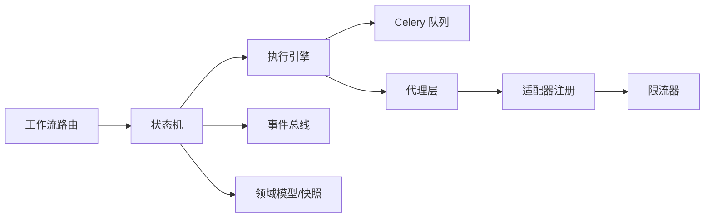

# 状态机引擎

<cite>
**本文引用的文件**   
- [pipeline/state_machine.py](file://pipeline/state_machine.py)
- [pipeline/restart_reset.py](file://pipeline/restart_reset.py)
- [core/execution_engine.py](file://core/execution_engine.py)
- [backend/app/celery_app.py](file://backend/app/celery_app.py)
- [backend/app/main.py](file://backend/app/main.py)
- [backend/app/services/workflow_context_builder.py](file://backend/app/services/workflow_context_builder.py)
- [backend/app/api/v1/workflow/routes.py](file://backend/app/api/v1/workflow/routes.py)
- [backend/app/models/dreamweaver.py](file://backend/app/models/dreamweaver.py)
- [backend/app/schemas/dreamweaver_contract.py](file://backend/app/schemas/dreamweaver_contract.py)
- [agents/dreamweaver.py](file://agents/dreamweaver.py)
- [adapters/base.py](file://adapters/base.py)
- [adapters/registry.py](file://adapters/registry.py)
- [adapters/rate_limiter.py](file://adapters/rate_limiter.py)
</cite>

## 目录
1. [简介](#简介)
2. [项目结构](#项目结构)
3. [核心组件](#核心组件)
4. [架构总览](#架构总览)
5. [详细组件分析](#详细组件分析)
6. [依赖关系分析](#依赖关系分析)
7. [性能考虑](#性能考虑)
8. [故障排查指南](#故障排查指南)
9. [结论](#结论)
10. [附录](#附录)

## 简介
本技术文档面向小说创作代理系统的“状态机引擎”，聚焦以下目标：
- 解释状态机的设计模式：状态定义、转换规则与事件驱动架构。
- 说明状态转换的执行机制：条件判断、动作执行与回滚处理。
- 描述事件处理系统：事件注册、消息传递与异步处理。
- 阐述重启与重置机制：状态保存、数据恢复与事务管理。
- 详述错误处理与异常恢复策略：重试、降级与故障转移。
- 提供扩展开发指南：自定义状态、转换条件与监听器实现。
- 给出性能调优与监控告警的最佳实践。

该引擎贯穿工作流编排、任务调度、适配器调用与持久化，确保长链路生成过程在复杂环境下具备可观测、可恢复、可扩展的能力。

## 项目结构
状态机引擎位于 pipeline 层，并与后端服务（FastAPI + Celery）、模型与适配器体系、以及工作流上下文构建紧密协作。关键路径包括：
- 状态机核心：pipeline/state_machine.py
- 重启与重置：pipeline/restart_reset.py
- 执行引擎：core/execution_engine.py
- 异步任务队列：backend/app/celery_app.py
- API 入口与工作流路由：backend/app/main.py, backend/app/api/v1/workflow/routes.py
- 工作流上下文构建：backend/app/services/workflow_context_builder.py
- 领域模型与契约：backend/app/models/dreamweaver.py, backend/app/schemas/dreamweaver_contract.py
- 代理与适配器：agents/dreamweaver.py, adapters/*

图表来源 
- [pipeline/state_machine.py](file://pipeline/state_machine.py)
- [core/execution_engine.py](file://core/execution_engine.py)
- [pipeline/restart_reset.py](file://pipeline/restart_reset.py)
- [backend/app/services/workflow_context_builder.py](file://backend/app/services/workflow_context_builder.py)
- [backend/app/models/dreamweaver.py](file://backend/app/models/dreamweaver.py)
- [backend/app/schemas/dreamweaver_contract.py](file://backend/app/schemas/dreamweaver_contract.py)
- [backend/app/celery_app.py](file://backend/app/celery_app.py)
- [backend/app/api/v1/workflow/routes.py](file://backend/app/api/v1/workflow/routes.py)
- [backend/app/main.py](file://backend/app/main.py)
- [agents/dreamweaver.py](file://agents/dreamweaver.py)
- [adapters/registry.py](file://adapters/registry.py)
- [adapters/rate_limiter.py](file://adapters/rate_limiter.py)

章节来源
- [pipeline/state_machine.py](file://pipeline/state_machine.py)
- [pipeline/restart_reset.py](file://pipeline/restart_reset.py)
- [core/execution_engine.py](file://core/execution_engine.py)
- [backend/app/celery_app.py](file://backend/app/celery_app.py)
- [backend/app/main.py](file://backend/app/main.py)
- [backend/app/services/workflow_context_builder.py](file://backend/app/services/workflow_context_builder.py)
- [backend/app/api/v1/workflow/routes.py](file://backend/app/api/v1/workflow/routes.py)
- [backend/app/models/dreamweaver.py](file://backend/app/models/dreamweaver.py)
- [backend/app/schemas/dreamweaver_contract.py](file://backend/app/schemas/dreamweaver_contract.py)
- [agents/dreamweaver.py](file://agents/dreamweaver.py)
- [adapters/base.py](file://adapters/base.py)
- [adapters/registry.py](file://adapters/registry.py)
- [adapters/rate_limiter.py](file://adapters/rate_limiter.py)

## 核心组件
- 状态机核心（State Machine）
  - 职责：维护当前状态、转换规则表、事件总线、动作钩子、审计日志与持久化快照。
  - 关键点：状态不可变快照、转换前置校验、动作原子性、失败回滚、幂等事件。
- 执行引擎（Execution Engine）
  - 职责：将状态转换映射为可执行的步骤序列，协调同步/异步执行，统一异常与重试。
  - 关键点：步骤级事务边界、超时控制、资源清理、结果聚合。
- 重启与重置（Restart & Reset）
  - 职责：基于持久化快照恢复或重置到指定阶段，支持断点续跑与一致性修复。
  - 关键点：快照版本、补偿操作、事务回滚、幂等重建。
- 工作流上下文（Workflow Context Builder）
  - 职责：组装状态机运行所需的全局上下文（用户、项目、配置、外部依赖句柄）。
  - 关键点：上下文隔离、按需加载、缓存与失效策略。
- 领域模型与契约（Models & Schemas）
  - 职责：定义状态机相关的数据结构与校验规则，保证输入输出一致性。
  - 关键点：字段约束、枚举值、时间戳与版本控制。
- 适配器与代理（Adapters & Agents）
  - 职责：封装第三方能力（LLM、图像、视频、TTS 等），提供统一接口与限流保护。
  - 关键点：适配器注册、动态选择、熔断与降级、速率限制。

章节来源
- [pipeline/state_machine.py](file://pipeline/state_machine.py)
- [core/execution_engine.py](file://core/execution_engine.py)
- [pipeline/restart_reset.py](file://pipeline/restart_reset.py)
- [backend/app/services/workflow_context_builder.py](file://backend/app/services/workflow_context_builder.py)
- [backend/app/models/dreamweaver.py](file://backend/app/models/dreamweaver.py)
- [backend/app/schemas/dreamweaver_contract.py](file://backend/app/schemas/dreamweaver_contract.py)
- [agents/dreamweaver.py](file://agents/dreamweaver.py)
- [adapters/base.py](file://adapters/base.py)
- [adapters/registry.py](file://adapters/registry.py)
- [adapters/rate_limiter.py](file://adapters/rate_limiter.py)

## 架构总览
状态机引擎以事件驱动为核心，通过“事件→条件→动作”的链式处理完成状态迁移。执行引擎负责编排步骤，Celery 承担异步任务，持久化层保障可恢复性。

图表来源 
- [backend/app/api/v1/workflow/routes.py](file://backend/app/api/v1/workflow/routes.py)
- [pipeline/state_machine.py](file://pipeline/state_machine.py)
- [core/execution_engine.py](file://core/execution_engine.py)
- [backend/app/celery_app.py](file://backend/app/celity_app.py)
- [agents/dreamweaver.py](file://agents/dreamweaver.py)
- [adapters/base.py](file://adapters/base.py)

## 详细组件分析

### 状态机核心（State Machine）
- 状态定义
  - 使用枚举或常量表示状态集合，如“待开始、规划中、素材准备、生成中、审核中、已完成、失败”。
  - 每个状态包含元数据：进入/退出钩子、允许的事件、默认超时、重试策略。
- 转换规则
  - 以“源状态 + 事件 → 目标状态”的规则表形式声明，支持条件表达式与副作用动作。
  - 条件判断可访问上下文（用户、项目、配置、外部资源可用性）。
- 事件驱动
  - 事件注册中心维护事件处理器；消息传递采用内存队列或消息中间件；异步处理由执行引擎调度。
- 动作执行与回滚
  - 动作分为“读、写、副作用”三类；写与副作用需包裹在事务中，失败时按逆序执行补偿。
  - 支持幂等键与去重，避免重复触发导致的状态不一致。
- 审计与快照
  - 每次转换记录审计日志（时间、操作者、事件、前后状态、错误码）。
  - 定期生成快照（JSON/序列化对象），用于重启恢复与回溯。

图表来源 
- [pipeline/state_machine.py](file://pipeline/state_machine.py)
- [core/execution_engine.py](file://core/execution_engine.py)

章节来源
- [pipeline/state_machine.py](file://pipeline/state_machine.py)

### 执行引擎（Execution Engine）
- 步骤编排
  - 将转换规则中的动作拆解为步骤序列，支持串行、并行与条件分支。
- 超时与重试
  - 每步设置超时阈值；失败按指数退避重试，支持最大次数与抖动。
- 资源管理
  - 统一获取/释放外部资源（连接池、临时文件、锁），异常时强制清理。
- 结果聚合
  - 合并多步骤结果，过滤无效数据，生成最终产物或错误摘要。

图表来源 
- [core/execution_engine.py](file://core/execution_engine.py)

章节来源
- [core/execution_engine.py](file://core/execution_engine.py)

### 重启与重置（Restart & Reset）
- 状态保存
  - 在关键节点写入快照（含状态、上下文、已执行步骤、未完成任务ID）。
- 数据恢复
  - 启动时读取最新快照，重建状态机上下文，恢复未完成的任务。
- 事务管理
  - 恢复过程中对未确认的事务进行补偿，确保最终一致性。
- 幂等重建
  - 对可重入的步骤进行幂等检查，避免重复执行造成数据污染。

图表来源 
- [pipeline/restart_reset.py](file://pipeline/restart_reset.py)
- [pipeline/state_machine.py](file://pipeline/state_machine.py)

章节来源
- [pipeline/restart_reset.py](file://pipeline/restart_reset.py)

### 事件处理系统（Event Bus）
- 事件注册
  - 通过装饰器或工厂方法注册事件处理器，支持优先级与分组。
- 消息传递
  - 同步调用或异步派发；支持广播与点对点模式。
- 异步处理
  - 借助 Celery 或线程池执行耗时处理器，避免阻塞主流程。
- 可靠性
  - 事件持久化、去重、死信队列与重试策略。

图表来源 
- [backend/app/celery_app.py](file://backend/app/celery_app.py)
- [pipeline/state_machine.py](file://pipeline/state_machine.py)

章节来源
- [backend/app/celery_app.py](file://backend/app/celery_app.py)
- [pipeline/state_machine.py](file://pipeline/state_machine.py)

### 工作流上下文构建（Workflow Context Builder）
- 上下文内容
  - 用户信息、项目配置、模型选择、适配器句柄、缓存与日志。
- 生命周期
  - 请求级隔离，自动清理；支持热更新配置。
- 依赖注入
  - 通过容器或工厂注入，便于测试与替换。

章节来源
- [backend/app/services/workflow_context_builder.py](file://backend/app/services/workflow_context_builder.py)

### 领域模型与契约（Models & Schemas）
- 模型定义
  - 状态机相关的实体（任务、步骤、快照、审计）与关联关系。
- 契约校验
  - 输入参数校验、枚举约束、时间戳与版本字段。
- 迁移兼容
  - 通过 Alembic 管理 schema 演进，保证向后兼容。

章节来源
- [backend/app/models/dreamweaver.py](file://backend/app/models/dreamweaver.py)
- [backend/app/schemas/dreamweaver_contract.py](file://backend/app/schemas/dreamweaver_contract.py)

### 代理与适配器（Agents & Adapters）
- 代理层
  - 编排多个适配器调用，组合结果，处理失败与降级。
- 适配器注册
  - 统一注册表管理适配器实例，支持动态发现与热插拔。
- 限流与熔断
  - 基于令牌桶或滑动窗口限流；失败率过高时熔断，快速失败。

章节来源
- [agents/dreamweaver.py](file://agents/dreamweaver.py)
- [adapters/base.py](file://adapters/base.py)
- [adapters/registry.py](file://adapters/registry.py)
- [adapters/rate_limiter.py](file://adapters/rate_limiter.py)

## 依赖关系分析
状态机引擎依赖执行引擎、事件总线、持久化与适配器体系；API 层通过路由暴露工作流接口；Celery 作为异步执行载体。

图表来源 
- [backend/app/api/v1/workflow/routes.py](file://backend/app/api/v1/workflow/routes.py)
- [pipeline/state_machine.py](file://pipeline/state_machine.py)
- [core/execution_engine.py](file://core/execution_engine.py)
- [backend/app/celery_app.py](file://backend/app/celery_app.py)
- [agents/dreamweaver.py](file://agents/dreamweaver.py)
- [adapters/registry.py](file://adapters/registry.py)
- [adapters/rate_limiter.py](file://adapters/rate_limiter.py)

章节来源
- [backend/app/api/v1/workflow/routes.py](file://backend/app/api/v1/workflow/routes.py)
- [pipeline/state_machine.py](file://pipeline/state_machine.py)
- [core/execution_engine.py](file://core/execution_engine.py)
- [backend/app/celery_app.py](file://backend/app/celery_app.py)
- [agents/dreamweaver.py](file://agents/dreamweaver.py)
- [adapters/registry.py](file://adapters/registry.py)
- [adapters/rate_limiter.py](file://adapters/rate_limiter.py)

## 性能考虑
- 状态机层面
  - 使用只读快照与增量更新，减少锁竞争。
  - 转换规则索引化，提高匹配效率。
- 执行引擎层面
  - 并行执行独立步骤，合理设置并发度与超时。
  - 批量写入与延迟落库，降低 IO 压力。
- 事件总线层面
  - 异步派发耗时处理器，避免阻塞主线程。
  - 事件批处理与压缩，减少网络开销。
- 适配器层面
  - 连接池复用、请求合并与缓存热点数据。
  - 自适应降级：优先本地/缓存，失败再走远程。
- 监控与告警
  - 指标采集：状态转换耗时、失败率、队列长度、适配器延迟。
  - 告警策略：阈值+趋势，分级通知与自愈脚本。

[本节为通用指导，不直接分析具体文件]

## 故障排查指南
- 常见问题定位
  - 状态卡住：检查快照版本、审计日志与事件消费情况。
  - 转换失败：查看条件表达式、上下文依赖与适配器健康状态。
  - 异步堆积：监控 Celery 队列长度与消费者 CPU/内存。
- 恢复策略
  - 使用重启/重置模块恢复到最近一致点，必要时回滚到更早快照。
  - 对幂等步骤进行重放，非幂等步骤需人工介入。
- 调试技巧
  - 开启详细日志与追踪 ID，串联请求链路。
  - 使用沙箱环境复现问题，逐步缩小范围。

章节来源
- [pipeline/restart_reset.py](file://pipeline/restart_reset.py)
- [pipeline/state_machine.py](file://pipeline/state_machine.py)
- [backend/app/celery_app.py](file://backend/app/celery_app.py)

## 结论
状态机引擎通过清晰的状态定义、严格的转换规则与可靠的事件驱动架构，为小说创作代理系统提供了稳定、可恢复、可扩展的执行基础。配合执行引擎、重启/重置、上下文构建与适配器体系，系统在复杂场景下仍能保持高可用与高性能。建议在生产环境中完善监控告警与自动化自愈，持续优化性能与稳定性。

[本节为总结性内容，不直接分析具体文件]

## 附录
- 扩展开发指南
  - 自定义状态：在状态枚举中添加新状态，并在转换规则表中声明允许的事件与目标状态。
  - 转换条件：编写条件函数，访问上下文进行决策；注意幂等与副作用隔离。
  - 监听器实现：注册事件处理器，区分同步与异步；确保异常捕获与日志记录。
  - 适配器接入：实现统一接口，注册到适配器注册表；配置限流与熔断策略。
- 最佳实践
  - 所有写操作包裹事务，失败时执行补偿。
  - 使用幂等键避免重复执行。
  - 合理拆分步骤，提升并行度与可观测性。
  - 定期生成快照，缩短恢复时间。
  - 建立完善的指标与告警体系。

[本节为通用指导，不直接分析具体文件]