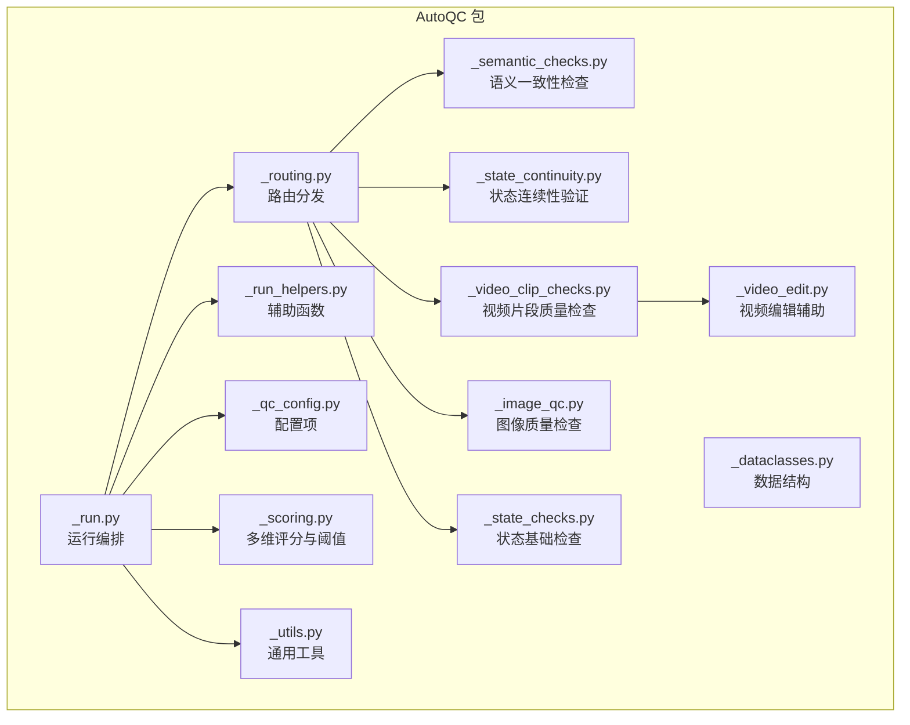
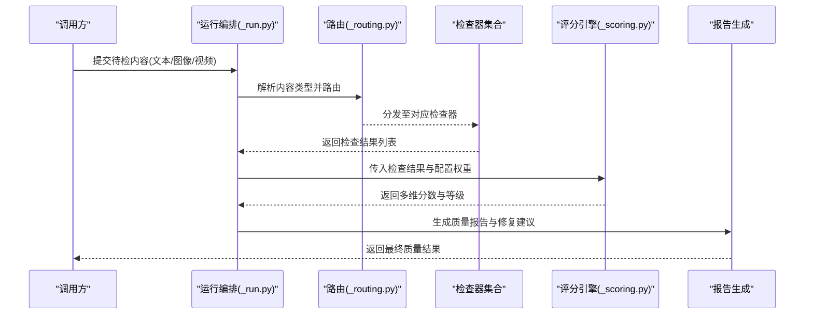
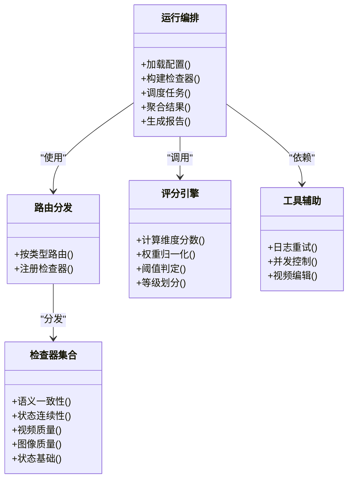

# 自动质量控制

<cite>
**本文引用的文件**   
- [pipeline/autoqc_pkg/_run.py](file://pipeline/autoqc_pkg/_run.py)
- [pipeline/autoqc_pkg/_scoring.py](file://pipeline/autoqc_pkg/_scoring.py)
- [pipeline/autoqc_pkg/_semantic_checks.py](file://pipeline/autoqc_pkg/_semantic_checks.py)
- [pipeline/autoqc_pkg/_state_continuity.py](file://pipeline/autoqc_pkg/_state_continuity.py)
- [pipeline/autoqc_pkg/_video_clip_checks.py](file://pipeline/autoqc_pkg/_video_clip_checks.py)
- [pipeline/autoqc_pkg/_image_qc.py](file://pipeline/autoqc_pkg/_image_qc.py)
- [pipeline/autoqc_pkg/_state_checks.py](file://pipeline/autoqc_pkg/_state_checks.py)
- [pipeline/autoqc_pkg/_dataclasses.py](file://pipeline/autoqc_pkg/_dataclasses.py)
- [pipeline/autoqc_pkg/_qc_config.py](file://pipeline/autoqc_pkg/_qc_config.py)
- [pipeline/autoqc_pkg/_routing.py](file://pipeline/autoqc_pkg/_routing.py)
- [pipeline/autoqc_pkg/_run_helpers.py](file://pipeline/autoqc_pkg/_run_helpers.py)
- [pipeline/autoqc_pkg/_utils.py](file://pipeline/autoqc_pkg/_utils.py)
- [pipeline/autoqc_pkg/_video_edit.py](file://pipeline/autoqc_pkg/_video_edit.py)
- [backend/app/services/audiobook/test_audiobook_quality_gate.py](file://backend/app/services/audiobook/test_audiobook_quality_gate.py)
- [backend/app/services/audiobook/test_audiobook_seed_scene_quality_gate.py](file://backend/app/services/audiobook/test_audiobook_seed_scene_quality_gate.py)
</cite>

## 目录
1. [简介](#简介)
2. [项目结构](#项目结构)
3. [核心组件](#核心组件)
4. [架构总览](#架构总览)
5. [详细组件分析](#详细组件分析)
6. [依赖关系分析](#依赖关系分析)
7. [性能考虑](#性能考虑)
8. [故障排查指南](#故障排查指南)
9. [结论](#结论)
10. [附录](#附录)

## 简介
本技术文档面向小说创作代理系统的“自动质量控制（AutoQC）”模块，聚焦以下目标：
- 质量检查规则设计原理：语义一致性、状态连续性、视频片段质量评估等核心算法。
- 评分算法实现机制：多维度评分模型、权重计算与阈值判断。
- 问题检测与修复流程：错误识别、自动修复策略、人工审核触发条件。
- 质量控制管道执行流程：任务调度、并行处理与结果聚合。
- 自定义检查规则扩展指南：接口规范、测试方法与性能优化技巧。
- 监控指标与调试工具使用方法。

该模块通过统一的入口编排多种检查器（文本、图像、视频），输出结构化质量报告与可操作修复建议，并在必要时触发人工审核或回退策略。

## 项目结构
AutoQC 位于 pipeline/autoqc_pkg 下，采用“按职责分文件”的组织方式：
- 运行编排：_run.py、_run_helpers.py、_routing.py
- 数据模型与配置：_dataclasses.py、_qc_config.py
- 检查器实现：_semantic_checks.py、_state_continuity.py、_video_clip_checks.py、_image_qc.py、_state_checks.py
- 评分与工具：_scoring.py、_utils.py、_video_edit.py

图表来源
- [pipeline/autoqc_pkg/_run.py](file://pipeline/autoqc_pkg/_run.py)
- [pipeline/autoqc_pkg/_routing.py](file://pipeline/autoqc_pkg/_routing.py)
- [pipeline/autoqc_pkg/_scoring.py](file://pipeline/autoqc_pkg/_scoring.py)
- [pipeline/autoqc_pkg/_semantic_checks.py](file://pipeline/autoqc_pkg/_semantic_checks.py)
- [pipeline/autoqc_pkg/_state_continuity.py](file://pipeline/autoqc_pkg/_state_continuity.py)
- [pipeline/autoqc_pkg/_video_clip_checks.py](file://pipeline/autoqc_pkg/_video_clip_checks.py)
- [pipeline/autoqc_pkg/_image_qc.py](file://pipeline/autoqc_pkg/_image_qc.py)
- [pipeline/autoqc_pkg/_state_checks.py](file://pipeline/autoqc_pkg/_state_checks.py)
- [pipeline/autoqc_pkg/_dataclasses.py](file://pipeline/autoqc_pkg/_dataclasses.py)
- [pipeline/autoqc_pkg/_qc_config.py](file://pipeline/autoqc_pkg/_qc_config.py)
- [pipeline/autoqc_pkg/_run_helpers.py](file://pipeline/autoqc_pkg/_run_helpers.py)
- [pipeline/autoqc_pkg/_utils.py](file://pipeline/autoqc_pkg/_utils.py)
- [pipeline/autoqc_pkg/_video_edit.py](file://pipeline/autoqc_pkg/_video_edit.py)

章节来源
- [pipeline/autoqc_pkg/_run.py](file://pipeline/autoqc_pkg/_run.py)
- [pipeline/autoqc_pkg/_routing.py](file://pipeline/autoqc_pkg/_routing.py)
- [pipeline/autoqc_pkg/_scoring.py](file://pipeline/autoqc_pkg/_scoring.py)

## 核心组件
- 运行编排器（_run.py）：负责加载配置、构建检查器实例、调度任务、收集结果、生成最终质量报告。
- 路由分发（_routing.py）：根据内容类型（文本/图像/视频）将任务路由到对应检查器。
- 数据模型（_dataclasses.py）：定义输入上下文、检查结果、评分对象、修复建议等统一结构。
- 配置管理（_qc_config.py）：集中管理检查开关、权重、阈值、并发度等参数。
- 评分引擎（_scoring.py）：实现多维度评分、权重归一化、阈值判定与等级划分。
- 检查器集合：
  - 语义一致性（_semantic_checks.py）：跨段落/镜头的实体、设定、动机一致性校验。
  - 状态连续性（_state_continuity.py）：角色状态、场景状态、时间线顺序的一致性验证。
  - 视频片段质量（_video_clip_checks.py）：帧率、分辨率、时长、转场、音频同步等指标。
  - 图像质量（_image_qc.py）：清晰度、噪声、色彩异常、尺寸合规性。
  - 状态基础检查（_state_checks.py）：必填字段、枚举值、范围约束等基础校验。
- 工具与辅助（_utils.py、_run_helpers.py、_video_edit.py）：IO、日志、重试、并发控制、视频剪辑辅助。

章节来源
- [pipeline/autoqc_pkg/_dataclasses.py](file://pipeline/autoqc_pkg/_dataclasses.py)
- [pipeline/autoqc_pkg/_qc_config.py](file://pipeline/autoqc_pkg/_qc_config.py)
- [pipeline/autoqc_pkg/_scoring.py](file://pipeline/autoqc_pkg/_scoring.py)
- [pipeline/autoqc_pkg/_semantic_checks.py](file://pipeline/autoqc_pkg/_semantic_checks.py)
- [pipeline/autoqc_pkg/_state_continuity.py](file://pipeline/autoqc_pkg/_state_continuity.py)
- [pipeline/autoqc_pkg/_video_clip_checks.py](file://pipeline/autoqc_pkg/_video_clip_checks.py)
- [pipeline/autoqc_pkg/_image_qc.py](file://pipeline/autoqc_pkg/_image_qc.py)
- [pipeline/autoqc_pkg/_state_checks.py](file://pipeline/autoqc_pkg/_state_checks.py)
- [pipeline/autoqc_pkg/_utils.py](file://pipeline/autoqc_pkg/_utils.py)
- [pipeline/autoqc_pkg/_run_helpers.py](file://pipeline/autoqc_pkg/_run_helpers.py)
- [pipeline/autoqc_pkg/_video_edit.py](file://pipeline/autoqc_pkg/_video_edit.py)

## 架构总览
AutoQC 采用“编排-路由-检查-评分-报告”的分层架构：
- 编排层：读取配置，组装检查器，协调并发与重试。
- 路由层：按内容类型选择检查器集合。
- 检查层：各检查器独立运行，产出结构化问题与建议。
- 评分层：汇总各维度得分，应用权重与阈值，给出总体等级。
- 报告层：输出可机读的质量报告与人工审核标记。

图表来源
- [pipeline/autoqc_pkg/_run.py](file://pipeline/autoqc_pkg/_run.py)
- [pipeline/autoqc_pkg/_routing.py](file://pipeline/autoqc_pkg/_routing.py)
- [pipeline/autoqc_pkg/_scoring.py](file://pipeline/autoqc_pkg/_scoring.py)

## 详细组件分析

### 运行编排器（_run.py）
- 功能要点：
  - 初始化配置与检查器实例。
  - 基于内容类型进行路由与并行调度。
  - 聚合检查结果，调用评分引擎，生成报告。
  - 支持失败重试、超时控制与降级策略。
- 关键流程：
  - 输入校验与上下文构建。
  - 任务拆分与并发执行。
  - 结果合并与去重。
  - 触发人工审核的条件判断（如严重问题数量、低分阈值）。

章节来源
- [pipeline/autoqc_pkg/_run.py](file://pipeline/autoqc_pkg/_run.py)
- [pipeline/autoqc_pkg/_run_helpers.py](file://pipeline/autoqc_pkg/_run_helpers.py)

### 路由分发（_routing.py）
- 功能要点：
  - 根据内容类型（文本/图像/视频）选择检查器组合。
  - 支持动态注册与扩展的检查器映射。
  - 提供默认策略与覆盖策略。
- 扩展点：
  - 新增检查器后在路由表中注册。
  - 按业务场景定制路由规则。

章节来源
- [pipeline/autoqc_pkg/_routing.py](file://pipeline/autoqc_pkg/_routing.py)

### 数据模型与配置（_dataclasses.py、_qc_config.py）
- 数据模型：
  - 输入上下文：包含原始内容、元数据、关联资产（角色、场景、镜头）。
  - 检查结果：问题类型、严重级别、位置信息、修复建议。
  - 评分对象：维度分数、权重、阈值、总分与等级。
- 配置项：
  - 检查开关、权重分配、阈值设置、并发度、重试次数、超时时间。
  - 支持环境覆盖与运行时调整。

章节来源
- [pipeline/autoqc_pkg/_dataclasses.py](file://pipeline/autoqc_pkg/_dataclasses.py)
- [pipeline/autoqc_pkg/_qc_config.py](file://pipeline/autoqc_pkg/_qc_config.py)

### 评分引擎（_scoring.py）
- 多维度评分模型：
  - 语义一致性、状态连续性、视频质量、图像质量、基础状态检查等维度。
  - 每个维度由若干子指标构成，支持加权求和。
- 权重计算：
  - 全局权重与维度内权重两级归一化。
  - 支持动态权重调整（按内容类型或项目配置）。
- 阈值判断：
  - 维度阈值与总分阈值双轨制。
  - 等级划分（通过/警告/失败/需人工审核）。
- 输出：
  - 维度分数明细、问题计数、建议优先级、是否触发人工审核。

章节来源
- [pipeline/autoqc_pkg/_scoring.py](file://pipeline/autoqc_pkg/_scoring.py)

### 语义一致性检查（_semantic_checks.py）
- 设计原理：
  - 抽取实体（角色、地点、物品）、设定（世界观、规则）、动机（行为意图）。
  - 跨段落/镜头比对一致性，识别冲突与漂移。
- 算法要点：
  - 实体对齐与消歧。
  - 设定引用追踪与冲突检测。
  - 动机连贯性评估（因果链完整性）。
- 输出：
  - 不一致条目、冲突描述、修复建议（替换、补充、删除）。

章节来源
- [pipeline/autoqc_pkg/_semantic_checks.py](file://pipeline/autoqc_pkg/_semantic_checks.py)

### 状态连续性验证（_state_continuity.py）
- 设计原理：
  - 维护角色状态、场景状态、时间线顺序的状态机。
  - 检查状态转移是否符合预设规则与叙事逻辑。
- 算法要点：
  - 状态快照对比与差异分析。
  - 时序一致性校验（前后矛盾、跳跃）。
  - 事件因果链验证。
- 输出：
  - 状态冲突、时序错误、缺失过渡事件及修复建议。

章节来源
- [pipeline/autoqc_pkg/_state_continuity.py](file://pipeline/autoqc_pkg/_state_continuity.py)

### 视频片段质量评估（_video_clip_checks.py）
- 设计原理：
  - 对视频片段的格式、分辨率、帧率、时长、转场、音画同步等进行量化评估。
- 算法要点：
  - 媒体元数据解析与合规性检查。
  - 视觉质量指标（模糊、噪点、过曝/欠曝）。
  - 音频质量指标（静音段、爆音、音量均衡）。
  - 转场与节奏评估（切点合理性）。
- 输出：
  - 质量分数、问题定位、修复建议（重编码、裁剪、补帧、音频校正）。

章节来源
- [pipeline/autoqc_pkg/_video_clip_checks.py](file://pipeline/autoqc_pkg/_video_clip_checks.py)
- [pipeline/autoqc_pkg/_video_edit.py](file://pipeline/autoqc_pkg/_video_edit.py)

### 图像质量检查（_image_qc.py）
- 设计原理：
  - 针对关键帧、参考图、插图进行清晰度、噪声、色彩、尺寸等检查。
- 算法要点：
  - 清晰度估计（边缘锐度、频域分析）。
  - 噪声与伪影检测。
  - 色彩空间与直方图异常识别。
- 输出：
  - 图像质量分数、问题描述、修复建议（增强、降噪、重采样）。

章节来源
- [pipeline/autoqc_pkg/_image_qc.py](file://pipeline/autoqc_pkg/_image_qc.py)

### 状态基础检查（_state_checks.py）
- 设计原理：
  - 对必填字段、枚举值、数值范围、格式约束进行快速校验。
- 算法要点：
  - Schema 驱动的规则匹配。
  - 批量校验与错误聚合。
- 输出：
  - 违规项清单、修复指引。

章节来源
- [pipeline/autoqc_pkg/_state_checks.py](file://pipeline/autoqc_pkg/_state_checks.py)

### 工具与辅助（_utils.py、_run_helpers.py、_video_edit.py）
- _utils.py：日志、重试、并发控制、路径与IO工具。
- _run_helpers.py：任务拆分、结果聚合、降级与回滚。
- _video_edit.py：FFmpeg封装、剪辑、拼接、转码、字幕合成。

章节来源
- [pipeline/autoqc_pkg/_utils.py](file://pipeline/autoqc_pkg/_utils.py)
- [pipeline/autoqc_pkg/_run_helpers.py](file://pipeline/autoqc_pkg/_run_helpers.py)
- [pipeline/autoqc_pkg/_video_edit.py](file://pipeline/autoqc_pkg/_video_edit.py)

## 依赖关系分析
- 内部依赖：
  - 运行编排依赖路由、配置、评分与工具。
  - 检查器之间相对独立，通过统一数据模型交换结果。
- 外部依赖：
  - 媒体处理（FFmpeg）用于视频/图像分析。
  - LLM/VLM 可用于语义抽取与一致性推理（可选）。
- 耦合与内聚：
  - 检查器高内聚、低耦合，便于扩展与替换。
  - 评分引擎与检查器解耦，支持权重策略灵活调整。

图表来源
- [pipeline/autoqc_pkg/_run.py](file://pipeline/autoqc_pkg/_run.py)
- [pipeline/autoqc_pkg/_routing.py](file://pipeline/autoqc_pkg/_routing.py)
- [pipeline/autoqc_pkg/_scoring.py](file://pipeline/autoqc_pkg/_scoring.py)
- [pipeline/autoqc_pkg/_semantic_checks.py](file://pipeline/autoqc_pkg/_semantic_checks.py)
- [pipeline/autoqc_pkg/_state_continuity.py](file://pipeline/autoqc_pkg/_state_continuity.py)
- [pipeline/autoqc_pkg/_video_clip_checks.py](file://pipeline/autoqc_pkg/_video_clip_checks.py)
- [pipeline/autoqc_pkg/_image_qc.py](file://pipeline/autoqc_pkg/_image_qc.py)
- [pipeline/autoqc_pkg/_state_checks.py](file://pipeline/autoqc_pkg/_state_checks.py)
- [pipeline/autoqc_pkg/_utils.py](file://pipeline/autoqc_pkg/_utils.py)
- [pipeline/autoqc_pkg/_video_edit.py](file://pipeline/autoqc_pkg/_video_edit.py)

章节来源
- [pipeline/autoqc_pkg/_run.py](file://pipeline/autoqc_pkg/_run.py)
- [pipeline/autoqc_pkg/_routing.py](file://pipeline/autoqc_pkg/_routing.py)
- [pipeline/autoqc_pkg/_scoring.py](file://pipeline/autoqc_pkg/_scoring.py)

## 性能考虑
- 并发与并行：
  - 检查器间并行执行，限制最大并发度避免资源争用。
  - I/O 密集型任务（媒体解析）与非阻塞策略结合。
- 缓存与复用：
  - 中间结果缓存（如特征提取、实体抽取）减少重复计算。
  - 共享上下文（角色/场景库）避免重复加载。
- 资源控制：
  - 超时与重试上限，防止长尾任务拖慢整体。
  - 内存与GPU使用监控，按需释放。
- 批处理与流式：
  - 大文件分块处理，流式读取降低峰值内存。
  - 增量更新：仅对变更片段重新检查。

[本节为通用指导，不直接分析具体文件]

## 故障排查指南
- 常见问题定位：
  - 检查器未注册或路由失败：确认路由表与检查器命名。
  - 评分异常：核对权重配置与阈值设置。
  - 视频/图像解析失败：检查媒体格式与依赖（FFmpeg）。
  - 并发超时：调整并发度与超时参数。
- 调试方法：
  - 启用详细日志，记录检查器输入输出。
  - 单检查器隔离测试，逐步缩小问题范围。
  - 使用测试用例复现（见下方测试文件）。
- 人工审核触发：
  - 严重问题数量超过阈值。
  - 总分低于通过阈值但高于警告阈值。
  - 关键维度（如语义一致性）得分过低。

章节来源
- [backend/app/services/audiobook/test_audiobook_quality_gate.py](file://backend/app/services/audiobook/test_audiobook_quality_gate.py)
- [backend/app/services/audiobook/test_audiobook_seed_scene_quality_gate.py](file://backend/app/services/audiobook/test_audiobook_seed_scene_quality_gate.py)

## 结论
AutoQC 模块通过模块化、可扩展的检查器体系与灵活的评分引擎，实现了从文本到视频的全链路质量控制。其设计强调：
- 规则清晰、可配置、可观测。
- 检查器解耦、易于扩展与替换。
- 评分模型透明、阈值可控、支持人工介入。
在实际使用中，建议结合业务场景定制权重与阈值，并通过持续测试与监控优化稳定性与性能。

[本节为总结性内容，不直接分析具体文件]

## 附录

### 自定义检查规则扩展指南
- 接口规范：
  - 实现统一检查器接口（输入上下文、返回检查结果）。
  - 遵循数据模型约定，确保与评分引擎兼容。
- 注册与路由：
  - 在路由表中注册新检查器，指定适用内容类型。
- 测试方法：
  - 编写单元测试覆盖正常与边界情况。
  - 使用现有测试套件进行集成验证。
- 性能优化：
  - 避免重复计算，利用缓存。
  - 合理设置并发与超时，避免阻塞。

章节来源
- [pipeline/autoqc_pkg/_routing.py](file://pipeline/autoqc_pkg/_routing.py)
- [pipeline/autoqc_pkg/_dataclasses.py](file://pipeline/autoqc_pkg/_dataclasses.py)
- [pipeline/autoqc_pkg/_qc_config.py](file://pipeline/autoqc_pkg/_qc_config.py)

### 监控指标与调试工具
- 监控指标：
  - 检查器耗时、成功率、问题分布、评分分布。
  - 资源使用（CPU/GPU/内存）、队列长度、重试次数。
- 调试工具：
  - 详细日志开关、检查器输出快照、评分明细导出。
  - 可视化报告（HTML/PDF）便于人工复核。

[本节为通用指导，不直接分析具体文件]