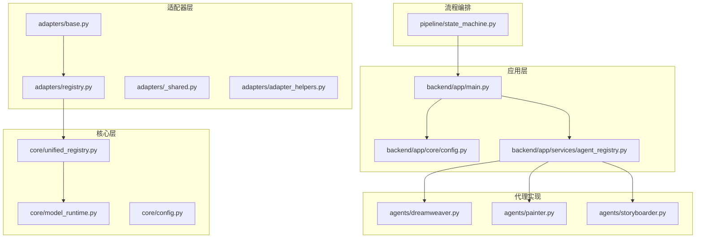
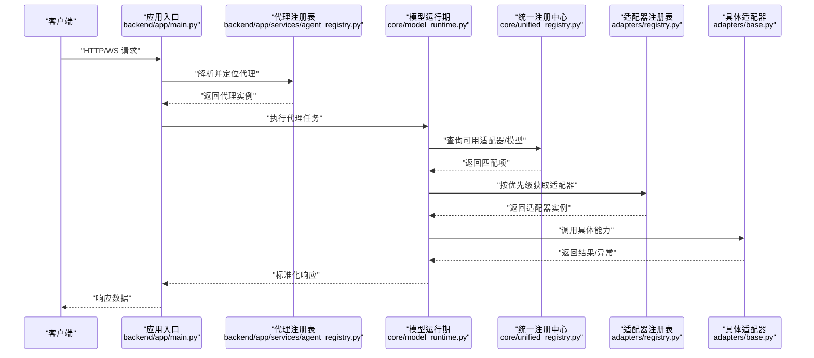
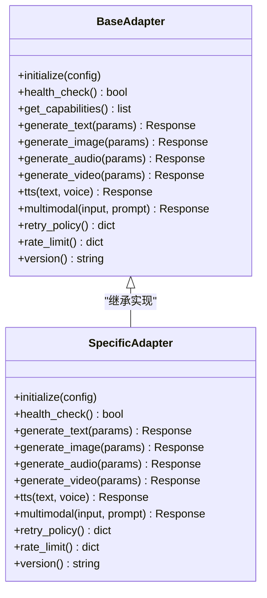
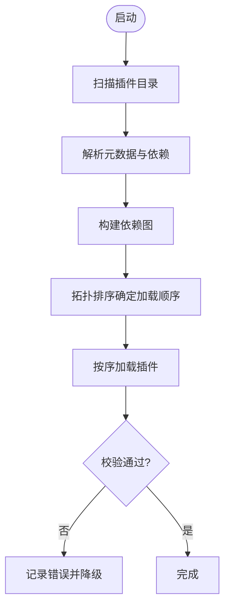
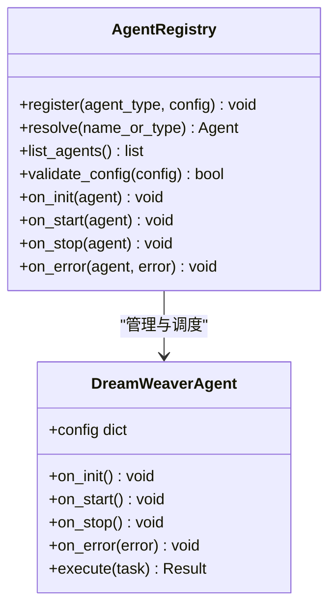
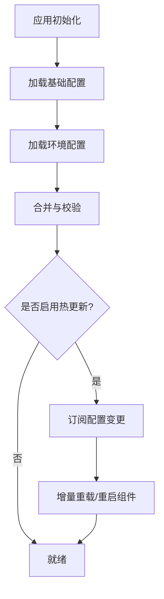
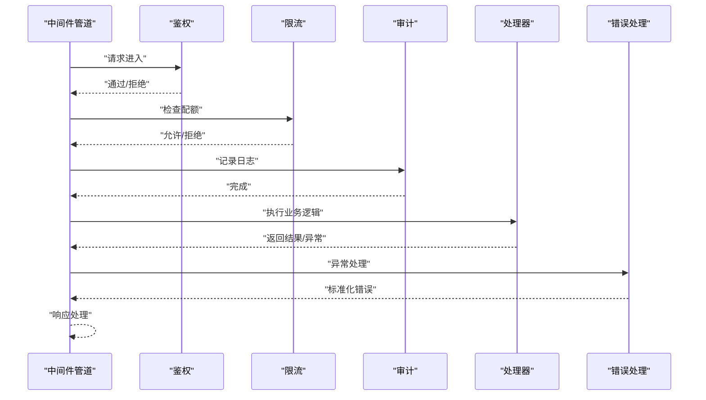
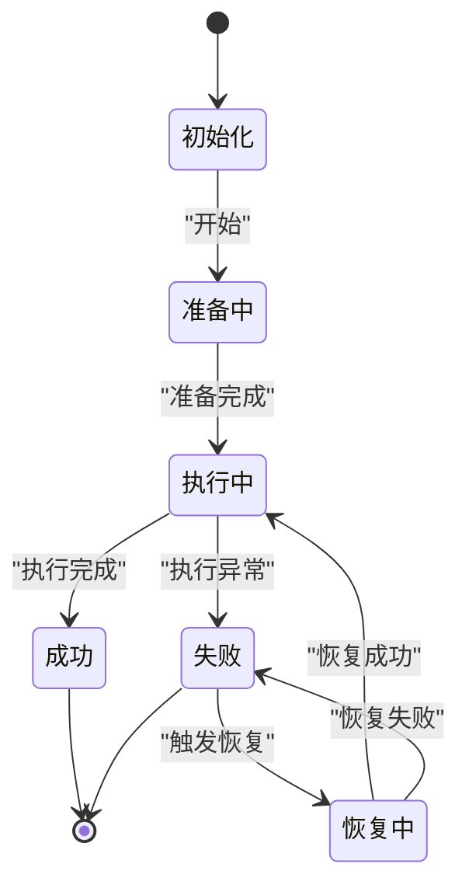
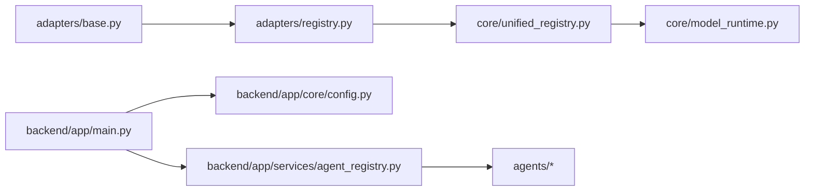

# 扩展机制设计

<cite>
**本文引用的文件**   
- [adapters/base.py](file://adapters/base.py)
- [adapters/registry.py](file://adapters/registry.py)
- [adapters/_shared.py](file://adapters/_shared.py)
- [adapters/adapter_helpers.py](file://adapters/adapter_helpers.py)
- [core/unified_registry.py](file://core/unified_registry.py)
- [core/model_runtime.py](file://core/model_runtime.py)
- [core/config.py](file://core/config.py)
- [backend/app/main.py](file://backend/app/main.py)
- [backend/app/core/config.py](file://backend/app/core/config.py)
- [backend/app/services/agent_registry.py](file://backend/app/services/agent_registry.py)
- [agents/dreamweaver.py](file://agents/dreamweaver.py)
- [agents/painter.py](file://agents/painter.py)
- [agents/storyboarder.py](file://agents/storyboarder.py)
- [pipeline/state_machine.py](file://pipeline/state_machine.py)
- [scripts/verify_all_adapters.py](file://scripts/verify_all_adapters.py)
</cite>

## 目录
1. [简介](#简介)
2. [项目结构](#项目结构)
3. [核心组件](#核心组件)
4. [架构总览](#架构总览)
5. [详细组件分析](#详细组件分析)
6. [依赖关系分析](#依赖关系分析)
7. [性能考量](#性能考量)
8. [故障排查指南](#故障排查指南)
9. [结论](#结论)
10. [附录](#附录)

## 简介
本设计文档面向“小说创作代理系统”的扩展机制，聚焦插件化与适配器体系，覆盖以下关键主题：
- 插件发现、加载顺序与依赖管理
- 适配器的扩展接口设计（基础接口、可选方法、版本兼容）
- 代理类型的扩展机制（注册、配置、生命周期钩子）
- 配置系统的扩展能力（动态加载、环境特定、热更新）
- 中间件管道的扩展点（请求拦截、响应处理、错误链）
- 扩展开发指南（示例、最佳实践）
- 测试策略与调试方法
- 打包与分发规范

## 项目结构
系统采用分层与模块化组织，扩展相关的关键目录与文件包括：
- adapters：统一适配器层，提供多模型/多厂商接入能力
- core：运行时核心，包含统一注册表、模型运行期、配置与路由等
- backend/app：后端应用入口、服务层、API路由与配置
- agents：业务代理实现（如 DreamWeaver、Painter、Storyboarder）
- pipeline：流程编排与状态机
- scripts：验证与工具脚本

**图表来源** 
- [adapters/base.py](file://adapters/base.py)
- [adapters/registry.py](file://adapters/registry.py)
- [core/unified_registry.py](file://core/unified_registry.py)
- [core/model_runtime.py](file://core/model_runtime.py)
- [backend/app/main.py](file://backend/app/main.py)
- [backend/app/core/config.py](file://backend/app/core/config.py)
- [backend/app/services/agent_registry.py](file://backend/app/services/agent_registry.py)
- [agents/dreamweaver.py](file://agents/dreamweaver.py)
- [agents/painter.py](file://agents/painter.py)
- [agents/storyboarder.py](file://agents/storyboarder.py)
- [pipeline/state_machine.py](file://pipeline/state_machine.py)

**章节来源**
- [adapters/base.py](file://adapters/base.py)
- [adapters/registry.py](file://adapters/registry.py)
- [core/unified_registry.py](file://core/unified_registry.py)
- [core/model_runtime.py](file://core/model_runtime.py)
- [backend/app/main.py](file://backend/app/main.py)
- [backend/app/core/config.py](file://backend/app/core/config.py)
- [backend/app/services/agent_registry.py](file://backend/app/services/agent_registry.py)
- [agents/dreamweaver.py](file://agents/dreamweaver.py)
- [agents/painter.py](file://agents/painter.py)
- [agents/storyboarder.py](file://agents/storyboarder.py)
- [pipeline/state_machine.py](file://pipeline/state_machine.py)

## 核心组件
- 适配器基类与共享能力：定义统一的适配器契约与通用工具，确保不同厂商/模型的接入一致性。
- 适配器注册表：集中管理适配器实例，支持按类型/名称查找、优先级排序与依赖解析。
- 统一注册中心：跨模块的实体注册（适配器、代理、任务等），保证全局唯一性与可发现性。
- 模型运行期：根据配置选择具体适配器，封装调用细节并提供重试、限流、缓存等横切能力。
- 应用启动与配置：应用初始化时加载配置、注册适配器与代理，构建中间件管道。
- 代理注册与服务：将业务代理纳入统一注册表，暴露生命周期钩子与配置项。
- 流程状态机：编排多步骤任务，为扩展点提供阶段回调与错误恢复。

**章节来源**
- [adapters/base.py](file://adapters/base.py)
- [adapters/registry.py](file://adapters/registry.py)
- [core/unified_registry.py](file://core/unified_registry.py)
- [core/model_runtime.py](file://core/model_runtime.py)
- [backend/app/main.py](file://backend/app/main.py)
- [backend/app/core/config.py](file://backend/app/core/config.py)
- [backend/app/services/agent_registry.py](file://backend/app/services/agent_registry.py)
- [pipeline/state_machine.py](file://pipeline/state_machine.py)

## 架构总览
下图展示从请求进入应用到最终调用适配器的整体流程，以及扩展点在其中的位置。

**图表来源** 
- [backend/app/main.py](file://backend/app/main.py)
- [backend/app/services/agent_registry.py](file://backend/app/services/agent_registry.py)
- [core/model_runtime.py](file://core/model_runtime.py)
- [core/unified_registry.py](file://core/unified_registry.py)
- [adapters/registry.py](file://adapters/registry.py)
- [adapters/base.py](file://adapters/base.py)

## 详细组件分析

### 适配器扩展接口设计
- 基础接口定义：统一抽象出文本生成、图像生成、音视频生成、TTS、多模态等能力，要求实现最小必要方法。
- 可选方法实现：提供重试、超时、并发控制、速率限制、缓存键生成、元数据提取等可选钩子。
- 版本兼容性处理：通过版本号声明与降级策略，确保新旧模型/接口平滑过渡。
- 错误与异常映射：将第三方错误映射为内部统一异常，便于上层统一处理。

**图表来源** 
- [adapters/base.py](file://adapters/base.py)

**章节来源**
- [adapters/base.py](file://adapters/base.py)
- [adapters/_shared.py](file://adapters/_shared.py)
- [adapters/adapter_helpers.py](file://adapters/adapter_helpers.py)

### 插件发现与加载顺序
- 插件发现：扫描指定包或目录，依据约定命名与元数据（如 __init__.py 中的注册装饰器）自动发现适配器与代理。
- 加载顺序：基于优先级字段与依赖图拓扑排序，确保先加载基础能力再加载高级能力。
- 依赖管理：声明式依赖列表，冲突检测与回退策略；未满足依赖时跳过或降级。

**图表来源** 
- [adapters/registry.py](file://adapters/registry.py)
- [core/unified_registry.py](file://core/unified_registry.py)

**章节来源**
- [adapters/registry.py](file://adapters/registry.py)
- [core/unified_registry.py](file://core/unified_registry.py)

### 代理类型扩展机制
- 新代理类注册：在代理注册表中以类型/名称注册，支持别名与分组。
- 配置管理：每个代理可声明配置项、默认值、校验规则与环境变量注入。
- 生命周期钩子：提供 on_init、on_start、on_stop、on_error 等钩子，用于资源准备与清理。

**图表来源** 
- [backend/app/services/agent_registry.py](file://backend/app/services/agent_registry.py)
- [agents/dreamweaver.py](file://agents/dreamweaver.py)

**章节来源**
- [backend/app/services/agent_registry.py](file://backend/app/services/agent_registry.py)
- [agents/dreamweaver.py](file://agents/dreamweaver.py)
- [agents/painter.py](file://agents/painter.py)
- [agents/storyboarder.py](file://agents/storyboarder.py)

### 配置系统扩展能力
- 动态配置加载：支持 YAML/JSON/环境变量等多源配置合并，运行时重载。
- 环境特定配置：按环境（dev/test/prod）选择配置片段，支持覆盖与继承。
- 热更新支持：监听配置变更事件，触发适配器/代理重新初始化或增量更新。

**图表来源** 
- [core/config.py](file://core/config.py)
- [backend/app/core/config.py](file://backend/app/core/config.py)

**章节来源**
- [core/config.py](file://core/config.py)
- [backend/app/core/config.py](file://backend/app/core/config.py)

### 中间件管道扩展点
- 请求拦截：在请求进入代理前进行鉴权、限流、审计、参数规范化。
- 响应处理：对响应进行格式化、脱敏、指标采集、缓存写入。
- 错误处理链：统一捕获异常，转换为标准错误码与消息，支持重试与降级。

[此图为概念性流程图，不直接映射到具体源码文件]

### 流程编排与状态机扩展
- 阶段回调：在每个阶段前后插入自定义逻辑（预处理、后处理）。
- 错误恢复：支持失败重试、分支回退、补偿操作。
- 扩展点：新增阶段或替换现有阶段实现，无需修改主流程。

**图表来源** 
- [pipeline/state_machine.py](file://pipeline/state_machine.py)

**章节来源**
- [pipeline/state_machine.py](file://pipeline/state_machine.py)

## 依赖关系分析
- 适配器与注册表：适配器实现需向注册表登记，注册表负责优先级与依赖解析。
- 运行期与统一注册中心：运行期通过统一注册中心查询可用能力，避免硬编码。
- 应用与配置：应用启动时加载配置并驱动注册过程。
- 代理与服务：代理注册表统一管理代理实例及其生命周期。

**图表来源** 
- [adapters/base.py](file://adapters/base.py)
- [adapters/registry.py](file://adapters/registry.py)
- [core/unified_registry.py](file://core/unified_registry.py)
- [core/model_runtime.py](file://core/model_runtime.py)
- [backend/app/main.py](file://backend/app/main.py)
- [backend/app/core/config.py](file://backend/app/core/config.py)
- [backend/app/services/agent_registry.py](file://backend/app/services/agent_registry.py)
- [agents/dreamweaver.py](file://agents/dreamweaver.py)
- [agents/painter.py](file://agents/painter.py)
- [agents/storyboarder.py](file://agents/storyboarder.py)

**章节来源**
- [adapters/base.py](file://adapters/base.py)
- [adapters/registry.py](file://adapters/registry.py)
- [core/unified_registry.py](file://core/unified_registry.py)
- [core/model_runtime.py](file://core/model_runtime.py)
- [backend/app/main.py](file://backend/app/main.py)
- [backend/app/core/config.py](file://backend/app/core/config.py)
- [backend/app/services/agent_registry.py](file://backend/app/services/agent_registry.py)
- [agents/dreamweaver.py](file://agents/dreamweaver.py)
- [agents/painter.py](file://agents/painter.py)
- [agents/storyboarder.py](file://agents/storyboarder.py)

## 性能考量
- 适配器选择策略：优先选择低延迟、高吞吐的实现，结合权重与可用性评分。
- 缓存与去重：对重复请求进行缓存，减少外部调用开销。
- 限流与熔断：保护下游服务，避免雪崩效应。
- 异步与并发：合理设置并发度，避免阻塞 I/O。
- 资源回收：在代理停止钩子中释放连接池、临时文件等资源。

[本节为通用指导，不直接分析具体文件]

## 故障排查指南
- 适配器健康检查：通过健康检查接口确认适配器状态，快速定位问题。
- 日志与追踪：在关键路径添加结构化日志与链路追踪，便于问题复现。
- 配置校验：启动时严格校验配置，提前发现缺失或非法项。
- 验证脚本：使用验证脚本批量检查适配器连通性与基本功能。

**章节来源**
- [scripts/verify_all_adapters.py](file://scripts/verify_all_adapters.py)

## 结论
本设计通过统一的适配器契约、集中式注册与运行期调度，构建了可扩展、可维护的小说创作代理系统。借助插件发现、依赖管理与配置热更新，系统能够灵活接入新的模型与能力，同时保持稳定的生命周期与错误处理机制。建议遵循本文档的扩展规范与最佳实践，确保扩展质量与可演进性。

## 附录

### 扩展开发指南（摘要）
- 实现适配器：继承基础适配器，实现必要方法，声明版本与能力。
- 注册与配置：在注册表中登记，提供配置模板与校验规则。
- 生命周期钩子：实现初始化、启动、停止、错误处理钩子。
- 中间件扩展：在管道中插入鉴权、限流、审计等中间件。
- 测试与调试：编写单元测试与集成测试，使用健康检查与验证脚本。
- 打包与分发：遵循包结构与依赖声明，提供安装与升级脚本。

[本节为通用指导，不直接分析具体文件]