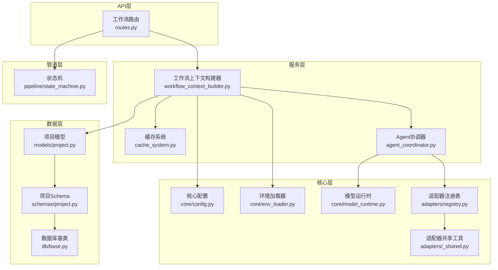
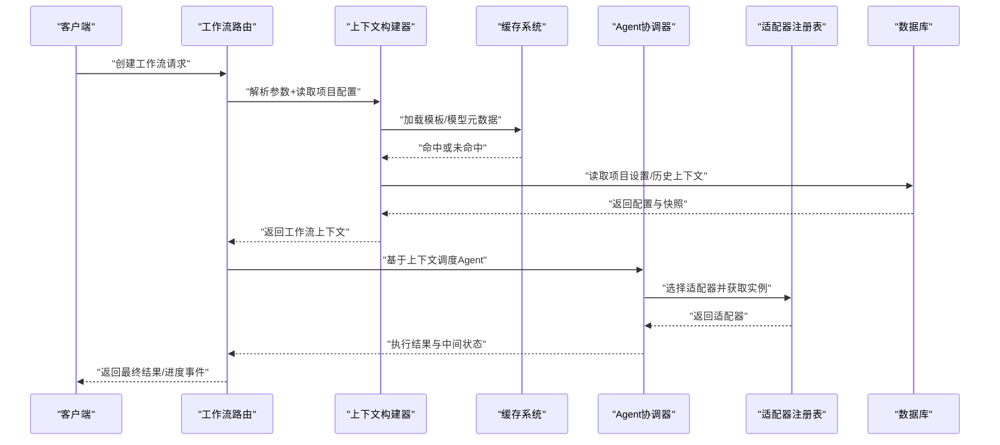
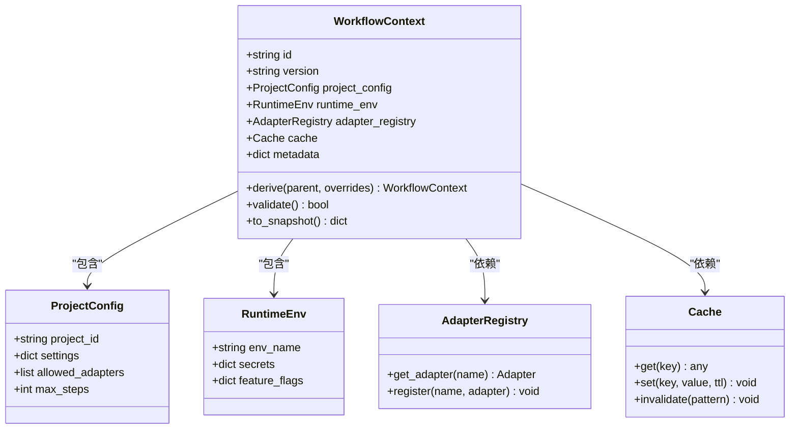
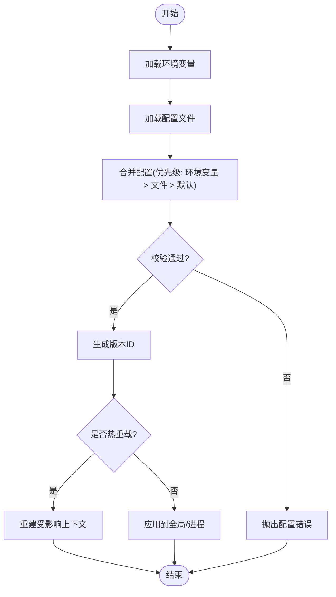
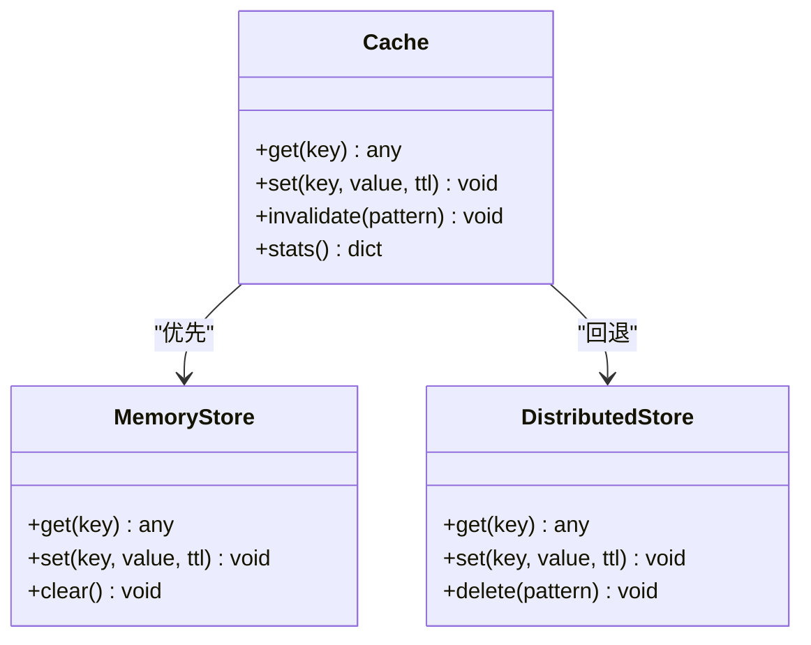
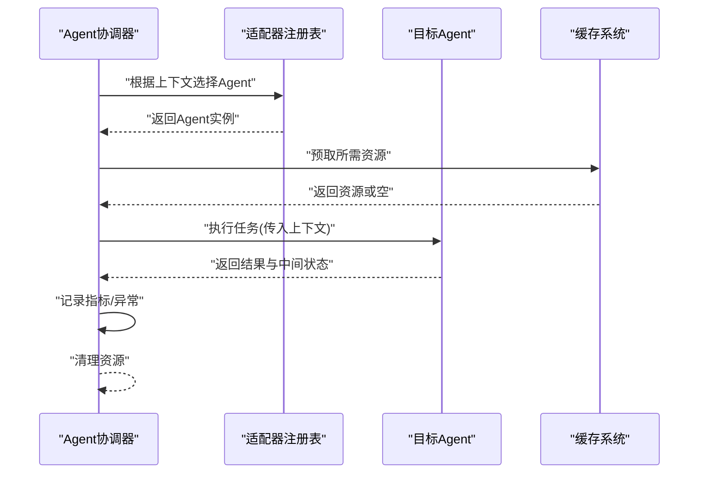
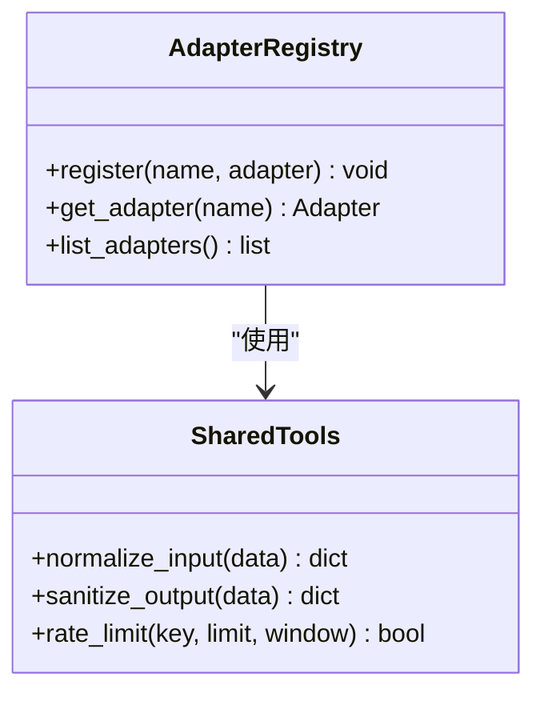
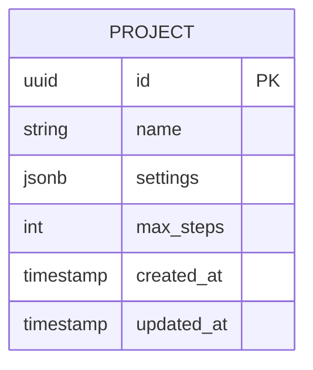
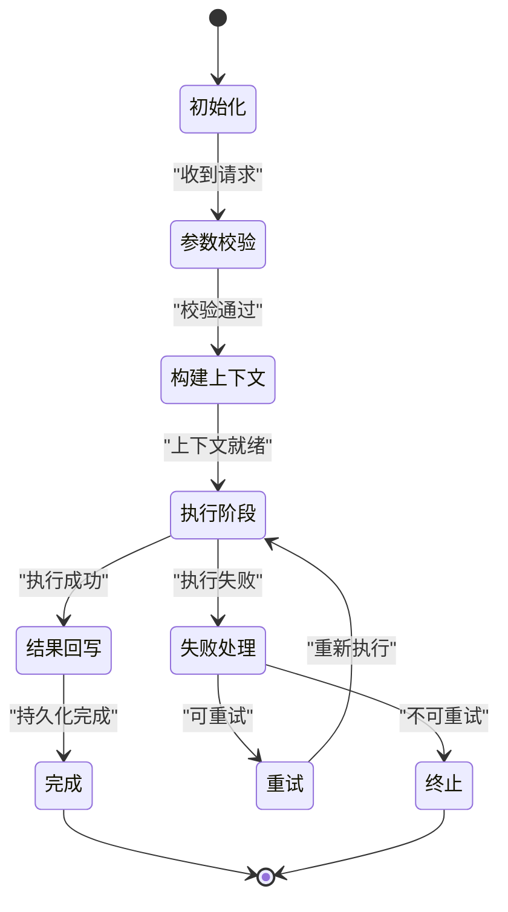
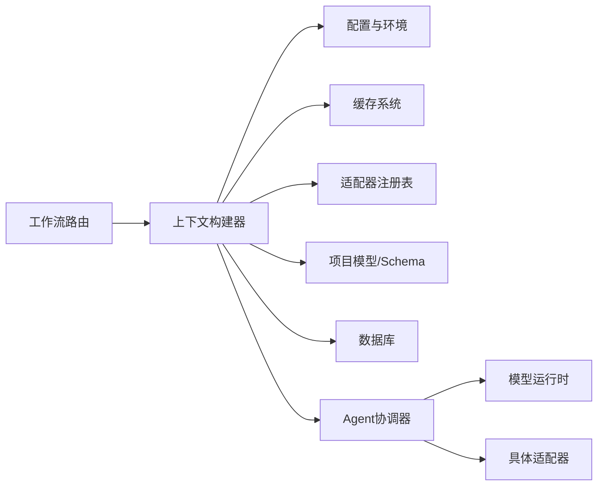

# 工作流上下文管理

<cite>
**本文引用的文件**   
- [backend/app/services/workflow_context_builder.py](file://backend/app/services/workflow_context_builder.py)
- [backend/app/core/config.py](file://backend/app/core/config.py)
- [backend/app/core/env_loader.py](file://backend/app/core/env_loader.py)
- [backend/app/api/v1/workflow/routes.py](file://backend/app/api/v1/workflow/routes.py)
- [backend/app/models/project.py](file://backend/app/models/project.py)
- [backend/app/schemas/project.py](file://backend/app/schemas/project.py)
- [backend/app/services/agents/agent_coordinator.py](file://backend/app/services/agents/agent_coordinator.py)
- [backend/app/services/cache_system.py](file://backend/app/services/cache_system.py)
- [backend/app/db/base.py](file://backend/app/db/base.py)
- [core/config.py](file://core/config.py)
- [core/model_runtime.py](file://core/model_runtime.py)
- [adapters/registry.py](file://adapters/registry.py)
- [adapters/_shared.py](file://adapters/_shared.py)
- [pipeline/state_machine.py](file://pipeline/state_machine.py)
</cite>

## 目录
1. [简介](#简介)
2. [项目结构](#项目结构)
3. [核心组件](#核心组件)
4. [架构总览](#架构总览)
5. [详细组件分析](#详细组件分析)
6. [依赖关系分析](#依赖关系分析)
7. [性能考虑](#性能考虑)
8. [故障排查指南](#故障排查指南)
9. [结论](#结论)
10. [附录](#附录)

## 简介
本文件面向小说创作代理系统的工作流上下文管理，系统性说明上下文的构建过程（参数解析、环境变量注入、依赖关系管理）、数据传递机制（父子上下文继承、隔离与共享策略）、生命周期管理（创建、更新、销毁、内存优化）、配置管理（动态加载、热重载、版本控制），以及数据结构定义、初始化流程、最佳实践、验证与错误处理、调试工具等。目标是帮助开发者快速理解并安全扩展上下文能力，确保多阶段、多代理协作的稳定性和可观测性。

## 项目结构
工作流上下文相关代码主要分布在后端服务层与核心模块：
- 服务层：工作流上下文构建器、缓存系统、Agent协调器等
- 核心层：配置与环境加载、模型运行时、适配器注册表
- API层：工作流路由负责接收请求并驱动上下文构建与流转
- 数据层：项目模型与Schema用于持久化与校验
- 管道层：状态机用于编排工作流阶段

图表来源 
- [backend/app/api/v1/workflow/routes.py](file://backend/app/api/v1/workflow/routes.py)
- [backend/app/services/workflow_context_builder.py](file://backend/app/services/workflow_context_builder.py)
- [backend/app/services/cache_system.py](file://backend/app/services/cache_system.py)
- [backend/app/services/agents/agent_coordinator.py](file://backend/app/services/agents/agent_coordinator.py)
- [core/config.py](file://core/config.py)
- [backend/app/core/env_loader.py](file://backend/app/core/env_loader.py)
- [core/model_runtime.py](file://core/model_runtime.py)
- [adapters/registry.py](file://adapters/registry.py)
- [adapters/_shared.py](file://adapters/_shared.py)
- [backend/app/models/project.py](file://backend/app/models/project.py)
- [backend/app/schemas/project.py](file://backend/app/schemas/project.py)
- [backend/app/db/base.py](file://backend/app/db/base.py)
- [pipeline/state_machine.py](file://pipeline/state_machine.py)

章节来源
- [backend/app/api/v1/workflow/routes.py](file://backend/app/api/v1/workflow/routes.py)
- [backend/app/services/workflow_context_builder.py](file://backend/app/services/workflow_context_builder.py)
- [backend/app/core/config.py](file://backend/app/core/config.py)
- [backend/app/core/env_loader.py](file://backend/app/core/env_loader.py)
- [backend/app/services/cache_system.py](file://backend/app/services/cache_system.py)
- [backend/app/services/agents/agent_coordinator.py](file://backend/app/services/agents/agent_coordinator.py)
- [core/config.py](file://core/config.py)
- [core/model_runtime.py](file://core/model_runtime.py)
- [adapters/registry.py](file://adapters/registry.py)
- [adapters/_shared.py](file://adapters/_shared.py)
- [backend/app/models/project.py](file://backend/app/models/project.py)
- [backend/app/schemas/project.py](file://backend/app/schemas/project.py)
- [backend/app/db/base.py](file://backend/app/db/base.py)
- [pipeline/state_machine.py](file://pipeline/state_machine.py)

## 核心组件
- 工作流上下文构建器：聚合请求参数、环境变量、项目配置与运行时依赖，生成不可变或受控可变的工作流上下文对象；提供子上下文派生与合并策略。
- 配置与环境加载器：集中管理应用级配置、环境变量注入、动态配置加载与版本控制。
- 缓存系统：为上下文中的大对象（如提示词模板、模型元数据）提供缓存与失效策略，降低重复计算与IO开销。
- Agent协调器：基于上下文调度具体Agent执行，维护调用栈、重试、超时与资源清理。
- 适配器注册表与共享工具：统一接入不同模型/媒体适配器，提供通用转换与安全校验。
- 项目模型与Schema：定义项目级配置项、校验规则与持久化映射。
- 数据库基类：提供连接池、事务与迁移支持。
- 状态机：编排工作流阶段，驱动上下文在不同阶段的演进。

章节来源
- [backend/app/services/workflow_context_builder.py](file://backend/app/services/workflow_context_builder.py)
- [backend/app/core/config.py](file://backend/app/core/config.py)
- [backend/app/core/env_loader.py](file://backend/app/core/env_loader.py)
- [backend/app/services/cache_system.py](file://backend/app/services/cache_system.py)
- [backend/app/services/agents/agent_coordinator.py](file://backend/app/services/agents/agent_coordinator.py)
- [adapters/registry.py](file://adapters/registry.py)
- [adapters/_shared.py](file://adapters/_shared.py)
- [backend/app/models/project.py](file://backend/app/models/project.py)
- [backend/app/schemas/project.py](file://backend/app/schemas/project.py)
- [backend/app/db/base.py](file://backend/app/db/base.py)
- [pipeline/state_machine.py](file://pipeline/state_machine.py)

## 架构总览
工作流上下文贯穿“请求入口—上下文构建—Agent执行—结果回写”的完整链路。上下文在构建阶段完成参数解析与环境注入，在执行阶段通过缓存与适配器进行资源访问，在结束阶段进行清理与审计。

图表来源 
- [backend/app/api/v1/workflow/routes.py](file://backend/app/api/v1/workflow/routes.py)
- [backend/app/services/workflow_context_builder.py](file://backend/app/services/workflow_context_builder.py)
- [backend/app/services/cache_system.py](file://backend/app/services/cache_system.py)
- [backend/app/services/agents/agent_coordinator.py](file://backend/app/services/agents/agent_coordinator.py)
- [adapters/registry.py](file://adapters/registry.py)
- [backend/app/db/base.py](file://backend/app/db/base.py)

## 详细组件分析

### 工作流上下文构建器
职责与行为：
- 参数解析：从请求体、路径参数、查询参数中抽取必要字段并进行类型校验。
- 环境变量注入：将运行环境密钥、端点、速率限制等注入到上下文的安全区域。
- 依赖关系管理：根据项目配置与运行时需求，解析并绑定所需的适配器、缓存键、任务队列等。
- 上下文派生：支持父上下文克隆与覆盖，形成父子继承关系，保证数据隔离与增量更新。
- 版本控制：为上下文附加版本号与变更摘要，便于回溯与灰度发布。

关键设计要点：
- 不可变性优先：构建完成后上下文尽量不可变，避免并发修改导致不一致。
- 分层存储：敏感信息（如密钥）与业务数据分离，使用只读视图暴露给下游。
- 懒加载：对大对象采用延迟初始化，减少启动与冷启动开销。
- 校验前置：在进入执行前完成所有必填字段与格式校验，失败快速返回。

图表来源 
- [backend/app/services/workflow_context_builder.py](file://backend/app/services/workflow_context_builder.py)
- [backend/app/models/project.py](file://backend/app/models/project.py)
- [backend/app/core/env_loader.py](file://backend/app/core/env_loader.py)
- [adapters/registry.py](file://adapters/registry.py)
- [backend/app/services/cache_system.py](file://backend/app/services/cache_system.py)

章节来源
- [backend/app/services/workflow_context_builder.py](file://backend/app/services/workflow_context_builder.py)

### 配置与环境加载器
职责与行为：
- 动态配置加载：支持从配置文件、环境变量、远程配置中心加载，按优先级合并。
- 热重载：监听配置变更事件，触发上下文重建或局部刷新，无需重启服务。
- 版本控制：为每次配置加载生成版本标识，支持回滚与对比。
- 安全注入：对敏感字段进行脱敏与权限校验，防止泄露。

关键设计要点：
- 幂等加载：多次加载同一版本不产生副作用。
- 差异合并：增量更新而非全量替换，减少抖动。
- 降级策略：当远程配置不可用时回退到本地缓存。

图表来源 
- [backend/app/core/config.py](file://backend/app/core/config.py)
- [backend/app/core/env_loader.py](file://backend/app/core/env_loader.py)

章节来源
- [backend/app/core/config.py](file://backend/app/core/config.py)
- [backend/app/core/env_loader.py](file://backend/app/core/env_loader.py)

### 缓存系统
职责与行为：
- 多级缓存：内存缓存与分布式缓存结合，提高命中率。
- 失效策略：TTL、LRU、按模式失效，避免脏读。
- 序列化：对复杂对象进行高效序列化与反序列化。
- 监控：记录命中率、延迟、容量与淘汰情况。

关键设计要点：
- 键命名规范：包含上下文版本、租户、功能域，避免冲突。
- 读写分离：读路径优先命中缓存，写路径同步更新。
- 容错：缓存不可用时降级为直接计算或磁盘读取。

图表来源 
- [backend/app/services/cache_system.py](file://backend/app/services/cache_system.py)

章节来源
- [backend/app/services/cache_system.py](file://backend/app/services/cache_system.py)

### Agent协调器
职责与行为：
- 基于上下文选择并实例化目标Agent。
- 管理调用栈、重试、超时、熔断与资源释放。
- 收集执行指标与追踪信息，便于排障与优化。

关键设计要点：
- 隔离执行：每个Agent在独立作用域内执行，避免状态污染。
- 可插拔：通过注册表动态接入新Agent实现。
- 可观测性：输出结构化日志与指标。

图表来源 
- [backend/app/services/agents/agent_coordinator.py](file://backend/app/services/agents/agent_coordinator.py)
- [adapters/registry.py](file://adapters/registry.py)
- [backend/app/services/cache_system.py](file://backend/app/services/cache_system.py)

章节来源
- [backend/app/services/agents/agent_coordinator.py](file://backend/app/services/agents/agent_coordinator.py)

### 适配器注册表与共享工具
职责与行为：
- 统一注册与管理各类适配器（LLM、图像、视频、TTS等）。
- 提供通用转换、签名、限流、重试等能力。
- 暴露最小接口，屏蔽底层差异。

关键设计要点：
- 强类型契约：适配器需实现统一接口，便于替换与测试。
- 安全校验：输入输出均经过白名单与长度限制。
- 性能优化：连接池、批量请求、缓存响应头。

图表来源 
- [adapters/registry.py](file://adapters/registry.py)
- [adapters/_shared.py](file://adapters/_shared.py)

章节来源
- [adapters/registry.py](file://adapters/registry.py)
- [adapters/_shared.py](file://adapters/_shared.py)

### 项目模型与Schema
职责与行为：
- 定义项目级配置项（如允许适配器列表、最大步数、风格偏好等）。
- 提供Pydantic Schema用于请求/响应校验与文档生成。
- 与数据库映射，支持迁移与版本演进。

关键设计要点：
- 向后兼容：新增字段默认值与可选策略。
- 约束明确：枚举、范围、正则表达式等严格校验。
- 审计字段：创建时间、更新时间、操作人等。

图表来源 
- [backend/app/models/project.py](file://backend/app/models/project.py)
- [backend/app/schemas/project.py](file://backend/app/schemas/project.py)
- [backend/app/db/base.py](file://backend/app/db/base.py)

章节来源
- [backend/app/models/project.py](file://backend/app/models/project.py)
- [backend/app/schemas/project.py](file://backend/app/schemas/project.py)
- [backend/app/db/base.py](file://backend/app/db/base.py)

### 状态机
职责与行为：
- 定义工作流阶段与状态转移规则。
- 驱动上下文在不同阶段的演进，确保顺序与一致性。
- 支持中断恢复与回滚。

关键设计要点：
- 确定性转移：每个状态转移由明确事件触发。
- 可观测性：记录状态变化与原因。
- 可扩展：新增阶段无需改动现有逻辑。

图表来源 
- [pipeline/state_machine.py](file://pipeline/state_machine.py)

章节来源
- [pipeline/state_machine.py](file://pipeline/state_machine.py)

## 依赖关系分析
- 低耦合高内聚：上下文构建器依赖配置、环境、缓存、适配器注册表，但不直接感知具体实现细节。
- 明确的边界：API层仅负责路由与参数转发，业务逻辑下沉至服务层。
- 外部依赖可控：适配器通过注册表统一管理，便于替换与测试。
- 数据流向清晰：请求→上下文→Agent→适配器→结果，单向流动，避免循环依赖。

图表来源 
- [backend/app/api/v1/workflow/routes.py](file://backend/app/api/v1/workflow/routes.py)
- [backend/app/services/workflow_context_builder.py](file://backend/app/services/workflow_context_builder.py)
- [backend/app/core/config.py](file://backend/app/core/config.py)
- [backend/app/core/env_loader.py](file://backend/app/core/env_loader.py)
- [backend/app/services/cache_system.py](file://backend/app/services/cache_system.py)
- [adapters/registry.py](file://adapters/registry.py)
- [backend/app/models/project.py](file://backend/app/models/project.py)
- [backend/app/schemas/project.py](file://backend/app/schemas/project.py)
- [backend/app/db/base.py](file://backend/app/db/base.py)
- [backend/app/services/agents/agent_coordinator.py](file://backend/app/services/agents/agent_coordinator.py)
- [core/model_runtime.py](file://core/model_runtime.py)

章节来源
- [backend/app/api/v1/workflow/routes.py](file://backend/app/api/v1/workflow/routes.py)
- [backend/app/services/workflow_context_builder.py](file://backend/app/services/workflow_context_builder.py)
- [backend/app/core/config.py](file://backend/app/core/config.py)
- [backend/app/core/env_loader.py](file://backend/app/core/env_loader.py)
- [backend/app/services/cache_system.py](file://backend/app/services/cache_system.py)
- [adapters/registry.py](file://adapters/registry.py)
- [backend/app/models/project.py](file://backend/app/models/project.py)
- [backend/app/schemas/project.py](file://backend/app/schemas/project.py)
- [backend/app/db/base.py](file://backend/app/db/base.py)
- [backend/app/services/agents/agent_coordinator.py](file://backend/app/services/agents/agent_coordinator.py)
- [core/model_runtime.py](file://core/model_runtime.py)

## 性能考虑
- 上下文构建缓存：对热点项目配置与模板进行缓存，减少重复解析。
- 懒加载与按需初始化：仅在首次使用时加载大对象，降低内存峰值。
- 批量与异步：对非阻塞I/O采用异步调用，提升吞吐。
- 连接池与复用：数据库、HTTP、适配器连接池化，避免频繁握手。
- 监控与告警：跟踪构建耗时、缓存命中率、适配器延迟，及时发现问题。

[本节为通用指导，不直接分析具体文件]

## 故障排查指南
常见问题与定位方法：
- 参数校验失败：检查请求体结构与必填字段，查看Schema错误详情。
- 环境变量缺失：确认密钥与端点已正确注入，检查加载优先级与覆盖规则。
- 缓存未命中：核对键命名规范与TTL设置，观察缓存统计。
- 适配器选择错误：检查注册表名称与上下文配置的一致性。
- 上下文泄漏：确认析构与清理逻辑是否被执行，监控内存增长。
- 状态机卡住：查看状态转移日志与事件来源，确认条件满足。

建议工具：
- 结构化日志：记录关键步骤与上下文快照（脱敏后）。
- 指标采集：构建耗时、缓存命中率、适配器QPS与错误率。
- 追踪ID：贯穿请求链路，便于跨服务关联。
- 回放与回放夹具：复现问题场景，加速修复。

章节来源
- [backend/app/services/workflow_context_builder.py](file://backend/app/services/workflow_context_builder.py)
- [backend/app/core/config.py](file://backend/app/core/config.py)
- [backend/app/core/env_loader.py](file://backend/app/core/env_loader.py)
- [backend/app/services/cache_system.py](file://backend/app/services/cache_system.py)
- [adapters/registry.py](file://adapters/registry.py)
- [backend/app/services/agents/agent_coordinator.py](file://backend/app/services/agents/agent_coordinator.py)
- [pipeline/state_machine.py](file://pipeline/state_machine.py)

## 结论
工作流上下文是小说创作代理系统的中枢，承载参数、环境、依赖与状态。通过清晰的构建流程、严格的校验、完善的缓存与适配器管理、以及健壮的生命周期与配置管理，系统能够在多阶段、多代理协作下保持稳定与高性能。建议持续完善监控与可观测性，强化错误恢复与回滚能力，确保在高负载与复杂场景下的可靠性。

[本节为总结，不直接分析具体文件]

## 附录
- 最佳实践
  - 上下文不可变优先，派生时使用覆盖策略。
  - 敏感信息隔离，最小权限暴露。
  - 配置热重载需幂等与回滚保障。
  - 缓存键命名包含上下文版本与租户。
  - 适配器实现统一接口，便于替换与测试。
- 数据结构定义
  - 上下文对象包含ID、版本、项目配置、运行时环境、适配器注册表、缓存与元数据。
  - 项目配置包含项目ID、设置字典、允许适配器列表、最大步数。
  - 运行时环境包含环境名、密钥字典、特性标志。
- 初始化流程
  - 解析参数→加载配置→注入环境→构建上下文→校验→进入执行。
- 验证与错误处理
  - 前置校验失败快速返回，记录错误上下文。
  - 运行时异常捕获并分类，区分可重试与不可重试。
- 调试工具
  - 启用详细日志与追踪ID。
  - 导出上下文快照（脱敏）用于离线分析。
  - 使用回放夹具复现问题。

[本节为补充信息，不直接分析具体文件]