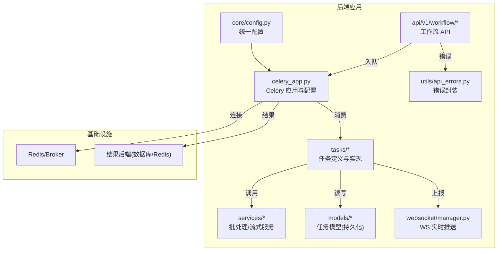
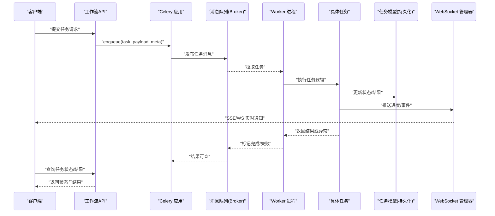
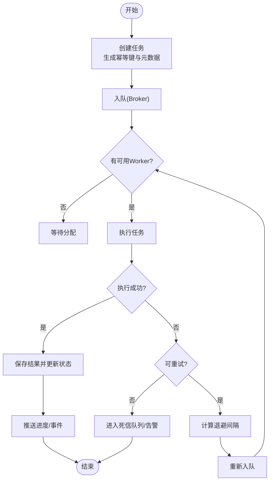
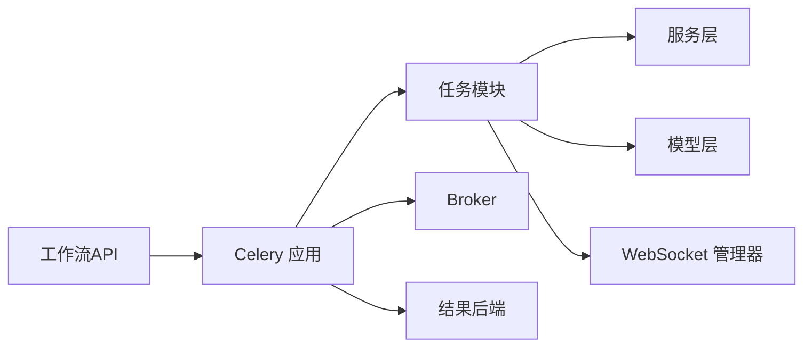

# 异步数据处理

<cite>
**本文引用的文件**   
- [backend/app/celery_app.py](file://backend/app/celery_app.py)
- [backend/app/tasks/audiobook_tasks.py](file://backend/app/tasks/audiobook_tasks.py)
- [backend/app/tasks/dreamweaver_tasks.py](file://backend/app/tasks/dreamweaver_tasks.py)
- [backend/app/tasks/experiment_tasks.py](file://backend/app/tasks/experiment_tasks.py)
- [backend/app/tasks/feedback_tasks.py](file://backend/app/tasks/feedback_tasks.py)
- [backend/app/api/v1/workflow/routes.py](file://backend/app/api/v1/workflow/routes.py)
- [backend/app/services/batch_processor.py](file://backend/app/services/batch_processor.py)
- [backend/app/services/streaming_service.py](file://backend/app/services/streaming_service.py)
- [backend/app/core/config.py](file://backend/app/core/config.py)
- [backend/app/models/audiobook_task.py](file://backend/app/models/audiobook_task.py)
- [backend/app/websocket/manager.py](file://backend/app/websocket/manager.py)
- [backend/app/api/v1/monitoring.py](file://backend/app/api/v1/monitoring.py)
- [backend/app/utils/api_errors.py](file://backend/app/utils/api_errors.py)
- [backend/tests/test_dreamweaver_task_trace.py](file://backend/tests/test_dreamweaver_task_trace.py)
- [backend/tests/test_audiobook_task_trace.py](file://backend/tests/test_audiobook_task_trace.py)
- [backend/tests/test_dev_worker_lifecycle.py](file://backend/tests/test_dev_worker_lifecycle.py)
- [backend/tests/test_sse_retry_preview.py](file://backend/tests/test_sse_retry_preview.py)
- [backend/tests/test_audiobook_task_repository.py](file://backend/tests/test_audiobook_task_repository.py)
- [backend/tests/test_audiobook_task_enqueue_order.py](file://backend/tests/test_audiobook_task_enqueue_order.py)
- [backend/tests/test_audiobook_tts_provider_payloads.py](file://backend/tests/test_audiobook_tts_provider_payloads.py)
- [backend/tests/test_smart_chunker.py](file://backend/tests/test_smart_chunker.py)
- [backend/tests/test_audiobook_sse_routes.py](file://backend/tests/test_audiobook_sse_routes.py)
</cite>

## 目录
1. [简介](#简介)
2. [项目结构](#项目结构)
3. [核心组件](#核心组件)
4. [架构总览](#架构总览)
5. [详细组件分析](#详细组件分析)
6. [依赖关系分析](#依赖关系分析)
7. [性能考虑](#性能考虑)
8. [故障排查指南](#故障排查指南)
9. [结论](#结论)
10. [附录](#附录)

## 简介
本文件面向小说创作代理系统的异步数据处理子系统，聚焦 Celery 任务队列的架构设计与实现。内容涵盖：
- 任务定义、调度策略与执行模型
- 消息格式规范（任务载荷、元数据、错误信息）
- 任务生命周期管理（创建、分发、执行、重试、结果存储）
- 并发控制与负载均衡（worker 管理、优先级、资源限制）
- 任务编排示例、错误处理模式与性能调优
- 监控、日志记录与调试工具使用

## 项目结构
异步处理相关代码主要位于 backend/app 下，关键目录与职责如下：
- celery_app.py：Celery 应用初始化、Broker/Backend 配置、路由与扩展
- tasks/*：按业务域划分的任务模块（有声书、Dreamweaver、实验、反馈等）
- services/*：批处理、流式服务、上下文构建等与任务协作的服务层
- api/v1/workflow/*：工作流 API，负责入队、状态查询与事件推送
- models/*：持久化模型（如 audiobook_task），用于任务状态与结果落库
- websocket/manager.py：WebSocket 管理器，用于实时进度与事件推送
- core/config.py：统一配置加载（含 Celery 相关环境变量）
- utils/api_errors.py：API 错误封装与标准化返回
- tests/*：覆盖任务追踪、SSE、入队顺序、负载构造等场景

图表来源
- [backend/app/celery_app.py](file://backend/app/celery_app.py)
- [backend/app/tasks/audiobook_tasks.py](file://backend/app/tasks/audiobook_tasks.py)
- [backend/app/tasks/dreamweaver_tasks.py](file://backend/app/tasks/dreamweaver_tasks.py)
- [backend/app/services/batch_processor.py](file://backend/app/services/batch_processor.py)
- [backend/app/services/streaming_service.py](file://backend/app/services/streaming_service.py)
- [backend/app/api/v1/workflow/routes.py](file://backend/app/api/v1/workflow/routes.py)
- [backend/app/models/audiobook_task.py](file://backend/app/models/audiobook_task.py)
- [backend/app/websocket/manager.py](file://backend/app/websocket/manager.py)
- [backend/app/core/config.py](file://backend/app/core/config.py)
- [backend/app/utils/api_errors.py](file://backend/app/utils/api_errors.py)

章节来源
- [backend/app/celery_app.py](file://backend/app/celery_app.py)
- [backend/app/core/config.py](file://backend/app/core/config.py)

## 核心组件
- Celery 应用与配置
  - 应用实例化、Broker/Backend 选择、路由规则、扩展插件（如任务追踪、限流、重试策略）
  - 通过统一配置加载环境变量，确保多环境一致性
- 任务模块
  - 按业务域拆分：audiobook_tasks、dreamweaver_tasks、experiment_tasks、feedback_tasks
  - 每个任务包含幂等键、重试策略、超时与资源限制、结果写入与事件上报
- 服务层
  - 批处理服务：批量任务拆分、合并与聚合
  - 流式服务：长耗时任务的增量结果推送（SSE/WebSocket）
- API 与工作流
  - 工作流 API 负责任务入队、状态查询、进度回调与错误回传
- 模型与持久化
  - 任务实体（如 audiobook_task）承载任务状态、阶段、结果指针与审计字段
- WebSocket 管理器
  - 维护连接与会话，广播任务进度与事件
- 错误与配置
  - 统一错误封装；集中配置管理

章节来源
- [backend/app/celery_app.py](file://backend/app/celery_app.py)
- [backend/app/tasks/audiobook_tasks.py](file://backend/app/tasks/audiobook_tasks.py)
- [backend/app/tasks/dreamweaver_tasks.py](file://backend/app/tasks/dreamweaver_tasks.py)
- [backend/app/services/batch_processor.py](file://backend/app/services/batch_processor.py)
- [backend/app/services/streaming_service.py](file://backend/app/services/streaming_service.py)
- [backend/app/api/v1/workflow/routes.py](file://backend/app/api/v1/workflow/routes.py)
- [backend/app/models/audiobook_task.py](file://backend/app/models/audiobook_task.py)
- [backend/app/websocket/manager.py](file://backend/app/websocket/manager.py)
- [backend/app/core/config.py](file://backend/app/core/config.py)
- [backend/app/utils/api_errors.py](file://backend/app/utils/api_errors.py)

## 架构总览
下图展示从 API 入队到 Worker 执行、结果落库与前端实时推送的整体流程。

图表来源
- [backend/app/api/v1/workflow/routes.py](file://backend/app/api/v1/workflow/routes.py)
- [backend/app/celery_app.py](file://backend/app/celery_app.py)
- [backend/app/tasks/audiobook_tasks.py](file://backend/app/tasks/audiobook_tasks.py)
- [backend/app/models/audiobook_task.py](file://backend/app/models/audiobook_task.py)
- [backend/app/websocket/manager.py](file://backend/app/websocket/manager.py)

## 详细组件分析

### Celery 应用与配置
- 应用初始化
  - 设置 Broker/Backend、路由、扩展（任务追踪、限流、重试）
  - 读取统一配置中的队列名、并发数、超时、重试策略等
- 路由与队列
  - 按业务域划分队列（如 audiobook、dreamweaver、experiment）
  - 支持优先级队列与动态路由
- 扩展与中间件
  - 任务追踪：为每个任务生成 trace_id，贯穿全链路
  - 限流与资源限制：基于 worker 级别与任务级别的配额
  - 重试策略：指数退避、最大重试次数、死信队列

章节来源
- [backend/app/celery_app.py](file://backend/app/celery_app.py)
- [backend/app/core/config.py](file://backend/app/core/config.py)

### 任务定义与执行模型
- 任务模块
  - audiobook_tasks：有声书生成、TTS、音频后处理、质量检查
  - dreamweaver_tasks：视频/图像生成、编辑、审核
  - experiment_tasks：A/B 实验、评测、指标采集
  - feedback_tasks：用户反馈收集、评分、召回训练
- 执行模型
  - 幂等性：通过幂等键避免重复执行
  - 重试：失败自动重试，支持条件重试（网络抖动、限流）
  - 超时：任务级超时保护，防止长时间阻塞
  - 结果：结构化结果写入数据库，附带审计字段

章节来源
- [backend/app/tasks/audiobook_tasks.py](file://backend/app/tasks/audiobook_tasks.py)
- [backend/app/tasks/dreamweaver_tasks.py](file://backend/app/tasks/dreamweaver_tasks.py)
- [backend/app/tasks/experiment_tasks.py](file://backend/app/tasks/experiment_tasks.py)
- [backend/app/tasks/feedback_tasks.py](file://backend/app/tasks/feedback_tasks.py)

### 消息格式规范
- 任务载荷（payload）
  - 必需字段：任务类型、幂等键、业务 ID、参数对象
  - 可选字段：优先级、超时、重试策略、标签
- 元数据（meta）
  - 追踪信息：trace_id、span_id、来源系统、时间戳
  - 权限与租户：user_id、project_id、tenant_id
  - 上下文：上游任务 ID、关联会话、版本信息
- 错误信息（error）
  - 错误码：分类（业务/系统/第三方）
  - 错误消息：人类可读描述
  - 堆栈：仅开发/调试环境启用
  - 重试建议：是否允许重试、退避策略

章节来源
- [backend/app/tasks/audiobook_tasks.py](file://backend/app/tasks/audiobook_tasks.py)
- [backend/app/tasks/dreamweaver_tasks.py](file://backend/app/tasks/dreamweaver_tasks.py)
- [backend/app/utils/api_errors.py](file://backend/app/utils/api_errors.py)

### 任务生命周期管理
- 创建
  - API 接收请求，校验参数，生成幂等键与元数据，入队
- 分发
  - Broker 根据队列与权重分发给可用 Worker
- 执行
  - Worker 拉取任务，加载上下文，执行业务逻辑
- 重试
  - 捕获异常，判断是否可重试，计算退避间隔，重新入队
- 结果存储
  - 成功：写入结果表，更新状态，触发下游任务或事件
  - 失败：记录错误详情，进入死信队列或告警

图表来源
- [backend/app/api/v1/workflow/routes.py](file://backend/app/api/v1/workflow/routes.py)
- [backend/app/celery_app.py](file://backend/app/celery_app.py)
- [backend/app/tasks/audiobook_tasks.py](file://backend/app/tasks/audiobook_tasks.py)
- [backend/app/models/audiobook_task.py](file://backend/app/models/audiobook_task.py)

### 并发控制与负载均衡
- Worker 管理
  - 水平扩展：按业务域启动多个 Worker 实例
  - 垂直扩展：调整单实例并发度与线程池
- 任务优先级
  - 队列级优先级（高/中/低）
  - 任务级优先级（数字越小越优先）
- 资源限制
  - CPU/内存上限、I/O 限制、外部 API 速率限制
- 负载均衡
  - 基于队列权重的公平调度
  - 亲和性路由（同租户/同项目任务尽量在同一 Worker）

章节来源
- [backend/app/celery_app.py](file://backend/app/celery_app.py)
- [backend/app/core/config.py](file://backend/app/core/config.py)

### 任务编排示例
- 有声书生成流水线
  - 文本分块 -> TTS 合成 -> 音频后处理 -> 质量检查 -> 导出
- Dreamweaver 视频生成
  - 提示词优化 -> 图像生成 -> 视频编辑 -> 审核 -> 输出
- 实验评估
  - 样本准备 -> 模型推理 -> 指标计算 -> 报告生成

章节来源
- [backend/app/tasks/audiobook_tasks.py](file://backend/app/tasks/audiobook_tasks.py)
- [backend/app/tasks/dreamweaver_tasks.py](file://backend/app/tasks/dreamweaver_tasks.py)
- [backend/app/services/batch_processor.py](file://backend/app/services/batch_processor.py)

### 错误处理模式
- 分类处理
  - 业务错误：不可重试，直接失败
  - 系统错误：可重试，指数退避
  - 第三方错误：限流/熔断，降级策略
- 错误上报
  - 统一错误码与消息
  - 追踪信息完整保留
- 恢复机制
  - 死信队列与人工干预
  - 补偿任务与重放

章节来源
- [backend/app/utils/api_errors.py](file://backend/app/utils/api_errors.py)
- [backend/app/tasks/audiobook_tasks.py](file://backend/app/tasks/audiobook_tasks.py)

### 监控、日志与调试
- 监控
  - 任务成功率、延迟、吞吐量
  - Worker 健康检查与资源监控
- 日志
  - 结构化日志，包含 trace_id
  - 分级日志（DEBUG/INFO/WARN/ERROR）
- 调试
  - 本地模拟 Worker 与 Broker
  - 任务回放与断点调试

章节来源
- [backend/app/api/v1/monitoring.py](file://backend/app/api/v1/monitoring.py)
- [backend/app/websocket/manager.py](file://backend/app/websocket/manager.py)
- [backend/tests/test_dreamweaver_task_trace.py](file://backend/tests/test_dreamweaver_task_trace.py)
- [backend/tests/test_audiobook_task_trace.py](file://backend/tests/test_audiobook_task_trace.py)

## 依赖关系分析
- 内部依赖
  - API 依赖 Celery 应用进行入队
  - 任务依赖服务层进行复杂逻辑处理
  - 任务依赖模型进行状态持久化
  - 任务依赖 WebSocket 管理器进行实时推送
- 外部依赖
  - Broker（Redis/RabbitMQ）
  - 结果后端（数据库/Redis）
  - 第三方 API（LLM/TTS/视频生成）

图表来源
- [backend/app/api/v1/workflow/routes.py](file://backend/app/api/v1/workflow/routes.py)
- [backend/app/celery_app.py](file://backend/app/celery_app.py)
- [backend/app/tasks/audiobook_tasks.py](file://backend/app/tasks/audiobook_tasks.py)
- [backend/app/services/batch_processor.py](file://backend/app/services/batch_processor.py)
- [backend/app/models/audiobook_task.py](file://backend/app/models/audiobook_task.py)
- [backend/app/websocket/manager.py](file://backend/app/websocket/manager.py)

章节来源
- [backend/app/api/v1/workflow/routes.py](file://backend/app/api/v1/workflow/routes.py)
- [backend/app/celery_app.py](file://backend/app/celery_app.py)

## 性能考虑
- 队列设计
  - 按业务域拆分队列，避免相互影响
  - 使用优先级队列保障关键任务
- 并发策略
  - 合理设置 Worker 数量与并发度
  - 避免 I/O 密集型任务阻塞 CPU 密集型任务
- 资源限制
  - 设置任务超时与内存上限
  - 外部 API 调用增加限流与熔断
- 结果存储
  - 异步写入，避免阻塞主流程
  - 使用索引优化查询性能
- 缓存与预取
  - 热点数据缓存
  - 任务预取减少延迟

章节来源
- [backend/app/celery_app.py](file://backend/app/celery_app.py)
- [backend/app/core/config.py](file://backend/app/core/config.py)

## 故障排查指南
- 常见问题
  - 任务堆积：检查 Worker 数量与处理能力
  - 任务失败：查看错误日志与重试策略
  - 结果不一致：检查幂等性与并发控制
- 诊断工具
  - 任务追踪：通过 trace_id 定位问题
  - 日志分析：结构化日志与分级过滤
  - 监控面板：实时观察队列长度与延迟
- 恢复措施
  - 重启 Worker 实例
  - 清理死信队列
  - 补偿任务修复数据

章节来源
- [backend/tests/test_dreamweaver_task_trace.py](file://backend/tests/test_dreamweaver_task_trace.py)
- [backend/tests/test_audiobook_task_trace.py](file://backend/tests/test_audiobook_task_trace.py)
- [backend/tests/test_dev_worker_lifecycle.py](file://backend/tests/test_dev_worker_lifecycle.py)
- [backend/tests/test_sse_retry_preview.py](file://backend/tests/test_sse_retry_preview.py)
- [backend/tests/test_audiobook_task_repository.py](file://backend/tests/test_audiobook_task_repository.py)
- [backend/tests/test_audiobook_task_enqueue_order.py](file://backend/tests/test_audiobook_task_enqueue_order.py)
- [backend/tests/test_audiobook_tts_provider_payloads.py](file://backend/tests/test_audiobook_tts_provider_payloads.py)
- [backend/tests/test_smart_chunker.py](file://backend/tests/test_smart_chunker.py)
- [backend/tests/test_audiobook_sse_routes.py](file://backend/tests/test_audiobook_sse_routes.py)

## 结论
本异步数据处理子系统通过 Celery 实现了高可靠、可扩展的任务队列架构。通过合理的任务定义、消息规范、生命周期管理与并发控制，保障了小说创作代理系统的高效稳定运行。结合完善的监控、日志与调试工具，能够快速定位与解决问题，提升系统可观测性与可维护性。

## 附录
- 最佳实践
  - 任务幂等性设计
  - 合理的重试与超时策略
  - 分层监控与告警
- 扩展建议
  - 支持更多队列类型（如 Kafka）
  - 引入分布式锁与事务
  - 增强任务编排能力（DAG）