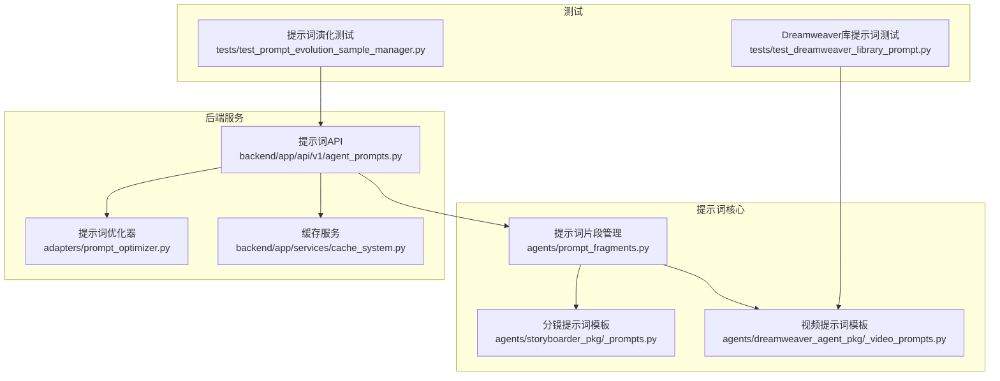
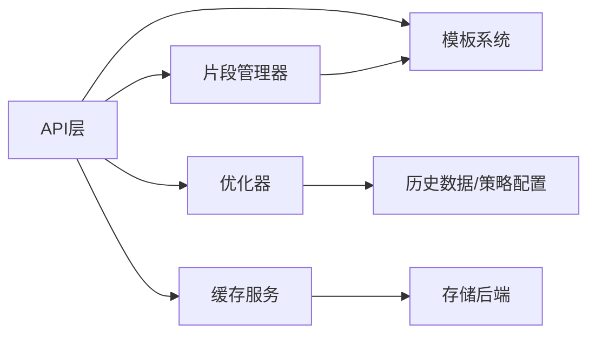

# 提示词数据结构

<cite>
**本文引用的文件**   
- [prompt_fragments.py](file://agents/prompt_fragments.py)
- [_prompts.py](file://agents/storyboarder_pkg/_prompts.py)
- [_video_prompts.py](file://agents/dreamweaver_agent_pkg/_video_prompts.py)
- [agent_prompts.py](file://backend/app/api/v1/agent_prompts.py)
- [prompt_optimizer.py](file://adapters/prompt_optimizer.py)
- [cache_system.py](file://backend/app/services/cache_system.py)
- [test_prompt_evolution_sample_manager.py](file://tests/test_prompt_evolution_sample_manager.py)
- [test_dreamweaver_library_prompt.py](file://tests/test_dreamweaver_library_prompt.py)
</cite>

## 目录
1. [简介](#简介)
2. [项目结构](#项目结构)
3. [核心组件](#核心组件)
4. [架构总览](#架构总览)
5. [详细组件分析](#详细组件分析)
6. [依赖关系分析](#依赖关系分析)
7. [性能考量](#性能考量)
8. [故障排查指南](#故障排查指南)
9. [结论](#结论)
10. [附录](#附录)

## 简介
本文件面向“小说创作代理系统”的提示词子系统，系统化阐述提示词的数据结构、模板语法与变量替换机制、片段组织与组合规则、上下文变量的作用域与生命周期、渲染引擎（编译、缓存与优化）、以及验证、调试与测试工具。目标是让开发者与内容创作者都能理解并高效使用提示词体系，确保在不同模型与业务场景下的一致性与可维护性。

## 项目结构
围绕提示词的核心代码主要分布在以下位置：
- agents/prompt_fragments.py：提示词片段管理与组合逻辑
- agents/storyboarder_pkg/_prompts.py：分镜相关提示词模板与片段
- agents/dreamweaver_agent_pkg/_video_prompts.py：视频生成相关提示词模板与片段
- backend/app/api/v1/agent_prompts.py：提示词相关的API接口与调用入口
- adapters/prompt_optimizer.py：提示词优化器（用于自动改进与策略选择）
- backend/app/services/cache_system.py：通用缓存服务（可用于提示词渲染结果缓存）
- tests/*：针对提示词与演化的测试用例



**图表来源** 
- [prompt_fragments.py](file://agents/prompt_fragments.py)
- [_prompts.py](file://agents/storyboarder_pkg/_prompts.py)
- [_video_prompts.py](file://agents/dreamweaver_agent_pkg/_video_prompts.py)
- [agent_prompts.py](file://backend/app/api/v1/agent_prompts.py)
- [prompt_optimizer.py](file://adapters/prompt_optimizer.py)
- [cache_system.py](file://backend/app/services/cache_system.py)
- [test_prompt_evolution_sample_manager.py](file://tests/test_prompt_evolution_sample_manager.py)
- [test_dreamweaver_library_prompt.py](file://tests/test_dreamweaver_library_prompt.py)

**章节来源**
- [prompt_fragments.py](file://agents/prompt_fragments.py)
- [_prompts.py](file://agents/storyboarder_pkg/_prompts.py)
- [_video_prompts.py](file://agents/dreamweaver_agent_pkg/_video_prompts.py)
- [agent_prompts.py](file://backend/app/api/v1/agent_prompts.py)
- [prompt_optimizer.py](file://adapters/prompt_optimizer.py)
- [cache_system.py](file://backend/app/services/cache_system.py)
- [test_prompt_evolution_sample_manager.py](file://tests/test_prompt_evolution_sample_manager.py)
- [test_dreamweaver_library_prompt.py](file://tests/test_dreamweaver_library_prompt.py)

## 核心组件
- 提示词片段管理器：负责片段的注册、分类、优先级排序与组合拼接，支持嵌套引用与条件化插入。
- 模板系统：提供模板语法与变量替换机制，支持全局与局部变量、作用域链解析、默认值与空值处理。
- 渲染引擎：将模板与上下文变量编译为最终提示词文本，具备缓存与性能优化能力。
- 提示词优化器：基于策略或实验数据对提示词进行自动改进与版本管理。
- API层：暴露统一的提示词获取、渲染与优化接口，供上层工作流调用。
- 缓存服务：提供键值存储与过期策略，用于缓存已编译的模板与渲染结果。

**章节来源**
- [prompt_fragments.py](file://agents/prompt_fragments.py)
- [_prompts.py](file://agents/storyboarder_pkg/_prompts.py)
- [_video_prompts.py](file://agents/dreamweaver_agent_pkg/_video_prompts.py)
- [agent_prompts.py](file://backend/app/api/v1/agent_prompts.py)
- [prompt_optimizer.py](file://adapters/prompt_optimizer.py)
- [cache_system.py](file://backend/app/services/cache_system.py)

## 架构总览
提示词系统的整体流程如下：
- 模板定义与片段组织：在模板文件中声明片段与组合规则，按分类与优先级管理。
- 上下文构建：根据请求或任务上下文构建全局与局部变量，形成作用域链。
- 渲染与优化：渲染引擎将模板与上下文编译为最终提示词；可选地通过优化器进行改进。
- 缓存与复用：渲染结果与编译后的模板被缓存，提升后续请求性能。
- API调用：上层服务通过API获取或渲染提示词，并返回给下游模型或服务。

```mermaid
sequenceDiagram
participant Client as "调用方"
participant API as "提示词API"
participant Frag as "片段管理器"
participant Temp as "模板系统"
participant Opt as "优化器"
participant Cache as "缓存服务"
Client->>API : "请求提示词(模板ID, 上下文)"
API->>Cache : "查询编译缓存/渲染缓存"
alt "命中缓存"
Cache-->>API : "返回已编译模板/渲染结果"
else "未命中缓存"
API->>Frag : "加载片段与组合规则"
Frag-->>API : "返回片段集合"
API->>Temp : "编译模板(变量替换/作用域解析)"
Temp-->>API : "返回编译后模板"
API->>Opt : "可选优化(策略/实验)"
Opt-->>API : "返回优化后模板"
API->>Cache : "写入缓存"
end
API-->>Client : "返回最终提示词"
```

**图表来源** 
- [agent_prompts.py](file://backend/app/api/v1/agent_prompts.py)
- [prompt_fragments.py](file://agents/prompt_fragments.py)
- [_prompts.py](file://agents/storyboarder_pkg/_prompts.py)
- [_video_prompts.py](file://agents/dreamweaver_agent_pkg/_video_prompts.py)
- [prompt_optimizer.py](file://adapters/prompt_optimizer.py)
- [cache_system.py](file://backend/app/services/cache_system.py)

## 详细组件分析

### 提示词片段管理器
- 功能要点：
  - 片段分类：按业务域（如分镜、视频、角色、场景等）组织片段，便于复用与维护。
  - 组合规则：支持顺序拼接、条件插入、循环展开与嵌套引用。
  - 优先级管理：当多个片段冲突时，依据优先级决定最终输出。
  - 变量注入：在片段中注入上下文变量，支持默认值与空值回退。
- 数据结构建议：
  - 片段对象包含标识、分类、优先级、模板字符串、条件表达式、变量映射等字段。
  - 组合规则对象包含操作类型（拼接/条件/循环）、参数与子规则。
- 复杂度与性能：
  - 片段合并时间复杂度与片段数量线性相关；可通过索引与缓存降低重复计算。
  - 条件与循环展开需避免无限递归，设置最大深度限制。

**章节来源**
- [prompt_fragments.py](file://agents/prompt_fragments.py)
- [_prompts.py](file://agents/storyboarder_pkg/_prompts.py)
- [_video_prompts.py](file://agents/dreamweaver_agent_pkg/_video_prompts.py)

### 模板系统与变量替换
- 模板语法：
  - 变量占位符：以特定标记表示变量（如 {{var}}），支持点号访问与数组索引。
  - 条件块：支持 if/else 条件判断，按上下文布尔值决定是否渲染。
  - 循环块：支持 for 遍历列表，生成重复片段。
  - 嵌套结构：支持片段内嵌片段，形成层次化模板。
- 变量替换机制：
  - 全局变量：跨请求共享的基础配置与元数据。
  - 局部变量：单次渲染过程中的临时变量与作用域内变量。
  - 作用域链：从当前作用域向上查找变量，直至全局作用域。
  - 默认值与空值处理：当变量缺失时使用默认值或跳过渲染。
- 示例模式：
  - 基础变量替换：{{character_name}} -> “林黛玉”
  - 条件渲染：{{#if mood}}悲伤氛围{{/if}}
  - 循环展开：{{#for scene in scenes}}场景描述{{/for}}

**章节来源**
- [_prompts.py](file://agents/storyboarder_pkg/_prompts.py)
- [_video_prompts.py](file://agents/dreamweaver_agent_pkg/_video_prompts.py)

### 渲染引擎（编译、缓存与优化）
- 模板编译：
  - 将模板字符串解析为抽象语法树（AST），并进行语法校验。
  - 生成可执行的渲染函数，减少运行时开销。
- 缓存策略：
  - 编译缓存：按模板ID与版本缓存编译结果。
  - 渲染缓存：按模板ID与上下文哈希缓存渲染结果。
  - 过期策略：基于时间或失效事件清理缓存。
- 性能优化：
  - 懒加载片段：按需加载片段，避免一次性加载全部。
  - 增量更新：仅重新编译变更的片段。
  - 并发安全：多线程或多进程环境下的缓存一致性。

**章节来源**
- [agent_prompts.py](file://backend/app/api/v1/agent_prompts.py)
- [cache_system.py](file://backend/app/services/cache_system.py)

### 提示词优化器
- 功能要点：
  - 策略选择：根据任务类型与历史效果选择最优提示词策略。
  - 自动改进：基于反馈数据对提示词进行微调与版本迭代。
  - A/B测试：对比不同策略的效果，选择最佳实践。
- 集成方式：
  - 在渲染流程中可选调用优化器，返回优化后的提示词。
  - 与缓存服务联动，缓存优化结果以提升性能。

**章节来源**
- [prompt_optimizer.py](file://adapters/prompt_optimizer.py)
- [agent_prompts.py](file://backend/app/api/v1/agent_prompts.py)

### API层设计
- 接口设计：
  - GET /api/prompts/{template_id}：获取模板元数据。
  - POST /api/prompts/render：渲染提示词，传入模板ID与上下文。
  - POST /api/prompts/optimize：优化提示词，传入原始提示词与策略。
- 错误处理：
  - 模板不存在：返回404与错误信息。
  - 变量缺失：返回400与缺失变量列表。
  - 渲染失败：返回500与堆栈跟踪（开发环境）。

**章节来源**
- [agent_prompts.py](file://backend/app/api/v1/agent_prompts.py)

## 依赖关系分析
- 模块耦合：
  - API层依赖片段管理器、模板系统、优化器与缓存服务。
  - 片段管理器依赖模板系统与上下文构建器。
  - 优化器依赖历史数据与策略配置。
- 外部依赖：
  - 缓存服务可能依赖Redis或本地内存存储。
  - 优化器可能依赖数据库或向量检索服务。
- 潜在风险：
  - 循环依赖：需通过接口解耦模块。
  - 缓存不一致：需实现合理的失效与同步机制。



**图表来源** 
- [agent_prompts.py](file://backend/app/api/v1/agent_prompts.py)
- [prompt_fragments.py](file://agents/prompt_fragments.py)
- [prompt_optimizer.py](file://adapters/prompt_optimizer.py)
- [cache_system.py](file://backend/app/services/cache_system.py)

**章节来源**
- [agent_prompts.py](file://backend/app/api/v1/agent_prompts.py)
- [prompt_fragments.py](file://agents/prompt_fragments.py)
- [prompt_optimizer.py](file://adapters/prompt_optimizer.py)
- [cache_system.py](file://backend/app/services/cache_system.py)

## 性能考量
- 模板编译缓存：避免重复编译相同模板，显著降低CPU开销。
- 渲染结果缓存：对高频请求的渲染结果进行缓存，减少上下文处理时间。
- 片段懒加载：按需加载片段，降低内存占用。
- 并发优化：使用线程池或异步IO处理高并发请求。
- 监控与度量：记录渲染耗时、缓存命中率与错误率，持续优化。

[本节为通用指导，无需具体文件来源]

## 故障排查指南
- 常见问题：
  - 变量未定义：检查上下文是否传递完整变量。
  - 模板语法错误：验证模板语法是否符合规范。
  - 缓存失效：检查缓存键生成逻辑与过期策略。
  - 性能瓶颈：分析渲染耗时与缓存命中率。
- 调试工具：
  - 启用调试日志：记录模板解析与渲染过程。
  - 单元测试：覆盖边界条件与异常路径。
  - 压测脚本：模拟高并发场景，评估系统稳定性。

**章节来源**
- [test_prompt_evolution_sample_manager.py](file://tests/test_prompt_evolution_sample_manager.py)
- [test_dreamweaver_library_prompt.py](file://tests/test_dreamweaver_library_prompt.py)

## 结论
提示词数据结构与模板系统是小说创作代理系统的核心基础设施。通过清晰的片段组织、灵活的模板语法、高效的渲染引擎与完善的缓存策略，系统能够支持多样化的业务需求与高性能要求。建议持续优化模板语法与渲染性能，完善调试与测试工具，确保系统的可维护性与可扩展性。

[本节为总结性内容，无需具体文件来源]

## 附录
- 模板语法参考：
  - 变量占位符：{{var}}
  - 条件块：{{#if cond}}...{{/if}}
  - 循环块：{{#for item in list}}...{{/for}}
- 片段分类建议：
  - 角色相关：角色设定、对话风格、情感表达
  - 场景相关：环境描述、氛围营造、时空背景
  - 情节相关：冲突设置、转折铺垫、结局收束
- 最佳实践：
  - 保持模板简洁，避免过度嵌套。
  - 使用默认值与空值处理，提高鲁棒性。
  - 定期审查与优化提示词，适应模型演进。

[本节为补充信息，无需具体文件来源]