# 数据流设计

<cite>
**本文引用的文件**   
- [backend/app/main.py](file://backend/app/main.py)
- [backend/app/celery_app.py](file://backend/app/celery_app.py)
- [backend/app/services/workflow_context_builder.py](file://backend/app/services/workflow_context_builder.py)
- [pipeline/state_machine.py](file://pipeline/state_machine.py)
- [backend/app/tasks/dreamweaver_tasks.py](file://backend/app/tasks/dreamweaver_tasks.py)
- [backend/app/api/v1/workflow/routes.py](file://backend/app/api/v1/workflow/routes.py)
- [adapters/base.py](file://adapters/base.py)
- [adapters/registry.py](file://adapters/registry.py)
- [core/unified_llm_client.py](file://core/unified_llm_client.py)
- [core/model_runtime.py](file://core/model_runtime.py)
- [backend/app/models/dreamweaver.py](file://backend/app/models/dreamweaver.py)
- [backend/app/schemas/dreamweaver_contract.py](file://backend/app/schemas/dreamweaver_contract.py)
- [backend/app/services/cache_system.py](file://backend/app/services/cache_system.py)
- [backend/app/services/streaming_service.py](file://backend/app/services/streaming_service.py)
- [backend/app/websocket/manager.py](file://backend/app/websocket/manager.py)
- [adapters/prompt_optimizer.py](file://adapters/prompt_optimizer.py)
- [agents/painter_pkg/_t2i_pipeline.py](file://agents/painter_pkg/_t2i_pipeline.py)
- [agents/storyboarder_pkg/_run.py](file://agents/storyboarder_pkg/_run.py)
</cite>

## 目录
1. [简介](#简介)
2. [项目结构](#项目结构)
3. [核心组件](#核心组件)
4. [架构总览](#架构总览)
5. [详细组件分析](#详细组件分析)
6. [依赖关系分析](#依赖关系分析)
7. [性能考量](#性能考量)
8. [故障排查指南](#故障排查指南)
9. [结论](#结论)
10. [附录](#附录)

## 简介
本文件面向小说创作代理系统的数据流设计，聚焦从用户输入到最终输出的完整链路。文档涵盖：
- 数据流转路径与处理流程
- 状态机在任务执行中的角色（状态定义、转换规则、持久化）
- 工作流上下文的构建与管理（参数传递、环境变量注入、依赖解析）
- 提示词工程数据结构（模板渲染、变量替换、上下文管理）
- 异步数据处理机制（任务队列、消息格式、错误重试）
- 数据验证、转换与清洗流程
- 缓存策略与数据一致性保证
- 数据流图、状态转换图、消息序列图

## 项目结构
系统采用前后端分离与多模块协作的架构：
- 前端通过 API 发起请求，后端以 FastAPI 暴露接口
- Celery 作为异步任务队列，驱动长耗时生成任务
- 适配器层统一封装外部模型能力（LLM、图像、视频、TTS 等）
- 状态机驱动工作流阶段推进，结合数据库持久化状态
- 服务层负责上下文构建、缓存、流式输出与 WebSocket 推送
- 管道层提供通用工具（自动质检、媒体处理等）

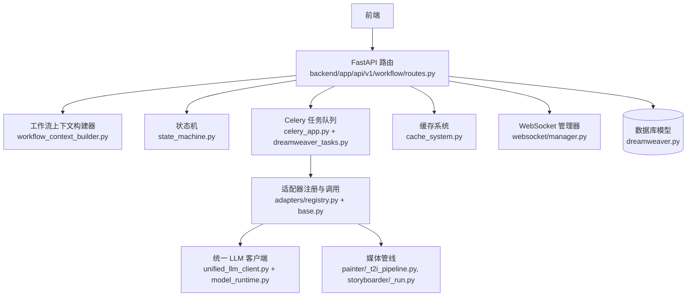

**图表来源** 
- [backend/app/api/v1/workflow/routes.py](file://backend/app/api/v1/workflow/routes.py)
- [backend/app/services/workflow_context_builder.py](file://backend/app/services/workflow_context_builder.py)
- [pipeline/state_machine.py](file://pipeline/state_machine.py)
- [backend/app/celery_app.py](file://backend/app/celery_app.py)
- [backend/app/tasks/dreamweaver_tasks.py](file://backend/app/tasks/dreamweaver_tasks.py)
- [adapters/registry.py](file://adapters/registry.py)
- [adapters/base.py](file://adapters/base.py)
- [core/unified_llm_client.py](file://core/unified_llm_client.py)
- [core/model_runtime.py](file://core/model_runtime.py)
- [backend/app/models/dreamweaver.py](file://backend/app/models/dreamweaver.py)
- [backend/app/services/cache_system.py](file://backend/app/services/cache_system.py)
- [backend/app/websocket/manager.py](file://backend/app/websocket/manager.py)
- [agents/painter_pkg/_t2i_pipeline.py](file://agents/painter_pkg/_t2i_pipeline.py)
- [agents/storyboarder_pkg/_run.py](file://agents/storyboarder_pkg/_run.py)

**章节来源**
- [backend/app/main.py](file://backend/app/main.py)
- [backend/app/api/v1/workflow/routes.py](file://backend/app/api/v1/workflow/routes.py)
- [backend/app/celery_app.py](file://backend/app/celery_app.py)

## 核心组件
- 工作流上下文构建器：组装任务参数、环境变量、依赖项，形成可执行的上下文对象
- 状态机：维护任务生命周期状态，定义状态转换规则与持久化策略
- 适配器注册表与基类：统一对外部模型能力的接入与调用契约
- 统一 LLM 客户端与模型运行时：抽象不同模型的调用方式，支持路由与降级
- 任务队列与任务实现：将长耗时生成任务入队并异步执行
- 缓存系统与流式服务：提升响应速度，支持增量输出与实时反馈
- WebSocket 管理器：向客户端推送进度与结果

**章节来源**
- [backend/app/services/workflow_context_builder.py](file://backend/app/services/workflow_context_builder.py)
- [pipeline/state_machine.py](file://pipeline/state_machine.py)
- [adapters/base.py](file://adapters/base.py)
- [adapters/registry.py](file://adapters/registry.py)
- [core/unified_llm_client.py](file://core/unified_llm_client.py)
- [core/model_runtime.py](file://core/model_runtime.py)
- [backend/app/tasks/dreamweaver_tasks.py](file://backend/app/tasks/dreamweaver_tasks.py)
- [backend/app/services/cache_system.py](file://backend/app/services/cache_system.py)
- [backend/app/services/streaming_service.py](file://backend/app/services/streaming_service.py)
- [backend/app/websocket/manager.py](file://backend/app/websocket/manager.py)

## 架构总览
整体数据流遵循“请求入站 → 上下文构建 → 状态推进 → 异步执行 → 适配器调用 → 结果回写 → 流式推送”的路径。关键节点包括：
- API 路由接收请求并进行基础校验
- 上下文构建器整合参数与环境变量，解析依赖
- 状态机根据当前阶段决定下一步动作
- Celery 任务承载具体生成逻辑，避免阻塞主线程
- 适配器层调用外部模型或本地管线
- 结果写入数据库与缓存，并通过 WebSocket/SSE 推送

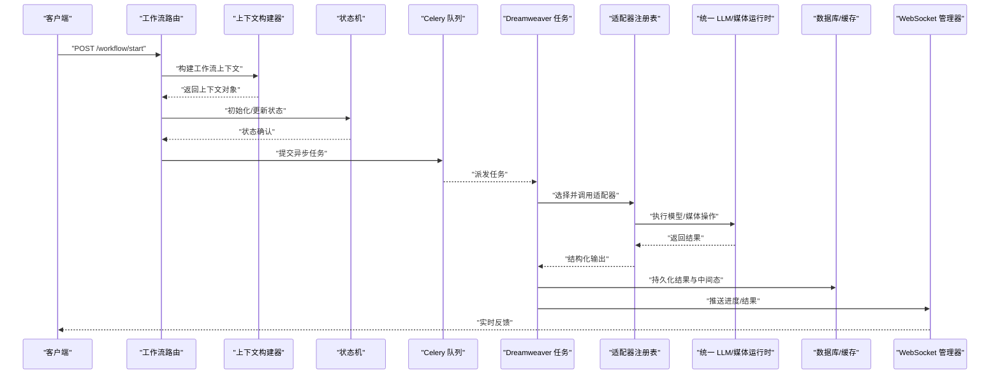

**图表来源** 
- [backend/app/api/v1/workflow/routes.py](file://backend/app/api/v1/workflow/routes.py)
- [backend/app/services/workflow_context_builder.py](file://backend/app/services/workflow_context_builder.py)
- [pipeline/state_machine.py](file://pipeline/state_machine.py)
- [backend/app/celery_app.py](file://backend/app/celery_app.py)
- [backend/app/tasks/dreamweaver_tasks.py](file://backend/app/tasks/dreamweaver_tasks.py)
- [adapters/registry.py](file://adapters/registry.py)
- [core/unified_llm_client.py](file://core/unified_llm_client.py)
- [backend/app/models/dreamweaver.py](file://backend/app/models/dreamweaver.py)
- [backend/app/services/cache_system.py](file://backend/app/services/cache_system.py)
- [backend/app/websocket/manager.py](file://backend/app/websocket/manager.py)

## 详细组件分析

### 工作流上下文构建与管理
- 参数传递：从请求体提取业务参数，合并默认值与校验结果
- 环境变量注入：读取配置中心或环境变量，注入到上下文
- 依赖解析：根据任务类型动态加载所需适配器与资源
- 上下文对象：包含任务元数据、运行环境、中间产物引用、权限信息

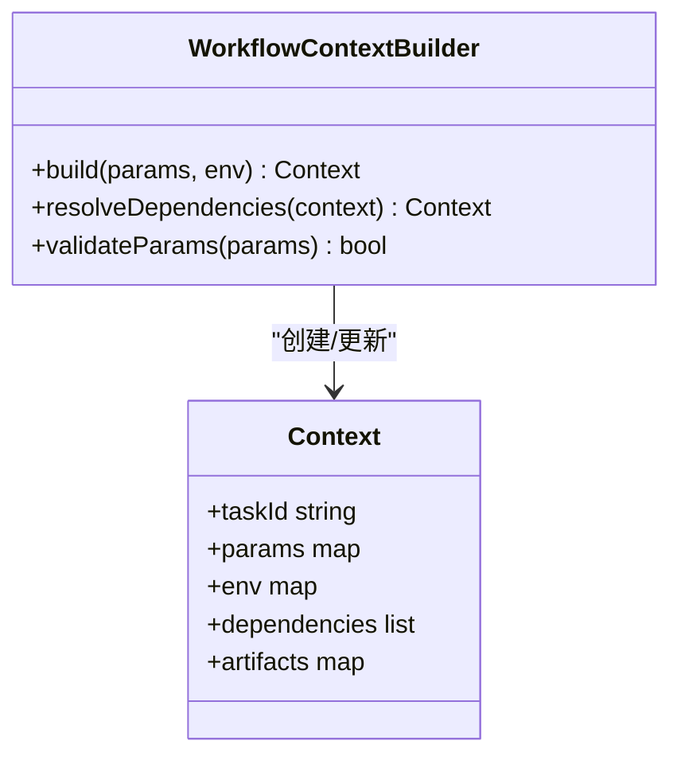

**图表来源** 
- [backend/app/services/workflow_context_builder.py](file://backend/app/services/workflow_context_builder.py)

**章节来源**
- [backend/app/services/workflow_context_builder.py](file://backend/app/services/workflow_context_builder.py)

### 状态机设计与持久化
- 状态定义：如待处理、进行中、成功、失败、重试中
- 转换规则：基于前置条件与后置动作进行状态迁移
- 持久化策略：每次状态变更写入数据库，确保可恢复与可审计

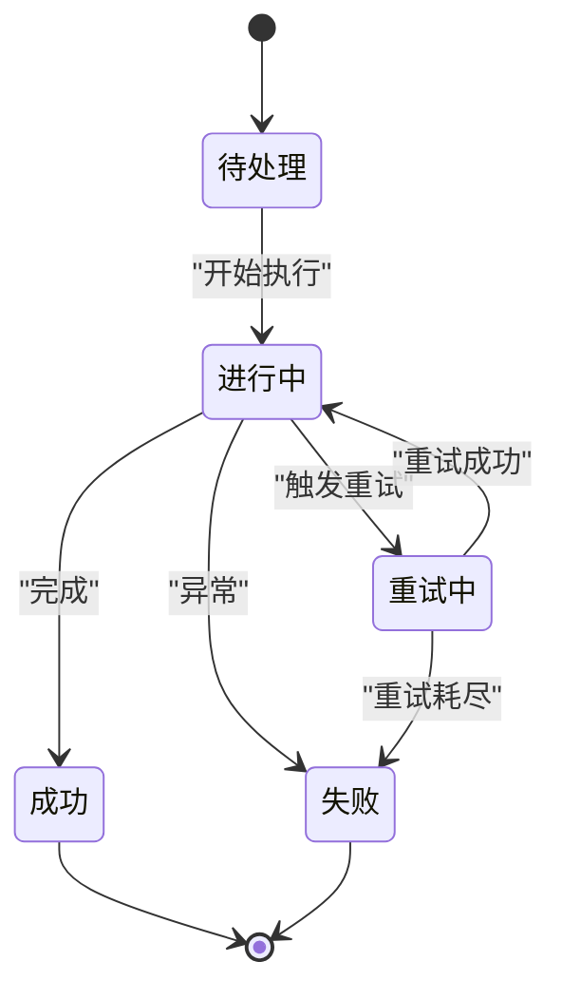

**图表来源** 
- [pipeline/state_machine.py](file://pipeline/state_machine.py)
- [backend/app/models/dreamweaver.py](file://backend/app/models/dreamweaver.py)

**章节来源**
- [pipeline/state_machine.py](file://pipeline/state_machine.py)
- [backend/app/models/dreamweaver.py](file://backend/app/models/dreamweaver.py)

### 适配器层与模型调用
- 适配器基类：定义统一的输入输出契约与错误处理
- 注册表：按模型名称或能力标签动态查找适配器
- 统一客户端：屏蔽底层差异，支持路由、降级与限流

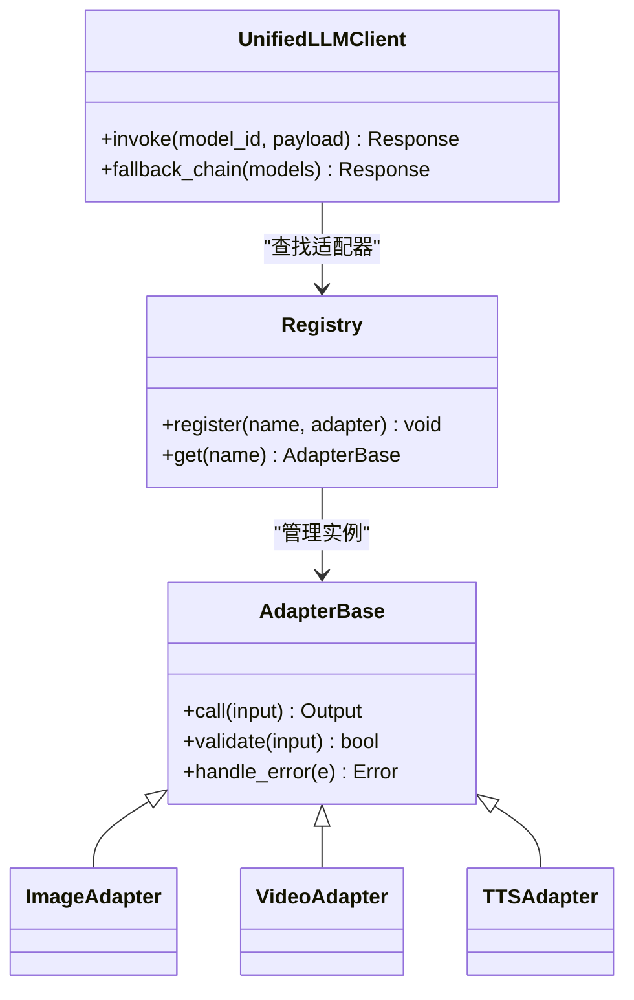

**图表来源** 
- [adapters/base.py](file://adapters/base.py)
- [adapters/registry.py](file://adapters/registry.py)
- [core/unified_llm_client.py](file://core/unified_llm_client.py)

**章节来源**
- [adapters/base.py](file://adapters/base.py)
- [adapters/registry.py](file://adapters/registry.py)
- [core/unified_llm_client.py](file://core/unified_llm_client.py)
- [core/model_runtime.py](file://core/model_runtime.py)

### 异步任务与消息格式
- 任务队列：使用 Celery 管理高并发任务
- 消息格式：包含任务 ID、类型、参数、优先级、超时时间
- 重试策略：指数退避、最大重试次数、死信队列

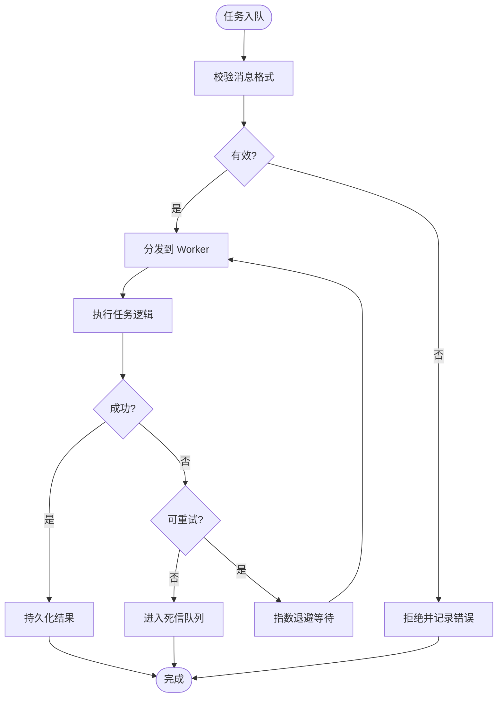

**图表来源** 
- [backend/app/celery_app.py](file://backend/app/celery_app.py)
- [backend/app/tasks/dreamweaver_tasks.py](file://backend/app/tasks/dreamweaver_tasks.py)

**章节来源**
- [backend/app/celery_app.py](file://backend/app/celery_app.py)
- [backend/app/tasks/dreamweaver_tasks.py](file://backend/app/tasks/dreamweaver_tasks.py)

### 提示词工程数据结构
- 模板渲染：支持 Jinja2 或自定义模板引擎
- 变量替换：从上下文注入变量，支持嵌套与条件渲染
- 上下文管理：维护历史对话、系统提示、用户输入

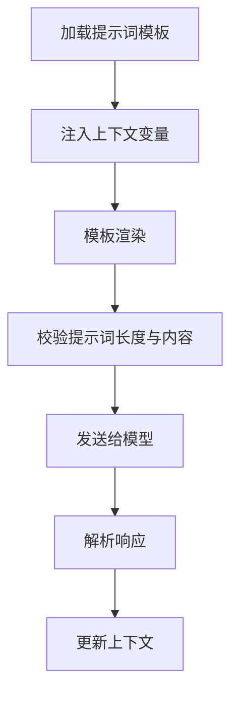

**图表来源** 
- [adapters/prompt_optimizer.py](file://adapters/prompt_optimizer.py)
- [backend/app/services/workflow_context_builder.py](file://backend/app/services/workflow_context_builder.py)

**章节来源**
- [adapters/prompt_optimizer.py](file://adapters/prompt_optimizer.py)
- [backend/app/services/workflow_context_builder.py](file://backend/app/services/workflow_context_builder.py)

### 数据验证、转换与清洗
- 输入验证：对请求参数进行类型、范围、必填校验
- 数据转换：将原始输入转换为模型期望格式
- 清洗流程：去除噪声、标准化格式、过滤敏感内容

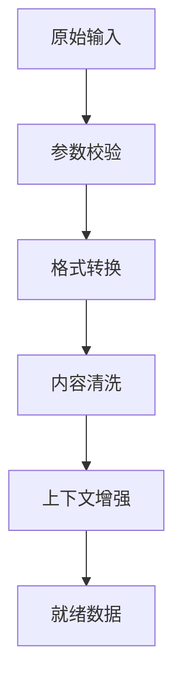

**图表来源** 
- [backend/app/schemas/dreamweaver_contract.py](file://backend/app/schemas/dreamweaver_contract.py)
- [adapters/base.py](file://adapters/base.py)

**章节来源**
- [backend/app/schemas/dreamweaver_contract.py](file://backend/app/schemas/dreamweaver_contract.py)
- [adapters/base.py](file://adapters/base.py)

### 缓存策略与数据一致性
- 缓存层级：内存缓存、Redis 缓存、数据库缓存
- 失效策略：TTL、主动失效、版本控制
- 一致性保证：读写穿透保护、分布式锁、事务边界

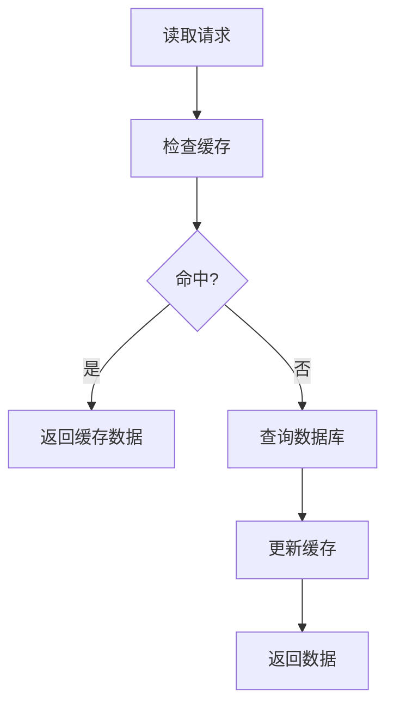

**图表来源** 
- [backend/app/services/cache_system.py](file://backend/app/services/cache_system.py)
- [backend/app/models/dreamweaver.py](file://backend/app/models/dreamweaver.py)

**章节来源**
- [backend/app/services/cache_system.py](file://backend/app/services/cache_system.py)
- [backend/app/models/dreamweaver.py](file://backend/app/models/dreamweaver.py)

### 流式输出与 WebSocket 推送
- 流式服务：支持 SSE 或 WebSocket 增量输出
- 消息协议：定义事件类型、负载结构、心跳机制
- 连接管理：维护客户端会话、重连策略、断线恢复

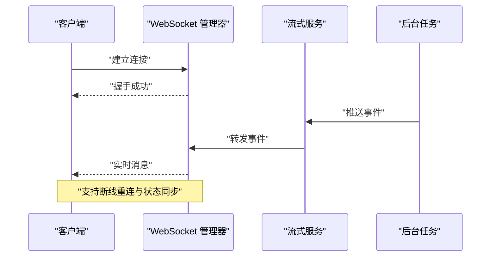

**图表来源** 
- [backend/app/services/streaming_service.py](file://backend/app/services/streaming_service.py)
- [backend/app/websocket/manager.py](file://backend/app/websocket/manager.py)
- [backend/app/tasks/dreamweaver_tasks.py](file://backend/app/tasks/dreamweaver_tasks.py)

**章节来源**
- [backend/app/services/streaming_service.py](file://backend/app/services/streaming_service.py)
- [backend/app/websocket/manager.py](file://backend/app/websocket/manager.py)
- [backend/app/tasks/dreamweaver_tasks.py](file://backend/app/tasks/dreamweaver_tasks.py)

## 依赖关系分析
- 低耦合：适配器层通过注册表解耦具体实现
- 高内聚：每个组件职责单一，便于测试与维护
- 外部依赖：Celery、Redis、PostgreSQL、第三方模型 API

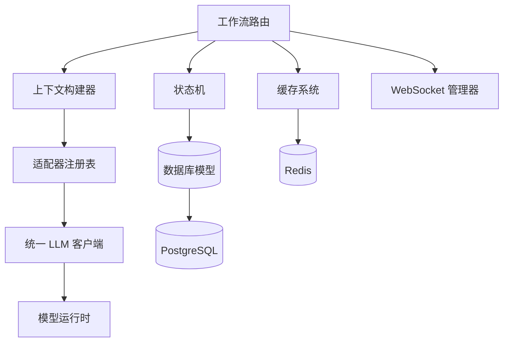

**图表来源** 
- [backend/app/api/v1/workflow/routes.py](file://backend/app/api/v1/workflow/routes.py)
- [backend/app/services/workflow_context_builder.py](file://backend/app/services/workflow_context_builder.py)
- [pipeline/state_machine.py](file://pipeline/state_machine.py)
- [adapters/registry.py](file://adapters/registry.py)
- [core/unified_llm_client.py](file://core/unified_llm_client.py)
- [core/model_runtime.py](file://core/model_runtime.py)
- [backend/app/models/dreamweaver.py](file://backend/app/models/dreamweaver.py)
- [backend/app/services/cache_system.py](file://backend/app/services/cache_system.py)
- [backend/app/websocket/manager.py](file://backend/app/websocket/manager.py)

**章节来源**
- [backend/app/api/v1/workflow/routes.py](file://backend/app/api/v1/workflow/routes.py)
- [adapters/registry.py](file://adapters/registry.py)
- [core/unified_llm_client.py](file://core/unified_llm_client.py)

## 性能考量
- 异步化：长耗时任务放入队列，避免阻塞主线程
- 缓存：热点数据多级缓存，减少重复计算
- 流式：增量输出降低首屏延迟
- 限流：适配器层实施速率限制，防止过载
- 批处理：批量处理小任务，提高吞吐

## 故障排查指南
- 任务失败：检查 Celery 日志与死信队列
- 适配器错误：查看模型 API 返回码与重试次数
- 状态卡住：核对状态机转换条件与数据库记录
- 缓存不一致：清理缓存并重新加载
- WebSocket 断开：检查连接管理与重连逻辑

**章节来源**
- [backend/app/tasks/dreamweaver_tasks.py](file://backend/app/tasks/dreamweaver_tasks.py)
- [pipeline/state_machine.py](file://pipeline/state_machine.py)
- [backend/app/services/cache_system.py](file://backend/app/services/cache_system.py)
- [backend/app/websocket/manager.py](file://backend/app/websocket/manager.py)

## 结论
本数据流设计通过清晰的组件划分与标准化的接口契约，实现了高内聚、低耦合的系统架构。状态机确保任务可追踪与可恢复，适配器层屏蔽外部差异，异步与流式机制提升用户体验。建议在生产环境中加强监控与告警，持续优化缓存命中率与任务调度效率。

## 附录
- 术语表：工作流、状态机、适配器、上下文、流式输出
- 参考文档：Celery 官方文档、Redis 缓存策略、WebSocket 协议规范