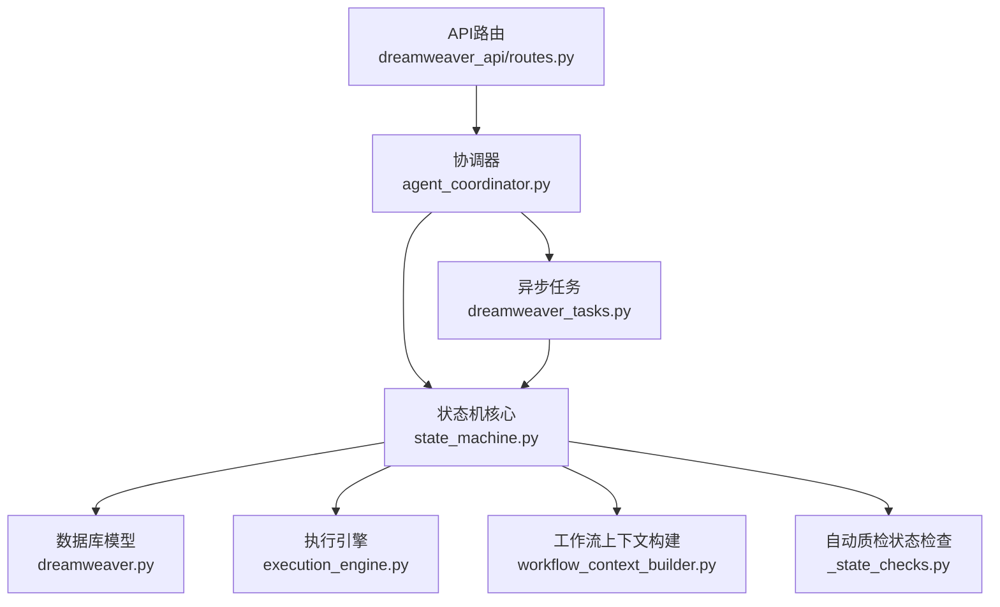
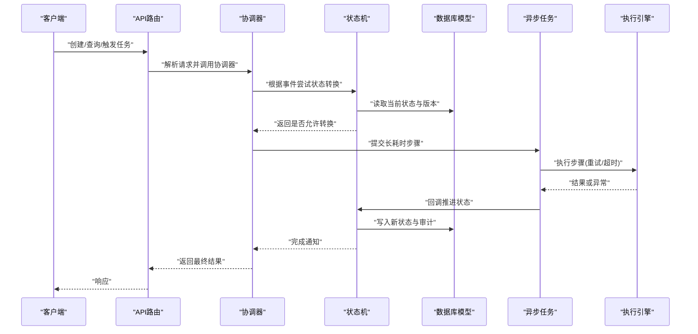
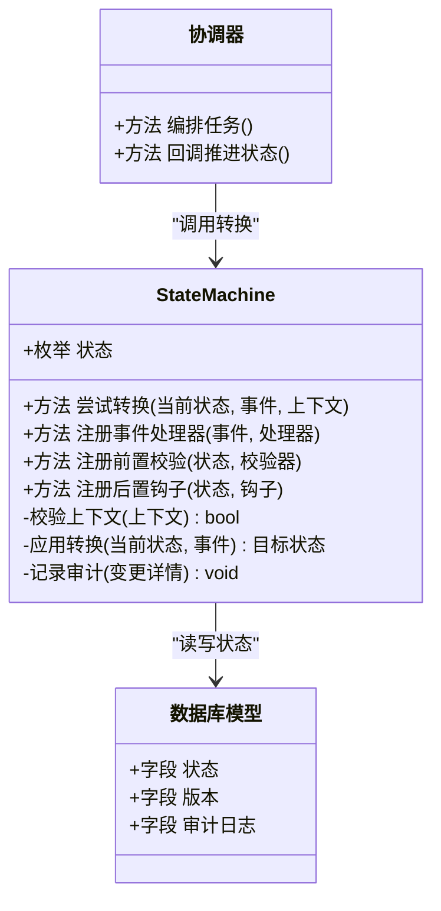
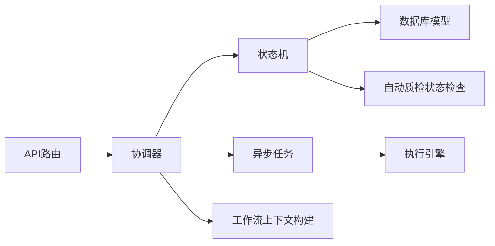
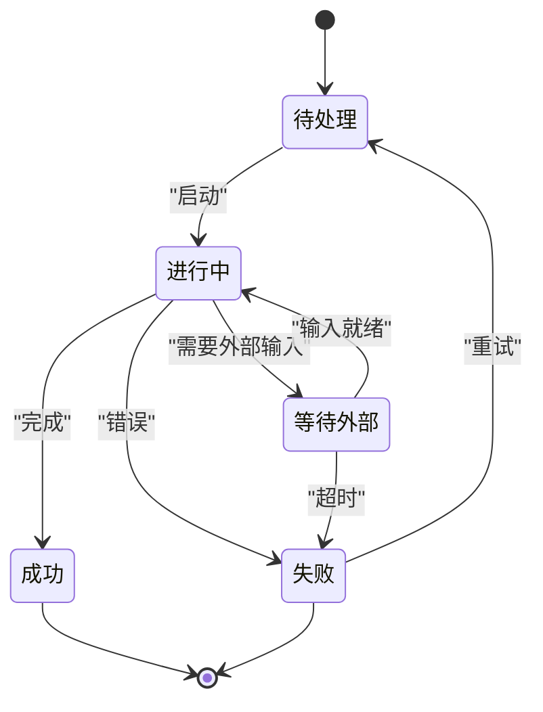

# 状态机设计

<cite>
**本文引用的文件**   
- [pipeline/state_machine.py](file://pipeline/state_machine.py)
- [backend/app/services/agents/agent_coordinator.py](file://backend/app/services/agents/agent_coordinator.py)
- [backend/app/models/dreamweaver.py](file://backend/app/models/dreamweaver.py)
- [backend/app/schemas/dreamweaver_contract.py](file://backend/app/schemas/dreamweaver_contract.py)
- [backend/app/api/v1/dreamweaver_api/routes.py](file://backend/app/api/v1/dreamweaver_api/routes.py)
- [backend/app/tasks/dreamweaver_tasks.py](file://backend/app/tasks/dreamweaver_tasks.py)
- [core/execution_engine.py](file://core/execution_engine.py)
- [pipeline/_state_checks.py](file://pipeline/autoqc_pkg/_state_checks.py)
- [backend/app/services/workflow_context_builder.py](file://backend/app/services/workflow_context_builder.py)
</cite>

## 目录
1. [简介](#简介)
2. [项目结构](#项目结构)
3. [核心组件](#核心组件)
4. [架构总览](#架构总览)
5. [详细组件分析](#详细组件分析)
6. [依赖关系分析](#依赖关系分析)
7. [性能考虑](#性能考虑)
8. [故障排查指南](#故障排查指南)
9. [结论](#结论)
10. [附录](#附录)

## 简介
本设计文档面向“小说创作代理系统”的状态机，目标是系统化描述状态定义、转换规则与触发条件，覆盖任务从创建到完成的完整生命周期；同时给出状态持久化策略（存储格式、恢复机制、并发控制）、异常处理与错误恢复流程，以及监控调试与性能优化建议。文档以代码级为依据，结合架构图、状态转换图与流程图帮助读者快速理解并落地实现。

## 项目结构
与状态机相关的核心位置包括：
- pipeline/state_machine.py：状态机核心实现与状态枚举、转换逻辑
- backend/app/services/agents/agent_coordinator.py：协调器负责编排任务执行与状态流转
- backend/app/models/dreamweaver.py：数据库模型，承载状态字段与审计信息
- backend/app/schemas/dreamweaver_contract.py：对外契约与输入输出校验
- backend/app/api/v1/dreamweaver_api/routes.py：API路由，接收请求并触发状态机
- backend/app/tasks/dreamweaver_tasks.py：异步任务，驱动长耗时步骤的状态推进
- core/execution_engine.py：统一执行引擎，封装重试、超时、回滚等通用能力
- pipeline/autoqc_pkg/_state_checks.py：自动质检中的状态检查辅助
- backend/app/services/workflow_context_builder.py：工作流上下文构建，为状态机提供上下文数据

图表来源
- [backend/app/api/v1/dreamweaver_api/routes.py](file://backend/app/api/v1/dreamweaver_api/routes.py)
- [backend/app/services/agents/agent_coordinator.py](file://backend/app/services/agents/agent_coordinator.py)
- [pipeline/state_machine.py](file://pipeline/state_machine.py)
- [backend/app/models/dreamweaver.py](file://backend/app/models/dreamweaver.py)
- [backend/app/tasks/dreamweaver_tasks.py](file://backend/app/tasks/dreamweaver_tasks.py)
- [core/execution_engine.py](file://core/execution_engine.py)
- [pipeline/autoqc_pkg/_state_checks.py](file://pipeline/autoqc_pkg/_state_checks.py)
- [backend/app/services/workflow_context_builder.py](file://backend/app/services/workflow_context_builder.py)

章节来源
- [pipeline/state_machine.py](file://pipeline/state_machine.py)
- [backend/app/services/agents/agent_coordinator.py](file://backend/app/services/agents/agent_coordinator.py)
- [backend/app/models/dreamweaver.py](file://backend/app/models/dreamweaver.py)
- [backend/app/schemas/dreamweaver_contract.py](file://backend/app/schemas/dreamweaver_contract.py)
- [backend/app/api/v1/dreamweaver_api/routes.py](file://backend/app/api/v1/dreamweaver_api/routes.py)
- [backend/app/tasks/dreamweaver_tasks.py](file://backend/app/tasks/dreamweaver_tasks.py)
- [core/execution_engine.py](file://core/execution_engine.py)
- [pipeline/autoqc_pkg/_state_checks.py](file://pipeline/autoqc_pkg/_state_checks.py)
- [backend/app/services/workflow_context_builder.py](file://backend/app/services/workflow_context_builder.py)

## 核心组件
- 状态机核心（state_machine.py）
  - 定义状态枚举、转换表、事件处理器与校验钩子
  - 提供原子化的状态切换接口，保证一致性
- 协调器（agent_coordinator.py）
  - 编排多阶段任务，调用状态机进行状态推进
  - 管理上下文、资源与回调
- 数据库模型（dreamweaver.py）
  - 持久化任务状态、版本、审计日志、错误码
- API路由（routes.py）
  - 暴露查询、更新、触发执行的接口
- 异步任务（dreamweaver_tasks.py）
  - 驱动长耗时步骤，完成后回调状态机
- 执行引擎（execution_engine.py）
  - 提供重试、超时、熔断、幂等与回滚能力
- 工作流上下文构建（workflow_context_builder.py）
  - 组装状态机所需上下文，如用户、项目、素材、提示词等
- 自动质检状态检查（_state_checks.py）
  - 在关键节点进行前置/后置状态校验

章节来源
- [pipeline/state_machine.py](file://pipeline/state_machine.py)
- [backend/app/services/agents/agent_coordinator.py](file://backend/app/services/agents/agent_coordinator.py)
- [backend/app/models/dreamweaver.py](file://backend/app/models/dreamweaver.py)
- [backend/app/api/v1/dreamweaver_api/routes.py](file://backend/app/api/v1/dreamweaver_api/routes.py)
- [backend/app/tasks/dreamweaver_tasks.py](file://backend/app/tasks/dreamweaver_tasks.py)
- [core/execution_engine.py](file://core/execution_engine.py)
- [backend/app/services/workflow_context_builder.py](file://backend/app/services/workflow_context_builder.py)
- [pipeline/autoqc_pkg/_state_checks.py](file://pipeline/autoqc_pkg/_state_checks.py)

## 架构总览
状态机处于“编排层”，向上对接协调器与API，向下通过执行引擎驱动具体步骤，并通过数据库模型持久化状态。异步任务在后台推进状态，确保可中断与可恢复。

图表来源
- [backend/app/api/v1/dreamweaver_api/routes.py](file://backend/app/api/v1/dreamweaver_api/routes.py)
- [backend/app/services/agents/agent_coordinator.py](file://backend/app/services/agents/agent_coordinator.py)
- [pipeline/state_machine.py](file://pipeline/state_machine.py)
- [backend/app/models/dreamweaver.py](file://backend/app/models/dreamweaver.py)
- [backend/app/tasks/dreamweaver_tasks.py](file://backend/app/tasks/dreamweaver_tasks.py)
- [core/execution_engine.py](file://core/execution_engine.py)

## 详细组件分析

### 状态机核心（state_machine.py）
- 状态定义
  - 使用枚举类型明确所有合法状态，避免硬编码字符串
  - 典型状态包括：待处理、进行中、等待外部、失败、成功、取消等
- 转换规则
  - 维护“当前状态 + 事件 -> 目标状态”的映射表
  - 对非法转换抛出明确异常，便于追踪
- 触发条件
  - 每个转换附带前置校验（如资源就绪、权限检查、上下文完整性）
  - 支持后置钩子（如记录审计、发送通知、清理临时资源）
- 原子性与一致性
  - 状态切换在事务中执行，保证读-改-写的一致性
  - 引入版本号或乐观锁防止并发覆盖
- 扩展点
  - 插件式事件处理器，便于新增业务阶段
  - 可插拔的校验器与监听器

图表来源
- [pipeline/state_machine.py](file://pipeline/state_machine.py)
- [backend/app/services/agents/agent_coordinator.py](file://backend/app/services/agents/agent_coordinator.py)
- [backend/app/models/dreamweaver.py](file://backend/app/models/dreamweaver.py)

章节来源
- [pipeline/state_machine.py](file://pipeline/state_machine.py)

### 协调器（agent_coordinator.py）
- 职责
  - 将业务需求拆解为步骤序列，按顺序或并行调度
  - 在每一步前后调用状态机进行状态推进
  - 管理上下文对象，传递必要参数与中间结果
- 错误处理
  - 捕获异常并转换为状态机可识别的事件（如失败、重试）
  - 支持降级与补偿操作
- 并发控制
  - 限制并行度，避免资源争用
  - 使用队列与信号量协调任务执行

章节来源
- [backend/app/services/agents/agent_coordinator.py](file://backend/app/services/agents/agent_coordinator.py)

### 数据库模型（dreamweaver.py）
- 字段设计
  - 状态字段：保存当前状态值
  - 版本字段：用于乐观锁，防止并发覆盖
  - 审计字段：记录状态变更时间、操作人、原因
  - 错误字段：记录错误码与消息，便于诊断
- 索引与约束
  - 针对常用查询字段建立索引（如任务ID、状态）
  - 唯一约束避免重复记录
- 迁移与兼容
  - 通过迁移脚本演进表结构，保持向后兼容

章节来源
- [backend/app/models/dreamweaver.py](file://backend/app/models/dreamweaver.py)

### API路由（routes.py）
- 接口设计
  - 创建任务：初始化状态为“待处理”
  - 查询任务：返回当前状态与进度
  - 触发执行：提交异步任务并返回任务ID
  - 更新状态：仅允许内部回调调用
- 鉴权与限流
  - 基于角色与配额控制访问
  - 对高频接口实施限流保护

章节来源
- [backend/app/api/v1/dreamweaver_api/routes.py](file://backend/app/api/v1/dreamweaver_api/routes.py)

### 异步任务（dreamweaver_tasks.py）
- 任务编排
  - 将长耗时步骤放入队列，支持重试与退避
  - 完成后回调状态机推进状态
- 监控与日志
  - 记录任务开始、结束、重试与失败
  - 上报指标以便监控

章节来源
- [backend/app/tasks/dreamweaver_tasks.py](file://backend/app/tasks/dreamweaver_tasks.py)

### 执行引擎（execution_engine.py）
- 通用能力
  - 重试策略：指数退避、最大重试次数
  - 超时控制：单步与整体超时
  - 熔断降级：当依赖服务不可用时快速失败
  - 幂等性：基于任务ID去重
- 回滚与补偿
  - 在执行失败时执行补偿逻辑，保证一致性

章节来源
- [core/execution_engine.py](file://core/execution_engine.py)

### 工作流上下文构建（workflow_context_builder.py）
- 上下文内容
  - 用户信息、项目配置、素材清单、提示词模板
  - 运行时变量（如随机种子、并发度）
- 校验与默认值
  - 缺失字段提供默认值或报错
  - 类型校验与格式规范化

章节来源
- [backend/app/services/workflow_context_builder.py](file://backend/app/services/workflow_context_builder.py)

### 自动质检状态检查（_state_checks.py）
- 检查点
  - 前置检查：输入完整性、资源可用性
  - 后置检查：输出质量、一致性
- 报告与告警
  - 生成质检报告，必要时触发告警

章节来源
- [pipeline/autoqc_pkg/_state_checks.py](file://pipeline/autoqc_pkg/_state_checks.py)

## 依赖关系分析
- 松耦合
  - 状态机不直接依赖具体业务实现，通过事件与钩子扩展
- 内聚性
  - 协调器集中编排逻辑，降低分散复杂度
- 外部依赖
  - 数据库模型依赖ORM与迁移工具
  - 执行引擎依赖队列与缓存

图表来源
- [backend/app/api/v1/dreamweaver_api/routes.py](file://backend/app/api/v1/dreamweaver_api/routes.py)
- [backend/app/services/agents/agent_coordinator.py](file://backend/app/services/agents/agent_coordinator.py)
- [pipeline/state_machine.py](file://pipeline/state_machine.py)
- [backend/app/models/dreamweaver.py](file://backend/app/models/dreamweaver.py)
- [backend/app/tasks/dreamweaver_tasks.py](file://backend/app/tasks/dreamweaver_tasks.py)
- [core/execution_engine.py](file://core/execution_engine.py)
- [pipeline/autoqc_pkg/_state_checks.py](file://pipeline/autoqc_pkg/_state_checks.py)
- [backend/app/services/workflow_context_builder.py](file://backend/app/services/workflow_context_builder.py)

章节来源
- [backend/app/api/v1/dreamweaver_api/routes.py](file://backend/app/api/v1/dreamweaver_api/routes.py)
- [backend/app/services/agents/agent_coordinator.py](file://backend/app/services/agents/agent_coordinator.py)
- [pipeline/state_machine.py](file://pipeline/state_machine.py)
- [backend/app/models/dreamweaver.py](file://backend/app/models/dreamweaver.py)
- [backend/app/tasks/dreamweaver_tasks.py](file://backend/app/tasks/dreamweaver_tasks.py)
- [core/execution_engine.py](file://core/execution_engine.py)
- [pipeline/autoqc_pkg/_state_checks.py](file://pipeline/autoqc_pkg/_state_checks.py)
- [backend/app/services/workflow_context_builder.py](file://backend/app/services/workflow_context_builder.py)

## 性能考虑
- 状态切换开销
  - 减少不必要的状态查询，批量更新
  - 使用内存缓存热点状态
- 并发控制
  - 合理设置队列大小与消费者数量
  - 避免死锁与饥饿
- I/O优化
  - 异步I/O与连接池
  - 读写分离与分库分表
- 监控与调优
  - 采集关键指标（延迟、吞吐、错误率）
  - 基于指标动态调整参数

[本节为通用指导，无需特定文件引用]

## 故障排查指南
- 常见错误
  - 非法状态转换：检查事件与当前状态匹配
  - 并发冲突：查看版本字段与锁机制
  - 超时与重试：确认执行引擎配置与依赖服务健康
- 定位手段
  - 审计日志：查看状态变更记录
  - 错误码与消息：快速分类问题
  - 监控面板：观察趋势与异常点
- 恢复策略
  - 重试与补偿：自动重试与人工干预结合
  - 快照与回滚：恢复到最近一致状态

章节来源
- [backend/app/models/dreamweaver.py](file://backend/app/models/dreamweaver.py)
- [core/execution_engine.py](file://core/execution_engine.py)

## 结论
本状态机设计通过清晰的状态定义、严格的转换规则与完善的持久化策略，确保了小说创作代理系统的稳定与可扩展。协调器与执行引擎的配合实现了高效的任务编排与容错能力。未来可进一步引入更细粒度的监控与自动化修复机制，提升系统韧性。

[本节为总结性内容，无需特定文件引用]

## 附录

### 状态转换图（概念）

[此图为概念示意，不直接映射具体源码文件]

### 状态表（示例）
| 状态 | 含义 | 允许的前置状态 | 触发事件 | 后置动作 |
| --- | --- | --- | --- | --- |
| 待处理 | 任务已创建但未开始 | 失败（重试） | 启动 | 记录开始时间 |
| 进行中 | 任务正在执行 | 待处理、等待外部 | 推进、失败 | 记录进度 |
| 等待外部 | 等待外部输入 | 进行中 | 输入就绪、超时 | 清理临时资源 |
| 成功 | 任务完成 | 进行中 | 完成 | 归档结果 |
| 失败 | 任务失败 | 进行中、等待外部 | 错误 | 记录错误信息 |

[此表为概念说明，不直接映射具体源码文件]

### 相关代码示例路径
- 状态机核心实现：[pipeline/state_machine.py](file://pipeline/state_machine.py)
- 协调器编排逻辑：[backend/app/services/agents/agent_coordinator.py](file://backend/app/services/agents/agent_coordinator.py)
- 数据库模型定义：[backend/app/models/dreamweaver.py](file://backend/app/models/dreamweaver.py)
- API路由接口：[backend/app/api/v1/dreamweaver_api/routes.py](file://backend/app/api/v1/dreamweaver_api/routes.py)
- 异步任务驱动：[backend/app/tasks/dreamweaver_tasks.py](file://backend/app/tasks/dreamweaver_tasks.py)
- 执行引擎能力：[core/execution_engine.py](file://core/execution_engine.py)
- 工作流上下文构建：[backend/app/services/workflow_context_builder.py](file://backend/app/services/workflow_context_builder.py)
- 自动质检状态检查：[pipeline/autoqc_pkg/_state_checks.py](file://pipeline/autoqc_pkg/_state_checks.py)