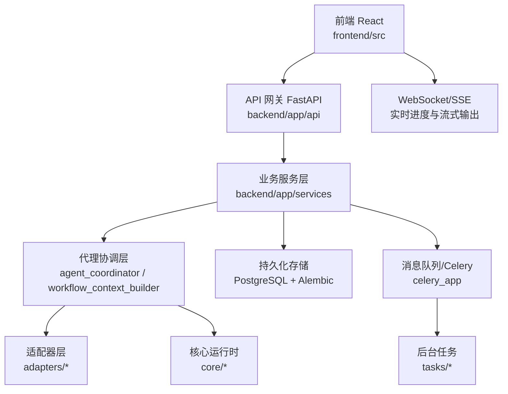
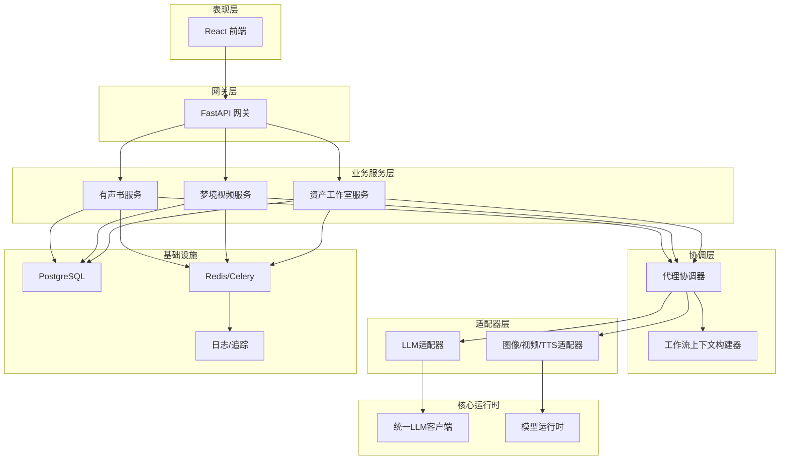
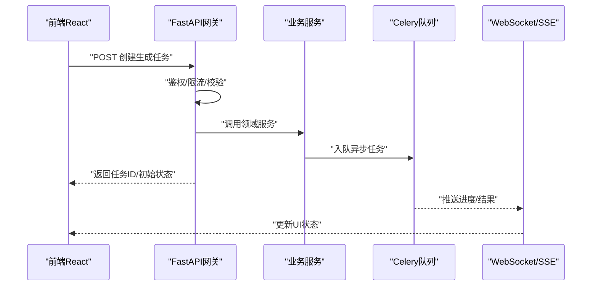
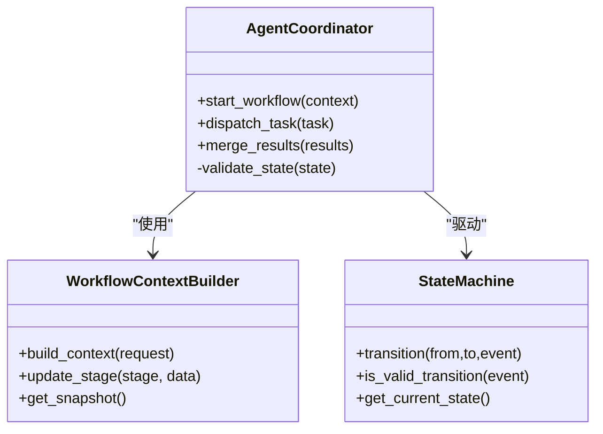
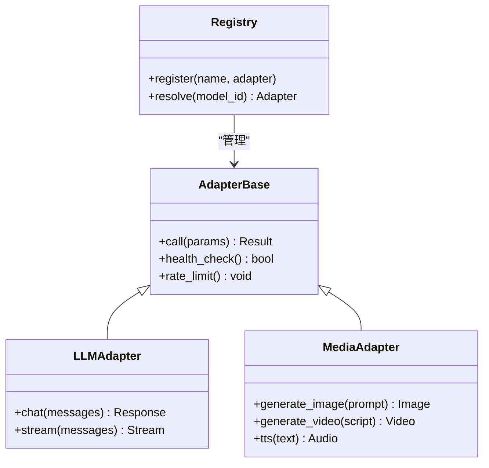
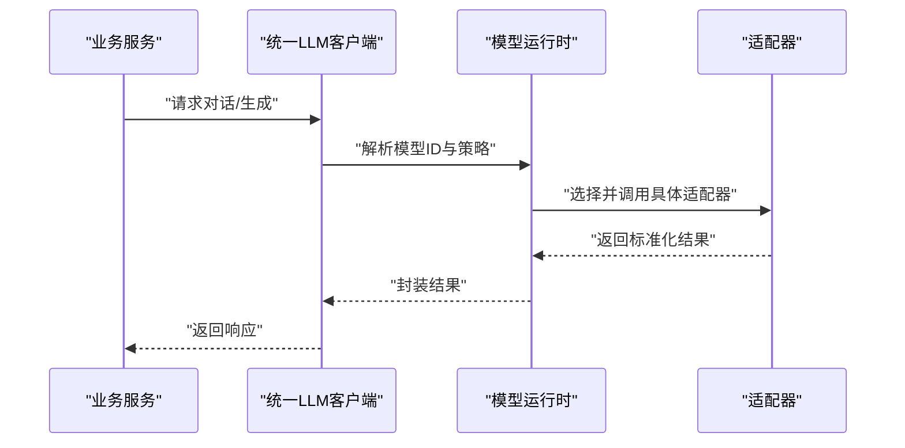
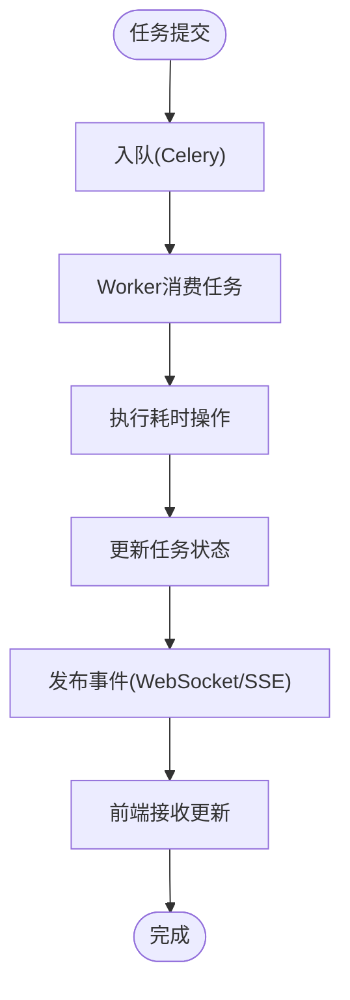
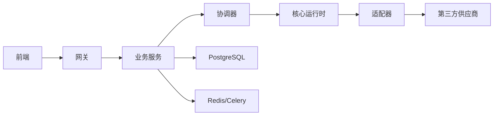
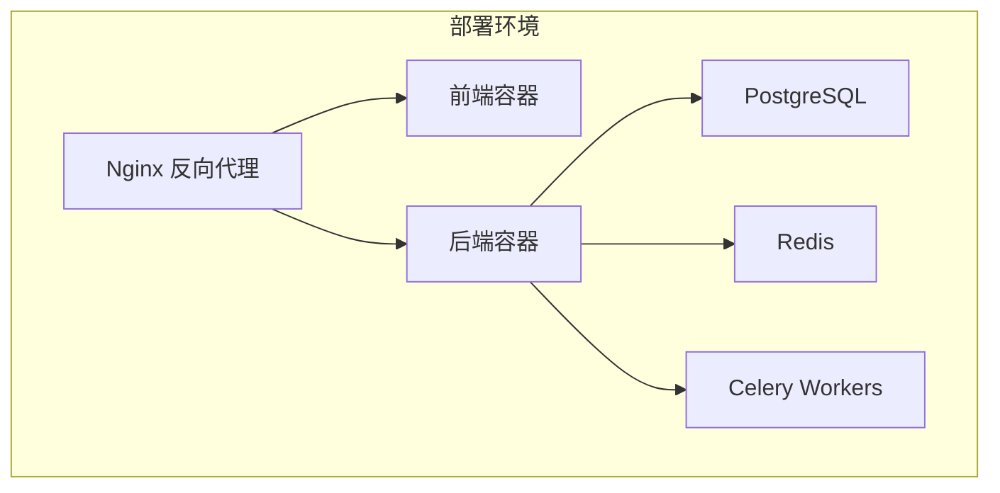

# 整体架构模式

<cite>
**本文引用的文件**   
- [backend/app/main.py](file://backend/app/main.py)
- [backend/app/celery_app.py](file://backend/app/celery_app.py)
- [backend/app/api/v1/dreamweaver.py](file://backend/app/api/v1/dreamweaver.py)
- [backend/app/api/v1/audiobook.py](file://backend/app/api/v1/audiobook.py)
- [backend/app/services/agent_coordinator.py](file://backend/app/services/agent_coordinator.py)
- [backend/app/services/workflow_context_builder.py](file://backend/app/services/workflow_context_builder.py)
- [adapters/base.py](file://adapters/base.py)
- [adapters/registry.py](file://adapters/registry.py)
- [core/unified_llm_client.py](file://core/unified_llm_client.py)
- [core/model_runtime.py](file://core/model_runtime.py)
- [frontend/src/App.tsx](file://frontend/src/App.tsx)
- [docker-compose.yml](file://docker-compose.yml)
- [nginx.conf](file://nginx.conf)
</cite>

## 目录
1. [简介](#简介)
2. [项目结构](#项目结构)
3. [核心组件](#核心组件)
4. [架构总览](#架构总览)
5. [详细组件分析](#详细组件分析)
6. [依赖关系分析](#依赖关系分析)
7. [性能考量](#性能考量)
8. [故障排查指南](#故障排查指南)
9. [结论](#结论)
10. [附录](#附录)

## 简介
本文件面向“小说创作代理系统”的整体架构模式，系统性阐述分层架构、微服务架构与事件驱动架构的设计思想与实践。文档聚焦以下目标：
- 明确各层职责边界：表现层（前端React）、API网关层（FastAPI）、业务服务层、代理协调层、适配器层。
- 解释微服务拆分原则：按功能域划分代理服务、按技术栈分离组件。
- 阐述事件驱动实现：消息队列使用、异步处理机制、状态同步策略。
- 提供系统上下文图、部署架构图与组件交互图，并总结关键架构决策与技术权衡。

## 项目结构
系统采用前后端分离与模块化后端组织方式：
- 前端React应用位于 frontend 目录，负责用户界面、路由与状态管理，通过HTTP/WebSocket与后端交互。
- 后端FastAPI应用位于 backend/app，包含API路由、领域服务、任务调度、数据库模型与迁移等。
- 适配器层 adapters 统一封装第三方模型/媒体能力调用，提供一致接口。
- 核心运行时 core 提供统一的LLM客户端、模型运行时、意图解析与执行引擎等通用能力。
- 编排与流水线 pipeline 提供工作流状态机、自动质量检查与媒体处理工具。
- 配置与脚本 config/scripts 提供模型目录、意图域、部署与运维脚本。

**图表来源** 
- [backend/app/main.py:1-200](file://backend/app/main.py#L1-L200)
- [backend/app/celery_app.py:1-200](file://backend/app/celery_app.py#L1-L200)
- [frontend/src/App.tsx:1-200](file://frontend/src/App.tsx#L1-L200)

**章节来源**
- [backend/app/main.py:1-200](file://backend/app/main.py#L1-L200)
- [frontend/src/App.tsx:1-200](file://frontend/src/App.tsx#L1-L200)

## 核心组件
- 表现层（前端React）
  - 职责：页面渲染、用户交互、表单校验、状态管理、与后端REST/WS通信。
  - 关键点：路由与页面组织、Hook与Services抽象、错误与加载态处理。
- API网关层（FastAPI）
  - 职责：请求路由、鉴权与限流、输入校验、响应序列化、跨域与日志。
  - 关键点：v1版本化路由、领域API聚合、中间件链。
- 业务服务层
  - 职责：领域逻辑编排、事务控制、外部服务调用、缓存与一致性。
  - 关键点：服务模块按领域划分、DTO映射、异常与重试策略。
- 代理协调层
  - 职责：多Agent协作、工作流上下文构建、任务分解与调度、结果合并。
  - 关键点：协调器模式、上下文构建器、状态机驱动。
- 适配器层
  - 职责：统一对外部模型/媒体能力的适配，屏蔽差异。
  - 关键点：基类抽象、注册表动态发现、速率限制与安全审查。
- 核心运行时
  - 职责：统一LLM客户端、模型运行时、意图解析、执行引擎、遥测与日志。
  - 关键点：模型目录与选择、降级与回退、可观测性。

**章节来源**
- [backend/app/api/v1/dreamweaver.py:1-200](file://backend/app/api/v1/dreamweaver.py#L1-L200)
- [backend/app/api/v1/audiobook.py:1-200](file://backend/app/api/v1/audiobook.py#L1-L200)
- [backend/app/services/agent_coordinator.py:1-200](file://backend/app/services/agent_coordinator.py#L1-L200)
- [backend/app/services/workflow_context_builder.py:1-200](file://backend/app/services/workflow_context_builder.py#L1-L200)
- [adapters/base.py:1-200](file://adapters/base.py#L1-L200)
- [adapters/registry.py:1-200](file://adapters/registry.py#L1-L200)
- [core/unified_llm_client.py:1-200](file://core/unified_llm_client.py#L1-L200)
- [core/model_runtime.py:1-200](file://core/model_runtime.py#L1-L200)

## 架构总览
系统采用分层+微服务+事件驱动的混合架构：
- 分层架构清晰界定表现层、网关层、业务层、协调层与适配层，降低耦合度。
- 微服务以领域为边界拆分（如有声书、梦境视频、资产工作室），便于独立演进与扩展。
- 事件驱动通过Celery与消息队列解耦耗时任务，提升吞吐与弹性；结合WebSocket/SSE实现近实时反馈。

**图表来源** 
- [backend/app/main.py:1-200](file://backend/app/main.py#L1-L200)
- [backend/app/celery_app.py:1-200](file://backend/app/celery_app.py#L1-L200)
- [adapters/base.py:1-200](file://adapters/base.py#L1-L200)
- [core/unified_llm_client.py:1-200](file://core/unified_llm_client.py#L1-L200)

## 详细组件分析

### API网关层（FastAPI）
- 职责边界：接收前端请求，进行鉴权、限流、参数校验与响应序列化；将请求分发至对应业务服务。
- 关键设计：
  - v1版本化路由，便于向后兼容与灰度发布。
  - 中间件链统一处理CORS、日志、审计与错误转换。
  - 领域API聚合（如dreamweaver、audiobook）简化前端调用。
- 典型流程：
  - 前端发起生成任务 -> 网关校验与鉴权 -> 入队异步任务或返回流式响应 -> 前端通过WebSocket/SSE获取进度。

**图表来源** 
- [backend/app/api/v1/dreamweaver.py:1-200](file://backend/app/api/v1/dreamweaver.py#L1-L200)
- [backend/app/api/v1/audiobook.py:1-200](file://backend/app/api/v1/audiobook.py#L1-L200)
- [backend/app/celery_app.py:1-200](file://backend/app/celery_app.py#L1-L200)

**章节来源**
- [backend/app/api/v1/dreamweaver.py:1-200](file://backend/app/api/v1/dreamweaver.py#L1-L200)
- [backend/app/api/v1/audiobook.py:1-200](file://backend/app/api/v1/audiobook.py#L1-L200)

### 代理协调层
- 职责边界：编排多Agent协作，维护工作流上下文，负责任务分解、调度与结果合并。
- 关键设计：
  - 协调器模式：集中式编排，避免服务间紧耦合。
  - 上下文构建器：标准化上下文数据结构，确保各阶段数据一致性。
  - 状态机驱动：基于pipeline/state_machine推进阶段流转。
- 典型流程：
  - 接收上游服务请求 -> 构建上下文 -> 分派子任务 -> 等待结果 -> 合并与校验 -> 返回最终结果。

**图表来源** 
- [backend/app/services/agent_coordinator.py:1-200](file://backend/app/services/agent_coordinator.py#L1-L200)
- [backend/app/services/workflow_context_builder.py:1-200](file://backend/app/services/workflow_context_builder.py#L1-L200)
- [pipeline/state_machine.py:1-200](file://pipeline/state_machine.py#L1-L200)

**章节来源**
- [backend/app/services/agent_coordinator.py:1-200](file://backend/app/services/agent_coordinator.py#L1-L200)
- [backend/app/services/workflow_context_builder.py:1-200](file://backend/app/services/workflow_context_builder.py#L1-L200)

### 适配器层
- 职责边界：统一封装第三方模型/媒体能力（LLM、图像、视频、TTS），屏蔽供应商差异。
- 关键设计：
  - 基类抽象：定义统一接口（chat、image、video、tts）。
  - 注册表动态发现：按模型ID或能力类型动态选择适配器。
  - 速率限制与安全审查：保障稳定性与合规性。
- 典型流程：
  - 上层调用统一接口 -> 注册表解析模型ID -> 实例化具体适配器 -> 调用供应商API -> 返回标准化结果。

**图表来源** 
- [adapters/base.py:1-200](file://adapters/base.py#L1-L200)
- [adapters/registry.py:1-200](file://adapters/registry.py#L1-L200)

**章节来源**
- [adapters/base.py:1-200](file://adapters/base.py#L1-L200)
- [adapters/registry.py:1-200](file://adapters/registry.py#L1-L200)

### 核心运行时
- 职责边界：提供统一LLM客户端、模型运行时、意图解析与执行引擎，支撑上层服务与协调器。
- 关键设计：
  - 统一LLM客户端：抽象不同供应商的对话与流式接口。
  - 模型运行时：根据目录与策略选择最优模型，支持降级与回退。
  - 意图解析与执行：将自然语言意图转换为结构化任务。
- 典型流程：
  - 服务调用LLM -> 统一客户端解析模型ID -> 运行时选择实例 -> 调用适配器 -> 返回结果。

**图表来源** 
- [core/unified_llm_client.py:1-200](file://core/unified_llm_client.py#L1-L200)
- [core/model_runtime.py:1-200](file://core/model_runtime.py#L1-L200)

**章节来源**
- [core/unified_llm_client.py:1-200](file://core/unified_llm_client.py#L1-L200)
- [core/model_runtime.py:1-200](file://core/model_runtime.py#L1-L200)

### 事件驱动架构实现
- 消息队列使用：Celery作为任务队列，Redis作为Broker，支持高并发与重试。
- 异步处理机制：长耗时任务（如视频生成、音频合成）入队执行，前端通过WebSocket/SSE轮询或订阅。
- 状态同步策略：任务状态持久化到数据库，结合事件广播实现前端实时更新。

**图表来源** 
- [backend/app/celery_app.py:1-200](file://backend/app/celery_app.py#L1-L200)

**章节来源**
- [backend/app/celery_app.py:1-200](file://backend/app/celery_app.py#L1-L200)

## 依赖关系分析
- 组件耦合：
  - 前端仅依赖网关API契约，不感知内部服务细节。
  - 网关层依赖业务服务，业务服务依赖协调器与适配器。
  - 协调器依赖核心运行时与适配器，形成单向依赖链。
- 外部依赖：
  - PostgreSQL用于持久化，Redis用于队列与缓存，Celery用于异步任务。
  - 第三方模型供应商通过适配器层隔离。

**图表来源** 
- [backend/app/main.py:1-200](file://backend/app/main.py#L1-L200)
- [docker-compose.yml:1-200](file://docker-compose.yml#L1-L200)

**章节来源**
- [backend/app/main.py:1-200](file://backend/app/main.py#L1-L200)
- [docker-compose.yml:1-200](file://docker-compose.yml#L1-L200)

## 性能考量
- 异步与并行：
  - 使用Celery将I/O密集型任务异步化，提升吞吐量。
  - 适配器层支持并发调用与连接池优化。
- 缓存与降级：
  - 热点数据缓存减少重复计算。
  - 模型运行时支持降级策略，保障可用性。
- 流式输出：
  - WebSocket/SSE实现近实时反馈，改善用户体验。
- 资源隔离：
  - 微服务按领域拆分，便于独立扩缩容与资源隔离。

[本节为通用指导，无需特定文件引用]

## 故障排查指南
- 常见问题定位：
  - 任务失败：检查Celery Worker日志与任务状态。
  - 适配器错误：查看适配器健康检查与速率限制日志。
  - 前端无响应：确认WebSocket连接与SSE事件流。
- 调试建议：
  - 启用详细日志与追踪ID，贯穿请求链路。
  - 使用健康检查端点验证服务状态。
  - 模拟第三方供应商失败场景，验证降级与重试。

**章节来源**
- [backend/app/celery_app.py:1-200](file://backend/app/celery_app.py#L1-L200)
- [adapters/base.py:1-200](file://adapters/base.py#L1-L200)

## 结论
本系统通过分层架构明确职责边界，微服务架构实现领域解耦与独立演进，事件驱动架构提升吞吐与弹性。关键权衡包括：
- 性能与可维护性：异步与缓存提升性能，但增加复杂度；需通过监控与自动化运维平衡。
- 扩展性与复杂度：微服务拆分增强扩展性，但需关注服务治理与数据一致性。
- 稳定性与灵活性：适配器抽象与模型运行时提供灵活切换，同时通过降级与重试保障稳定。

[本节为总结性内容，无需特定文件引用]

## 附录
- 部署架构图：展示Nginx、前端静态资源、后端服务、数据库与队列的部署关系。
- 组件交互图：细化API调用序列与事件流。

**图表来源** 
- [docker-compose.yml:1-200](file://docker-compose.yml#L1-L200)
- [nginx.conf:1-200](file://nginx.conf#L1-L200)

**章节来源**
- [docker-compose.yml:1-200](file://docker-compose.yml#L1-L200)
- [nginx.conf:1-200](file://nginx.conf#L1-L200)