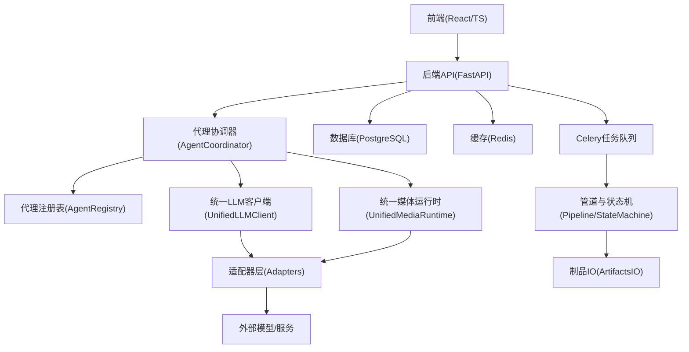
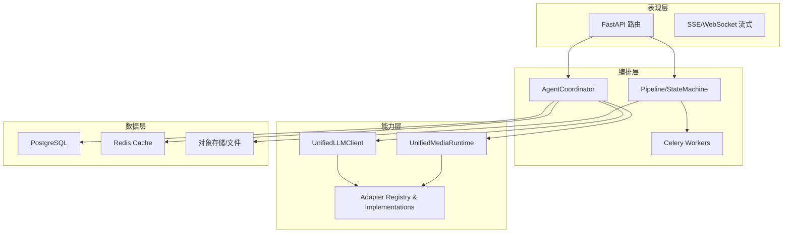
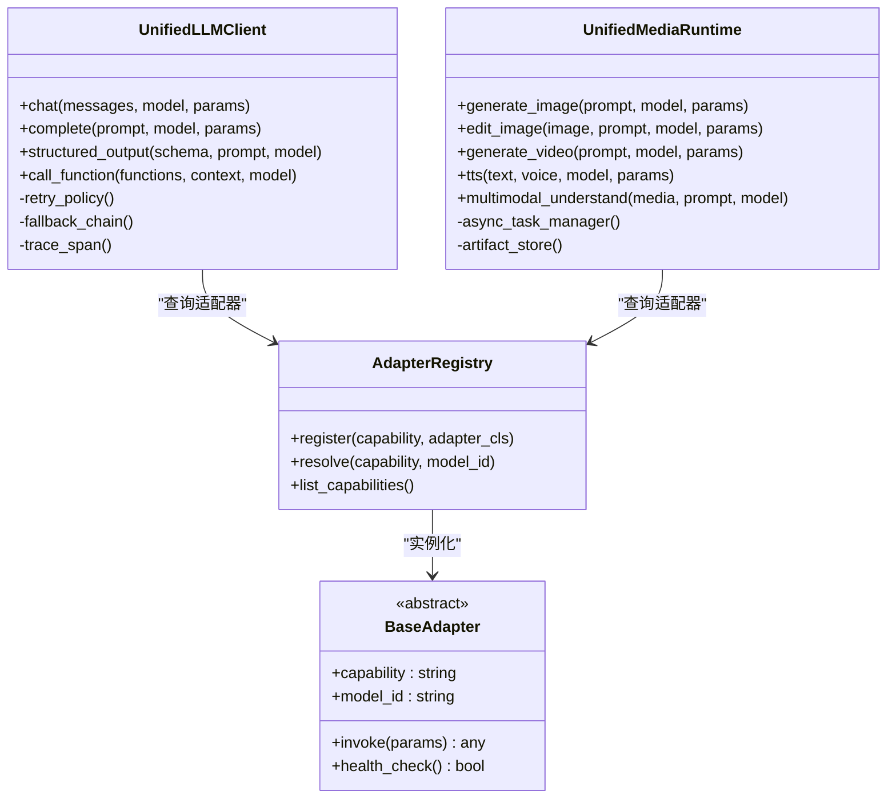
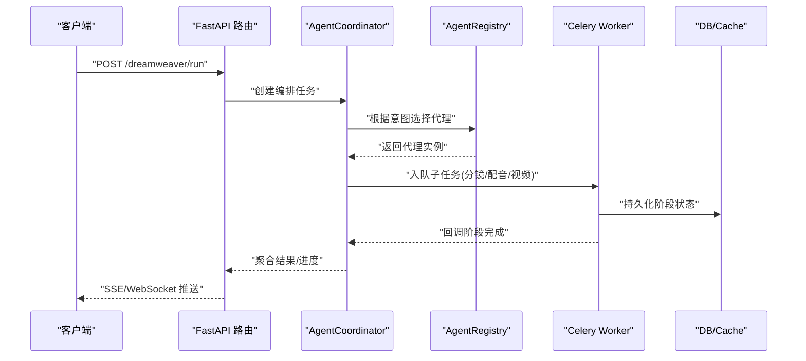
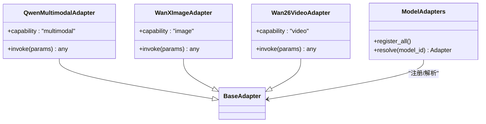
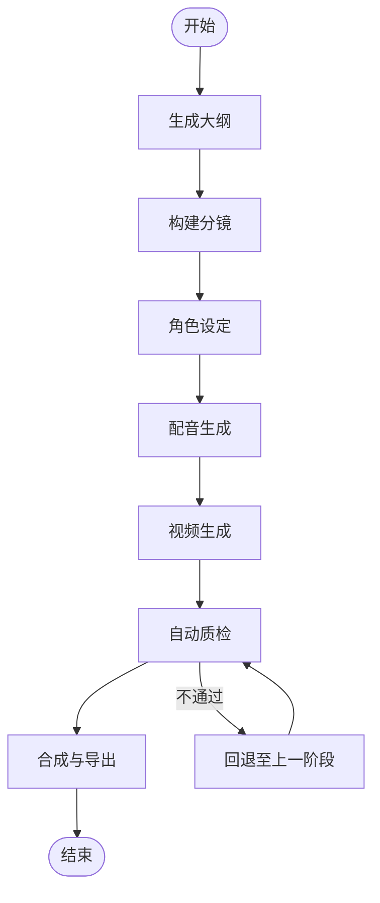
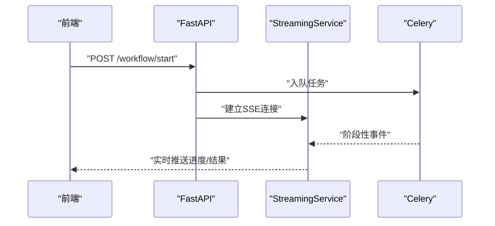
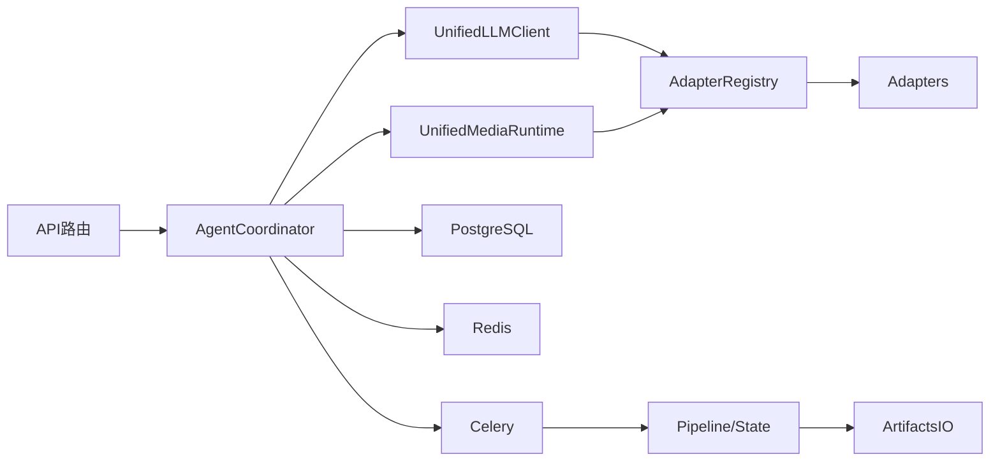

# 架构设计

<cite>
**本文引用的文件**   
- [backend/app/main.py](file://backend/app/main.py)
- [backend/app/celery_app.py](file://backend/app/celery_app.py)
- [backend/app/services/agent_coordinator.py](file://backend/app/services/agent_coordinator.py)
- [backend/app/services/agent_registry.py](file://backend/app/services/agent_registry.py)
- [core/unified_llm_client.py](file://core/unified_llm_client.py)
- [core/unified_media_runtime.py](file://core/unified_media_runtime.py)
- [adapters/base.py](file://adapters/base.py)
- [adapters/registry.py](file://adapters/registry.py)
- [adapters/model_adapters.py](file://adapters/model_adapters.py)
- [adapters/new_models_adapters.py](file://adapters/new_models_adapters.py)
- [adapters/qwen_multimodal_adapter.py](file://adapters/qwen_multimodal_adapter.py)
- [adapters/wanx_adapter.py](file://adapters/wanx_adapter.py)
- [adapters/wan26_video_adapter.py](file://adapters/wan26_video_adapter.py)
- [adapters/rate_limiter.py](file://adapters/rate_limiter.py)
- [adapters/content_safety_checker.py](file://adapters/content_safety_checker.py)
- [backend/app/api/v1/dreamweaver_api/routes.py](file://backend/app/api/v1/dreamweaver_api/routes.py)
- [backend/app/api/v1/workflow/routes.py](file://backend/app/api/v1/workflow/routes.py)
- [backend/app/api/v1/audiobook_api/routes.py](file://backend/app/api/v1/audiobook_api/routes.py)
- [backend/app/services/streaming_service.py](file://backend/app/services/streaming_service.py)
- [backend/app/services/cache_system.py](file://backend/app/services/cache_system.py)
- [backend/app/services/batch_processor.py](file://backend/app/services/batch_processor.py)
- [backend/app/services/generation_lock.py](file://backend/app/services/generation_lock.py)
- [backend/app/services/rate_limit_handler.py](file://backend/app/services/rate_limit_handler.py)
- [backend/app/core/config.py](file://backend/app/core/config.py)
- [backend/app/core/security.py](file://backend/app/core/security.py)
- [backend/app/db/base.py](file://backend/app/db/base.py)
- [schemas/unified_model_spec.py](file://schemas/unified_model_spec.py)
- [pipeline/state_machine.py](file://pipeline/state_machine.py)
- [pipeline/artifacts_io.py](file://pipeline/artifacts_io.py)
- [config/models.yaml](file://config/models.yaml)
- [config/llm_models.yaml](file://config/llm_models.yaml)
- [docker-compose.yml](file://docker-compose.yml)
</cite>

## 目录
1. [简介](#简介)
2. [项目结构](#项目结构)
3. [核心组件](#核心组件)
4. [架构总览](#架构总览)
5. [详细组件分析](#详细组件分析)
6. [依赖关系分析](#依赖关系分析)
7. [性能考量](#性能考量)
8. [故障排查指南](#故障排查指南)
9. [结论](#结论)
10. [附录](#附录)

## 简介
本架构设计文档面向“小说创作代理系统”，系统性阐述分层架构、微服务化边界与事件驱动机制的设计决策。重点解释统一模型系统、代理协调器、适配器层等核心组件的职责与交互，描述数据流向、消息传递与状态管理策略，明确系统边界、扩展点与插件机制，并给出架构图与依赖图。同时说明技术选型权衡（性能、可扩展性、可维护性），以及安全、监控、日志等横切关注点的实现思路。

## 项目结构
系统采用前后端分离与多语言协作：
- 前端：React + TypeScript，提供可视化工作流、资产管理与生成结果预览。
- 后端：Python FastAPI 应用，承载 API、编排、任务调度、持久化与外部模型适配。
- 核心库：统一的 LLM/Media 运行时与适配器注册中心，屏蔽底层厂商差异。
- 适配器：按能力域（文本、图像、视频、TTS、多模态）组织，支持热插拔。
- 管道与状态机：编排长链路生成流程，保证幂等与可恢复。
- 配置与模型目录：集中式模型清单与路由策略。

**图表来源**
- [backend/app/main.py](file://backend/app/main.py)
- [backend/app/celery_app.py](file://backend/app/celery_app.py)
- [backend/app/services/agent_coordinator.py](file://backend/app/services/agent_coordinator.py)
- [core/unified_llm_client.py](file://core/unified_llm_client.py)
- [core/unified_media_runtime.py](file://core/unified_media_runtime.py)
- [adapters/base.py](file://adapters/base.py)
- [adapters/registry.py](file://adapters/registry.py)
- [pipeline/state_machine.py](file://pipeline/state_machine.py)
- [pipeline/artifacts_io.py](file://pipeline/artifacts_io.py)

**章节来源**
- [backend/app/main.py](file://backend/app/main.py)
- [backend/app/celery_app.py](file://backend/app/celery_app.py)
- [docker-compose.yml](file://docker-compose.yml)

## 核心组件
- 统一模型系统
  - 统一LLM客户端：抽象对话/补全/函数调用接口，封装重试、限流、追踪与降级。
  - 统一媒体运行时：抽象图像/视频/TTS等多模态能力，统一输入输出规范与异步处理。
- 代理协调器与注册表
  - 代理协调器：解析意图、选择子代理、编排步骤、聚合结果、错误恢复。
  - 代理注册表：按领域/能力注册与发现代理，支持版本与权重路由。
- 适配器层
  - 基础抽象与工厂：定义能力契约与生命周期，集中注册与实例化。
  - 具体适配器：对接各厂商（如通义千问、万相、视频生成等），屏蔽差异。
- 管道与状态机
  - 状态机：定义阶段、转换条件、回滚与补偿动作，保障长链路一致性。
  - 制品IO：统一上传/下载、分片、校验与清理。
- 横切能力
  - 限流与锁：请求级与任务级限流，分布式锁避免重复生成。
  - 缓存：热点提示词、模型元数据、中间结果缓存。
  - 流式服务：SSE/WebSocket 推送进度与增量结果。
  - 安全与鉴权：JWT、RBAC、内容安全检测。

**章节来源**
- [core/unified_llm_client.py](file://core/unified_llm_client.py)
- [core/unified_media_runtime.py](file://core/unified_media_runtime.py)
- [backend/app/services/agent_coordinator.py](file://backend/app/services/agent_coordinator.py)
- [backend/app/services/agent_registry.py](file://backend/app/services/agent_registry.py)
- [adapters/base.py](file://adapters/base.py)
- [adapters/registry.py](file://adapters/registry.py)
- [adapters/model_adapters.py](file://adapters/model_adapters.py)
- [adapters/new_models_adapters.py](file://adapters/new_models_adapters.py)
- [adapters/qwen_multimodal_adapter.py](file://adapters/qwen_multimodal_adapter.py)
- [adapters/wanx_adapter.py](file://adapters/wanx_adapter.py)
- [adapters/wan26_video_adapter.py](file://adapters/wan26_video_adapter.py)
- [adapters/rate_limiter.py](file://adapters/rate_limiter.py)
- [adapters/content_safety_checker.py](file://adapters/content_safety_checker.py)
- [backend/app/services/cache_system.py](file://backend/app/services/cache_system.py)
- [backend/app/services/generation_lock.py](file://backend/app/services/generation_lock.py)
- [backend/app/services/streaming_service.py](file://backend/app/services/streaming_service.py)
- [pipeline/state_machine.py](file://pipeline/state_machine.py)
- [pipeline/artifacts_io.py](file://pipeline/artifacts_io.py)

## 架构总览
系统采用分层+微服务+事件驱动的混合架构：
- 表现层：REST/SSE/WebSocket API，面向前端与第三方集成。
- 编排层：代理协调器与管道状态机，负责复杂业务流程编排与容错。
- 能力层：统一LLM与媒体运行时，向上暴露稳定接口；向下通过适配器接入多厂商。
- 数据层：PostgreSQL 持久化，Redis 缓存，对象存储/文件系统作为制品仓库。
- 基础设施：Celery 异步任务、Nginx 反向代理、容器编排。

**图表来源**
- [backend/app/main.py](file://backend/app/main.py)
- [backend/app/celery_app.py](file://backend/app/celery_app.py)
- [backend/app/services/agent_coordinator.py](file://backend/app/services/agent_coordinator.py)
- [core/unified_llm_client.py](file://core/unified_llm_client.py)
- [core/unified_media_runtime.py](file://core/unified_media_runtime.py)
- [adapters/registry.py](file://adapters/registry.py)
- [pipeline/state_machine.py](file://pipeline/state_machine.py)

## 详细组件分析

### 统一模型系统（LLM 与媒体运行时）
- 统一LLM客户端
  - 职责：抽象对话、补全、结构化输出、函数调用；内置重试、退避、熔断、追踪与降级。
  - 关键特性：上下文窗口管理、提示词模板绑定、多模型路由与A/B切换。
- 统一媒体运行时
  - 职责：抽象图像生成/编辑、视频生成/剪辑、TTS、多模态理解；统一输入输出格式与异步回调。
  - 关键特性：批量提交、进度轮询、失败重试、产物校验与回滚。

**图表来源**
- [core/unified_llm_client.py](file://core/unified_llm_client.py)
- [core/unified_media_runtime.py](file://core/unified_media_runtime.py)
- [adapters/base.py](file://adapters/base.py)
- [adapters/registry.py](file://adapters/registry.py)

**章节来源**
- [core/unified_llm_client.py](file://core/unified_llm_client.py)
- [core/unified_media_runtime.py](file://core/unified_media_runtime.py)
- [adapters/base.py](file://adapters/base.py)
- [adapters/registry.py](file://adapters/registry.py)

### 代理协调器与注册表
- 代理协调器
  - 职责：解析用户意图，选择合适代理（脚本、分镜、配音、视频生成等），编排步骤，聚合结果，异常恢复。
  - 关键特性：动态参数注入、上下文共享、重试与补偿、审计追踪。
- 代理注册表
  - 职责：按能力域注册代理类，支持版本、权重、灰度发布与快速切换。

**图表来源**
- [backend/app/api/v1/dreamweaver_api/routes.py](file://backend/app/api/v1/dreamweaver_api/routes.py)
- [backend/app/services/agent_coordinator.py](file://backend/app/services/agent_coordinator.py)
- [backend/app/services/agent_registry.py](file://backend/app/services/agent_registry.py)
- [backend/app/celery_app.py](file://backend/app/celery_app.py)

**章节来源**
- [backend/app/services/agent_coordinator.py](file://backend/app/services/agent_coordinator.py)
- [backend/app/services/agent_registry.py](file://backend/app/services/agent_registry.py)

### 适配器层（多模型/多厂商）
- 设计要点
  - 以能力为维度抽象（文本、图像、视频、TTS、多模态），每个能力一个适配器族。
  - 通过注册表集中管理，支持按模型ID或能力名解析到具体实现。
  - 内置限流、重试、降级、内容安全检测等横切逻辑。
- 典型实现
  - 通义千问多模态、万相图像、万相2.6视频、其他厂商适配器等。

**图表来源**
- [adapters/qwen_multimodal_adapter.py](file://adapters/qwen_multimodal_adapter.py)
- [adapters/wanx_adapter.py](file://adapters/wanx_adapter.py)
- [adapters/wan26_video_adapter.py](file://adapters/wan26_video_adapter.py)
- [adapters/model_adapters.py](file://adapters/model_adapters.py)
- [adapters/new_models_adapters.py](file://adapters/new_models_adapters.py)

**章节来源**
- [adapters/model_adapters.py](file://adapters/model_adapters.py)
- [adapters/new_models_adapters.py](file://adapters/new_models_adapters.py)
- [adapters/qwen_multimodal_adapter.py](file://adapters/qwen_multimodal_adapter.py)
- [adapters/wanx_adapter.py](file://adapters/wanx_adapter.py)
- [adapters/wan26_video_adapter.py](file://adapters/wan26_video_adapter.py)

### 管道与状态机（长链路编排）
- 状态机
  - 定义阶段（如：大纲→分镜→角色设定→配音→视频生成→质检→合成）。
  - 转换条件基于前置产出与质量门控，支持回滚与补偿。
- 制品IO
  - 统一上传/下载、分片校验、临时清理与归档。

**图表来源**
- [pipeline/state_machine.py](file://pipeline/state_machine.py)
- [pipeline/artifacts_io.py](file://pipeline/artifacts_io.py)

**章节来源**
- [pipeline/state_machine.py](file://pipeline/state_machine.py)
- [pipeline/artifacts_io.py](file://pipeline/artifacts_io.py)

### API 与流式服务
- REST 路由：按业务域划分（Dreamweaver、Workflow、Audiobook 等），统一鉴权与校验。
- 流式服务：SSE/WebSocket 推送任务进度、中间结果与最终产物链接。

**图表来源**
- [backend/app/api/v1/workflow/routes.py](file://backend/app/api/v1/workflow/routes.py)
- [backend/app/services/streaming_service.py](file://backend/app/services/streaming_service.py)
- [backend/app/celery_app.py](file://backend/app/celery_app.py)

**章节来源**
- [backend/app/api/v1/dreamweaver_api/routes.py](file://backend/app/api/v1/dreamweaver_api/routes.py)
- [backend/app/api/v1/workflow/routes.py](file://backend/app/api/v1/workflow/routes.py)
- [backend/app/api/v1/audiobook_api/routes.py](file://backend/app/api/v1/audiobook_api/routes.py)
- [backend/app/services/streaming_service.py](file://backend/app/services/streaming_service.py)

## 依赖关系分析
- 模块耦合
  - API 层仅依赖协调器与管道，不直接感知适配器细节。
  - 协调器依赖统一运行时与注册表，保持对厂商解耦。
  - 适配器通过注册表被统一运行时发现，新增能力只需注册。
- 外部依赖
  - PostgreSQL、Redis、Celery、对象存储/文件系统、外部模型API。
- 配置与模型目录
  - models.yaml、llm_models.yaml 集中声明可用模型、能力与路由策略。

**图表来源**
- [backend/app/main.py](file://backend/app/main.py)
- [backend/app/services/agent_coordinator.py](file://backend/app/services/agent_coordinator.py)
- [core/unified_llm_client.py](file://core/unified_llm_client.py)
- [core/unified_media_runtime.py](file://core/unified_media_runtime.py)
- [adapters/registry.py](file://adapters/registry.py)
- [pipeline/state_machine.py](file://pipeline/state_machine.py)
- [pipeline/artifacts_io.py](file://pipeline/artifacts_io.py)

**章节来源**
- [config/models.yaml](file://config/models.yaml)
- [config/llm_models.yaml](file://config/llm_models.yaml)

## 性能考量
- 并发与异步
  - Celery 异步任务拆分长链路步骤，提升吞吐与弹性伸缩。
  - 统一运行时内部使用异步I/O与连接池，减少阻塞。
- 缓存与去重
  - Redis 缓存提示词、模型元数据与中间结果，降低重复计算。
  - 生成锁避免相同参数的重复生成。
- 限流与背压
  - 适配器级与全局限流，保护下游服务与系统稳定性。
- 流式输出
  - SSE/WebSocket 渐进式返回，改善用户体验与首帧时间。
- 资源隔离
  - 不同能力域独立Worker池，避免相互干扰。

[本节为通用指导，无需特定文件引用]

## 故障排查指南
- 常见问题定位
  - 适配器健康检查失败：查看适配器 health_check 与日志，确认密钥与网络。
  - 限流触发：检查 rate_limiter 配置与配额，必要时扩容或优化调用频率。
  - 内容安全拦截：查看 content_safety_checker 的拦截规则与白名单。
  - 任务卡住：检查 Celery Worker 状态、队列堆积与数据库锁。
  - 状态机死锁：审查阶段转换条件与补偿动作，确保幂等。
- 诊断工具
  - 追踪与埋点：在统一LLM与媒体运行时中记录Span，便于链路追踪。
  - 缓存命中率：监控Redis命中与失效，调整TTL与键空间。
  - 制品完整性：校验上传/下载摘要，失败时自动重试与清理。

**章节来源**
- [adapters/rate_limiter.py](file://adapters/rate_limiter.py)
- [adapters/content_safety_checker.py](file://adapters/content_safety_checker.py)
- [backend/app/services/generation_lock.py](file://backend/app/services/generation_lock.py)
- [backend/app/services/cache_system.py](file://backend/app/services/cache_system.py)
- [pipeline/state_machine.py](file://pipeline/state_machine.py)

## 结论
本架构通过分层与微服务边界清晰划分职责，以统一模型系统与适配器层屏蔽厂商差异，借助代理协调器与管道状态机实现复杂流程编排与容错。结合事件驱动与流式输出，系统在性能、可扩展性与可维护性之间取得平衡。未来可在模型目录智能路由、自适应降级与多活部署方面持续演进。

[本节为总结性内容，无需特定文件引用]

## 附录
- 安全与鉴权
  - JWT 鉴权与RBAC权限控制，敏感操作二次校验。
  - 内容安全检测贯穿提示词与生成产物。
- 监控与日志
  - 结构化日志、指标上报与链路追踪，覆盖API、任务与适配器。
- 配置管理
  - 集中式模型清单与环境变量注入，支持灰度与A/B测试。
- 部署与运维
  - Docker Compose 编排，Nginx 反向代理与SSL证书管理。

**章节来源**
- [backend/app/core/security.py](file://backend/app/core/security.py)
- [backend/app/core/config.py](file://backend/app/core/config.py)
- [backend/app/db/base.py](file://backend/app/db/base.py)
- [docker-compose.yml](file://docker-compose.yml)