# 代理协调器

<cite>
**本文引用的文件**   
- [agent_coordinator.py](file://agent_coordinator.py)
- [split_agent_coordinator.py](file://split_agent_coordinator.py)
- [backend/app/services/agent_coordinator.py](file://backend/app/services/agent_coordinator.py)
- [backend/app/services/agent_registry.py](file://backend/app/services/agent_registry.py)
- [core/unified_registry.py](file://core/unified_registry.py)
- [adapters/registry.py](file://adapters/registry.py)
- [backend/app/celery_app.py](file://backend/app/celery_app.py)
- [backend/app/main.py](file://backend/app/main.py)
- [backend/app/api/v1/smart_dispatch.py](file://backend/app/api/v1/smart_dispatch.py)
- [backend/app/api/v1/dreamweaver.py](file://backend/app/api/v1/dreamweaver.py)
- [agents/__init__.py](file://agents/__init__.py)
- [adapters/__init__.py](file://adapters/__init__.py)
</cite>

## 目录
1. [简介](#简介)
2. [项目结构](#项目结构)
3. [核心组件](#核心组件)
4. [架构总览](#架构总览)
5. [详细组件分析](#详细组件分析)
6. [依赖关系分析](#依赖关系分析)
7. [性能考量](#性能考量)
8. [故障排查指南](#故障排查指南)
9. [结论](#结论)
10. [附录](#附录)

## 简介
本文件为“小说创作代理系统”的代理协调器提供全面文档，聚焦以下目标：
- 工厂模式实现、代理生命周期管理与任务分发机制
- 代理间通信协议：同步调用、异步消息传递与事件订阅
- 代理状态管理：持久化、并发控制与事务管理
- 调度算法：负载均衡、优先级调度与故障转移
- 代理注册、发现与销毁流程
- 健康检查、性能监控与错误处理
- 使用协调器创建与管理不同类型代理实例的实践

## 项目结构
本项目采用分层与模块化组织方式：
- 顶层协调器入口与拆分模块：agent_coordinator.py、split_agent_coordinator.py
- 后端服务层：backend/app/services/agent_coordinator.py（业务编排）、backend/app/services/agent_registry.py（注册表）
- 统一注册中心：core/unified_registry.py（跨域统一注册）、adapters/registry.py（适配器注册）
- 任务队列与异步执行：backend/app/celery_app.py
- API 路由与编排入口：backend/app/main.py、backend/app/api/v1/smart_dispatch.py、backend/app/api/v1/dreamweaver.py
- 领域代理与适配器：agents/__init__.py、adapters/__init__.py

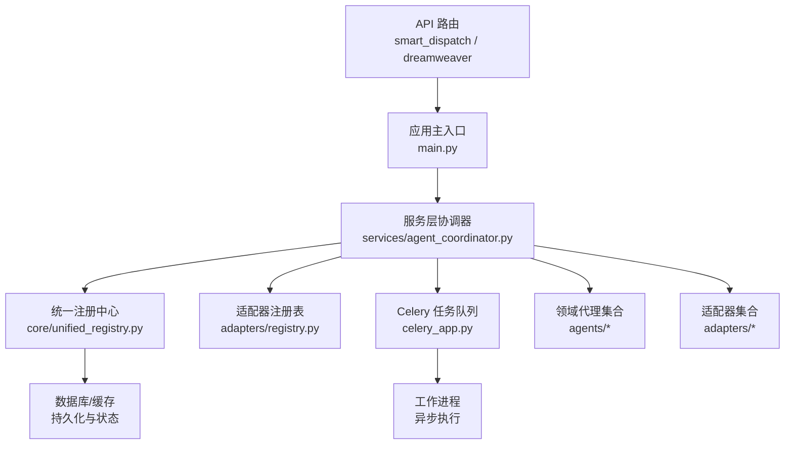

图表来源
- [backend/app/main.py](file://backend/app/main.py)
- [backend/app/api/v1/smart_dispatch.py](file://backend/app/api/v1/smart_dispatch.py)
- [backend/app/api/v1/dreamweaver.py](file://backend/app/api/v1/dreamweaver.py)
- [backend/app/services/agent_coordinator.py](file://backend/app/services/agent_coordinator.py)
- [core/unified_registry.py](file://core/unified_registry.py)
- [adapters/registry.py](file://adapters/registry.py)
- [backend/app/celery_app.py](file://backend/app/celery_app.py)

章节来源
- [backend/app/main.py](file://backend/app/main.py)
- [backend/app/api/v1/smart_dispatch.py](file://backend/app/api/v1/smart_dispatch.py)
- [backend/app/api/v1/dreamweaver.py](file://backend/app/api/v1/dreamweaver.py)
- [backend/app/services/agent_coordinator.py](file://backend/app/services/agent_coordinator.py)
- [core/unified_registry.py](file://core/unified_registry.py)
- [adapters/registry.py](file://adapters/registry.py)
- [backend/app/celery_app.py](file://backend/app/celery_app.py)

## 核心组件
- 顶层协调器（agent_coordinator.py）：对外暴露统一的协调接口，负责策略选择、参数校验、上下文组装与结果归一化。
- 拆分协调器（split_agent_coordinator.py）：将复杂编排拆分为子流程，提升可维护性与可测试性。
- 服务层协调器（backend/app/services/agent_coordinator.py）：面向业务场景的编排器，串联注册表、适配器、任务队列与状态机。
- 统一注册中心（core/unified_registry.py）：集中管理所有可用代理/适配器的元数据、能力标签与版本信息。
- 适配器注册表（adapters/registry.py）：按能力域（如 LLM、图像、视频、TTS）注册具体实现，支持动态发现与热更新。
- Celery 任务队列（backend/app/celery_app.py）：承载异步任务、重试与幂等保障。

章节来源
- [agent_coordinator.py](file://agent_coordinator.py)
- [split_agent_coordinator.py](file://split_agent_coordinator.py)
- [backend/app/services/agent_coordinator.py](file://backend/app/services/agent_coordinator.py)
- [core/unified_registry.py](file://core/unified_registry.py)
- [adapters/registry.py](file://adapters/registry.py)
- [backend/app/celery_app.py](file://backend/app/celery_app.py)

## 架构总览
协调器作为“中枢”，向上承接 API 请求，向下通过注册中心发现并调用合适的代理或适配器，必要时借助任务队列完成耗时操作。

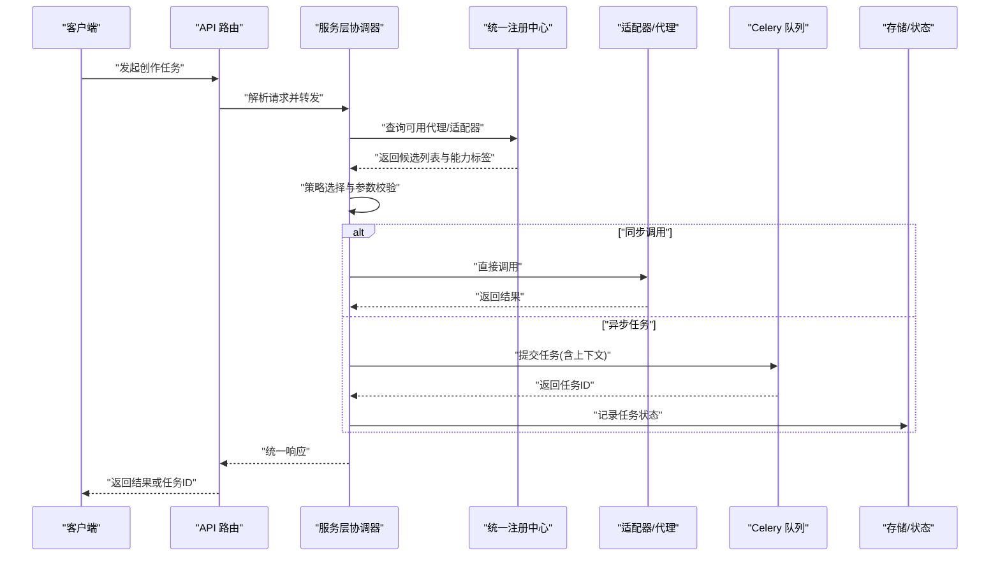

图表来源
- [backend/app/api/v1/smart_dispatch.py](file://backend/app/api/v1/smart_dispatch.py)
- [backend/app/api/v1/dreamweaver.py](file://backend/app/api/v1/dreamweaver.py)
- [backend/app/services/agent_coordinator.py](file://backend/app/services/agent_coordinator.py)
- [core/unified_registry.py](file://core/unified_registry.py)
- [adapters/registry.py](file://adapters/registry.py)
- [backend/app/celery_app.py](file://backend/app/celery_app.py)

## 详细组件分析

### 工厂模式与代理创建
- 工厂职责：根据能力标签、模型标识与运行时配置，创建对应代理或适配器实例；支持默认回退与多实现选择。
- 关键要点：
  - 基于注册中心的元数据进行匹配与排序
  - 构造时注入依赖（配置、日志、限流、缓存）
  - 失败时触发降级策略或抛出明确错误码

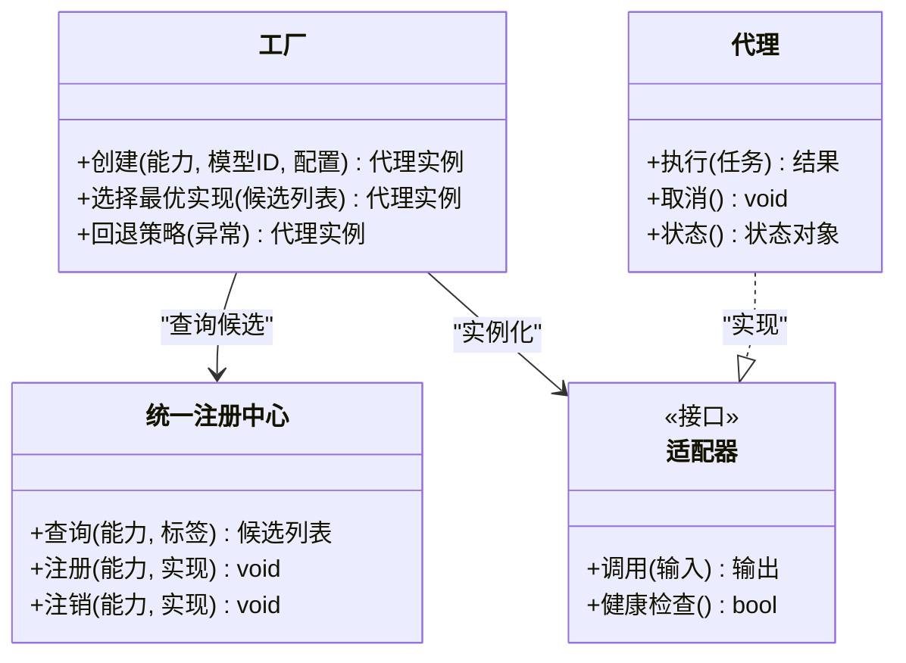

图表来源
- [core/unified_registry.py](file://core/unified_registry.py)
- [adapters/registry.py](file://adapters/registry.py)
- [adapters/__init__.py](file://adapters/__init__.py)
- [agents/__init__.py](file://agents/__init__.py)

章节来源
- [core/unified_registry.py](file://core/unified_registry.py)
- [adapters/registry.py](file://adapters/registry.py)
- [adapters/__init__.py](file://adapters/__init__.py)
- [agents/__init__.py](file://agents/__init__.py)

### 代理生命周期管理
- 阶段划分：初始化 -> 就绪 -> 运行中 -> 暂停/恢复 -> 销毁
- 关键点：
  - 启动时预加载必要资源（连接池、缓存预热）
  - 运行期监控心跳与资源占用
  - 优雅关闭：停止接收新任务、等待进行中任务完成、释放资源

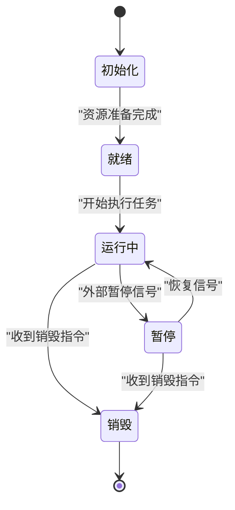

章节来源
- [agent_coordinator.py](file://agent_coordinator.py)
- [split_agent_coordinator.py](file://split_agent_coordinator.py)
- [backend/app/services/agent_coordinator.py](file://backend/app/services/agent_coordinator.py)

### 任务分发机制
- 分发策略：
  - 同步调用：低延迟、短任务直接调用
  - 异步消息：长耗时任务入队，返回任务 ID 供查询
  - 事件订阅：通过事件总线通知下游消费方
- 关键点：
  - 任务序列化与幂等键
  - 超时与重试策略
  - 失败隔离与熔断

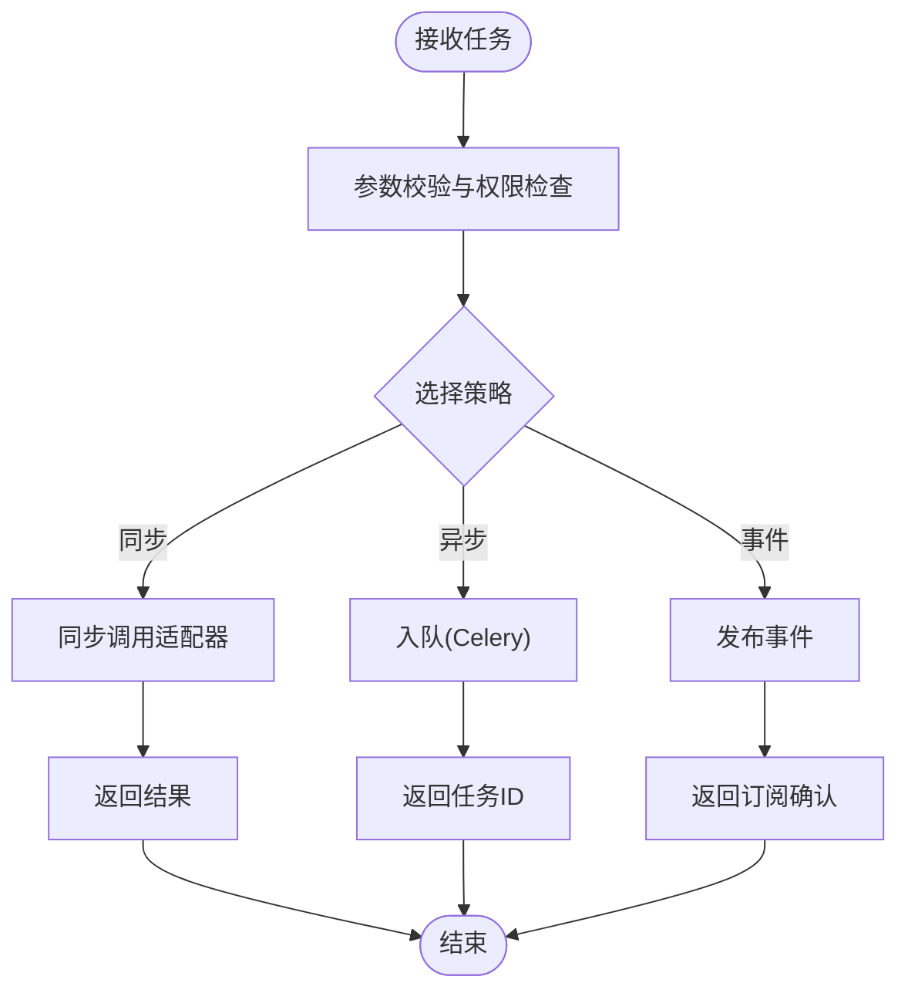

章节来源
- [backend/app/api/v1/smart_dispatch.py](file://backend/app/api/v1/smart_dispatch.py)
- [backend/app/api/v1/dreamweaver.py](file://backend/app/api/v1/dreamweaver.py)
- [backend/app/celery_app.py](file://backend/app/celery_app.py)

### 代理间通信协议
- 同步调用：REST/gRPC-style 调用，强一致性，适合简单查询与快速反馈
- 异步消息：基于队列的消息体包含任务类型、参数、追踪ID与重试次数
- 事件订阅：发布-订阅模式，解耦上下游，支持多消费者与重放

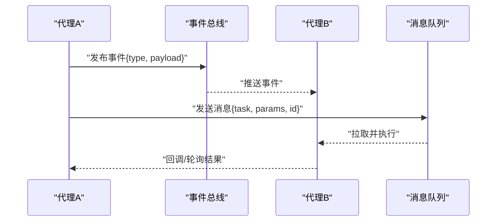

章节来源
- [backend/app/celery_app.py](file://backend/app/celery_app.py)
- [backend/app/services/agent_coordinator.py](file://backend/app/services/agent_coordinator.py)

### 代理状态管理机制
- 状态持久化：任务状态、代理实例状态、执行轨迹写入数据库或缓存
- 并发控制：分布式锁、令牌桶限流、任务去重
- 事务管理：跨步骤操作的补偿与回滚，保证最终一致性

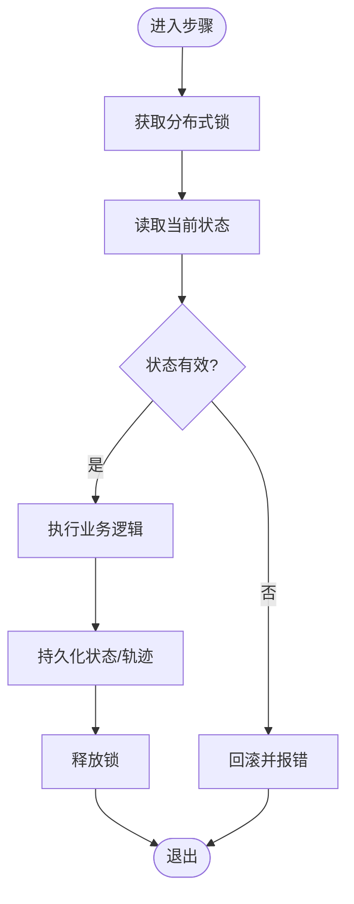

章节来源
- [backend/app/services/agent_coordinator.py](file://backend/app/services/agent_coordinator.py)
- [core/unified_registry.py](file://core/unified_registry.py)

### 代理调度算法
- 负载均衡：加权轮询、最少连接、延迟感知
- 优先级调度：高优先级任务抢占、公平队列、配额限制
- 故障转移：健康检查失败自动切换、熔断与降级

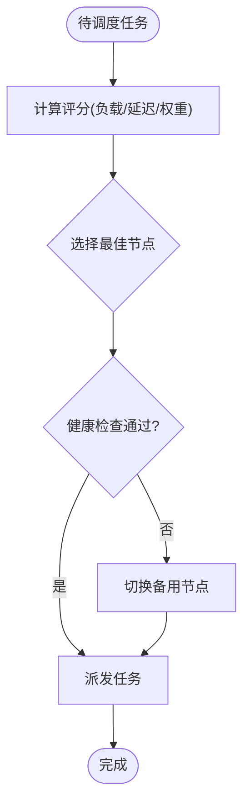

章节来源
- [backend/app/api/v1/smart_dispatch.py](file://backend/app/api/v1/smart_dispatch.py)
- [backend/app/services/agent_coordinator.py](file://backend/app/services/agent_coordinator.py)

### 代理注册、发现与销毁流程
- 注册：启动时扫描能力域，向统一注册中心登记元数据与端点
- 发现：协调器按能力标签与约束条件检索候选
- 销毁：优雅关闭，清理资源并注销注册

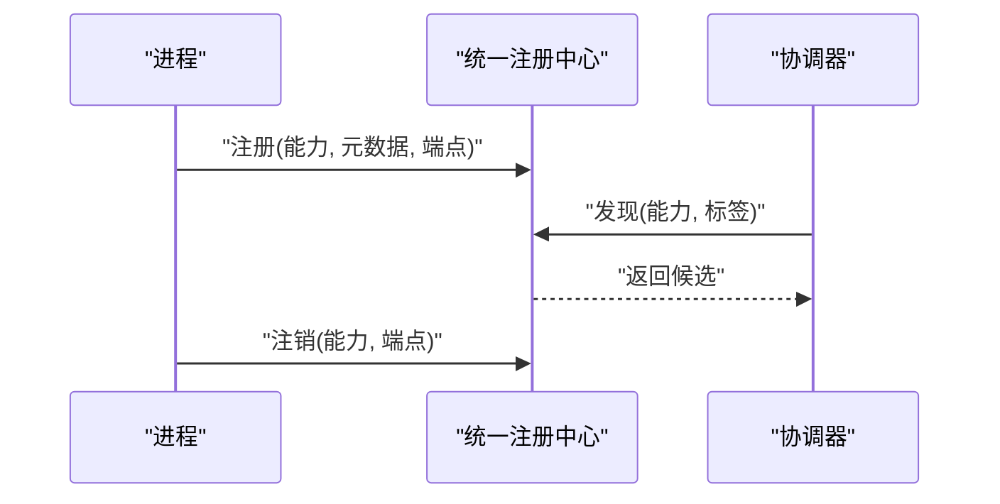

章节来源
- [core/unified_registry.py](file://core/unified_registry.py)
- [adapters/registry.py](file://adapters/registry.py)
- [backend/app/services/agent_coordinator.py](file://backend/app/services/agent_coordinator.py)

### 健康检查、性能监控与错误处理
- 健康检查：周期性探针、指标采集（CPU/内存/队列长度/延迟）
- 性能监控：链路追踪、采样统计、告警阈值
- 错误处理：分类错误码、重试策略、熔断与降级、审计日志

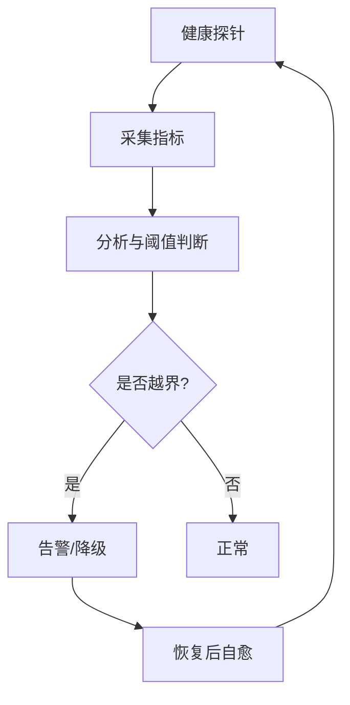

章节来源
- [backend/app/services/agent_coordinator.py](file://backend/app/services/agent_coordinator.py)
- [backend/app/celery_app.py](file://backend/app/celery_app.py)

### 使用协调器创建与管理不同类型的代理实例
- 创建流程：
  - 指定能力域与模型标识
  - 传入运行时配置（超时、重试、并发度）
  - 由工厂选择最优实现并初始化
- 管理操作：
  - 启动/暂停/恢复/销毁
  - 动态更新配置与热重载
  - 查询状态与指标

章节来源
- [agent_coordinator.py](file://agent_coordinator.py)
- [split_agent_coordinator.py](file://split_agent_coordinator.py)
- [backend/app/services/agent_coordinator.py](file://backend/app/services/agent_coordinator.py)
- [core/unified_registry.py](file://core/unified_registry.py)
- [adapters/registry.py](file://adapters/registry.py)

## 依赖关系分析
协调器依赖注册中心进行能力发现，依赖适配器执行具体逻辑，依赖任务队列进行异步编排，依赖存储进行状态持久化。

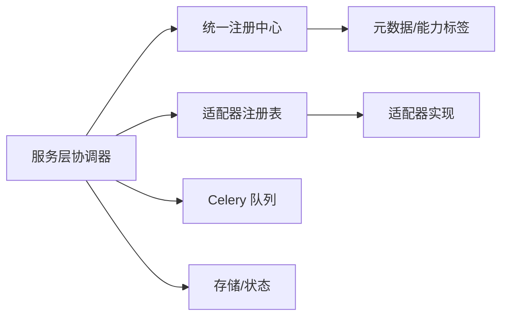

图表来源
- [backend/app/services/agent_coordinator.py](file://backend/app/services/agent_coordinator.py)
- [core/unified_registry.py](file://core/unified_registry.py)
- [adapters/registry.py](file://adapters/registry.py)
- [backend/app/celery_app.py](file://backend/app/celery_app.py)

章节来源
- [backend/app/services/agent_coordinator.py](file://backend/app/services/agent_coordinator.py)
- [core/unified_registry.py](file://core/unified_registry.py)
- [adapters/registry.py](file://adapters/registry.py)
- [backend/app/celery_app.py](file://backend/app/celery_app.py)

## 性能考量
- 减少同步阻塞：长任务走异步队列，短任务同步直调
- 连接与资源复用：连接池、缓存预热、批量处理
- 限流与背压：令牌桶、滑动窗口、队列深度控制
- 观测性：链路追踪、采样日志、指标上报
- 弹性伸缩：水平扩展工作进程、动态扩缩容

[本节为通用指导，不直接分析具体文件]

## 故障排查指南
- 常见问题定位：
  - 注册失败：检查注册中心连通性与元数据完整性
  - 任务堆积：查看队列长度与工作进程状态
  - 健康检查失败：检查依赖服务与资源占用
  - 错误码与日志：结合追踪ID定位调用链
- 建议工具：
  - 健康探针与指标面板
  - 队列监控与重试日志
  - 错误分类与告警规则

章节来源
- [backend/app/services/agent_coordinator.py](file://backend/app/services/agent_coordinator.py)
- [backend/app/celery_app.py](file://backend/app/celery_app.py)

## 结论
代理协调器通过工厂模式、统一注册中心与任务队列，构建了可扩展、可观测、高可用的代理编排体系。其生命周期管理、状态持久化、并发控制与调度算法共同保障了系统在复杂创作流水线中的稳定性与效率。

[本节为总结，不直接分析具体文件]

## 附录
- 术语表：
  - 代理：具备特定能力的执行单元
  - 适配器：对第三方服务的封装实现
  - 统一注册中心：集中管理能力与元数据的目录服务
  - 任务队列：异步执行与重试的基础设施
- 参考路径：
  - 协调器入口：agent_coordinator.py、split_agent_coordinator.py
  - 服务层编排：backend/app/services/agent_coordinator.py
  - 注册与发现：core/unified_registry.py、adapters/registry.py
  - 异步执行：backend/app/celery_app.py
  - API 入口：backend/app/main.py、backend/app/api/v1/smart_dispatch.py、backend/app/api/v1/dreamweaver.py

[本节为补充信息，不直接分析具体文件]