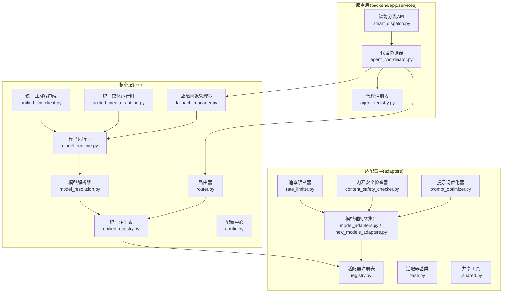
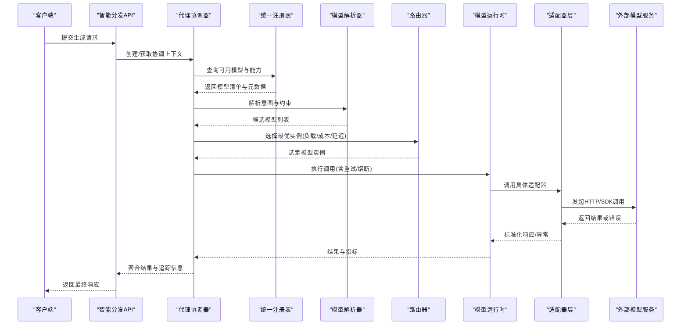
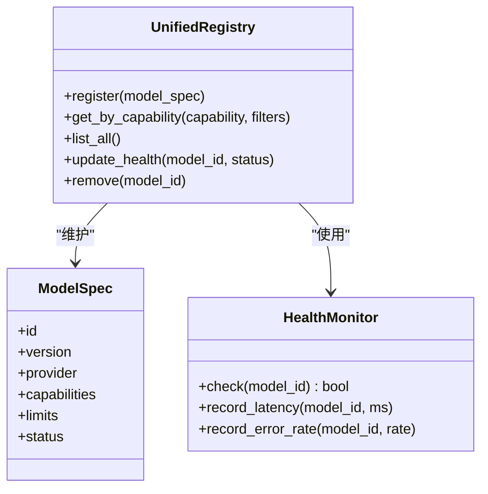
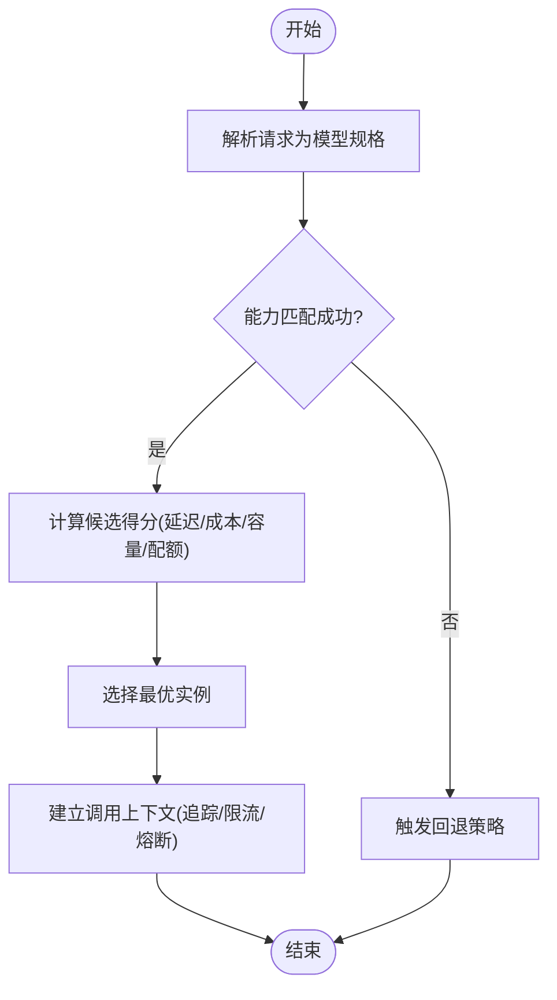
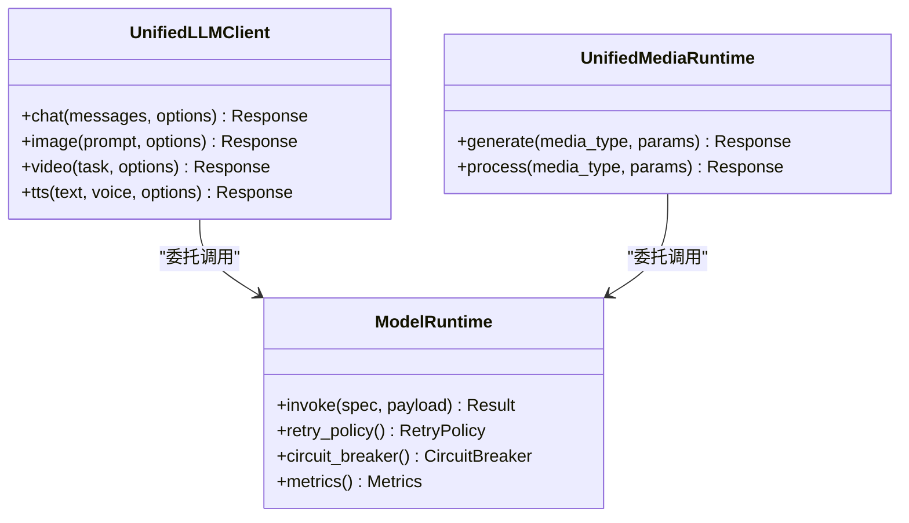
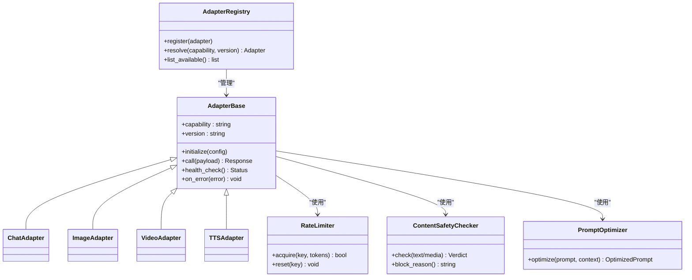
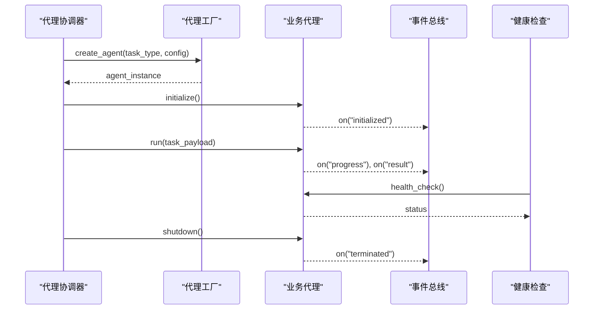
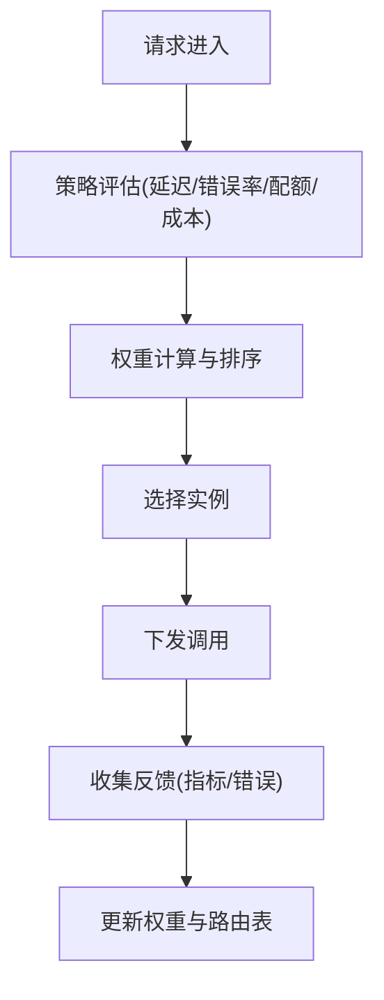
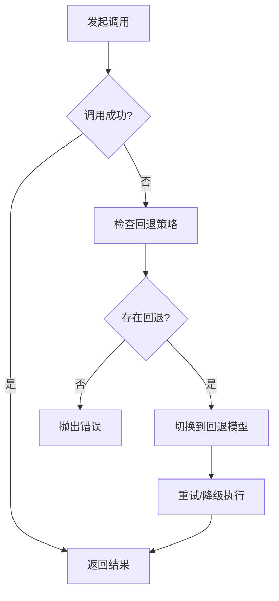
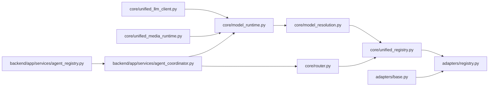

# 核心组件设计

<cite>
**本文引用的文件**   
- [core/unified_registry.py](file://core/unified_registry.py)
- [core/model_resolution.py](file://core/model_resolution.py)
- [core/router.py](file://core/router.py)
- [adapters/registry.py](file://adapters/registry.py)
- [adapters/base.py](file://adapters/base.py)
- [adapters/_shared.py](file://adapters/_shared.py)
- [adapters/model_adapters.py](file://adapters/model_adapters.py)
- [adapters/new_models_adapters.py](file://adapters/new_models_adapters.py)
- [backend/app/services/agent_coordinator.py](file://backend/app/services/agent_coordinator.py)
- [backend/app/services/agent_registry.py](file://backend/app/services/agent_registry.py)
- [core/model_runtime.py](file://core/model_runtime.py)
- [core/unified_llm_client.py](file://core/unified_llm_client.py)
- [core/unified_media_runtime.py](file://core/unified_media_runtime.py)
- [core/fallback_manager.py](file://core/fallback_manager.py)
- [core/config.py](file://core/config.py)
- [adapters/rate_limiter.py](file://adapters/rate_limiter.py)
- [adapters/content_safety_checker.py](file://adapters/content_safety_checker.py)
- [adapters/prompt_optimizer.py](file://adapters/prompt_optimizer.py)
- [backend/app/api/v1/smart_dispatch.py](file://backend/app/api/v1/smart_dispatch.py)
</cite>

## 目录
1. [引言](#引言)
2. [项目结构](#项目结构)
3. [核心组件](#核心组件)
4. [架构总览](#架构总览)
5. [详细组件分析](#详细组件分析)
6. [依赖关系分析](#依赖关系分析)
7. [性能考量](#性能考量)
8. [故障排查指南](#故障排查指南)
9. [结论](#结论)
10. [附录](#附录)

## 引言
本设计文档面向小说创作代理系统的“统一模型系统”与“代理协调器”，聚焦以下目标：
- 统一模型系统：模型注册机制、动态发现、路由选择与负载均衡策略
- 代理协调器：工厂模式、观察者模式应用，生命周期管理与通信协议
- 适配器层：抽象接口设计与具体实现策略（注册、版本兼容、错误处理）
- 组件间依赖与交互协议：同步调用、异步消息传递、事件订阅
- 可视化：类图与时序图展示关键业务流程协作
- 配置管理、健康检查与故障恢复

## 项目结构
围绕统一模型系统与代理协调器的关键代码分布在 core、adapters、backend/app/services 等模块中。整体采用分层与插件化设计：
- core：统一模型注册、解析、运行时、路由与客户端封装
- adapters：多厂商/多模态适配器及通用能力（限流、安全、提示优化）
- backend/app/services：代理协调器、注册表、调度与服务编排

图表来源
- [core/unified_registry.py](file://core/unified_registry.py)
- [core/model_resolution.py](file://core/model_resolution.py)
- [core/model_runtime.py](file://core/model_runtime.py)
- [core/router.py](file://core/router.py)
- [core/unified_llm_client.py](file://core/unified_llm_client.py)
- [core/unified_media_runtime.py](file://core/unified_media_runtime.py)
- [core/fallback_manager.py](file://core/fallback_manager.py)
- [core/config.py](file://core/config.py)
- [adapters/registry.py](file://adapters/registry.py)
- [adapters/base.py](file://adapters/base.py)
- [adapters/model_adapters.py](file://adapters/model_adapters.py)
- [adapters/new_models_adapters.py](file://adapters/new_models_adapters.py)
- [adapters/_shared.py](file://adapters/_shared.py)
- [adapters/rate_limiter.py](file://adapters/rate_limiter.py)
- [adapters/content_safety_checker.py](file://adapters/content_safety_checker.py)
- [adapters/prompt_optimizer.py](file://adapters/prompt_optimizer.py)
- [backend/app/services/agent_coordinator.py](file://backend/app/services/agent_coordinator.py)
- [backend/app/services/agent_registry.py](file://backend/app/services/agent_registry.py)
- [backend/app/api/v1/smart_dispatch.py](file://backend/app/api/v1/smart_dispatch.py)

章节来源
- [core/unified_registry.py](file://core/unified_registry.py)
- [adapters/registry.py](file://adapters/registry.py)
- [backend/app/services/agent_coordinator.py](file://backend/app/services/agent_coordinator.py)

## 核心组件
- 统一注册表：集中维护模型与适配器的元数据、版本与能力标签，支持热插拔与动态发现
- 模型解析器：将用户请求映射到具体模型规格，进行能力匹配与约束校验
- 路由器：基于策略（权重、地域、延迟、成本、容量）选择最优实例，并支持负载均衡
- 模型运行时：封装调用生命周期（预热、重试、熔断、指标上报）
- 统一客户端：对外暴露一致的LLM/媒体调用接口，屏蔽底层差异
- 适配器注册表与基类：定义标准接口与扩展点，提供注册、版本兼容与错误归一化
- 代理协调器：按任务类型编排子代理，管理生命周期与事件总线
- 辅助能力：限流、内容安全、提示词优化、回退策略

章节来源
- [core/unified_registry.py](file://core/unified_registry.py)
- [core/model_resolution.py](file://core/model_resolution.py)
- [core/router.py](file://core/router.py)
- [core/model_runtime.py](file://core/model_runtime.py)
- [core/unified_llm_client.py](file://core/unified_llm_client.py)
- [adapters/base.py](file://adapters/base.py)
- [adapters/registry.py](file://adapters/registry.py)
- [backend/app/services/agent_coordinator.py](file://backend/app/services/agent_coordinator.py)

## 架构总览
统一模型系统通过“注册-解析-路由-运行-适配”的流水线完成请求处理；代理协调器作为编排中枢，驱动各阶段协同工作。

图表来源
- [backend/app/api/v1/smart_dispatch.py](file://backend/app/api/v1/smart_dispatch.py)
- [backend/app/services/agent_coordinator.py](file://backend/app/services/agent_coordinator.py)
- [core/unified_registry.py](file://core/unified_registry.py)
- [core/model_resolution.py](file://core/model_resolution.py)
- [core/router.py](file://core/router.py)
- [core/model_runtime.py](file://core/model_runtime.py)
- [adapters/base.py](file://adapters/base.py)

## 详细组件分析

### 统一模型注册与动态发现
- 职责：维护模型ID、版本、能力标签、提供方、配额与状态；支持扫描与热更新
- 关键点：
  - 注册入口：集中式注册表提供 add/list/get_by_capability 等方法
  - 动态发现：监听配置变更或文件系统扫描，增量更新缓存
  - 版本兼容：语义化版本比较与降级策略
  - 健康状态：结合心跳与健康检查，标记不可用实例

图表来源
- [core/unified_registry.py](file://core/unified_registry.py)
- [core/config.py](file://core/config.py)

章节来源
- [core/unified_registry.py](file://core/unified_registry.py)
- [core/config.py](file://core/config.py)

### 模型解析与路由选择
- 解析器：将自然语言/结构化请求转换为模型规格（能力、输入输出格式、参数约束）
- 路由器：根据策略选择实例，支持加权轮询、最少连接、延迟优先、成本优先、地域亲和等
- 负载均衡：结合运行时指标（QPS、延迟、错误率、配额剩余）动态调整权重

图表来源
- [core/model_resolution.py](file://core/model_resolution.py)
- [core/router.py](file://core/router.py)

章节来源
- [core/model_resolution.py](file://core/model_resolution.py)
- [core/router.py](file://core/router.py)

### 模型运行时与统一客户端
- 运行时：封装预热、重试、熔断、指标上报、超时控制、幂等与去重
- 统一客户端：对上层暴露一致接口（文本、图像、视频、TTS等），内部委托给运行时与适配器

图表来源
- [core/model_runtime.py](file://core/model_runtime.py)
- [core/unified_llm_client.py](file://core/unified_llm_client.py)
- [core/unified_media_runtime.py](file://core/unified_media_runtime.py)

章节来源
- [core/model_runtime.py](file://core/model_runtime.py)
- [core/unified_llm_client.py](file://core/unified_llm_client.py)
- [core/unified_media_runtime.py](file://core/unified_media_runtime.py)

### 适配器层抽象与实现策略
- 抽象接口：定义统一的输入输出契约、能力声明、错误码映射与钩子（预处理/后处理）
- 注册机制：按能力与版本注册，支持覆盖与灰度发布
- 版本兼容：通过能力矩阵与降级路径保证向后兼容
- 错误处理：统一异常分类、重试判定、熔断阈值与告警

图表来源
- [adapters/base.py](file://adapters/base.py)
- [adapters/registry.py](file://adapters/registry.py)
- [adapters/rate_limiter.py](file://adapters/rate_limiter.py)
- [adapters/content_safety_checker.py](file://adapters/content_safety_checker.py)
- [adapters/prompt_optimizer.py](file://adapters/prompt_optimizer.py)
- [adapters/model_adapters.py](file://adapters/model_adapters.py)
- [adapters/new_models_adapters.py](file://adapters/new_models_adapters.py)
- [adapters/_shared.py](file://adapters/_shared.py)

章节来源
- [adapters/base.py](file://adapters/base.py)
- [adapters/registry.py](file://adapters/registry.py)
- [adapters/model_adapters.py](file://adapters/model_adapters.py)
- [adapters/new_models_adapters.py](file://adapters/new_models_adapters.py)
- [adapters/_shared.py](file://adapters/_shared.py)
- [adapters/rate_limiter.py](file://adapters/rate_limiter.py)
- [adapters/content_safety_checker.py](file://adapters/content_safety_checker.py)
- [adapters/prompt_optimizer.py](file://adapters/prompt_optimizer.py)

### 代理协调器与生命周期管理
- 设计模式：
  - 工厂模式：根据任务类型创建对应代理实例（如编剧、分镜、配音、审校）
  - 观察者模式：事件总线订阅任务状态变化、错误、进度与审计日志
- 生命周期：初始化、预热、运行、监控、优雅关闭
- 通信协议：同步调用（REST/SDK）、异步消息（队列/事件）、事件订阅（WebSocket/SSE）

图表来源
- [backend/app/services/agent_coordinator.py](file://backend/app/services/agent_coordinator.py)
- [backend/app/services/agent_registry.py](file://backend/app/services/agent_registry.py)

章节来源
- [backend/app/services/agent_coordinator.py](file://backend/app/services/agent_coordinator.py)
- [backend/app/services/agent_registry.py](file://backend/app/services/agent_registry.py)

### 智能分发与负载均衡
- 分发入口：API层接收请求，交由协调器编排
- 路由策略：综合延迟、错误率、配额、成本、地域与权重，动态选择实例
- 负载均衡：支持加权轮询、最少活跃连接、延迟感知与容量感知

图表来源
- [backend/app/api/v1/smart_dispatch.py](file://backend/app/api/v1/smart_dispatch.py)
- [core/router.py](file://core/router.py)

章节来源
- [backend/app/api/v1/smart_dispatch.py](file://backend/app/api/v1/smart_dispatch.py)
- [core/router.py](file://core/router.py)

### 回退与故障恢复
- 回退管理器：在模型不可用或超时时自动切换备选模型/降级策略
- 熔断与隔离：按模型维度统计错误率与延迟，达到阈值触发熔断
- 健康检查：周期性探测，失败则从路由池剔除，恢复后重新加入

图表来源
- [core/fallback_manager.py](file://core/fallback_manager.py)
- [core/model_runtime.py](file://core/model_runtime.py)

章节来源
- [core/fallback_manager.py](file://core/fallback_manager.py)
- [core/model_runtime.py](file://core/model_runtime.py)

## 依赖关系分析
- 低耦合高内聚：适配器与运行时解耦，通过统一接口与注册表协作
- 明确边界：core负责统一抽象与编排，adapters专注具体实现，services负责业务编排
- 潜在循环依赖规避：通过事件总线与接口抽象避免直接强引用

图表来源
- [core/unified_registry.py](file://core/unified_registry.py)
- [adapters/registry.py](file://adapters/registry.py)
- [core/model_resolution.py](file://core/model_resolution.py)
- [core/router.py](file://core/router.py)
- [core/model_runtime.py](file://core/model_runtime.py)
- [core/unified_llm_client.py](file://core/unified_llm_client.py)
- [core/unified_media_runtime.py](file://core/unified_media_runtime.py)
- [adapters/base.py](file://adapters/base.py)
- [backend/app/services/agent_coordinator.py](file://backend/app/services/agent_coordinator.py)
- [backend/app/services/agent_registry.py](file://backend/app/services/agent_registry.py)

章节来源
- [core/unified_registry.py](file://core/unified_registry.py)
- [adapters/registry.py](file://adapters/registry.py)
- [backend/app/services/agent_coordinator.py](file://backend/app/services/agent_coordinator.py)

## 性能考量
- 路由与负载均衡：引入延迟与错误率感知，减少热点与拥塞
- 运行时优化：连接池、批量请求、缓存与去重、幂等键
- 适配器侧：异步I/O、流式响应、预取与预热
- 资源管控：限流、配额、熔断与隔离，保障稳定性
- 可观测性：指标采集、链路追踪与采样

[本节为通用指导，不直接分析具体文件]

## 故障排查指南
- 常见问题定位：
  - 模型不可用：检查健康状态与熔断阈值，查看回退策略是否生效
  - 路由异常：核对能力匹配与权重配置，检查实例配额与地域限制
  - 适配器错误：查看错误码映射与重试策略，确认限流与安全拦截
  - 协调器阻塞：检查事件总线积压与代理生命周期状态
- 诊断手段：
  - 指标与日志：关注延迟、错误率、QPS、配额消耗
  - 链路追踪：跨组件TraceID关联
  - 健康检查：周期性探针与告警

章节来源
- [core/fallback_manager.py](file://core/fallback_manager.py)
- [adapters/rate_limiter.py](file://adapters/rate_limiter.py)
- [adapters/content_safety_checker.py](file://adapters/content_safety_checker.py)
- [core/model_runtime.py](file://core/model_runtime.py)

## 结论
本设计通过统一注册、解析、路由与运行时，构建了可扩展、高可用的模型系统；适配器层以标准接口与丰富能力支撑多厂商与多模态场景；代理协调器以工厂与观察者模式实现灵活编排与稳定生命周期管理。配合限流、安全、回退与健康检查，系统在复杂业务下具备良好弹性与可观测性。

[本节为总结性内容，不直接分析具体文件]

## 附录
- 配置建议：模型能力标签、权重与配额、熔断阈值、重试策略、限流策略
- 最佳实践：能力最小化声明、错误归一化、指标完备、灰度发布与回滚流程
- 扩展指引：新增适配器需实现基类接口并在注册表中登记；新增路由策略需在路由器中注册

[本节为补充说明，不直接分析具体文件]