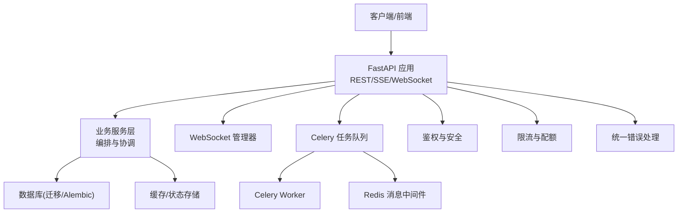
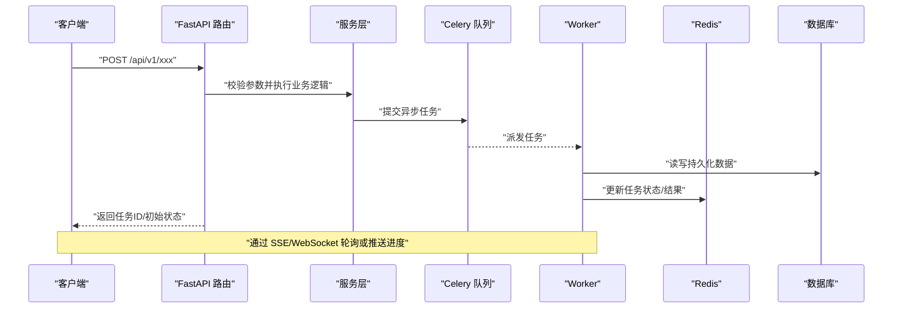
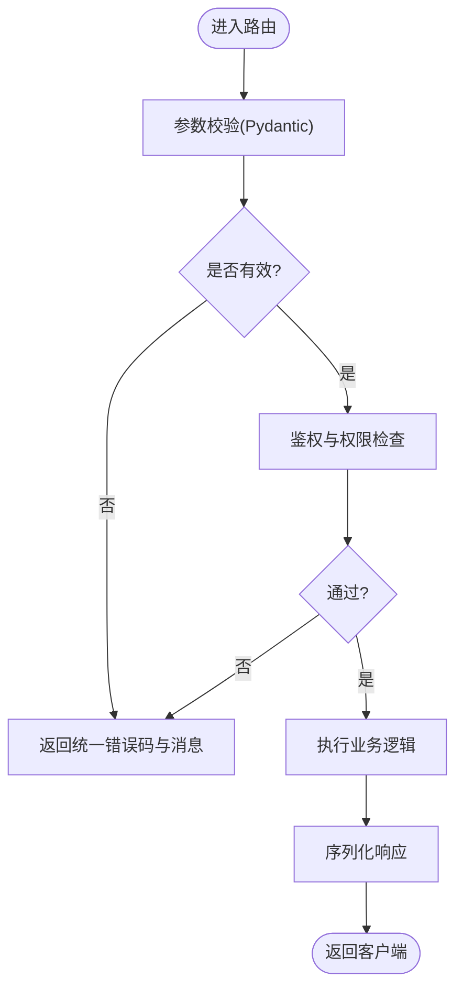
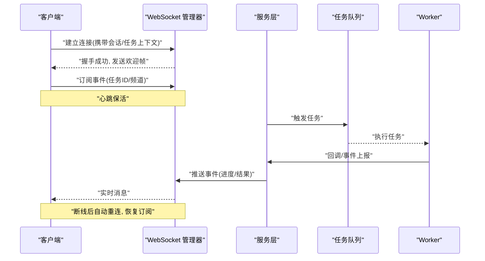
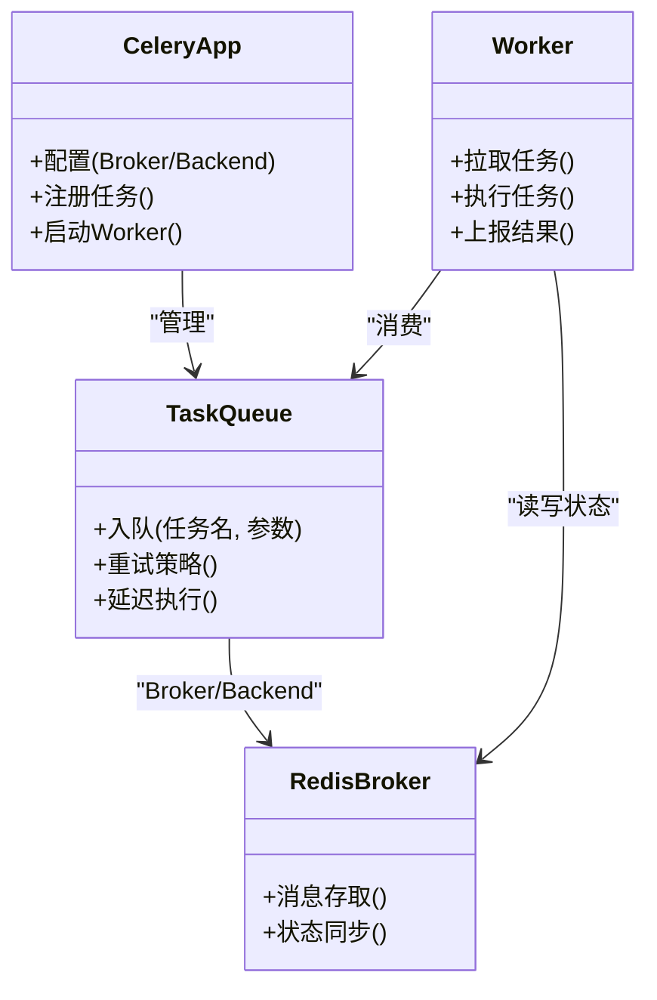
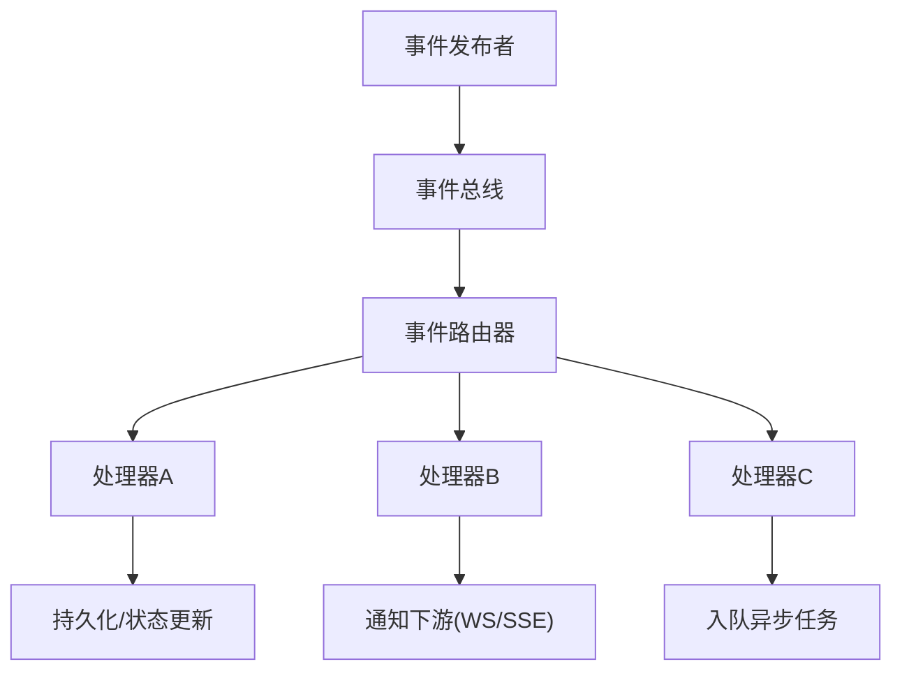
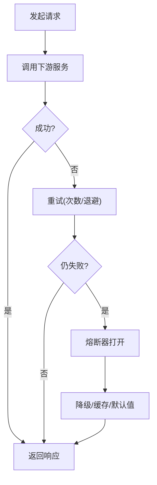
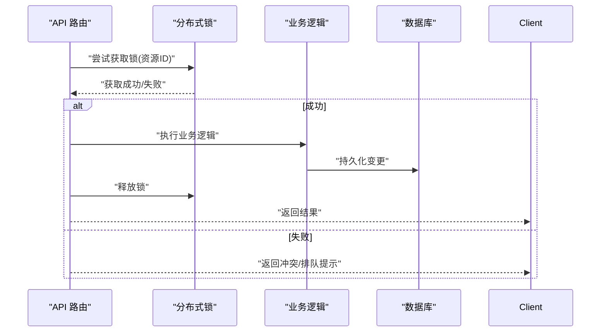
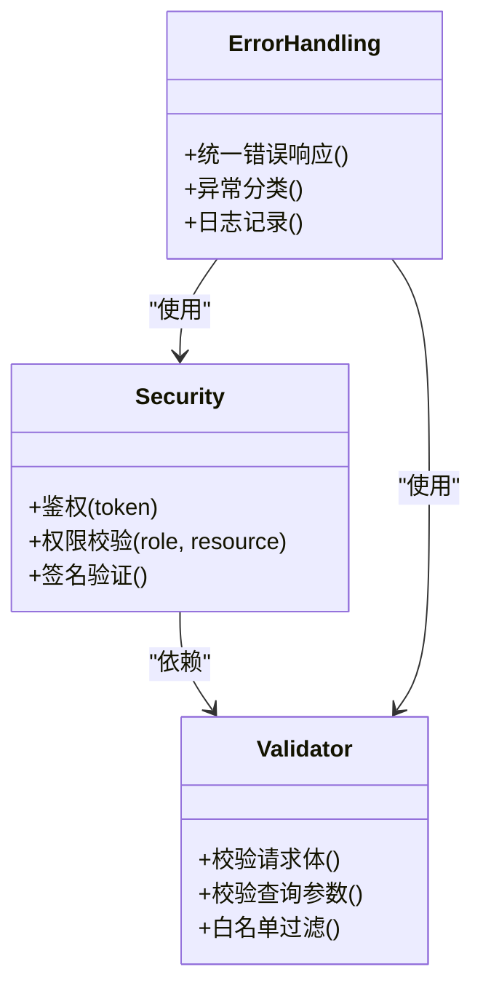
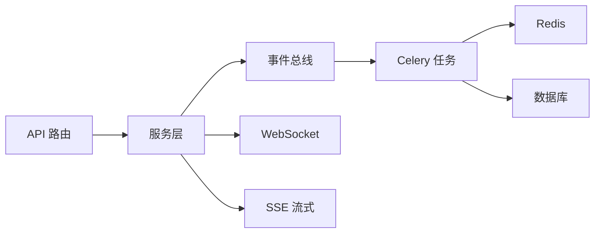

# 组件通信机制

<cite>
**本文引用的文件**   
- [backend/app/main.py](file://backend/app/main.py)
- [backend/app/celery_app.py](file://backend/app/celery_app.py)
- [backend/app/api/v1/dreamweaver.py](file://backend/app/api/v1/dreamweaver.py)
- [backend/app/api/v1/audiobook.py](file://backend/app/api/v1/audiobook.py)
- [backend/app/services/streaming_service.py](file://backend/app/services/streaming_service.py)
- [backend/app/websocket/manager.py](file://backend/app/websocket/manager.py)
- [backend/app/services/generation_lock.py](file://backend/app/services/generation_lock.py)
- [backend/app/services/rate_limit_handler.py](file://backend/app/services/rate_limit_handler.py)
- [backend/app/core/security.py](file://backend/app/core/security.py)
- [backend/app/schemas/common.py](file://backend/app/schemas/common.py)
- [backend/app/utils/api_errors.py](file://backend/app/utils/api_errors.py)
- [redis.conf](file://redis.conf)
- [docker-compose.yml](file://docker-compose.yml)
- [SEED_TTS_WEBSOCKET_IMPLEMENTATION.md](file://SEED_TTS_WEBSOCKET_IMPLEMENTATION.md)
- [AUDIOBOOK_TASK_QUEUE.md](file://AUDIOBOOK_TASK_QUEUE.md)
</cite>

## 目录
1. [简介](#简介)
2. [项目结构](#项目结构)
3. [核心组件](#核心组件)
4. [架构总览](#架构总览)
5. [详细组件分析](#详细组件分析)
6. [依赖关系分析](#依赖关系分析)
7. [性能考量](#性能考量)
8. [故障排查指南](#故障排查指南)
9. [结论](#结论)
10. [附录](#附录)

## 简介
本文件面向小说创作代理系统的“组件通信机制”，系统性阐述以下方面：
- RESTful API、WebSocket 实时通信与消息队列（Celery + Redis）的集成方式
- 事件驱动架构（发布/订阅、事件路由、处理器注册）
- 异步通信（任务队列、中间件、分布式锁）
- 请求-响应模式（超时、重试、熔断器）
- 实时通信实现（连接管理、消息格式、断线重连）
- 安全、数据校验与错误处理
- 不同通信方式的使用场景与最佳实践

## 项目结构
系统后端基于 FastAPI，提供 REST API、SSE/流式输出与 WebSocket 能力；通过 Celery 与 Redis 完成异步任务与消息传递；使用 Pydantic 进行数据模型校验；通过生成锁与限流器保障并发与稳定性。

图表来源
- [backend/app/main.py:1-200](file://backend/app/main.py#L1-L200)
- [backend/app/celery_app.py:1-120](file://backend/app/celery_app.py#L1-L120)
- [backend/app/websocket/manager.py:1-200](file://backend/app/websocket/manager.py#L1-L200)
- [backend/app/services/streaming_service.py:1-200](file://backend/app/services/streaming_service.py#L1-L200)

章节来源
- [backend/app/main.py:1-200](file://backend/app/main.py#L1-L200)
- [docker-compose.yml:1-200](file://docker-compose.yml#L1-L200)

## 核心组件
- RESTful API：以 FastAPI 路由组织，按领域划分（如 dreamweaver、audiobook），统一入参校验与出参结构。
- WebSocket：用于长连接实时推送（如 TTS 进度、生成状态）。
- 消息队列：Celery 负责异步任务调度，Redis 作为 Broker/Result Backend。
- 事件驱动：通过服务层与任务层的事件发布/订阅，解耦生产与消费。
- 同步请求-响应：包含超时控制、重试策略与熔断保护。
- 安全与校验：鉴权、权限、输入校验、错误标准化。
- 并发控制：分布式锁避免重复生成或资源竞争。

章节来源
- [backend/app/api/v1/dreamweaver.py:1-200](file://backend/app/api/v1/dreamweaver.py#L1-L200)
- [backend/app/api/v1/audiobook.py:1-200](file://backend/app/api/v1/audiobook.py#L1-L200)
- [backend/app/services/streaming_service.py:1-200](file://backend/app/services/streaming_service.py#L1-L200)
- [backend/app/websocket/manager.py:1-200](file://backend/app/websocket/manager.py#L1-L200)
- [backend/app/celery_app.py:1-120](file://backend/app/celery_app.py#L1-L120)
- [backend/app/services/generation_lock.py:1-120](file://backend/app/services/generation_lock.py#L1-L120)
- [backend/app/services/rate_limit_handler.py:1-120](file://backend/app/services/rate_limit_handler.py#L1-L120)
- [backend/app/core/security.py:1-120](file://backend/app/core/security.py#L1-L120)
- [backend/app/schemas/common.py:1-120](file://backend/app/schemas/common.py#L1-L120)
- [backend/app/utils/api_errors.py:1-120](file://backend/app/utils/api_errors.py#L1-L120)

## 架构总览
系统采用分层与领域划分的组合架构：
- 接入层：FastAPI 暴露 REST/SSE/WebSocket
- 服务层：业务编排、事件发布、外部适配调用
- 异步层：Celery Worker 执行耗时任务，Redis 做消息与结果存储
- 数据层：数据库与缓存
- 横切关注点：鉴权、限流、错误处理、监控追踪

图表来源
- [backend/app/api/v1/dreamweaver.py:1-200](file://backend/app/api/v1/dreamweaver.py#L1-L200)
- [backend/app/api/v1/audiobook.py:1-200](file://backend/app/api/v1/audiobook.py#L1-L200)
- [backend/app/celery_app.py:1-120](file://backend/app/celery_app.py#L1-L120)
- [backend/app/websocket/manager.py:1-200](file://backend/app/websocket/manager.py#L1-L200)

## 详细组件分析

### RESTful API 设计与实现
- 路由组织：按领域拆分（dreamweaver、audiobook、settings 等），每个模块内再按功能细分。
- 数据校验：使用 Pydantic Schema 对请求体与路径参数进行强类型校验，失败时返回统一错误结构。
- 错误处理：统一异常捕获与格式化，区分业务错误与系统错误。
- 鉴权与权限：在路由层或中间件中校验令牌与角色权限。
- 限流与配额：针对高频接口实施速率限制与配额控制。

图表来源
- [backend/app/api/v1/dreamweaver.py:1-200](file://backend/app/api/v1/dreamweaver.py#L1-L200)
- [backend/app/api/v1/audiobook.py:1-200](file://backend/app/api/v1/audiobook.py#L1-L200)
- [backend/app/schemas/common.py:1-120](file://backend/app/schemas/common.py#L1-L120)
- [backend/app/core/security.py:1-120](file://backend/app/core/security.py#L1-L120)
- [backend/app/utils/api_errors.py:1-120](file://backend/app/utils/api_errors.py#L1-L120)

章节来源
- [backend/app/api/v1/dreamweaver.py:1-200](file://backend/app/api/v1/dreamweaver.py#L1-L200)
- [backend/app/api/v1/audiobook.py:1-200](file://backend/app/api/v1/audiobook.py#L1-L200)
- [backend/app/schemas/common.py:1-120](file://backend/app/schemas/common.py#L1-L120)
- [backend/app/core/security.py:1-120](file://backend/app/core/security.py#L1-L120)
- [backend/app/utils/api_errors.py:1-120](file://backend/app/utils/api_errors.py#L1-L120)

### WebSocket 实时通信
- 连接管理：维护连接会话、用户/任务绑定、心跳检测。
- 消息格式：定义统一的 JSON 协议（事件类型、负载、时间戳、追踪ID）。
- 断线重连：客户端指数退避重连，服务端保持会话状态与未消费消息缓冲。
- 典型场景：TTS 生成进度、视频生成阶段推进、审核反馈推送。

图表来源
- [backend/app/websocket/manager.py:1-200](file://backend/app/websocket/manager.py#L1-L200)
- [backend/app/services/streaming_service.py:1-200](file://backend/app/services/streaming_service.py#L1-L200)
- [SEED_TTS_WEBSOCKET_IMPLEMENTATION.md:1-200](file://SEED_TTS_WEBSOCKET_IMPLEMENTATION.md#L1-L200)

章节来源
- [backend/app/websocket/manager.py:1-200](file://backend/app/websocket/manager.py#L1-L200)
- [backend/app/services/streaming_service.py:1-200](file://backend/app/services/streaming_service.py#L1-L200)
- [SEED_TTS_WEBSOCKET_IMPLEMENTATION.md:1-200](file://SEED_TTS_WEBSOCKET_IMPLEMENTATION.md#L1-L200)

### 消息队列与异步任务（Celery + Redis）
- 任务定义：将耗时操作（如音频合成、视频生成、批量处理）封装为 Celery Task。
- 调度与执行：Broker 使用 Redis，支持延迟任务、优先级与重试。
- 结果存储：任务结果与状态写入 Redis，供查询与回推。
- 可观测性：任务生命周期日志、指标采集与追踪 ID 透传。

图表来源
- [backend/app/celery_app.py:1-120](file://backend/app/celery_app.py#L1-L120)
- [redis.conf:1-200](file://redis.conf#L1-L200)
- [AUDIOBOOK_TASK_QUEUE.md:1-200](file://AUDIOBOOK_TASK_QUEUE.md#L1-L200)

章节来源
- [backend/app/celery_app.py:1-120](file://backend/app/celery_app.py#L1-L120)
- [redis.conf:1-200](file://redis.conf#L1-L200)
- [AUDIOBOOK_TASK_QUEUE.md:1-200](file://AUDIOBOOK_TASK_QUEUE.md#L1-L200)

### 事件驱动架构（发布/订阅、路由与处理器注册）
- 事件总线：在服务层抽象事件总线，支持事件类型到处理器的映射。
- 发布订阅：生产者仅关心事件发布，消费者按需订阅与处理。
- 事件路由：根据事件元数据（如领域、版本、租户）路由到对应处理器。
- 处理器注册：集中式注册表维护处理器列表，支持热插拔与扩展。

图表来源
- [backend/app/services/streaming_service.py:1-200](file://backend/app/services/streaming_service.py#L1-L200)
- [backend/app/celery_app.py:1-120](file://backend/app/celery_app.py#L1-L120)

章节来源
- [backend/app/services/streaming_service.py:1-200](file://backend/app/services/streaming_service.py#L1-L200)
- [backend/app/celery_app.py:1-120](file://backend/app/celery_app.py#L1-L120)

### 请求-响应模式（超时、重试、熔断）
- 超时控制：对外部 LLM/媒体服务调用设置合理超时，避免阻塞线程池。
- 重试机制：对幂等且短暂失败的调用实施指数退避重试。
- 熔断器：当下游持续失败时快速失败，降低雪崩风险。
- 降级策略：在不可用时返回缓存或默认值，保证用户体验。

图表来源
- [backend/app/services/streaming_service.py:1-200](file://backend/app/services/streaming_service.py#L1-L200)
- [backend/app/api/v1/dreamweaver.py:1-200](file://backend/app/api/v1/dreamweaver.py#L1-L200)

章节来源
- [backend/app/services/streaming_service.py:1-200](file://backend/app/services/streaming_service.py#L1-L200)
- [backend/app/api/v1/dreamweaver.py:1-200](file://backend/app/api/v1/dreamweaver.py#L1-L200)

### 分布式锁与并发控制
- 生成锁：防止同一资源（项目/章节/角色）被并发重复生成。
- 锁粒度：按业务实体维度加锁，避免过度串行化。
- 锁释放：确保异常路径也能正确释放锁，避免死锁。

图表来源
- [backend/app/services/generation_lock.py:1-120](file://backend/app/services/generation_lock.py#L1-L120)

章节来源
- [backend/app/services/generation_lock.py:1-120](file://backend/app/services/generation_lock.py#L1-L120)

### 安全、数据验证与错误处理
- 鉴权与授权：JWT/OAuth 校验、RBAC 权限控制。
- 数据校验：Pydantic Schema 严格校验请求体与查询参数。
- 错误处理：统一错误码、错误消息与堆栈脱敏。
- 安全加固：输入过滤、SQL 注入防护、敏感信息脱敏。

图表来源
- [backend/app/core/security.py:1-120](file://backend/app/core/security.py#L1-L120)
- [backend/app/schemas/common.py:1-120](file://backend/app/schemas/common.py#L1-L120)
- [backend/app/utils/api_errors.py:1-120](file://backend/app/utils/api_errors.py#L1-L120)

章节来源
- [backend/app/core/security.py:1-120](file://backend/app/core/security.py#L1-L120)
- [backend/app/schemas/common.py:1-120](file://backend/app/schemas/common.py#L1-L120)
- [backend/app/utils/api_errors.py:1-120](file://backend/app/utils/api_errors.py#L1-L120)

## 依赖关系分析
- 组件耦合：API 层与服务层松耦合，通过事件与任务队列进一步解耦。
- 外部依赖：Redis（Broker/Cache）、数据库（PostgreSQL/SQLite）、第三方媒体/LLM 服务。
- 循环依赖：通过接口抽象与依赖注入避免循环引用。
- 关键链路：API -> 服务 -> 任务队列 -> Worker -> Redis/DB -> 推送（WS/SSE）。

图表来源
- [backend/app/main.py:1-200](file://backend/app/main.py#L1-L200)
- [backend/app/celery_app.py:1-120](file://backend/app/celery_app.py#L1-L120)
- [backend/app/websocket/manager.py:1-200](file://backend/app/websocket/manager.py#L1-L200)
- [backend/app/services/streaming_service.py:1-200](file://backend/app/services/streaming_service.py#L1-L200)

章节来源
- [backend/app/main.py:1-200](file://backend/app/main.py#L1-L200)
- [backend/app/celery_app.py:1-120](file://backend/app/celery_app.py#L1-L120)
- [backend/app/websocket/manager.py:1-200](file://backend/app/websocket/manager.py#L1-L200)
- [backend/app/services/streaming_service.py:1-200](file://backend/app/services/streaming_service.py#L1-L200)

## 性能考量
- 连接池：数据库与 HTTP 客户端连接复用，减少握手开销。
- 批处理：批量写入与读取，降低 I/O 频率。
- 缓存：热点数据缓存（Redis），减轻数据库压力。
- 限流：接口级限流与配额控制，保护后端稳定。
- 背压：在高负载下通过队列削峰填谷，避免过载。
- 监控：指标采集与日志聚合，定位瓶颈。

[本节为通用指导，不直接分析具体文件]

## 故障排查指南
- 常见问题
  - WebSocket 频繁断线：检查心跳、网络质量、服务端会话清理策略。
  - 任务堆积：查看 Redis 队列长度、Worker 数量与 CPU/内存占用。
  - 接口超时：检查下游服务健康度与超时阈值配置。
  - 权限错误：核对 Token 有效期与角色权限映射。
- 诊断步骤
  - 查看任务日志与追踪 ID，定位失败节点。
  - 检查 Redis 键空间与过期策略。
  - 使用限流与熔断指标判断是否触发保护。
  - 复现实例：最小化用例+隔离环境。

章节来源
- [backend/app/utils/api_errors.py:1-120](file://backend/app/utils/api_errors.py#L1-L120)
- [backend/app/services/rate_limit_handler.py:1-120](file://backend/app/services/rate_limit_handler.py#L1-L120)
- [backend/app/core/security.py:1-120](file://backend/app/core/security.py#L1-L120)

## 结论
本系统通过 REST、WebSocket 与 Celery+Redis 的组合，构建了高可用、可扩展的组件通信机制。事件驱动与异步任务解耦了核心流程，分布式锁与限流保障了稳定性与公平性。建议在生产环境中完善监控告警、容量规划与演练预案，持续提升系统韧性与用户体验。

[本节为总结性内容，不直接分析具体文件]

## 附录
- 术语
  - SSE：Server-Sent Events，服务端推送事件
  - WS：WebSocket，全双工实时通信
  - RBAC：基于角色的访问控制
  - 熔断器：快速失败与降级保护
- 参考文档
  - [SEED_TTS_WEBSOCKET_IMPLEMENTATION.md](file://SEED_TTS_WEBSOCKET_IMPLEMENTATION.md)
  - [AUDIOBOOK_TASK_QUEUE.md](file://AUDIOBOOK_TASK_QUEUE.md)

[本节为补充信息，不直接分析具体文件]