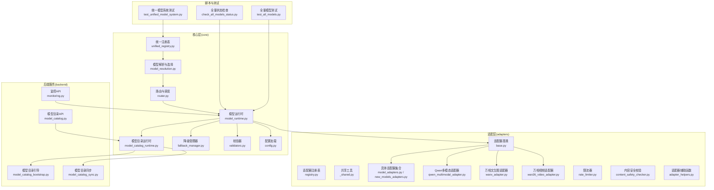
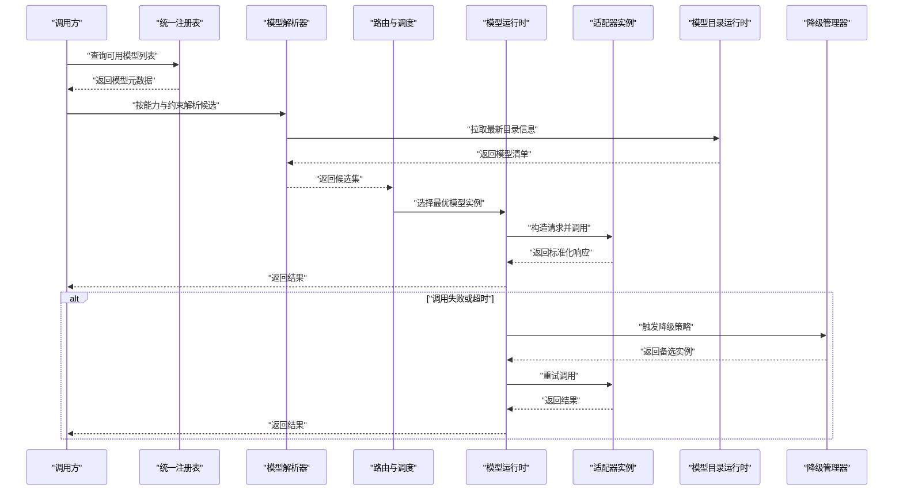
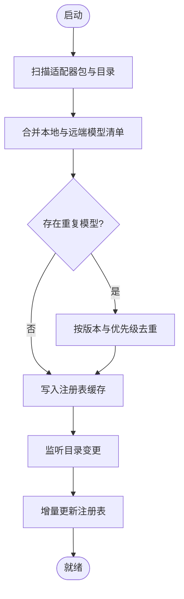
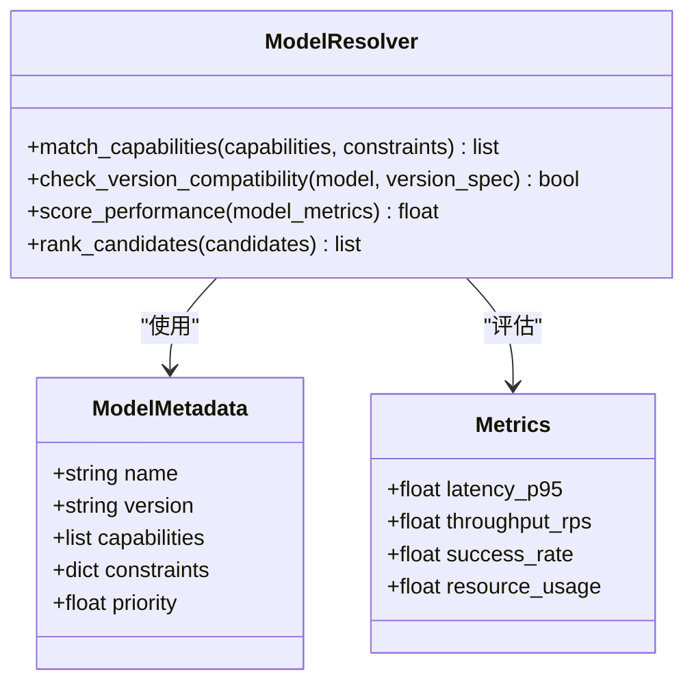
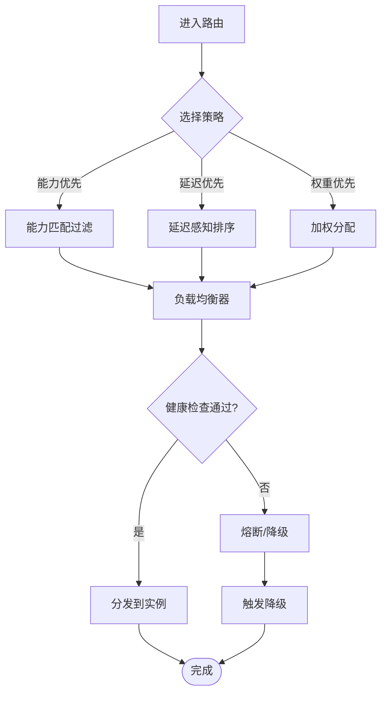
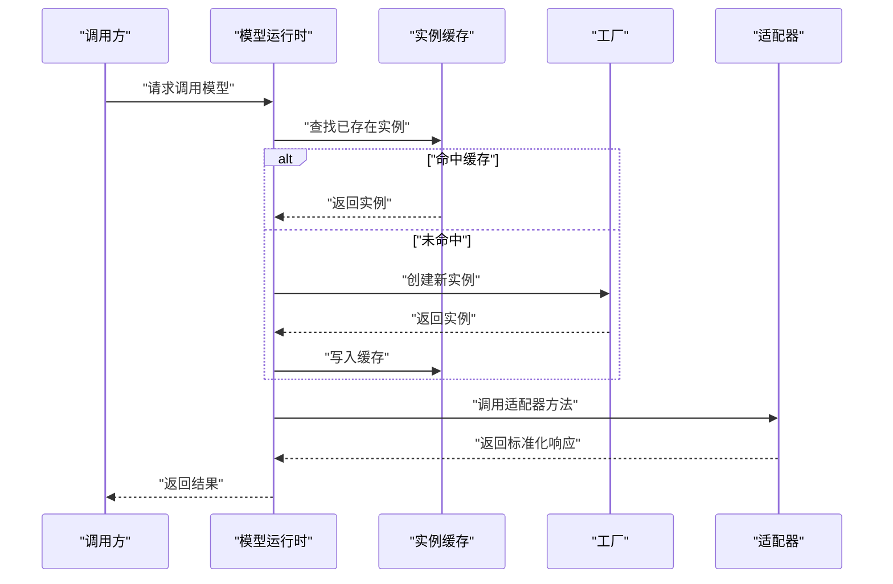
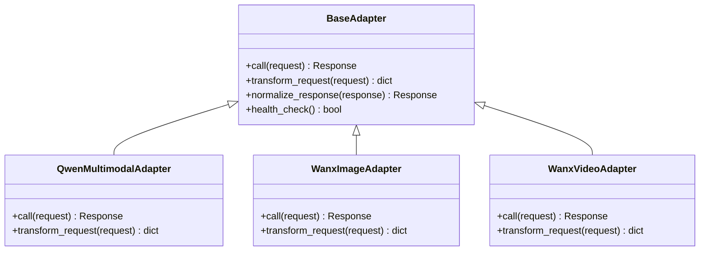
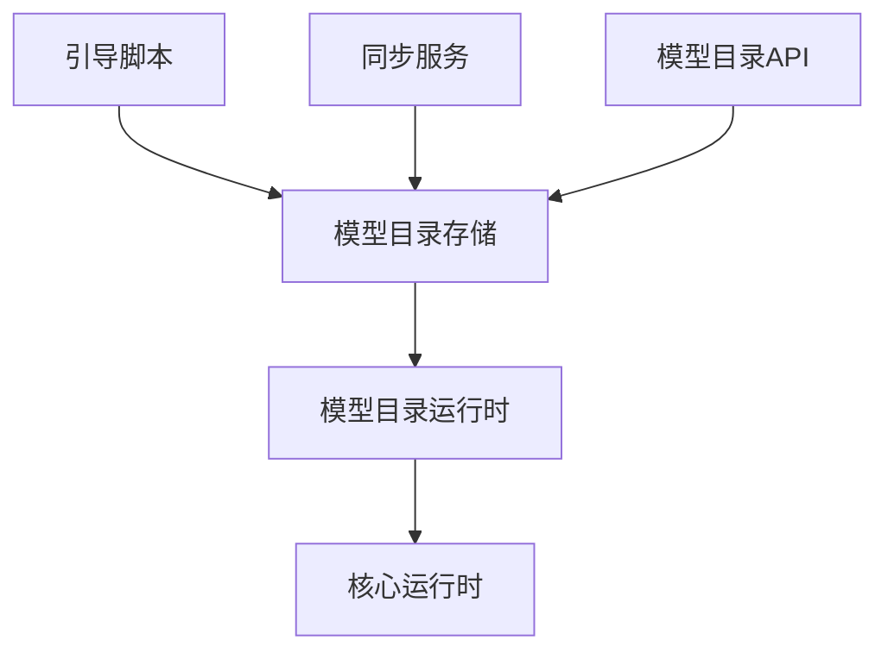
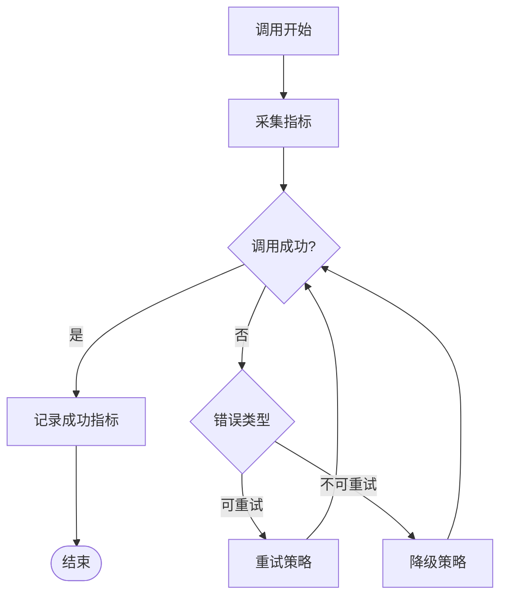
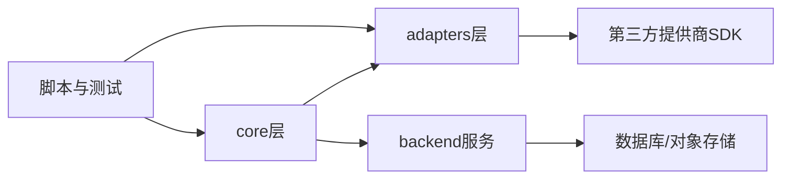

# 统一模型系统

<cite>
**本文引用的文件**   
- [core/unified_registry.py](file://core/unified_registry.py)
- [core/model_resolution.py](file://core/model_resolution.py)
- [core/router.py](file://core/router.py)
- [core/model_runtime.py](file://core/model_runtime.py)
- [adapters/registry.py](file://adapters/registry.py)
- [adapters/base.py](file://adapters/base.py)
- [adapters/_shared.py](file://adapters/_shared.py)
- [adapters/model_adapters.py](file://adapters/model_adapters.py)
- [adapters/new_models_adapters.py](file://adapters/new_models_adapters.py)
- [adapters/qwen_multimodal_adapter.py](file://adapters/qwen_multimodal_adapter.py)
- [adapters/wanx_adapter.py](file://adapters/wanx_adapter.py)
- [adapters/wan26_video_adapter.py](file://adapters/wan26_video_adapter.py)
- [adapters/rate_limiter.py](file://adapters/rate_limiter.py)
- [adapters/content_safety_checker.py](file://adapters/content_safety_checker.py)
- [adapters/adapter_helpers.py](file://adapters/adapter_helpers.py)
- [core/model_hub.py](file://core/model_hub.py)
- [core/model_catalog_runtime.py](file://core/model_catalog_runtime.py)
- [core/fallback_manager.py](file://core/fallback_manager.py)
- [core/validators.py](file://core/validators.py)
- [core/config.py](file://core/config.py)
- [backend/app/services/model_catalog_bootstrap.py](file://backend/app/services/model_catalog_bootstrap.py)
- [backend/app/services/model_catalog_sync.py](file://backend/app/services/model_catalog_sync.py)
- [backend/app/api/v1/model_catalog.py](file://backend/app/api/v1/model_catalog.py)
- [backend/app/api/v1/monitoring.py](file://backend/app/api/v1/monitoring.py)
- [scripts/check_all_models_status.py](file://scripts/check_all_models_status.py)
- [scripts/test_all_models.py](file://scripts/test_all_models.py)
- [tests/test_unified_model_system.py](file://tests/test_unified_model_system.py)
</cite>

## 目录
1. [简介](#简介)
2. [项目结构](#项目结构)
3. [核心组件](#核心组件)
4. [架构总览](#架构总览)
5. [详细组件分析](#详细组件分析)
6. [依赖关系分析](#依赖关系分析)
7. [性能考量](#性能考量)
8. [故障排查指南](#故障排查指南)
9. [结论](#结论)
10. [附录](#附录)

## 简介
本文件面向小说创作代理系统的“统一模型系统”，系统性阐述其核心架构与实现要点，包括：
- 模型注册机制与动态发现算法
- 智能路由选择与负载均衡策略
- 模型解析器（能力检测、版本兼容性检查、性能评估）
- 模型工厂（实例化、缓存管理、生命周期控制）
- 模型适配器抽象接口（统一调用、参数转换、响应处理）
- 监控指标、错误恢复与可观测性
- 实践示例：注册新模型、配置优先级、处理故障

该文档旨在帮助开发者快速理解并扩展统一模型系统，同时为运维与测试提供可操作的指导。

## 项目结构
统一模型系统横跨 core、adapters、backend 与 scripts/tests 等模块，采用分层与插件化设计：
- core：统一注册表、路由、运行时、模型目录运行时、降级与校验等
- adapters：适配器基类、共享工具、具体适配器实现、限流与安全校验
- backend：模型目录的启动引导、同步服务与 API
- scripts/tests：健康检查、全量测试与回归用例

图示来源
- [core/unified_registry.py:1-200](file://core/unified_registry.py#L1-L200)
- [core/model_resolution.py:1-200](file://core/model_resolution.py#L1-L200)
- [core/router.py:1-200](file://core/router.py#L1-L200)
- [core/model_runtime.py:1-200](file://core/model_runtime.py#L1-L200)
- [adapters/base.py:1-200](file://adapters/base.py#L1-L200)
- [adapters/registry.py:1-200](file://adapters/registry.py#L1-L200)
- [adapters/model_adapters.py:1-200](file://adapters/model_adapters.py#L1-L200)
- [adapters/new_models_adapters.py:1-200](file://adapters/new_models_adapters.py#L1-L200)
- [adapters/qwen_multimodal_adapter.py:1-200](file://adapters/qwen_multimodal_adapter.py#L1-L200)
- [adapters/wanx_adapter.py:1-200](file://adapters/wanx_adapter.py#L1-L200)
- [adapters/wan26_video_adapter.py:1-200](file://adapters/wan26_video_adapter.py#L1-L200)
- [adapters/rate_limiter.py:1-200](file://adapters/rate_limiter.py#L1-L200)
- [adapters/content_safety_checker.py:1-200](file://adapters/content_safety_checker.py#L1-L200)
- [adapters/adapter_helpers.py:1-200](file://adapters/adapter_helpers.py#L1-L200)
- [core/model_catalog_runtime.py:1-200](file://core/model_catalog_runtime.py#L1-L200)
- [core/fallback_manager.py:1-200](file://core/fallback_manager.py#L1-L200)
- [core/validators.py:1-200](file://core/validators.py#L1-L200)
- [core/config.py:1-200](file://core/config.py#L1-L200)
- [backend/app/services/model_catalog_bootstrap.py:1-200](file://backend/app/services/model_catalog_bootstrap.py#L1-L200)
- [backend/app/services/model_catalog_sync.py:1-200](file://backend/app/services/model_catalog_sync.py#L1-L200)
- [backend/app/api/v1/model_catalog.py:1-200](file://backend/app/api/v1/model_catalog.py#L1-L200)
- [backend/app/api/v1/monitoring.py:1-200](file://backend/app/api/v1/monitoring.py#L1-L200)
- [scripts/check_all_models_status.py:1-200](file://scripts/check_all_models_status.py#L1-L200)
- [scripts/test_all_models.py:1-200](file://scripts/test_all_models.py#L1-L200)
- [tests/test_unified_model_system.py:1-200](file://tests/test_unified_model_system.py#L1-L200)

章节来源
- [core/unified_registry.py:1-200](file://core/unified_registry.py#L1-L200)
- [adapters/base.py:1-200](file://adapters/base.py#L1-L200)
- [core/model_runtime.py:1-200](file://core/model_runtime.py#L1-L200)
- [backend/app/api/v1/model_catalog.py:1-200](file://backend/app/api/v1/model_catalog.py#L1-L200)

## 核心组件
本节聚焦统一模型系统的核心构件及其职责边界：
- 统一注册表：集中维护模型元数据、能力标签、优先级与权重，支持动态发现与热更新
- 模型解析器：基于能力标签与约束进行匹配，执行版本兼容性与性能评估
- 路由与调度：根据上下文、负载与健康度选择最优模型实例
- 模型运行时：封装实例化、缓存、生命周期、重试与降级
- 适配器基类与具体实现：定义统一调用接口、参数转换与响应归一化
- 模型目录运行时：对接后端模型目录服务，提供查询、同步与引导能力
- 降级管理器：在失败或不可用时自动切换备选模型
- 校验器与配置：输入输出校验、环境配置加载与校验

章节来源
- [core/unified_registry.py:1-200](file://core/unified_registry.py#L1-L200)
- [core/model_resolution.py:1-200](file://core/model_resolution.py#L1-L200)
- [core/router.py:1-200](file://core/router.py#L1-L200)
- [core/model_runtime.py:1-200](file://core/model_runtime.py#L1-L200)
- [adapters/base.py:1-200](file://adapters/base.py#L1-L200)
- [adapters/registry.py:1-200](file://adapters/registry.py#L1-L200)
- [core/model_catalog_runtime.py:1-200](file://core/model_catalog_runtime.py#L1-L200)
- [core/fallback_manager.py:1-200](file://core/fallback_manager.py#L1-L200)
- [core/validators.py:1-200](file://core/validators.py#L1-L200)
- [core/config.py:1-200](file://core/config.py#L1-L200)

## 架构总览
统一模型系统以“注册—解析—路由—运行时—适配器”为主线，结合“模型目录运行时”和“降级管理器”形成高可用闭环。

图示来源
- [core/unified_registry.py:1-200](file://core/unified_registry.py#L1-L200)
- [core/model_resolution.py:1-200](file://core/model_resolution.py#L1-L200)
- [core/router.py:1-200](file://core/router.py#L1-L200)
- [core/model_runtime.py:1-200](file://core/model_runtime.py#L1-L200)
- [adapters/base.py:1-200](file://adapters/base.py#L1-L200)
- [core/model_catalog_runtime.py:1-200](file://core/model_catalog_runtime.py#L1-L200)
- [core/fallback_manager.py:1-200](file://core/fallback_manager.py#L1-L200)

## 详细组件分析

### 统一注册表与动态发现
- 职责
  - 维护模型元数据（名称、版本、能力标签、权重、优先级）
  - 支持动态发现：扫描适配器包、读取模型目录、合并本地与远端清单
  - 提供查询接口：按能力、版本、标签筛选；按优先级排序
- 关键点
  - 动态发现算法：基于包导入与注解/约定式注册，增量更新避免全量重扫
  - 冲突解决：同名模型按版本号与优先级决定生效实例
  - 热更新：监听目录变更事件，触发增量刷新

图示来源
- [core/unified_registry.py:1-200](file://core/unified_registry.py#L1-L200)
- [adapters/registry.py:1-200](file://adapters/registry.py#L1-L200)
- [core/model_catalog_runtime.py:1-200](file://core/model_catalog_runtime.py#L1-L200)

章节来源
- [core/unified_registry.py:1-200](file://core/unified_registry.py#L1-L200)
- [adapters/registry.py:1-200](file://adapters/registry.py#L1-L200)
- [core/model_catalog_runtime.py:1-200](file://core/model_catalog_runtime.py#L1-L200)

### 模型解析器：能力检测、版本兼容与性能评估
- 能力检测
  - 基于能力标签（如文本生成、图像生成、视频生成、TTS、多模态）匹配
  - 支持细粒度能力组合与互斥规则
- 版本兼容性
  - 语义化版本比较，确保最小/最大版本约束满足
  - 向后兼容策略与弃用标记处理
- 性能评估
  - 基于历史延迟、吞吐、成功率与资源占用评分
  - 动态权重调整，结合实时健康度

图示来源
- [core/model_resolution.py:1-200](file://core/model_resolution.py#L1-L200)

章节来源
- [core/model_resolution.py:1-200](file://core/model_resolution.py#L1-L200)

### 智能路由与负载均衡
- 路由策略
  - 基于能力匹配、版本约束、用户偏好与业务场景选择
  - 支持灰度发布与影子流量
- 负载均衡
  - 轮询、加权轮询、最少连接、延迟感知
  - 健康检查与熔断：剔除异常实例，快速恢复

图示来源
- [core/router.py:1-200](file://core/router.py#L1-L200)
- [core/fallback_manager.py:1-200](file://core/fallback_manager.py#L1-L200)

章节来源
- [core/router.py:1-200](file://core/router.py#L1-L200)
- [core/fallback_manager.py:1-200](file://core/fallback_manager.py#L1-L200)

### 模型运行时：实例化、缓存与生命周期
- 实例化
  - 懒加载与预初始化两种模式
  - 参数校验与默认值填充
- 缓存管理
  - 按模型ID与参数指纹缓存实例
  - TTL与LRU策略，内存与磁盘双级缓存
- 生命周期控制
  - 优雅关闭、资源释放、连接池回收
  - 监控埋点：创建、销毁、复用次数

图示来源
- [core/model_runtime.py:1-200](file://core/model_runtime.py#L1-L200)

章节来源
- [core/model_runtime.py:1-200](file://core/model_runtime.py#L1-L200)

### 适配器抽象接口与实现
- 抽象接口
  - 统一调用入口：文本、图像、视频、TTS等多模态能力
  - 参数转换：将通用请求转换为各提供商特定格式
  - 响应处理：统一错误码、日志、追踪与指标上报
- 具体实现
  - Qwen多模态适配器、万相文生图/视频适配器、其他第三方适配器
  - 限流器与安全校验作为横切关注点集成

图示来源
- [adapters/base.py:1-200](file://adapters/base.py#L1-L200)
- [adapters/qwen_multimodal_adapter.py:1-200](file://adapters/qwen_multimodal_adapter.py#L1-L200)
- [adapters/wanx_adapter.py:1-200](file://adapters/wanx_adapter.py#L1-L200)
- [adapters/wan26_video_adapter.py:1-200](file://adapters/wan26_video_adapter.py#L1-L200)

章节来源
- [adapters/base.py:1-200](file://adapters/base.py#L1-L200)
- [adapters/qwen_multimodal_adapter.py:1-200](file://adapters/qwen_multimodal_adapter.py#L1-L200)
- [adapters/wanx_adapter.py:1-200](file://adapters/wanx_adapter.py#L1-L200)
- [adapters/wan26_video_adapter.py:1-200](file://adapters/wan26_video_adapter.py#L1-L200)

### 模型目录运行时与后端服务
- 模型目录运行时
  - 聚合本地与远端模型清单，提供查询与同步接口
  - 支持增量同步与冲突合并
- 后端服务
  - 引导脚本：初始化模型目录卡片与验证数据
  - 同步服务：定时拉取远端目录，更新本地缓存
  - API：对外暴露模型目录查询与管理接口

图示来源
- [backend/app/services/model_catalog_bootstrap.py:1-200](file://backend/app/services/model_catalog_bootstrap.py#L1-L200)
- [backend/app/services/model_catalog_sync.py:1-200](file://backend/app/services/model_catalog_sync.py#L1-L200)
- [backend/app/api/v1/model_catalog.py:1-200](file://backend/app/api/v1/model_catalog.py#L1-L200)
- [core/model_catalog_runtime.py:1-200](file://core/model_catalog_runtime.py#L1-L200)

章节来源
- [backend/app/services/model_catalog_bootstrap.py:1-200](file://backend/app/services/model_catalog_bootstrap.py#L1-L200)
- [backend/app/services/model_catalog_sync.py:1-200](file://backend/app/services/model_catalog_sync.py#L1-L200)
- [backend/app/api/v1/model_catalog.py:1-200](file://backend/app/api/v1/model_catalog.py#L1-L200)
- [core/model_catalog_runtime.py:1-200](file://core/model_catalog_runtime.py#L1-L200)

### 监控、指标与错误恢复
- 监控指标
  - 调用成功率、延迟分布、吞吐、资源占用、错误类型统计
  - 适配器健康检查与熔断状态
- 错误恢复
  - 重试策略：指数退避、幂等性保障
  - 降级策略：备选模型切换、功能降级（如高清转标清）
  - 告警与自愈：阈值告警、自动重启与扩容

图示来源
- [backend/app/api/v1/monitoring.py:1-200](file://backend/app/api/v1/monitoring.py#L1-L200)
- [core/fallback_manager.py:1-200](file://core/fallback_manager.py#L1-L200)
- [adapters/rate_limiter.py:1-200](file://adapters/rate_limiter.py#L1-L200)
- [adapters/content_safety_checker.py:1-200](file://adapters/content_safety_checker.py#L1-L200)

章节来源
- [backend/app/api/v1/monitoring.py:1-200](file://backend/app/api/v1/monitoring.py#L1-L200)
- [core/fallback_manager.py:1-200](file://core/fallback_manager.py#L1-L200)
- [adapters/rate_limiter.py:1-200](file://adapters/rate_limiter.py#L1-L200)
- [adapters/content_safety_checker.py:1-200](file://adapters/content_safety_checker.py#L1-L200)

## 依赖关系分析
统一模型系统内部依赖清晰，外部依赖主要为各模型提供商SDK与存储服务。

图示来源
- [core/unified_registry.py:1-200](file://core/unified_registry.py#L1-L200)
- [adapters/base.py:1-200](file://adapters/base.py#L1-L200)
- [backend/app/api/v1/model_catalog.py:1-200](file://backend/app/api/v1/model_catalog.py#L1-L200)
- [scripts/test_all_models.py:1-200](file://scripts/test_all_models.py#L1-L200)

章节来源
- [core/unified_registry.py:1-200](file://core/unified_registry.py#L1-L200)
- [adapters/base.py:1-200](file://adapters/base.py#L1-L200)
- [backend/app/api/v1/model_catalog.py:1-200](file://backend/app/api/v1/model_catalog.py#L1-L200)
- [scripts/test_all_models.py:1-200](file://scripts/test_all_models.py#L1-L200)

## 性能考量
- 缓存策略
  - 模型实例缓存减少冷启动开销
  - 请求参数指纹缓存提升命中率
- 并发与限流
  - 适配器层限流保护下游服务
  - 异步调用与连接池优化
- 资源隔离
  - 不同模型任务分进程/线程隔离
  - GPU/CPU资源配额与抢占
- 监控与调优
  - 关键路径埋点与分布式追踪
  - 基于指标的自动扩缩容

[本节为通用指导，不直接分析具体文件]

## 故障排查指南
- 常见问题
  - 模型无法发现：检查动态扫描与目录同步
  - 路由失败：核对能力标签与版本约束
  - 调用超时：查看限流与熔断状态
  - 响应异常：检查适配器参数转换与错误码映射
- 诊断工具
  - 全量状态检查脚本：批量探测模型健康
  - 全量模型测试：端到端验证调用链路
  - 监控API：实时查看指标与告警

章节来源
- [scripts/check_all_models_status.py:1-200](file://scripts/check_all_models_status.py#L1-L200)
- [scripts/test_all_models.py:1-200](file://scripts/test_all_models.py#L1-L200)
- [backend/app/api/v1/monitoring.py:1-200](file://backend/app/api/v1/monitoring.py#L1-L200)
- [adapters/rate_limiter.py:1-200](file://adapters/rate_limiter.py#L1-L200)
- [adapters/content_safety_checker.py:1-200](file://adapters/content_safety_checker.py#L1-L200)

## 结论
统一模型系统通过清晰的层次划分与插件化设计，实现了模型能力的统一管理、智能路由与高可用运行。借助模型目录运行时与降级管理器，系统在复杂环境下仍能保持稳定与高效。建议在生产环境中启用完善的监控与告警，并结合业务需求持续优化路由策略与缓存策略。

[本节为总结，不直接分析具体文件]

## 附录
- 实践示例
  - 注册新模型：在适配器包中实现具体适配器，并在注册表中声明能力与优先级
  - 配置模型优先级：通过模型目录或配置文件调整权重与版本约束
  - 处理模型故障：配置重试与降级策略，结合监控告警快速定位问题
- 参考文件
  - 统一注册表与解析器：core/unified_registry.py、core/model_resolution.py
  - 路由与运行时：core/router.py、core/model_runtime.py
  - 适配器基类与实现：adapters/base.py、adapters/model_adapters.py、adapters/new_models_adapters.py
  - 模型目录服务：backend/app/services/model_catalog_bootstrap.py、backend/app/services/model_catalog_sync.py、backend/app/api/v1/model_catalog.py
  - 监控与测试：backend/app/api/v1/monitoring.py、scripts/test_all_models.py、tests/test_unified_model_system.py

[本节为补充说明，不直接分析具体文件]