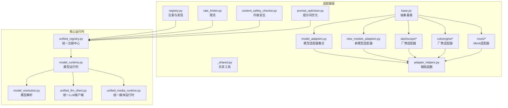
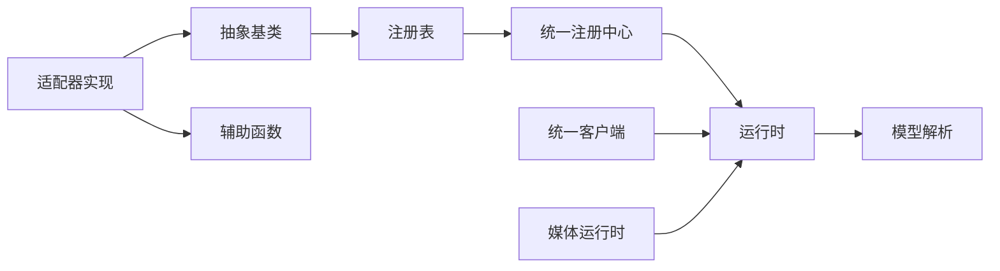

# 适配器管理

<cite>
**本文引用的文件**   
- [adapters/base.py](file://adapters/base.py)
- [adapters/registry.py](file://adapters/registry.py)
- [adapters/_shared.py](file://adapters/_shared.py)
- [adapters/adapter_helpers.py](file://adapters/adapter_helpers.py)
- [adapters/model_adapters.py](file://adapters/model_adapters.py)
- [adapters/new_models_adapters.py](file://adapters/new_models_adapters.py)
- [adapters/dashscope/chat.py](file://adapters/dashscope/chat.py)
- [adapters/volcengine/chat.py](file://adapters/volcengine/chat.py)
- [adapters/mock/llm.py](file://adapters/mock/llm.py)
- [core/unified_registry.py](file://core/unified_registry.py)
- [core/model_runtime.py](file://core/model_runtime.py)
- [core/model_resolution.py](file://core/model_resolution.py)
- [core/unified_llm_client.py](file://core/unified_llm_client.py)
- [core/unified_media_runtime.py](file://core/unified_media_runtime.py)
- [adapters/rate_limiter.py](file://adapters/rate_limiter.py)
- [adapters/content_safety_checker.py](file://adapters/content_safety_checker.py)
- [adapters/prompt_optimizer.py](file://adapters/prompt_optimizer.py)
- [adapters/wan26_video_adapter.py](file://adapters/wan26_video_adapter.py)
- [adapters/wanx_adapter.py](file://adapters/wanx_adapter.py)
</cite>

## 目录
1. [简介](#简介)
2. [项目结构](#项目结构)
3. [核心组件](#核心组件)
4. [架构总览](#架构总览)
5. [详细组件分析](#详细组件分析)
6. [依赖关系分析](#依赖关系分析)
7. [性能考量](#性能考量)
8. [故障排查指南](#故障排查指南)
9. [结论](#结论)
10. [附录：自定义适配器开发指南](#附录自定义适配器开发指南)

## 简介
本文件面向小说创作代理系统的“适配器管理系统”，系统性阐述适配器的注册机制、基类设计模式、发现算法、生命周期管理、协作机制，以及配置管理、错误处理与性能优化策略。文档同时提供自定义适配器的完整开发指南，帮助开发者快速扩展新的模型或媒体能力到统一运行时。

## 项目结构
适配器系统主要位于 adapters 目录，配合 core 层的统一运行时与注册中心，形成“插件化”的模型与媒体能力接入体系。关键目录与职责如下：
- adapters/base.py：定义适配器抽象基类与通用契约（输入输出、元数据、版本等）。
- adapters/registry.py：适配器注册表与发现逻辑（自动扫描、手动注册、条件加载）。
- adapters/_shared.py：跨适配器的共享工具与公共数据结构。
- adapters/adapter_helpers.py：适配器辅助函数（参数归一化、结果标准化、重试与超时封装等）。
- adapters/model_adapters.py / new_models_adapters.py：具体模型适配器的实现集合。
- core/unified_registry.py：全局统一注册中心，聚合各域适配器。
- core/model_runtime.py / model_resolution.py：运行时调度与模型解析策略。
- core/unified_llm_client.py / unified_media_runtime.py：统一的 LLM 与媒体运行时入口。
- 第三方厂商适配器示例：dashscope、volcengine、mock 等。
- 横切关注点：rate_limiter.py（限流）、content_safety_checker.py（内容安全）、prompt_optimizer.py（提示词优化）。



图表来源
- [adapters/base.py](file://adapters/base.py)
- [adapters/registry.py](file://adapters/registry.py)
- [adapters/_shared.py](file://adapters/_shared.py)
- [adapters/adapter_helpers.py](file://adapters/adapter_helpers.py)
- [adapters/model_adapters.py](file://adapters/model_adapters.py)
- [adapters/new_models_adapters.py](file://adapters/new_models_adapters.py)
- [adapters/dashscope/chat.py](file://adapters/dashscope/chat.py)
- [adapters/volcengine/chat.py](file://adapters/volcengine/chat.py)
- [adapters/mock/llm.py](file://adapters/mock/llm.py)
- [core/unified_registry.py](file://core/unified_registry.py)
- [core/model_runtime.py](file://core/model_runtime.py)
- [core/model_resolution.py](file://core/model_resolution.py)
- [core/unified_llm_client.py](file://core/unified_llm_client.py)
- [core/unified_media_runtime.py](file://core/unified_media_runtime.py)
- [adapters/rate_limiter.py](file://adapters/rate_limiter.py)
- [adapters/content_safety_checker.py](file://adapters/content_safety_checker.py)
- [adapters/prompt_optimizer.py](file://adapters/prompt_optimizer.py)

章节来源
- [adapters/base.py](file://adapters/base.py)
- [adapters/registry.py](file://adapters/registry.py)
- [core/unified_registry.py](file://core/unified_registry.py)
- [core/model_runtime.py](file://core/model_runtime.py)

## 核心组件
- 抽象基类与统一接口
  - 定义统一的调用签名、输入输出规范、元数据描述、版本标识、能力声明与生命周期钩子。
  - 通过抽象方法强制子类实现关键行为（如初始化、请求构建、响应解析、资源释放）。
- 注册与发现
  - 支持自动扫描模块、按命名约定注册；也支持显式 API 注册与条件加载（基于环境、配置或运行时特性）。
  - 提供版本兼容检查与优先级排序，确保多实现共存时的正确选择。
- 运行时与解析
  - 运行时负责实例化、缓存、上下文注入与并发控制；解析器根据模型 ID、能力标签与策略选择最佳实现。
- 辅助与横切
  - 辅助函数提供参数校验、格式转换、重试与超时、指标埋点等；限流、内容安全、提示词优化作为可插拔中间件。

章节来源
- [adapters/base.py](file://adapters/base.py)
- [adapters/registry.py](file://adapters/registry.py)
- [adapters/adapter_helpers.py](file://adapters/adapter_helpers.py)
- [core/model_runtime.py](file://core/model_runtime.py)
- [core/model_resolution.py](file://core/model_resolution.py)

## 架构总览
适配器系统采用“基类契约 + 注册中心 + 运行时调度”的分层架构。上层业务通过统一客户端调用，运行时依据模型解析策略选择具体适配器实现，并经由辅助与横切组件完成参数处理、限流、安全审查与结果标准化。

```mermaid
classDiagram
class 抽象适配器 {
+ "初始化(配置)"
+ "构建请求(输入)"
+ "发送请求()"
+ "解析响应(原始响应)"
+ "清理资源()"
+ "能力检查()"
+ "版本信息()"
}
class 注册表 {
+ "注册(名称, 实现类)"
+ "发现(路径/包)"
+ "获取(名称)"
+ "列表()"
+ "条件加载(规则)"
+ "版本匹配(目标版本)"
}
class 运行时 {
+ "解析(模型ID)"
+ "实例化(配置)"
+ "缓存(键, 实例)"
+ "并发控制(限制)"
+ "监控(指标)"
}
class 统一客户端 {
+ "调用(模型ID, 输入)"
+ "路由(策略)"
+ "聚合(并行结果)"
}
抽象适配器 <|-- "具体适配器实现"
注册表 --> 抽象适配器 : "管理生命周期"
运行时 --> 注册表 : "查找与实例化"
统一客户端 --> 运行时 : "委托调度"
```

图表来源
- [adapters/base.py](file://adapters/base.py)
- [adapters/registry.py](file://adapters/registry.py)
- [core/model_runtime.py](file://core/model_runtime.py)
- [core/unified_llm_client.py](file://core/unified_llm_client.py)

## 详细组件分析

### 抽象基类与统一接口
- 设计要点
  - 统一输入输出：定义标准化的请求体与响应体结构，屏蔽底层差异。
  - 抽象方法：强制实现初始化、请求构建、发送、响应解析、清理等关键步骤。
  - 能力与版本：声明支持的模型族、功能开关、最低/最高兼容版本。
  - 生命周期钩子：提供 before/after 回调，便于注入日志、指标与安全审查。
- 扩展点
  - 可选的异步实现、流式返回、重试策略、降级回退。
  - 可扩展的元数据字段，用于追踪调用链与计费。

章节来源
- [adapters/base.py](file://adapters/base.py)

### 注册与发现机制
- 动态加载
  - 自动扫描指定包或目录，按命名约定识别适配器模块并导入。
  - 支持懒加载，按需导入以减少启动开销。
- 依赖注入
  - 通过注册表注入配置、服务实例（如 HTTP 客户端、缓存、指标收集器）。
  - 支持工厂模式创建实例，避免硬编码依赖。
- 版本管理
  - 记录适配器版本与依赖要求，解析时进行兼容性校验。
  - 提供版本回退与优先选择策略，保证升级平滑。
- 条件加载
  - 基于环境变量、配置文件或运行时特性决定是否启用某适配器。
  - 支持按能力标签过滤，仅加载满足条件的实现。

章节来源
- [adapters/registry.py](file://adapters/registry.py)
- [core/unified_registry.py](file://core/unified_registry.py)

### 运行时与模型解析
- 运行时职责
  - 实例化与缓存适配器实例，减少重复创建成本。
  - 并发控制与资源隔离，防止过载。
  - 监控与指标上报，便于观测与告警。
- 模型解析策略
  - 根据模型 ID、能力标签、用户偏好与策略选择最优实现。
  - 支持多候选并行探测与择优返回。
  - 失败回退与降级策略，提高鲁棒性。

章节来源
- [core/model_runtime.py](file://core/model_runtime.py)
- [core/model_resolution.py](file://core/model_resolution.py)

### 统一客户端与媒体运行时
- 统一 LLM 客户端
  - 对外暴露一致的调用接口，内部委托运行时进行路由与执行。
  - 支持同步/异步调用、流式返回、批量处理。
- 统一媒体运行时
  - 对图像、音频、视频等多模态能力进行统一封装。
  - 提供参数归一化、结果标准化、错误映射与重试。

章节来源
- [core/unified_llm_client.py](file://core/unified_llm_client.py)
- [core/unified_media_runtime.py](file://core/unified_media_runtime.py)

### 具体适配器实现示例
- 厂商适配器
  - dashscope、volcengine 等厂商适配器遵循抽象基类契约，实现各自 API 的请求构建与响应解析。
  - 通过注册表注册，供运行时选择与调用。
- Mock 适配器
  - 提供本地模拟实现，便于开发与测试，无需真实网络调用。
- 视频适配器
  - wan26_video_adapter、wanx_adapter 针对特定视频生成能力进行适配。

章节来源
- [adapters/dashscope/chat.py](file://adapters/dashscope/chat.py)
- [adapters/volcengine/chat.py](file://adapters/volcengine/chat.py)
- [adapters/mock/llm.py](file://adapters/mock/llm.py)
- [adapters/wan26_video_adapter.py](file://adapters/wan26_video_adapter.py)
- [adapters/wanx_adapter.py](file://adapters/wanx_adapter.py)

### 辅助函数与横切关注点
- 辅助函数
  - 参数校验、格式转换、结果标准化、重试与超时封装、指标埋点。
- 限流
  - 基于令牌桶或漏桶算法，保护后端服务不被压垮。
- 内容安全
  - 在调用前后进行敏感内容检测与过滤。
- 提示词优化
  - 对输入提示词进行结构化增强与去噪，提升生成质量。

章节来源
- [adapters/adapter_helpers.py](file://adapters/adapter_helpers.py)
- [adapters/rate_limiter.py](file://adapters/rate_limiter.py)
- [adapters/content_safety_checker.py](file://adapters/content_safety_checker.py)
- [adapters/prompt_optimizer.py](file://adapters/prompt_optimizer.py)

## 依赖关系分析
适配器系统与核心运行时之间的依赖关系清晰分层：
- 适配器层依赖抽象基类与辅助函数，不直接耦合运行时细节。
- 运行时依赖注册表进行实例化与查找，依赖解析器进行策略选择。
- 统一客户端与媒体运行时作为对外门面，屏蔽内部复杂性。



图表来源
- [adapters/base.py](file://adapters/base.py)
- [adapters/registry.py](file://adapters/registry.py)
- [core/unified_registry.py](file://core/unified_registry.py)
- [core/model_runtime.py](file://core/model_runtime.py)
- [core/model_resolution.py](file://core/model_resolution.py)
- [core/unified_llm_client.py](file://core/unified_llm_client.py)
- [core/unified_media_runtime.py](file://core/unified_media_runtime.py)

章节来源
- [adapters/_shared.py](file://adapters/_shared.py)
- [adapters/adapter_helpers.py](file://adapters/adapter_helpers.py)

## 性能考量
- 启动优化
  - 延迟加载与按需导入，减少冷启动时间。
  - 预注册常用适配器，避免运行时扫描开销。
- 运行时优化
  - 实例缓存与连接池复用，降低创建与握手成本。
  - 并发控制与背压，防止资源耗尽。
  - 批处理与合并请求，提升吞吐。
- 网络与 I/O
  - 超时与重试策略调优，平衡成功率与延迟。
  - 压缩与流式传输，减少带宽占用。
- 监控与可观测性
  - 指标采集与链路追踪，定位瓶颈与异常。
  - 告警阈值与自动恢复，保障稳定性。

[本节为通用指导，不直接分析具体文件]

## 故障排查指南
- 常见问题
  - 适配器未注册：检查自动扫描路径与命名约定，确认显式注册调用。
  - 版本不兼容：查看版本声明与解析策略，必要时回退或升级。
  - 依赖缺失：确认外部库安装与环境变量配置。
  - 网络超时：调整超时与重试参数，检查后端可用性。
- 调试技巧
  - 启用详细日志与指标，观察调用链与耗时分布。
  - 使用 Mock 适配器验证流程，隔离外部依赖问题。
  - 逐步缩小范围，定位是参数、网络还是解析问题。
- 恢复策略
  - 降级到备用实现或本地缓存。
  - 熔断与隔离，防止级联故障。
  - 自动重启与自愈，提升可用性。

章节来源
- [adapters/registry.py](file://adapters/registry.py)
- [core/model_runtime.py](file://core/model_runtime.py)
- [adapters/adapter_helpers.py](file://adapters/adapter_helpers.py)

## 结论
适配器管理系统通过抽象基类、注册中心与运行时调度，实现了高内聚、低耦合的插件化架构。开发者可快速扩展新的模型与媒体能力，系统提供完善的生命周期管理、错误处理与性能优化策略，保障稳定高效的运行。

[本节为总结，不直接分析具体文件]

## 附录：自定义适配器开发指南
- 接口实现
  - 继承抽象基类，实现必需方法（初始化、请求构建、发送、响应解析、清理）。
  - 声明能力与版本信息，确保与运行时兼容。
- 注册与发现
  - 将适配器模块放入扫描路径，或通过注册 API 显式注册。
  - 使用条件加载规则，按环境或配置启用。
- 配置管理
  - 从配置源读取密钥、端点、超时等参数，并进行校验。
  - 支持热更新与动态重载。
- 测试方法
  - 使用 Mock 适配器验证流程与边界条件。
  - 编写单元测试与集成测试，覆盖成功、失败与超时场景。
- 部署步骤
  - 打包适配器模块，发布到依赖仓库或直接部署。
  - 更新注册表与运行时配置，重启服务生效。
- 错误处理
  - 捕获并转换底层异常为统一错误码与消息。
  - 实现重试、回退与熔断策略。
- 性能优化
  - 使用连接池与缓存，减少重复开销。
  - 启用批处理与流式传输，提升吞吐。
  - 采集指标与日志，持续优化。

章节来源
- [adapters/base.py](file://adapters/base.py)
- [adapters/registry.py](file://adapters/registry.py)
- [adapters/adapter_helpers.py](file://adapters/adapter_helpers.py)
- [core/model_runtime.py](file://core/model_runtime.py)
- [core/model_resolution.py](file://core/model_resolution.py)