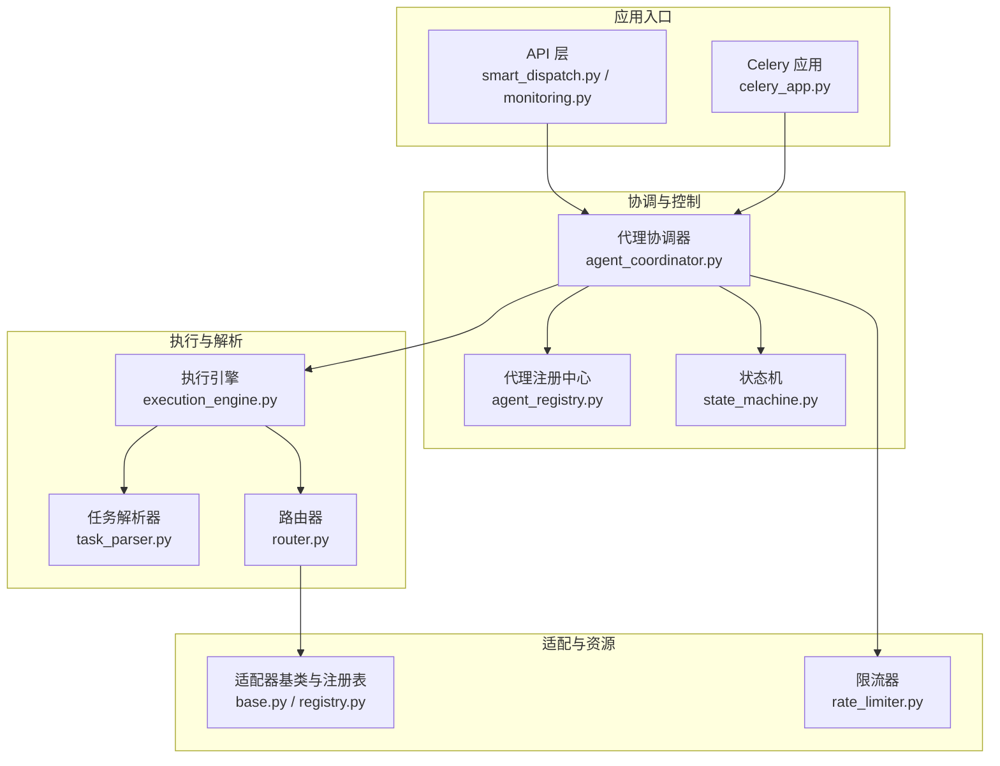
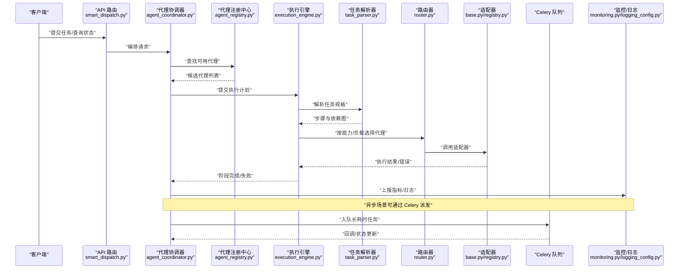
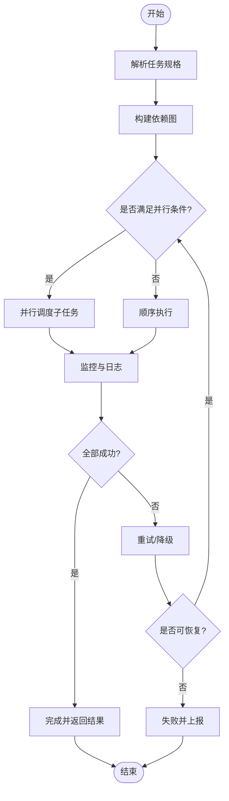
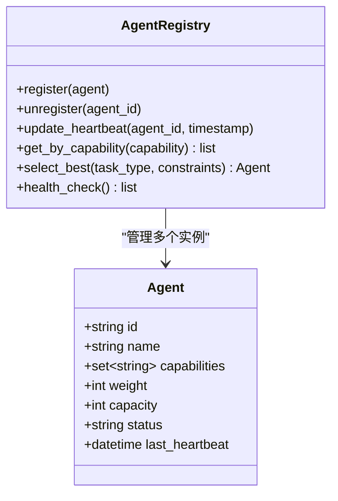
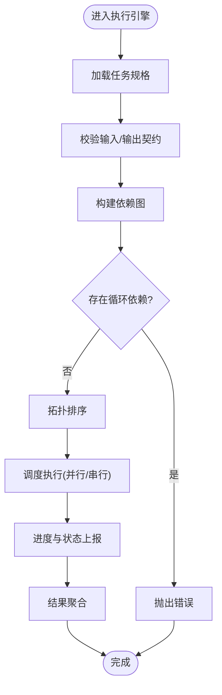
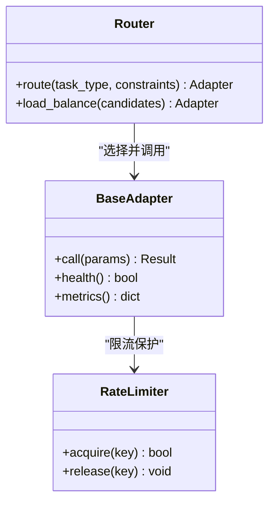
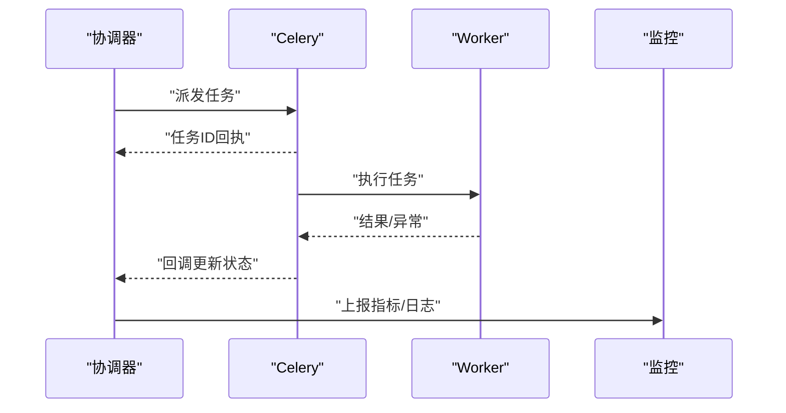
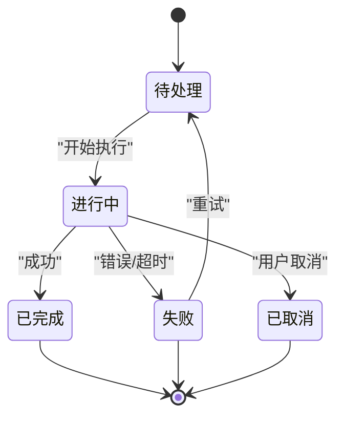
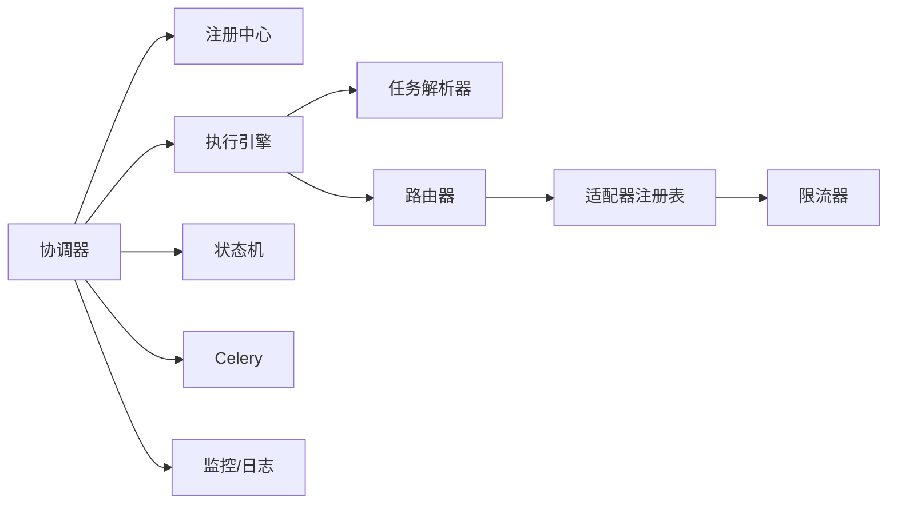

# 代理协调器

<cite>
**本文引用的文件**   
- [agent_coordinator.py](file://agent_coordinator.py)
- [split_agent_coordinator.py](file://split_agent_coordinator.py)
- [backend/app/services/agent_coordinator.py](file://backend/app/services/agent_coordinator.py)
- [backend/app/services/agent_registry.py](file://backend/app/services/agent_registry.py)
- [core/execution_engine.py](file://core/execution_engine.py)
- [core/task_parser.py](file://core/task_parser.py)
- [core/router.py](file://core/router.py)
- [adapters/base.py](file://adapters/base.py)
- [adapters/registry.py](file://adapters/registry.py)
- [adapters/_shared.py](file://adapters/_shared.py)
- [adapters/rate_limiter.py](file://adapters/rate_limiter.py)
- [backend/app/celery_app.py](file://backend/app/celery_app.py)
- [backend/app/tasks/dreamweaver_tasks.py](file://backend/app/tasks/dreamweaver_tasks.py)
- [backend/app/api/v1/smart_dispatch.py](file://backend/app/api/v1/smart_dispatch.py)
- [backend/app/api/v1/monitoring.py](file://backend/app/api/v1/monitoring.py)
- [core/logging_config.py](file://core/logging_config.py)
- [core/config.py](file://core/config.py)
- [schemas/task_spec.py](file://schemas/task_spec.py)
- [pipeline/state_machine.py](file://pipeline/state_machine.py)
</cite>

## 目录
1. [简介](#简介)
2. [项目结构](#项目结构)
3. [核心组件](#核心组件)
4. [架构总览](#架构总览)
5. [详细组件分析](#详细组件分析)
6. [依赖关系分析](#依赖关系分析)
7. [性能考量](#性能考量)
8. [故障排查指南](#故障排查指南)
9. [结论](#结论)
10. [附录](#附录)

## 简介
本技术文档围绕“代理协调器”展开，系统阐述多代理协作架构的设计理念与实现要点。内容涵盖：
- 代理生命周期管理、任务分发机制与状态同步策略
- 代理间通信协议（消息格式、事件驱动模式、异步处理）
- 负载均衡算法（基于能力的路由、负载感知调度、故障恢复）
- 执行引擎工作流（任务解析、依赖分析、并行执行）
- 监控与日志记录机制
- 实践示例：创建新代理、定义任务流程、异常处理

## 项目结构
本项目采用分层与模块化组织方式，关键目录与职责如下：
- core：通用能力（执行引擎、任务解析、路由、配置、日志等）
- adapters：外部模型/服务适配器与统一注册表
- backend/app/services：业务服务层（含代理协调器、代理注册中心等）
- backend/app/tasks：Celery 异步任务编排
- backend/app/api：HTTP API 暴露（智能分发、监控等）
- pipeline：流水线与状态机
- schemas：数据契约与规范

**图示来源** 
- [backend/app/api/v1/smart_dispatch.py](file://backend/app/api/v1/smart_dispatch.py)
- [backend/app/api/v1/monitoring.py](file://backend/app/api/v1/monitoring.py)
- [backend/app/celery_app.py](file://backend/app/celery_app.py)
- [agent_coordinator.py](file://agent_coordinator.py)
- [backend/app/services/agent_coordinator.py](file://backend/app/services/agent_coordinator.py)
- [backend/app/services/agent_registry.py](file://backend/app/services/agent_registry.py)
- [core/execution_engine.py](file://core/execution_engine.py)
- [core/task_parser.py](file://core/task_parser.py)
- [core/router.py](file://core/router.py)
- [adapters/base.py](file://adapters/base.py)
- [adapters/registry.py](file://adapters/registry.py)
- [adapters/rate_limiter.py](file://adapters/rate_limiter.py)
- [pipeline/state_machine.py](file://pipeline/state_machine.py)

**章节来源**
- [agent_coordinator.py](file://agent_coordinator.py)
- [backend/app/services/agent_coordinator.py](file://backend/app/services/agent_coordinator.py)
- [backend/app/services/agent_registry.py](file://backend/app/services/agent_registry.py)
- [core/execution_engine.py](file://core/execution_engine.py)
- [core/task_parser.py](file://core/task_parser.py)
- [core/router.py](file://core/router.py)
- [adapters/base.py](file://adapters/base.py)
- [adapters/registry.py](file://adapters/registry.py)
- [adapters/rate_limiter.py](file://adapters/rate_limiter.py)
- [backend/app/celery_app.py](file://backend/app/celery_app.py)
- [backend/app/api/v1/smart_dispatch.py](file://backend/app/api/v1/smart_dispatch.py)
- [backend/app/api/v1/monitoring.py](file://backend/app/api/v1/monitoring.py)
- [pipeline/state_machine.py](file://pipeline/state_machine.py)

## 核心组件
- 代理协调器（Agent Coordinator）
  - 负责代理生命周期（注册、发现、健康检查、销毁）、任务编排、状态同步与重试、跨代理事件广播。
  - 提供面向上层 API 的编排接口与面向 Celery 的异步执行入口。
- 代理注册中心（Agent Registry）
  - 维护代理元数据（能力标签、版本、权重、健康状态、容量配额），支持动态扩缩容与热更新。
- 执行引擎（Execution Engine）
  - 解析任务规格（TaskSpec），构建依赖图，进行拓扑排序与并行调度，跟踪执行进度与结果聚合。
- 任务解析器（Task Parser）
  - 将高层任务描述转换为可执行的步骤序列，校验约束条件，生成依赖边。
- 路由器（Router）
  - 根据任务类型与能力标签选择具体适配器或代理实例，支持权重与负载感知的路由策略。
- 适配器体系（Adapters）
  - 统一对外部模型/服务的调用接口，包含限流、重试、错误归一化与遥测埋点。
- 状态机（State Machine）
  - 定义任务与代理的状态转换规则，保证一致性与可恢复性。

**章节来源**
- [backend/app/services/agent_coordinator.py](file://backend/app/services/agent_coordinator.py)
- [backend/app/services/agent_registry.py](file://backend/app/services/agent_registry.py)
- [core/execution_engine.py](file://core/execution_engine.py)
- [core/task_parser.py](file://core/task_parser.py)
- [core/router.py](file://core/router.py)
- [adapters/base.py](file://adapters/base.py)
- [adapters/registry.py](file://adapters/registry.py)
- [adapters/rate_limiter.py](file://adapters/rate_limiter.py)
- [pipeline/state_machine.py](file://pipeline/state_machine.py)

## 架构总览
下图展示从请求到执行的关键路径：API/Celery 进入协调器，协调器通过注册中心发现代理，由执行引擎解析并调度任务，路由器选择适配器执行，状态机保障一致性，监控与日志贯穿全程。

**图示来源** 
- [backend/app/api/v1/smart_dispatch.py](file://backend/app/api/v1/smart_dispatch.py)
- [agent_coordinator.py](file://agent_coordinator.py)
- [backend/app/services/agent_coordinator.py](file://backend/app/services/agent_coordinator.py)
- [backend/app/services/agent_registry.py](file://backend/app/services/agent_registry.py)
- [core/execution_engine.py](file://core/execution_engine.py)
- [core/task_parser.py](file://core/task_parser.py)
- [core/router.py](file://core/router.py)
- [adapters/base.py](file://adapters/base.py)
- [adapters/registry.py](file://adapters/registry.py)
- [backend/app/celery_app.py](file://backend/app/celery_app.py)
- [backend/app/api/v1/monitoring.py](file://backend/app/api/v1/monitoring.py)
- [core/logging_config.py](file://core/logging_config.py)

## 详细组件分析

### 代理协调器（Agent Coordinator）
- 职责
  - 代理注册/注销、健康检查、容量与权重管理
  - 任务接收、分解、依赖分析与并行调度
  - 事件总线与状态同步（成功、失败、重试、超时）
  - 与 Celery 集成以支持异步与持久化任务
- 关键流程
  - 接收任务 -> 解析规格 -> 构建依赖图 -> 选择代理 -> 执行与聚合 -> 状态更新 -> 监控上报
- 异常与恢复
  - 重试策略（指数退避、最大次数）
  - 熔断与降级（切换备用代理/适配器）
  - 幂等与去重（任务ID、状态机回滚）

**图示来源** 
- [agent_coordinator.py](file://agent_coordinator.py)
- [backend/app/services/agent_coordinator.py](file://backend/app/services/agent_coordinator.py)
- [core/execution_engine.py](file://core/execution_engine.py)
- [core/task_parser.py](file://core/task_parser.py)
- [pipeline/state_machine.py](file://pipeline/state_machine.py)

**章节来源**
- [agent_coordinator.py](file://agent_coordinator.py)
- [backend/app/services/agent_coordinator.py](file://backend/app/services/agent_coordinator.py)
- [core/execution_engine.py](file://core/execution_engine.py)
- [core/task_parser.py](file://core/task_parser.py)
- [pipeline/state_machine.py](file://pipeline/state_machine.py)

### 代理注册中心（Agent Registry）
- 职责
  - 维护代理元数据（能力标签、版本、权重、健康状态、配额）
  - 动态发现与剔除不健康实例
  - 支持热更新与灰度发布
- 数据结构
  - 代理条目：ID、名称、能力集合、权重、容量、状态、最后心跳时间
  - 索引：按能力标签反向索引，加速路由选择
- 操作
  - 注册/注销、心跳更新、健康检查、容量调整、权重调优

**图示来源** 
- [backend/app/services/agent_registry.py](file://backend/app/services/agent_registry.py)

**章节来源**
- [backend/app/services/agent_registry.py](file://backend/app/services/agent_registry.py)

### 执行引擎（Execution Engine）
- 职责
  - 解析 TaskSpec，生成 DAG（有向无环图）
  - 拓扑排序与并行执行控制
  - 结果聚合、中间状态持久化、进度上报
- 关键点
  - 依赖分析：输入输出契约校验、循环依赖检测
  - 并行度控制：并发上限、资源隔离、背压
  - 容错：节点级重试、阶段回滚、补偿逻辑

**图示来源** 
- [core/execution_engine.py](file://core/execution_engine.py)
- [core/task_parser.py](file://core/task_parser.py)
- [schemas/task_spec.py](file://schemas/task_spec.py)

**章节来源**
- [core/execution_engine.py](file://core/execution_engine.py)
- [core/task_parser.py](file://core/task_parser.py)
- [schemas/task_spec.py](file://schemas/task_spec.py)

### 路由器与适配器（Router & Adapters）
- 路由器
  - 基于能力标签匹配、权重与负载感知的选择策略
  - 支持多目标路由（主备、灰度、A/B）
- 适配器
  - 统一接口封装外部模型/服务调用
  - 限流、重试、错误归一化、遥测埋点

**图示来源** 
- [core/router.py](file://core/router.py)
- [adapters/base.py](file://adapters/base.py)
- [adapters/registry.py](file://adapters/registry.py)
- [adapters/rate_limiter.py](file://adapters/rate_limiter.py)

**章节来源**
- [core/router.py](file://core/router.py)
- [adapters/base.py](file://adapters/base.py)
- [adapters/registry.py](file://adapters/registry.py)
- [adapters/rate_limiter.py](file://adapters/rate_limiter.py)

### 异步任务与事件驱动（Celery & Events）
- Celery 集成
  - 长耗时任务入队，回调更新协调器状态
  - 任务重试、死信队列、延迟任务
- 事件驱动
  - 协调器广播任务阶段事件（开始、完成、失败）
  - 订阅者（监控、审计、下游系统）消费事件

**图示来源** 
- [backend/app/celery_app.py](file://backend/app/celery_app.py)
- [backend/app/tasks/dreamweaver_tasks.py](file://backend/app/tasks/dreamweaver_tasks.py)
- [agent_coordinator.py](file://agent_coordinator.py)
- [backend/app/api/v1/monitoring.py](file://backend/app/api/v1/monitoring.py)

**章节来源**
- [backend/app/celery_app.py](file://backend/app/celery_app.py)
- [backend/app/tasks/dreamweaver_tasks.py](file://backend/app/tasks/dreamweaver_tasks.py)
- [agent_coordinator.py](file://agent_coordinator.py)
- [backend/app/api/v1/monitoring.py](file://backend/app/api/v1/monitoring.py)

### 状态同步与一致性（State Machine）
- 状态定义
  - 任务：待处理、进行中、已完成、失败、已取消
  - 代理：在线、离线、降级、维护中
- 转换规则
  - 严格的状态迁移约束，避免非法跳转
  - 持久化快照，支持断点续跑与回滚

**图示来源** 
- [pipeline/state_machine.py](file://pipeline/state_machine.py)

**章节来源**
- [pipeline/state_machine.py](file://pipeline/state_machine.py)

## 依赖关系分析
- 组件耦合
  - 协调器强依赖注册中心与执行引擎；执行引擎依赖任务解析器与路由器；路由器依赖适配器注册表与限流器。
- 外部依赖
  - Celery（异步队列）、数据库（持久化状态）、监控系统（指标与日志）
- 潜在环路
  - 通过接口解耦与事件总线避免循环依赖

**图示来源** 
- [agent_coordinator.py](file://agent_coordinator.py)
- [backend/app/services/agent_registry.py](file://backend/app/services/agent_registry.py)
- [core/execution_engine.py](file://core/execution_engine.py)
- [core/task_parser.py](file://core/task_parser.py)
- [core/router.py](file://core/router.py)
- [adapters/registry.py](file://adapters/registry.py)
- [adapters/rate_limiter.py](file://adapters/rate_limiter.py)
- [pipeline/state_machine.py](file://pipeline/state_machine.py)
- [backend/app/celery_app.py](file://backend/app/celery_app.py)
- [backend/app/api/v1/monitoring.py](file://backend/app/api/v1/monitoring.py)

**章节来源**
- [agent_coordinator.py](file://agent_coordinator.py)
- [backend/app/services/agent_registry.py](file://backend/app/services/agent_registry.py)
- [core/execution_engine.py](file://core/execution_engine.py)
- [core/task_parser.py](file://core/task_parser.py)
- [core/router.py](file://core/router.py)
- [adapters/registry.py](file://adapters/registry.py)
- [adapters/rate_limiter.py](file://adapters/rate_limiter.py)
- [pipeline/state_machine.py](file://pipeline/state_machine.py)
- [backend/app/celery_app.py](file://backend/app/celery_app.py)
- [backend/app/api/v1/monitoring.py](file://backend/app/api/v1/monitoring.py)

## 性能考量
- 并行度与资源隔离
  - 限制最大并发，避免资源争用；为不同代理/适配器设置独立线程池或进程池
- 负载均衡
  - 基于能力标签+权重+实时负载（CPU/内存/队列长度）的动态选择
- 缓存与复用
  - 对热点适配器连接、模型上下文进行缓存；减少重复初始化开销
- 限流与背压
  - 使用令牌桶/漏桶限流，防止上游过载；在队列堆积时主动降速
- I/O 优化
  - 批量请求、异步非阻塞 I/O、结果分页拉取

[本节为通用指导，无需特定文件引用]

## 故障排查指南
- 常见问题定位
  - 代理不健康：检查心跳、健康检查接口、资源占用与网络连通性
  - 任务卡住：查看状态机快照、依赖图、队列积压情况
  - 适配器报错：核对限流阈值、重试策略、错误码映射
- 监控与日志
  - 启用结构化日志，关联任务ID与代理ID
  - 关键指标：成功率、延迟分位、重试率、错误分布、队列长度
- 恢复策略
  - 自动重试与降级；必要时人工介入回滚与补偿

**章节来源**
- [backend/app/api/v1/monitoring.py](file://backend/app/api/v1/monitoring.py)
- [core/logging_config.py](file://core/logging_config.py)
- [adapters/rate_limiter.py](file://adapters/rate_limiter.py)
- [pipeline/state_machine.py](file://pipeline/state_machine.py)

## 结论
代理协调器通过清晰的职责划分与模块化解耦，实现了高内聚、低耦合的多代理协作体系。借助执行引擎的任务解析与依赖分析、路由器的负载感知选择、适配器体系的统一封装以及状态机的强一致性保障，系统在可扩展性、可靠性与可观测性方面具备良好基础。配合 Celery 异步能力与完善的监控日志，可满足复杂生产环境的稳定运行需求。

[本节为总结性内容，无需特定文件引用]

## 附录
- 实践示例（概念说明）
  - 创建新代理
    - 在注册中心登记代理元数据（能力标签、权重、容量）
    - 启动代理心跳与健康检查
  - 定义任务流程
    - 编写 TaskSpec，声明输入输出与依赖关系
    - 通过协调器提交执行计划
  - 异常处理
    - 配置重试策略与降级路径
    - 使用状态机进行回滚与补偿
- 参考文件
  - [schemas/task_spec.py](file://schemas/task_spec.py)
  - [backend/app/services/agent_registry.py](file://backend/app/services/agent_registry.py)
  - [core/execution_engine.py](file://core/execution_engine.py)
  - [core/router.py](file://core/router.py)
  - [adapters/base.py](file://adapters/base.py)
  - [pipeline/state_machine.py](file://pipeline/state_machine.py)

[本节为补充信息，无需特定文件引用]