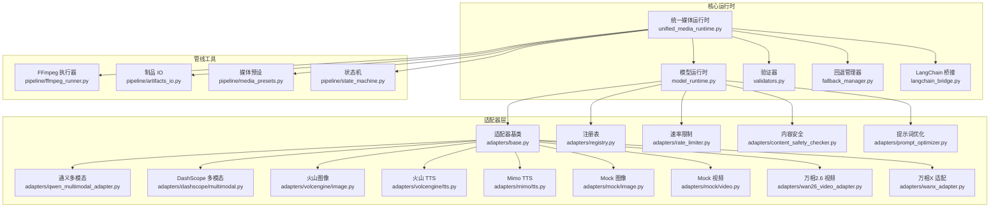
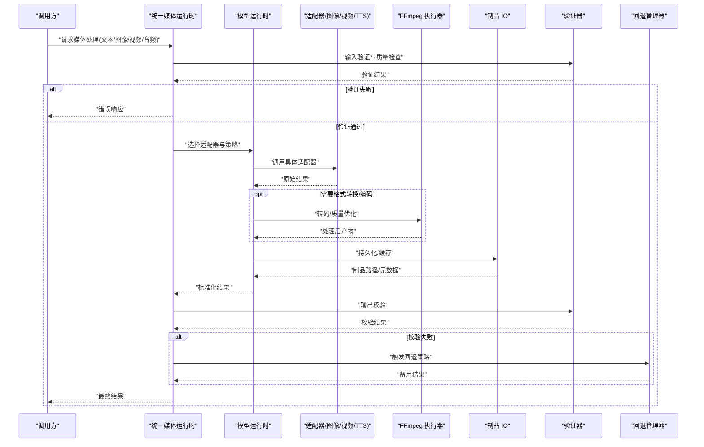
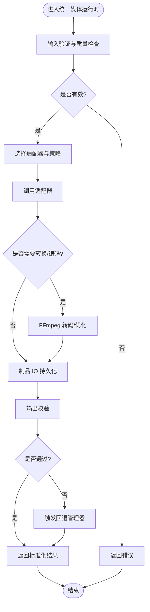
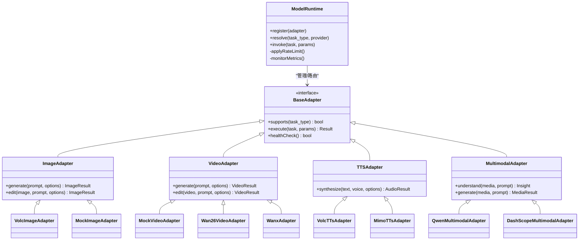
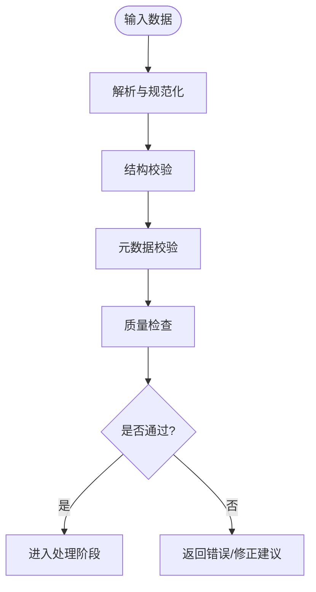
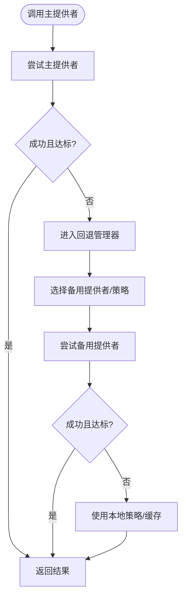
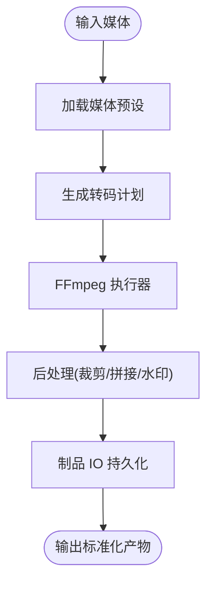
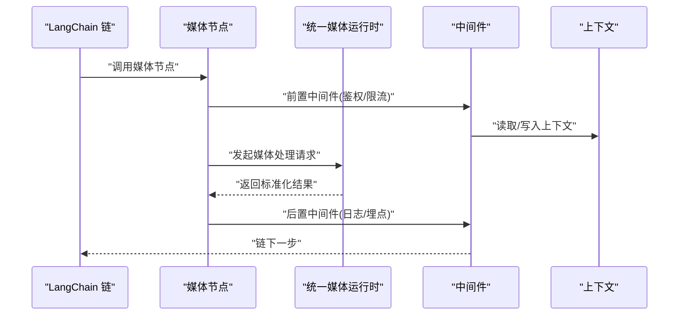
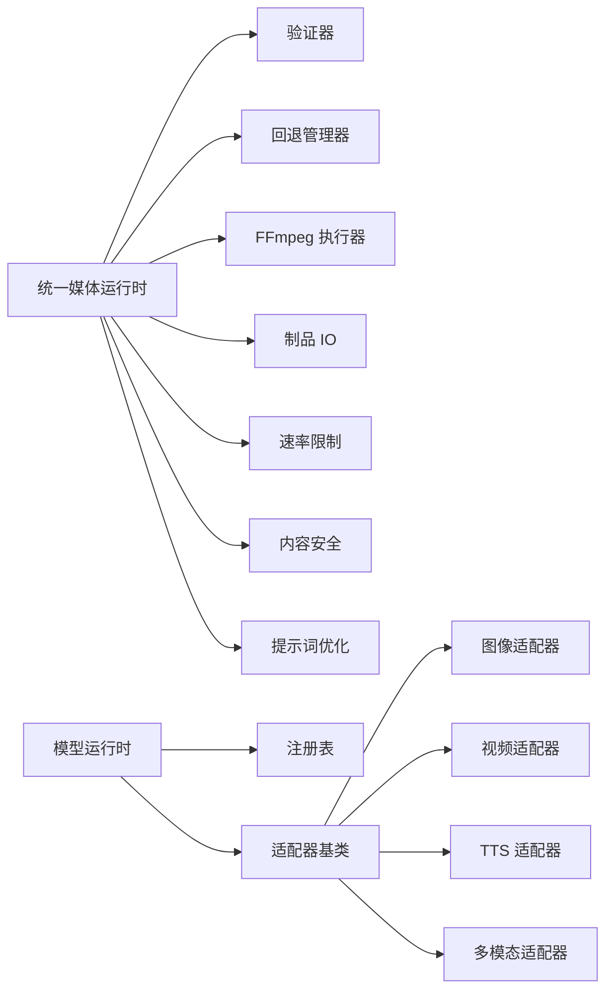

# 媒体运行时

<cite>
**本文引用的文件**   
- [unified_media_runtime.py](file://core/unified_media_runtime.py)
- [validators.py](file://core/validators.py)
- [fallback_manager.py](file://core/fallback_manager.py)
- [langchain_bridge.py](file://core/langchain_bridge.py)
- [model_runtime.py](file://core/model_runtime.py)
- [model_adapters.py](file://adapters/model_adapters.py)
- [base.py](file://adapters/base.py)
- [_shared.py](file://adapters/_shared.py)
- [registry.py](file://adapters/registry.py)
- [rate_limiter.py](file://adapters/rate_limiter.py)
- [ffmpeg_runner.py](file://pipeline/ffmpeg_runner.py)
- [artifacts_io.py](file://pipeline/artifacts_io.py)
- [media_presets.py](file://pipeline/media_presets.py)
- [state_machine.py](file://pipeline/state_machine.py)
- [qwen_multimodal_adapter.py](file://adapters/qwen_multimodal_adapter.py)
- [dashscope/multimodal.py](file://adapters/dashscope/multimodal.py)
- [volcengine/image.py](file://adapters/volcengine/image.py)
- [volcengine/tts.py](file://adapters/volcengine/tts.py)
- [mimo/tts.py](file://adapters/mimo/tts.py)
- [mock/image.py](file://adapters/mock/image.py)
- [mock/video.py](file://adapters/mock/video.py)
- [content_safety_checker.py](file://adapters/content_safety_checker.py)
- [prompt_optimizer.py](file://adapters/prompt_optimizer.py)
- [legacy_runtime_wrappers.py](file://adapters/legacy_runtime_wrappers.py)
- [new_models_adapters.py](file://adapters/new_models_adapters.py)
- [wan26_video_adapter.py](file://adapters/wan26_video_adapter.py)
- [wanx_adapter.py](file://adapters/wanx_adapter.py)
- [README.md](file://README.md)
</cite>

## 目录
1. [简介](#简介)
2. [项目结构](#项目结构)
3. [核心组件](#核心组件)
4. [架构总览](#架构总览)
5. [详细组件分析](#详细组件分析)
6. [依赖关系分析](#依赖关系分析)
7. [性能考量](#性能考量)
8. [故障排查指南](#故障排查指南)
9. [结论](#结论)
10. [附录：示例与最佳实践](#附录示例与最佳实践)

## 简介
本技术文档面向“媒体运行时系统”，聚焦多模态媒体的统一抽象、转换管道、回退管理、验证器体系以及与 LangChain 的集成。该系统为文本、图像、视频、音频提供标准化接口与数据格式，支持格式转换、质量优化与编码处理；内置服务降级、备用提供商选择与容错策略；通过验证器保障输入输出质量；并以链式调用、中间件与上下文管理的方式与 LangChain 无缝协作。

## 项目结构
媒体运行时由核心运行时、适配器层、管线工具与配置组成：
- 核心运行时：统一媒体运行时、模型运行时、验证器、回退管理器、LangChain 桥接等
- 适配器层：各厂商/协议的媒体能力适配（图像、视频、TTS、多模态）
- 管线工具：FFmpeg 执行、制品 IO、预设、状态机
- 配置与注册：模型注册、速率限制、内容安全、提示词优化等

图表来源
- [unified_media_runtime.py](file://core/unified_media_runtime.py)
- [model_runtime.py](file://core/model_runtime.py)
- [validators.py](file://core/validators.py)
- [fallback_manager.py](file://core/fallback_manager.py)
- [langchain_bridge.py](file://core/langchain_bridge.py)
- [base.py](file://adapters/base.py)
- [registry.py](file://adapters/registry.py)
- [rate_limiter.py](file://adapters/rate_limiter.py)
- [content_safety_checker.py](file://adapters/content_safety_checker.py)
- [prompt_optimizer.py](file://adapters/prompt_optimizer.py)
- [qwen_multimodal_adapter.py](file://adapters/qwen_multimodal_adapter.py)
- [dashscope/multimodal.py](file://adapters/dashscope/multimodal.py)
- [volcengine/image.py](file://adapters/volcengine/image.py)
- [volcengine/tts.py](file://adapters/volcengine/tts.py)
- [mimo/tts.py](file://adapters/mimo/tts.py)
- [mock/image.py](file://adapters/mock/image.py)
- [mock/video.py](file://adapters/mock/video.py)
- [wan26_video_adapter.py](file://adapters/wan26_video_adapter.py)
- [wanx_adapter.py](file://adapters/wanx_adapter.py)
- [ffmpeg_runner.py](file://pipeline/ffmpeg_runner.py)
- [artifacts_io.py](file://pipeline/artifacts_io.py)
- [media_presets.py](file://pipeline/media_presets.py)
- [state_machine.py](file://pipeline/state_machine.py)

章节来源
- [README.md](file://README.md)

## 核心组件
- 统一媒体运行时：对外暴露统一的媒体处理能力入口，负责编排验证、转换、编码、回退与结果校验。
- 模型运行时：管理与调度底层模型适配器，维护能力发现、路由与限流。
- 验证器系统：对输入参数、媒体元数据、输出内容进行结构化校验与质量检查。
- 回退管理器：在服务不可用或质量不达标时自动降级到备用提供商或本地策略。
- LangChain 桥接：将媒体能力封装为可被链式调用的节点，支持中间件与上下文传递。

章节来源
- [unified_media_runtime.py](file://core/unified_media_runtime.py)
- [model_runtime.py](file://core/model_runtime.py)
- [validators.py](file://core/validators.py)
- [fallback_manager.py](file://core/fallback_manager.py)
- [langchain_bridge.py](file://core/langchain_bridge.py)

## 架构总览
媒体运行时采用“统一入口 + 适配器矩阵 + 管线工具”的分层架构：
- 统一入口：统一媒体运行时屏蔽多模态差异，提供一致的 API。
- 适配器矩阵：按媒体类型与厂商实现具体能力，遵循基类契约。
- 管线工具：以 FFmpeg、制品 IO、预设与状态机支撑格式转换、质量优化与流程编排。
- 控制面：验证器、回退管理器、速率限制、内容安全、提示词优化贯穿全链路。

图表来源
- [unified_media_runtime.py](file://core/unified_media_runtime.py)
- [model_runtime.py](file://core/model_runtime.py)
- [ffmpeg_runner.py](file://pipeline/ffmpeg_runner.py)
- [artifacts_io.py](file://pipeline/artifacts_io.py)
- [validators.py](file://core/validators.py)
- [fallback_manager.py](file://core/fallback_manager.py)

## 详细组件分析

### 统一媒体运行时
- 职责：统一入口、流程编排、跨媒体类型的能力聚合、错误收敛与结果标准化。
- 关键流程：输入验证 → 适配器选择 → 调用 → 转换/编码 → 制品存储 → 输出校验 → 回退。
- 扩展点：新增媒体类型或厂商适配器时，仅需实现基类契约并在注册表中声明。

图表来源
- [unified_media_runtime.py](file://core/unified_media_runtime.py)
- [ffmpeg_runner.py](file://pipeline/ffmpeg_runner.py)
- [artifacts_io.py](file://pipeline/artifacts_io.py)
- [validators.py](file://core/validators.py)
- [fallback_manager.py](file://core/fallback_manager.py)

章节来源
- [unified_media_runtime.py](file://core/unified_media_runtime.py)

### 模型运行时与适配器矩阵
- 模型运行时：维护适配器注册表、能力探测、路由策略、速率限制与监控埋点。
- 适配器基类：定义统一的媒体处理接口（如图像生成/编辑、视频生成/编辑、TTS、多模态理解）。
- 厂商适配器：分别实现 DashScope、VolcEngine、Mimo、Mock、Wan26、Wanx 等。

图表来源
- [model_runtime.py](file://core/model_runtime.py)
- [base.py](file://adapters/base.py)
- [qwen_multimodal_adapter.py](file://adapters/qwen_multimodal_adapter.py)
- [dashscope/multimodal.py](file://adapters/dashscope/multimodal.py)
- [volcengine/image.py](file://adapters/volcengine/image.py)
- [volcengine/tts.py](file://adapters/volcengine/tts.py)
- [mimo/tts.py](file://adapters/mimo/tts.py)
- [mock/image.py](file://adapters/mock/image.py)
- [mock/video.py](file://adapters/mock/video.py)
- [wan26_video_adapter.py](file://adapters/wan26_video_adapter.py)
- [wanx_adapter.py](file://adapters/wanx_adapter.py)

章节来源
- [model_runtime.py](file://core/model_runtime.py)
- [base.py](file://adapters/base.py)
- [registry.py](file://adapters/registry.py)

### 验证器系统
- 输入验证：校验任务类型、参数完整性、媒体元数据（分辨率、时长、采样率等）。
- 输出校验：校验产物格式、尺寸、比特率、音轨数、字幕同步等。
- 质量检查：基于规则或启发式指标进行评分，必要时触发回退或二次处理。

图表来源
- [validators.py](file://core/validators.py)

章节来源
- [validators.py](file://core/validators.py)

### 回退管理机制
- 服务降级：当主提供者超时/失败/质量不达标时，自动切换到备用提供者或本地策略。
- 备用提供商选择：依据能力、成本、延迟、配额与健康度动态选择。
- 容错策略：重试、熔断、短路、降级、补偿与审计记录。

图表来源
- [fallback_manager.py](file://core/fallback_manager.py)

章节来源
- [fallback_manager.py](file://core/fallback_manager.py)

### 媒体转换管道
- 格式转换：统一通过 FFmpeg 执行器完成容器/编解码转换。
- 质量优化：根据预设调整分辨率、码率、帧率、音频采样率与声道布局。
- 编码处理：批量转码、并行处理、进度上报与断点续传。

图表来源
- [ffmpeg_runner.py](file://pipeline/ffmpeg_runner.py)
- [media_presets.py](file://pipeline/media_presets.py)
- [artifacts_io.py](file://pipeline/artifacts_io.py)

章节来源
- [ffmpeg_runner.py](file://pipeline/ffmpeg_runner.py)
- [media_presets.py](file://pipeline/media_presets.py)
- [artifacts_io.py](file://pipeline/artifacts_io.py)

### 与 LangChain 的集成
- 链式调用：将媒体能力封装为链节点，支持顺序/分支/循环编排。
- 中间件处理：在节点前后注入日志、监控、鉴权、缓存等横切逻辑。
- 上下文管理：跨节点共享上下文（如任务 ID、用户信息、制品路径），保证一致性。

图表来源
- [langchain_bridge.py](file://core/langchain_bridge.py)
- [unified_media_runtime.py](file://core/unified_media_runtime.py)

章节来源
- [langchain_bridge.py](file://core/langchain_bridge.py)

### 辅助能力
- 速率限制：保护上游服务，避免超限与雪崩。
- 内容安全：敏感词检测、图像/视频审核、合规过滤。
- 提示词优化：结构化提示词模板、风格增强、约束注入。
- 遗留兼容：为旧版运行时提供桥接与适配。

章节来源
- [rate_limiter.py](file://adapters/rate_limiter.py)
- [content_safety_checker.py](file://adapters/content_safety_checker.py)
- [prompt_optimizer.py](file://adapters/prompt_optimizer.py)
- [legacy_runtime_wrappers.py](file://adapters/legacy_runtime_wrappers.py)

## 依赖关系分析
- 耦合与内聚：统一媒体运行时高内聚地组织验证、转换、回退与结果标准化；模型运行时与适配器解耦，通过注册表与基类契约降低耦合。
- 直接依赖：运行时依赖验证器、回退管理器、FFmpeg 执行器、制品 IO、速率限制、内容安全与提示词优化。
- 间接依赖：适配器依赖网络 SDK、第三方库与外部服务。
- 潜在循环：通过接口与注册表避免循环依赖。

图表来源
- [unified_media_runtime.py](file://core/unified_media_runtime.py)
- [model_runtime.py](file://core/model_runtime.py)
- [base.py](file://adapters/base.py)
- [registry.py](file://adapters/registry.py)
- [rate_limiter.py](file://adapters/rate_limiter.py)
- [content_safety_checker.py](file://adapters/content_safety_checker.py)
- [prompt_optimizer.py](file://adapters/prompt_optimizer.py)
- [ffmpeg_runner.py](file://pipeline/ffmpeg_runner.py)
- [artifacts_io.py](file://pipeline/artifacts_io.py)

章节来源
- [unified_media_runtime.py](file://core/unified_media_runtime.py)
- [model_runtime.py](file://core/model_runtime.py)
- [base.py](file://adapters/base.py)
- [registry.py](file://adapters/registry.py)

## 性能考量
- 并行与批处理：FFmpeg 转码与制品 IO 支持并发，提升吞吐。
- 缓存与复用：制品缓存、结果缓存、预热与预取减少重复计算。
- 资源控制：速率限制、熔断与背压防止过载。
- 质量与体积平衡：自适应码率、分辨率与采样率，兼顾质量与带宽。
- 监控与观测：埋点、追踪与指标采集定位瓶颈。

[本节为通用指导，无需引用具体文件]

## 故障排查指南
- 常见问题
  - 输入校验失败：检查参数结构与媒体元数据是否符合规范。
  - 适配器不可用：查看健康检查、配额与网络连通性。
  - 转码失败：确认 FFmpeg 命令与预设参数，检查输入源兼容性。
  - 回退未生效：核对回退策略配置与备用提供者可用性。
- 诊断步骤
  - 启用详细日志与追踪，定位失败阶段。
  - 使用最小复现用例隔离问题。
  - 检查制品 IO 权限与磁盘空间。
  - 验证速率限制与内容安全策略。

章节来源
- [validators.py](file://core/validators.py)
- [fallback_manager.py](file://core/fallback_manager.py)
- [ffmpeg_runner.py](file://pipeline/ffmpeg_runner.py)
- [artifacts_io.py](file://pipeline/artifacts_io.py)

## 结论
媒体运行时通过统一抽象、适配器矩阵与管线工具，实现了文本、图像、视频、音频的多模态一体化处理。验证器与回退机制保障了稳定性与鲁棒性，LangChain 集成提升了编排灵活性。未来可在质量评估、智能路由与端到端观测方面持续演进。

[本节为总结，无需引用具体文件]

## 附录：示例与最佳实践
- 处理不同格式的媒体数据
  - 图像：使用图像适配器进行生成/编辑，并通过 FFmpeg 进行格式转换与质量优化。
  - 视频：使用视频适配器生成/编辑，结合预设进行转码与剪辑。
  - 音频：使用 TTS 适配器合成语音，并进行响度归一化与格式转换。
  - 文本：作为提示词或元数据参与多模态处理。
- 实现自定义媒体处理器
  - 继承适配器基类，实现 supports 与 execute 方法。
  - 在注册表中声明新适配器，并配置能力与优先级。
  - 编写验证规则与质量检查，确保输入输出一致。
  - 集成中间件与上下文，支持链式调用与监控。

章节来源
- [base.py](file://adapters/base.py)
- [registry.py](file://adapters/registry.py)
- [validators.py](file://core/validators.py)
- [ffmpeg_runner.py](file://pipeline/ffmpeg_runner.py)
- [media_presets.py](file://pipeline/media_presets.py)
- [langchain_bridge.py](file://core/langchain_bridge.py)